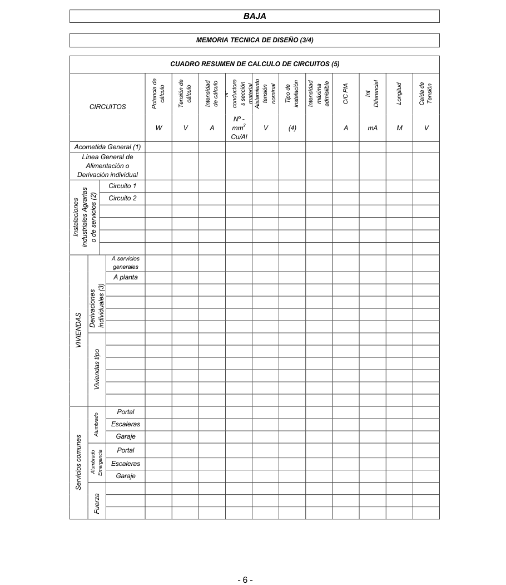

# BT-04. Documentación y puesta en servicio de las instalaciones

_INSTALACIONES..............................................................2 2._

### 0. ÍNDICE

- 0. ÍNDICE — 1

- 1. OBJETO — 2

- 2. DOCUMENTACIÓN DE LAS INSTALACIONES — 2

- 2.1 Proyecto — 2

- 2.2 Memoria Técnica de Diseño — 2

- 3. INSTALACIONES QUE PRECISAN PROYECTO — 8

- 4. INSTALACIONES QUE REQUIEREN MEMORIA TÉCNICA DE DISEÑO — 11

- 5. EJECUCIÓN Y TRAMITACIÓN DE LAS INSTALACIONES — 11

- 6. PUESTA EN SERVICIO DE LAS INSTALACIONES — 17

- 1 -

### 1. OBJETO

La presente Instrucción tiene por objeto desarrollar las prescripciones del artículo 18 del Reglamento Electrotécnico para Baja Tensión, determinando la documentación técnica que deben tener las instalaciones para ser legalmente puestas en servicio, así como su tramitación ante el Órgano competente de la Administración.

### 2. DOCUMENTACIÓN DE LAS INSTALACIONES

Las instalaciones en el ámbito de aplicación del presente Reglamento deben ejecutarse sobre la base de una documentación técnica que, en función de su importancia, deberá adoptar una de las siguientes modalidades:

#### 2.1 Proyecto

Cuando se precise proyecto, de acuerdo con lo establecido en el apartado 3, éste deberá ser redactado y firmado por técnico titulado competente, quien será directamente responsable de que el mismo se adapte a las disposiciones reglamentarias. El proyecto de instalación se desarrollará, bien como parte del proyecto general del edificio, bien en forma de uno o varios proyectos específicos.

En la memoria del proyecto se expresarán especialmente:

- Datos relativos al propietario; - Emplazamiento, características básicas y uso al que se destina; - Características y secciones de los conductores a emplear; - Características y diámetros de los tubos para canalizaciones; - Relación nominal de los receptores que se prevean instalar y su potencia, sistemas y dispositivos de seguridad adoptados y cuantos detalles sean necesarios de acuerdo con la importancia de la instalación proyectada y para que se ponga de manifiesto el cumplimiento de las prescripciones del Reglamento y sus Instrucciones Técnicas Complementarias. - Esquema unifilar de la instalación y características de los dispositivos de corte y protección adoptados, puntos de utilización y secciones de los conductores. - Croquis de su trazado; - Cálculos justificativos del diseño.

Los planos serán los suficientes en número y detalle, tanto para dar una idea clara de las disposiciones que pretenden adoptarse en las instalaciones, como para que la Empresa instaladora que ejecute la instalación disponga de todos los datos necesarios para la realización de la misma.

#### 2.2 Memoria Técnica de Diseño

La Memoria Técnica de Diseño (MTD) se redactará sobre impresos, según modelo determinado por el Órgano competente de la Comunidad Autónoma, con objeto de proporcionar los principales datos y características de diseño de las instalaciones. El instalador autorizado para la categoría de la instalación correspondiente o el técnico titulado competente que firme dicha Memoria será

- 2 -

directamente responsable de que la misma se adapte a las exigencias reglamentarias.

En especial, se incluirán los siguientes datos:

- Los referentes al propietario; - Identificación de la persona que firma la memoria y justificación de su competencia; - Emplazamiento de la instalación; - Uso al que se destina; - Relación nominal de los receptores que se prevea instalar y su potencia; - Cálculos justificativos de las características de la línea general de alimentación, derivaciones individuales y líneas secundarias, sus elementos de protección y sus puntos de utilización; - Pequeña memoria descriptiva; - Esquema unifilar de la instalación y características de los dispositivos de corte y protección adoptados, puntos de utilización y secciones de los conductores. - Croquis de su trazado;

Se adjunta un ejemplo de formato tipo de MTD que garantiza el contenido técnico mínimo establecido en el RBT.

- 3 -

### BAJA TENSIÓN

### MEMORIA TÉCNICA DE DISEÑO ( 1 / 4 )

### Nº EXPENDIENTE

Datos administrativos TITULAR Y LOCALIZACIÓN DE LA INSTALACIÓN N.I.F.

<!-- tabla: ../tablas/BT-04_t01.csv -->

|  |  | Apellido 2º |  |  |
|---|---|---|---|---|
|  |  |  |  | l |

Datos técnicos

### CARACTERÍSTICAS GENERALES DE LA INSTALACIÓN

<!-- tabla: ../tablas/BT-04_t02.csv -->

| W |  |
|---|---|
|  | m² |

ACOMETIDA (Según información de la empresa suministradora) Punto de conexión (3) Tipo (4) Sección mm² Material (5) C.G.P. o C/C DE SEGURIDAD Tipo In. Base A In. Cartucho A

### LÍNEA GENERAL DE ALIMENTACIÓN O DERIVACIÓN INDIVIDUAL

Tipo Sección mm² Cu

### MÓDULO DE MEDIDA

Tipo Situación (6)

### PROTECCIÓN MAGNETOTÉRMICA / DIFERENCIAL

Int. General Automático A Int. Diferencial A Sensibilidad mA

### PUESTA A TIERRA

Tipo (7) Electrodos Línea enlace mm² Cu Línea principal mm² Cu

, a de de_ _ _ _

Nombre y firma del titular

NO TAS: (1) Instalación:N(Nuevo),A(Ampliación-Ref orma), CN (3) C.T.(CentrodeTransformación); R.B.T.(Redde (5) Material; Cu (Cobre), Al (Aluminio) (Cambio de Nombre) CT (Cambio Tensión) Baja Tensión) (2) Según tabla de referencia de la carpeta informativa (4) Aérea, Subterránea, Interior (6) En Cuarto de Centralización; En interior; En fachada (7) Picas; Placas; Mallas

- 4 -

### BAJA TENSIÓN

### MEMORIA TÉCNICA DE DISEÑO ( 2 / 4 )

### PREVISIÓN DE CARGAS EN INSTALACIONES INDUSTRIALES, AGRARIAS O DE SERVICIOS

RECEPTORES (agrupar puntos de luz, tomas de corriente y receptores similares):

### ALUMBRADO FUERZA

<!-- tabla: ../tablas/BT-04_t03.csv -->

| Denominación Potencia |  | Denominación | Potencia |
|---|---|---|---|
|  | W |  | W |
|  | W |  | W |
|  | W |  | W |
|  | W |  | W |
|  | W |  | W |
|  | W |  | W |
|  | W |  | W |

### PREVISIÓN DE CARGAS EN EDIFICIOS DE VIVIENDAS

VIVIENDAS: Grado electrificación Nª viviendas Superf. Unitaria m² Demanda máx/vivienda W Grado electrificación Nª viviendas Superf. Unitaria m² Demanda máx/vivienda W Coeficiente simultaneidad según MIBT010

### CARGAS PREVISTA EN VIVIENDAS (A) W

SERVICIOS GENERALES: Ascensores W Alumbrado escalera W Otros servicios

### CARGAS PREVISTA EN SERVICIOS GENERALES (B)

LOCALES COMERCIALES Y/U OFIC INAS: Superficie útil total m² Potencia específica previst a W/m²

### CARGAS PREVISTA EN LOCALES COMERCIALES Y/U OFICINAS (C)

### CARGAS TOTAL PREVISTA EN EL EDIFICIO (A+B+C)

ESQUEMA UNIFILAR Y PLANOS (Se representará la instalación completa, según normas UNE) En elcasodevivien das individua les ,seprese ntaráesqu emaunifilar.En losedific iosde viviend as ydemáscas os,s epresentará esquem au nifilar,plan osycroq uis delemplazamiento.E nedificiosde viviendasq uedarán pe rfectam e ntedefinidos ;Cajagenera ldeprote cc ión, línearepa rtido ra,f usiblesdesegurida d ,a paratos de medida,derivacionesindividuales,dispositivosprivadosdemandoyprotección,instalacionesinterioresdelasvivie ndastipoconsuscaracterísticasylasecciónde conductores. De la centralización de contadores y de las viviendas tipo se presentará siempre planos de planta.

### PRESUPUESTO DE MATERIALES Y MANO DE OBRA (OPCIONAL)

### INSTALACIONES DE ENLACE

Enedificiosd e viviendas:A cometidaen sucaso,ca jagenerald eprotec ció n,líneag eneral de alimentación centralizacióndecontadores,deriva cionesindividuales,dispositivosprivadosdemandoyprotección de viviendas y se rvicios gene rales. € Eninstalacionesindustriales,agrariasodeservic ios:Desdelaacometida,ensucaso,hastaelprimer cuadro general de mando y protección inclusive. €

### INSTALACIONES RECEPTORAS

En edificio de viviendas: Instalaciones interiores o receptoras € Eninstalacio n esindustriale s,agrariasodeservicios:Ci rcuitosdesalida delcuad rogen era l,cuadros secundariosysu ssalidas,canalizadores,interruptores,guardamotores,fusibles,tomasdecorriente, reactancias, etc. €

### SISTEMAS DE TIERRAS €

### PRESUPUESTO TOTAL / €

Nº DE INSTALACIONES INDIVIDUALES FINALES Uds.

### MEMORIA REALIZADA POR INSTALADOR AUTORIZADO

Nº de carné Nombre domiciliado en calle / plaza Núm. Localidad Código Postal Teléfono

### MEMORIA REALIZADA POR TECNICO COMPETENTE

Nombre Nº colegiado domiciliado en calle / plaza Núm. Localidad Código Postal Teléfono Colegiado Oficial Instalador autorizado o Técnico competente (Firma)

- 5 -

<!-- tabla: ../tablas/BT-04_t04.csv -->

| CUADRO RESUMEN DE CALCULO DE CIRCUITOS (5) |  |  |  |  |  |  |  |  |  |  |  |  |  |  |
|---|---|---|---|---|---|---|---|---|---|---|---|---|---|---|
| CIRCUITOS |  |  |  | ed aicnetoP oluclác W | ed oluclác nóisneT V | dadisnetnI oluclác ed A | erotcudnoc nóicces lairetam ºN s Nº - mm2 Cu/Al | otneimalsiA nóisnet lanimon V | nóicalatsni ed opiT (4) | dadisnetnI elbiisimda amixám | AIP C/C A | laicnerefiD tnI mA | dutignoL M | ed nóisneT adíaC V |
| Acometida General (1) |  |  |  |  |  |  |  |  |  |  |  |  |  |  |
| Línea General de Alimentación o Derivación individual |  |  |  |  |  |  |  |  |  |  |  |  |  |  |
| sairargA )2( senoicalatsnI soicivres selairtsudni ed o |  | Circuito 1 |  |  |  |  |  |  |  |  |  |  |  |  |
|  |  | Circuito 2 |  |  |  |  |  |  |  |  |  |  |  |  |
| SADNEIVIV | )3( senoicavireD selaudividni |  | A servicios generales |  |  |  |  |  |  |  |  |  |  |  |
|  |  |  | A planta |  |  |  |  |  |  |  |  |  |  |  |
|  | opit sadneiviV |  |  |  |  |  |  |  |  |  |  |  |  |  |
| senumoc soicivreS | odarbmulA |  | Portal |  |  |  |  |  |  |  |  |  |  |  |
|  |  |  | Escaleras |  |  |  |  |  |  |  |  |  |  |  |
|  |  |  | Garaje |  |  |  |  |  |  |  |  |  |  |  |
|  | odarbmulA aicnegremE |  | Portal |  |  |  |  |  |  |  |  |  |  |  |
|  |  |  | Escaleras |  |  |  |  |  |  |  |  |  |  |  |
|  |  |  | Garaje |  |  |  |  |  |  |  |  |  |  |  |
|  | azreuF |  |  |  |  |  |  |  |  |  |  |  |  |  |

<!-- tabla no extraíble en la pág. 6 -->
> La tabla de esta página no se puede extraer como texto (pdfplumber la lee como
> caracteres sueltos): se muestra la imagen de la página. También está en [pdf/BT-04.pdf](../pdf/BT-04.pdf#page=6).

### BAJA TENSIÓN

### MEMORIA TÉCNICA DE DISEÑO ( 4 / 4 )

### CROQUIS DEL EMPLAZAMIENTO

Incluye localización de los aparatos de alumbrado de emergencia y las rutas de evacuación, si procede

### MEMORIA DESCRIPTIVA

- 7 -

<!-- tabla: ../tablas/BT-04_t05.csv -->

| 3. INSTALACIONES QUE PRECISAN PROYECTO |  |  |
|---|---|---|
| 3.1. Para su ejecución, precisan elaboración de proyecto las nuevas instalaciones siguientes: |  |  |
| Grupo | Tipo de Instalación | Límites |
| a | Las correspondientes a industrias, en general | P>20 kW |
| b | Las correspondientes a: - Locales húmedos, polvorientos o con riesgo de corrosión; - Bombas de extracción o elevación de agua, sean industriales o no. |  |
|  |  | P>10 kW |
| c | Las correspondientes a: - Locales mojados; - generadores y convertidores; - conductores aislados para caldeo, excluyendo las de viviendas. |  |
|  |  | P>10 kW |
| d | - de carácter temporal para alimentación de maquinaria de obras en construcción. - de carácter temporal en locales o emplazamientos abiertos; |  |
|  |  | P>50 kW |
| e | Las de edificios destinados principalmente a viviendas, locales comerciales y oficinas, que no tengan la consideración de locales de pública concurrencia, en edificación vertical u horizontal. |  |
|  |  | P>100 kW por caja gral. de protección |
| f | Las correspondientes a viviendas unifamiliares | P>50 kW |
| g | Las de garajes que requieren ventilación forzada | Cualquiera que sea su ocupación |
| h | Las de garajes que disponen de ventilación natural | De más de 5 plazas de estacionamiento |
| i | Las correspondientes a locales de pública concurrencia; | Sin límite |
| j | Las correspondientes a: - Líneas de baja tensión con apoyos comunes con las de alta tensión; - Máquinas de elevación y transporte; - Las que utilicen tensiones especiales; - Las destinadas a rótulos luminosos salvo que se consideren instalaciones de Baja tensión según lo establecido en la ITC-BT 44; - Cercas eléctricas; - Redes aéreas o subterráneas de distribución; |  |
|  |  | Sin límite de potencia |
| k | - Instalaciones de alumbrado exterior. |  |
|  |  | P > 5 kW |
| l | Las correspondientes a locales con riesgo de incendio o explosión, excepto garajes |  |
|  |  | Sin límite |
| m | Las de quirófanos y salas de intervención | Sin límite |
| n | Las correspondientes a piscinas y fuentes. | P> 5 kW |
| o | Todas aquellas que, no estando comprendidas en los grupos anteriores, determine el Ministerio de Ciencia y Tecnología, mediante la oportuna Disposición. |  |
|  |  | Según corresponda |
| P = Potencia prevista en la instalación, teniendo en cuenta lo estipulado en la ITC-BT-10) |  |  |

- 8 -

A continuación se incluyen los esquemas correspondientes que comparan con las exigencias del REBT 1973,

Instalaciones que precisan Proyecto Instalaciones que precisan Proyecto

Grupo Tipo de instalación REBT 2002 REBT 1973

Si precisan a) Industrias en general P > 20 kW autorización previa ♦ Locales húmedos, polvorientos o con b) riesgo de corrosión; NO ♦ Bombas de extracción o elevación de agua P > 10 kW ♦ Locales mojados; ♦ SL; ♦ Generadores y convertidores; ♦ P > 10 kW; c) ♦ Conductores aislados para caldeo, ♦ SL; excluyendo las de viviendas

♦De carácter temporal para alimentación de maquinaria de obras en construcción; d) P > 50 kW SL ♦ De carácter temporal en locales o emplazamientosabiertos

Edificios destinados principalmente a viviendas y locales comerciales y oficinas que P > 100 kW e) no tengan la consideración de locales de Por CGP P > 100 kW pública concurrencia

f) Viviendas unifamiliares P > 50 kW

g) Garajes que precisan ventilación forzada SL NO h) Garajes con ventilación natural > 5 plazas (P = Potencia prevista en la instalación, según RBT-10)

(SL: sin límite, se requiere proyecto para cualquier potencia).

- 9 -

<!-- figura vectorial en la pág. 9 del PDF original -->
> Figura en la pág. 9 del PDF original: [ver en el PDF](../pdf/BT-04.pdf#page=9)

Instalaciones que precisan Proyecto Instalaciones que precisan Proyecto

Grupo Tipo de instalación REBT 2002 REBT 1973

Excepto i) Locales de pública concurrencia SL Comercios P < 50 kW ♦Líneas de baja tensión con apoyos comunes con las de alta tensión; ♦ Máquinas de elevación y transporte; ♦ Utilizando tensiones especiales; j) SL ♦ Rótulos luminosos según ITC BT 44, salvo que se consideren instalaciones de BT; ♦ Cercas eléctricas; ♦ Redes de distribución SL k) Alumbrado exterior P > 5 kW

Locales con riesgo de incendio o explosión, l) excepto garajes SL m) Quirófanos y salas de intervención

n) Piscinas y fuentes P > 5 kW

Todas las no citadas para las que así se determine Según por el Ministerio el caso

(P = Potencia prevista en la instalación, según RBT-10)

- 10 -

<!-- figura vectorial en la pág. 10 del PDF original -->
> Figura en la pág. 10 del PDF original: [ver en el PDF](../pdf/BT-04.pdf#page=10)

#### 3.2. Asimismo, requerirán elaboración de proyecto las ampliaciones y modificaciones de las

instalaciones siguientes:

a) Las ampliaciones de las instalaciones de los tipos (b,c,g,i,j,l,m) y modificaciones de importancia de las instalaciones señaladas en 3.1;

b) Las ampliaciones de las instalaciones que, siendo de los tipos señalados en 3.1. no alcanzasen los límites de potencia prevista establecidos para las mismas, pero que los superan al producirse la ampliación.

c) Las ampliaciones de instalaciones que requirieron proyecto originalmente si en una o en varias ampliaciones se supera el 50 % de la potencia prevista en el proyecto anterior.

3.3 Si una instalación esta comprendida en más de un grupo de los especificados en 3.1, se le aplicará el criterio más exigente de los establecidos para dichos grupos

### 4. INSTALACIONES QUE REQUIEREN MEMORIA TÉCNICA DE DISEÑO

Requerirán Memoria Técnica de Diseño todas las instalaciones - sean nuevas, ampliaciones o modificaciones - no incluidas en los grupos indicados en el apartado 3.

### 5. EJECUCIÓN Y TRAMITACIÓN DE LAS INSTALACIONES

5.1. Todas las instalaciones en el ámbito de aplicación del Reglamento deben ser efectuadas por los instaladores autorizados en baja tensión a los que se refiere la Instrucción Técnica complementaria ITC-BT-03.

En el caso de instalaciones que requirieron Proyecto, su ejecución deberá contar con la dirección de un técnico titulado competente.

Si, en el curso de la ejecución de la instalación, el instalador autorizado considerase que el Proyecto o Memoria Técnica de Diseño no se ajusta a lo establecido en el Reglamento, deberá, por escrito, poner tal circunstancia en conocimiento del autor de dichos Proyecto o Memoria, y del propietario. Si no hubiera acuerdo entre las partes se someterá la cuestión al Órgano competente de la Comunidad Autónoma, para que ésta resuelva en el más breve plazo posible.

5.2.. Al término de la ejecución de la instalación, el instalador autorizado realizará las verificaciones que resulten oportunas, en función de las características de aquélla, según se especifica en la ITC-BT-05 y en su caso todas las que determine la dirección de obra.

5.3. Asimismo, las instalaciones que se especifican en la ITC-BT-05, deberán ser objeto de la correspondiente Inspección Inicial por Organismo de Control.

5.4. Finalizadas las obras y realizadas las verificaciones e inspección inicial a que se refieren los puntos anteriores, instalador autorizado deberá emitir un Certificado de Instalación, según modelo establecido por la Administración, que deberá comprender, al menos, lo siguiente:

- 11 -

a) los datos referentes a las principales características de la instalación; b) la potencia prevista de la instalación.; c) en su caso, la referencia del certificado del Organismo de Control que hubiera realizado con calificación de resultado favorable, la inspección inicial; d) identificación del instalador autorizado responsable de la instalación; e) declaración expresa de que la instalación ha sido ejecutada de acuerdo con las prescripciones del Reglamento Electrotécnico para Baja Tensión y, en su caso, con las especificaciones particulares aprobadas a la Compañía eléctrica, así como, según corresponda, con el Proyecto o la Memoria Técnica de Diseño.

#### 5.5. Antes de la puesta en servicio de las instalaciones, el instalador autorizado deberá

presentar ante el Órgano competente de la Comunidad Autónoma, al objeto de su inscripción en el correspondiente registro, el Certificado de Instalación con su correspondiente anexo de información al usuario, por quintuplicado, al que se acompañará, según el caso, el Proyecto o la Memoria Técnica de Diseño, así como el certificado de Dirección de Obra firmado por el correspondiente técnico titulado competente, y el certificado de inspección inicial con calificación de resultado favorable, del Organismo de Control, si procede.

El Órgano competente de la Comunidad Autónoma deberá diligenciar las copias del Certificado de Instalación y, en su caso, del certificado de inspección inicial, devolviendo cuatro al instalador autorizado, dos para sí y las otras dos para la propiedad, a fin de que ésta pueda, a su vez, quedarse con una copia y entregar la otra a la Compañía eléctrica, requisito sin el cual ésta no podrá suministrar energía a la instalación, salvo lo indicado en el Artículo 18.3 del Reglamento Electrotécnico para Baja Tensión.

5.6. Instalaciones temporales en ferias, exposiciones y similares.

Cuando en este tipo de eventos exista para toda la instalación de la feria o exposición una Dirección de Obra común, podrán agruparse todas las documentaciones de las instalaciones parciales de alimentación a los distintos stands o elementos de la feria, exposición, etc., y presentarse de una sola vez ante el Órgano competente de la Comunidad Autónoma, bajo una certificación de instalación global firmada por el responsable técnico de la Dirección mencionada.

Cuando se trate de montajes repetidos idénticos, se podrá prescindir de la documentación de diseño, tras el registro de la primera instalación, haciendo constar en el certificado de instalación dicha circunstancia, que será válida durante un año, siempre que no se produjeran modificaciones significativas, entendiendo como tales las que afecten a la potencia prevista, tensiones de servicio y utilización y a los elementos de protección contra contactos directos e indirectos y contra sobreintensidades y sobretensiones .

En el apartado 5.5, la referencia al articulo 18.3 del Reglamento, debería ser al articulo 18.4.

- 12 -

A continuación se incluye un esquema resumen relativo a la tramitación de las instalaciones,

Tramitación de las instalaciones Tramitación de las instalaciones

<!-- tabla: ../tablas/BT-04_t06.csv -->

|  | Documentación técnica Documentación técnica |
|---|---|
|  | de diseño de diseño |

Memoria Proyecto Memoria Proyecto técnica técnica

Técnico titulado (cid:1)(cid:1)(cid:1)(cid:1)(cid:1)(cid:1)(cid:1)(cid:1)(cid:1)(cid:1)(cid:1)(cid:1)(cid:1)(cid:1)(cid:1)(cid:1)(cid:1)(cid:1)(cid:1)(cid:1)(cid:1)(cid:1)(cid:1)(cid:1)(cid:1)(cid:1)(cid:1)(cid:1)(cid:1)(cid:1)(cid:1)(cid:1)(cid:1)(cid:1) Instalador competente (cid:1)(cid:1)(cid:1)(cid:1)(cid:1)(cid:1)(cid:1)(cid:1)(cid:1)(cid:1)(cid:1)(cid:1)(cid:1)(cid:1)(cid:1)(cid:1)(cid:1)(cid:1)(cid:1)(cid:1)(cid:1)(cid:1)(cid:1)(cid:1)(cid:1)(cid:1)(cid:1)(cid:1)(cid:1)(cid:1)(cid:1)(cid:1)(cid:1) (cid:1)(cid:1)(cid:1) Dirección (cid:1)(cid:1)(cid:1)(cid:1)(cid:1)(cid:1)(cid:1)(cid:1)(cid:1)(cid:1)(cid:1)(cid:1)(cid:1)(cid:1)(cid:1)(cid:1)(cid:1)(cid:1)(cid:1)(cid:1)(cid:1)(cid:1)(cid:1)(cid:1)(cid:1)(cid:1)(cid:1)(cid:1)(cid:1)(cid:1)(cid:1)(cid:1) Dirección técnica (cid:1)(cid:1)(cid:1)(cid:1)(cid:1)(cid:1)(cid:1)(cid:1)(cid:1)(cid:1)(cid:1)(cid:1)(cid:1)(cid:1)(cid:1)(cid:1)(cid:1)(cid:1)(cid:1)(cid:1)(cid:1)(cid:1)(cid:1)(cid:1)(cid:1)(cid:1)(cid:1)(cid:1)(cid:1)(cid:1)(cid:1)(cid:1)(cid:1)(cid:1) técnica

Ejecución Ejecución Instalador Verificación Verificación

Inspección Organismo de Control Inspección inicial inicial

C C e e rt r i t f i i f c i a ca d d o o d d e e I n In st s a ta la la ci c ó ió n n Instalador

<!-- tabla: ../tablas/BT-04_t07.csv -->

|  | Registro Registro |
|---|---|
|  | Registro Registro |

Registro Autónoma

- 13 -

<!-- figura vectorial en la pág. 13 del PDF original -->
> Figura en la pág. 13 del PDF original: [ver en el PDF](../pdf/BT-04.pdf#page=13)

Todas las instalaciones que requieren de inspección inicial debieron de ser objeto del correspondiente proyecto, pero no todas las instalaciones que requieren proyecto precisan de una inspección inicial.

En el caso de instalaciones con proyecto el instalador es responsable también de comprobar que todas las prescripciones del proyecto son conformes a lo establecido en el RBT, en caso de que el proyecto no se ajustara al RBT el instalador debería poner tal hecho en conocimiento del autor del proyecto y de la propiedad y si no hubiera acuerdo se debería recurrir al órgano competente de la Comunidad autónoma decidiría al respecto.

Cuando se requiera proyecto, la documentación debe incluir además la supervisión del Director de Obra. En este caso, verificación y supervisión, se realizarán conjuntamente a fin de comprobar la correcta ejecución de la instalación y su funcionamiento seguro.

Todas las instalaciones deberán ser verificadas por el Instalador Autorizado que las haya ejecutado siguiendo la metodología reflejada en la norma UNE -20460-6-61. En el Anexo 4 de la guía del RBT se indican más detalladamente los contenidos de esta verificación.

Para las instalaciones especificadas en el apartado 4.1 de la ITC-BT-05, además de la verificación que efectúa el instalador, será necesaria también su inspección, realizada por un Organismo de Control autorizado por la Administración.

Como se desprende del texto y del esquema anterior, las Comunidades Autónomas registran y diligencian la documentación que se les presenta, por lo que no son necesarios más trámites ni inspecciones adicionales.

Esto significa que las administraciones públicas competentes se limitarán por lo general a registrar la documentación de la instalación, sin que ello suponga su aprobación o un reconocimiento expreso de la idoneidad de la instalación con las condiciones técnicas reglamentarias exigibles. En cualquier caso, y de acuerdo con la facultad que señala el artículo 14 de la ley 21/1992 de industria, las Comunidades autónomas podrán llevar a cabo las actuaciones de inspección y control que estimen necesarias, por ejemplo mediante control por muestreo estadístico para asegurar de esta forma la eficacia del sistema de autorización de instalaciones.

Para aquellas instalaciones industriales que cuenten con un proyecto general, que englobe el proyecto eléctrico, tanto el instalador autorizado, como la propiedad o quien haya firmado la dirección de obra podrán solicitar el correspondiente registro de la documentación ante la Comunidad Autónoma.

En el esquema siguiente se indica cómo el instalador autorizado debe distribuir las cuatro copias de la documentación de la instalación que recibe de la Comunidad autónoma una vez diligenciadas. De las cinco copias iniciales la Comunidad autónoma mantiene una para su propio archivo y registro.

- 14 -

Documentación de las instalaciones Documentación de las instalaciones

<!-- tabla: ../tablas/BT-04_t08.csv -->

| ertificado de Instalación Certificado de Instalación Certificado de Instalación Certificado de Instalación |  |
|---|---|
|  | ertificado de Instalación Certificado de Instalación Certificado de Instalación |

5

Titular Instalador 2 Comunidad 2 Titular Instalador instalación Autónoma instalación

Archivo Expediente Custodia propio del (archivo en la instalador C.A.)

Estadísticas Empresa suministradora (Contrato)

- 15 -

<!-- figura vectorial en la pág. 15 del PDF original -->
> Figura en la pág. 15 del PDF original: [ver en el PDF](../pdf/BT-04.pdf#page=15)

A continuación se incluye un modelo de certificado de instalación eléctrica en baja tensión:

<!-- tabla: ../tablas/BT-04_t09.csv -->

|  |  |  | CERTIFICADO DE INSTALACIÓN ELÉCTRICA EN BAJA TENSIÓN |  |  |  |
|---|---|---|---|---|---|---|
|  | TITULAR |  |  |  |  |  |
| APELLIDOS Y NOMBRE O RAZÓN SOCIAL |  |  |  |  |  | D.N.I. - N.I.F. |
| DOMICILIO (calle o plaza y número) |  |  |  |  |  | C.P. |
| MUNICIPIO |  |  |  | PROVINCIA | TELÉFONO | FAX |
| REPRESENTANTE (si procede) |  |  |  |  |  | D.N.I. |
|  |  | EMPRESA SUMINISTRADORA |  |  |  |  |

<!-- tabla: ../tablas/BT-04_t10.csv -->

|  | CARACTERÍSTICAS DE LA INSTALACIÓN |  |  |  |  |  |  |  |  |  |  |  |  |
|---|---|---|---|---|---|---|---|---|---|---|---|---|---|
| EMPLAZAMIENTO (calle o plaza y número) |  |  |  |  |  |  | Portal |  | Bls |  | Esc | Piso | Puerta |
| MUNICIPIO |  |  |  |  |  | C.P. |  |  |  |  |  |  |  |
| TIPO DE INSTALACIÓN (ver tabla 1) |  |  |  |  |  |  |  |  |  |  |  |  |  |
| POTENCIA PREVISTA (kW) |  |  | POTENCIA INSTALADA (Kw) |  |  |  |  |  |  | TENSIÓN |  |  |  |
|  | EMPRESA INSTALADORA |  |  |  |  |  |  |  |  |  |  |  |  |
| APELLIDOS Y NOMBRE O RAZÓN SOCIAL |  |  |  |  |  |  |  |  | Nº DEL DCE |  |  |  |  |
| NOMBRE DEL INSTALADOR |  |  |  |  |  |  |  |  | Nº DEL CARNET INSTAL. AUTORIZAD |  |  |  |  |
|  | DERIVACIÓN INDIVIDUAL |  |  |  |  |  |  |  |  |  |  |  |  |
| VIVIENDAS |  | GRADO ELECTRIFICACIÓN |  | : SUPERFICIE: |  |  |  | SECCIÓN DE LA DERIVACIÓN INDIVIDUAL |  |  |  |  |  |
| OTROS USOS |  | SUPERFICIE: |  |  |  |  |  | SECCIÓN DE LA DERIVACIÓN INDIVIDUAL |  |  |  |  |  |
| OTRAS INSTALACIONES |  |  |  |  |  |  |  | SECCIÓN DE LA DERIVACIÓN INDIVIDUAL |  |  |  |  |  |
|  | LÍNEA GENERAL DE ALIMENTACIÓN |  |  |  |  |  |  |  |  |  |  |  |  |
| SECCIÓN (mm²): |  |  |  |  |  |  |  |  |  |  |  |  |  |
|  | PROTECCIÓN CONTACTOS INDIRECTOS |  |  |  |  |  |  |  |  |  |  |  |  |
| INTERRUPTOR DIFERENCIAL: |  |  |  |  |  |  |  | Intensidad Nominal: Sensibilidad: |  |  |  |  |  |
| RESISTENCIA DE LA TIERRA DE PROTECCIÓN: |  |  |  |  |  |  |  |  |  |  |  |  |  |
| OTROS: |  |  |  |  |  |  |  |  |  |  |  |  |  |
|  | CERTIFICACIÓN DE LA EMPRESA INSTALADORA |  |  |  |  |  |  |  |  |  |  |  |  |
| El Instala dor au torizado q uesuscribe ,i nscritoenes teServicio Territorialconeln úmeroyDocumentodeCalificaciónEmpresarial arriba indicados. CERTIFICA:ha ber ejecutad olainstalaci ónde acue rdoconl as prescripcione sdel v igente regla men to para b aja tensión e instrucc ionesITC-B Te sp ecíficasq uelesonde aplicación, las normases pecíficasdelaempresasuministradoraaprobadas,así como del Proyecto Memoría Técnica de Diseño |  |  |  |  | Básica Especialista Modalidad: |  |  |  |  |  |  |  |  |
| , a de de _ _ _ _ Firma del instalador: |  |  |  |  | SELLO DE LA EMPRESA INSTALADORA |  |  |  |  |  |  |  |  |

De las dos copias diligenciadas por la C.A. para el Instalador, una de ellas está prevista para la asociación profesional correspondiente, con el objeto de que sirva para la elaboración de estadísticas. Estas asociaciones pueden facilitar tales estadísticas a la C.A.

- 16 -

Para facilitar el tratamiento de esta información, se recomienda el uso de medios telemáticos.

### 6. PUESTA EN SERVICIO DE LAS INSTALACIONES

El titular de la instalación deberá solicitar el suministro de energía a la Empresas suministradora mediante entrega del correspondiente ejemplar del certificado de instalación.

La Empresa suministradora podrá realizar, a su cargo, las verificaciones que considere oportunas, en lo que se refiere al cumplimiento de las prescripciones del presente Reglamento.

Cuando los valores obtenidos en la indicada verificación sean inferiores o superiores a los señalados respectivamente para el aislamiento y corrientes de fuga en la ITC-BT-19, las Empresas suministradoras no podrán conectar a sus redes las instalaciones receptoras.

En esos casos, deberán extender un Acta, en la que conste el resultado de las comprobaciones, la cual deberá ser firmada igualmente por el titular de la instalación, dándose por enterado. Dicha acta, en el plazo más breve posible, se pondrá en conocimiento del Órgano competente de la Comunidad Autónoma, quien determinará lo que proceda.

- 17 -
