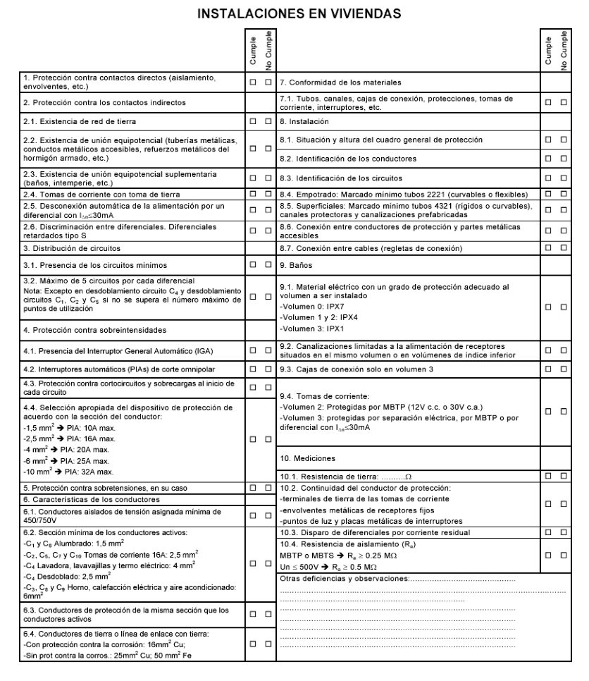
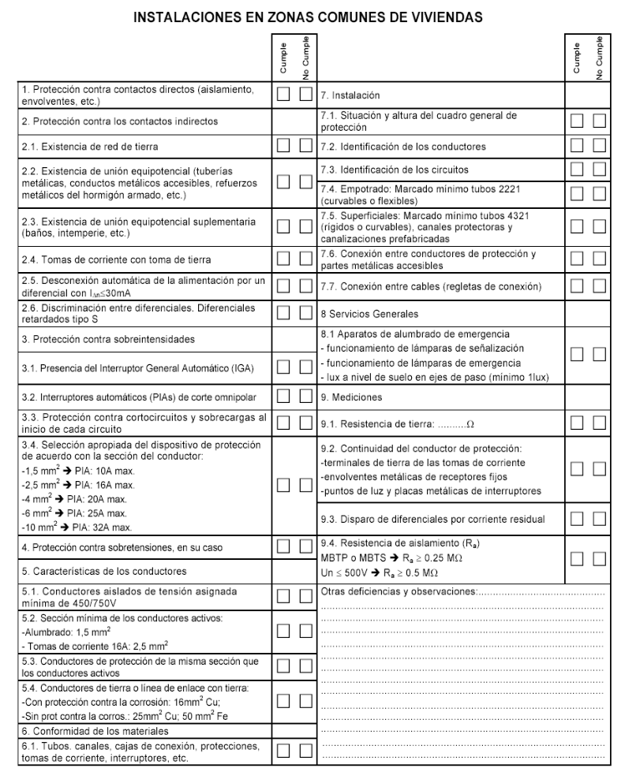

# BT-05. Verificaciones e Inspecciones

_SERVICIO............................................3 3._

### 0. ÍNDICE

- 0. ÍNDICE — 1

- 1. OBJETO — 2

- 2. AGENTES INTERVINIENTES — 2

- 3. VERIFICACIONES PREVIAS A LA PUESTA EN SERVICIO — 3

- 4. INSPECCIONES — 7

- 4.1 Inspecciones iniciales — 7

- 4.2 Inspecciones periódicas — 7

- 5. PROCEDIMIENTO — 7

- 6. CLASIFICACIÓN DE DEFECTOS — 10

- 6.1 Defecto Muy Grave — 10

- 6.2 Defecto Grave — 10

- 6.3 Defecto Leve — 11

- 1 -

### 1. OBJETO

La presente Instrucción tiene por objeto desarrollar las previsiones de los artículos 18 y 20 del Reglamento Electrotécnico para Baja Tensión, en relación con las verificaciones previas a la puesta en servicio e inspecciones de las instalaciones eléctricas incluidas en su campo de aplicación.

### 2. AGENTES INTERVINIENTES

#### 2.1. Las verificaciones previas a la puesta en servicio de las instalaciones deberán ser

realizadas por las empresas instaladoras que las ejecuten.

#### 2.2. De acuerdo con lo indicado en el artículo 20 del Reglamento, sin perjuicio de las

atribuciones que, en cualquier caso, ostenta la Administración Pública, los agentes que lleven a cabo las inspecciones de las instalaciones eléctricas de Baja Tensión deberán tener la condición de Organismos de Control, según lo establecido en el Real Decreto 2.200/1995, de 28 de diciembre, acreditados para este campo reglamentario.

La diferencia entre verificación e inspección radica principalmente en el agente encargado de su ejecución.

Todas las instalaciones eléctricas deben ser objeto de una verificación previa a su puesta en servicio efectuada por el instalador autorizado que las realizó, con la supervisión en su caso del director de obra. El instalador autorizado es por lo tanto responsable de la correcta ejecución de la instalación y de que sea segura , lo mismo que un fabricante es responsable del producto que fabrica.

Las inspecciones las efectúan bien directamente las propias Administraciones Públicas competentes (mediante los servicios de industria de las CCAA), o como es más frecuente las efectúan los Organismos de Control autorizados por la administración (OCAs). De entre todas las instalaciones eléctricas dentro del ámbito del RBT, solamente algunas de ellas son objeto de inspecciones iniciales o periódicas.

También conviene aclarar que los titulares de las instalaciones deberán mantenerlas en buen estado de funcionamiento, utilizándolas de acuerdo con sus características y absteniéndose de intervenir en las mismas para modificarlas. Si son necesarias modificaciones, éstas deberán ser efectuadas por un instalador autorizado. Por lo tanto, no sólo las nuevas instalaciones eléctricas deben ejecutarse por instaladores autorizados, sino también cualquier ampliación o modificación de una existente. Cualquier actuación de un instalador autorizado debe por tanto ir seguida de la correspondiente verificación del trabajo realizado siendo el propio instalador quien debe verificar la instalación.

En resumen todas las instalaciones eléctricas deben ser objeto de la correspondiente verificación después de su realización o modificación.

- 2 -

### 3. VERIFICACIONES PREVIAS A LA PUESTA EN SERVICIO

Las instalaciones eléctricas en baja tensión deberán ser verificadas, previamente a su puesta en servicio y según corresponda en función de sus características, siguiendo la metodología de la norma UNE 20.460 -6-61.

La verificación de las instalaciones eléctricas previa a su puesta en servicio comprende dos fases, una primera fase que no requiere efectuar medidas y que se denomina verificación por examen, y una segunda fase que requiere la utilización de equipos de medida específicos. El alcance de esta verificación se detalla en la ITC-BT-19 y en la norma UNE 20460 parte 6-61 y comprende tanto la verificación por examen como la verificación mediante medidas eléctricas. Adicionalmente otras instrucciones establecen verificaciones adicionales, como la ITC-BT-18 para el caso de las puestas a tierra. Verificación por examen Debe preceder a los ensayos y medidas, y normalmente se efectuará para el conjunto de la instalación estando ésta sin tensión. Está destinada a comprobar: (cid:57) Si el material eléctrico instalado permanentemente es conforme con las prescripciones establecidas en el proyecto o memoria técnica de diseño. (cid:57) Si el material ha sido elegido e instalado correctamente conforme a las prescripciones del Reglamento y del fabricante del material. (cid:57) Que el material no presenta ningún daño visible que pueda afectar a la seguridad. (cid:57) En concreto los aspectos cualitativos que este tipo de verificación debe tener en cuenta son los siguientes: o La existencia de medidas de protección contra los choques eléctricos por contacto de partes bajo tensión o contactos directos, como por ejemplo: el aislamiento de las partes activas, el empleo de envolventes, barreras, obstáculos o alejamiento de las partes en tensión. o La existencia de medidas de protección contra choques eléctricos derivados del fallo de aislamiento de las partes activas de la instalación, es decir, contactos indirectos. Dichas medidas pueden ser el uso de dispositivos de corte automático de la alimentación tales como interruptores de máxima corriente, fusibles, o diferenciales, la utilización de equipos y materiales de clase II, disposición de paredes y techos aislantes o alternativamente de conexiones equipotenciales en locales que no utilicen conductor de protección, etc. o La existencia y calibrado de los dispositivos de protección y señalización. o La presencia de barreras cortafuegos y otras disposiciones que impidan la propagación del fuego, así como protecciones contra efectos térmicos. o La utilización de materiales y medidas de protección apropiadas a las influencias externas. o La existencia y disponibilidad de esquemas, advertencias e informaciones similares.

- 3 -

o La identificación de circuitos, fusibles, interruptores, bornes, etc. o La correcta ejecución de las conexiones de los conductores. o La accesibilidad para comodidad de funcionamiento y mantenimiento.

Verificaciones mediante medidas o ensayos. Las verificaciones descritas en la ITC-BT-19 e ITC-BT-18 son las siguientes: (cid:57) Medida de continuidad de los conductores de protección. (cid:57) Medida de la resistencia de puesta a tierra. (cid:57) Medida de la resistencia de aislamiento de los conductores. (cid:57) Medida de la resistencia de aislamiento de suelos y paredes, cuando se utilice este sistema de protección. (cid:57) Medida de la rigidez dieléctrica. Adicionalmente hay que considerar otras medidas y comprobaciones que son necesarias para garantizar que se han adoptado convenientemente los requisitos de protección contra choques eléctricos. Se realizarán una o varias de las medidas indicadas a continuación según el sistema de protección utilizado: (cid:57) Medida de las corrientes de fuga. (cid:57) Comprobación de la intensidad de disparo de los diferenciales. (cid:57) Medida de la impedancia de bucle. (cid:57) Comprobación de la secuencia de fases. Las instalaciones eléctricas en baja tensión de especial relevancia que se citan en la capítulo 4 deberán ser objeto además de inspección por un Organismo de Control, a fin de asegurar, en la medida de lo posible, el cumplimiento reglamentario a lo largo de la vida de dichas instalaciones. A continuación se adjunta una hoja de control de verificación que puede ser utilizada por los instaladores como guía de referencia de los puntos principales para el caso de viviendas:

- 4 -

- 5 -

- 6 -

### 4. INSPECCIONES

Las instalaciones eléctricas en baja tensión de especial relevancia que se citan a continuación, deberán ser objeto de inspección por un Organismo de Control, a fin de asegurar, en la medida de lo posible, el cumplimiento reglamentario a lo largo de la vida de dichas instalaciones.

Las inspecciones podrán ser: o Iniciales: Antes de la puesta en servicio de las instalaciones. o Periódicas;

4.1 Inspecciones iniciales.

Serán objeto de inspección, una vez ejecutadas las instalaciones, sus ampliaciones o modificaciones de importancia y previamente a ser documentadas ante el Órgano competente de la Comunidad Autónoma, las siguientes instalaciones:

a) Instalaciones industriales que precisen proyecto, con una potencia instalada superior a 100 kW; b) Locales de Pública Concurrencia; c) Locales con riesgo de incendio o explosión, de clase I, excepto garajes de menos de 25 plazas; d) Locales mojados con potencia instalada superior a 25 kW; e) Piscinas con potencia instalada superior a 10 kW; g) Quirófanos y salas de intervención; h) Instalaciones de alumbrado exterior con potencia instalada superior 5 kW.

4.2 Inspecciones periódicas.

Serán objeto de inspecciones periódicas, cada 5 años, todas las instalaciones eléctricas en baja tensión que precisaron inspección inicial, según el punto 4.1 anterior, y cada 10 años, las comunes de edificios de viviendas de potencia total instalada superior a 100 kW.

### 5. PROCEDIMIENTO

5.1. Los Organismos de Control realizarán la inspección de las instalaciones sobre la base de las prescripciones que establezca el Reglamento de aplicación y, en su caso, de lo especificado en la documentación técnica, aplicando los criterios para la clasificación de defectos que se relacionan en el apartado siguiente. La empresa instaladora, si lo estima conveniente, podrá asistir a la realización de estas inspecciones.

#### 5.2. Como resultado de la inspección, el Organismo de Control emitirá un Certificado de

Inspección, en el cual figurarán los datos de identificación de la instalación y la posible relación de defectos, con su clasificación, y la calificación de la instalación, que podrá ser:

5.2.1. Favorable: Cuando no se determine la existencia de ningún defecto muy grave o grave. En este caso, los posibles defectos leves se anotarán para constancia del titular, con la indicación de que deberá poner los medios para subsanarlos antes de la próxima inspección; Asimismo, podrán servir de base a efectos estadísticos y de control del buen hacer de las empresas instaladoras.

- 7 -

##### 5.2.2. Condicionada: Cuando se detecte la existencia de, al menos, un defecto grave o

defecto leve procedente de otra inspección anterior que no se haya corregido. En este caso:

a) Las instalaciones nuevas que sean objeto de esta calificación no podrán ser suministradas de energía eléctrica en tanto no se hayan corregido los defectos indicados y puedan obtener la calificación de favorable.

b) A las instalaciones ya en servicio se les fijará un plazo para proceder a su corrección, que no podrá superar los 6 meses. Transcurrido dicho plazo sin haberse subsanado los defectos, el Organismo de Control deberá remitir el Certificado con la calificación negativa al Órgano competente de la Comunidad Autónoma.

5.2.3. Negativa: Cuando se observe, al menos, un defecto muy grave. En este caso:

a) Las nuevas instalaciones no podrán entrar en servicio, en tanto no se hayan corregido los defectos indicados y puedan obtener la calificación de favorable.

b) A las instalaciones ya en servicio se les emitirá Certificado negativo, que se remitirá inmediatamente al Órgano competente de la Comunidad Autónoma

- 8 -

A continuación se incluye un esquema del procedimiento de inspección,

Metodología de Inspección Metodología de Inspección

Inspección

Sin defectos, o con Al menos 1 defecto Al menos 1 defecto defectos leves grave muy grave

Inst. Inst. Inst. Inst. existentes Nuevas Nuevas existentes

Corregir en Corregir 6 meses

Certificado Certificado

### SI/NO NO/SI

Favorable Favorable

Anotación Prohibido defectos leves: dar servicio Corregir próxima inspección Certificado Negativo

- 9 -

<!-- figura vectorial en la pág. 9 del PDF original -->
> Figura en la pág. 9 del PDF original: [ver en el PDF](../pdf/BT-05.pdf#page=9)

### 6. CLASIFICACIÓN DE DEFECTOS

Los defectos en las instalaciones se clasificarán en: Defectos muy graves, defectos graves y defectos leves.

#### 6.1 Defecto Muy Grave

Es todo aquél que la razón o la experiencia determina que constituye un peligro inmediato para la seguridad de las personas o los bienes.

Se consideran tales los incumplimientos de las medidas de seguridad que pueden provocar el desencadenamiento de los peligros que se pretenden evitar con tales medidas, en relación con:

- Contactos directos, en cualquier tipo de instalación; - Locales de pública concurrencia; - Locales con riesgo de incendio o explosión; - Locales de características especiales; - Instalaciones con fines especiales; - Quirófanos y salas de intervención.

#### 6.2 Defecto Grave

Es el que no supone un peligro inmediato para la seguridad de las personas o de los bienes, pero puede serlo al originarse un fallo en la instalación. También se incluye dentro de esta clasificación, el defecto que pueda reducir de modo sustancial la capacidad de utilización de la instalación eléctrica.

Dentro de este grupo y con carácter no exhaustivo, se consideran los siguientes defectos graves:

- Falta de conexiones equipotenciales, cuando éstas fueran requeridas; - Inexistencia de medidas adecuadas de seguridad contra contactos indirectos; - Falta de aislamiento de la instalación; - Falta de protección adecuada contra cortocircuitos y sobrecargas en los conductores, en función de la intensidad máxima admisible en los mismos, de acuerdo con sus características y condiciones de instalación; - Falta de continuidad de los conductores de protección; - Valores elevados de resistencia de tierra en relación con las medidas de seguridad adoptadas. - Defectos en la conexión de los conductores de protección a las masas, cuando estas conexiones fueran preceptivas; - Sección insuficiente de los conductores de protección; - Existencia de partes o puntos de la instalación cuya defectuosa ejecución pudiera ser origen de averías o daños; - Naturaleza o características no adecuadas de los conductores utilizados; - Falta de sección de los conductores, en relación con las caídas de tensión admisibles para las cargas previstas; - Falta de identificación de los conductores "neutro" y "de protección"; - Empleo de materiales, aparatos o receptores que no se ajusten a las especificaciones vigentes. - Ampliaciones o modificaciones de una instalación que no se hubieran tramitado según

- 10 -

lo establecido en la ITC -BT 04. - Carencia del número de circuitos mínimos estipulados - La sucesiva reiteración o acumulación de defectos leves.

#### 6.3 Defecto Leve

Es todo aquel que no supone peligro para las personas o los bienes, no perturba el funcionamiento de la instalación y en el que la desviación respecto de lo reglamentado no tiene valor significativo para el uso efectivo o el funcionamiento de la instalación.

- 11 -
