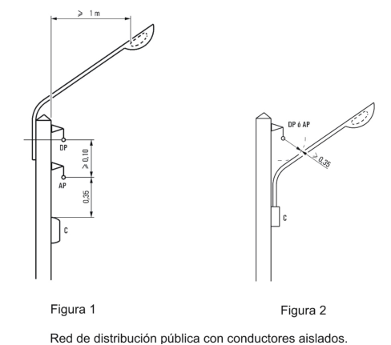
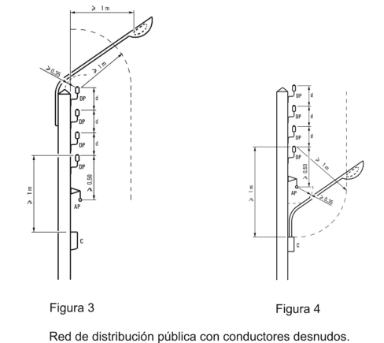
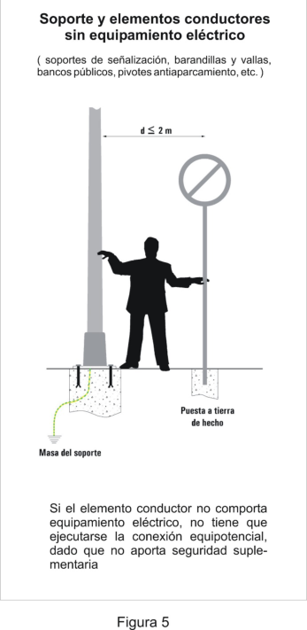
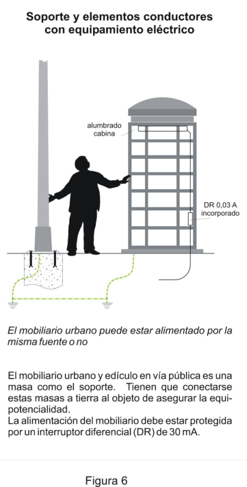
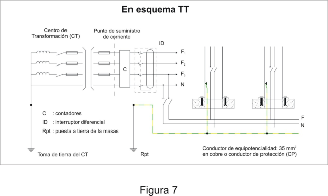
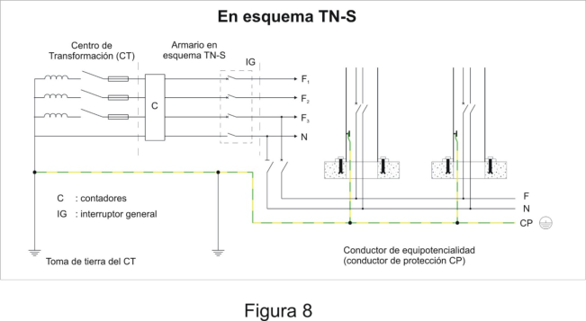
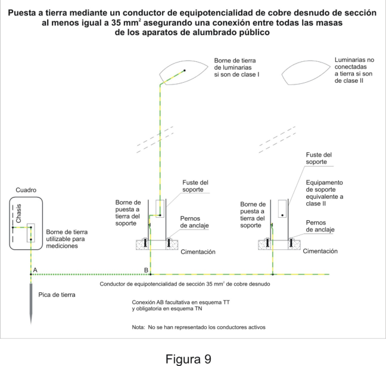
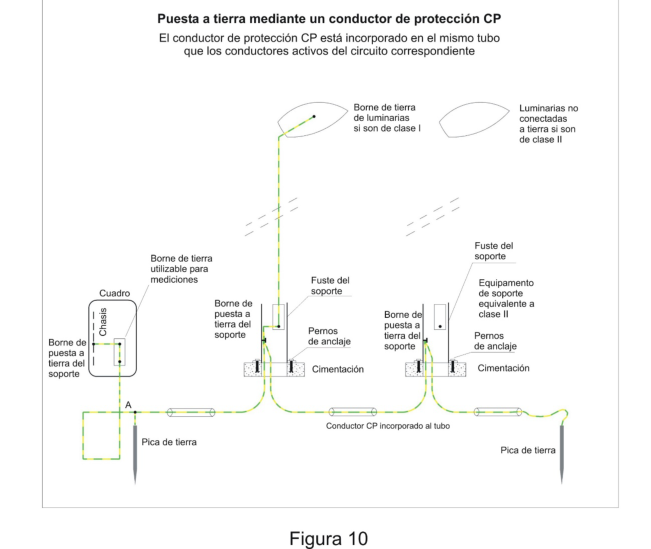

# BT-09. Instalaciones de alumbrado exterior

### 0 ÍNDICE

- 0 ÍNDICE — 1

- 1 CAMPO DE APLICACIÓN — 2

### 2 ACOMETIDAS DESDE LAS REDES DE DISTRIBUCIÓN DE LA COMPAÑÍA

- SUMINISTRADORA — 4

- 3 DIMENSIONAMIENTO DE LAS INSTALACIONES — 4

- 4 CUADROS DE PROTECCIÓN, MEDIDA Y CONTROL — 6

- 5 REDES DE ALIMENTACIÓN — 7

- 5.1 Cables — 7

- 5.2 Tipos — 8

- 5.2.1 Redes subterráneas — 8

- 5.2.2 Redes aéreas — 10

- 5.2.3 Redes de control y auxiliares — 14

- 6 SOPORTES DE LUMINARIAS — 15

- 6.1 Características — 15

- 6.2 Instalación eléctrica — 18

- 7 LUMINARIAS — 18

- 7.1 Características — 18

- 7.2 Instalación eléctrica de luminarias suspendidas. — 19

- 8 EQUIPOS ELÉCTRICOS DE LOS PUNTOS DE LUZ — 20

- 9 PROTECCIÓN CONTRA CONTACTOS DIRECTOS E INDIRECTOS — 22

- 10 PUESTAS A TIERRA — 27

- 1 -

### 1 CAMPO DE APLICACIÓN

Esta instrucción complementaria, se aplicará a las instalaciones de alumbrado exterior, destinadas a iluminar zonas de dominio público o privado, tales como autopistas, carreteras, calles, plazas, parques, jardines, pasos elevados o subterráneos para vehículos o personas, caminos, etc. Igualmente se incluyen las instalaciones de alumbrado para cabinas telefónicas, anuncios publicitarios, mobiliario urbano en general, monumentos o similares así como todos receptores que se conecten a la red de alumbrado exterior. Se excluyen del ámbito de aplicación de esta instrucción la instalación para la iluminación de fuentes y piscinas y las de los semáforos y las balizas, cuando sean completamente autónomos.

Dentro del ámbito de aplicación de esta ITC-BT-09, además de las instalaciones de alumbrado exterior propiamente dichas, se consideran las siguientes: las de alumbrado u otros servicios eléctricos para mobiliario urbano, edículos en vía pública, iluminación ornamental, balizas luminosas, señalización luminosa no autónoma para la regulación de tráfico, así como otros receptores. Asimismo, de acuerdo con el artículo 57.4 de la Directiva (UE) 2018/1972 del Parlamento Europeo y del Consejo, de 11 de diciembre de 2018, por la que se establece el Código Europeo de las Comunicaciones Electrónicas, las autoridades nacionales, regionales o locales deben permitir que las operadoras accedan a las instalaciones de alumbrado exterior que sean aptas técnicamente y que están controladas por ellas, para acoger y conectar a una red troncal los puntos de acceso inalámbrico para pequeñas áreas (SAWAP) y en consecuencia deberá considerarse la alimentación eléctrica de dichos dispositivos y la coexistencia con otras redes troncales de telecomunicaciones. Las autoridades públicas satisfarán todas las solicitudes razonables de acceso, que deberán cumplir las condiciones establecidas en el apartado 5.2.3, en lo relativo a la instalación y protecciones de las redes de alimentación de energía eléctrica. Mobiliario urbano Comprende el mobiliario dotado de equipamiento eléctrico para su propia iluminación u otras necesidades funcionales. Entre otros se pueden encontrar los siguientes: anuncios publicitarios (mupis, columnas, etc.), marquesinas (paradas de bus, de taxis, de tranvías), cabinas telefónicas, carteles de señalización (tráfico, escuelas, policía, hospitales, etc.), equipamientos diversos (parquímetros, aparatos de acceso a aparcamientos, mojones escamoteables, sistemas de elevación de contenedores soterrados, etc.). A efectos de protección contra contactos directos e indirectos por su proximidad a instalaciones de alumbrado exterior, tal y como se desarrolla en el apartado 9 de esta Guía Técnica de Aplicación, también debe tenerse en cuenta el mobiliario urbano que carece de equipamiento eléctrico y que engloba los siguientes: paneles publicitarios, carteles de señalización, bancos públicos, señales de tráfico, barandillas y vallas, guardarraíles, mástiles y tiestos, soportes para toldos, pivotes anti-aparcamiento, salidas de ventilación, tapas de arquetas, buzones, papeleras y armarios metálicos, etc. Aún cuando figuren en las estadísticas e inventarios municipales, los soportes de alumbrado público (columnas, báculos y brazos) no se consideran mobiliario urbano, sino parte integrante de la instalación de alumbrado exterior. Edículos de la vía pública Son pequeños edificios implantados en la vía pública dotados de la correspondiente iluminación y, en su caso, equipamiento eléctrico: kioscos (venta de periódicos, venta de loterías, etc.), aseos públicos.

- 2 -

Iluminación ornamental Corresponde a la iluminación de monumentos, fachadas de edificios, construcciones singulares, etc. que puede ser integrada en el monumento o accesible desde la vía pública Balizas luminosas Soportes luminosos cuya función es el guiado visual tanto para la circulación de vehículos (glorietas, rotondas, cambios de dirección, carriles bus, emergencias sobre la vía pública, etc.) como de peatones. Señalización luminosa no autónoma para la regulación de tráfico - semáforos - señales luminosas de tráfico Instalaciones de telecomunicaciones Las instalaciones de alimentación y de datos a los puntos de acceso inalámbrico para pequeñas áreas (SAWAP) que se especifican por los actos de ejecución publicados al amparo del artículo 57 de la Directiva (UE) 2018/1972 del Parlamento Europeo y del Consejo, de 11 de diciembre de 2018, por la que se establece el Código Europeo de las Comunicaciones Electrónicas. Otras instalaciones Todos los receptores que se conecten a la red de alumbrado exterior. Exclusiones del ámbito de aplicación Se consideran excluidas de la aplicación de esta ITC-BT-09: - las de los semáforos y las balizas, cuando sean completamente autónomos. Las instalaciones completamente autónomas son aquellas dotadas una acometida independiente, es decir, cuya alimentación no tenga su origen en el cuadro de protección medida y control de la red de alumbrado exterior. - las instalaciones eléctricas de las piscinas, pediluvios y fuentes están recogidas en la Instrucción Técnica Complementarias ITC-BT-31 que desarrolla el artículo 11 del Reglamento. - las instalaciones eléctricas temporales de ferias, exposiciones, muestras, stands, alumbrados festivos de calles, verbenas y manifestaciones análogas están reguladas en la ITC-BT-34. - las instalaciones de alumbrado exterior de viviendas unifamiliares, cuando tengan menos de 5 puntos de luz exteriores, sin contabilizar los puntos de luz instalados en fachadas; en este caso, la instalación del alumbrado en el exterior de dicha vivienda se realizará según lo prescrito en la ITC-BT-25.

- 3 -

### 2 ACOMETIDAS DESDE LAS REDES DE DISTRIBUCIÓN DE LA COMPAÑÍA

SUMINISTRADORA

La acometida podrá ser subterránea o aérea con cables aislados, y se realizará de acuerdo con las prescripciones particulares de la compañía suministradora, aprobadas según lo previsto en este Reglamento para este tipo de instalaciones.

La acometida finalizará en la caja general de protección y a continuación de la misma se dispondrá el equipo de medida.

Las acometidas en el Reglamento Electrotécnico para Baja Tensión vienen reguladas en el artículo 15, así como en la Instrucción Técnica Complementaria ITC-BT-11. El apartado 2 de la ITC-BT-09 determina que la acometida podrá ser subterránea, o aérea o mixta con cables o conductores aislados. Es decir, no se permiten acometidas con conductores desnudos. En el caso de acometidas aéreas se cumplirá lo dispuesto en la ITC-BT-06 y cuando sean subterráneas lo establecido en la ITC-BT-07. Continuidad del conductor neutro Tanto en el esquema de conexión TT como en el esquema de conexión TN, el neutro de la instalación de alumbrado exterior debe estar conectado al neutro de la red de distribución, de forma que se garantice la continuidad del neutro desde la salida del transformador de distribución AT/BT hasta los receptores de alumbrado.

### 3 DIMENSIONAMIENTO DE LAS INSTALACIONES

Las líneas de alimentación a puntos de luz con lámparas o tubos de descarga, estarán previstas para transportar la carga debida a los propios receptores, a sus elementos asociados, a sus corrientes armónicas, de arranque y desequilibrio de fases. Como consecuencia, la potencia aparente mínima en VA, se considerará 1,8 veces la potencia en vatios de las lámparas o tubos de descarga.

Cuando se conozca la carga que supone cada uno de los elementos asociados a las lámparas o tubos de descarga, las corrientes armónicas, de arranque y desequilibrio de fases, que tanto éstas como aquellos puedan producir, se aplicará el coeficiente corrector calculado con estos valores.

Además de lo indicado en párrafos anteriores, el factor de potencia de cada punto de luz, deberá corregirse hasta un valor mayor o igual a 0,90. La máxima caída de tensión entre el origen de la instalación y cualquier otro punto de la instalación, será menor o igual que 3%.

Para el cálculo de la potencia aparente señalado en el primer párrafo, la potencia en vatios a multiplicar será la potencia nominal de las lámparas o tubos de descarga. A los efectos de lo indicado en esta ITC-BT-09, se define como origen de la instalación de alumbrado exterior el cuadro de protección, medida y control. En el caso de instalaciones de

- 4 -

alumbrado con un gran número de puntos de luz, se recomienda que para el cálculo de la caída de tensión se considere también la originada en la acometida. Cálculo de la sección de los conductores La determinación de la sección de un cable o conductor estriba en calcular la sección mínima normalizada que cumple simultáneamente los criterios de intensidad máxima admisible (o de calentamiento), de caída de tensión y de intensidad de cortocircuito. En el caso de las instalaciones de alumbrado exterior, suele ser determinante el criterio de la caída de tensión. La limitación del 3% como máxima caída de tensión entre el origen de la instalación y el punto más alejado, se debe a que las caídas de tensión deben permitir siempre el encendido y funcionamiento correcto de las lámparas de descarga. No obstante, efectuados dichos cálculos es conveniente comprobar las intensidades en los tramos con mayor carga, de forma que se cumplan las intensidades máximas admisibles reguladas en la Instrucción Técnica Complementaria ITC-BT-06 para redes aéreas y la ITC-BT- 07 para redes subterráneas. En el apartado 5 de esta guía se incluyen las tablas de carga más usuales. Respecto a la ejecución de los cálculos de caídas de tensión en la red de alimentación de los puntos de luz, debe tenerse en cuenta la Guía Técnica de Aplicación - Anexo 2: “Cálculo de caídas de tensión”. En los circuitos trifásicos, se deben repartir los puntos de luz entre las tres fases de la forma más equilibrada posible, conectándolos, por ejemplo, alternativamente a cada fase.

Con el fin de conseguir ahorros energéticos y siempre que sea posible, las instalaciones de alumbrado público se proyectarán con distintos niveles de iluminación, de forma que ésta decrezca durante las horas de menor necesidad de iluminación.

Eficiencia energética En las instalaciones de alumbrado público, en general y siempre que sea posible, se proyectarán con dispositivos o sistemas para regular el nivel luminoso mediante, por ejemplo, balastos serie de tipo inductivo para doble nivel de potencia, reguladores - estabilizadores en cabecera de línea o balastos electrónicos para doble nivel de potencia. Para el establecimiento del porcentaje de ahorro energético y la elección, en cada caso, del sistema idóneo deberán considerarse las variaciones de tensión de la red, sus características, tipos de lámparas a implantar, etc. y, en el caso de instalaciones existentes, el estado de las líneas eléctricas de alimentación de los puntos de luz secciones, caídas de tensión, equilibrio de fases, armónicos, etc. En las vías de tráfico, zonas peatonales, plazas, etc. podrán reducirse los niveles luminosos a ciertas horas de la noche, siempre que quede garantizada la seguridad de los usuarios. En ningún caso la reducción descenderá por debajo del nivel de iluminación aconsejable para la seguridad de tráfico y para el movimiento peatonal. En puntos concretos con elevados porcentajes de accidentalidad nocturna, zonas peatonales con riesgo considerable de criminalidad, etc. se recomienda por razones de seguridad no llevar a cabo variaciones temporales de los niveles de iluminación. Otro método para obtener ahorro energético en instalaciones de alumbrado ornamental de fachadas de edificios y monumentos, anuncios luminosos, espacios deportivos o culturales, áreas de trabajo exteriores, etc., consiste en establecer los correspondientes ciclos de funcionamiento (encendido y apagado) de dichas instalaciones, disponiendo de relojes capaces de ser programados por ciclos diarios, semanales, mensuales o anuales. - 5 -

Producto Norma de aplicación Interruptor astronómico UNE-EN 60730-2-7 Interruptor crepuscular (células fotoeléctricas) UNE-EN 60669-2-1

### 4 CUADROS DE PROTECCIÓN, MEDIDA Y CONTROL

Las líneas de alimentación a los puntos de luz y de control, cuando existan, partirán desde un cuadro de protección y control; las líneas estarán protegidas individualmente, con corte omnipolar, en este cuadro, tanto contra sobreintensidades (sobrecargas y cortocircuitos), como contra corrientes de defecto a tierra y contra sobretensiones cuando los equipos instalados lo precisen. La intensidad de defecto, umbral de desconexión de los interruptores diferenciales, que podrán ser de reenganche automático, será como máximo de 300 mA y la resistencia de puesta a tierra, medida en la puesta en servicio de la instalación, será como máximo de 30 Ω. No obstante se admitirán interruptores diferenciales de intensidad máxima de 500 mA o 1 A, siempre que la resistencia de puesta a tierra medida en la puesta en servicio de la instalación sea inferior o igual a 5 Ω y a 1 Ω, respectivamente.

Si el sistema de accionamiento del alumbrado se realiza con interruptores horarios o fotoeléctricos, se dispondrá además de un interruptor manual que permita el accionamiento del sistema, con independencia de los dispositivos citados.

Lo descrito en los apartados 4 y 9 de la ITC-BT-09 se circunscribe a las redes de alimentación que tengan un esquema tipo TT. No obstante, en el caso de instalaciones de alumbrado exterior particulares o privadas en las que las redes de alimentación no estén realizadas según el esquema TT, serán de aplicación en lo relativo a la protección contra los contactos directos y contactos indirectos, las prescripciones de la ITC-BT-24. Además, en lo referente a la protección contra sobreintensidades y sobretensiones se seguirá lo indicado en la ITC-BT-22 e ITC-BT-23, respectivamente. En lo que concierne a los dispositivos generales e individuales de mando y protección se tendrá en cuenta lo señalado en la ITC-BT-17.

La envolvente del cuadro, proporcionará un grado de protección mínima IP55 según UNE 20.324 e IK10 según UNE-EN 50.102 y dispondrá de un sistema de cierre que permita el acceso exclusivo al mismo, del personal autorizado, con su puerta de acceso situada a una altura comprendida entre 2m y 0,3 m. Los elementos de medidas estarán situados en un módulo independiente.

Las partes metálicas del cuadro irán conectadas a tierra.

El significado de los códigos IP e IK se indica en la Guía-BT-Anexo1. Los grados IP55 e IK10 podrán obtenerse mediante la utilización de envolventes múltiples proporcionando el grado de protección requerido el conjunto de las envolventes completamente montadas. En este caso, en la documentación del fabricante del cuadro deberá estar perfectamente definido el método para la obtención de los diferentes grados de protección IP e IK.

- 6 -

Producto Norma de aplicación Envolvente cuadro general (uso doméstico o análogo) (1) UNE-EN 60670-1 Envolvente cuadro y conjuntos de aparamenta (1) (2) UNE-EN 62208 Conjunto de aparamenta (2) UNE-EN 61439-5 Interruptor de control de potencia UNE 20317 Interruptores automáticos (uso doméstico o análogo) UNE-EN 60898 Interruptores automáticos con capacidad de seccionamiento UNE-EN 60947-2 Interruptores diferenciales (uso doméstico o análogo) UNE-EN 61008 Interruptores diferenciales con dispositivo de protección contra UNE-EN 61009 sobreintensidades incorporado (uso doméstico o análogo) Interruptores diferenciales UNE-EN 60947-2 Fusibles UNE-HD 60269-3 Interruptor horario UNE-EN 62054-21 Bornes de conexión UNE-EN 60998 Nota 1: El grado de protección IP55 se verificará de acuerdo a lo establecido en la norma UNE 20324, el grado de protección contra los impactos mecánicos externos IK10 de acuerdo con la norma UNE EN 50102. Según la norma UNE EN 60695-2-11, y para equipos instalados cerca del punto de alimentación, la temperatura de ensayo de inflamabilidad (hilo incandescente) será de: - (960 ± 10) ºC para las partes que soportan partes activas - (650 ± 10) ºC para todas las demás partes Nota 2: Los diferentes componentes que conforman el cuadro deberán cumplir con su correspondiente norma de producto. Cuando se comercializan montados, todos estos elementos, constituyen el conjunto de aparamenta y deberán cumplir con las prescripciones de la norma UNE-EN 61439-5

### 5 REDES DE ALIMENTACIÓN

#### 5.1 Cables

Los cables serán multipolares o unipolares con conductores de cobre y tensión asignada de 0,6/1 kV.

El conductor neutro de cada circuito que parte del cuadro, no podrá ser utilizado por ningún otro circuito.

Tipos de conductores Según el apartado 5.1 de la ITC-BT-09 los conductores serán de cobre; no obstante, el apartado 5.2.1 establece la utilización de sistemas y materiales análogos a los de las redes subterráneas de distribución reguladas en la ITC-BT-07 que dispone que los conductores serán de cobre o de aluminio. Asimismo, en el apartado 5.2.2 correspondiente a las redes aéreas, que remite a la ITC-BT-06 determina que los cables serán de cobre, aluminio o de otros materiales o aleaciones. Como consecuencia de lo anterior, puesto que no existen condicionantes técnicos para prohibir los conductores de aluminio, y teniendo en cuenta el principio de seguridad equivalente que con carácter general establece el propio Reglamento para Baja Tensión, podrán utilizarse conductores de aluminio siempre que se tomen las precauciones adecuadas en su instalación. Concretamente, para garantizar en este caso la adecuada conexión al dispositivo de protección, dicho dispositivo será del tipo definido en la norma UNE-EN 60947-2.

- 7 -

En todos los casos los cables o conductores deberán ser aislados, por lo que no se permiten las redes aéreas con conductores desnudos, autorizados en el RBT 1973. De acuerdo con las reglas de la buena práctica en la ejecución de las redes de alimentación de los puntos de luz, se recomienda limitar la sección máxima de los conductores a 25 mm2 de cobre, al objeto de poder manipular adecuadamente los conductores. En consecuencia, se recomienda la subdivisión de las redes, cuando los resultados de los cálculos obliguen a la instalación de conductores de mayor sección.

#### 5.2 Tipos

##### 5.2.1 Redes subterráneas

Se emplearán sistemas y materiales análogos a los de las redes subterráneas de distribución reguladas en la ITC-BT-07. Los cables serán de las características especificadas en la UNE 21123, e irán entubados; los tubos para las canalizaciones subterráneas deben ser los indicados en la ITC-BT-21 y el grado de protección mecánica el indicado en dicha instrucción, y podrán ir hormigonados en zanja o no. Cuando vayan hormigonados el grado de resistencia al impacto será ligero según UNE-EN 50.086 –2- 4.

Los tubos irán enterrados a una profundidad mínima de 0,4 m del nivel del suelo medidos desde la cota inferior del tubo y su diámetro interior no será inferior a 60 mm.

Se colocará una cinta de señalización que advierta de la existencia de cables de alumbrado exterior, situada a una distancia mínima del nivel del suelo de 0,10 m y a 0,25 m por encima del tubo.

En los cruzamientos de calzadas, la canalización, además de entubada, irá hormigonada y se instalará como mínimo un tubo de reserva.

La sección mínima a emplear en los conductores de los cables, incluido el neutro, será de 6 mm2. En distribuciones trifásicas tetrapolares, para conductores de fase de sección superior a 6 mm2, la sección del neutro será conforme a lo indicado en la tabla 1 de la ITC-BT-07.

Para garantizar las distancias mínimas entre el suelo, la cinta de señalización y el tubo enterrado, la profundidad de enterramiento deberá ser superior a 0,4 m. Se recomienda que la distancia mínima entre la parte superior del tubo y el nivel del suelo sea de 0,4 m y para los cruzamientos de calzadas de 0,5 m. Dada la problemática ocasionada por las lámparas de descarga y el equipo auxiliar asociado en lo referente a los armónicos e intensidades en el neutro, se recomienda en este tipo de instalaciones que el conductor neutro tenga la misma sección que la fase.

- 8 -

Los cables y tubos de instalación habitual con estas características son:

<!-- tabla: ../tablas/BT-09_t01.csv -->

| Sistema de canalización (calidad mínima) |  | Cable |  |
|---|---|---|---|
| Tubo | Compresión 450N, Impacto Normal. UNE-EN 61386-24 | VV-K | Cable de tensión asignada 0,6/1 kV, con conductor de co- bre clase 5 (-K), aislamiento y cubierta de policloruro de vi- nilo (VV) UNE 21123-11 |
|  |  | RV-K | Cable de tensión asignada 0,6/1 kV, con conductor de co- bre clase 5 (-K), aislamiento de polietileno reticulado (R) y cubierta policloruro de vinilo (V) UNE 21123-21 |
| Nota 1: Las normas de la serie UNE 21123 también incluyen las variantes de cables armados y apantallados que puede ser conve- niente utilizar en instalaciones particulares |  |  |  |

En la tabla A se especifica para cada uno de los tipos de cables la intensidad máxima admisible en función de la sección del cable y del tipo de instalación. Si procede, deben aplicarse los factores de corrección por temperatura del terreno distinta de 25ºC, por resistividad térmica del terreno diferente de 1K.m/W, por agrupamiento de circuitos o por profundidad de enterramiento distinta de 70 cm.

La tabla de referencia corresponde a la ITC-BT 07, apartado 3.1.2 para condiciones tipo de instalación enterrada entubada. Por tanto, se ha aplicado un factor de corrección 0,8, según el apartado 3.1.3 de la ITC- BT-07, para una instalación en la que cada conductor tripolar o terna de conductores unipolares va alojado en el interior de un tubo. No se agruparán varios circuitos en el interior del mismo tubo.

Tabla A. Intensidad máxima admisible, en amperios, para cables con conductores de cobre en instalación enterrada entubada (servicio permanente).

<!-- tabla: ../tablas/BT-09_t02.csv -->

| SECCIÓN NOMINAL mm2 | Terna de cables unipolares (1) (2) |  | 1 cable tripolar o tetrapolar (3) |  |
|---|---|---|---|---|
|  | TIPO DE AISLAMIENTO |  |  |  |
|  | XLPE | PVC | XLPE | PVC |
| 6 10 16 25 35 | 58 77 100 128 152 | 50 68 88 112 136 | 53 70 92 120 144 | 45 60 78 100 120 |

temperatura ambiente del terreno: 25 ºC, conductividad térmica del terreno 1K·m/W. un sólo circuito de cables unipolares en contacto, bajo tubo

(1) incluye el conductor neutro. (2) para el caso de dos cables unipolares, la intensidad máxima admisible será la correspondiente a la columna de la terna de cables unipolares de la misma sección y aislamiento, multiplicada por 1,225 (3) para el caso de un cable bipolar, la intensidad máxima admisible será la correspondiente a la columna del cable tripolar o tetrapolar de la misma sección y aislamiento, multiplicada por 1,225

Si las exigencias reales de instalación no coinciden con las condiciones tipo se aplicarán los factores de corrección indicados en las tablas 6, 7, 8 y 9 de la ITC-BT-07

- 9 -

<!-- figura vectorial en la pág. 9 del PDF original -->
> Figura en la pág. 9 del PDF original: [ver en el PDF](../pdf/BT-09.pdf#page=9)

Los tubos, cuando vayan hormigonados presentarán una resistencia a la compresión mínima de 250 N.

<!-- tabla: ../tablas/BT-09_t03.csv -->

| Producto | Norma de aplicación |
|---|---|
| Tubo enterrado | UNE-EN 61386-24 |
| Bornes de conexión | UNE-EN 60998 |

Los empalmes y derivaciones deberán realizarse en cajas de bornes adecuadas, situadas dentro de los soportes de las luminarias, y a una altura mínima de 0,3 m sobre el nivel del suelo o en una arqueta registrable, que garanticen, en ambos casos, la continuidad, el aislamiento y la estanqueidad del conductor. Cuando se utilice una arqueta registrable para albergar los empalmes o derivaciones, se recomienda que su construcción se realice de forma que el agua que pudiera entrar en ella se drene fácilmente, por ejemplo mediante la utilización de un lecho de grava gruesa o método similar y que los empalmes o derivaciones, así como los dispositivos de protección se alojen en una caja estanca con un grado de protección IP X7, sellando la entrada y salida de los conductores a la misma y situada a una profundidad que minimice el riesgo de inundación en la misma.

##### 5.2.2 Redes aéreas

Se emplearán los sistemas y materiales adecuados para las redes aéreas aisladas descritas en la ITC-BT-06.

Podrán estar constituidas por cables posados sobre fachadas o tensados sobre apoyos. En este último caso, los cables serán autoportantes con neutro fiador o con fiador de acero.

La sección mínima a emplear, para todos los conductores incluido el neutro, será de 4 mm2. En distribuciones trifásicas tetrapolares con conductores de fase de sección superior a 10 mm2, la sección del neutro será como mínimo la mitad de la sección de fase. En caso de ir sobre apoyos comunes con los de una red de distribución, el tendido de los cables de alumbrado será independiente de aquel.

Respecto a las redes aéreas aisladas serán de las características señaladas en la ITC-BT-06, bien posadas sobre fachadas o tensadas sobre apoyos con cable fiador de acero, con una sección mínima de 4 mm2, a diferencia de los 2,5 mm2 que se fijaban anteriormente. El régimen de distancias al suelo, ventanas, terrazas, balcones, etc., así como las condiciones para cruzamientos y paralelismos, será el establecido en la Instrucción Complementaria ITC-BT- 06. El cable de instalación habitual es del tipo RZ, aunque cuando la red aérea posada se instale en el interior de un tubo o canal protector, se podrán utilizar cables del tipo VV-K o RV-K. El tubo o canal será de las características indicadas en la ITC-BT-21 para canalizaciones fijas en superficie, siempre que su altura de instalación sea superior a 2,5 m y de las características indicadas en la ITC-BT-11 para alturas de instalación inferiores. En instalaciones de alumbrado exterior especiales (por ejemplo en fábricas) en las que sus canalizaciones discurran por el interior de los edificios podrá utilizarse cable del tipo RZ sobre bandejas.

- 10 -

En la tabla siguiente se indican los sistemas de instalación más habituales:

<!-- tabla: ../tablas/BT-09_t04.csv -->

| Sistema de instalación | Sistema de canalización (calidad mínima) |  |  | Cable |  |
|---|---|---|---|---|---|
| Aéreo - Po- sados so- bre fa- chada | m5,2< arutlA | Tubo 4421 No propa- gador de la llama | Compresión Fuerte (4), Impacto Fuerte (4), Propiedades eléctricas: Aislante / continuidad eléctrica. UNE-EN 61386-21 | VV-K RV-K RZ | Cable de tensión asignada 0,6/1 kV, con conductor de cobre clase 5 (-K), aislamiento y cubierta de policloruro de vinilo (VV) UNE 21123-11 |
|  |  |  |  |  | Cable de tensión asignada 0,6/1 kV, con conductor de cobre clase 5 (-K), aislamiento de polietileno reticulado (R) y cubierta policlo- ruro de vinilo (V) UNE 21123-21 |
|  |  | Canal no propaga- dora de la llama | Impacto 6J, No propagador de la llama, Propiedades eléctricas: Aislante / continuidad eléctrica. UNE-EN 50085 |  |  |
|  |  |  |  |  | Cable de tensión asignada 0,6/1 kV, con cubierta aislante de poli- etileno reticulado (R) y conduc- tores de cobre cableados a de- rechas (Z) UNE 21030-2 |
|  | m5,2 ≥ arutlA | Tubo 4321 No propa- gador de la llama | Compresión Fuerte (4), Impacto Media (3), Propiedades eléctricas: Aislante / continuidad eléctrica. UNE-EN 61386-21 | VV-K RV-K | Tipos ya descritos |
|  |  | Canal no propaga- dora de la llama | No propagador de la llama, Pro- piedades eléctricas: Aislante / continuidad eléctrica. UNE-EN 50085 |  |  |
|  |  | Sin canalización |  | RZ | Tipo ya descrito |
| Aéreo – Tensados sobre apoyo | Sin canalización |  |  | RZ2 | Tipo ya descrito |
| Nota 1: Las normas de la serie UNE 21123 también incluyen las variantes de cables armados y apantallados que puede ser conveniente utilizar en instalaciones particulares. Nota 2: El conductor neutro nunca tiene las funciones de fiador. |  |  |  |  |  |

En la tabla B se detalla para cada uno de los tipos de cables la intensidad máxima admisible en función de la sección del cable y del tipo de instalación. Si procede, deben aplicarse los factores de corrección por temperatura ambiente distinta de 40 ºC, o por agrupamiento de circuitos.

- 11 -

Tabla B. Intensidad máxima admisible en amperios a temperatura ambiente de 40°C

<!-- tabla: ../tablas/BT-09_t05.csv -->

| Número de conductores por sección mm2 | Intensidad máxima en A |  |
|---|---|---|
|  | Posada sobre fachada | Tendida con fiador de acero |
| 2 x 4 Cu 4 x 4 Cu 2 x 6 Cu 4 x 6 Cu 2 x 10 Cu 4 x 10 Cu 4 x 16 Cu | 45 37 57 47 77 65 86 | 50 41 63 52 85 72 95 |

4 x 16 Cu 86 95

Si las condiciones reales de instalación no coinciden con las condiciones tipo se aplicarán los factores de corrección indicados en las tablas 6, 7, y 8 de la ITC-BT-06.

Para cables expuestos directamente al sol se utilizará el coeficiente 0,9 o inferior (a criterio del proyectista).

Redes aéreas de alumbrado en apoyos comunes con redes de distribución en baja tensión Cuando las redes de distribución pública en baja tensión (DP) y de alumbrado público (AP) se instalen en los mismos apoyos, los conductores de alumbrado público se situarán siempre por debajo de los conductores de la red de distribución pública en baja tensión y, por tanto, en todos los casos el tendido de los conductores de alumbrado público será independiente de la red de distribución pública en baja tensión. La disposición de los conductores y luminarias de la instalación de alumbrado público (AP), así como de la red de distribución pública en baja tensión (DP), se determina en las figuras 1, 2, 3 y 4. Se recomienda el siguiente régimen de distancias mínimas: − Conductores aislados en redes AP y DP (figs 1 y 2) − 0,10 m entre conductores AP y DP − 0,35 m para la caja de conexión C y brazo − Conductores aislados en red AP y desnudos en red DP (figs 3 y 4) − 1 m para la luminaria y equipo auxiliar − 0,50 m entre conductor AP y DP − (d) en m entre conductores DP en función de la longitud del vano (punto 3.2.2 de la ITC- BT-06) − Cuando la luminaria esté implantada por encima de las redes públicas de distribución y alumbrado (figs 1 y 3), la distancia mínima de la luminaria al apoyo será de 1 m.

- 12 -

- 13 -

##### 5.2.3 Redes de control y auxiliares

Se emplearán sistemas y materiales similares a los indicados para los circuitos de alimentación, la sección mínima de los conductores será 2,5 mm2.

Redes de control y servicios auxiliares

Los circuitos de alimentación para las instalaciones de telecomunicaciones destinadas a alimentar los puntos de acceso inalámbrico para pequeñas áreas tendrán la consideración de redes auxiliares.

De forma general se considerarán para la instalación de los circuitos de las redes de control y auxiliares, los requisitos aplicables de redes aéreas y subterráneas de alimentación.

Por tanto, no será admisible la utilización de las conducciones subterráneas que alimentan instalaciones de alumbrado exterior para desplegar los circuitos de alimentación de los servicios auxiliares.

No obstante, atendiendo a que la carga de estos circuitos no es elevada, se pueden admitir varios circuitos de servicios auxiliares compartiendo la misma conducción subterránea independiente de la principal, siempre y cuando se cumplan, como mínimo, los siguientes requisitos: • El tubo enterrado para los circuitos auxiliares debe admitir la colocación del número de conductores totales que utilizarán los varios circuitos que se van a canalizar en ese conducto. • Todos los circuitos deben partir del mismo cuadro de protección, medida y control. • Los circuitos coincidentes deben derivarse y tener sus protecciones situadas físicamente muy próximas en el cuadro de protección, medida y control, adecuadamente marcadas indicando que discurren por la misma canalización. • Las tensiones de aislamiento de los cables de diferentes circuitos se deben corresponder a la máxima tensión de los circuitos coincidentes. • Tras el tendido de nuevos circuitos en un tubo con cables instalados previamente, se deberá comprobar que existe el aislamiento adecuado entre todos.

Adicionalmente la operadora que quieran tener acceso a las canalizaciones de redes de control y servicios auxiliares que sean de titularidad pública, deberán realizar una solicitud para la autorización al titular de la instalación en la que deberán incluir, además del proyecto técnico de la instalación que contemple la conformidad con los puntos anteriores, un análisis de impacto e implicaciones de seguridad sobre la instalación existente.

En cuanto a la fibra óptica, hay que tener en cuenta que no se trata de cables conductores de energía eléctrica, sino de cables dieléctricos, por lo que es posible la coexistencia de redes de telecomunicaciones de fibra óptica en las canalizaciones de redes de alimentación de alumbrado exterior, siempre que se tengan en cuentan todos los requisitos mecánicos en su montaje.

- 14 -

### 6 SOPORTES DE LUMINARIAS

#### 6.1 Características

Los soportes de las luminarias de alumbrado exterior, se ajustarán a la normativa vigente (en el caso de que sean de acero deberán cumplir el RD 2642/85, RD 401/89 y OM de 16/5/89). Serán de materiales resistentes a las acciones de la intemperie o estarán debidamente protegidas contra éstas, no debiendo permitir la entrada de agua de lluvia ni la acumulación del agua de condensación. Los soportes, sus anclajes y cimentaciones, se dimensionarán de forma que resistan las solicitaciones mecánicas, particularmente teniendo en cuenta la acción del viento, con un coeficiente de seguridad no inferior a 2,5, considerando las luminarias completas instaladas en el soporte.

Normativa y su ámbito de aplicación. Desde la publicación del Reglamento Electrotécnico para Baja Tensión, en Septiembre del 2002, se han producido cambios muy sustanciales en la legislación que regula los soportes de alumbrado, motivados por el desarrollo de la Directiva 89/106/CEE, de 21 de Diciembre de 1989, que dicta las disposiciones para la libre circulación de productos de construcción, y posteriormente por el Reglamento (UE) n.o 305/2011 del Parlamento Europeo y del Consejo que deroga la anterior directiva. Mediante la Comunicación 2002/C 212/06 de la Comisión en el marco de la aplicación de la Directiva 89/106/CEE del Consejo, se declara, entre otras, como norma armonizada la EN 40-5: 2002 “Columnas y báculos de alumbrado. Parte 5: Requisitos para las columnas y báculos de alumbrado fabricados en acero”. Esta norma se ratifica como norma armonizada en aplicación del Reglamento citado anteriormente en la Comunicación de la Comisión 2018/C 092/06. La Resolución de 16 de enero de 2003, de la Dirección General de Política Tecnológica amplía los anexos I, II y III de la Orden de 29 de noviembre de 2001, por la que se publican las referencias a las normas UNE que son transposición de las normas armonizadas, entre otras, la UNE-EN 40-5: 2003. La norma UNE-EN 40-5:2003, es aplicable a columnas de alumbrado de acero que no sobrepasen 20 m de altura para luminarias montadas en la parte superior, y a báculos de alumbrado de acero que no superen los 18 m de altura para luminarias con entrada lateral. Se considera que los soportes de acero (columnas y báculos) de alturas superiores a las señaladas anteriormente, continúan sometidos a los requisitos establecidos en el Real Decreto 2642/85, Real Decreto 401/89 y Orden Ministerial de 16/5/89. Respecto a los soportes realizados en otros materiales (aluminio, hormigón, etc.) serán de aplicación las normas de la serie EN 40 “Columnas y báculos de alumbrado” relativas a cada tipo de material. Fechas de aplicabilidad y coexistencia. En virtud de lo dispuesto en la referenciada normativa, la entrada en vigor del marcado CE con carácter obligatorio para los soportes metálicos de luminarias y que marca el final del periodo de coexistencia con el RD 2642/85, RD 401/89 y OM de 16/5/89, es el: 1-02-2004 Debe aclararse que la fecha en que finaliza el periodo de coexistencia coincide con la fecha en la que se retiran las especificaciones técnicas contradictorias (RD 2642/85, RD 401/89 y OM de - 15 -

16/5/89 para columnas de alumbrado de acero que no excedan de 20 m de altura y a báculos también de acero que no rebasen 18 m de altura para luminarias con entrada lateral), después de lo cual la presunción de conformidad debe basarse siempre en la norma armonizada UNE- EN 40-5:2003 “Columnas y báculos de alumbrado. Parte 5: Requisitos para las columnas y báculos de alumbrado fabricados en acero” Para las columnas y báculos de acero de alturas superiores a las referidas con anterioridad, la presunción de conformidad debe fundamentarse en el Real Decreto 2642/85, Real Decreto 401/89 y Orden Ministerial de 16/5/89. Marcado CE de los soportes. El fabricante, o su representante autorizado establecido dentro de la UE es el responsable de la realización del Marcado CE. El símbolo CE debe ser conforme a la Directiva 93/68/CEE, y los soportes contendrán marcas o indicaciones de acuerdo con la norma UNE-EN 40-5:2003. El Marcado CE y la información que lo acompaña deben colocarse, al menos, en uno de los siguientes lugares: - En el propio producto. - En una etiqueta adherida al mismo - En su embalaje - En la documentación comercial adjunta Los soportes que lo requieran, deberán poseer una abertura de dimensiones adecuadas al equipo eléctrico para acceder a los elementos de protección y maniobra; la parte inferior de dicha abertura estará situada, como mínimo, a 0,30 m de la rasante, y estará dotada de puerta o trampilla con grado de protección IP 44 según UNE 20.324 (EN 60529) e IK10 según UNE-EN 50.102. La puerta o trampilla solamente se podrá abrir mediante el empleo de útiles especiales y dispondrá de un borne de tierra cuando sea metálica.

Cuando por su situación o dimensiones, las columnas fijadas o incorporadas a obras de fábrica no permitan la instalación de los elementos de protección y maniobra en la base, podrán colocarse éstos en la parte superior, en lugar apropiado o en el interior de la obra de fábrica.

Códigos IP e IK Cuando en el texto de la ITC-BT-09 se alude a un grado de protección IP44 e IK10 en la puerta o trampilla, quiere referirse al grado de protección mínimo que se debe proporcionar al equipo eléctrico que normalmente vaya alojado en el interior del soporte (caja de fusibles u otro tipo de protección). Como según las normas armonizadas de la serie EN 40, el grado de protección de las puertas de los soportes deben ser como mínimo IP3X o IP2X (en función de la altura sobre la rasante a la que estén situadas las puertas) e IK08, el grado de protección requerido, podrá obtenerse, o bien por la propia construcción de la trampilla del soporte, o bien mediante la utilización suplementaria de una caja u otra envolvente que esté alojada en el interior del soporte de forma que, el conjunto del soporte y la envolvente completamente montada, proporcione el grado de protección exigido. En este último caso, en la documentación del fabricante del soporte deberán estar definidas las características de la caja para la obtención de los grados de protección pedidos. Será responsabilidad del instalador la adecuada instalación de la caja correspondiente para garantizar el cumplimiento de la normativa de soportes del conjunto completo.

- 16 -

Borne de tierra en la portezuela o trampilla metálica Cuando el equipo eléctrico se aloje en una caja cerrada aislante o metálica puesta a tierra en el interior del soporte, podrá evitarse la colocación del borne de tierra en la portezuela. En cualquier caso, se instalará en el fuste del soporte un borne de toma de tierra. Dimensionamiento del fuste La sección del fuste del soporte tendrá las dimensiones suficientes para alojar con holgura la caja de protección e instalar el borne de toma de tierra. Factores de carga parciales. La Directiva 89/106/CEE, al establecer como norma armonizada la UNE-EN 40-5, fija como factores de carga parciales para el peso propio 1,2 y para el viento 1,4, los cuales permiten garantizar la seguridad por combinación de ambos efectos, con mayor rigor técnico que el coeficiente de seguridad de 2,5 reflejado en el texto actual de la Instrucción Técnica Complementaria ITC-BT-09 del Reglamento del 2002, que quedaría sustituido por los dos mencionados factores de carga parciales, siempre y cuando las cargas características debidas al peso propio y a la acción del viento se ajusten estrictamente a lo dispuesto en la norma UNE- EN 40-5, que remite a lo especificado en la norma UNE-EN 40-3-1 (Parte 3-1: Diseño y verificación. Especificación para cargas características). Lo cual exige que la presión característica del viento se obtenga teniendo en cuenta la presión del viento de referencia (q ), el coeficiente (δ) dependiente del tamaño del soporte, el (10) coeficiente (β) que es función del comportamiento dinámico del soporte, el coeficiente topográfico (f) y, por último, el coeficiente de exposición (Ce ) que depende del terreno y de la altura por (z) encima del suelo (z). Asimismo, se deberá considerar el coeficiente de forma de las columnas y báculos (sección circular, octogonal regular y otras diferentes), así como el coeficiente de forma de las luminarias. Calculadas las cargas características, se evaluarán las fuerzas debidas a la presión del viento y a las cargas propias, tanto sobre el fuste del soporte como sobre la luminaria, calculando los momentos de flexión que actúan sobre el fuste de la columna o báculo y sobre el brazo, así como los momentos de torsión que actúan sobre el fuste del soporte debidos a las cargas del viento. Para lo cual, en cumplimiento de lo dispuesto en la norma UNE-EN 40-5, se considerarán las secciones transversales críticas definidas por la norma UNE-EN 40-3-3 (Parte 3-3: Diseño y verificación: Verificación mediante cálculo). Deformaciones horizontal y vertical. Como criterios de aceptación, la flecha horizontal y la deformación vertical de la conexión de las luminarias, bajo el efecto de las cargas características, en cumplimiento de lo establecido en la norma UNE-EN 40-5 no sobrepasarán los valores determinados en la norma UNE-EN 40-3-3, en las condiciones señaladas por la misma. Verificación del diseño estructural En cumplimiento de lo dispuesto de la norma UNE-EN 40-5, el diseño estructural de una columna o báculo de alumbrado debe verificarse, bien por ensayo de acuerdo con la norma UNE-EN 40- 3-2 (Parte 3-2: Diseño y verificación: Verificación mediante ensayo), o por cálculo en consonancia con la norma UNE-EN 40-3-3 (Parte 3-3: Diseño y verificación: Verificación mediante cálculo).

- 17 -

#### 6.2 Instalación eléctrica

En la instalación eléctrica en el interior de los soportes, se deberán respetar los siguientes aspectos: - Los conductores serán de cobre, de sección mínima 2,5 mm2, y de tensión asignada 0,6/1kV, como mínimo; no existirán empalmes en el interior de los soportes. - En los puntos de entrada de los cables al interior de los soportes, los cables tendrán una protección suplementaria de material aislante mediante la prolongación del tubo u otro sistema que lo garantice. - La conexión a los terminales, estará hecha deforma que no ejerza sobre los conductores ningún esfuerzo de tracción. Para las conexiones de los conductores de la red con los del soporte, se utilizarán elementos de derivación que contendrán los bornes apropiados, en número y tipo, así como los elementos de protección necesarios para el punto de luz.

Los tipos de cable a utilizar corresponden a los indicados en el apartado (5.2.1) o (5.2.2).

### 7 LUMINARIAS

#### 7.1 Características

Las luminarias utilizadas en el alumbrado exterior serán conformes la norma UNE-EN 60.598 -2-3 y la UNE-EN 60.598 -2-5 en el caso de proyectores de exterior.

La Instrucción ITC-BT-09 determina que las luminarias se ajustarán a la norma UNE-EN-60598- 2-3 y los proyectores cumplirán la UNE-EN 60598-2-5. Una luminaria es un conjunto óptico, mecánico y eléctrico equipado para recibir una o varias lámparas, que se compone de cuerpo o carcasa, elementos auxiliares (balasto, arrancador y condensador) instalados generalmente en un compartimento de la luminaria, portalámparas, etc. y bloque óptico. En el caso en el que el fabricante suministre tanto la luminaria y el proyector con los equipos auxiliares (balasto, arrancador y condensador) incorporados, el responsable del cumplimiento de la norma de luminarias será el fabricante. Cuando la luminaria, dotada de alojamiento para el equipo auxiliar, y el proyector se suministre sin equipamiento eléctrico (balasto, arrancador y condensador), será responsabilidad del instalador la utilización y conexión adecuada de dichos equipos para asegurar el cumplimiento de los requisitos incluidos en la norma de luminarias del conjunto completo. Para ello se deberán seguir escrupulosamente las instrucciones proporcionadas por el fabricante de la envolvente de la luminaria especialmente en lo relativo a los calentamientos y protección contra los choques eléctricos, así como en el tipo y potencia de lámpara máxima a instalar en la luminaria. Las luminarias utilizadas en el alumbrado exterior deben tener como mínimo el grado de protección IP 23.

- 18 -

Como caso particular en ambientes con contaminación o existencia de componentes corrosivos (zonas industriales, urbanas, costeras, etc.) y con el fin de mantener el rendimiento de la luminaria, es recomendable que tenga los siguientes grados de protección: − IP66 para el compartimiento óptico. − IP44 para el alojamiento del equipo auxiliar. En lo que atañe a la resistencia mecánica, en el caso de luminarias de alumbrado exterior, la norma UNE-EN 60.598-2-3 establece como mínimo los siguientes valores: − IK04 (0,5 julios) para las partes frágiles (cierres de vidrio, metacrilato, etc.). − IK05 (0,7 julios) para el resto de las partes (cuerpo o carcasa). La protección contra los choques mecánicos debe ser apropiada al emplazamiento donde las luminarias están instaladas, cuyo grado mínimo será IK 08 (5 julios), si están situadas a menos de 1,5 m del suelo.

7.2 Instalación eléctrica de luminarias suspendidas. La conexión se realizará mediante cables flexibles, que penetren en la luminaria con la holgura suficiente para evitar que las oscilaciones de ésta provoquen esfuerzos perjudiciales en los cables y en los terminales de conexión, utilizándose dispositivos que no disminuyan el grado de protección de luminaria IP X3 según UNE 20.324.

La suspensión de las luminarias se hará mediante cables de acero protegido contra la corrosión, de sección suficiente para que posea una resistencia mecánica con coeficiente de seguridad de no inferior a 3,5. La altura mínima sobre el nivel del suelo será de 6 m.

Los tipos de cable a utilizar corresponden a los indicados en el apartado 5.2.1, siempre con conductor flexible de clase 5. Tipos de cable habituales:

<!-- tabla: ../tablas/BT-09_t06.csv -->

| cable tipo VV-K (norma UNE 21123-1) | cable de tensión asignada 0,6/1 kV, con conductor de cobre clase 5 (-K), aislamiento y cubierta de policloruro de vinilo (VV) |
|---|---|
| cable tipo RV-K (norma UNE 21123-2) | cable de tensión asignada 0,6/1 kV, con conductor de cobre clase 5 (-K), aislamiento de polietileno reticulado (R) y cubierta policloruro de vinilo (V) |
| Nota 1: Las normas de la serie UNE 21123 también incluyen las variantes de cables armados y apantallados que puede ser conveniente utilizar en instalaciones particulares. |  |

- 19 -

### 8 EQUIPOS ELÉCTRICOS DE LOS PUNTOS DE LUZ

Podrán ser de tipo interior o exterior, y su instalación será la adecuada al tipo utilizado.

Los equipos eléctricos para montaje exterior poseerán un grado de protección mínima IP54, según UNE 20.324 e IK 8 según UNE-EN 50.102, e irán montados a una altura mínima de 2,5 m sobre el nivel del suelo, las entradas y salidas de cables serán por la parte inferior de la envolvente.

Cada punto de luz deberá tener compensado individualmente el factor de potencia para que sea igual o superior a 0,90; asimismo deberá estar protegido contra sobreintensidades.

Las lámparas de descarga tienen en común una impedancia negativa, lo que supone que la intensidad de corriente suministrada para una tensión constante se incremente hasta la destrucción de la lámpara. Por esta causa, debe instalarse un balasto para limitar la intensidad de la corriente que fluye por la lámpara y suministrar a la misma los parámetros necesarios. Cuando el balasto es electromagnético, asociado al mismo deberán instalarse los condensadores precisos para la corrección del factor de potencia. Además algunas lámparas de descarga, necesitan incorporar un arrancador que proporcione en el instante del encendido, la alta tensión necesaria para el cebado de la corriente de arco de la lámpara. Los balastos electrónicos cumplen la misión de limitar la intensidad de corriente, al tiempo que realizan las funciones de los arrancadores y condensadores de compensación del factor de potencia. Se recomienda que las pérdidas en los conjuntos equipo auxiliar y lámpara de descarga no superen los valores determinados en la siguiente tabla:

### LÁMPARAS DE DESCARGA

<!-- tabla: ../tablas/BT-09_t07.csv -->

| POTENCIA NOMINAL DE LÁMPARA (W) | POTENCIA TOTAL DEL CONJUNTO (W) |  |  |
|---|---|---|---|
|  | VAPOR DE MERCURIO (W) | VAPOR DE SODIO ALTA PRESIÓN (W) | HALOGENUROS METÁLICOS (W) |
| 50 | 60 | 62 | -- |
| 70 | -- | 84 | 84 |
| 80 | 92 | -- | -- |
| 100 | -- | 116 | 116 |
| 125 | 139 | -- | -- |
| 150 | -- | 171 | 171 |
| 250 | 270 | 277 | 270 (2,15A) 277 (3A) |
| 400 | 425 | 435 | 425 (3,5A) 435 (4,6A) |

435 (4,6A) Nota: Ensayo según norma EN 60923: 1997 y a tensión nominal de red de 230 V. Estos valores se aplicarán a los balastos estándares de mercado (los balastos de ejecución especial no están contemplados, p. ej. “secciones reducidas, balastos de doble nivel”). Las pérdidas del conjunto equipo auxiliar y lámpara fluorescente se ajustarán a los valores admitidos por la Directiva 2000/55/CE “Eficiencia energética de los balastos para lámparas fluorescentes” y por el R.D. 838/2002 de 2 de Agosto, que constituye su trasposición. Para la instalación del equipo auxiliar se consideran las dos tipologías existentes, es decir, los equipos eléctricos de tipo exterior utilizados generalmente en instalaciones de alumbrado con puntos de luz implantados en fachadas o apoyos, alimentados mediante redes aéreas posadas - 20 -

sobre muros o tensadas sobre apoyos. En este supuesto, se fijan los grados de protección IP54 e IK08 y se establece que dichos equipos eléctricos de tipo exterior irán instalados a una altura mínima sobre el nivel del suelo de 2,5 m. En el caso de los equipos eléctricos de tipo interior, al estar instalados en el alojamiento de auxiliares de las propias luminarias, o en el interior del soporte, no precisan se exija grado de protección IP e IK, ya que las envolventes donde están ubicados ya lo poseen. Cada punto de luz deberá estar protegido contra sobreintensidades (interruptor automático o fusible) de acuerdo a lo establecido en la ITC-BT-22.

<!-- tabla: ../tablas/BT-09_t08.csv -->

| Producto | Norma de aplicación |
|---|---|
| Balastos para lámparas de descarga (Vapor de sodio, Vapor de mercurio, Halogenuros, etc.) | UNE-EN 61347-2-9 |
| Balastos para lámparas fluorescentes | UNE-EN 61347-2-8 |
| Aparatos arrancadores para lámparas de descarga y fluorescentes | UNE-EN 61347-2-1 |
| Condensadores para alumbrado | UNE-EN 61048 |
| Bornes de conexión | UNE-EN 60998 |
| Portalámparas de rosca Edison | UNE-EN 60238 |
| Portalámparas de tipo Bayoneta | UNE-EN 61184 |
| Portalámparas para lámparas de fluorescencia | UNE-EN 60400 |
| Otros portalámparas | UNE-EN 60838 |

- 21 -

### 9 PROTECCIÓN CONTRA CONTACTOS DIRECTOS E INDIRECTOS

Las luminarias serán de Clase I o de Clase II.

Las partes metálicas accesibles de los soportes de luminarias estarán conectadas a tierra. Se excluyen de esta prescripción aquellas partes metálicas que, teniendo un doble aislamiento, no sean accesibles al público en general. Para el acceso al interior de las luminarias que estén instaladas a una altura inferior a 3 m sobre el suelo o en un espacio accesible al público, se requerirá el empleo de útiles especiales. Las partes metálicas de los kioskos, marquesinas, cabinas telefónicas, paneles de anuncios y demás elementos de mobiliario urbano, que estén a una distancia inferior a 2 m de las partes metálicas de la instalación de alumbrado exterior y que sean susceptibles de ser tocadas simultáneamente, deberán estar puestas a tierra.

Cuando las luminarias sean de Clase I, deberán estar conectadas al punto de puesta a tierra del soporte, mediante cable unipolar aislado de tensión asignada 450/750V con recubrimiento de color verde-amarillo y sección mínima 2,5 mm2 en cobre.

Mobiliario urbano y edículos en vía pública El mobiliario urbano y edículos en vía pública, dotados de equipamiento eléctrico (como mínimo iluminación), definidos en el apartado 1 de la presente Guía Técnica de Aplicación, se recomienda que estén protegidos por un dispositivo diferencial-residual de 30 mA, cualquiera que sea la clase del material eléctrico. El interruptor diferencial de protección, generalmente, está instalado en el propio mobiliario urbano o edículo, en el punto de conexión con la canalización de alimentación. El mobiliario urbano y los edículos en vía pública, habitualmente, son alimentados mediante una derivación de la red de alumbrado público, cuyos conductores son, en principio, de sección inferior a los de dicha red. Debe llevarse a efecto la protección contra los cortocircuitos en el referido cambio de sección de los conductores. Instalaciones de alumbrado exteriores particulares: Este tipo de instalaciones pueden tener su origen: − en un ramal de la red de distribución pública de baja tensión − en una derivación sobre la distribución de los servicios generales del inmueble En este último caso debe establecerse un circuito independiente de los otros circuitos del inmueble (caja de escaleras, garaje, etc.). La protección mediante interruptor diferencial debe estar coordinada con las condiciones de puesta a tierra de la instalación en consonancia con el esquema TT ó TN que corresponda. Se recomienda efectuar la puesta a tierra de la instalación de alumbrado exterior mediante conductor de protección (CP) con aislamiento de color verde–amarillo, incorporado en la misma canalización que la alimentación de los puntos de luz. El tipo de canalización a utilizar se escogerá de acuerdo a lo establecido en la ITC-BT-21. Las uniones o empalmes de interconexión deben ser ejecutadas correctamente en cajas de conexión al objeto de asegurar su continuidad y la buena derivabilidad de las puestas a tierra.

- 22 -

Protección de las partes metálicas accesibles La ejecución de una unión equipotencial entre las masas y elementos conductores simultáneamente accesibles resulta, en general, recomendable en las instalaciones eléctricas, ya que dicha conexión equipotencial evita la aparición de la tensión de contacto. Sin embargo, en las instalaciones de alumbrado exterior, la situación y gran extensión de los elementos conductores puede hacer, en algunos casos, más peligrosa la ejecución de tales enlaces equipotenciales que su ausencia. A continuación se estudian los casos característicos siguientes: − Soporte de alumbrado y elementos conductores sin equipamiento eléctrico (fig. 5). − Soporte de alumbrado y mobiliario urbano o edículos con equipamiento eléctrico (fig. 6). En el primer caso se considera la situación de algún elemento conductor sin equipamiento eléctrico del mobiliario urbano, como ocurre en las señales de tráfico, paneles publicitarios, bancos públicos, barandillas y vallas, pivotes anti-aparcamiento, etc. en las proximidades (a distancia igual o inferior a 2 m) de un soporte de alumbrado exterior. Como el elemento conductor perteneciente al mobiliario urbano no tiene equipamiento eléctrico, no es necesario establecer una conexión equipotencial (véase fig. 5), dado que dichos elementos conductores del mobiliario urbano, de hecho se encuentran al potencial de la tierra, por lo que una conexión de dicha naturaleza no aportaría seguridad suplementaria. El segundo caso corresponde a la ubicación en la cercanía de un soporte de alumbrado público (a distancia igual o inferior a 2 m), de mobiliario urbano o edículos con equipamiento eléctrico, como sucede con las cabinas telefónicas, marquesinas, kioscos, aseos públicos o cualesquiera otros elementos reseñados en el epígrafe 1 de esta Guía Técnica de Aplicación. El mobiliario urbano o el edículo de la vía pública es una masa como el soporte (columna o báculo) de alumbrado exterior. Estas masas deben unirse de manera que se asegure su equipotencialidad (véase fig. 6). Asimismo, cuando se trate de 2 soportes de alumbrado público, simultáneamente accesibles, es decir, situados a una distancia igual o inferior a 2 m, sus masas deben unirse, de modo que quede asegurada su equipotencialidad. En todos los supuestos, el valor de la resistencia de puesta a tierra y del dispositivo diferencial– residual, asociado a la misma, correspondientes a la instalación de alumbrado exterior, deberán ajustarse a lo señalado en este apartado 9 de la Guía Técnica de Aplicación para los esquemas TT y TN-S.

- 23 -

### PROTECCIÓN CONTRA CONTACTOS INDIRECTOS

En consonancia con la Instrucción Complementaría, ITC-BT-24, debe existir una adecuada coordinación entre el esquema de conexiones a tierra de la instalación de alumbrado exterior y las características de los dispositivos de protección. La protección contra los contactos indirectos puede asegurarse mediante: − Corte automático de la alimentación en un tiempo compatible con la seguridad de las personas y una tensión de contacto no mayor de 24 V. Esta primera medida está ligada a la puesta a tierra de la instalación. − Ejecutando la instalación de manera que todo defecto entre las partes bajo tensión y las accesibles sea improbable y, por tanto, los riesgos correspondientes puedan ser despreciados. Esta segunda medida requiere la utilización de materiales clase II. Las dos medidas pueden combinarse, que es lo que en la práctica normalmente se lleva a cabo. - 24 -

La ITC-BT-08 que establece los sistemas de conexión del neutro y de las masas en redes de distribución de energía eléctrica, contempla la aplicación de los esquemas TT, TN e IT. Las redes de distribución pública de baja tensión, como es el caso de las instalaciones de alumbrado exterior, según la ITC-BT-08, deben tener un esquema de conexión TT, en el que las intensidades de defecto fase-masa o fase-tierra pueden alcanzar valores inferiores a los de cortocircuito pero que, no obstante, pueden ser suficientes para provocar la aparición de tensiones peligrosas. Esquema TT Para los esquemas TT se seguirá todo lo indicado en el apartado 4.1.2 de la ITC-BT-24, considerando la tensión de contacto límite convencional de 24 V. Esquema TN La autorización de un esquema TN está subordinada a ciertas condiciones de orden técnico en lo que concierne a la adecuación con la distribución pública en baja tensión, relativas, por ejemplo, al neutro a la salida del transformador, a estudiar con la Empresa distribuidora de energía eléctrica. En el esquema TN, una corriente de defecto en un aparato, entre una fase y la masa, llega a ser una corriente de cortocircuito fase / neutro, que, normalmente, es eliminada por los dispositivos de protección contra las sobreintensidades previstos en la instalación. En este caso se seguirá todo lo señalado en el apartado 4.1.1 de la ITC-BT-24, Esquema TN-C En el esquema TN-C en el que el conductor neutro (N) y el conductor de protección (CP) son comunes (CPN), no pueden utilizarse dispositivos de protección de corriente diferencial-residual (interruptores diferenciales). Este esquema TN-C no permite el seccionamiento del neutro, ya que el conductor de protección (CP) jamás debe ser cortado. Por todo ello, en instalaciones de alumbrado exterior, no es recomendable el esquema TN-C. Esquema TN-S En el esquema TN-S el conductor de protección (CP) es distinto del neutro (N), por lo que se permite el seccionamiento del neutro, disposición que presenta la ventaja de poder dejar fuera de tensión por seccionamiento todos los conductores activos de un mismo circuito. Si las condiciones locales de distribución eléctrica no lo impiden, el esquema TN-S debe elegirse en relación al esquema TN-C, que resulta desaconsejable. En el supuesto de adoptar, en su caso, el esquema TN-S, debe prestarse atención a no sobrecalibrar las protecciones. Elección y coordinación de los interruptores diferenciales En las instalaciones de alumbrado exterior es trascendental la elección y correcta coordinación de los dispositivos de protección contra contactos indirectos, con la finalidad de asegurar un correcto equilibrio entre la continuidad en el servicio y la seguridad eléctrica. En todos los casos la concepción de una instalación de alumbrado exterior debe ser tal que, en lo posible, un defecto localizado no provoque la interrupción de todo el alumbrado. A nivel de alimentación general respecto a la distribución de las distintas salidas o circuitos, el interruptor diferencial puede ser del tipo ”S”, o del tipo retardado de tiempo regulable al objeto de asegurar la selectividad de los interruptores diferenciales eventualmente instalados aguas abajo.

Protección por utilización de equipos clase II o por aislamiento equivalente

- 25 -

Esta medida de protección definida en la Instrucción Complementaría ITC-BT-24, consiste en ejecutar la instalación de alumbrado exterior de tal manera que sea excluido todo riesgo de defecto de aislamiento. Es decir, las luminarias y los materiales del circuito de alimentación deben fabricarse en Clase II ó dotarlos, cuando se realiza la obra, de un aislamiento suplementario. En algunas ocasiones, esto no puede llevarse a cabo en toda la extensión de la instalación de alumbrado público, pero puede efectuarse en partes concretas de la misma como son: − Conjunto soporte con luminaria y equipo auxiliar: El conjunto se admite que es de Clase II, cuando se satisfacen las condiciones siguientes: • Luminarias Clase II • Canalización interior constituida por conductores aislados en el interior de tubos para soportes con partes metálicas accesibles al público, exceptuando soportes con envolventes duraderas y prácticamente continuas de material aislante, encerrando todas las partes metálicas accesibles al público. • Los cables deben estar fijados a la extremidad superior del soporte, mediante un dispositivo de amarre previsto por la Norma UNE-EN 60.598-2-3. • Protección suplementaria de material aislante para los cables, mediante prolongación del tubo u otro sistema que lo garantice, en los puntos de entrada de los cables al interior de los soportes. • Aparamenta instalada en una caja Clase II. − Brazo con luminaria implantado sobre fachada o apoyo: El conjunto de luminaria Clase II instalado en un brazo montado sobre fachada, con protección situada en una caja Clase II, de forma que el equipamiento interno de la caja presente un grado de protección IP 2X, cuando la tapa esté abierta, constituye un conjunto Clase II. El brazo no se une a tierra, teniendo en cuenta la excepción del apartado 9 de la ITC-BT-09. − Alimentación en derivación a un soporte − Mobiliario urbano y edículos de la vía pública con equipamiento eléctrico Debe llamarse la atención sobre los puntos siguientes: − La envolvente aislante no debe ser atravesada por partes conductoras susceptibles de propagar un potencial. Las partes accesibles, cuando la portezuela de los soportes o las tapas de las cajas estén abiertas, deben tener, al menos, un grado de protección IP 2X, y si esto no es posible debe instalarse una barrera aislante para obtener una protección equivalente.

- 26 -

### 10 PUESTAS A TIERRA

La máxima resistencia de puesta a tierra será tal que, a lo largo de la vida de la instalación y en cualquier época del año, no se puedan producir tensiones de contacto mayores de 24 V, en las partes metálicas accesibles de la instalación (soportes, cuadros metálicos, etc.).

La puesta a tierra de los soportes se realizará por conexión a una red de tierra común para todas las líneas que partan del mismo cuadro de protección, medida y control.

En las redes de tierra, se instalará como mínimo un electrodo de puesta a tierra cada 5 soportes de luminarias, y siempre en el primero y en el último soporte de cada línea.

Los conductores de la red de tierra que unen los electrodos deberán ser: - Desnudos, de cobre, de 35 mm2 de sección mínima, si forman parte de la propia red de tierra, en cuyo caso irán por fuera de las canalizaciones de los cables de alimentación.

- Aislados, mediante cables de tensión asignada 450/750V, con recubrimiento de color verde-amarillo, con conductores de cobre, de sección mínima 16 mm2 para redes subterráneas, y de igual sección que los conductores de fase para las redes posadas, en cuyo caso irán por el interior de las canalizaciones de los cables de alimentación.

El conductor de protección que une de cada soporte con el electrodo o con la red de tierra, será de cable unipolar aislado, de tensión asignada 450/750 V, con recubrimiento de color verde-amarillo, y sección mínima de 16 mm2 de cobre.

Todas las conexiones de los circuitos de tierra, se realizarán mediante terminales, grapas, soldadura o elementos apropiados que garanticen un buen contacto permanente y protegido contra la corrosión.

Características de los conductores: - Desnudos: serán de construcción y resistencia eléctrica según la clase 2 de la norma UNE-EN 60228 (conductor formado por varios alambres rígidos cableados entre sí) - Aislados: los conductores aislados de tensión asignada 450/750 V y de instalación habitual con estas características son: conductor unipolar aislado de tensión asignada 450/750 V, con conductor de cobre cable H07V-U clase 1 (-U) y aislamiento de policloruro de vinilo (V) (norma UNE-EN 50525- Nota: mayor sección normalizada 10 mm2, por lo tanto solamente pueden utilizarse como 2-31) conductor de protección para las redes posadas cable H07V-R conductor unipolar aislado de tensión asignada 450/750 V, con conductor de cobre (norma UNE-EN 50525clase 2 (-R) y aislamiento de policloruro de vinilo (V) 2-31) cable H07V-K conductor unipolar aislado de tensión asignada 450/750 V, con conductor de cobre (norma UNE-EN 50525clase 5 (-K) y aislamiento de policloruro de vinilo (V) 2-31)

- 27 -

Cuando en las redes aéreas el conductor de protección forme parte del cable RZ (cable de tensión asignada 0,6/1 kV, con cubierta aislante de polietileno reticulado y conductores de cobre cableados a derechas) no es necesaria la coloración verde-amarillo; en este caso el conductor de protección debe estar identificado con un marcado apropiado, por ejemplo mediante el símbolo de tierra o CP, cada 0,5 m. Ejemplos de puesta a tierra En las figuras 7 y 8 se representan dos ejemplos de puestas a tierra en instalaciones de alumbrado público en esquemas TT y TN-S

La instalación de la puesta a tierra asegura las funciones siguientes: - La protección de las personas contra los choques eléctricos - La protección de los equipamientos contra las sobretensiones

- 28 -

La red de los conductores de equipotencialidad y la puesta a tierra deben presentar una débil impedancia para derivar las corrientes de defecto. Puesta a tierra: conductor desnudo y conductor de protección En los esquemas de las figuras siguientes, en las que no se han incluido los conductores activos, se representa la puesta a tierra mediante cable de cobre desnudo de 35 mm2 de sección mínima (fig. 9) y mediante conductor de protección (CP) aislado con recubrimiento de color verde-amarillo (fig. 10). En ambas figuras las luminarias Clase I se han unido a tierra, mientras que en las de Clase II no se ha realizado dicha conexión. En la figura 9 el cable de cobre desnudo de 35 mm2 está enterrado directamente en la tierra de la zanja para obtener la mejor conductividad posible, aun cuando el subsuelo sea heterogéneo. La conexión AB es facultativa en el esquema TT, mientras resulta obligatoria en el esquema TN- S. En este caso (fig. 9), la resistencia de puesta a tierra resulta generalmente inferior a 5Ω, aunque el terreno esté constituido por materiales dispersos, como por ejemplo rellenos compactados. Esta solución permite obtener la más débil resistencia de puesta a tierra, con la ventaja de conseguir la mejor salida de la corriente de fuga. En la figura 10 se representa la puesta a tierra por conductor de protección (CP) con recubrimiento de color verde-amarillo, que se ha incorporado en el mismo tubo, enterrado en la zanja por el que se han tendido los cables de alimentación de la red de alumbrado exterior.

- 29 -

- 30 -

NOTA de las figuras 9 y 10: la instalación de las picas de tierra deberá realizarse, tal como se indica en el texto reglamentario, en el primer y último soporte de cada línea y cada 5 soportes de luminarias.

- 31 -

