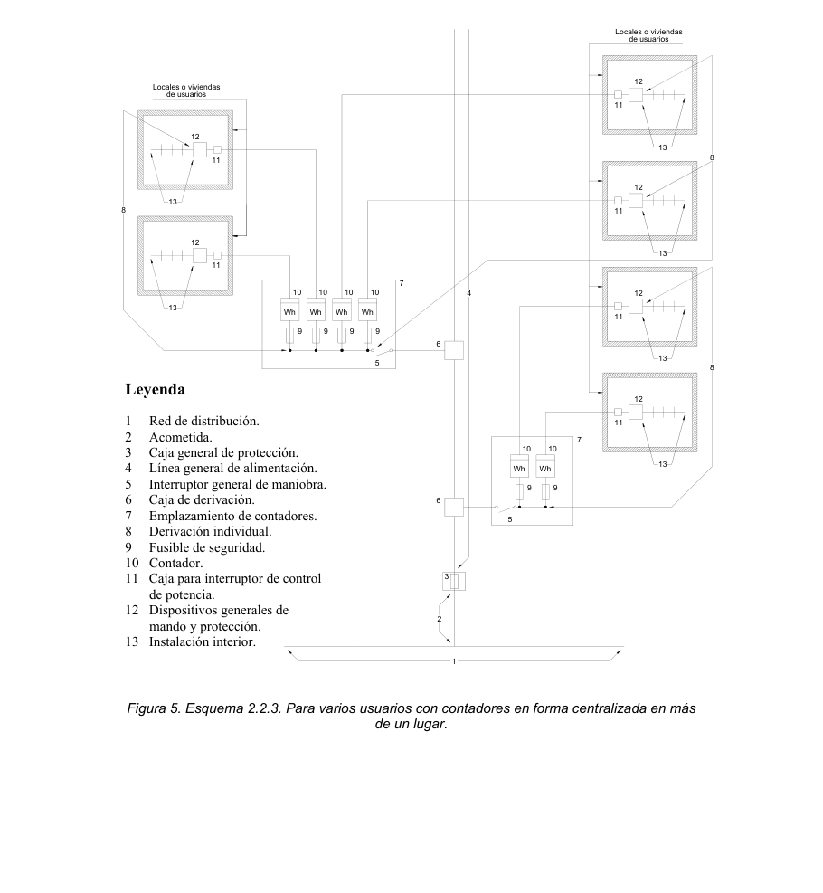

# BT-12. Esquemas

### 0. ÍNDICE

- 0. ÍNDICE — 1

- 00. DIFERENCIAS MÁS IMPORTANTES ENTRE EL RBT 2002 Y EL RBT 1973 — 2

- 1. INSTALACIONES DE ENLACE — 3

- 1.1 Definición — 3

- 1.2 Partes que constituyen las instalaciones de enlace — 3

- 2. ESQUEMAS — 3

- 2.1 Para un solo usuario — 4

- 2.2 Para más de un usuario — 5

##### 2.2.1 Colocación de contadores para dos usuarios alimentados desde el mismo lugar5

- 2.2.2 Colocación de contadores en forma centralizada en un lugar — 5

- 2.2.3 Colocación de contadores en forma centralizada en más de un lugar — 7

00. DIFERENCIAS MÁS IMPORTANTES ENTRE EL RBT 2002 Y EL RBT 1973.

<!-- tabla: ../tablas/BT-12_t01.csv -->

| RBT 1973 | RBT 2002 |
|---|---|
| MI BT 11-pto.1 La parte de la instalación de enlace entre la caja general de protección y la centralización de contadores se denomina línea repartidora. | ITC-BT 12-pto.1.2 Se denomina línea general de alimentación. |
| MI BT 11-pto.1 Se permite la colocación de contadores de forma individual dentro o fuera del local del abonado, independientemente del número de abonados. | ITC-BT 12-pto.2.1 y 2.2.1 La colocación de contadores de forma individual sólo se permite para un usuario o dos usuarios si están alimentados desde el mismo lugar, por ejemplo en chalets adosados. |
| MI BT 11-pto.1 Sólo se permiten varias concentraciones de contadores en plantas intermedias para edificios de gran altura. Centralización “por plantas”. | ITC-BT 12-pto.2.2.2 La concentración de contadores en varios lugares es aplicable tanto a edificación vertical u horizontal. |
| MI BT 11-pto.1 No existe interruptor general de maniobra. | ITC-BT 12-pto.2.2.2 y 2.2.3 En los esquemas con centralizaciones de más de dos contadores es necesario introducir un nuevo elemento: un interruptor general de maniobra que permite desconectar en carga toda la concentración de contadores. |

### 1. INSTALACIONES DE ENLACE

#### 1.1 Definición

Se denominan instalaciones de enlace, aquellas que unen la caja general de protección o cajas generales de protección, incluidas éstas, con las instalaciones interiores o receptoras del usuario.

Comenzarán, por tanto, en el final de la acometida y terminarán en los dispositivos generales de mando y protección.

Estas instalaciones se situarán y discurrirán siempre por lugares de uso común y quedarán de propiedad del usuario, que se responsabilizará de su conservación y mantenimiento.

La acometida (ver ITC 11) no forma parte de las instalaciones de enlace, y es responsabilidad de la empresa suministradora..

#### 1.2 Partes que constituyen las instalaciones de enlace

- Caja General de Protección (CGP) - Línea General de Alimentación (LGA) - Elementos para la Ubicación de Contadores (CC) - Derivación Individual (DI) - Caja para Interruptor de Control de Potencia (ICP) - Dispositivos Generales de Mando y Protección (DGMP)

El interruptor de control de potencia (ICP) es un dispositivo para controlar que la potencia realmente demandada por el consumidor no exceda de la contratada.

El ICP se utiliza para suministros en baja tensión y hasta una intensidad de 63 A

Para suministros de intensidad superior a 63 A no se utiliza el ICP, sino que se utilizarán interruptores de intensidad regulable, maxímetros o integradores incorporados al equipo de medida de energía eléctrica. En estos casos no es preceptiva la instalación de la caja para ICP (ver también ITC-BT-17 apartado 1.1).

<!-- tabla: ../tablas/BT-12_t02.csv -->

| 2. ESQUEMAS |  |  |  |
|---|---|---|---|
| Leyenda |  |  |  |
| 1 Red de distribución |  |  | 8 Derivación individual |
| 2 Acometida |  |  | 9 Fusible de seguridad |
| 3 Caja general de protección |  |  | 10 Contador |
| 4 Línea general de alimentación |  |  | 11 Caja para interruptor de control de |
| 5 Interruptor general de maniobra |  |  | potencia |
| 6 Caja de derivación |  |  | 12 Dispositivos generales de mando y |
| 7 Emplazamiento de contadores |  |  | protección |
|  |  |  | 13 Instalación interior |

Nota: El conjunto de derivación individual e instalación interior constituye la instalación privada.

#### 2.1 Para un solo usuario

En este caso se podrán simplificar las instalaciones de enlace al coincidir en el mismo lugar la Caja General de Protección y la situación del equipo de medida y no existir, por tanto, la Línea general de alimentación. En consecuencia, el fusible de seguridad (9) coincide con el fusible de la CGP.

Según la ITC-BT-13 pto. 2, la caja general de protección que incluye el contador, sus fusibles de protección y, en su caso, reloj para discriminación horaria, se denomina caja de protección y medida (CPM).

Local o vivienda de usuario

13

12

11

8 10 Wh CPM 9

2

### 1 Figura 1. Esquema 2.1. Para un solo usuario

<!-- figura vectorial en la pág. 4 del PDF original -->
> Figura en la pág. 4 del PDF original: [ver en el PDF](../pdf/BT-12.pdf#page=4)

#### 2.2 Para más de un usuario

Las instalaciones de enlace se ajustarán a los siguientes esquemas según la colocación de los contadores.

##### 2.2.1 Colocación de contadores para dos usuarios alimentados desde el mismo lugar

El esquema 2.1 puede generalizarse para dos usuarios alimentados desde el mismo lugar.

Por lo tanto es válido lo indicado para los fusibles de seguridad (9) en el apartado 2.1.

Este tipo de esquema es típico de chalets, de forma que se instalan dos cajas de protección y medida empotradas en el mismo nicho, o bien una caja doble que agrupe los contadores y fusibles de protección de los dos usuarios.

Locales o viviendas de usuarios

13 13

12 12

11 11

8 8 10 10 Wh Wh CPM 9 9

2

1

Figura 2. Esquema 2.2.1. Para dos usuarios alimentados desde el mismo lugar .

##### 2.2.2 Colocación de contadores en forma centralizada en un lugar

Este esquema es el que se utilizará normalmente en conjuntos de edificación vertical u horizontal, destinados principalmente a viviendas, edificios comerciales, de oficinas o destinados a una concentración de industrias.

<!-- figura vectorial en la pág. 5 del PDF original -->
> Figura en la pág. 5 del PDF original: [ver en el PDF](../pdf/BT-12.pdf#page=5)

Viviendas de Locales de usuarios usuarios

13 13 13 13 13

12 12 12 12 12

11 11 11 11 11

8

8 8

7

10 10 10 10 10

Wh Wh Wh Wh Wh

9 9 9 9 9

5

4

3

2

1 Leyenda 1 Red de distribución. 8 Derivación individual. 2 Acometida. 9 Fusible de seguridad. 3 Caja general de protección. 10 Contador. 4 Línea general de alimentación. 11 Caja para interruptor de control de potencia. 5 Interruptor general de maniobra. 12 Dispositivos generales de mando y protección. 6 Caja de derivación. 13 Instalación interior. 7 Emplazamiento de contadores. Figura 3. Esquema 2.2.2. Para varios usuarios con contadores en forma centralizada en un lugar

En los esquemas con contadores centralizados se incluye un elemento nuevo respecto del RBT 1973, que es el interruptor general de maniobra, obligatorio para concentraciones de mas de dos contadores. Dicho interruptor-seccionador tiene por misión dejar fuera de servicio, por ejemplo en caso de incendio, la instalación eléctrica del edificio. Las características se detallan en la ITC 16 apartado 3.

<!-- figura vectorial en la pág. 6 del PDF original -->
> Figura en la pág. 6 del PDF original: [ver en el PDF](../pdf/BT-12.pdf#page=6)

##### 2.2.3 Colocación de contadores en forma centralizada en más de un lugar

Este esquema se utilizará en edificios destinados a viviendas, edificios comerciales, de oficinas o destinados a una concentración de industrias donde la previsión de cargas haga aconsejable la centralización de contadores en más de un lugar o planta. Igualmente se utilizará para la ubicación de diversas centralizaciones en una misma planta en edificios comerciales o industriales, cuando la superficie de la misma y la previsión de cargas lo aconseje. También podrá ser de aplicación en las agrupaciones de viviendas en distribución horizontal dentro de un recinto privado.

Este esquema es de aplicación en el caso de centralización de contadores de forma distribuida mediante canalizaciones eléctricas prefabricadas, que cumplan lo establecido en la norma UNE-EN 60.439 -2.

<!-- tabla no extraíble en la pág. 8 -->
> La tabla de esta página no se puede extraer como texto (pdfplumber la lee como
> caracteres sueltos): se muestra la imagen de la página. También está en [pdf/BT-12.pdf](../pdf/BT-12.pdf#page=8).

