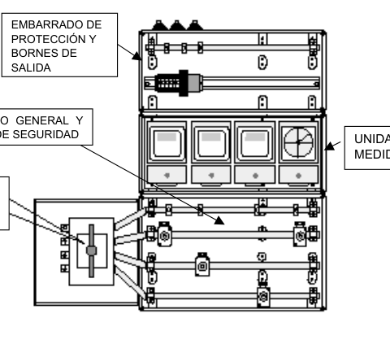

# BT-16. Contadores: Ubicación y sistemas de Instalación

_CONTADORES: UBICACIÓN Y SISTEMAS DE_

### 0. ÍNDICE

- 0. ÍNDICE — 1

- 00. DIFERENCIAS MÁS IMPORTANTES ENTRE EL RBT 2002 Y EL RBT 1973 — 2

- 1. GENERALIDADES — 5

- 2. FORMAS DE COLOCACIÓN — 6

- 2.1 Colocación en forma individual — 6

- 2.2 Colocación en forma concentrada — 7

- 2.2.1 En local — 7

- 2.2.2 En armario — 9

- 3. CONCENTRACIÓN DE CONTADORES — 10

- 4. ELECCIÓN DEL SISTEMA — 13

### 00. DIFERENCIAS MÁS IMPORTANTES ENTRE EL RBT 2002 Y EL RBT

1973.

<!-- tabla: ../tablas/BT-16_t01.csv -->

| RBT 1973 | RBT 2002 |
|---|---|
| MI BT 15-pto.1.1 Los contadores se instalarán sobre bases constituidas por materiales adecuados y no inflamables, estando incluso autorizado que las bases sean de madera. | ITC-BT 16-pto.1 Se amplían las posibilidades de instalación, ya que los contadores estarán ubicados en módulos, paneles o armarios. Los módulos son cajas provistas de tapas precintables. |
| MI BT 15-pto.1.1 Características de la centralización sin especificar. | ITC-BT 16-pto.1 Independientemente del tipo de centralización el conjunto una vez montado debe cumplir con la norma UNE–EN 60439 partes 1, 2, y 3, y proporcionar un grado de protección IP 40, IK 09 para interior, y de IP 43 , IK 09 para exterior. |
| Los conductores serán siempre de cobre de nivel de aislamiento 750V si son rígidos y 500V si son flexibles. | ITC-BT 16-pto.1 Los conductores serán de cobre de nivel de aislamiento 750 V, de sección mínima de 6mm2 y de clase 2. |
| MI BT 15-pto.1.1 Características sin especificar. | ITC-BT 16-pto.1 La conexión a los contadores se realizarán directamente sin emplear terminales. |
| MI BT 15-pto.1.1 A los conductores aislados no se les exige ninguna característica específica de comportamiento frente al fuego. | ITC-BT 16-pto.1 Los cables serán no propagadores del incendio con emisión de humos y opacidad reducida. |
| MI BT 15-pto.1.2 La colocación de contadores de forma individual no está limitada en cuanto al número de usuarios. | ITC-BT 16-pto.2.1 La colocación de contadores de forma individual se limita a un único usuario ampliable como máximo a dos cuando se alimente desde el mimo lugar. En estos casos los contadores y sus fusibles de protección se instalarán en una caja de protección y medida (CPM) |
| MI BT 15-pto.1.2 Cuando los contadores se instalan de forma individual la altura del contador estará entre 1,5m y 1,8m . | ITC-BT 13-pto.2.1 Cuando los contadores se instalan de forma individual el dispositivo de lectura del contador estará comprendido entre 0,7m, y 1,8m. |
| MI BT 15-pto.1.3 No se permite el uso de un armario. Los contadores se deben centralizar en un local o espacio adecuado a este fin. | ITC-BT 16-pto.2.2 Si el número de contadores a instalar es superior a 16 será obligatoria su instalación en local. Hasta 16 contadores se pueden instalar en un armario. |
| MI BT 15-pto.1.3 No se especifican los casos en los que se pueden utilizar varias centralizaciones de contadores. | ITC-BT 16-pto.2.2 Se podrán concentrar los contadores por plantas en edificios de más de 12 plantas y cuando existan más de 16 contadores en cada centralización. |
| MI BT 15-pto.1.3 El local donde se instalen los contadores será de fácil y libre acceso, tal como portal, recinto de portero o un departamento o habitación especialmente dedicado para ello. | ITC-BT 16-pto.2.2 El local será de fácil y libre acceso, tal como portal o recinto de portería y nunca podrá coincidir con el de otros servicios Además estará situado en la planta baja, entresuelo o primer sótano, salvo cuando existan concentraciones por plantas, en un lugar lo más próximo posible a la entrada del edificio y a la canalización de las derivaciones individuales. |

<!-- tabla: ../tablas/BT-16_t02.csv -->

| RBT 1973 | RBT 2002 |
|---|---|
| MI BT 15-pto.1.3 El local no ha de ser húmedo, no se describe nada en cuanto a las características que definen el comportamiento al fuego de las paredes y suelos. | ITC-BT 16-pto.2.2 El local estará construido con paredes de clase M0 y suelos de clase M1, separado de otros locales que presenten riesgos de incendio o produzcan vapores corrosivos y no estará expuesto a vibraciones ni humedad. |
| MI BT 15-pto.1.3 El local será de dimensiones suficientes para trabajar en él con garantía y seguridad. Entre el contador más saliente y la pared opuesta deberá respetarse un pasillo de 1,10m. | ITC-BT 16-pto.2.2 El local tendrá una altura mínima de 2,30 m y una anchura mínima en paredes ocupadas por contadores de 1,50 m. Sus dimensiones serán tales que las distancias desde la pared donde se instale la concentración de contadores hasta el primer obstáculo que tenga enfrente sean de 1,10 m. La distancia entre los laterales de dicha concentración y sus paredes colindantes será de 20 cm. La resistencia al fuego del local corresponderá a lo establecido en la Norma NBE-CPI-96 para locales de riesgo especial bajo |
| MI BT 15-pto.1.3 Los contadores se fijarán a la pared, nunca sobre tabique. | ITC-BT 16-pto.2.2 Las paredes donde debe fijarse la concentración de contadores tendrán una resistencia no inferior a la del tabicón de medio pie de ladrillo hueco. |
| MI BT 15-pto.1.3 No se describen las características de la puerta del local, ni se prescribe la necesidad de disponer de un extintor, ni se indica nada acerca del alumbrado de emergencia. | ITC-BT 16-pto.2.2 La puerta de acceso abrirá hacia el exterior y tendrá una dimensión mínima de 0,70 x 2 m, su resistencia al fuego corresponderá a lo establecido para puertas de locales de riesgo especial bajo en la Norma NBE-CPI-96 y estará equipada con la cerradura que tenga normalizada la empresa distribuidora. Dentro del local e inmediato a la entrada deberá instalarse un equipo autónomo de alumbrado de emergencia, de autonomía no inferior a 1 hora y proporcionando un nivel mínimo de iluminación de 5 lux. En el exterior del local y lo más próximo a la puerta de entrada, deberá existir un extintor móvil, de eficacia mínima 21B, cuya instalación y mantenimiento será a cargo de la propiedad del edificio. |
| MI BT 15-pto.1.3 No se admite la concentración de los contadores en el interior de un armario | ITC-BT 16-pto.2.2 Se describen detenidamente las características del armario y los servicios auxiliares (luz, base de enchufe) con que debe contar. |
| MI BT 15-pto.1.3 Los contadores se instalarán sobre bases constituidas por bases de materiales adecuados y no inflamables. | ITC-BT 16-pto.3 En referente al grado de inflamabilidad de las concentraciones de contadores cumplirán con el ensayo del hilo incandescente descrito en la norma UNE-EN 60.695-2-1, a una temperatura de 960°C para los materiales aislantes que estén en contacto con las partes que transportan la corriente y de 850°C para el resto de los materiales tales como envolventes, tapas, etc. |

<!-- tabla: ../tablas/BT-16_t03.csv -->

| RBT 1973 | RBT 2002 |
|---|---|
| MI BT 15-pto.1.3 Los contadores deberán colocarse de forma que se hallen a una altura mínima del suelo de 0,5m, y máxima de 1,8m. Podrá sin embargo admitirse su instalación hasta una altura máxima de 3 m, debiendo el propietario, en este caso, disponer en el local de elementos de acceso hasta esta altura que permitan la lectura de las indicaciones de los contadores. | ITC-BT 16-pto.3 La colocación de la concentración de contadores (sea en local o en armario), se realizará de tal forma que desde la parte inferior de la misma al suelo haya como mínimo una altura de 0,25 m y el cuadrante de lectura del aparato de medida situado más alto, no supere el 1,80 m. |
| MI BT 15-pto.1.3 No se describen las unidades funcionales que componen una centralización. Sólo se mencionan los contadores y sus fusibles de seguridad. | ITC-BT 16-pto.3 Se detallan las características de todas las unidades funcionales que existen siempre una centralización de contadores: Interruptor general de maniobra (obligatorio para más de dos usuarios) Embarrado general y fusibles de seguridad. Unidad de medida. Embarrado de protección y bornes de salida. Además existen unidades opcionales: Unidad de mando para el cambio de tarifa Unidad de telecomunicaciones |

### 1. GENERALIDADES

Los contadores y demás dispositivos para la medida de la energía eléctrica, podrán estar ubicados en:

- módulos (cajas con tapas precintables) - paneles - armarios

Todos ellos, constituirán conjuntos que deberán cumplir la norma UNE-EN 60.439 partes 1,2 y 3.

El grado de protección mínimo que deben cumplir estos conjuntos, de acuerdo con la norma UNE 20.324 y UNE-EN 50.102, respectivamente.

- para instalaciones de tipo interior: IP40; IK 09 - para instalaciones de tipo exterior: IP43; IK 09

Deberán permitir de forma directa la lectura de los contadores e interruptores horarios, así como la del resto de dispositivos de medida, cuando así sea preciso. Las partes transparentes que permiten la lectura directa, deberán ser resistentes a los rayos ultravioleta.

Cuando se utilicen módulos o armarios, éstos deberán disponer de ventilación interna para evitar condensaciones sin que disminuya su grado de protección.

Las dimensiones de los módulos, paneles y armarios, serán las adecuadas para el tipo y número de contadores así como del resto de dispositivos necesarios para la facturación de la energía, que según el tipo de suministro deban llevar.

El significado de los códigos IP e IK se indican en el Anexo 1 de esta Unidad Temática.

El grado de protección para las centralizaciones tipo módulos o del tipo panel se refiere al conjunto de las unidades funcionales correspondientes totalmente equipadas y montadas.

Cada derivación individual debe llevar asociado en su origen su propia protección compuesta por fusibles de seguridad, con independencia de las protecciones correspondientes a la instalación interior de cada suministro. Estos fusibles se instalarán antes del contador y se colocarán en cada uno de los hilos de fase o polares que van al mismo, tendrán la adecuada capacidad de corte en función de la máxima intensidad de cortocircuito que pueda presentarse en ese punto y estarán precintados por la empresa distribuidora. Los cables serán de 6 mm2 de sección, salvo cuando se incumplan las prescripciones reglamentarias en lo que afecta a previsión de cargas y caídas de tensión, en cuyo caso la sección será mayor.

Teniendo en cuenta los ejemplos elaborados en la GUIA-BT-15 de cálculo de caída de tensión en la derivación individual de suministros monofásicos, cuando los contadores se ubican en una única concentración, se recomienda la utilización de conductores de sección mínima de 10

mm2 para el conexionado en viviendas de grado de electrificación básico y de 16 mm2 para las de grado elevado, salvo para trazados de longitud muy corta (menos de 14 metros en electrificación básica, y menos de 8 metros en electrificación elevada).

Los cables serán de una tensión asignada de 450/750 V y los conductores de cobre, de clase 2 según norma UNE 21.022, con un aislamiento seco, extruido a base de mezclas termoestables o termoplásticas; y se identificarán según los colores prescritos en la ITC MIE-BT-26.

Los cables serán no propagadores del incendio y con emisión de humos y opacidad reducida. Los cables con características equivalentes a la norma UNE 21.027 –9 (mezclas termoestables) o a la norma UNE 21.1002 (mezclas termoplásticas) cumplen con esta prescripción.

Asimismo, deberá disponer del cableado necesario para los circuitos de mando y control con el objetivo de satisfacer las disposiciones tarifarias vigentes. El cable tendrá las mismas características que las indicadas anteriormente, su color de identificación será el rojo y con una sección de 1,5 mm2.

Las conexiones se efectuarán directamente y los conductores no requerirán preparación especial o terminales.

Los cables con estas características indicados en estas normas son:

<!-- tabla: ../tablas/BT-16_t04.csv -->

| Producto |  | Norma de aplicación |
|---|---|---|
| Cable tipo H07Z-R | Conductor unipolar aislado de tensión asignada 450/750 V, conductor de cobre clase 2 (-R), aislamiento de compuesto termoestable (Z). | UNE 21 027-9 |
| Cable tipo ES07Z1-R (AS) | Conductor unipolar aislado de tensión asignada 450/750 V, conductor de cobre clase 2 (-R), aislamiento de compuesto termoplástico a base de poliolefina (Z1) Este tipo de cable solamente está normalizado para las secciones de 1,5 mm2 con aislamiento de color rojo y de 6, 10, 16 mm2. | UNE 211 002 |
| Nota 1: Según la norma UNE 21 022 los conductores clase 2 son aquellos constituidos por varios alambres cableados, formando un conductor rígido. |  |  |

### 2. FORMAS DE COLOCACIÓN

#### 2.1 Colocación en forma individual

Esta disposición se utilizará sólo cuando se trate de un suministro a un único usuario independiente o a dos usuarios alimentados desde un mismo lugar.

Se hará uso de la Caja de Protección y Medida, de los tipos y características indicados en el apartado 2 de ITC-BT-13, que reúne bajo una misma envolvente, los fusibles generales de protección, el contador y el dispositivo para discriminación horaria. En este caso, los fusibles de seguridad coinciden con los generales de protección.

El emplazamiento de la Caja de Protección y Medida se efectuará de acuerdo a lo indicado en

el apartado 2.1 de la ITC-BT-13.

Para suministros industriales, comerciales o de servicios con medida indirecta, dada la complejidad y diversidad que ofrecen, la solución a adoptar será la que se especifique en las requisitos particulares de la empresa suministradora para cada caso en concreto, partiendo de los siguientes principios:

- fácil lectura del equipo de medida - acceso permanente a los fusibles generales de protección - garantías de seguridad y mantenimiento

El usuario será responsable del quebrantamiento de los precintos que coloquen los organismos oficiales o las empresas suministradoras, así como de la rotura de cualquiera de los elementos que queden bajo su custodia, cuando el contador esté instalado dentro de su local o vivienda. En el caso de que el contador se instale fuera, será responsable el propietario del edificio.

#### 2.2 Colocación en forma concentrada

En el caso de:

- edificios destinados a viviendas y locales comerciales - edificios comerciales - edificios destinados a una concentración de industrias

Los contadores y demás dispositivos para la medida de la energía eléctrica de cada uno de los usuarios y de los servicios generales del edificio, podrán concentrarse en uno o varios lugares, para cada uno de los cuales habrá de preverse en el edificio un armario o local adecuado a este fin, donde se colocarán los distintos elementos necesarios para su instalación.

Cuando el número de contadores a instalar sea superior a 16, será obligatoria su ubicación en local, según el apartado 2.2.1 siguiente.

En función de la naturaleza y número de contadores, así como de las plantas del edificio, la concentración de los contadores se situará de la forma siguiente:

- En edificios de hasta 12 plantas se colocarán en la planta baja, entresuelo o primer sótano. En edificios superiores a 12 plantas se podrá concentrar por plantas intermedias, comprendiendo cada concentración los contadores de 6 o más plantas. - Podrán disponerse concentraciones por plantas cuando el número de contadores en cada una de las concentraciones sea superior a 16.

##### 2.2.1 En local

Este local que estará dedicado única y exclusivamente a este fin podrá, además, albergar por necesidades de la Compañía Eléctrica para la gestión de los suministros que parten de la centralización, un equipo de comunicación y adquisición de datos, a instalar por la Compañía Eléctrica, así como el cuadro general de mando y protección de los servicios comunes del edificio, siempre que las dimensiones reglamentarias lo permitan.

El local cumplirá las condiciones de protección contra incendios que establece la NBE-CPI-96 para los locales de riesgo especial bajo y responderá a las siguientes condiciones:

- estará situado en la planta baja, entresuelo o primer sótano, salvo cuando existan concentraciones por plantas, en un lugar lo más próximo posible a la entrada del edificio y a la canalización de las derivaciones individuales. Será de fácil y libre acceso, tal como portal o recinto de portería y el local nunca podrá coincidir con el de otros servicios tales como cuarto de calderas, concentración de contadores de agua, gas, telecomunicaciones, maquinaria de ascensores o de otros como almacén, cuarto trastero, de basuras, etc.

- no servirá nunca de paso ni de acceso a otros locales.

- estará construido con paredes de clase M0 y suelos de clase M1, separado de otros locales que presenten riesgos de incendio o produzcan vapores corrosivos y no estará expuesto a vibraciones ni humedades.

Las exigencias de comportamiento ante el fuego de los materiales se definen fijando la clase que deben alcanzar conforme a la norma UNE 23727. Estas clases se denominan: M0, M1, M2, M3 y M4. El número de la denominación de cada clase indica la magnitud relativa con la que los materiales correspondientes pueden favorecer el desarrollo de un incendio.

La clase M0 indica que un material es no combustible ante la acción térmica normalizada del ensayo correspondiente. Un material de clase M1 es combustible, pero no inflamable, lo que implica que su combustión no se mantiene cuando cesa la aportación de calor desde un foco exterior. Los materiales de clase M2, M3, y M4 pueden considerarse de un grado de inflamabilidad moderada, media o alta respectivamente.

- dispondrá de ventilación y de iluminación suficiente para comprobar el buen funcionamiento de todos los componentes de la concentración.

- cuando la cota del suelo sea inferior o igual a la de los pasillos o locales colindantes, deberán disponerse sumideros de desagüe para que en el caso de avería, descuido o rotura de tuberías de agua, no puedan producirse inundaciones en el local.

- las paredes donde debe fijarse la concentración de contadores tendrán una resistencia no inferior a la del tabicón de medio pie de ladrillo hueco.

- el local tendrá una altura mínima de 2,30 m y una anchura mínima en paredes ocupadas por contadores de 1,50 m. Sus dimensiones serán tales que las distancias desde la pared donde se instale la concentración de contadores hasta el primer obstáculo que tenga enfrente sean de 1,10 m. La distancia entre los laterales de dicha concentración y sus paredes colindantes será de 20 cm. La resistencia al fuego del local corresponderá a lo establecido en la Norma NBE- CPI-96 para locales de riesgo especial bajo.

RF90 según el artículo 19 de la NBE-CPI-96.

- la puerta de acceso abrirá hacia el exterior y tendrá una dimensión mínima de 0,70 x 2 m, su resistencia al fuego corresponderá a lo establecido para puertas de locales de riesgo especial bajo en la Norma NBE-CPI-96 y estará equipada con la cerradura que tenga normalizada la empresa distribuidora.

RF60 como mínimo excepto cuando el paso se realice desde un vestíbulo previo, caso en que la puerta será RF30, según el artículo 15 de la NBE-CPI-96

- dentro del local e inmediato a la entrada deberá instalarse un equipo autónomo de alumbrado de emergencia, de autonomía no inferior a 1 hora y proporcionando un nivel mínimo de

iluminación de 5 lux.

- en el exterior del local y lo más próximo a la puerta de entrada, deberá existir un extintor móvil, de eficacia mínima 21B, cuya instalación y mantenimiento será a cargo de la propiedad del edificio.

Se recomienda que los extintores tengan una eficacia 21A/113B, según establecen varias reglamentaciones de protección contra incendios.

≥1,50m ≥0,20m ≥0,20m Embarrado de protección y bornes de salida m03,2≥ IP40 m08,1≤ IK09 (cid:1)(cid:1)(cid:1)(cid:1)(cid:1)(cid:1)(cid:1)(cid:1)(cid:1)(cid:1)(cid:1)(cid:1)(cid:1)(cid:1)(cid:1)(cid:1)(cid:1)(cid:1)(cid:1)(cid:1)(cid:1)(cid:1)(cid:1)(cid:1)(cid:1)(cid:1)(cid:1)(cid:1)(cid:1)(cid:1)(cid:1)(cid:1)(cid:1)(cid:1)(cid:1)(cid:1)(cid:1)(cid:1)(cid:1)(cid:1)(cid:1)(cid:1)(cid:1)(cid:1) (cid:1)(cid:1)(cid:1)(cid:1)(cid:1)(cid:1)(cid:1)(cid:1)(cid:1)(cid:1)(cid:1)(cid:1)(cid:1)(cid:1)(cid:1)(cid:1)(cid:1)(cid:1)(cid:1)(cid:1)(cid:1)(cid:1)(cid:1)(cid:1)(cid:1)(cid:1)(cid:1)(cid:1)(cid:1)(cid:1)(cid:1)(cid:1)(cid:1)(cid:1)(cid:1)(cid:1)(cid:1)(cid:1)(cid:1)(cid:1)(cid:1)(cid:1)(cid:1)(cid:1) Unidad (cid:1)(cid:1)(cid:1)(cid:1)(cid:1)(cid:1)(cid:1)(cid:1)(cid:1)(cid:1)(cid:1)(cid:1)(cid:1)(cid:1)(cid:1)(cid:1)(cid:1)(cid:1)(cid:1)(cid:1)(cid:1)(cid:1)(cid:1)(cid:1)(cid:1)(cid:1)(cid:1)(cid:1)(cid:1)(cid:1)(cid:1)(cid:1)(cid:1)(cid:1)(cid:1)(cid:1)(cid:1)(cid:1)(cid:1)(cid:1)(cid:1)(cid:1)(cid:1)(cid:1) funcional de Interruptor general medida de maniobra Embarrado general y fusibles de seguridad

Figura B. : Ejemplo de colocación de contadores centralizados en un local.

##### 2.2.2 En armario

Si el número de contadores a centralizar es igual o inferior a 16, además de poderse instalar en un local de las características descritas en 2.2.1, la concentración podrá ubicarse en un armario destinado única y exclusivamente a este fin.

Este armario, reunirá los siguientes requisitos:

- estará situado en la planta baja, entresuelo o primer sótano del edificio, salvo cuando existan concentraciones por plantas, empotrado o adosado sobre un paramento de la zona común de la entrada lo más próximo a ella y a la canalización de las derivaciones individuales.

- no tendrá bastidores intermedios que dificulten la instalación o lectura de los contadores y demás dispositivos.

- desde la parte más saliente del armario hasta la pared opuesta deberá respetarse un pasillo de 1,5 m como mínimo.

- los armarios tendrán una característica parallamas mínima, PF 30

- las puertas de cierre, dispondrán de la cerradura que tenga normalizada la empresa

<!-- figura vectorial en la pág. 9 del PDF original -->
> Figura en la pág. 9 del PDF original: [ver en el PDF](../pdf/BT-16.pdf#page=9)

suministradora.

- dispondrá de ventilación y de iluminación suficiente y en sus inmediaciones, se instalará un extintor móvil, de eficacia mínima 21B, cuya instalación y mantenimiento será a cargo de la propiedad del edificio. Igualmente, se colocará una base de enchufe (toma de corriente) con toma de tierra de 16 A para servicios de mantenimiento.

### 3. CONCENTRACIÓN DE CONTADORES

Las concentraciones de contadores estarán concebidas para albergar los aparatos de medida, mando, control (ajeno al ICP) y protección de todas y cada una de las derivaciones individuales que se alimentan desde la propia concentración.

En referente al grado de inflamabilidad cumplirán con el ensayo del hilo incandescente descrito en la norma UNE-EN 60.695 -2-1, a una temperatura de 960°C para los materiales aislantes que estén en contacto con las partes que transportan la corriente y de 850°C para el resto de los materiales tales como envolventes, tapas, etc.

Cuando existan envolventes estarán dotadas de dispositivos precintables que impidan toda manipulación interior y podrán constituir uno o varios conjuntos. Los elementos constituyentes de la concentración que lo precisen, estarán marcados de forma visible para que permitan una fácil y correcta identificación del suministro a que corresponde.

La propiedad del edificio o el usuario tendrán, en su caso, la responsabilidad del quebranto de los precintos que se coloquen y de la alteración de los elementos instalados que quedan bajo su custodia en el local o armario en que se ubique la concentración de contadores.

Las concentraciones permitirán la instalación de los elementos necesarios para la aplicación de las disposiciones tarifarias vigentes y permitirán la incorporación de los avances tecnológicos del momento.

La colocación de la concentración de contadores, se realizará de tal forma que desde la parte inferior de la misma al suelo haya como mínimo una altura de 0,25 m y el cuadrante de lectura del aparato de medida situado más alto, no supere el 1,80 m.

El cableado que efectúa las uniones embarrado-contador-borne de salida podrá ir bajo tubo o conducto.

Las concentraciones, estarán formadas eléctricamente, por las siguientes unidades funcionales:

- Unidad funcional de interruptor general de maniobra

Su misión es dejar fuera de servicio, en caso de necesidad, toda la concentración de contadores. Será obligatoria para concentraciones de más de dos usuarios.

Esta unidad se instalará en una envolvente de doble aislamiento independiente, que contendrá un interruptor de corte omnipolar, de apertura en carga y que garantice que el neutro no sea cortado antes que los otros polos.

Se instalará entre la línea general de alimentación y el embarrado general de la concentración de contadores.

Cuando exista más de una línea general de alimentación se colocará un interruptor por cada una de ellas.

El interruptor será, como mínimo, de 160 A para previsiones de carga hasta 90 kW, y de 250 A para las superiores a ésta, hasta 150 kW.

Cuando en una misma instalación de enlace se instale mas de un interruptor general de maniobra porque se alimenten distintas centralizaciones de contadores, se recomienda que se coloquen juntos en la centralización más próxima al acceso de los bomberos al edificio

- Unidad funcional de embarrado general y fusibles de seguridad

Contiene el embarrado general de la concentración y los fusibles de seguridad correspondiente a todos los suministros que estén conectados al mismo. Dispondrá de una protección aislante que evite contactos accidentales con el embarrado general al acceder a los fusibles de seguridad.

- Unidad funcional de medida

Contiene los contadores, interruptores horarios y/o dispositivos de mando para la medida de la energía eléctrica.

- Unidad funcional de mando (opcional)

Contiene los dispositivos de mando para el cambio de tarifa de cada suministro.

- Unidad funcional de embarrado de protección y bornes de salida

Contiene el embarrado de protección donde se conectarán los cables de protección de cada derivación individual así como los bornes de salida de las derivaciones individuales.

El embarrado de protección, deberá estar señalizado con el símbolo normalizado de puesta a tierra y conectado a tierra.

- Unidad funcional de telecomunicaciones (opcional)

Contiene el espacio para el equipo de comunicación y adquisición de datos.

La protección aislante adicional que protege el embarrado general de la concentración y los fusibles de seguridad tendrá un grado de protección mínimo IP XXB.

En los esquemas con contadores centralizados se incluye un elemento nuevo que es el interruptor general de maniobra, obligatorio para concentraciones de más de dos contadores. Dicho interruptor-seccionador tiene por misión dejar fuera de servicio, por ejemplo en caso de incendio, la instalación eléctrica del edificio y deberá poderse enclavar en posición de abierto.

También es importante prever suficiente espacio libre en el local donde se ubica la centralización de contadores para poder instalar posteriormente las unidades funcionales opcionales o de registro de calidad de servicio.

Producto Norma de aplicación

<!-- tabla: ../tablas/BT-16_t05.csv -->

| Conjuntos de aparamenta (Módulos, paneles o armarios) | UNE-EN 60439-1 y 2 |
|---|---|
| Envolvente (para conjunto de aparamenta) | UNE-EN 50298 |
| Envolvente de accesorio (Cuadros, cajas derivación, registro, etc.) | UNE 20451 |
| Bornes de conexión | UNE-EN 60998 UNE-EN 60947-7 |
| Interruptor general de maniobra (interruptor-seccionador) | UNE-EN 60947-3 |
| Fusibles | UNE-EN 60269 (serie) |
| Contadores (electrónicos) | UNE-EN 61036 |
| Contadores (inducción) | UNE-EN 60521 |
| Interruptor horario | UNE-EN 61038 |
| Base de toma de corriente | UNE 20315 |
| Nota 1: Los diferentes componentes que conforman los módulos, paneles o armarios deberán cumplir con su correspondiente norma de producto. Cuando se comercializan montados, todos estos elementos, constituyen el conjunto de aparamenta y deberán cumplir con las prescripciones de la norma (UNE-EN 60439-1). Nota 2: El grado de protección IP 40 (interior) ó IP43 (exterior), el grado de protección contra los impactos mecánicos externos IK09 y el grado de inflamabilidad se verificarán de acuerdo a lo establecido en la norma UNE-EN 50298. El grado de inflamabilidad será: - (960 ± 10) ºC para las partes que soportan partes activas - (650 ± 10) ºC para todas las demás partes |  |

### EMBARRADO DE

### PROTECCIÓN Y

### BORNES DE SALIDA

### EMBARRADO GENERAL Y

### FUSIBLES DE SEGURIDAD UNIDAD DE

MEDIDA

INTERRUPTOR

### GENERAL DE

MANIOBRA

Figura C: Ejemplo de instalación de las unidades funcionales principales de una centralización de contadores.

### 4. ELECCIÓN DEL SISTEMA

Para homogeneizar estas instalaciones la Empresa Suministradora, de común acuerdo con la propiedad, elegirá de entre las soluciones propuestas la que mejor se ajuste al suministro solicitado. En caso de discrepancia resolverá el Organismo Competente de la Administración

Se admitirán otras soluciones tales como contadores individuales en viviendas o locales, cuando se incorporen al sistema nuevas técnicas de telegestión.
