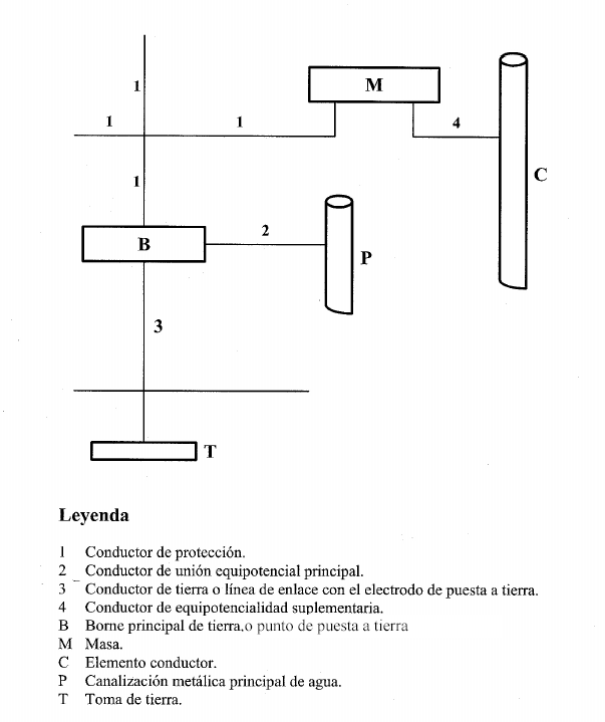
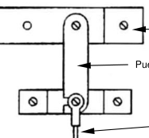
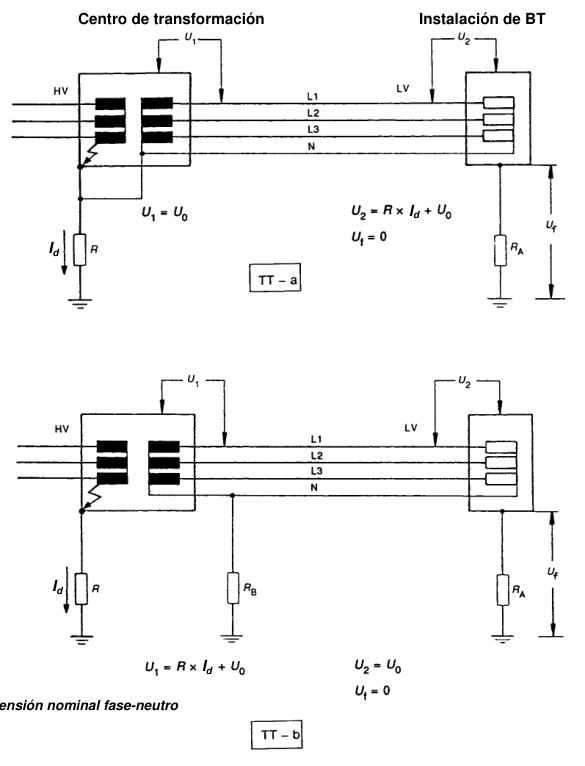

# BT-18. Instalaciones de puesta a tierra

_INSTALACIONES DE PUESTA A TIERRA_

### 0. ÍNDICE

- 0. ÍNDICE — 1

- 1. OBJETO — 2

- 2. PUESTA O CONEXIÓN A TIERRA. DEFINICIÓN — 2

- 3. UNIONES A TIERRA — 2

- 3.1 Tomas de tierra — 3

- 3.2 Conductores de tierra — 5

- 3.3 Bornes de puesta a tierra — 6

- 3.4 Conductores de protección — 6

- 4. PUESTA A TIERRA POR RAZONES DE PROTECCION — 9

#### 4.1 Tomas de tierra y conductores de protección para dispositivos de control de

- tensión de defecto — 9

- 5. PUESTA A TIERRA POR RAZONES FUNCIONALES — 9

### 6. PUESTA A TIERRA POR RAZONES COMBINADAS DE PROTECCION Y

- FUNCIONALES — 9

- 7. CONDUCTORES CPN (TAMBIÉN DENOMINADOS PEN) — 9

- 8. CONDUCTORES DE EQUIPOTENCIALIDAD — 10

- 9. RESISTENCIA DE LAS TOMAS DE TIERRA — 10

- 10. TOMAS DE TIERRA INDEPENDIENTES — 13

### 11. SEPARACIÓN ENTRE LAS TOMAS DE TIERRA DE LAS MASAS DE LAS

### INSTALACIONES DE UTILIZACIÓN Y DE LAS MASAS DE UN CENTRO DE

- TRANSFORMACIÓN — 15

- 12. REVISIÓN DE LAS TOMAS DE TIERRA — 17

- 1 -

### 1. OBJETO

Las puestas a tierra se establecen principalmente con objeto de limitar la tensión que, con respecto a tierra, puedan presentar en un momento dado las masas metálicas, asegurar la actuación de las protecciones y eliminar o disminuir el riesgo que supone una avería en los materiales eléctricos utilizados. Cuando otras instrucciones técnicas prescriban como obligatoria la puesta a tierra de algún elemento o parte de la instalación, dichas puestas a tierra se regirán por el contenido de la presente instrucción.

### 2. PUESTA O CONEXIÓN A TIERRA. DEFINICIÓN

La puesta o conexión a tierra es la unión eléctrica directa, sin fusibles ni protección alguna, de una parte del circuito eléctrico o de una parte conductora no perteneciente al mismo mediante una toma de tierra con un electrodo o grupos de electrodos enterrados en el suelo. Mediante la instalación de puesta a tierra se deberá conseguir que en el conjunto de instalaciones, edificios y superficie próxima del terreno no aparezcan diferencias de potencial peligrosas y que, al mismo tiempo, permita el paso a tierra de las corrientes de defecto o las de descarga de origen atmosférico.

### 3. UNIONES A TIERRA

Las disposiciones de puesta a tierra pueden ser utilizadas a la vez o separadamente, por razones de protección o razones funcionales, según las prescripciones de la instalación. La elección e instalación de los materiales que aseguren la puesta a tierra deben ser tales que: - El valor de la resistencia de puesta a tierra esté conforme con las normas de protección y de funcionamiento de la instalación y se mantenga de esta manera a lo largo del tiempo, teniendo en cuenta los requisitos generales indicados en la ITC-BT-24 y los requisitos particulares de las Instrucciones Técnicas aplicables a cada instalación. - Las corrientes de defecto a tierra y las corrientes de fuga puedan circular sin peligro, particularmente desde el punto de vista de solicitaciones térmicas, mecánicas y eléctricas. - La solidez o la protección mecánica quede asegurada con independencia de las condiciones estimadas de influencias externas. - Contemplen los posibles riesgos debidos a electrólisis que pudieran afectar a otras partes metálicas. En la figura 1 se indican las partes típicas de una instalación de puesta a tierra:

- 2 -

Figura 1. Representación esquemática de un circuito de puesta a tierra

#### 3.1 Tomas de tierra

Para la toma de tierra se pueden utilizar electrodos formados por: - barras, tubos; - pletinas, conductores desnudos; - placas; - anillos o mallas metálicas constituidos por los elementos anteriores o sus combinaciones; - armaduras de hormigón enterradas; con excepción de las armaduras pretensadas; - otras estructuras enterradas que se demuestre que son apropiadas. Los conductores de cobre utilizados como electrodos serán de construcción y resistencia eléctrica según la clase 2 de la norma UNE 21.022.

- 3 -

El tipo y la profundidad de enterramiento de las tomas de tierra deben ser tales que la posible pérdida de humedad del suelo, la presencia del hielo u otros efectos climáticos, no aumenten la resistencia de la toma de tierra por encima del valor previsto. La profundidad nunca será inferior a 0,50 m.

La profundidad de enterramiento del electrodo deberá medirse desde la parte superior del mismo. Además, en lugares en los que existan riesgo continuado de heladas, se recomienda una profundidad mínima de enterramiento de la parte superior del electrodo de 0,8 m. Los materiales utilizados y la realización de las tomas de tierra deben ser tales que no se vea afectada la resistencia mecánica y eléctrica por efecto de la corrosión de forma que comprometa las características del diseño de la instalación Las canalizaciones metálicas de otros servicios (agua, líquidos o gases inflamables, calefacción central, etc.) no deben ser utilizadas como tomas de tierra por razones de seguridad. Las envolventes de plomo y otras envolventes de cables que no sean susceptibles de deterioro debido a una corrosión excesiva, pueden ser utilizadas como toma de tierra, previa autorización del propietario, tomando las precauciones debidas para que el usuario de la instalación eléctrica sea advertido de los cambios del cable que podría afectar a sus características de puesta a tierra.

La ITC-BT-26 aplicable a viviendas, locales comerciales, oficinas y otros locales con usos análogos, exige que la toma de tierra se realice en forma de anillo cerrado que interese a todo el perímetro del edificio al que se conectan, en su caso, los electrodos verticalmente hincados en el terreno cuando se prevea la necesidad de disminuir la resistencia de tierra que pueda presentar el conductor en anillo. En otros casos no contemplados en la ITC-BT-26, se recomienda también utilizar esta disposición constructiva.

<!-- tabla: ../tablas/BT-18_t01.csv -->

| Producto | Norma de aplicación |
|---|---|
| Picas cilíndricas de acero-cobre | UNE 21056 UNE 202006 |
| Conductor de cobre desnudo (clase 2) | UNE 21022 UNE-EN 60228 |

- 4 -

Las dimensiones mínimas recomendadas para los electrodos de puesta a tierra, son las siguientes:

<!-- tabla: ../tablas/BT-18_t02.csv -->

| Tipo de electrodo |  | Dimensión mínima |
|---|---|---|
| Picas | barras | Ø ≥ 14,2 mm (acero-cobre 250µ) Ø ≥ 20 mm (acero galvanizado 78µ) |
|  | perfiles | Espesor ≥ 5 mm y Sección ≥ 350 mm2 |
|  | tubos | Ø ≥ 30 mm y Espesor ≥ 3 mm ext |
| Placas | rectangular | 1 m x 0,5 m Espesor ≥ 2 mm (cobre); Espesor ≥ 3 mm (acero galvanizado 78µ) |
|  | cuadrada | 1 m x 1 m Espesor ≥ 2 mm (cobre); Espesor ≥ 3 mm (acero galvanizado 78µ) |
| Conductor desnudo |  | 35 mm2 (cobre) |

La longitud mínima de las picas cilíndricas se indica en la norma de producto aplicable.

#### 3.2 Conductores de tierra

La sección de los conductores de tierra tienen que satisfacer las prescripciones del apartado 3.4 de esta Instrucción y, cuando estén enterrados, deberán estar de acuerdo con los valores de la tabla 1. La sección no será inferior a la mínima exigida para los conductores de protección. Tabla 1. Secciones mínimas convencionales de los conductores de tierra

<!-- tabla: ../tablas/BT-18_t03.csv -->

|  | TIPO |  |  | Protegido mecánicamente |  |  | No protegido mecánicamente |
|---|---|---|---|---|---|---|---|
| Protegido contra la corrosión* |  |  | Según apartado 3.4 |  |  |  | 16 mm2 Cobre |
|  |  |  |  |  |  |  | 16 mm2 Acero Galvanizado |
|  | No protegido contra la |  |  | 25 mm2 Cobre |  |  |  |
|  | corrosión |  |  | 50 mm2 Hierro |  |  |  |
|  | * La protección contra la corrosión puede obtenerse mediante una envolvente |  |  |  |  |  |  |

Durante la ejecución de las uniones entre conductores de tierra y electrodos de tierra debe extremarse el cuidado para que resulten eléctricamente correctas. Debe cuidarse, en especial, que las conexiones, no dañen ni a los conductores ni a los electrodos de tierra.

No obstante a lo indicado en la tabla, es recomendable que la sección mínima del conductor de tierra de cobre enterrado y desnudo sea de 35 mm2. Se considera que las conexiones son eléctricamente correctas, si se realizan, por ejemplo, mediante grapas de conexión, soldadura aluminotérmica o autógena. La determinación de la sección de los conductores de tierra se debe realizar utilizando el método de calculo indicado en la Norma UNE 20460-5-54 (descrito en el apartado 3.4), respetando los valores mínimos indicados en la Tabla 1.

- 5 -

#### 3.3 Bornes de puesta a tierra

En toda instalación de puesta a tierra debe preverse un borne principal de tierra, al cual deben unirse los conductores siguientes: - Los conductores de tierra, - Los conductores de protección. - Los conductores de unión equipotencial principal. - Los conductores de puesta a tierra funcional, si son necesarios. Debe preverse sobre los conductores de tierra y en lugar accesible, un dispositivo que permita medir la resistencia de la toma de tierra correspondiente. Este dispositivo puede estar combinado con el borne principal de tierra, debe ser desmontable necesariamente por medio de un útil, tiene que ser mecánicamente seguro y debe asegurar la continuidad eléctrica

Figura A. Ejemplo de puente seccionador de tierra

Borne principal de tierra

Puente seccionador

Conductor de tierra

La sección del puente seccionador de tierra debe ser la misma que la del conductor de tierra o sección equivalente si se utilizan otros materiales. Se recomienda desconectar la instalación eléctrica en su origen antes de abrir el puente seccionador de tierra, para evitar que quede sin protección contra los contactos indirectos. Una vez realizada la medida de resistencia de puesta a tierra, se debe volver a conectar el puente antes de ponerla de nuevo en servicio.

#### 3.4 Conductores de protección

Los conductores de protección sirven para unir eléctricamente las masas de una instalación a ciertos elementos con el fin de asegurar la protección contra contactos indirectos. En el circuito de conexión a tierra, los conductores de protección unirán las masas al conductor de tierra. En otros casos reciben igualmente el nombre de conductores de protección, aquellos conductores que unen las masas: - al neutro de la red, - a un relé de protección. La sección de los conductores de protección será la indicada en la tabla 2, o se obtendrá por

- 6 -

cálculo conforme a lo indicado en la Norma UNE 20.460 -5-54 apartado 543.1.1. Tabla 2. Relación entre las secciones de los conductores de protección y los de fase

<!-- tabla: ../tablas/BT-18_t04.csv -->

|  | Sección de los conductores de |  |  | Sección mínima de los conductores de |
|---|---|---|---|---|
|  | fase de la instalación |  |  | protección |
|  | S (mm2) |  |  | S (mm2) p |
|  | S ≤ 16 |  |  | S = S p |
|  | 16 < S ≤ 35 |  |  | S = 16 p |
|  | S > 35 |  |  | S = S/2 p |

Si la aplicación de la tabla conduce a valores no normalizados, se han de utilizar conductores que tengan la sección normalizada superior más próxima. Los valores de la tabla 2 solo son válidos en el caso de que los conductores de protección hayan sido fabricados del mismo material que los conductores activos; de no ser así, las secciones de los conductores de protección se determinarán de forma que presenten una conductividad equivalente a la que resulta aplicando la tabla 2. En todos los casos los conductores de protección que no forman parte de la canalización de alimentación serán de cobre con una sección, al menos de: - 2,5 mm2, si los conductores de protección disponen de una protección mecánica. - 4 mm2, si los conductores de protección no disponen de una protección mecánica. Cuando el conductor de protección sea común a varios circuitos, la sección de ese conductor debe dimensionarse en función de la mayor sección de los conductores de fase.

Para instalaciones interiores, tal y como se indica en la ITC-BT-19, la sección mínima de los conductores de protección serán las indicadas en la Tabla 2. Cuando por aplicación de la Tabla 2 la sección del conductor de protección pueda ser inferior a la sección de los conductores de fase, se recomienda verificar que por aplicación del método de cálculo indicado en la Norma UNE 20460-5-54, no resulta una sección mayor (por ejemplo en un sistema de distribución TN). Este método de cálculo establece que la sección debe ser, como mínimo igual a la determinada por la fórmula siguiente, que resulta aplicable solamente para tiempos de corte no superiores a 5 s: I2t S = k Siendo: t duración del cortocircuito en segundos S sección del conductor de protección en mm2 I corriente de defecto en A, que puede atravesar el dispositivo de protección para un defecto de impedancia despreciable, expresada en valor eficaz k constante que toma los valores siguientes:

conductores de protección no incorporados a los cables y conductores de protección desnudos en contacto con el revestimiento de cables

<!-- tabla: ../tablas/BT-18_t05.csv -->

|  | Naturaleza del aislante de los conductores de protección o de los revestimientos de cables |  |  |
|---|---|---|---|
|  | PVC | PR/EPR | Caucho butilo |
| Temperatura inicial | 30ºC | 30ºCº | 30ºC |
| Temperatura final | 160ºC | 250ºC | 220ºC |
| Material del conductor | k |  |  |
| Cobre | 143 | 176 | 166 |

- 7 -

Aluminio 95 116 110 Acero 52 64 60

conductores de protección que constituyen un cable multiconductor

<!-- tabla: ../tablas/BT-18_t06.csv -->

|  | Naturaleza del aislamiento |  |  |
|---|---|---|---|
|  | PVC | PR/EPR | Caucho butilo |
| Temperatura inicial | 70ºC | 90ºCº | 85ºC |
| Temperatura final | 160ºC | 250ºC | 220ºC |
| Material del conductor | k |  |  |
| Cobre | 115 | 143 | 134 |
| Aluminio | 76 | 94 | 89 |

conductores desnudos que no corren el riesgo de dañar materiales próximos para las temperaturas indicadas

<!-- tabla: ../tablas/BT-18_t07.csv -->

| Materiales del conductor | Condiciones |  |  |
|---|---|---|---|
|  | Visible y en los emplazamientos reservados | Condiciones normales | Riesgo de incendio |
| Temperatura máxima | 500ºC | 200ºC | 150ºC |
| Cobre (valor de k) | 228 | 159 | 138 |
| Temperatura máxima | 300ºC | 200ºC | 150ºC |
| Aluminio(valor de k) | 125 | 105 | 91 |
| Temperatura máxima | 500ºC | 200ºC | 150ºC |
| Acero (valor de k) | 82 | 58 | 50 |
| Nota: La temperatura inicial del conductor se considera que es de 30ºC |  |  |  |

Como conductores de protección pueden utilizarse: - conductores en los cables multiconductores, o - conductores aislados o desnudos que posean una envolvente común con los conductores activos, o - conductores separados desnudos o aislados. Cuando la instalación consta de partes de envolventes de conjuntos montadas en fábrica o de canalizaciones prefabricadas con envolvente metálica, estas envolventes pueden ser utilizadas como conductores de protección si satisfacen, simultáneamente, las tres condiciones siguientes: a) Su continuidad eléctrica debe ser tal que no resulte afectada por deterioros mecánicos, químicos o electroquímicos. b) Su conductibilidad debe ser, como mínimo, igual a la que resulta por la aplicación del presente apartado. c) Deben permitir la conexión de otros conductores de protección en toda derivación predeterminada. La cubierta exterior de los cables con aislamiento mineral, puede utilizarse como conductor de protección de los circuitos correspondientes, si satisfacen simultáneamente las condiciones a) y b) anteriores. Otros conductos (agua, gas u otros tipos) o estructuras metálicas, no pueden utilizarse como conductores de protección (CP ó CPN). Los conductores de protección deben estar convenientemente protegidos contra deterioros mecánicos, químicos y electroquímicos y contra los esfuerzos electrodinámicos. Las conexiones deben ser accesibles para la verificación y ensayos, excepto en el caso de las efectuadas en cajas selladas con material de relleno o en cajas no desmontables con juntas estancas. Ningún aparato deberá ser intercalado en el conductor de protección, aunque para los ensayos

- 8 -

podrán utilizarse conexiones desmontables mediante útiles adecuados. Las masas de los equipos a unir con los conductores de protección no deben ser conectadas en serie en un circuito de protección, con excepción de las envolventes montadas en fábrica o canalizaciones prefabricadas mencionadas anteriormente.

### 4. PUESTA A TIERRA POR RAZONES DE PROTECCIÓN

Para las medidas de protección en los esquemas TN, TT e IT, ver la ITC-BT 24. Cuando se utilicen dispositivos de protección contra sobreintensidades para la protección contra el choque eléctrico, será preceptiva la incorporación del conductor de protección en la misma canalización que los conductores activos o en su proximidad inmediata.

#### 4.1 Tomas de tierra y conductores de protección para dispositivos de control de

tensión de defecto. La toma de tierra auxiliar del dispositivo debe ser eléctricamente independiente de todos los elementos metálicos puestos a tierra, tales como elementos de construcciones metálicas, conducciones metálicas, cubiertas metálicas de cables. Esta condición se considera como cumplida si la toma de tierra auxiliar se instala a una distancia suficiente de todo elemento metálico puesto a tierra, tal que quede fuera de la zona de influencia de la puesta a tierra principal. La unión a esta toma de tierra debe estar aislada, con el fin de evitar todo contacto con el conductor de protección o cualquier elemento que pueda estar conectado a él. El conductor de protección no debe estar unido más que a las masas de aquellos equipos eléctricos cuya alimentación pueda ser interrumpida cuando el dispositivo de protección funcione en las condiciones de defecto.

### 5. PUESTA A TIERRA POR RAZONES FUNCIONALES

Las puestas a tierra por razones funcionales deben ser realizadas de forma que aseguren el funcionamiento correcto del equipo y permitan un funcionamiento correcto y fiable de la instalación.

### 6. PUESTA A TIERRA POR RAZONES COMBINADAS DE PROTECCIÓN Y

FUNCIONALES

Cuando la puesta a tierra sea necesaria a la vez por razones de protección y funcionales, prevalecerán las prescripciones de las medidas de protección.

### 7. CONDUCTORES CPN (TAMBIÉN DENOMINADOS PEN)

En el esquema TN, cuando en las instalaciones fijas el conductor de protección tenga una sección al menos igual a 10 mm2, en cobre o aluminio, las funciones de conductor de protección y de conductor neutro pueden ser combinadas, a condición de que la parte de la instalación común no se encuentre protegida por un dispositivo de protección de corriente diferencial residual. Sin embargo, la sección de mínima de un conductor CPN puede ser de 4 mm2, a condición de

- 9 -

que el cable sea de cobre y del tipo concéntrico y que las conexiones que aseguran la continuidad estén duplicadas en todos los puntos de conexión sobre el conductor externo. El conductor CPN concéntrico debe utilizarse a partir del transformador y debe limitarse a aquellas instalaciones en las que se utilicen accesorios concebidos para este fin. El conductor CPN debe estar aislado para la tensión más elevada a la que puede estar sometido, con el fin de evitar las corrientes de fuga. El conductor CPN no tiene necesidad de estar aislado en el interior de los aparatos. Si a partir de un punto cualquiera de la instalación, el conductor neutro y el conductor de protección están separados, no estará permitido conectarlos entre sí en la continuación del circuito por detrás de este punto. En el punto de separación, deben preverse bornes o barras separadas para el conductor de protección y para el conductor neutro. El conductor CPN debe estar unido al borne o a la barra prevista para el conductor de protección.

### 8. CONDUCTORES DE EQUIPOTENCIALIDAD

El conductor principal de equipotencialidad debe tener una sección no inferior a la mitad de la del conductor de protección de sección mayor de la instalación, con un mínimo de 6 mm2. Sin embargo, su sección puede ser reducida a 2,5 mm2, si es de cobre. Si el conductor suplementario de equipotencialidad uniera una masa a un elemento conductor, su sección no será inferior a la mitad de la del conductor de protección unido a esta masa. La unión de equipotencialidad suplementaria puede estar asegurada, bien por elementos conductores no desmontables, tales como estructuras metálicas no desmontables, bien por conductores suplementarios, o por combinación de los dos.

### 9. RESISTENCIA DE LAS TOMAS DE TIERRA

El electrodo se dimensionará de forma que su resistencia de tierra, en cualquier circunstancia previsible, no sea superior al valor especificado para ella, en cada caso. Este valor de resistencia de tierra será tal que cualquier masa no pueda dar lugar a tensiones de contacto superiores a: - 24 V en local o emplazamiento conductor - 50 V en los demás casos. Si las condiciones de la instalación son tales que pueden dar lugar a tensiones de contacto superiores a los valores señalados anteriormente, se asegurará la rápida eliminación de la falta mediante dispositivos de corte adecuados a la corriente de servicio. La resistencia de un electrodo depende de sus dimensiones, de su forma y de la resistividad del terreno en el que se establece. Esta resistividad varía frecuentemente de un punto a otro del terreno, y varía también con la profundidad.

La resistividad del terreno depende de su humedad y temperatura, las cuales varían durante las estaciones. La humedad está influenciada por la granulación y porosidad del terreno. La resistividad del terreno aumenta considerablemente debido a: - Bajas temperaturas: La resistividad puede alcanzar varios miles de Ω·m en el estrato helado, cuyo grosor puede alcanzar 1 m en algunas zonas.

- 10 -

- Sequedad: Este problema puede encontrarse en algunas áreas hasta una profundidad de 2 m. Los valores alcanzados por la resistividad pueden ser del mismo orden de aquellos debidos a heladas. Los estratos del terreno a través de los cuales puede fluir una corriente de agua, por ejemplo cerca de un río, raramente son apropiados para la instalación de electrodos de puesta a tierra. Estos estratos se componen usualmente de suelos pedregosos, muy permeables, saturados del agua proveniente de filtración natural que presentan resistividades elevadas. En estos casos se recomienda instalar picas de gran longitud que permitan alcanzar terrenos más profundos y con mejor conductividad. Por ello, los electrodos no se instalarán de forma que se encuentren parcial o totalmente inmersos en agua (ríos, estanques, etc.).

<!-- tabla: ../tablas/BT-18_t08.csv -->

|  | La tabla 3 muestra, a título de orientación, unos valores de la resistividad para un cierto |
|---|---|
|  | número de terrenos. Con objeto de obtener una primera aproximación de la resistencia a |
|  | tierra, los cálculos pueden efectuarse utilizando los valores medios indicados en la tabla 4. |
|  | Aunque los cálculos efectuados a partir de estos valores no dan más que un valor muy |
|  | aproximado de la resistencia a tierra del electrodo, la medida de resistencia de tierra de este |
|  | electrodo puede permitir, aplicando las fórmulas dadas en la tabla 5, estimar el valor medio |
|  | local de la resistividad del terreno. El conocimiento de este valor puede ser útil para trabajos |
|  | posteriores efectuados, en condiciones análogas. |

- 11 -

Tabla 3. Valores orientativos de la resistividad en función del terreno

<!-- tabla: ../tablas/BT-18_t09.csv -->

|  | Naturaleza terreno |  |  | Resistividad en Ohm.m |
|---|---|---|---|---|
|  | Terrenos pantanosos |  |  | de algunas unidades a 30 |
|  | Limo |  |  | 20 a 100 |
|  | Humus |  |  | 10 a 150 |
|  | Turba húmeda |  |  | 5 a 100 |
|  | Arcilla plástica |  |  | 50 |
|  | Margas y Arcillas compactas |  |  | 100 a 200 |
|  | Margas del Jurásico |  |  | 30 a 40 |
|  | Arena arcillosas |  |  | 50 a 500 |
|  | Arena silícea |  |  | 200 a 3.000 |
|  | Suelo pedregoso cubierto de césped |  |  | 300 a 5.00 |
|  | Suelo pedregoso desnudo |  |  | 1500 a 3.000 |
|  | Calizas blandas |  |  | 100 a 300 |
|  | Calizas compactas |  |  | 1.000 a 5.000 |
|  | Calizas agrietadas |  |  | 500 a 1.000 |
|  | Pizarras |  |  | 50 a 300 |
|  | Roca de mica y cuarzo |  |  | 800 |
|  | Granitos y gres procedente de |  |  | 1.500 a 10.000 |
|  | alteración |  |  |  |
|  | Granito y gres muy alterado |  |  | 100 a 600 |

Tabla 4. Valores medios aproximados de la resistividad en función del terreno.

<!-- tabla: ../tablas/BT-18_t10.csv -->

| Naturaleza del terreno |  |  |  | Valor medio de la resistividad |
|---|---|---|---|---|
|  |  |  |  | Ohm.m |
|  | Terrenos cultivables y fértiles, |  |  |  |
|  | terraplenes compactos y húmedos |  |  | 50 |
|  | Terraplenes cultivables poco fértiles y |  |  |  |
|  | otros terraplenes |  |  | 500 |
|  | Suelos pedregosos desnudos, arenas |  |  |  |
|  | secas permeables |  |  | 3.000 |

Tabla 5. Fórmulas para estimar la resistencia de tierra en función de la resistividad del terreno y las características del electrodo

<!-- tabla: ../tablas/BT-18_t11.csv -->

|  | Electrodo |  |  | Resistencia de Tierra en Ohm |
|---|---|---|---|---|
|  | Placa enterrada |  |  | R = 0,8 ρ/P |
|  | Pica vertical |  |  | R = ρ/L |
|  | Conductor enterrado horizontalmente |  |  | R = 2 ρ/L |
|  | ρ, resistividad del terreno (Ohm.m) |  |  |  |
|  | P , perímetro de la placa (m) |  |  |  |
|  | L, longitud de la pica o del conductor (m) |  |  |  |

Placa enterrada El valor de resistencia de tierra de la tabla anterior se refiere a la instalación de la placa en posición vertical; de este modo se consigue el máximo contacto de las dos caras con el terreno, por ello se recomienda instalar las placas en posición vertical.

- 12 -

Cuando por condicionantes del terreno no sea posible la instalación vertical, el valor de la resistencia de tierra se calculará según la fórmula siguiente: ρ R=1,6 P Pica vertical Es posible reducir el valor de la resistencia del electrodo si se disponen varias picas conectadas en paralelo, manteniendo una distancia mínima entre ellas igual al doble de su longitud. Se debe prestar atención al hecho de que, en el caso de picas de gran longitud, éstas pueden alcanzar estratos con resistividades menores. Conductor enterrado horizontalmente La colocación de conductores en trazado sinuoso dentro de la zanja no mejora la resistencia del electrodo de puesta a tierra. En la práctica, estos conductores se colocan de dos maneras diferentes: - Electrodo de puesta a tierra en los cimientos del edificio: estos electrodos se instalan embebidos en los cimientos y están constituidos por un bucle alrededor del perímetro del edificio. - Zanjas horizontales: los conductores están enterrados a una profundidad aproximada de 0,8 m en zanjas excavadas al efecto. Las zanjas no se llenarán con piedras o materiales similares, sino con tierra que mantenga la humedad.

<!-- tabla: ../tablas/BT-18_t12.csv -->

|  | 10. TOMAS DE TIERRA INDEPENDIENTES |
|---|---|
|  | Se considerará independiente una toma de tierra respecto a otra, cuando una de las tomas de |
|  | tierra, no alcance, respecto a un punto de potencial cero, una tensión superior a 50 V cuando |
|  | por la otra circula la máxima corriente de defecto a tierra prevista. |

Este apartado aplica a la distancia entre la tierra de protección alta tensión (R) y la tierra de las masas de utilización de baja tensión (R ). La separación entre R y la tierra del neutro del A transformador de distribución (R ) se trata en la MIE-RAT-13 del Reglamento sobre B Condiciones Técnicas y Garantía de Seguridad en Centrales Eléctricas, Subestaciones y Centros de Transformación. En el ejemplo siguiente se calculan las tensiones que se originan en caso de defecto fase-tierra en el lado de AT, tanto entre masas de AT y conductores de fase de BT (U ) como entre los 1 conductores de fase de BT y las masas de utilización de BT (U ). 2

- 13 -

Centro de transformación Instalación de BT

I d

I d

I d

I d

U es la tensión nominal fase-neutro 0

Figura B – Ejemplo de puestas a tierra en un esquema TT

Se podrían considerar las tensiones inducidas por defectos en ambos sentidos: de AT a BT (U 1 y U en el esquema anterior) y de BT a AT. En el segundo caso se tienen valores bastante 2 bajos por lo que en general, no es necesario su toma en consideración.

Para los defectos en AT (Fase-Tierra), la máxima corriente de defecto (I ) es un valor que d generalmente proporcionan las compañías eléctricas (por ejemplo 500A a 25kV; 650A a 11kV; 25 A por kV; etc.). Para comprobar si R y R son independientes, se seguirán los siguientes pasos: A a) Desconectar la instalación eléctrica de BT lo más cerca posible de la salida del transformador AT/BT, por ejemplo mediante los fusibles de la CGP.

- 14 -

b) Desconectar la línea de enlace del borne de puesta a tierra tanto en AT (R), como en las masas de utilización de BT (R ), mediante los puentes seccionadores correspondientes. A c) Clavar un electrodo auxiliar a una distancia suficientemente grande para garantizar que la tensión del terreno en una zona intermedia sea nula. (generalmente superior a 50 m) (R ) aux1 d) Hacer circular una corriente (I ) entre los anteriores puntos, R y R . d aux1 e) Clavar un nuevo electrodo auxiliar R en un punto intermedio de los dos anteriores. aux2 f) A fin de verificar que el electrodo auxiliar R está en una zona en que el terreno está a aux2 potencial nulo, se debe medir la tensión entre R y la tierra de utilización de BT (R ); el aux2 A electrodo auxiliar debe acercarse y alejarse un mínimo de 2 m con respecto a R , para A verificar que la tensión medida no varía. Si no se cumpliera esta condición habrá que aumentar la distancia entre R y R repitiendo el proceso anterior desde el punto d). aux1 g) Registrar el valor final de la tensión entre R y R A aux2 Se considerará que las tierras son independientes si la tensión registrada en el punto g) es inferior o igual a 50 V. En caso contrario se seguirá lo indicado en el capítulo 11. Cuando durante el procedimiento anterior no sea posible inyectar la corriente I , se podrá d utilizar una fracción de ésta considerando que la tensión registrada en el punto g) debe corregirse multiplicando por el cociente entre I y la corriente realmente inyectada, que como d mínimo debería ser de 5 A.

<!-- tabla: ../tablas/BT-18_t13.csv -->

|  | 11. SEPARACIÓN ENTRE LAS TOMAS DE TIERRA DE LAS MASAS DE LAS |
|---|---|
|  | INSTALACIONES DE UTILIZACIÓN Y DE LAS MASAS DE UN CENTRO DE |
|  | TRANSFORMACIÓN |
|  | Se verificará que las masas puestas a tierra en una instalación de utilización, así como los |
|  | conductores de protección asociados a estas masas o a los relés de protección de masa, no |
|  | están unidas a la toma de tierra de las masas de un centro de transformación, para evitar que |
|  | durante la evacuación de un defecto a tierra en el centro de transformación, las masas de la |
|  | instalación de utilización puedan quedar sometidas a tensiones de contacto peligrosas. Si no |
|  | se hace el control de independencia del punto 10, entre las puesta a tierra de las masas de las |
|  | instalaciones de utilización respecto a la puesta a tierra de protección o masas del centro de |
|  | transformación, se considerará que las tomas de tierra son eléctricamente independientes |
|  | cuando se cumplan todas y cada una de las condiciones siguientes: |
|  | a) No exista canalización metálica conductora (cubierta metálica de cable no aislada |
|  | especialmente, canalización de agua, gas, etc.) que una la zona de tierras del centro de |
|  | transformación con la zona en donde se encuentran los aparatos de utilización. |
|  | b) La distancia entre las tomas de tierra del centro de transformación y las tomas de tierra u |
|  | otros elementos conductores enterrados en los locales de utilización es al menos igual a 15 |
|  | metros para terrenos cuya resistividad no sea elevada (<100 ohmios.m). Cuando el terreno |
|  | sea muy mal conductor, la distancia se calculará, aplicando la fórmula : |
|  | ρI D = d 2πU |
|  | siendo: |
|  | D : distancia entre electrodos, en metros |
|  | ρ : resistividad media del terreno en ohmios.metro |
|  | I : intensidad de defecto a tierra, en amperios, para el lado de alta tensión, que será d |
|  | facilitado por la empresa eléctrica |
|  | U : 1200 V para sistemas de distribución TT, siempre que el tiempo de eliminación del |
|  | defecto en la instalación de alta tensión sea menor o igual a 5 segundos y 250 V, en |
|  | caso contrario. Para redes TN, U será inferior a dos veces la tensión de contacto |
|  | máxima admisible de la instalación definida en el punto 1.1 de la MIE-RAT 13 del |
|  | Reglamento sobre Condiciones Técnicas y Garantía de Seguridad en Centrales |
|  | Eléctricas, Subestaciones y Centros de Transformación. |

- 15 -

c) El centro de transformación está situado en un recinto aislado de los locales de utilización o bien, si esta contiguo a los locales de utilización o en el interior de los mismos, está establecido de tal manera que sus elementos metálicos no están unidos eléctricamente a los elementos metálicos constructivos de los locales de utilización. Sólo se podrán unir la puesta a tierra de la instalación de utilización (edificio) y la puesta a tierra de protección (masas) del centro de transformación, si el valor de la resistencia de puesta a tierra única es lo suficientemente baja para que se cumpla que en el caso de evacuar el máximo valor previsto de la corriente de defecto a tierra (I ) en el centro de transformación, d el valor de la tensión de defecto (V = I * R) sea menor que la tensión de contacto máximo d d t aplicada, definida en el punto 1.1 de la MIE-RAT 13 del Reglamento sobre Condiciones Técnicas y Garantía de Seguridad en Centrales Eléctricas, Subestaciones y Centros de Transformación.

El valor de la tensión de defecto que se indica en la ITC no siempre es proporcional al valor de la corriente de defecto a tierra I sino a una fracción de este valor denominada intensidad de d puesta a tierra I en el Reglamento sobre Condiciones Técnicas y Garantía de Seguridad en E Centrales Eléctricas, Subestaciones y Centros de Transformación. El valor de I depende del sistema de instalación de la red de AT y de los tipos de conductores E utilizados. Por ejemplo, en líneas subterráneas con cables XLPE unipolares apantallados con pantalla de cobre de 16 mm2, el valor del coeficiente reductor está comprendido entre 0,5 y 0,6 conforme a lo especificado en la Norma UNE 207003. Por tanto, se podrá aplicar el valor de I E en lugar de I , cuando se conozca el coeficiente reductor a aplicar en la instalación d considerada. Cuando las tierras no sean eléctricamente independientes según lo establecido en el capítulo 10 u 11, se admite la unión de la puesta a tierra de protección de AT (R) y la puesta a tierra de las masas de utilización (R ), si se cumple lo establecido en el siguiente procedimiento. A Si embargo, esta unión no es posible en el caso de redes TT en las que la tierra del neutro y la tierra del centro de transformación estén unidas, dado que por la definición de un sistema TT, debe existir separación entre la puesta a tierra del neutro y la puesta a tierra de las masas de utilización de BT (ver figura B, esquema TT-a). El objetivo del procedimiento es garantizar que se cumpla la condición siguiente: V < V d c Siendo: V = I * R (Tensión de defecto, según RAT, tensión de puesta a tierra) d d t k ⎛ 1,5⋅ρ ⎞ V = ⎜1+ s ⎟ (tensión de contacto máxima admisible según MIE-RAT-13) C tn ⎝ 1000 ⎠

donde: I : Intensidad de defecto a tierra en el lado de AT. Este valor debe ser proporcionado por la d empresa suministradora eléctrica, R: Resistencia de puesta a tierra resultante de la unión de R y R t A ρ : Resistividad superficial. Resistividad correspondiente al tipo de terreno que conforma la S superficie de contacto. t: la duración del defecto en AT; k=72 y n=1 para t ≤ 0,9s k=78,5 y n=0,18 para 0,9 < t ≤ 3s

- 16 -

Esta condición reglamentaria resulta muy restrictiva, ya que la tensión de contacto que puede aparecer en una instalación de alta tensión (V´ ) y que puede ser puenteada por una persona c entre la mano y el pie (considerando una separación de 1m) o entre las dos manos, es generalmente sólo una fracción de la tensión de puesta a tierra (V ) d Para garantizar el cumplimiento de la condición anterior se puede seguir el siguiente procedimiento: a) Se calcula el sistema de puesta a tierra que nos proporcionará R. t b) De acuerdo con lo establecido en la MIE-RAT-13, se calcula la tensión de contacto máxima admisible en la instalación, V , teniendo en cuenta la resistividad superficial del terreno y los c tiempos de actuación de las protecciones en alta tensión. c) Se comprueba si se cumple la condición: V < V d c En caso de que no se cumpliera la condición se empezaría de nuevo por el apartado a), modificando el diseño inicial del sistema de puesta a tierra. d) Finalmente, una vez realizada la red de tierras, se medirá la V (tensión de contacto ca aplicada), para comprobar que está dentro de los límites admitidos, tal como se indica en el apartado 8.1 de la MIE RAT 13

<!-- tabla: ../tablas/BT-18_t14.csv -->

|  | 12. REVISIÓN DE LAS TOMAS DE TIERRA |
|---|---|
|  | Por la importancia que ofrece, desde el punto de vista de la seguridad cualquier instalación de |
|  | toma de tierra, deberá ser obligatoriamente comprobada por el Director de la Obra o Instalador |
|  | Autorizado en el momento de dar de alta la instalación para su puesta en marcha o en |
|  | funcionamiento. |
|  | Personal técnicamente competente efectuará la comprobación de la instalación de puesta a |
|  | tierra, al menos anualmente, en la época en la que el terreno esté mas seco. Para ello, se |
|  | medirá la resistencia de tierra, y se repararán con carácter urgente los defectos que se |
|  | encuentren. |
|  | En los lugares en que el terreno no sea favorable a la buena conservación de los electrodos, |
|  | éstos y los conductores de enlace entre ellos hasta el punto de puesta a tierra, se pondrán al |
|  | descubierto para su examen, al menos una vez cada cinco años. |

En el caso que las tomas de tierra de alta y baja tensión coincidan, también será de aplicación la MIE-RAT 13, apartado 8.

- 17 -

ANEXO 1 Puesta a tierra y conexión equipotencial en instalaciones con equipos de tecnología de la información. A. Introducción La puesta a tierra de instalaciones con equipos de tecnología de la información requiere una topología especial para mitigar los efectos de las interferencias electromagnéticas. B. Topología de las redes de puesta a tierra y de la unión equipotencial Existen cuatro posibilidades distintas: B1 - Red de puesta a tierra tipo estrella, sin conexiones equipotenciales. Este tipo de red se aplica a instalaciones pequeñas tales como viviendas, pequeños edificios comerciales, etc., y en general, a equipos que no están interconectados por cables de señal.

Cuadro de distribución

Receptores

Borne principal de tierra

Conductor de tierra Conductor de protección Figura B1 – Ejemplos de red de tierras en estrella

B2 - Red de puesta a tierra tipo estrella, con conexiones equipotenciales. Este tipo de red se aplica a instalaciones pequeñas tales como viviendas, pequeños edificios comerciales, etc., con equipos que están interconectados por cables de señal y donde se requiere una conexión equipotencial funcional, bien integrada en el propio cable de señal, o bien dispuesta de forma externa.

- 18 -

<!-- figura vectorial en la pág. 18 del PDF original -->
> Figura en la pág. 18 del PDF original: [ver en el PDF](../pdf/BT-18.pdf#page=18)

Cuadro de distribución

Receptores

Borne principal de tierra)

Conductor de tierra Conductor de protección Conductor equipotencial funcional

Figura B2 – Ejemplos de red de tierras en estrella con equipos interconectados mediante cables de señal

B3 – Red de tierras en estrella y red equipotencial de tipo malla múltiple Este tipo de red se aplica a instalaciones pequeñas con diferentes grupos de equipos interconectados. Esto permite la dispersión local de corrientes causadas por interferencias electromagnéticas.

<!-- tabla: ../tablas/BT-18_t15.csv -->

| RCeucrreepntto urseisn g equipment |  |  |  |  |
|---|---|---|---|---|
|  | (cid:121) |  |  |  |
|  | (cid:121) |  |  | (cid:121) |

Cuadro de distribución Distribution board

<!-- tabla: ../tablas/BT-18_t16.csv -->

| (cid:121) |  |  |  |
|---|---|---|---|
| (cid:121) |  |  | (cid:121) (cid:121) |

Borne Main earthing principal de terminal(s) tierra (cid:121) (cid:121) (cid:121) (cid:121)

Figura B3 – Ejemplo de red tipo malla múltiple en estrella

B4 – Red de tierras en estrella y red equipotencial de tipo malla única Este tipo de red se aplica a instalaciones de equipos que normalmente tienen funciones críticas o que estén ubicados muy próximos unos a otros o que pueden tener ubicaciones variables a lo largo del tiempo. El tamaño de la malla depende del nivel elegido de protección contra el rayo, del nivel de inmunidad del equipo que forma parte de la instalación y de las frecuencias utilizadas para la transmisión de datos. Las dimensiones del entramado deben adaptarse a las dimensiones de la instalación a proteger aunque la cuadrícula no debe superar los 2 m x 2 m.

- 19 -

<!-- figura vectorial en la pág. 19 del PDF original -->
> Figura en la pág. 19 del PDF original: [ver en el PDF](../pdf/BT-18.pdf#page=19)

Malla

Cuadro de Receptores distribución

Borne principal de t ierra

Conductores de Conductores de equipotencialidad protección funcional. Su longitud debe ser lo más corta posible. Por ejemplo < 50cm

Figura B4 – Ejemplo de red de tierras en estrella y red equipotencial tipo malla única

C. Conexiones a la red equipotencial Las conexiones a la malla de la red equipotencial deben tener una impedancia tan baja como sea posible. Esto se consigue mediante: - longitudes lo más cortas posibles, o - cables con una forma específica, por ejemplo de sección plana tal como una trenza flexible con una relación anchura-altura no inferior a 5. Las siguientes partes metálicas también deben conectarse a la malla de la red equipotencial: - pantallas conductoras, cubiertas o armaduras conductoras de cables de transmisión de datos o de equipos de tecnología de la información; - el polo conectado a tierra de la alimentación en corriente continua de los equipos de tecnología de la información; - conductores de tierra funcional La efectividad de esta red equipotencial depende de la ruta y de la impedancia del conductor utilizado. Por esta razón, para instalaciones grandes, se recomienda que el conductor de protección que une el borne principal de tierra con las redes equipotenciales tipo malla o desde el que se derivan las conexiones equipotenciales a equipos, tenga una sección no inferior a 50 mm2. Cuando se utilicen cables apantallados de datos o señal, se deberá tener cuidado de limitar la corriente de defecto desde sistemas de potencia a través de la pantalla puesta a tierra de dichos cables. Pueden utilizarse conductores adicionales tales como los conductores de conexión equipotencial de by-pass. I defecto

Conductor de conexión equipotencial de by-pass Figura C – Ejemplo de instalación de conductor de conexión equipotencial de by-pass

- 20 -

<!-- figura vectorial en la pág. 20 del PDF original -->
> Figura en la pág. 20 del PDF original: [ver en el PDF](../pdf/BT-18.pdf#page=20)
