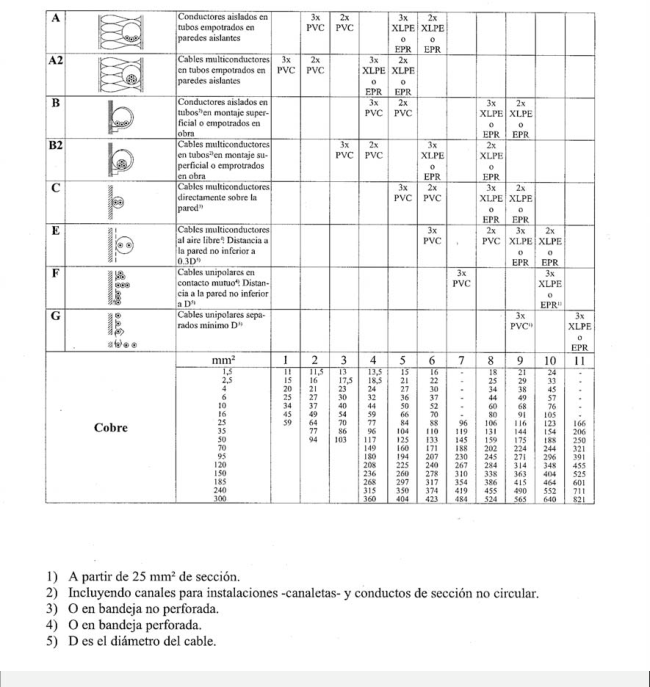
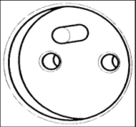
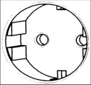
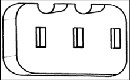

# BT-19. Instalaciones interiores o receptoras. Prescripciones generales

_INSTALACIONES INTERIORES O RECEPTORAS._

### 0. ÍNDICE

- 0. ÍNDICE — 1

- 1. CAMPO DE APLICACIÓN — 2

- 2. PRESCRIPCIONES DE CARÁCTER GENERAL — 2

- 2.1 Regla general — 2

- 2.2 Conductores activos — 4

- 2.2.1 Naturaleza de los conductores — 4

- 2.2.2 Sección de los conductores. Caídas de tensión — 4

- 2.2.3 Intensidades máximas admisibles — 7

- 2.2.4 Identificación de conductores — 15

- 2.3 Conductores de protección — 16

- 2.4 Subdivisión de las instalaciones — 17

- 2.5 Equilibrado de cargas — 18

- 2.6 Posibilidad de separación de la alimentación — 18

- 2.7 Posibilidad de conectar y desconectar en carga — 19

- 2.8 Medidas de protección contra contactos directos o indirectos — 21

- 2.9 Resistencia de aislamiento y rigidez dieléctrica — 21

- 2.10 Bases de toma de corriente — 23

- 2.11 Conexiones — 25

### 1. CAMPO DE APLICACIÓN

Las prescripciones contenidas en esta Instrucción se extienden a las instalaciones interiores dentro del campo de aplicación del articulo 2 y con tensión asignada dentro de los márgenes de tensión fijados en el artículo 4 del Reglamento Electrotécnico para Baja Tensión.

Las instalaciones interiores o receptoras tienen por finalidad principal la utilización de la energía eléctrica, pudiendo estar situadas tanto en el interior como en el exterior, con montaje aéreo, empotrado o enterrado. Las instalaciones interiores o receptoras se pueden realizar en viviendas, industrias, comercios, etc. Las redes de distribución de energía eléctrica no están incluidas en el campo de aplicación de esta ITC-BT.

### 2. PRESCRIPCIONES DE CARÁCTER GENERAL

#### 2.1 Regla general

La determinación de las características de la instalación deberá efectuarse de acuerdo con lo señalado en la Norma UNE 20.460 -3.

En función de las características de cada tipo de instalación, adicionalmente se deberán aplicar las prescripciones la ITC-BT correspondiente, por ejemplo:

- instalaciones interiores de viviendas: ITC-BT-25, 26 y 27 - locales de pública concurrencia: ITC-BT-28 - locales con riesgo de incendio o explosión: ITC-BT-29 - locales húmedos, mojados, riesgo de corrosión, temperaturas elevadas o bajas, etc.: ITC- BT-30

La determinación de las características de la instalación dependerá de varios criterios que se deben tener en cuenta con el objeto de elegir las medidas de protección más adecuadas en cada caso para garantizar la seguridad, así como para efectuar una adecuada elección de los materiales eléctricos a instalar.

Estos criterios son los siguientes:

 La utilización prevista de la instalación, su estructura y tipo de sistema de distribución utilizado.

Es esencial la determinación de la potencia prevista de una instalación para conseguir un diseño económico y seguro dentro de los límites admisibles de temperatura y caída de tensión. Para ello se deben seguir los criterios de la ITC-BT-10 en cuanto a previsión de cargas y factores de simultaneidad.

Si se utiliza un esquema trifásico en lugar de uno monofásico se consigue dividir por tres la intensidad para la misma carga, por ello a partir de cierta potencia (15 kW) las compañías suministran en trifásico en lugar de en monofásico. Según los tipos de puesta a tierra

existen distintos tipos de esquemas de distribución recogidos en la ITC-BT-08 que condicionan a su vez los tipos de protecciones a utilizar.

En cuanto a las características de la alimentación, es importante conocer además del valor nominal de la tensión y de la frecuencia, el valor de la intensidad de cortocircuito prevista en el origen de la instalación para poder calcular el poder de corte de los dispositivos de protección.

 Las influencias externas a las que está sometida la instalación.

Los materiales eléctricos instalados deben estar diseñados y fabricados para soportar las influencias externas que se produzcan en función de sus condiciones y lugar de instalación, según su utilización prevista y según las características constructivas de los edificios en que se instalen. A este respecto la norma UNE 20460-3 lista de forma pormenorizada todas las influencias externas posibles, de forma que cuando estas influencias tomen valores extremos será necesario utilizar un material especialmente fabricado para esas condiciones especificadas. Las características especiales de las canalizaciones en función de las influencias externas se detallan en la UNE 20460-5-52, mientras que las características especiales del material eléctrico y su instalación se detallan en la UNE 20460-5-51.

Algunos ejemplos de influencias externas cuantificadas en la norma y que pueden requerir materiales o sistemas de protección especiales son los siguientes:

 Funcionamiento a temperaturas muy bajas o muy altas.  Condiciones extremas de humedad.  Condiciones industriales severas con previsión de choques o vibraciones importantes.  Presencia permanente de sustancias corrosivas o contaminantes.  Instalaciones en locales con polvo abundante.  Presencia en el lugar de instalación de agua en forma de gotas, pulverización, proyecciones, chorros o posibilidad de inundación intermitente o permanente.  Instalaciones a altitudes mayores de 2000 metros.  Instalaciones en entornos con influencias electromagnéticas, electrostáticas o ionizantes no despreciables.  Instalaciones de intemperie con radiaciones solares altas.  Instalaciones en lugares con presencia de flora, moho o fauna (insectos, pájaros o pequeños animales).  Instalaciones en zonas de actividad sísmica no despreciable.  Instalaciones expuestas a los efectos de caída directas de rayos o alimentadas por líneas aéreas, con probabilidad de más de 25 días de tormenta por año.  Instalaciones de intemperie con previsión de fuertes vientos o de interior con sistemas de movimiento de aire de alta velocidad.  Capacidad de las personas usuarias de la instalación según su conocimiento de los riesgos eléctricos. Por ejemplo en guarderías y hospitales la temperatura de las superficies accesibles se debe limitar para evitar riesgos a niños o enfermos.  Tipo constructivo del edificio, por ejemplo si el edificio es combustible ( de madera).  Diseño del edificio en cuanto al riesgo de propagación del incendio o cuando tengan estructuras que puedan ser objeto de movimientos.

 Compatibilidad de los materiales eléctricos con otros materiales, servicios y con la fuente de alimentación.

Deben tomarse las disposiciones apropiadas cuando ciertas características de los materiales instalados puedan no ser compatibles con otros materiales, o servicios o cuando puedan alterar el funcionamiento de la fuente de alimentación.

Estas características se refieren por ejemplo a sobretensiones transitorias y temporales, variaciones rápidas de potencia, intensidades de arranque, armónicos, componentes continuas, oscilaciones a alta frecuencia, corrientes de fuga o la necesidad de conexiones complementarias a tierra.

 Facilidad de mantenimiento.

Las instalaciones eléctricas deben realizarse de forma que toda verificación periódica, ensayo, mantenimiento o reparación necesaria en el transcurso de su vida útil pueda realizarse de forma fácil y segura. Además la fiabilidad de los materiales instalados debe permitir el funcionamiento de la instalación durante toda su vida útil.

#### 2.2 Conductores activos

##### 2.2.1 Naturaleza de los conductores

Los conductores y cables que se empleen en las instalaciones serán de cobre o aluminio y serán siempre aislados, excepto cuando vayan montados sobre aisladores, tal como se indica en la ITC-BT 20.

La ITC-BT-20 indica los posibles métodos de instalación y las características de los conductores y cables a emplear en cada uno de ellos.

Solamente uno de estos métodos permite la instalación de conductores de cobre desnudos sobre aisladores.

En viviendas e instalaciones similares (p. e. oficinas, locales comerciales, etc.) los conductores deben ser de cobre según establece la ITC-BT 26. Los cables con conductores de aluminio se usan habitualmente en instalaciones industriales con elevadas previsiones de carga.

##### 2.2.2 Sección de los conductores. Caídas de tensión

La sección de los conductores a utilizar se determinará de forma que la caída de tensión entre el origen de la instalación interior y cualquier punto de utilización sea, salvo lo prescrito en las Instrucciones particulares, menor del 3 % de la tensión nominal para cualquier circuito interior de viviendas, y para otras instalaciones interiores o receptoras, del 3 % para alumbrado y del 5 % para los demás usos. Esta caída de tensión se calculará considerando alimentados todos los aparatos de utilización susceptibles de funcionar simultáneamente. El valor de la caída de tensión podrá compensarse entre la de la instalación interior y la de las derivaciones individuales, de forma que la caída de tensión total sea inferior a la suma de los valores límites especificados para ambas, según el tipo de esquema utilizado.

Para instalaciones industriales que se alimenten directamente en alta tensión mediante un

transformador de distribución propio, se considerará que la instalación interior de baja tensión tiene su origen en la salida del transformador. En este caso las caídas de tensión máximas admisibles serán del 4,5 % para alumbrado y del 6,5 % para los demás usos.

La compensación de las caídas de tensión entre la instalación interior y la derivación individual se puede realizar en ambos sentidos.

Si se necesita limitar la sección de los conductores en las instalaciones interiores para evitar de esta forma los problemas de conexión de los conductores con los mecanismos y aparatos receptores, se recomienda aumentar la caída de tensión en el tramo de la instalación interior y sobredimensionar la sección de los conductores de la derivación individual.

Por el contrario cuando la caída de tensión en los circuitos de la instalación interior sea inferior al límite admisible, por ejemplo en viviendas pequeñas, se podrá compensar su valor con el de la derivación individual.

En el anexo de caídas de tensión se indican algunos ejemplos de cálculo.

Figura A: Esquemas resumen de las caídas de tensión máximas admisibles

Esquema para un único usuario C.T. DE

### COMPAÑÍA CPM

### ACOMETIDA DI

1,5% 3%A y 5%F 3%V Esquema para una única centralización de contadores: C.T. DE

### COMPAÑÍA CC

CGP

### ACOMETIDA LGA DI

0,5% 1% 3%A y 5%F 3%V Esquema cuando existen varias centralizaciones de contadores: C.T. DE

### COMPAÑÍA CC

CGP

### ACOMETIDA LGA DI

1% 0,5% 3%A y 5%F 3%V

<!-- figura vectorial en la pág. 5 del PDF original -->
> Figura en la pág. 5 del PDF original: [ver en el PDF](../pdf/BT-19.pdf#page=5)

Esquema de una instalación industrial que se alimenta directamente en alta tensión mediante un transformador de distribución propio.

### C.T. PARA ABONNADOO

DE A.T.

4,5%A 6,5%F

Leyenda: A: circuitos de alumbrado CGP: Caja general de protección F: circuitos de fuerza CC: Centralización de contadores V: circuitos interiores de viviendas LGA: Línea general de alimentación CPM: Caja de protección y medida DI: Derivación individual

El número de aparatos susceptibles de funcionar simultáneamente, se determinará en cada caso particular, de acuerdo con las indicaciones incluidas en las instrucciones del presente reglamento y en su defecto con las indicaciones facilitadas por el usuario considerando una utilización racional de los aparatos.

En instalaciones interiores, para tener en cuenta las corrientes armónicas debidas a cargas no lineales y posibles desequilibrios, salvo justificación por cálculo, la sección del conductor neutro será como mínimo igual a la de las fases.

<!-- figura vectorial en la pág. 6 del PDF original -->
> Figura en la pág. 6 del PDF original: [ver en el PDF](../pdf/BT-19.pdf#page=6)

##### 2.2.3 Intensidades máximas admisibles

Las intensidades máximas admisibles, se regirán en su totalidad por lo indicado en la Norma UNE 20.460 -5-523 y su anexo Nacional.

En la siguiente tabla se indican las intensidades admisibles para una temperatura ambiente del aire de 40C y para distintos métodos de instalación, agrupamientos y tipos de cables. Para otras temperaturas, métodos de instalación, agrupamientos y tipos de cable, así como para conductores enterrados, consultar la Norma UNE 20.460 -5-523.

Tabla 1. Intensidades admisibles (A) al aire 40C. Nº de conductores con carga y naturaleza del aislamiento

### INTENSIDADES MÁXIMAS ADMISIBLES SEGÚN LA NORMA UNE 20460-5-523

Esta ITC-BT-19 prescribe la aplicación de la norma UNE 20460-5-523 en las siguientes instalaciones: ITC-BT 014 Línea general de alimentación ITC-BT 015 Derivación individual ITC-BT 019 Instalaciones interiores o receptoras

Sin embargo, a pesar de la referencia general hecha a la mencionada norma UNE, el Reglamento inserta como tabla 1 de esta ITC, una tabla resumen aplicable a los cables con conductor de cobre. Por tanto, para los cables con conductor de cobre es de aplicación la tabla de la ITC, a pesar de las referencias a la norma.

Esta tabla 1, corresponde al apartado 11.2 de la edición de 1994 de la norma UNE 20460-5- 523. Esta Norma ha sido modificada por la edición de 2004. En las mismas condiciones de instalación, no existen grandes diferencias entre los valores indicados en ambas ediciones. En la mayoría de los casos, la intensidad admisible es muy similar y para otros, las diferencias (en más o en menos) pueden llegar hasta un 10%, aproximadamente, no obstante, se recomienda aplicar con carácter general la norma UNE 20460-5-523, en su edición de 2004.

La norma UNE 20460-5-523 no es una norma de lectura y comprensión fácil, por este motivo y para facilitar su aplicación, hace una simplificación que consiste en agrupar en dos tablas resumen las diversas tablas particulares de intensidades admisibles que hay para los diferentes tipos / construcciones de cable (unipolares o tripolares) y los diversos métodos de instalación de referencia.

Se pueden distinguir dos situaciones respecto a las intensidades admisibles. - Instalaciones no enterradas, Tabla A-52-1bis de la norma UNE 20460-5-523:2004 - Instalaciones enterradas, Tabla A-52-2bis de la norma UNE 20460-5-523:2004

Instalaciones no enterradas de cables con conductor de cobre

En la siguiente tabla, además de repetir los valores dados en la Tabla A.52-1bis de la norma UNE 20460-5-523:2004, se incluyen los valores calculados para las secciones no contempladas en la misma (de 400 mm2 hasta 630 mm2).

Tabla A - Intensidades admisibles para cables con conductores de cobre, no enterrados Temperatura ambiente 40ºC en el aire

<!-- tabla: ../tablas/BT-19_t01.csv -->

| Método de instalación* | Número de conductores cargados y tipo de aislamiento |  |  |  |  |  |  |  |  |  |  |  |
|---|---|---|---|---|---|---|---|---|---|---|---|---|
| A1 |  | 3x PVC | 2x PVC |  | 3x XLPE | 2x XLPE |  |  |  |  |  |  |
| A2 | 3x PVC | 2x PVC |  | 3x XLPE | 2x XLPE |  |  |  |  |  |  |  |
| B1 |  |  |  | 3x PVC | 2x PVC |  | 3x XLPE |  | 2x XLPE |  |  |  |
| B2 |  |  | 3x PVC | 2x PVC |  | 3x XLPE | 2x XLPE |  |  |  |  |  |
| C |  |  |  |  | 3x PVC |  | 2x PVC | 3x XLPE |  | 2x XLPE |  |  |
| E |  |  |  |  |  | 3x PVC |  | 2x PVC | 3x XLPE |  | 2x XLPE |  |
| F |  |  |  |  |  |  | 3x PVC |  | 2x PVC | 3x XLPE |  | 2x XLPE |
| Sección mm2 COBRE | 2 | 3 | 4 | 5 | 6 | 7 | 8 | 9 | 10 | 11 | 12 | 13 |
| 1,5 | 11 | 11,5 | 13 | 13,5 | 15 | 16 | 16,5 | 19 | 20 | 21 | 24 | -- |
| 2,5 | 15 | 16 | 17,5 | 18,5 | 21 | 22 | 23 | 26 | 26,5 | 29 | 33 | -- |
| 4 | 20 | 21 | 23 | 24 | 27 | 30 | 31 | 34 | 36 | 38 | 45 | -- |
| 6 | 25 | 27 | 30 | 32 | 36 | 37 | 40 | 44 | 46 | 49 | 57 | -- |
| 10 | 34 | 37 | 40 | 44 | 50 | 52 | 54 | 60 | 65 | 68 | 76 | -- |
| 16 | 45 | 49 | 54 | 59 | 66 | 70 | 73 | 81 | 87 | 91 | 105 | -- |
| 25 | 59 | 64 | 70 | 77 | 84 | 88 | 95 | 103 | 110 | 116 | 123 | 140 |
| 35 | -- | 77 | 86 | 96 | 104 | 110 | 119 | 127 | 137 | 144 | 154 | 174 |
| 50 | -- | 94 | 103 | 117 | 125 | 133 | 145 | 155 | 167 | 175 | 188 | 210 |
| 70 | -- | -- | -- | 149 | 160 | 171 | 185 | 199 | 214 | 224 | 244 | 269 |
| 95 | -- | -- | -- | 180 | 194 | 207 | 224 | 241 | 259 | 271 | 296 | 327 |
| 120 | -- | -- | -- | 208 | 225 | 240 | 260 | 280 | 301 | 314 | 348 | 380 |
| 150 | -- | -- | -- | 236 | 260 | 278 | 299 | 322 | 343 | 363 | 404 | 438 |
| 185 | -- | -- | -- | 268 | 297 | 317 | 341 | 368 | 391 | 415 | 464 | 500 |
| 240 | -- | -- | -- | 315 | 350 | 374 | 401 | 435 | 468 | 490 | 552 | 590 |
| 300 | -- | -- | -- | 361 | 401 | 430 | 461 | 500 | 538 | 563 | 638 | 678 |
| 400 | -- | -- | -- | 431 | 480 | 515 | 552 | 699 | 645 | 674 | 770 | 812 |
| 500 | -- | -- | -- | 493 | 551 | 592 | 633 | 687 | 741 | 774 | 889 | 931 |
| 630 | -- | -- | -- | 565 | 632 | 681 | 728 | 790 | 853 | 890 | 1028 | 1071 |
| Se indican como 3x los circuitos trifásicos y como 2x los monofásicos. A efecto de las intensidades admisibles los cables con aislamiento termoplástico a base de poliolefina (Z1) son equivalentes a los cables con aislamiento de policloruro de vinilo (V). |  |  |  |  |  |  |  |  |  |  |  |  |

Esta tabla presenta de manera simplificada, varias tablas de la norma, de forma que en determinados casos se han agrupado en la misma columna diferentes tipos de cable y diferentes tipos de instalación cuyos valores de intensidad admisibles son prácticamente iguales. Por lo tanto, la columna de la izquierda que corresponde al “tipo de instalación” (de A hasta F) abarca los sistemas indicados en la tabla B.

Tabla B - Tipos de instalación de cables no enterrados

<!-- tabla: ../tablas/BT-19_t02.csv -->

| A1 | - Conductores unipolares aislados en tubos empotrados en paredes térmicamente aislantes - Cables multiconductores empotrados directamente en paredes térmicamente aislantes. - Conductores unipolares aislados en molduras. - Conductores unipolares aislados en conductos o cables uni o multiconductores dentro de los marcos de las puertas. - Conductores unipolares aislados en tubos o cables uni o multiconductores dentro de los marcos de las ventanas. |
|---|---|
| A2 | - Cables multiconductores en tubos empotrados en paredes térmicamente aislantes. |
| B1 | - Conductores aislados o cable unipolar en tubos empotrados en obra - Conductores aislados o cable unipolar en tubo sobre pared de madera o mampostería separados a una distancia inferior a 0,3 veces el diámetro del tubo. - Conductores unipolares aislados en canales o conductos cerrados de sección no circular sobre pared de madera - Cables unipolares o multiconductores en huecos de obra de fábrica +) - Conductores unipolares aislados en tubos dentro de huecos de obra de fábrica +) - Conductores unipolares aislados en conductos cerrados de sección no circular en huecos de obra de fábrica +) - Conductores aislados en conductos cerrados de sección no circular empotrados en obra de fábrica con una resistividad térmica no superior a 2K·m/W +) - Conductores unipolares aislados o cables unipolares en canal protectora empotrada en el suelo - Conductores aislados o cables unipolares en conductos perfilados empotrados - Cables uni o multiconductores en falsos techos o suelos técnicos +) - Conductores unipolares aislados o cables unipolares en canal protectora suspendida - Conductores aislados o cables unipolares en tubos en canalizaciones no ventiladas +) - Conductores unipolares aislados en tubos en canales de obra ventilados - Cables uni o multiconductores en canales de obra ventilados - Conductores unipolares aislados o cables unipolares dentro de zócalos acanalados (rodapiés ranurado) |
| B2 | - Cables multiconductores en tubos empotrados en obra - Cables multiconductores en tubos sobre pared de madera o separados a una distancia inferior a 0,3 veces el diámetro del tubo. - Cables multiconductores en canales o conductos cerrados de sección no circular sobre pared de madera - Cables multiconductores en canal protectora suspendida - Cables multiconductores dentro de zócalos acanalados(rodapiés ranurado) - Cables multiconductores en canal protectora empotrada en el suelo - Cables multiconductores en conductos perfilados empotrados |
| C | - Cables multiconductores directamente bajo un techo de madera - Cables unipolares o multiconductores sobre bandejas no perforadas - Cables unipolares o multiconductores fijados en el techo o pared de madera o espaciados 0,3 veces el diámetro del cable - Cables uni o multiconductores empotrados directamente en paredes |
| E | - Cables multiconductores separados de la pared una distancia no inferior a 0,3 D 5) - Cables unipolares o multiconductores sobre bandejas perforadas en horizontal o vertical - Cables unipolares o multiconductores sobre bandejas de rejilla - Cables unipolares o multiconductores sobre bandejas de escalera - Cables unipolares o multiconductores suspendidos de un cable fiador |
| F | - Se aplica a los mismos sistemas de instalación que el tipo E, cuando la sección del conductor es superior a 25 mm2 - Cables unipolares en contacto mutuo separados de la pared una distancia no inferior a D 5) |

Ver notas 1) a 5) en la tabla 1. +) Según la relación entre el diámetro del cable y su alojamiento, puede ser de aplicación el método B2. Dicha relación se indica en la norma UNE 20460-5-523.

En las tablas anteriores, la referencia a conductor aislado debe entenderse como conductor y aislamiento, y la referencia a cable como conductor o conductores aislados y con cubierta.

Instalaciones no enterradas de cables con conductor de aluminio

Las intensidades admisibles se podrán calcular teniendo en cuenta las indicaciones de la norma UNE 20460-5-523, edición de 2004. La tabla resumen es la tabla A-52-1 bis

Instalaciones enterradas

Las intensidades admisibles se calcularán teniendo en cuenta las indicaciones de la norma UNE 20460-5-523, edición de 2004.

En la ITC-BT-14 de líneas generales de alimentación y en la ITC-BT-15 de derivaciones individuales se especifica que las intensidades admisibles en el caso de instalaciones enterradas deberán seguir lo especificado en la ITC-BT-07. No obstante, la nueva edición de 2004 de la norma UNE 20-460-5-523 ya incluye la instalación bajo tubo enterrada, por lo que se recomienda utilizar esta norma para el cálculo de las intensidades admisibles con este tipo de instalación.

Las intensidades máximas admisibles para cables enterrados directamente en el terreno y sus factores de corrección, se pueden consultar en la ITC-BT-07.

Para el cálculo de la intensidad admisible en los cables enterrados uno de los factores a tener en cuenta es la resistividad térmica del terreno, la cual depende del tipo de terreno y de su humedad, aumentando cuando el terreno está mas seco. La tabla siguiente muestra valores de resistividades térmicas del terreno en función de su naturaleza y grado de humedad.

Tabla C - Resistividad térmica del terreno en función de su naturaleza y humedad

<!-- tabla: ../tablas/BT-19_t03.csv -->

| Resistividad térmica del terreno (K.m/W) | Naturaleza del terreno y grado de humedad |
|---|---|
| 0,40 | Inundado |
| 0,50 | Muy húmedo |
| 0,70 | Húmedo |
| 0,85 | Poco húmedo |
| 1,00 | Seco |
| 1,20 | Arcilloso muy seco |
| 1,50 | Arenoso muy seco |
| 2,00 | De piedra arenisca |
| 2,50 | De piedra caliza |
| 3,00 | De piedra granítica |

La tabla resumen A-52-2 bis de la norma, aplica a las instalaciones de cable enterrado, bajo tubo o directamente, que discurren por recorridos en el interior o alrededor de edificios, para una temperatura del terreno de 25ºC y una resistividad térmica del terreno de 2,5 K.m/W. Cuando el cable discurra por otros recorridos puede considerarse la posibilidad de aplicar una resistividad térmica diferente.

Por ejemplo, para un valor de resistividad térmica del terreno de referencia de 1,5 K.m/W, las intensidades admisibles para cables enterrados bajo tubo de tensión asignada 0,6/1kV, se indican en la tabla siguiente:

Tabla D - Intensidad admisible (en A), para cables soterrados bajo tubo (tensión asignada hasta 0,6/1 kV)

<!-- tabla: ../tablas/BT-19_t04.csv -->

| SECCIÓN mm2 | 3 XLPE (3 cables unipolares o 1 tripolar) |  | 2 XLPE (2 cables unipolares o 1 bipolar) |  |
|---|---|---|---|---|
|  | Cobre | Aluminio | Cobre | Aluminio |
| 1,5 | 23 | -- | 27 | -- |
| 2,5 | 30 | 23 | 36 | 27 |
| 4 | 39 | 30 | 46 | 36 |
| 6 | 48 | 37 | 58 | 44 |
| 10 | 64 | 49 | 77 | 58 |
| 16 | 82 | 62 | 100 | 77 |
| 25 | 105 | 82 | 130 | 98 |
| 35 | 130 | 98 | 155 | 120 |
| 50 | 155 | 115 | 183 | 139 |
| 70 | 190 | 145 | 225 | 170 |
| 95 | 225 | 175 | 265 | 205 |
| 120 | 260 | 200 | 305 | 230 |
| 150 | 300 | 230 | 340 | 265 |
| 185 | 335 | 260 | 385 | 295 |
| 240 | 400 | 305 | 440 | 340 |
| 300 | 455 | 350 | 500 | 385 |
| 400 | 530 | 405 | 570 | 445 |
| 500 | 610 | 465 | 660 | 510 |
| 630 | 710 | 530 | 735 | 575 |
| Condiciones de cálculo | Resistividad térmica del terreno: 1,5 K.m/W |  |  |  |
|  | Temperatura del terreno: 25ºC |  |  |  |
|  | Profundidad de la instalación: 70 cm |  |  |  |

### FACTORES DE REDUCCIÓN POR AGRUPACIÓN DE CIRCUITOS

En la siguiente tabla se indican factores de reducción de la intensidad máxima admisible usuales en caso de agrupamiento de varios circuitos o de varios cables multiconductores o para el agrupamiento de varios circuitos en bandejas. No se considerarán los factores de reducción cuando la distancia en la que discurran paralelos los circuitos sea inferior a 2 m, por ejemplo en la salida de varios circuitos de un cuadro de mando y protección.

Tabla E. Factores de reducción para agrupamiento de varios circuitos (Tabla A.52-3 de la norma UNE 20 460-5-523:2004)

<!-- tabla: ../tablas/BT-19_t05.csv -->

| Ref. | Disposición de cables contiguos | Número de circuitos o cables multiconductores |  |  |  |  |  |  |  |  |
|---|---|---|---|---|---|---|---|---|---|---|
|  |  | 1 | 2 | 3 | 4 | 6 | 9 | 12 | 16 | 20 |
| 1 | Empotrados o embutidos | 1,00 | 0,80 | 0,70 | 0,70 | 0,55 | 0,50 | 0,45 | 0,40 | 0,40 |
| 2 | Capa única sobre pared, suelo o superficie sin perforar | 1,00 | 0,85 | 0,80 | 0,75 | 0,70 | 0,70 | Sin reducción adicional para más de 9 circuitos o cables multiconductores. |  |  |
| 3 | Capa única fijada bajo techo | 0,95 | 0,80 | 0,70 | 0,70 | 0,65 | 0,60 |  |  |  |
| 4 | Capa única en una bandeja perforada vertical u horizontal | 1,00 | 0,90 | 0,80 | 0,75 | 0,75 | 0,70 |  |  |  |
| 5 | Capa única con apoyo de bandeja escalera o abrazaderas (collarines) etc. | 1,00 | 0,85 | 0,80 | 0,80 | 0,80 | 0,8 |  |  |  |
| Nota 1. Estos factores son aplicables a grupos homogéneos de cables cargados por igual. Nota 2. Cuando la distancia horizontal entre cables adyacentes es superior al doble de su diámetro exterior, no es necesario factor de reducción alguno. Nota 3. Los mismos factores se aplican para grupos de dos o tres cables unipolares que para cables multiconductores. Nota 4. Si un sistema se compone de cables de dos o tres conductores, se toma el número total de cables como el número de circuitos, y se aplica el factor correspondiente a las tablas de dos conductores cargados para los cables de dos conductores y a las tablas de tres conductores cargados para los cables de tres conductores. Nota 5. Si la instalación se compone de “n” conductores unipolares cargados, también pueden considerarse como “n/2” circuitos de dos conductores o “n/3” circuitos de tres conductores cargados. |  |  |  |  |  |  |  |  |  |  |

En la tabla F se indican los factores de reducción por agrupamiento de circuitos en varias capas que multiplicarán al factor de reducción de la tabla E anterior.

Tabla F – Factor de reducción adicional para cables instalados en varias capas

<!-- tabla: ../tablas/BT-19_t06.csv -->

| Nº de capas | 2 | 3 | 4 ó 5 | 6 a 8 | 9 o más |
|---|---|---|---|---|---|
| Factor | 0,8 | 0,73 | 0,70 | 0,68 | 0,66 |

En la tabla G, se indican los factores de reducción correspondientes para agrupación de cables en el interior de tubos en contacto y en posición horizontal, instalados al aire, formando una o varias capas.

Tabla G – Factores de reducción para cables en el interior de tubos en contacto en posición horizontal, instalados al aire, formando una o varias capas.

<!-- tabla: ../tablas/BT-19_t07.csv -->

| Nº de capas en vertical | Nº de tubos en horizontal |  |  |  |  |  |
|---|---|---|---|---|---|---|
|  | 1 | 2 | 3 | 4 | 5 | 6 |
| 1 | 1,00 | 0,94 | 0,91 | 0,88 | 0,87 | 0,86 |
| 2 | 0,92 | 0,87 | 0,84 | 0,81 | 0,80 | 0,79 |
| 3 | 0,85 | 0,81 | 0,78 | 0,76 | 0,75 | 0,74 |
| 4 | 0,82 | 0,78 | 0,74 | 0,73 | 0,72 | 0,72 |
| 5 | 0,80 | 0,76 | 0,72 | 0,71 | 0,70 | 0,70 |
| 6 | 0,79 | 0,75 | 0,71 | 0,70 | 0,69 | 0,68 |

Cuando los conductores enterrados se instalen bajo tubo, no se instalará más de un circuito por cada tubo, en caso de instalar agrupaciones de tubos (un cable por tubo) se pueden aplicar los siguientes factores de corrección:

Tabla H. Factores de reducción para agrupamiento de cables multiconductores en tubos enterrados, un cable por tubo (tabla 52 E3 A de la UNE 20460-5-523:2004)

<!-- tabla: ../tablas/BT-19_t08.csv -->

| Número de cables | Distancia entre tubos |  |  |  |
|---|---|---|---|---|
|  | Nula (tubos en contacto) | 0,25 m | 0,50 m | 1,0 m |
| 2 | 0,85 | 0,90 | 0,95 | 0,95 |
| 3 | 0,75 | 0,85 | 0,90 | 0,95 |
| 4 | 0,70 | 0,80 | 0,85 | 0,90 |
| 5 | 0,65 | 0,80 | 0,85 | 0,90 |
| 6 | 0,60 | 0,80 | 0,80 | 0,90 |

En el caso de que se instale un circuito único de conductores unipolares por tubo se pueden aplicar también los factores de corrección de la tabla H. Para el caso de canalizaciones enterradas en que se instale un único cable unipolar por tubo, los factores de corrección por agrupamiento de tubos se pueden consultar en la tabla 52 E3 B de la norma UNE 20460-5-523, edición 2004.

En la tabla I, se indican los factores de reducción correspondientes para agrupación de cables en el interior de tubos en contacto y en disposición horizontal, enterrados o embebidos en hormigón, formando varias capas.

Tabla I – Factores de reducción para cables en el interior de tubos en contacto, enterrados o embebidos en hormigón, formando varias capas.

<!-- tabla: ../tablas/BT-19_t09.csv -->

| Nº de capas en vertical | Nº de tubos en horizontal |  |  |  |  |  |
|---|---|---|---|---|---|---|
|  | 1 | 2 | 3 | 4 | 5 | 6 |
| 2 | 0,87 | 0,71 | 0,62 | 0,57 | 0,53 | 0,50 |
| 3 | 0,77 | 0,62 | 0,53 | 0,48 | 0,45 | 0,42 |
| 4 | 0,72 | 0,57 | 0,48 | 0,44 | 0,40 | 0,38 |
| 5 | 0,68 | 0,53 | 0,45 | 0,40 | 0,37 | 0,35 |
| 6 | 0,65 | 0,50 | 0,42 | 0,38 | 0,35 | 0,32 |

##### 2.2.4 Identificación de conductores

Los conductores de la instalación deben ser fácilmente identificables, especialmente por lo que respecta al conductor neutro y al conductor de protección. Esta identificación se realizará por los colores que presenten sus aislamientos. Cuando exista conductor neutro en la instalación o se prevea para un conductor de fase su pase posterior a conductor neutro, se identificarán éstos por el color azul claro. Al conductor de protección se le identificará por el color verde-amarillo. Todos los conductores de fase, o en su caso, aquellos para los que no se prevea su pase posterior a neutro, se identificarán por los colores marrón o negro.

Cuando se considere necesario identificar tres fases diferentes, se utilizará también el color gris.

<!-- tabla: ../tablas/BT-19_t10.csv -->

| conductor | coloración |  |  |
|---|---|---|---|
| neutro (o previsión de que un conductor de fase pase posteriormente a neutro) | azul |  |  |
| protección | verde-amarillo |  |  |
| fase | marrón | negro | gris |

En los circuitos trifásicos, cada fase deberá identificarse con un color diferente, utilizando los colores negro, marrón y gris. El reglamento establece también que en circuitos monofásicos la fase estará identificada por el color negro o marrón, independientemente de que estos circuitos se alimenten de fases distintas.

No obstante, cuando para facilitar la identificación, la instalación o el mantenimiento, se considere necesario distinguir entre diferentes circuitos de una instalación interior monofásica, se podrán utilizar los colores negro, marrón o gris en los conductores de fase de los diferentes

<!-- figura vectorial en la pág. 15 del PDF original -->
> Figura en la pág. 15 del PDF original: [ver en el PDF](../pdf/BT-19.pdf#page=15)

circuitos, siempre que en el proyecto o memoria técnica de diseño se especifiquen los colores seleccionados para cada circuito.

Los cables unipolares de tensión asignada 0,6/1 kV con aislamiento y cubierta no tienen aplicadas diferentes coloraciones, en este caso el instalador debe identificar los conductores mediante medios apropiados, por ejemplo mediante un señalizador o argolla, una etiqueta, etc.. en cada extremo del cable.

En sistemas TN-C y TN-C-S descritos en la ITC-BT 08, se debe identificar a los conductores de protección y neutro (CPN), mediante el color verde-amarillo más una marca azul que podrá ser un señalizador o argolla, una etiqueta, etc., que identifique su propiedad CPN.

#### 2.3 Conductores de protección

Se aplicará lo indicado en la Norma UNE 20.460 -5-54 en su apartado 543. Como ejemplo, para los conductores de protección que estén constituidos por el mismo metal que los conductores de fase o polares, tendrán una sección mínima igual a la fijada en la tabla 2, en función de la sección de los conductores de fase o polares de la instalación; en caso de que sean de distinto material, la sección se determinará de forma que presente una conductividad equivalente a la que resulta de aplicar la tabla 2.

<!-- tabla: ../tablas/BT-19_t11.csv -->

| Tabla 2. |  |  |  |  |
|---|---|---|---|---|
|  | Secciones de los conductores de fase o |  |  | Secciones mínimas de los conductores de |
|  | polares de la instalación |  |  | protección |
|  | (mm2) |  |  | (mm2) |
|  | S < 16 |  |  | S (*) |
|  | 16< S < 35 |  |  | 16 |
|  | S > 35 |  |  | S/2 |
|  | (*) Con un mínimo de: |  |  |  |
|  | 2,5 mm2 si los conductores de protección no forman parte de la canalización de alimentación |  |  |  |
|  | y tienen una protección mecánica |  |  |  |
|  | 4 mm2 si los conductores de protección no forman parte de la canalización de alimentación y |  |  |  |
|  | no tienen una protección mecánica |  |  |  |
| Para otras condiciones se aplicará la norma UNE 20.460 -5-54, apartado 543. |  |  |  |  |
| En la instalación de los conductores de protección se tendrá en cuenta: |  |  |  |  |
| - Si se aplican diferentes sistemas de protección en instalaciones próximas, se empleará |  |  |  |  |
| para cada uno de los sistemas un conductor de protección distinto. Los sistemas a |  |  |  |  |
| utilizar estarán de acuerdo con los indicados en la norma UNE 20.460-3. En los pasos a |  |  |  |  |
| través de paredes o techos estarán protegidos por un tubo de adecuada resistencia |  |  |  |  |
| mecánica, según ITC-BT 21 para canalizaciones empotradas. |  |  |  |  |

La forma de instalación de los tubos empotrados se describe en la ITC-BT-21.

El tubo presentará unas características mínimas según lo especificado en la tabla 3 de la ITC-BT-21 si la pared es de obra de fábrica o si el tubo circula por el interior de un hueco

de la construcción o canal de obra. Se elegirá un tubo según la tabla 4 de la ITC-BT-21 si el tubo está empotrado en hormigón y para canalizaciones precableadas.

El diámetro exterior mínimo de los tubos se elegirá según la tabla 5 de la ITC-BT-21 en función de la sección y el número de conductores a conducir.

- No se utilizará un conductor de protección común para instalaciones de tensiones nominales diferentes.

- Si los conductores activos van en el interior de una envolvente común, se recomienda incluir también dentro de ella el conductor de protección, en cuyo caso presentará el mismo aislamiento que los otros conductores. Cuando el conductor de protección se instale fuera de esta canalización seguirá el curso de la misma.

- En una canalización móvil todos los conductores incluyendo el conductor de protección, irán por la misma canalización

- En el caso de canalizaciones que incluyan conductores con aislamiento mineral, la cubierta exterior de estos conductores podrá utilizarse como conductor de protección de los circuitos correspondientes, siempre que su continuidad quede perfectamente asegurada y su conductividad sea como mínimo igual a la que resulte de la aplicación de la Norma UNE 20.460 -5-54, apartado 543.

- Cuando las canalizaciones estén constituidas por conductores aislados colocados bajo tubos de material ferromagnético, o por cables que contienen una armadura metálica, los conductores de protección se colocarán en los mismos tubos o formarán parte de los mismos cables que los conductores activos.

- Los conductores de protección estarán convenientemente protegidos contra el deterioro mecánicos y químicos, especialmente en los pasos a través de los elementos de la construcción.

- Las conexiones en estos conductores se realizarán por medio de uniones soldadas sin empleo de ácido o por piezas de conexión de apriete por rosca, debiendo ser accesibles para verificación y ensayo. Estas piezas serán de material inoxidable y los tornillos de apriete, si se usan, estarán previstos para evitar su desapriete. Se considera que los dispositivos que cumplan con la norma UNE-EN 60.998 -2-1 cumplen con esta prescripción.

- Se tomarán las precauciones necesarias para evitar el deterioro causado por efectos electroquímicos cuando las conexiones sean entre metales diferentes (por ejemplo cobre-aluminio).

#### 2.4 Subdivisión de las instalaciones

Las instalaciones se subdividirán de forma que las perturbaciones originadas por averías que puedan producirse en un punto de ellas, afecten solamente a ciertas partes de la instalación, por ejemplo a un sector del edificio, a un piso, a un solo local, etc., para lo cual los dispositivos de protección de cada circuito estarán adecuadamente coordinados y serán selectivos con los dispositivos generales de protección que les precedan.

Toda instalación se dividirá en varios circuitos, según las necesidades, a fin de:

- evitar las interrupciones innecesarias de todo el circuito y limitar las consecuencias de un fallo - facilitar las verificaciones, ensayos y mantenimientos - evitar los riesgos que podrían resultar del fallo de un solo circuito que pudiera dividirse, como por ejemplo si solo hay un circuito de alumbrado.

Deben preverse circuitos distintos para las partes de la instalación que es necesario controlar separadamente, por ejemplo: alumbrado, tomas de corriente, alimentación de máquinas, etc., de tal forma que estos circuitos no se vean afectados por el fallo de otros circuitos.

Por otro lado, aunque la ITC-BT-22 punto 1.1b admite que cuando se trate de circuitos derivados de uno principal y cada uno de estos circuitos derivados disponga de protección contra sobrecargas, un solo dispositivo general pueda asegurar la protección contra cortocircuitos para todos los circuitos derivados, se recomienda proteger cada circuito derivado contra sobrecargas y cortocircuitos para garantizar la debida selectividad.

Sin embargo, no es posible lograr esta selectividad con los interruptores magnetotérmicos para uso doméstico al ser el disparo instantáneo en caso de cortocircuito.

Para garantizar la selectividad total entre los diferenciales instalados en serie, se deben cumplir las siguientes condiciones:

1- El tiempo de no-actuación del diferencial instalado aguas arriba deberá ser superior al tiempo de total de operación del diferencial situado aguas abajo. Los diferenciales tipo S o los de tipo retardado de tiempo regulable cumplen con esta condición. 2- La intensidad diferencial-residual del diferencial instalado aguas arriba deberá ser superior a la del diferencial situado aguas abajo.

En el caso de diferenciales para uso doméstico o análogo (UNE-EN 61008 y UNE-EN 61009) la intensidad diferencial residual nominal del diferencial instalado aguas arriba deberá ser como mínimo tres veces superior a la del diferencial situado aguas abajo. Los diferenciales instalados serán de tipo S según lo establecido en ITC-BT-24 Apto 4.1.2.

#### 2.5 Equilibrado de cargas

Para que se mantenga el mayor equilibrio posible en la carga de los conductores que forman parte de una instalación, se procurará que aquella quede repartida entre sus fases o conductores polares.

#### 2.6 Posibilidad de separación de la alimentación

Se podrán desconectar de la fuente de alimentación de energía, las siguientes instalaciones:

a) Toda instalación cuyo origen esté en una línea general de alimentación b) Toda instalación con origen en un cuadro de mando o de distribución.

Los dispositivos admitidos para esta desconexión, que garantizarán la separación omnipolar excepto en el neutro de las redes TN-C, son:

- Los cortacircuitos fusibles - Los seccionadores - Los interruptores con separación de contactos mayor de 3 mm o con nivel de seguridad equivalente - Los bornes de conexión, sólo en caso de derivación de un circuito

Los dispositivos de desconexión se situarán y actuarán en un mismo punto de la instalación, y cuando esta condición resulte de difícil cumplimiento, se colocarán instrucciones o avisos aclaratorios. Los dispositivos deberán ser accesibles y estarán dispuestos de forma que permitan la fácil identificación de la parte de la instalación que separan.

Con posterioridad a la publicación del RBT los requisitos de separación de contactos en seccionadores de seguridad presentes en la norma EN 60669-2-4 han pasado de 3 a 4 mm, excepto cuando se satisfacen requisitos de ensayos suplementarios.

La separación omnipolar mediante el uso de cortacircuitos fusibles deberá asegurar también la separación simultánea del neutro.

Si la separación de la alimentación se produce debido a un mantenimiento o reparación, se deberán proveer medios que impidan la conexión indeseada, a menos que los medios de corte estén bajo la vigilancia continua de todas las personas que efectúan dicho mantenimiento.

Estos medios pueden comprender una o varias de las siguientes medidas: - bloqueo por candados - paneles indicadores de peligro - ubicación dentro de un local con cierre por llave o dentro de una envolvente.

<!-- tabla: ../tablas/BT-19_t12.csv -->

| Producto | Norma de aplicación |
|---|---|
| Seccionadores fusibles | UNE-EN 60269 (serie) UNE-EN 60947-3 |
| Seccionadores (uso industrial) | UNE-EN 60947-3 |
| Interruptores seccionadores (uso industrial) | UNE-EN 60947-3 |
| Interruptores automáticos (uso doméstico o análogo) | UNE-EN 60898 |
| Interruptores automáticos con capacidad de seccionamiento (uso industrial)(1) | UNE-EN 60947-2 |
| Interruptores diferenciales con dispositivo de protección contra sobreintensidades incorporado (uso doméstico o análogo) | UNE-EN 61009 |
| Bornes de conexión (sin carga) | UNE-EN 60998 UNE-EN 60947-7 |
| (1) La norma UNE-EN 60947-2 define tanto las características de aquellos interruptores automáticos de uso industrial que poseen características de seccionamiento como de aquellos que no las poseen. |  |

#### 2.7 Posibilidad de conectar y desconectar en carga

Se instalarán dispositivos apropiados que permitan conectar y desconectar en carga en una sola maniobra, en:

a) Toda instalación interior o receptora en su origen, circuitos principales y cuadros secundarios. Podrán exceptuarse de esta prescripción los circuitos destinados a relojes, a rectificadores para instalaciones telefónicas cuya potencia nominal no exceda de 500 VA y los circuitos de mando o control, siempre que su desconexión impida cumplir

alguna función importante para la seguridad de la instalación. Estos circuitos podrán desconectarse mediante dispositivos independientes del general de la instalación. b) Cualquier receptor c) Todo circuito auxiliar para mando o control, excepto los destinados a la tarificación de la energía d) Toda instalación de aparatos de elevación o transporte, en su conjunto. e) Todo circuito de alimentación en baja tensión destinado a una instalación de tubos luminosos de descarga en alta tensión f) Toda instalación de locales que presente riesgo de incendio o de explosión. g) Las instalaciones a la intemperie h) Los circuitos con origen en cuadros de distribución i) Las instalaciones de acumuladores j) Los circuitos de salida de generadores

Los dispositivos admitidos para la conexión y desconexión en carga son:

- Los interruptores manuales.

También pueden utilizarse los interruptores automáticos con accionamiento manual y contactores accionados por pulsador.

- Los cortacircuitos fusibles de accionamiento manual, o cualquier otro sistema aislado que permita estas maniobras siempre que tengan poder de corte y de cierre adecuado e independiente del operador.

- Las clavijas de las tomas de corriente de intensidad nominal no superior a 16 A.

Deberán ser de corte omnipolar los dispositivos siguientes:

- Los situados en el cuadro general y secundarios de toda instalación interior o receptora. - Los destinados a circuitos excepto en sistemas de distribución TN-C, en los que el corte del conductor neutro esta prohibido y excepto en los TN-S en los que se pueda asegurar que el conductor neutro esta al potencial de tierra. - Los destinados a receptores cuya potencia sea superior a 1.000 W, salvo que prescripciones particulares admitan corte no omnipolar. - Los situados en circuitos que alimenten a lámparas de descarga o autotransformadores. - Los situados en circuitos que alimenten a instalaciones de tubos de descarga en alta tensión.

En los demás casos, los dispositivos podrán no ser de corte omnipolar.

El conductor neutro o compensador no podrá ser interrumpido salvo cuando el corte se establezca por interruptores omnipolares.

<!-- tabla: ../tablas/BT-19_t13.csv -->

| Producto | Norma de aplicación |
|---|---|
| Seccionadores fusibles | UNE-EN 60269 (serie) |
| Interruptor de fusible, fusible-interruptor y fusible-interruptor- seccionador | UNE-EN 60947-3 |
| Interruptores seccionadores (uso industrial) | UNE-EN 60947-3 |

Producto Norma de aplicación Interruptores automáticos (uso doméstico o análogo) UNE-EN 60898 Interruptores automáticos (uso industrial)(1) UNE-EN 60947-2 Interruptores diferenciales con dispositivo de protección contra UNE-EN 61009 sobreintensidades incorporado (uso doméstico o análogo) Bases de toma de corriente (fijas y móviles) para uso doméstico o UNE 20315 análogo Bases de toma de corriente para uso industrial UNE-EN 60309 (1) La norma UNE-EN 60947-2 define tanto las características de aquellos interruptores automáticos de uso industrial que poseen características de seccionamiento como de aquellos que no las poseen.

<!-- tabla: ../tablas/BT-19_t14.csv -->

| 2.8 Medidas de protección contra contactos directos o indirectos |  |  |  |  |  |  |  |
|---|---|---|---|---|---|---|---|
| Las instalaciones eléctricas se establecerán de forma que no supongan riesgo para las |  |  |  |  |  |  |  |
| personas y los animales domésticos tanto en servicio normal como cuando puedan presentarse |  |  |  |  |  |  |  |
| averías previsibles. |  |  |  |  |  |  |  |
| En relación con estos riesgos, las instalaciones deberán proyectarse y ejecutarse aplicando las |  |  |  |  |  |  |  |
| medidas de protección necesarias contra los contactos directos e indirectos. |  |  |  |  |  |  |  |
| Estas medidas de protección son las señaladas en la Instrucción ITC-BT-24 y deberán cumplir |  |  |  |  |  |  |  |
| lo indicado en la UNE 20.460, parte 4-41 y parte 4-47. |  |  |  |  |  |  |  |
| 2.9 Resistencia de aislamiento y rigidez dieléctrica |  |  |  |  |  |  |  |
| Las instalaciones deberán presentar una resistencia de aislamiento al menos igual a los |  |  |  |  |  |  |  |
| valores indicados en la tabla siguiente: |  |  |  |  |  |  |  |
| Tabla 3. |  |  |  |  |  |  |  |
|  | Tensión nominal de la |  |  | Tensión de ensayo en |  |  | Resistencia de |
|  | instalación |  |  | corriente continua (v) |  |  | aislamiento (M) |
|  | Muy Baja Tensión de Seguridad |  | 250 |  |  |  0,25 |  |
|  | (MBTS) |  |  |  |  |  |  |
|  | Muy Baja Tensión de protección |  |  |  |  |  |  |
|  | (MBTP) |  |  |  |  |  |  |
|  | Inferior o igual a 500 V, excepto |  | 500 |  |  |  0,5 |  |
|  | caso anterior |  |  |  |  |  |  |
|  | Superior a 500 V |  |  | 1000 |  |  |  1,0 |
|  | Nota: Para instalaciones a MBTS y MBTP, véase la ITC-BT-36 |  |  |  |  |  |  |
| Este aislamiento se entiende para una instalación en la cual la longitud del conjunto de |  |  |  |  |  |  |  |
| canalizaciones y cualquiera que sea el número de conductores que las componen no exceda |  |  |  |  |  |  |  |
| de 100 metros. Cuando esta longitud exceda del valor anteriormente citado y pueda |  |  |  |  |  |  |  |
| fraccionarse la instalación en partes de aproximadamente 100 metros de longitud, bien por |  |  |  |  |  |  |  |
| seccionamiento, desconexión, retirada de fusibles o apertura de interruptores, cada una de las |  |  |  |  |  |  |  |
| partes en que la instalación ha sido fraccionada debe presentar la resistencia de aislamiento |  |  |  |  |  |  |  |
| que corresponda. |  |  |  |  |  |  |  |
| Cuando no sea posible efectuar el fraccionamiento citado, se admite que el valor de la |  |  |  |  |  |  |  |
| resistencia de aislamiento de toda la instalación sea, con relación al mínimo que le |  |  |  |  |  |  |  |
| corresponda, inversamente proporcional a la longitud total, en hectómetros, de las |  |  |  |  |  |  |  |

canalizaciones.

El aislamiento se medirá con relación a tierra y entre conductores, mediante un generador de corriente continua capaz de suministrar las tensiones de ensayo especificadas en la tabla anterior con una corriente de 1 mA para una carga igual a la mínima resistencia de aislamiento especificada para cada tensión.

Durante la medida, los conductores, incluido el conductor neutro o compensador, estarán aislados de tierra, así como de la fuente de alimentación de energía a la cual están unidos habitualmente. Si las masas de los aparatos receptores están unidas al conductor neutro, se suprimirán estas conexiones durante la medida, restableciéndose una vez terminada ésta.

Cuando la instalación tenga circuitos con dispositivos electrónicos, en dichos circuitos los conductores de fases y el neutro estarán unidos entre sí durante las medidas.

Si se realiza el test sin una conexión entre conductores activos, los dispositivos electrónicos podrían resultar dañados.

Para un análisis más detallado de las pruebas necesarias para la verificación de una instalación eléctrica consultar el Anexo de esta unidad temática.

La medida de aislamiento con relación a tierra, se efectuará uniendo a ésta el polo positivo del generador y dejando, en principio, todos los receptores conectados y sus mandos en posición “paro”, asegurándose que no existe falta de continuidad eléctrica en la parte de la instalación que se verifica; los dispositivos de interrupción se pondrán en posición de "cerrado" y los cortacircuitos instalados como en servicio normal. Todos los conductores se conectarán entre sí incluyendo el conductor neutro o compensador, en el origen de la instalación que se verifica y a este punto se conectará el polo negativo del generador.

Cuando la resistencia de aislamiento obtenida resultara inferior al valor mínimo que le corresponda, se admitirá que la instalación es, no obstante correcta, si se cumplen las siguientes condiciones:

- Cada aparato receptor presenta una resistencia de aislamiento por lo menos igual al valor señalado por la Norma UNE que le concierna o en su defecto 0,5 M. - Desconectados los aparatos receptores, la instalación presenta la resistencia de aislamiento que le corresponda.

La medida de la resistencia de aislamiento entre conductores polares, se efectúa después de haber desconectado todos los receptores, quedando los interruptores y cortacircuitos en la misma posición que la señalada anteriormente para la medida del aislamiento con relación a tierra. La medida de la resistencia de aislamiento se efectuará sucesivamente entre los conductores tomados dos a dos, comprendiendo el conductor neutro o compensador.

Por lo que respecta a la rigidez dieléctrica de una instalación, ha de ser tal, que desconectados los aparatos de utilización (receptores), resista durante 1 minuto una prueba de tensión de 2U + 1000 voltios a frecuencia industrial, siendo U la tensión máxima de servicio expresada en voltios y con un mínimo de 1.500 voltios. Este ensayo se realizará para cada uno de los conductores incluido el neutro o compensador, con relación a tierra y entre conductores, salvo para aquellos materiales en los que se justifique que haya sido realizado dicho ensayo previamente por el fabricante.

Durante este ensayo los dispositivos de interrupción se pondrán en la posición de "cerrado" y los cortacircuitos instalados como en servicio normal. Este ensayo no se realizará en instalaciones correspondientes a locales que presenten riesgo de incendio o explosión.

Las corrientes de fuga no serán superiores para el conjunto de la instalación o para cada uno de los circuitos en que ésta pueda dividirse a efectos de su protección, a la sensibilidad que presenten los interruptores diferenciales instalados como protección contra los contactos indirectos.

Según las prescripciones de las normas de producto UNE-EN 61008-1 y UNE-EN 61009-1 los interruptores diferenciales pueden desconectar a partir del 50% de su intensidad diferencialresidual asignada. Por lo tanto se deben limitar las corrientes de fuga muy por debajo de dicho valor.

Para las pruebas de rigidez dieléctrica se deberán desconectar los eventuales protectores de sobretensiones de la instalación.

#### 2.10 Bases de toma de corriente

Las bases de toma de corriente utilizadas en las instalaciones interiores o receptoras serán del tipo indicado en las figuras C2a, C3a o ESB 25-5a de la norma UNE 20315. El tipo indicado en la figura C3a queda reservado para instalaciones en las que se requiera distinguir la fase del neutro, o disponer de una red de tierras específica.

Por lo tanto, las bases de toma de corriente utilizadas en las instalaciones interiores o receptoras serán de acuerdo a la norma UNE 20315. C2a: Base bipolar con contacto ESB 25-5a: Base bipolar con contacto lateral de tierra 10/16A 250V de tierra 25A 250V (Base de 10/16A de uso general) (Base de 25A para cocina)

C3a: Base bipolar con espiga de contacto de tierra 10/16A 250V (Base a utilizar cuando haya que distinguir entre fase/neutro)

Figura B: Figuras correspondientes a las bases de toma de corriente.

Con posterioridad a la publicación del Reglamento, se ha editado la serie de normas UNE 20315:2004 en la que las figuras C2a y C3a cambian sus características asignadas a 16A 250V ~ y disponen de obturadores automáticos de los alvéolos.

En instalaciones diferentes de las indicadas en la ITC-BT 25 para viviendas, además se admitirán las bases de toma de corriente indicadas en la serie de normas UNE EN 60309.

En la nueva serie de normas UNE 20315:2004, se define una nueva base de toma de corriente denominada ESB 32a. Su uso está destinado a las encimeras eléctricas, cocinas u hornos que tengan una intensidad asignada superior a 25 A. Esta base de toma de corriente es admisible para su instalación en el circuito C3 en viviendas, así como en instalaciones tales como bares, restaurantes, hoteles, etc.

La instalación de esta base de toma de corriente requiere la adecuación de la previsión de cargas en la instalación, que en el caso de viviendas, será de al menos 7360 W, incluyendo la instalación del PIA del circuito C3 de 32 A, así como en su caso, la adecuación de la sección de los conductores.”

Figura C: Base ESB 32a: Base bipolar con contacto de tierra 32A 250V ~

Las bases móviles deberán ser del tipo indicado en las figuras ESC 10-1a, C2a o C3a de la Norma UNE 20315. Las clavijas utilizadas en los cordones prolongadores deberán ser del tipo indicado en las figuras ESC 10-1b, C2b, C4, C6 o ESB 25-5b.

Por lo tanto, las bases móviles y clavijas utilizadas en los prolongadores serán de acuerdo a la norma UNE 20315.

Las bases de toma de corriente del tipo indicado en las figuras C1a, las ejecuciones fijas de las figuras ESB 10-5a y ESC 10-1a, así como las clavijas de las figuras ESB 10-5b y C1b, recogidas en la norma UNE 20315, solo podrán comercializarse e instalarse para reposición de las existentes.

Las bases de toma de corriente anteriores de uso exclusivo para reposición no se podrán montar en instalaciones nuevas, ampliaciones, modificaciones ni en reparaciones de importancia de las instalaciones existentes.

Figura D: Base C1a: Base bipolar sin contacto de tierra 10/16A 250V

Con posterioridad a la publicación del Reglamento, se ha editado la serie de normas UNE 20315:2004 en la que las figuras C2a y C3a cambian sus características asignadas a 16A 250V ~ y disponen de obturadores automáticos de los alvéolos.

Los circuitos que alimenten estas bases de toma de corriente de clase 0 para reposición deben estar protegidas por diferenciales de alta sensibilidad por no disponer la base de toma de tierra.

<!-- tabla: ../tablas/BT-19_t15.csv -->

| Producto | Norma de aplicación |
|---|---|
| Bases de toma de corriente (fijas y móviles) para uso doméstico o análogo | UNE 20315 |
| Bases de toma de corriente para uso industrial | UNE-EN 60309 |

#### 2.11 Conexiones

En ningún caso se permitirá la unión de conductores mediante conexiones y/o derivaciones por simple retorcimiento o arrollamiento entre sí de los conductores, sino que deberá realizarse siempre utilizando bornes de conexión montados individualmente o constituyendo bloques o regletas de conexión; puede permitirse asimismo, la utilización de bridas de conexión. Siempre deberán realizarse en el interior de cajas de empalme y/o de derivación salvo en los casos indicados en el apartado 3.1. de la ITC-BT-21. Si se trata de conductores de varios alambres cableados, las conexiones se realizarán de forma que la corriente se reparta por todos los alambres componentes y si el sistema adoptado es de tornillo de apriete entre una arandela metálica bajo su cabeza y una superficie metálica, los conductores de sección superior a 6 mm2 deberán conectarse por medio de terminales adecuados, de forma que las conexiones no queden sometidas a esfuerzos mecánicos.

Cuando el sistema de conexión adoptado sea de tornillo de apriete entre una arandela metálica bajo su cabeza y una superficie metálica, la conexión de los conductores de sección superior a 6 mm2 debe realizarse mediante terminales engastados al conductor para evitar la rotura o deterioro de los alambres al apretar el borne.

Para facilitar su verificación, ensayos, mantenimiento y substitución, las conexiones deberán ser accesibles.

Tal y como se indica en la ITC-BT21 pto. 3.1, en las canales protectoras de grado IP4X o superior y clasificadas como “canales con tapa de acceso que solo puede abrirse con herramientas” según la norma UNE-EN 50.085 -1, se podrá realizar empalmes de conductores en su interior y conexiones a los mecanismos.

Producto Norma de aplicación UNE-EN 60998 Bornes de conexión UNE-EN 60947-7 UNE 20451 Cajas de empalme y/o derivación UNE-EN 60670-22
