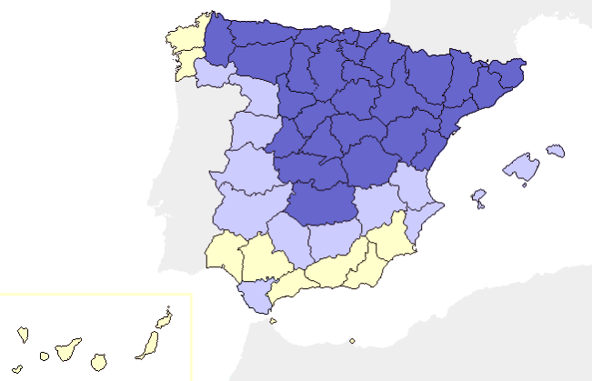
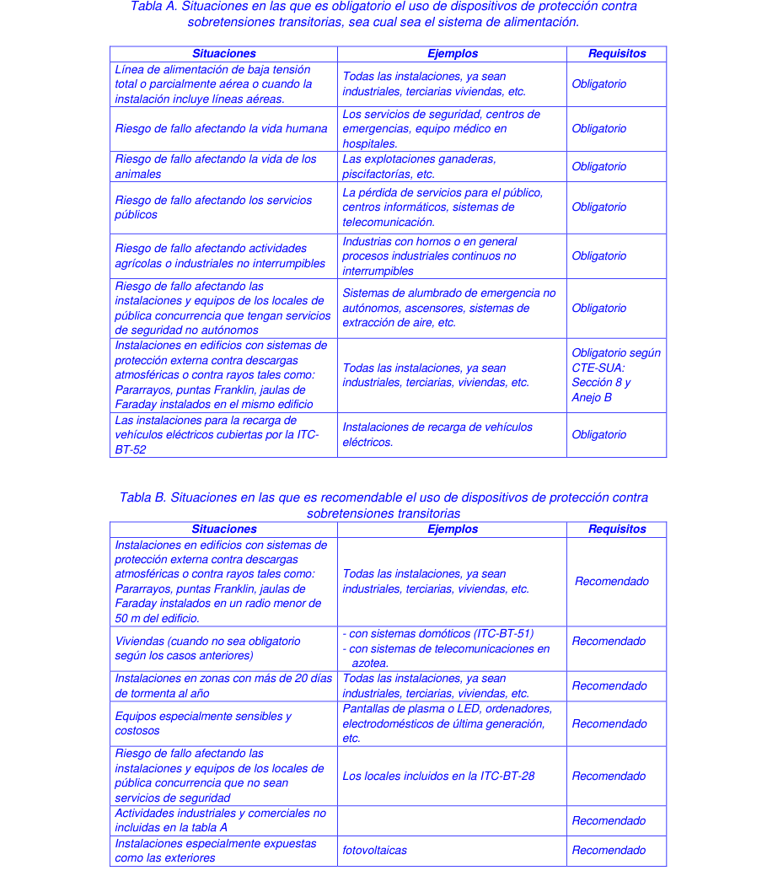

# BT-23. Protección contra sobretensiones

_PROTECCIÓN DE INSTALACIONES INTERIORES_

- 1. OBJETO Y CAMPO DE APLICACIÓN — 2

- 2. CATEGORÍAS DE LAS SOBRETENSIONES — 3

- 2.1 Objeto de las categorías — 3

- 2.2 Descripción de las categorías de sobretensiones — 3

- 3. MEDIDAS PARA EL CONTROL DE LAS SOBRETENSIONES — 4

- 3.1 Situación natural — 4

- 3.2 Situación controlada — 4

- 4. SELECCIÓN DE LOS MATERIALES EN LA INSTALACIÓN — 9

### 1. OBJETO Y CAMPO DE APLICACIÓN

Esta instrucción trata de la protección de las instalaciones eléctricas interiores contra las sobretensiones transitorias que se transmiten por las redes de distribución y que se originan, fundamentalmente, como consecuencia de las descargas atmosféricas, conmutaciones de redes y defectos en las mismas.

Conforme al artículo 16.1 del Reglamento, dentro del concepto de instalación interior hay que incluir cualquier instalación receptora aunque toda ella o alguna de sus partes esté situada a la intemperie, por lo que las instalaciones receptoras para fines especiales tales como parques de caravanas, marinas, ferias y stands, instalaciones provisionales y de obra, instalaciones agrícolas, generadores eólicos, etc., se consideran incluidas en el campo de aplicación de esta instrucción, dado que pueden estar muy expuestas a las sobretensiones transitorias de origen atmosférico.

Las causas más frecuentes de aparición de sobretensiones transitorias de origen atmosférico son las siguientes: − La caída de un rayo sobre la línea de distribución o en sus proximidades − El funcionamiento de un sistema de protección externa contra descargas atmosféricas (pararrayos, puntas Franklin, jaulas de Faraday, etc.), situado en el propio edificio o en sus proximidades. − La incidencia directa de una descarga atmosférica en el propio edificio, tanto más probable cuanto más alto sea éste, o en sus proximidades. A estos efectos se considera proximidad una distancia de aproximadamente 50 m.

El nivel de sobretensión que puede aparecer en la red es función del: nivel isoceraúnico estimado, tipo de acometida aérea o subterránea, proximidad del transformador de MT/BT, etc. La incidencia que la sobretensión puede tener en la seguridad de las personas, instalaciones y equipos, así como su repercusión en la continuidad del servicio es función de:

- La coordinación del aislamiento de los equipos - Las características de los dispositivos de protección contra sobretensiones, su instalación y su ubicación. - La existencia de una adecuada red de tierras.

Esta instrucción contiene las indicaciones a considerar para cuando la protección contra sobretensiones está prescrita o recomendada en las líneas de alimentación principal 230/400 V en corriente alterna, no contemplándose en la misma otros casos como, por ejemplo, la protección de señales de medida, control y telecomunicación.

En general, las sobretensiones originadas por maniobras en las redes son inferiores, en valor de cresta, a las atmosféricas y por ello generalmente, los requisitos de protección contra sobretensiones atmosféricas garantizan la protección contra sobretensiones de maniobra.

La instrucción ITC-BT-23 no trata la protección contra sobretensiones temporales, también denominadas permanentes o a frecuencia industrial, por ejemplo, debidas a la rotura o desconexión del neutro.

### 2. CATEGORÍAS DE LAS SOBRETENSIONES

#### 2.1 Objeto de las categorías

Las categorías de sobretensiones permiten distinguir los diversos grados de tensión soportada a las sobretensiones en cada una de las partes de la instalación, equipos y receptores. Mediante una adecuada selección de la categoría, se puede lograr la coordinación del aislamiento necesario en el conjunto de la instalación, reduciendo el riesgo de fallo a un nivel aceptable y proporcionando una base para el control de la sobretensión.

Las categorías indican los valores de tensión soportada a la onda de choque de sobretensión que deben de tener los equipos, determinando, a su vez, el valor límite máximo de tensión residual que deben permitir los diferentes dispositivos de protección de cada zona para evitar el posible daño de dichos equipos. La reducción de las sobretensiones de entrada a valores inferiores a los indicados en cada categoría se consigue con una estrategia de protección en cascada que integra tres niveles de protección: basta, media y fina, logrando de esta forma un nivel de tensión residual no peligroso para los equipos y una capacidad de derivación de energía que prolonga la vida y efectividad de los dispositivos de protección.

#### 2.2 Descripción de las categorías de sobretensiones

En la tabla 1 se distinguen 4 categorías diferentes, indicando en cada caso el nivel de tensión soportada a impulsos, en kV, según la tensión nominal de la instalación.

Categoría I Se aplica a los equipos muy sensibles a las sobretensiones y que están destinados a ser conectados a la instalación eléctrica fija. En este caso, las medidas de protección se toman fuera de los equipos a proteger, ya sea en la instalación fija o entre la instalación fija y los equipos, con objeto de limitar las sobretensiones a un nivel específico. Ejemplo: ordenadores, equipos electrónicos muy sensibles, etc.

Categoría II Se aplica a los equipos destinados a conectarse a una instalación eléctrica fija. Ejemplo: electrodomésticos, herramientas portátiles y otros equipos similares.

Categoría III Se aplica a los equipos y materiales que forman parte de la instalación eléctrica fija y a otros equipos para los cuales se requiere un alto nivel de fiabilidad. Ejemplo: armarios de distribución, embarrados, aparamenta (interruptores, seccionadores, tomas de corriente...), canalizaciones y sus accesorios (cables, caja de derivación...), motores con conexión eléctrica fija (ascensores, máquinas industriales...), etc.

Categoría IV Se aplica a los equipos y materiales que se conectan en el origen o muy próximos al origen de la instalación, aguas arriba del cuadro de distribución. Ejemplo: contadores de energía, aparatos de telemedida, equipos principales de protección contra sobreintensidades, etc.

### 3. MEDIDAS PARA EL CONTROL DE LAS SOBRETENSIONES

Es preciso distinguir dos tipos de sobretensiones: - Las producidas como consecuencia de la descarga directa del rayo. Esta instrucción no trata este caso

Esta instrucción no contempla las características del sistema externo de protección contra el rayo (dispositivo captador, derivadores o bajadas y la toma de tierra), que están recogidas en el Código Técnico de la Edificación, Artículo 12.8 Exigencia básica SUA 8 Seguridad frente al riesgo causado por la acción del rayo y Anejo B Características de las instalaciones de protección contra el rayo. Sin embargo, sí que se consideran los sistemas internos mediante dispositivos de protección contra sobretensiones transitorias que reducen los efectos eléctricos y magnéticos de la corriente de la descarga atmosférica dentro del espacio a proteger

- Las debidas a la influencia de la descarga lejana del rayo, conmutaciones de la red, defectos de red, efectos inductivos, capacitivos, etc.

Los efectos capacitivos e inductivos son debidos a: − descargas atmosféricas en: - el propio sistema de protección externa (pararrayos,...); - las inmediaciones (árboles, estructuras, etc.); − el acoplamiento capacitivo entre primario y secundario en el caso de descargas atmosféricas en la línea aérea de AT; y − el acoplamiento inductivo por las maniobras de equipos con reactancia de valor elevado (hornos de inducción, máquinas de soldadura eléctrica, transformadores, etc.)

Se pueden presentar dos situaciones diferentes:

- Situación natural: cuando no es preciso la protección contra las sobretensiones transitorias - Situación controlada: cuando es preciso la protección contra las sobretensiones transitorias

#### 3.1 Situación natural

Cuando se prevé un bajo riesgo de sobretensiones en una instalación (debido a que está alimentada por una red subterránea en su totalidad), se considera suficiente la resistencia a las sobretensiones de los equipos que se indica en la Tabla 1 y no se requiere ninguna protección suplementaria contra las sobretensiones transitorias. Una línea aérea constituida por conductores aislados con pantalla metálica unida a tierra en sus dos extremos, se considera equivalente a una línea subterránea.

#### 3.2 Situación controlada

Cuando una instalación se alimenta por, o incluye, una línea aérea con conductores desnudos o aislados, se considera necesaria una protección contra sobretensiones de origen atmosférico en el origen de la instalación.

El nivel de sobretensiones puede controlarse mediante dispositivos de protección contra las sobretensiones colocados en las líneas aéreas (siempre que estén suficientemente próximos al origen de la instalación) o en la instalación eléctrica del edificio.

También se considera situación controlada aquella situación natural en que es conveniente incluir dispositivos de protección para una mayor seguridad (por ejemplo, continuidad de servicio, valor económico de los equipos, pérdidas irreparables, etc.).

En base a un análisis de riesgos contemplado en la Norma UNE EN 62305-2, se consideran situaciones controladas que deberán disponer de protección contra sobretensiones, todas aquellas instalaciones en las que el fallo del suministro o de los equipos debido a la sobretensión pudiera afectar a: − la vida humana, por ejemplo, servicios de seguridad, centros de emergencias, equipo médico en hospitales. − la vida de los animales, por ejemplo, explotaciones ganaderas, piscifactorías, etc. − los servicios públicos, por ejemplo, pérdida de servicios para el público, centros informáticos, sistemas de telecomunicación. − las instalaciones de los locales de pública concurrencia cubiertos por la ITC-BT-28. − la actividad agrícola o industrial en función del impacto económico que pudieran implicar las sobretensiones (continuidad del servicio, destrucción de equipos, etc.).

Por otro lado, la nueva ITC-BT-52 incluye la necesidad de protección contra sobretensiones en las instalaciones para la recarga de vehículos eléctricos.

Además, es recomendable tener en cuenta el coste y sensibilidad de los equipos ya que cuanto más sensible sea un aparato y mayor coste tenga, mayor protección debería recibir. Este es el caso de equipos informáticos en general, pantallas de plasma o LED, electrodomésticos de última generación, autómatas, equipos electrónicos de máquinas industriales etc. Para estos casos la disposición de protecciones se realizará conforme a lo establecido en el capítulo A de esta Guía con dispositivos de protección contra sobretensiones transitorias de tipo 3.

Para instalaciones especialmente expuestas como las exteriores (ej: alumbrado exterior, fotovoltaicas), la integración de un mayor número de equipos y elementos electrónicos precisan de la utilización de dispositivos de protección contra sobretensiones transitorias. Para estos casos la disposición de protecciones se realizará conforme a lo establecido en el capítulo A de esta Guía con dispositivos de protección contra sobretensiones transitorias de tipo 2. Las recomendaciones específicas para la protección contra sobretensiones de instalaciones fotovoltaicas se proporcionan en la Guía BT 40.

Asimismo, aunque la situación sea natural, la instalación de dispositivos de protección contra sobretensiones transitorias es recomendable en aquellas provincias con al menos 20 días de tormenta al año y muy recomendable en aquellas con al menos 25 días, según el mapa A.

Mapa A – Clasificación de las provincias de España en función del número medio anual de días de tormenta.

días tormenta/año < 20 días tormenta/año  20 días tormenta/año  25

Cuando la instalación esté en un lugar elevado (sobre una montaña, colina o promontorio), se considerará como criterio de seguridad adecuado, escoger el nivel inmediato superior al asignado a la provincia.

En las instalaciones de edificios que tengan sistemas de protección externa contra el rayo (pararrayos, puntas Franklin, jaulas de Faraday, etc.), según lo establecido en el CTE, SUA 8, y anejo B.2, los conductores de los circuitos eléctricos sometidos a la tensión de alimentación de red y los conductores de los circuitos de telecomunicación deben ser protegidos mediante dispositivos de protección contra sobretensiones transitorias instalados en el origen de la instalación del edificio, estos deberán ser de Tipo 1. Cuando se utilice una protección de sobretensiones en cascada, la selección de dispositivos se realizará de acuerdo a lo establecido en el apartado A de la sección 4 de la presente Guía.

En las instalaciones ubicadas en un radio de aproximadamente de 50 m alrededor de un pararrayos (aunque no estén en el mismo edificio) se recomienda disponer de dispositivos de protección contra sobretensiones transitorias de tipo 1. Cuando se utilice una protección de sobretensiones en cascada, la selección de dispositivos se realizará de acuerdo a lo establecido en el apartado A de la sección 4 de la presente Guía.

Los dispositivos de protección contra sobretensiones de origen atmosférico deben seleccionarse de forma que su nivel de protección sea inferior a la tensión soportada a impulso de la categoría de los equipos y materiales que se prevé que se vayan a instalar. En redes TT o IT, los descargadores se conectarán entre cada uno de los conductores, incluyendo el neutro o compensador y la tierra de la instalación. En redes TN-S, los descargadores se conectarán entre cada uno de los conductores de fase y el conductor de protección. En redes TN-C, los descargadores se conectarán entre cada uno de los conductores de fase y el neutro o compensador. No obstante, se permiten otras formas de conexión, siempre que se demuestre su eficacia.

En el sistema TT, el dispositivo de protección contra sobretensiones transitorias podrá instalarse tanto aguas arriba (entre el interruptor general y el propio diferencial) como aguas abajo del interruptor diferencial. En caso de instalarse aguas abajo del diferencial, éste deberá ser selectivo de tipo S (o retardado).

Para instalaciones en viviendas con un único diferencial, con el fin de evitar disparos intempestivos del interruptor diferencial en caso de actuación del dispositivo de protección contra sobretensiones transitorias, dicho dispositivo debe instalarse aguas arriba del interruptor diferencial (entre el interruptor general y el propio interruptor diferencial).

Con el fin de optimizar la continuidad de servicio en caso de destrucción del dispositivo de protección contra sobretensiones transitorias a causa de una descarga de rayo superior a la máxima prevista, cuando el dispositivo de protección contra sobretensiones transitorias no lleve incorporada su propia protección, se debe instalar el dispositivo de protección recomendado por el fabricante, aguas arriba del dispositivo de protección contra sobretensiones transitorias , con objeto de mantener la continuidad de todo el sistema, evitando el disparo del interruptor general.

Ante la eventual necesidad de instalar varios dispositivos de protección contra sobretensiones transitorias en cascada (por ejemplo, uno general o de cabecera y otros en determinados circuitos de salida), se deberá consultar la información de utilización facilitada por el fabricante para conseguir la adecuada coordinación. En instalaciones de grandes longitudes, y que dispongan o permitan la instalación de cuadros secundarios, es conveniente la instalación de dispositivos de protección contra sobretensiones transitorias de tipo 2 adicionales cada 10 m aproximadamente, según se establece en al UNE-CLC TS 61643-12.

En las tablas A y B se resumen las situaciones en las que es obligatorio y/o recomendable respectivamente, el uso de dispositivos de protección contra sobretensiones transitorias. Cuando una instalación pueda estar considerada en ambas tablas, se aplicará la tabla A.

<!-- tabla: ../tablas/BT-23_t01.csv -->

| Situaciones | Ejemplos | Requisitos |
|---|---|---|
| Línea de alimentación de baja tensión total o parcialmente aérea o cuando la instalación incluye líneas aéreas. | Todas las instalaciones, ya sean industriales, terciarias viviendas, etc. | Obligatorio |
| Riesgo de fallo afectando la vida humana | Los servicios de seguridad, centros de emergencias, equipo médico en hospitales. | Obligatorio |
| Riesgo de fallo afectando la vida de los animales | Las explotaciones ganaderas, piscifactorías, etc. | Obligatorio |
| Riesgo de fallo afectando los servicios públicos | La pérdida de servicios para el público, centros informáticos, sistemas de telecomunicación. | Obligatorio |
| Riesgo de fallo afectando actividades agrícolas o industriales no interrumpibles | Industrias con hornos o en general procesos industriales continuos no interrumpibles | Obligatorio |
| Riesgo de fallo afectando las instalaciones y equipos de los locales de pública concurrencia que tengan servicios de seguridad no autónomos | Sistemas de alumbrado de emergencia no autónomos, ascensores, sistemas de extracción de aire, etc. | Obligatorio |
| Instalaciones en edificios con sistemas de protección externa contra descargas atmosféricas o contra rayos tales como: Pararrayos, puntas Franklin, jaulas de Faraday instalados en el mismo edificio | Todas las instalaciones, ya sean industriales, terciarias, viviendas, etc. | Obligatorio según CTE-SUA: Sección 8 y Anejo B |
| Las instalaciones para la recarga de vehículos eléctricos cubiertas por la ITC- BT-52 | Instalaciones de recarga de vehículos eléctricos. | Obligatorio |

<!-- tabla: ../tablas/BT-23_t02.csv -->

| Situaciones | Ejemplos | Requisitos |
|---|---|---|
| Instalaciones en edificios con sistemas de protección externa contra descargas atmosféricas o contra rayos tales como: Pararrayos, puntas Franklin, jaulas de Faraday instalados en un radio menor de 50 m del edificio. | Todas las instalaciones, ya sean industriales, terciarias, viviendas, etc. | Recomendado |
| Viviendas (cuando no sea obligatorio según los casos anteriores) | - con sistemas domóticos (ITC-BT-51) - con sistemas de telecomunicaciones en azotea. | Recomendado |
| Instalaciones en zonas con más de 20 días de tormenta al año | Todas las instalaciones, ya sean industriales, terciarias, viviendas, etc. | Recomendado |
| Equipos especialmente sensibles y costosos | Pantallas de plasma o LED, ordenadores, electrodomésticos de última generación, etc. | Recomendado |
| Riesgo de fallo afectando las instalaciones y equipos de los locales de pública concurrencia que no sean servicios de seguridad | Los locales incluidos en la ITC-BT-28 | Recomendado |
| Actividades industriales y comerciales no incluidas en la tabla A |  | Recomendado |
| Instalaciones especialmente expuestas como las exteriores | fotovoltaicas | Recomendado |

<!-- tabla no extraíble en la pág. 8 -->
> La tabla de esta página no se puede extraer como texto (pdfplumber la lee como
> caracteres sueltos): se muestra la imagen de la página. También está en [pdf/BT-23.pdf](../pdf/BT-23.pdf#page=8).

### 4. SELECCIÓN DE LOS MATERIALES EN LA INSTALACIÓN

Los equipos y materiales deben escogerse de manera que su tensión soportada a impulsos no sea inferior a la tensión soportada prescrita en la tabla 1, según su categoría.

Los equipos y materiales que tengan una tensión soportada a impulsos inferior a la indicada en la tabla 1, se pueden utilizar, no obstante:

- en situación natural, cuando el riesgo sea aceptable. - en situación controlada, si la protección contra las sobretensiones es adecuada,

Tabla 1

### TENSIÓN NOMINAL TENSIÓN SOPORTADA A IMPULSOS 1,2/50

DE LA INSTALACIÓN (kV)

### SISTEMAS SISTEMAS CATEGORÍA CATEGORÍA CATEGORÍA CATEGORÍA

### TRIFÁSICOS MONOFÁSICOS IV III II I

230/400 230 6 4 2,5 1,5 400/690 -- 8 6 4 2,5 1000 --

### A SELECCIÓN DEL TIPO DE LOS DISPOSITIVOS DE PROTECCIÓN CONTRA

### SOBRETENSIONES TRANSITORIAS A INSTALAR

Los dispositivos de protección contra sobretensiones transitorias son dispositivos capaces de garantizar la protección contra sobretensiones de origen atmosférico, debidas a conmutaciones, etc., que se producen en la instalación. Estos dispositivos pueden ser descargadores a gas, varistores de óxido de zinc, diodos supresores, descargadores de arco, combinaciones de los anteriores, etc.

Se considera que cumplen con las prescripciones de esta instrucción los dispositivos de características equivalentes a los establecidos en la serie de normas UNE-EN 61643. Según la norma UNE-EN 61643-11 existen 3 tipos de protectores de sobretensión transitoria denominados: Tipo 1, Tipo 2 y Tipo 3.

Los parámetros más significativos para cada uno de estos tipos son:

<!-- tabla: ../tablas/BT-23_t03.csv -->

|  | Tipo 1 | Tipo 2 | Tipo 3 |
|---|---|---|---|
| Capacidad de absorción de energía | Muy alta - Alta | Media - Alta | Baja |
| Rapidez de respuesta | Baja - Media | Media - Alta | Muy alta |
| Origen de la sobretensión | Impacto directo de rayo | Sobretensiones de origen atmosférico y conmutaciones, conducidas o inducidas |  |

El objetivo a conseguir es que la actuación del dispositivo de protección reduzca la sobretensión transitoria a un valor de tensión inferior a la soportada por el equipo protegido (de acuerdo con su categoría de sobretensión según se definen en la Tabla 1). Para alcanzar este objetivo puede ser necesario utilizar más de un dispositivo de protección.

En general, se puede lograr la protección de la instalación mediante un dispositivo Tipo 2, instalado lo más cerca posible del origen de la instalación interior, en el cuadro de distribución principal.

En función del dispositivo instalado en cabecera y de las distancias entre éste y los equipos a proteger, puede ser necesario instalar dispositivos de protección adicionales para proteger equipos sensibles. Éstos podrán ser de Tipo 2 o de Tipo 3.

Cuando el edificio disponga de sistemas de protección externa contra el rayo (pararrayos, puntas Franklin, jaulas de Faraday) además será necesario instalar en el origen de la instalación (antes de los contadores), un dispositivo de protección de Tipo 1.

Para garantizar la coordinación adecuada entre dispositivos se seguirán las recomendaciones del fabricante.

Instalación Receptor interior categoría I

<!-- tabla: ../tablas/BT-23_t04.csv -->

| Cuadro General de |  |
|---|---|
| Distri | bución |

Tipo 1 Tipo 2 Receptor categoría II

Ejemplo de instalación que incluye los tres tipos de dispositivos de protección contra sobretensiones transitorias.

### B SELECCIÓN DE LAS CARACTERÍSTICAS Y TIPO DE CONEXIÓN DEL DISPOSITIVO DE

### PROTECCIÓN CONTRA SOBRETENSIONES TRANSITORIAS

Para la correcta selección de los dispositivos de protección contra sobretensiones transitorias es necesario consultar al fabricante, ya que deben tenerse en cuenta varios factores, tales como: − Nivel de protección o tensión limitada, en función de la categoría de los equipos a proteger − Tensión máxima de servicio permanente. − Intensidad nominal de descarga e intensidad máxima de descarga, en función de las intensidades de descarga previstas. − Tipo de conexión (régimen de neutro, tipo de red…)

Nivel de protección (U ): es el parámetro que caracteriza el funcionamiento del dispositivo de p protección contra sobretensiones transitorias por limitación de la tensión entre sus bornes. Debe ser inferior a la categoría de sobretensión de la instalación o equipo a proteger (Ver punto 2.2 y Tabla 1). No obstante, si el protector está alejado de dicho punto puede ser necesario utilizar protectores adicionales.

Ejemplo: instalación en la que los equipos más sensibles correspondan a la Categoría de sobretensión II, como electrodomésticos o herramientas portátiles, la U del protector p seleccionado debe ser  2,5 kV

Tensión máxima de servicio permanente (U ): es el valor eficaz de tensión máximo que puede c aplicarse permanentemente a los bornes del dispositivo de protección.

Ejemplo: en una red de distribución TT 230/400V, la tensión máxima permanente se considerará un 10% superior al valor nominal (230 x 1,1 = 253 V). Por tanto, la tensión máxima de servicio permanente U del protector seleccionado debe ser superior a 253 V. c

Corriente nominal de descarga (I ): Este parámetro caracteriza a los dispositivos de protección n contra sobretensiones transitorias de Tipo 2. Es la corriente de cresta repetitiva que puede soportar el dispositivo de protección sin fallo. La forma de onda de la corriente aplicada está normalizada como 8/20 µs. La elección del dispositivo se puede realizar según lo establecido en la UNE-HD 60364-5-534, en donde la In no debe ser inferior a 5 kA 8/20 µs, entre fase y neutro.

Corriente de impulso (I ): Este parámetro caracteriza a los dispositivos de protección contra imp sobretensiones transitorias de Tipo 1. Es la corriente de cresta que puede soportar el dispositivo de protección sin fallo. Habitualmente se utiliza la forma de onda de la corriente aplicada normalizada como 10/350 µs. La elección del dispositivo se puede realizar según lo establecido en la UNE-HD 60364-5-534, en donde la I no debe ser inferior a 12,5 kA. imp

### C COORDINACIÓN ENTRE LOS DISPOSITIVOS DE PROTECCIÓN CONTRA

### SOBRETENSIONES TRANSITORIAS

Para garantizar la coordinación adecuada entre dispositivos se seguirán las recomendaciones del fabricante.

Para asegurar la coordinación entre los dispositivos de protección instalados en cascada, puede ser necesaria la instalación de inductancias de desacoplo, si la longitud del cable que los conecta es inferior a la mínima especificada por el fabricante. Por ello y para verificar que existe coordinación entre los dispositivos ubicados en cuadros principales y cuadros secundarios, se debe comprobar la distancia del cable entre los mismos.

Asimismo, será necesaria la instalación en cascada de un segundo dispositivo de protección contra sobretensiones transitorias próximo al receptor, cuando la distancia entre el dispositivo de protección contra sobretensiones y el receptor sea superior a la especificada por el fabricante.

### D CONEXIÓN A TIERRA DE LOS DISPOSITIVOS DE PROTECCIÓN CONTRA

### SOBRETENSIONES TRANSITORIAS

Para el correcto funcionamiento de los dispositivos de protección será necesario que el conductor que une el dispositivo con la instalación de tierra del edificio tenga una sección mínima de cobre, en toda su longitud, según la siguiente tabla:

<!-- tabla: ../tablas/BT-23_t05.csv -->

| Tipo de dispositivo | Sección mínima del conductor (mm2) | Conexión entre el dispositivo y |
|---|---|---|
| Tipo 1 | 16 | el borne principal de tierra o punto de puesta a tierra del edificio |
| Tipo 2 | 4 | el borne de entrada de tierra de la instalación interior |
| Tipo 3 | 2,5 o lo especificado por el fabricante | un borne de tierra de la instalación interior |
