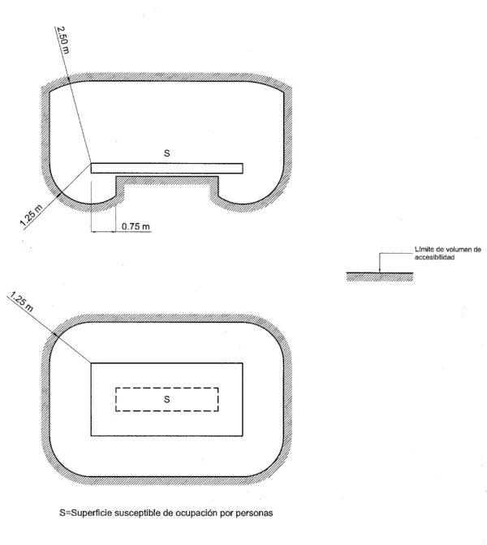
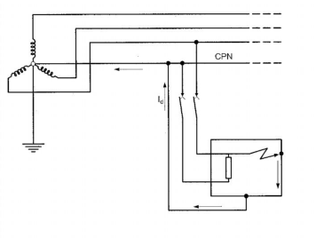
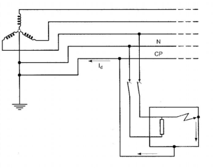
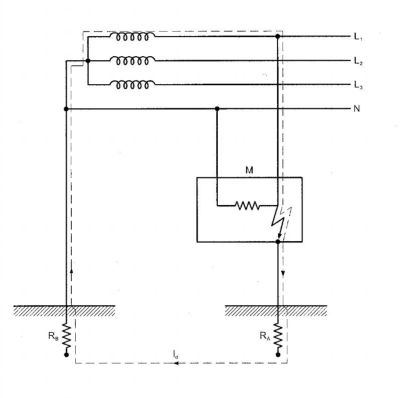
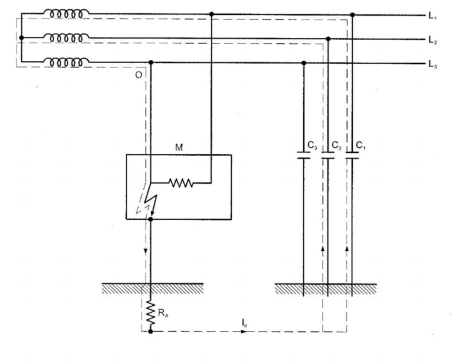
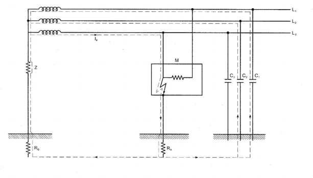
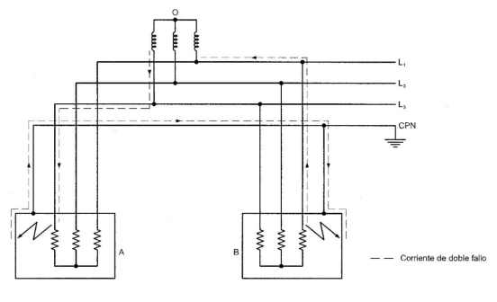
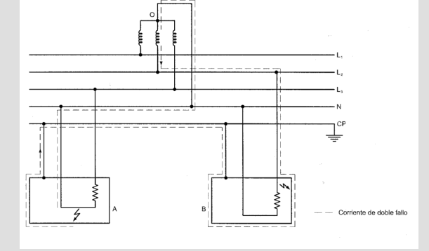
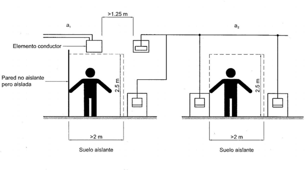
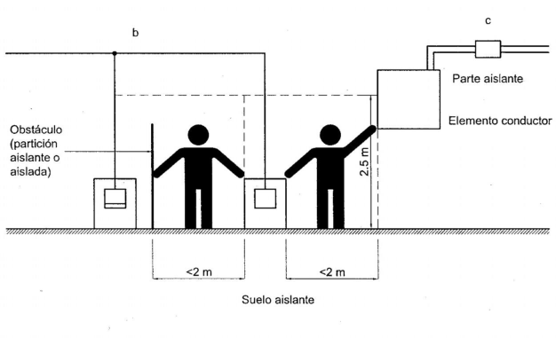

# BT-24. Protección contra los contactos directos e indirectos

_PROTECCIÓN CONTR A LOS CONTACTOS_

### 0. ÍNDICE

- 0. ÍNDICE — 1

- 1. INTRODUCCIÓN — 2

- 2. PROTECCIÓN CONTRA CONTACTOS DIRECTOS E INDIRECTOS — 2

- 3. PROTECCIÓN CONTRA CONTACTOS DIRECTOS — 3

- 3.1 Protección por aislamiento de las partes activas — 3

- 3.2 Protección por medio de barreras o envolventes — 3

- 3.3 Protección por medio de obstáculos — 4

- 3.4 Protección por puesta fuera de alcance por alejamiento — 4

#### 3.5 Protección complementaria por dispositivos de corriente diferencial-

- residual — 6

- 4. PROTECCIÓN CONTRA LOS CONTACTOS INDIRECTOS — 7

- 4.1 Protección por corte automático de la alimentación — 7

##### 4.1.1 Esquemas TN, características y prescripciones de los dispositivos de

- protección. — 9

##### 4.1.2 Esquemas TT. Características y prescripciones de los dispositivos de

- protección. — 11

##### 4.1.3 Esquemas IT. Características y prescripciones de los dispositivos de

- protección — 13

#### 4.2 Protección por empleo de equipos de la clase II o por aislamiento

- equivalente. — 19

- 4.3 Protección en los locales o emplazamientos no conductores — 19

#### 4.4 Protección mediante conexiones equipotenciales locales no conectadas

- a tierra — 21

- 4.5 Protección por separación eléctrica — 22

- 1 -

### 1. INTRODUCCIÓN

La presente instrucción describe las medidas destinadas a asegurar la protección de las personas y animales domésticos contra los choques eléctricos.

En la protección contra los choques eléctricos se aplicarán las medidas apropiadas: - para la protección contra los contactos directos y contra los contactos indirectos. - para la protección contra contactos directos. - para la protección contra contactos indirectos.

Esta nueva edición de la GUIA-BT-24 está motivada principalmente por la publicación de la norma UNE-HD 60364-4-41, que sustituye a la UNE 20.460-4-41 usada como referencia por la ITC-BT-24. La norma UNE-HD 60364-4-41 define y enumera las medidas de protección frente a los riesgos asociados a los contactos directos e indirectos en las instalaciones eléctricas.

En esta norma, los conceptos de” protección contra los contactos directos” y “protección contra los contactos indirectos” han pasado a denominarse “protección principal" y "protección en caso de defecto", respectivamente.

La regla fundamental para la protección contra el choque eléctrico, tal como la define la Norma UNE-EN 61140, es que las partes activas peligrosas no deben ser accesibles y que las partes conductoras accesibles no deben ser peligrosas, ni en condiciones normales ni en condiciones de defecto simple. La protección en condiciones normales la proporcionan las disposiciones para la protección contra los contactos directos (o de protección principal) y la protección en caso de defecto simple la proporcionan las disposiciones para la protección contra los contactos indirectos (o de protección en caso de defecto). Además, y con carácter alternativo, la protección contra los choques eléctricos se puede conseguir simultáneamente contra los contactos directos e indirectos, mediante una disposición de protección reforzada que garantiza la protección en condiciones normales y en condiciones de defecto simple.

<!-- tabla: ../tablas/BT-24_t01.csv -->

|  | 2. PROTECCIÓN CONTRA CONTACTOS DIRECTOS E INDIRECTOS |
|---|---|
|  | La protección contra los choques eléctricos para contactos directos e indirectos a la vez se |
|  | realiza mediante la utilización de muy baja tensión de seguridad MBTS, que debe cumplir las |
|  | siguientes condiciones: |
|  | - Tensión nominal en el campo I de acuerdo a la norma UNE 20.481 y la ITC-BT-36. |
|  | - Fuente de alimentación de seguridad para MBTS de acuerdo con lo indicado en la norma |
|  | UNE 20.460 -4-41. |
|  | - Los circuitos de instalaciones para MBTS, cumplirán lo que se indica en la Norma UNE |
|  | 20.460-4-41 y en la ITC-BT-36. |

La norma UNE 20.460-4-41 ha sido reemplazada por la UNE-HD 60364-4-41 que define y enumera las medidas de protección frente a los riesgos asociados a los contactos directos e indirectos en las instalaciones eléctricas.

Aunque la norma UNE-HD 60364-4-41 establece el límite de la Muy Baja Tensión (MBT) en corriente continua en 120 V, el Artículo 4 del REBT y la ITC-BT-36 lo establecen en 75 V. El requisito del REBT es el que prevalece para las instalaciones eléctricas en España.

La protección por aislamiento doble o reforzado también protege a la vez contra contactos directos e indirectos. Los requisitos y recomendaciones se incluyen en el punto 4.2 de esta Guía.

- 2 -

<!-- tabla: ../tablas/BT-24_t02.csv -->

|  | 3. PROTECCIÓN CONTRA CONTACTOS DIRECTOS |
|---|---|
|  | Esta protección consiste en tomar las medidas destinadas a proteger las personas contra los |
|  | peligros que pueden derivarse de un contacto con las partes activas de los materiales |
|  | eléctricos. |
|  | Salvo indicación contraria, los medios a utilizar vienen expuestos y definidos en la Norma UNE |
|  | 20.460 -4-41, que son habitualmente: |
|  | - Protección por aislamiento de las partes activas. |
|  | - Protección por medio de barreras o envolventes. |
|  | - Protección por medio de obstáculos. |
|  | - Protección por puesta fuera de alcance por alejamiento. |
|  | - Protección complementaria por dispositivos de corriente diferencial residual. |

La norma UNE-HD 60364-4-41 incluye:

• en su Anexo A los requisitos aplicables al uso de aislamiento de las partes activas y al uso de barreras o envolventes

• en su Anexo B los requisitos aplicables a obstáculos y puesta fuera del alcance

• en su apartado 415.1 la protección complementaria por dispositivos de corriente diferencial residual, también denominados interruptores diferenciales

<!-- tabla: ../tablas/BT-24_t03.csv -->

|  | 3.1 Protección por aislamiento de las partes activas |
|---|---|
|  | Las partes activas deberán estar recubiertas de un aislamiento que no pueda ser eliminado |
|  | más que destruyéndolo. |
|  | Las pinturas, barnices, lacas y productos similares no se considera que constituyan un |
|  | aislamiento suficiente en el marco de la protección contra los contactos directos. |
|  | 3.2 Protección por medio de barreras o envolventes |
|  | Las partes activas deben estar situadas en el interior de las envolventes o detrás de barreras |
|  | que posean, como mínimo, el grado de protección IP XXB, según UNE 20.324. Si se necesitan |
|  | aberturas mayores para la reparación de piezas o para el buen funcionamiento de los equipos, |
|  | se adoptarán precauciones apropiadas para impedir que las personas o animales domésticos |
|  | toquen las partes activas y se garantizará que las personas sean conscientes del hecho de |
|  | que las partes activas no deben ser tocadas voluntariamente. |

Una envolvente o barrera que proporcione al menos un grado de protección IP 2X, proporcionará siempre un grado de protección IP XXB. El significado de los códigos IP e IK se indica en la GUIA-BT-ANEXO 1.

<!-- tabla: ../tablas/BT-24_t04.csv -->

|  | Las superficies superiores de las barreras o envolventes horizontales que son fácilmente |
|---|---|
|  | accesibles, deben responder como mínimo al grado de protección IP4X o IP XXD. |

- 3 -

Las barreras o envolventes deben fijarse de manera segura y ser de una robustez y durabilidad suficientes para mantener los grados de protección exigidos, con una separación suficiente de las partes activas en las condiciones normales de servicio, teniendo en cuenta las influencias externas.

Cuando sea necesario suprimir las barreras, abrir las envolventes o quitar partes de éstas, esto no debe ser posible más que:

- bien con la ayuda de una llave o de una herramienta; - o bien, después de quitar la tensión de las partes activas protegidas por estas barreras o estas envolventes, no pudiendo ser restablecida la tensión hasta después de volver a colocar las barreras o las envolventes; - o bien, si hay interpuesta una segunda barrera que posee como mínimo el grado de protección IP2X o IP XXB, que no pueda ser quitada más que con la ayuda de una llave o de una herramienta y que impida todo contacto con las partes activas.

Cuando para suprimir las barreras, abrir las envolventes o quitar partes de éstas sea necesario el uso de una llave o herramienta, dicha llave sólo estará al alcance de personas cualificadas que garantizarán que las barreras o las envolventes queden cerradas cuando se finalice la intervención.

<!-- tabla: ../tablas/BT-24_t05.csv -->

| Producto | Norma de aplicación |
|---|---|
| Cajas y envolventes de Conjuntos de aparamenta de baja tensión | UNE-EN 61439 (serie) |
| Cajas y envolventes para accesorios eléctricos en instalaciones eléctricas fijas para uso doméstico y análogos | UNE-EN 60670 (serie) |
| Envolventes vacías destinadas a los conjuntos de aparamenta | UNE-EN 62208 |

<!-- tabla: ../tablas/BT-24_t06.csv -->

|  | 3.3 Protección por medio de obstáculos |
|---|---|
|  | Esta medida no garantiza una protección completa y su aplicación se limita, en la práctica, a |
|  | los locales de servicio eléctrico solo accesibles al personal autorizado. |

De acuerdo con la norma UNE-HD 60364-4-41, personal autorizado son las personas cualificadas o instruidas para reconocer y evitar los riesgos que puede crear la electricidad.

<!-- tabla: ../tablas/BT-24_t07.csv -->

|  | Los obstáculos están destinados a impedir los contactos fortuitos con las partes activas, pero |
|---|---|
|  | no los contactos voluntarios por una tentativa deliberada de salvar el obstáculo. |
|  | Los obstáculos deben impedir: |
|  | - bien, un acercamiento físico no intencionado a las partes activas; |
|  | - bien, los contactos no intencionados con las partes activas en el caso de intervenciones |
|  | en equipos bajo tensión durante el servicio. |
|  | Los obstáculos pueden ser desmontables sin la ayuda de una herramienta o de una llave; no |
|  | obstante, deben estar fijados de manera que se impida todo desmontaje involuntario. |
|  | 3.4 Protección por puesta fuera de alcance por alejamiento |
|  | Esta medida no garantiza una protección completa y su aplicación se limita, en la práctica a |
|  | los locales de servicio eléctrico solo accesibles al personal autorizado. |

- 4 -

De acuerdo con la norma UNE-HD 60364-4-41, personal autorizado son las personas cualificadas o instruidas para reconocer y evitar los riesgos que puede crear la electricidad.

<!-- tabla: ../tablas/BT-24_t08.csv -->

|  | La puesta fuera de alcance por alejamiento está destinada solamente a impedir los contactos |
|---|---|
|  | fortuitos con las partes activas. |
|  | Las partes accesibles simultáneamente, que se encuentran a tensiones diferentes no deben |
|  | encontrarse dentro del volumen de accesibilidad. |
|  | El volumen de accesibilidad de las personas se define como el situado alrededor de los |
|  | emplazamientos en los que pueden permanecer o circular personas, y cuyos límites no pueden |
|  | ser alcanzados por una mano sin medios auxiliares. Por convenio, este volumen está limitado |
|  | conforme a la figura 1, entendiendo que la altura que limita el volumen es 2,5 m. |
|  | Figura 1. – Volumen de accesibilidad |

- 5 -

La norma UNE 21302-826 define el volumen de accesibilidad al contacto o alcance del brazo como aquella zona que se extiende desde cualquier punto de una superficie en la que las personas permanecen y circulan habitualmente, y el límite que una persona puede alcanzar con la mano, en cualquier dirección y sin ayuda.

El concepto de volumen de accesibilidad, si bien se introduce en esta prescripción aplicado a la accesibilidad a partes con tensión, tiene un campo de aplicación mucho más amplio. En las diferentes ITCs del REBT 2002 se utilizan en diversas ocasiones, las mismas distancias para definir otros requisitos, por ejemplo:

- Altura mínima de los conductores posados sobre fachada (ITC-BT-06); - Altura mínima de montaje de los equipos eléctricos de las luminarias para montaje exterior de instalaciones de alumbrado exterior (ITC-BT-09); - Altura sobre el nivel del suelo hasta la que las canalizaciones para acometidas aéreas sobre fachada deben presentar unas características especiales de protección mecánica (ITC-BT-11); - Recomendación de la altura mínima de tubos en montaje superficial para garantizar el requisito de protección mecánica (ITC-BT-21); - Altura de los volúmenes de piscinas y fuentes (ITC-BT-31); - Altura mínima de instalación de luminarias en lugares accesibles al público de ferias y stands (ITC-BT-34); y - Altura del alumbrado general de quirófanos por debajo de la cual deberá disponer de protección diferencial (ITC-BT-38).

<!-- tabla: ../tablas/BT-24_t09.csv -->

|  | Cuando el espacio en el que permanecen y circulan normalmente personas está limitado por |
|---|---|
|  | un obstáculo (por ejemplo, listón de protección, barandillas, panel enrejado) que presenta un |
|  | grado de protección inferior al IP2X o IP XXB, según UNE 20 324, el volumen de accesibilidad |
|  | comienza a partir de este obstáculo. |
|  | En los emplazamientos en que se manipulen corrientemente objetos conductores de gran |
|  | longitud o voluminosos, las distancias prescritas anteriormente deben aumentarse teniendo |
|  | en cuenta las dimensiones de estos objetos. |
|  | 3.5 Protección complementaria por dispositivos de corriente diferencial-residual |
|  | Esta medida de protección está destinada solamente a complementar otras medidas de |
|  | protección contra los contactos directos. |
|  | El empleo de dispositivos de corriente diferencial-residual, cuyo valor de corriente diferencial |
|  | asignada de funcionamiento sea inferior o igual a 30 mA, se reconoce como medida de |
|  | protección complementaria en caso de fallo de otra medida de protección contra los contactos |
|  | directos o en caso de imprudencia de los usuarios. |

<!-- tabla: ../tablas/BT-24_t10.csv -->

|  | Cuando se prevea que las corrientes diferenciales puedan ser no senoidales (como por |
|---|---|
|  | ejemplo en salas de radiología intervencionista), los dispositivos de corriente diferencial- |
|  | residual utilizados serán de clase A que aseguran la desconexión para corrientes alternas |
|  | senoidales así como para corrientes continuas pulsantes. |
|  | La utilización de tales dispositivos no constituye por sí mismo una medida de protección |
|  | completa y requiere el empleo de una de las medidas de protección enunciadas en los |
|  | apartados 3.1 a 3.4 de la presente instrucción. |

- 6 -

El apartado 531.3 de la norma UNE-HD 60364-5-53 está dedicado a la selección e instalación de los interruptores diferenciales (DDR) utilizados para proteger contra el choque eléctrico.

En el Anexo I de esta guía se incluyen los criterios para seleccionar los interruptores diferenciales y su eventual rearme automático.

<!-- tabla: ../tablas/BT-24_t11.csv -->

|  | 4. PROTECCIÓN CONTRA LOS CONTACTOS INDIRECTOS |
|---|---|
|  | Esta protección se consigue mediante la aplicación de algunas de las medidas siguientes: |
|  | 4.1 Protección por corte automático de la alimentación |
|  | El corte automático de la alimentación después de la aparición de un fallo está destinado a |
|  | impedir que una tensión de contacto de valor suficiente, se mantenga durante un tiempo tal |
|  | que puede dar como resultado un riesgo. |
|  | Debe existir una adecuada coordinación entre el esquema de conexiones a tierra de la |
|  | instalación utilizado de entre los descritos en la ITC-BT-08 y las características de los |
|  | dispositivos de protección. |

En el apartado 411 de la norma UNE-HD 60364-4-41 se desarrollan los requisitos y soluciones para proteger contra los contactos directos e indirectos al utilizar la medida de protección por corte automático de la alimentación. De acuerdo con la norma UNE-HD 60364-4-41 la protección complementaria mediante interruptores diferenciales con corriente diferencial asignada de funcionamiento inferior o igual a 30 mA también puede complementar a la protección contra los contactos indirectos.

En el apartado 531 de la norma UNE-HD 60364-5-53 se desarrollan los requisitos y soluciones para la selección e instalación de dispositivos de protección contra el choque eléctrico mediante la desconexión automática de la alimentación.

<!-- tabla: ../tablas/BT-24_t12.csv -->

|  | El corte automático de la alimentación está prescrito cuando puede producirse un efecto |
|---|---|
|  | peligroso en las personas o animales domésticos en caso de defecto, debido al valor y |
|  | duración de la tensión de contacto. Se utilizará como referencia lo indicado en la norma UNE |
|  | 20.572 -1. |

La norma UNE 20572-1 ha sido anulada y sustituida por la Especificación Técnica UNE-IEC/TS 60479-1.

Además de la prescripción general anterior, otras ITC-BT de carácter particular incluyen requisitos adicionales y/o complementarios para caracterizar esta protección, tales como la ITC- BT-25, ITC-BT-26, ITC-BT-34, ITC-BT-38, etc.

Para proteger contra los contactos indirectos mediante el corte automático de la alimentación, es necesario que se respeten las dos condiciones siguientes: - Se produzca el denominado “bucle de defecto” que permite la circulación de la corriente de defecto. La constitución de este bucle de defecto depende del esquema de conexión a tierra de la instalación (TN, TT o IT). Esta condición implica la instalación de los correspondientes conductores de protección que unen las masas de todos los equipos eléctricos con su respectiva puesta a tierra según esquema de conexión a tierra de la instalación. Las características generales de los conductores de protección se definen en las ITC-BT-18 e ITC-BT-19.

- 7 -

- De acuerdo con el esquema de conexión a tierra de la instalación se haya seleccionado el dispositivo de protección apropiado que desconecte la corriente de defecto en un tiempo adecuado de acuerdo con lo indicado en los apartados 4.1.1 a 4.1.3 de la ITC- BT-24.

<!-- tabla: ../tablas/BT-24_t13.csv -->

|  | La tensión límite convencional es igual a 50 V, valor eficaz en corriente alterna, en condiciones |
|---|---|
|  | normales. En ciertas condiciones pueden especificarse valores menos elevados, como por |
|  | ejemplo, 24 V para las instalaciones de alumbrado público contempladas en la ITC-BT-09, |
|  | apartado 10. |

La tensión límite convencional de 24 V es aplicable tanto a las instalaciones de alumbrado exterior como a los locales o emplazamientos que por sus características puedan hacer más vulnerable a personas y animales a los efectos de un choque eléctrico, por ejemplo, locales húmedos, mojados, instalaciones a la intemperie e instalaciones temporales y provisionales de obra.

Uno de los dispositivos de protección utilizados más habitualmente para la protección contra los contactos indirectos mediante el corte automático de la alimentación son los interruptores diferenciales. En la elección del interruptor diferencial, una de las características que deben considerarse es el valor de la corriente diferencial de funcionamiento asignada I . Δn

De acuerdo con las correspondientes normas de producto, los valores normales de la corriente diferencial de funcionamiento asignada I son: Δn

UNE-EN 61008-1; I = (0,01 – 0,03 – 0,1 – 0,3 – 0,5 – 1) A Δn UNE-EN 61009-1; I = (0,01 – 0,03 – 0,1 – 0,3 – 0,5 – 1) A Δn UNE-EN 62423; I = (0,01 – 0,03 – 0,1 – 0,3 – 0,5 – 1) A Δn UNE-EN 60947-2; I = (0,006 – 0,01 – 0,03 – 0,1 – 0,3 – 0,5 – 1 – 3 – 10 – 30) A Δn

aunque se pueden encontrar diferenciales con valores diferentes

El umbral de disparo en todos los casos es de (0,5  1) I n

Por ejemplo:

- Para I = 30 mA el disparo estará comprendido entre 15 y 30 mA y n - Para I = 300 mA el disparo estará comprendido entre 150 y 300 mA n

En la elección de I se debe cumplir: n

a) Con las consideraciones de los apartados 4.1.1 a 4.1.3 𝐼Δ𝑛; b) 𝐼 < siendo I la corriente de fuga en condiciones normales de funcionamiento de 𝑓𝑢𝑔𝑎 fuga 2 la instalación, medida aguas abajo del diferencial

Con el objetivo de minimizar los disparos intempestivos de los interruptores diferenciales, en el Anexo III se detallan sus causas y cómo limitarlos.

<!-- tabla: ../tablas/BT-24_t14.csv -->

|  | Se describen a continuación aquellos aspectos más significativos que deben reunir los |
|---|---|
|  | sistemas de protección en función de los distintos esquemas de conexión de la instalación, |
|  | según la ITC-BT-08 y que la norma UNE 20.460 -4-41 define en cada caso. |

Según la ITC-BT-08 las redes de distribución de las empresas suministradoras que alimentan a los usuarios en Baja Tensión deben corresponder al esquema TT.

- 8 -

Los usuarios que contraten en Alta Tensión (aunque la utilización sea en BT) podrán elegir, además, el esquema TN o IT.

4.1.1 Esquemas TN, características y prescripciones de los dispositivos de protección.

Todas las masas de los equipos eléctricos protegidos por un mismo dispositivo de protección deben estar unidas por un conductor de protección (CP o CPN) a la toma de tierra de la alimentación (también denominada fuente).

<!-- tabla: ../tablas/BT-24_t15.csv -->

| Una puesta a tierra múltiple, en puntos repartidos con regularidad, puede ser necesaria para |  |  |  |  |  |
|---|---|---|---|---|---|
| asegurarse de que el potencial del conductor de protección se mantiene, en caso de fallo, lo |  |  |  |  |  |
| más próximo posible al de tierra. Por la misma razón, se recomienda conectar el conductor de |  |  |  |  |  |
| protección a tierra en el punto de entrada de cada edificio o establecimiento. |  |  |  |  |  |
| Las características de los dispositivos de protección y las secciones de los conductores se |  |  |  |  |  |
| eligen de manera que, si se produce en un lugar cualquiera un fallo, de impedancia |  |  |  |  |  |
| despreciable, entre un conductor de fase y el conductor de protección o una masa, el corte |  |  |  |  |  |
| automático se efectúe en un tiempo igual, como máximo, al valor especificado, y se cumpla la |  |  |  |  |  |
| condición siguiente: |  |  |  |  |  |
| Z x I  U s a 0 |  |  |  |  |  |
| donde |  |  |  |  |  |
| Z es la impedancia del bucle de defecto, incluyendo la de la fuente, la del conductor activo s |  |  |  |  |  |
| hasta el punto de defecto y la del conductor de protección, desde el punto de defecto |  |  |  |  |  |
| hasta la fuente. |  |  |  |  |  |
| I es la corriente que asegura el funcionamiento del dispositivo de corte automático en un a |  |  |  |  |  |
| tiempo como máximo igual al definido en la tabla 1 para tensión nominal igual a U . En 0 |  |  |  |  |  |
| caso de utilización de un dispositivo de corriente diferencial-residual, I es la corriente a |  |  |  |  |  |
| diferencial asignada |  |  |  |  |  |
| U es la tensión nominal entre fase y tierra, valor eficaz en corriente alterna. 0 |  |  |  |  |  |
| Tabla 1 |  |  |  |  |  |
|  |  | U 0 |  |  | Tiempos de interrupción |
|  |  | (V) |  |  | (s) |
|  |  | 230 |  |  | 0,4 |
|  |  | 400 |  |  | 0,2 |
|  |  | > 400 |  |  | 0,1 |
| En la norma UNE 20.460 -4-41 se indican las condiciones especiales que deben cumplirse |  |  |  |  |  |
| para permitir tiempos de interrupción mayores o condiciones especiales de instalación. |  |  |  |  |  |

De acuerdo con la norma UNE-HD 60364-4-41 los tiempos máximos de interrupción (tiempos máximos de desconexión según la norma de instalaciones) establecidos en la tabla 1 deben aplicarse a los circuitos finales que tengan una corriente asignada que no supere:

- 63 A con una o más tomas de corriente, y - 32 A alimentando solo receptores conectados de forma fija.

- 9 -

Se admite un tiempo de desconexión que no exceda de 5 s para los circuitos de distribución y para circuitos distintos a los mencionados en el párrafo anterior de esta Guía.

En circuitos de distribución y a efectos de selectividad, retardos de hasta 1 s pueden asegurar suficientes niveles de selectividad para la mayoría de las instalaciones. En este caso es necesario comprobar que se cumplen todos los condicionantes de la Norma UNE-HD 60364-4- 41.

<!-- tabla: ../tablas/BT-24_t16.csv -->

|  | En el esquema TN pueden utilizarse los dispositivos de protección siguientes: |
|---|---|
|  | - Dispositivos de protección de máxima corriente, tales como fusibles, interruptores |
|  | automáticos. |
|  | - Dispositivos de protección de corriente diferencial-residual. |

En el Anexo I se incluyen los requisitos generales para seleccionar los interruptores diferenciales y su eventual rearme automático.

En el Anexo II se incluyen los requisitos generales de los dispositivos de protección contra sobreintensidades (dispositivos de protección de máxima corriente) y su eventual rearme automático.

<!-- tabla: ../tablas/BT-24_t17.csv -->

|  | Cuando el conductor neutro y el conductor de protección sean comunes (esquemas TN-C), no |
|---|---|
|  | podrá utilizarse dispositivos de protección de corriente diferencial-residual. |
|  | Cuando se utilice un dispositivo de protección de corriente diferencial-residual en esquemas |
|  | TN-C-S, no debe utilizarse un conductor CPN aguas abajo. La conexión del conductor de |
|  | protección al conductor CPN debe efectuarse aguas arriba del dispositivo de protección de |
|  | corriente diferencial-residual. |
|  | Con miras a la selectividad pueden instalarse dispositivos de corriente diferencial-residual |
|  | temporizada (por ejemplo del tipo “S”) en serie con dispositivos de protección diferencial- |
|  | residual de tipo general. |
|  | Figura 2. Esquema TN-C. |

- 10 -

Figura 3. Esquema TN-S.

4.1.2 Esquemas TT. Características y prescripciones de los dispositivos de protección.

Todas las masas de los equipos eléctricos protegidos por un mismo dispositivo de protección, deben ser interconectadas y unidas por un conductor de protección a una misma toma de tierra. Si varios dispositivos de protección van montados en serie, esta prescripción se aplica por separado a las masas protegidas por cada dispositivo.

El punto neutro de cada generador o transformador, o si no existe, un conductor de fase de cada generador o transformador, debe ponerse a tierra.

Se cumplirá la siguiente condición: R x I  U A a

donde: R es la suma de las resistencias de la toma de tierra y de los conductores de protección A de masas. I es la corriente que asegura el funcionamiento automático del dispositivo de protección. a Cuando el dispositivo de protección es un dispositivo de corriente diferencial-residual es la corriente diferencial-residual asignada. U es la tensión de contacto límite convencional (50, 24V u otras, según los casos).

Además, y de acuerdo con la norma UNE-HD 60364-4-41 la desconexión de la alimentación debe producirse en los tiempos máximos indicados en la Tabla A en caso de circuitos finales que tengan una corriente asignada que no supere los

- 63 A con una o más tomas de corriente, y - 32 A alimentando solo receptores conectados de forma fija.

Tabla A

<!-- tabla: ../tablas/BT-24_t18.csv -->

| U 0 (V) | Tiempos máximos de desconexión (s) |
|---|---|
| 230 400 > 400 | 0,2 0,07 0,04 |

Se admite un tiempo de desconexión que no exceda de 1 s para los circuitos de distribución y para circuitos distintos a los mencionados en el párrafo anterior de esta Guía.

- 11 -

En las normas de producto para interruptores diferenciales se establecen los tiempos de corte máximos siguientes para diferenciales de tipo general:

<!-- tabla: ../tablas/BT-24_t19.csv -->

|  | I n | 2I n | 5I n |
|---|---|---|---|
| Tiempo máximo de corte (s) | 0,3 | 0,15 | 0,04 |

En la práctica, los defectos de aislamiento generalmente son de baja impedancia por lo que la corriente originada es del orden de 5 I o mayor. Por tanto, con el uso de interruptores n diferenciales normalizados se cumple con el requisito que la norma de instalaciones fija para el tiempo máximo de desconexión.

Cuando se instalen diversos dispositivos que protegen diferentes equipos con sus correspondientes masas unidas a la misma toma de tierra, el valor de I a utilizar en la fórmula a anterior será el correspondiente al dispositivo de la instalación con mayor intensidad nominal si se trata de una protección con fusibles o interruptores automáticos y con mayor intensidad diferencial residual para el caso de protección con diferenciales. De esta forma se determina el valor máximo de la resistencia de la toma de tierra de las masas en función de las características de funcionamiento de los dispositivos de protección.

<!-- tabla: ../tablas/BT-24_t20.csv -->

|  | En el esquema TT, se utilizan los dispositivos de protección siguientes: |
|---|---|
|  | – Dispositivos de protección de corriente diferencial-residual. |
|  | – Dispositivos de protección de máxima corriente, tales como fusibles, interruptores |
|  | automáticos. Estos dispositivos solamente son aplicables cuando la resistencia R tiene un A |
|  | valor muy bajo. |

En el Anexo I se incluyen los criterios para seleccionar los interruptores diferenciales y su eventual rearme automático.

En el Anexo II se incluyen los criterios para seleccionar los dispositivos de protección contra sobreintensidades (dispositivos de protección de máxima corriente) y su rearme automático.

<!-- tabla: ../tablas/BT-24_t21.csv -->

|  | Cuando el dispositivo de protección es un dispositivo de protección contra las sobreintensidades, |
|---|---|
|  | debe ser: |
|  | - bien un dispositivo que posea una característica de funcionamiento de tiempo inverso e |
|  | I debe ser la corriente que asegure el funcionamiento automático en 5 s como máximo; a |
|  | - o bien un dispositivo que posea una característica de funcionamiento instantánea e I a |
|  | debe ser la corriente que asegura el funcionamiento instantáneo. |

En la práctica, los dispositivos de protección contra sobreintensidades no son de aplicación para la protección contra los contactos indirectos en esquemas TT, ya que para alcanzar, sin riesgo para las personas, una intensidad suficiente para provocar la desconexión del circuito con defecto, debería garantizarse, una resistencia de puesta a tierra extremadamente pequeña, de forma fiable, estable y permanente durante toda la vida de la instalación.

En una instalación industrial en la que se utilizan Interruptores Automáticos (IA) según la norma UNE-EN 60898, la corriente de disparo según la característica térmica correspondiente a 5 segundos es del orden de 5 In.

Si por ejemplo el calibre del IA fuera de 25 A, se tendría

I = 5 · 25 = 125 A a

- 12 -

Aplicando la condición más restrictiva para esquemas TT y suponiendo una tensión de contacto máxima de 24 V, correspondiente a locales húmedos: U 24 R I U R  = 0,2 Ω A a A I 125 a Que debería garantizarse a lo largo de toda la vida útil de la instalación para todas las masas de la misma.

<!-- tabla: ../tablas/BT-24_t22.csv -->

|  | La utilización de dispositivos de protección de tensión de defecto no está excluida para |
|---|---|
|  | aplicaciones especiales cuando no puedan utilizarse los dispositivos de protección antes |
|  | señalados. |

Los dispositivos de protección de tensión de defecto se utilizaron antiguamente pero han sido desplazados por el uso de interruptores diferenciales. Actualmente están en desuso y carecen de norma de producto.

<!-- tabla: ../tablas/BT-24_t23.csv -->

|  | Con miras a la selectividad pueden instalarse dispositivos de corriente diferencial-residual |
|---|---|
|  | temporizada (por ejemplo del tipo “S”) en serie con dispositivos de protección diferencial-residual |
|  | de tipo general, con un tiempo de funcionamiento como máximo igual a 1 s. |
|  | Figura 4 Esquema TT |
|  | 4.1.3 Esquemas IT. Características y prescripciones de los dispositivos de protección |
|  | En el esquema IT, la instalación debe estar aislada de tierra o conectada a tierra a través de |
|  | una impedancia de valor suficientemente alto. Esta conexión se efectúa bien sea en el punto |
|  | neutro de la instalación, si está montada en estrella, o en un punto neutro artificial. Cuando no |
|  | exista ningún punto de neutro, un conductor de fase puede conectarse a tierra a través de una |
|  | impedancia. |
|  | En caso de que exista un sólo defecto a masa o a tierra, la corriente de fallo es de poca |
|  | intensidad y no es imperativo el corte. Sin embargo, se deben tomar medidas para evitar |
|  | cualquier peligro en caso de aparición de dos fallos simultáneos. |

- 13 -

Ningún conductor activo debe conectarse directamente a tierra en la instalación.

Las masas deben conectarse a tierra, bien sea individualmente o por grupos.

Debe ser satisfecha la condición siguiente:

R x I  U A d L

donde:

R es la suma de las resistencias de toma de tierra y de los conductores de protección de A las masas.

I es la corriente de defecto en caso de un primer defecto franco de baja impedancia entre d un conductor de fase y una masa. Este valor tiene en cuenta las corrientes de fuga y la impedancia global de puesta a tierra de la instalación eléctrica

U es la tensión de contacto límite convencional (50, 24V u otras, según los casos). L

C ; C ; C Capacidad homopolar de los conductores respecto de tierra. 1 2 3

Figura 5. Esquema IT aislado de tierra.

- 14 -

Figura 6. Esquema IT unido a tierra por impedancia Z y con las puestas a tierra de la alimentación y de las masas separadas

En el esquema IT, se utilizan los dispositivos de protección siguientes:

- Controladores permanentes de aislamiento

En el apartado 538.1 de la norma UNE-HD 60364-5-53 se incluyen los requisitos y recomendaciones para la instalación de dispositivos de detección del aislamiento (DDAs) para esquemas IT.

<!-- tabla: ../tablas/BT-24_t24.csv -->

|  | - Dispositivos de protección de corriente diferencial-residual |
|---|---|
|  | - Dispositivos de protección de máxima corriente, tales como fusibles, interruptores |
|  | automáticos. |

En estas instalaciones también pueden utilizarse los sistemas y dispositivos de protección siguientes:

- Equipos para localización de defecto de aislamiento en esquemas IT, cuyos requisitos de instalación se describen en el apartado 538.2 de la norma UNE-HD 60364-5-53

- Controladores de aislamiento por corriente diferencial residual (RCMs), cuyos requisitos de instalación se describen en el apartado 538.4 de la norma UNE-HD 60364-5-53

<!-- tabla: ../tablas/BT-24_t25.csv -->

| Producto | Norma de aplicación |
|---|---|
| Interruptores diferenciales sin dispositivo de protección contra sobreintensidades (uso doméstico o análogo) | UNE-EN 61008-1 y UNE-EN 61008-2-1 |
| Interruptores diferenciales con dispositivo de protección contra sobreintensidades incorporado (uso doméstico o análogo) | UNE-EN 61009-1 y UNE-EN 61009-2-1 |
| Interruptores diferenciales tipo F y tipo B, con y sin dispositivo de protección contra sobreintensidades incorporado (uso doméstico o análogo) | UNE-EN 62423 |
| Interruptores automáticos para instalaciones domésticas y análogas para la protección contra sobreintensidades (IA modulares o magnetotérmicos) | UNE-EN 60898 (serie) |

- 15 -

Producto Norma de aplicación Fusibles de baja tensión. Reglas suplementarias para los fusibles destinados a ser utilizados por personas autorizadas (fusibles para UNE-HD 60269-2 usos principalmente industriales) Fusibles de baja tensión. Reglas suplementarias para los fusibles destinados a ser utilizados por personas comunes (fusibles para usos UNE-HD 60269-3 principalmente para aplicaciones domésticas y análogas) Interruptores automáticos (uso industrial u otras aplicaciones) UNE-EN 60947-2 Aparatos de conexión de mando y de protección (ACP) UNE-EN 60947-6-2 Dispositivos de detección del aislamiento para esquemas IT (DDAs) UNE-EN 61557-8 Equipos para localización de defecto de aislamiento en esquemas IT UNE-EN 61557-9 Controladores de aislamiento por corriente diferencial residual (RCMs) UNE-EN 62020

<!-- tabla: ../tablas/BT-24_t26.csv -->

|  | Si se ha previsto un controlador permanente de primer defecto para indicar la aparición de un |
|---|---|
|  | primer defecto de una parte activa a masa o a tierra, debe activar una señal acústica o visual. |

Generalmente, el esquema IT se utiliza para garantizar una continuidad del servicio, siendo necesario, en este caso, el uso de un controlador permanente de aislamiento.

<!-- tabla: ../tablas/BT-24_t27.csv -->

|  | Después de la aparición de un primer defecto, las condiciones de interrupción de la |
|---|---|
|  | alimentación en un segundo defecto deben ser las siguientes: |
|  | - Cuando se pongan a tierra masas por grupos o individualmente, las condiciones de |
|  | protección son las del esquema TT, salvo que el neutro no debe ponerse a tierra. |

Por tanto, en este caso deben aplicarse los requisitos del apartado 4.1.2 de esta ITC-BT incluyendo la fórmula y los tiempos máximos de desconexión de la Tabla A.

Del mismo modo que en los esquemas TT, en la práctica, los dispositivos de protección contra sobreintensidades no son de aplicación para la protección contra los contactos indirectos, ya que para alcanzar, sin riesgo para las personas, una intensidad suficiente para provocar la desconexión del circuito con defecto, debería garantizarse, una resistencia de puesta a tierra extremadamente pequeña, de forma fiable, estable y permanente durante toda la vida de la instalación.

- 16 -

- Cuando las masas estén interconectadas mediante un conductor de protección, colectivamente a tierra, se aplican las condiciones del esquema TN, con protección mediante un dispositivo contra sobreintensidades de forma que se cumplan las condiciones siguientes:

a) si el neutro no esta distribuido: 2 x Z x I  U s a b) si el neutro esta distribuido: 2 x Z ’ x I  U s a 0

donde: Z es la impedancia del bucle de defecto constituido por el conductor de fase y el s conductor de protección.

Z ’ es la impedancia del bucle de defecto constituido por el conductor neutro, el s conductor de protección y el de fase.

I es la corriente que garantiza el funcionamiento del dispositivo de protección de a la instalación en un tiempo t, según la tabla 2, ó tiempos superiores, con 5 segundos como máximo, para aquellos casos especiales contemplados en la norma UNE 20.460 -4-41.

U es la tensión entre fases, valor eficaz en corriente alterna.

U es la tensión entre fase y neutro, valor eficaz en corriente alterna. 0

Tabla 2

Tensión nominal de la Tiempo de interrupción instalación (s) (U/U) Neutro no distribuido Neutro distribuido 0 230/400 0,4 0,8 400/690 0,2 0,4 580/1000 0,1 0,2

A partir de la edición de 2010 de la norma UNE-HD 60364-4-41 en esquemas IT con las masas interconectadas mediante un conductor de protección, colectivamente a tierra, ya no se especifican tiempos de interrupción distintos en función de si el neutro está distribuido o no. La norma sólo requiere que se respeten los tiempos máximos de desconexión que en el REBT se prescriben en la Tabla 1 de esta ITC-BT (esquemas TN).

- 17 -

Figura 7. Corriente de segundo defecto en el esquema IT con masa conectadas a la misma toma de tierra y neutro no distribuido.

Se llama la atención que en la anterior figura donde se dice CPN debe indicarse CP, ya que el esquema corresponde a neutro no distribuido.

<!-- tabla: ../tablas/BT-24_t28.csv -->

|  | Figura 8. Corriente de segundo defecto en el esquema IT con masa conectadas a la |
|---|---|
|  | misma toma de tierra y neutro distribuido. |
|  | Si no es posible utilizar dispositivos de protección contra sobreintensidades de forma que se |
|  | cumpla lo anterior, se utilizarán dispositivos de protección de corriente diferencial-residual para |
|  | cada aparato de utilización o se realizará una conexión equipotencial complementaria según lo |
|  | dispuesto en la norma UNE 20. 460 -4-41 |

- 18 -

4.2 Protección por empleo de equipos de la clase II o por aislamiento equivalente.

Se asegura esta protección por:

- Utilización de equipos con un aislamiento doble o reforzado (clase II). - Conjuntos de aparamenta construidos en fábrica y que posean aislamiento equivalente (doble o reforzado). - Aislamientos suplementarios montados en el curso de la instalación eléctrica y que aíslen equipos eléctricos que posean únicamente un aislamiento principal. - Aislamientos reforzados montados en el curso de la instalación eléctrica y que aíslen las partes activas descubiertas, cuando por construcción no sea posible la utilización de un doble aislamiento.

Los equipos de clase II se identifican mediante el símbolo .

También se utiliza el símbolo para indicar que estos equipos no deben conectarse a tierra.

<!-- tabla: ../tablas/BT-24_t29.csv -->

|  | La norma UNE 20.460 -4-41 describe el resto de características y revestimiento que deben |
|---|---|
|  | cumplir las envolventes de estos equipos. |

En el apartado 412 de la norma UNE-HD 60364-4-41 se desarrollan los requisitos y soluciones para proteger a la vez contra los contactos directos e indirectos utilizando la medida de protección por aislamiento doble o reforzado.

De acuerdo con el citado apartado 412, se considera que las canalizaciones instaladas de acuerdo con la ITC-BT-20 e ITC-BT-21 cumplen con los requisitos de aislamiento doble o reforzado si son conformes a una de las condiciones siguientes:

a) Se utilicen conductores que tengan un aislamiento de tensión asignada no inferior a la tensión nominal del sistema y como mínimo de 300/500 V, instalados en el interior de canales o conductos cerrados de sección no circular con características de aislamiento eléctrico que cumplan con la serie de Normas UNE-EN 50085 (que en el futuro cambiará su numeración por la nueva serie de normas UNE-EN 61084), o de tubos con características de aislamiento eléctrico que cumplan con la serie de Normas UNE-EN 61386.

b) Se utilicen cables adecuados para resistir los esfuerzos eléctricos, térmicos, mecánicos y ambientales con la misma fiabilidad de protección que la proporcionada por un doble aislamiento.

En el momento de la redacción de esta Guía está en estudio qué cables cumplen con la prescripción b). Como ejemplo, la norma UNE-EN 50618 "Cables eléctricos para sistemas fotovoltaicos" indica que estos cables son adecuados para ser utilizados en instalaciones y equipos de clase II, aunque los cables no se clasifiquen como tales.

<!-- tabla: ../tablas/BT-24_t30.csv -->

|  | 4.3 Protección en los locales o emplazamientos no conductores |
|---|---|
|  | La norma UNE 20.460 -4-41 indica las características de las protecciones y medios para estos |
|  | casos. |

En el apartado C.1 del Anexo C de la norma UNE-HD 60364-4-41 se desarrollan los requisitos y soluciones para protección contra los contactos indirectos utilizando la medida de protección por

- 19 -

emplazamiento no conductor. La norma UNE-HD 60364-4-41 contempla el uso de esta medida de protección únicamente cuando la instalación se encuentre controlada o supervisada por personas cualificadas o advertidas.

<!-- tabla: ../tablas/BT-24_t31.csv -->

|  | Esta medida de protección está destinada a impedir en caso de fallo del aislamiento principal de |
|---|---|
|  | las partes activas, el contacto simultáneo con partes que pueden ser puestas a tensiones |
|  | diferentes. Se admite la utilización de materiales de la clase 0 a condición que se respete el |
|  | conjunto de las condiciones siguientes: |
|  | Las masas deben estar dispuestas de manera que, en condiciones normales, las personas no |
|  | hagan contacto simultáneo: bien con dos masas, bien con una masa y cualquier elemento |
|  | conductor, si estos elementos pueden encontrarse a tensiones diferentes en caso de un fallo del |
|  | aislamiento principal de las partes activas |
|  | En estos locales (o emplazamientos), no debe estar previsto ningún conductor de protección. |
|  | Las prescripciones del apartado anterior se consideran satisfechas si el emplazamiento posee |
|  | paredes aislantes y si se cumplen una o varias de las condiciones siguientes: |
|  | a) Alejamiento respectivo de las masas y de los elementos conductores, así como de las |
|  | masas entre sí. Este alejamiento se considera suficiente si la distancia entre dos |
|  | elementos es de 2 m como mínimo, pudiendo ser reducida esta distancia a 1,25 m por |
|  | fuera del volumen de accesibilidad. |
|  | b) Interposición de obstáculos eficaces entre las masas o entre las masas y los elementos |
|  | conductores. Estos obstáculos son considerados como suficientemente eficaces si dejan |
|  | la distancia a franquear en los valores indicados en el punto a). No deben conectarse ni a |
|  | tierra ni a las masas y, en la medida de lo posible, deben ser de material aislante. |
|  | c) Aislamiento o disposición aislada de los elementos conductores. El aislamiento debe |
|  | tener una rigidez mecánica suficiente y poder soportar una tensión de ensayo de un |
|  | mínimo de 2.000 V. La corriente de fuga no debe ser superior a 1 mA en las condiciones |
|  | normales de empleo. |
|  | Las figuras siguientes contienen ejemplos explicativos de las disposiciones anteriores. |
|  | Figura 9. |

- 20 -

Figura 10.

Las paredes y suelos aislantes deben presentar una resistencia no inferior a:

- 50 k, s i la tensión nominal de la instalación no es superior a 500 V; y - 100 k, si la tensión nominal de la instalación es superior a 500 V,

Si la resistencia no es superior o igual, en todo punto, al valor prescrito, estas paredes y suelos se considerarán como elementos conductores desde el punto de vista de la protección contra las descargas eléctricas.

Las disposiciones adoptadas deben ser duraderas y no deben poder inutilizarse. Igualmente deben garantizar la protección de los equipos móviles cuando esté prevista la utilización de éstos.

Deberá evitarse la colocación posterior, en las instalaciones eléctricas no vigiladas continuamente, de otras partes (por ejemplo, materiales móviles de la clase I o elementos conductores, tales como conductos de agua metálicos), que puedan anular la conformidad con el apartado anterior.

Deberá evitarse que la humedad pueda comprometer el aislamiento de las paredes y de los suelos.

Deben adoptarse medidas adecuadas para evitar que los elementos conductores puedan transferir tensiones fuera del emplazamiento considerado.

#### 4.4 Protección mediante conexiones equipotenciales locales no conectadas a

tierra

En el apartado C.2 del Anexo C de la norma UNE-HD 60364-4-41 se desarrollan los requisitos y soluciones para proteger contra los contactos indirectos utilizando la medida de protección por conexión equipotencial local no conectada a tierra. La norma UNE-HD 60364-4-41 contempla el uso de esta medida de protección únicamente cuando la instalación se encuentre controlada o supervisada por personas cualificadas o advertidas.

- 21 -

Los conductores de equipotencialidad deben conectar todas las masas y todos los elementos conductores que sean simultáneamente accesibles.

La conexión equipotencial local así realizada no debe estar conectada a tierra, ni directamente ni a través de masas o de elementos conductores.

Deben adoptarse disposiciones para asegurar el acceso de personas al emplazamiento considerado sin que éstas puedan ser sometidas a una diferencia de potencial peligrosa. Esto se aplica concretamente en el caso en que un suelo conductor, aunque aislado del terreno, está conectado a la conexión equipotencial local.

#### 4.5 Protección por separación eléctrica

En el apartado 413 de la norma UNE-HD 60364-4-41 se desarrollan los requisitos y soluciones para la protección contra los contactos indirectos utilizando la medida de protección por separación eléctrica.

<!-- tabla: ../tablas/BT-24_t32.csv -->

|  | El circuito debe alimentarse a través de una fuente de separación, es decir: |
|---|---|
|  | - un transformador de aislamiento, |
|  | - una fuente que asegure un grado de seguridad equivalente al transformador de |
|  | aislamiento anterior, por ejemplo un grupo motor generador que posea una separación |
|  | equivalente. |
|  | La norma UNE 20.460 -4-41 enuncia el conjunto de prescripciones que debe garantizar esta |
|  | protección. |
|  | En el caso de que el circuito separado no alimente más que un solo aparato, las masas del |
|  | circuito no deben ser conectadas a un conductor de protección. |
|  | En el caso de un circuito separado que alimente muchos aparatos, se satisfarán las siguientes |
|  | prescripciones: |
|  | a) Las masas del circuito separado deben conectarse entre sí mediante conductores de |
|  | equipotencialidad aislados, no conectados a tierra. Tales conductores, no deben |
|  | conectarse ni a conductores de protección, ni a masas de otros circuitos ni a elementos |
|  | conductores. |
|  | b) Todas las bases de tomas de corriente deben estar previstas de un contacto de tierra |
|  | que debe estar conectado al conductor de equipotencialidad descrito en el apartado |
|  | anterior. |
|  | c) Todos los cables flexibles de equipos que no sean de clase II, deben tener un conductor |
|  | de protección utilizado como conductor de equipotencialidad. |
|  | d) En el caso de dos fallos francos que afecten a dos masas y alimentados por dos |
|  | conductores de polaridad diferente, debe existir un dispositivo de protección que garantice |
|  | el corte en un tiempo como máximo igual al indicado en la tabla 1 incluida en el apartado |
|  | 4.1.1, para esquemas TN. |

En el apartado C.3 del Anexo C de la norma UNE-HD 60364-4-41 se desarrollan los requisitos y soluciones para proteger contra los contactos indirectos utilizando la medida de protección por separación eléctrica para la alimentación de más de un receptor. La norma UNE-HD 60364-4-41 contempla el uso de esta medida de protección únicamente cuando la instalación se encuentre controlada o supervisada por personas cualificadas o advertidas.

- 22 -

En relación al anterior punto d), cuando el sistema de conexión del neutro sea un TT, los tiempos máximos de desconexión utilizados serán conformes a la Tabla A del apartado 4.1.2 de esta guía.

- 23 -

Anexo I

Requisitos generales para la selección e instalación de interruptores diferenciales

I.1 Selección en función de la accesibilidad a las protecciones

En instalaciones en corriente alterna en las que los interruptores diferenciales (DDRs) sean accesibles a personas comunes (BA1), niños (BA2) o a personas discapacitadas (BA3) los interruptores diferenciales deben cumplir con alguna de las siguientes normas:

<!-- tabla: ../tablas/BT-24_t33.csv -->

| Producto | Norma de aplicación |
|---|---|
| Interruptores diferenciales sin dispositivo de protección contra sobreintensidades (uso doméstico o análogo) | UNE-EN 61008-1 y UNE-EN 61008-2-1 |
| Interruptores diferenciales con dispositivo de protección contra sobreintensidades incorporado (uso doméstico o análogo) | UNE-EN 61009-1 y UNE-EN 61009-2-1 |
| Interruptores diferenciales tipo F y tipo B, con y sin dispositivo de protección contra sobreintensidades incorporado (uso doméstico o análogo) | UNE-EN 62423 |

En instalaciones en corriente alterna en las que los interruptores diferenciales (DDRs) sean accesibles solamente a personas instruidas (BA4) o a personas cualificadas (BA5) los interruptores diferenciales deben cumplir con alguna de las siguientes normas:

<!-- tabla: ../tablas/BT-24_t34.csv -->

| Producto | Norma de aplicación |
|---|---|
| Interruptores diferenciales sin dispositivo de protección contra sobreintensidades (uso doméstico o análogo) | UNE-EN 61008-1 y UNE-EN 61008-2-1 |
| Interruptores diferenciales con dispositivo de protección contra sobreintensidades incorporado (uso doméstico o análogo) | UNE-EN 61009-1 y UNE-EN 61009-2-1 |
| Interruptores diferenciales tipo F y tipo B, con y sin dispositivo de protección contra sobreintensidades incorporado (uso doméstico o análogo) | UNE-EN 62423 |
| Interruptores diferenciales (uso industrial u otras aplicaciones) | UNE-EN 60947-2 |

I.2 Rearme automático

Para mantener la continuidad de la alimentación eléctrica cuando se utilicen interruptores diferenciales para uso doméstico o análogo, independientemente del tipo de usuario (BA1, BA2, BA3, BA4 y BA5) puede utilizarse rearme automático mediante dispositivos que cumplan la Norma UNE-EN 50557.

El rearme automático de los interruptores automáticos de uso industrial también está permitido, tal como se especifica en la norma UNE-EN 60947-2.

I.3 Tipos de interruptores diferenciales

Existen distintos tipos de interruptores diferenciales (DDRs) dependiendo de su funcionamiento ante las componentes en corriente continua y de frecuencias distintas de la frecuencia asignada:

- 24 -

DDR de Tipo AC: dispara con corrientes diferenciales alternas sinusoidales, ya sean aplicadas bruscamente o bien aumentadas progresivamente. Las normas aplicables son: UNE-EN 61008- 1 y UNE-EN 61008-2-1; UNE-EN 61009-1 y UNE-EN 61009-2-1; y UNE-EN 60947-2.

DDR de Tipo A: dispara con corrientes diferenciales alternas sinusoidales o continuas pulsantes, ya sean aplicadas bruscamente o bien aumentándolas progresivamente. El disparo está asegurado con corrientes diferenciales continuas pulsantes a las que se superpone una corriente continua alisada de hasta 0,006 A. Las normas aplicables son: UNE-EN 61008-1 y UNE-EN 61008-2-1; UNE-EN 61009-1 y UNE-EN 61009-2-1; y UNE-EN 60947-2.

DDR de Tipo F: el disparo está asegurado en las mismas situaciones que el Tipo A y, además:

- para corrientes diferenciales compuestas (con componentes de varias frecuencias), ya sean aplicadas bruscamente o bien aumentándolas progresivamente, para circuitos con convertidores electrónicos alimentados entre fase y neutro o entre fase y conductor medio puesto a tierra;

- para corrientes diferenciales continuas pulsantes superpuestas sobre una corriente continua alisada de hasta 0,010 A.

La norma aplicable es UNE-EN 62423.

DDR de Tipo B: el disparo está asegurado en las mismas situaciones que el Tipo F y, además:

- para corrientes diferenciales alternas sinusoidales hasta 1000 Hz;

- para corrientes diferenciales alternas superpuestas sobre una corriente continua alisada;

- para corrientes diferenciales continuas pulsantes superpuestas sobre una corriente continua alisada de hasta 0,006 A;

- para corrientes diferenciales continuas pulsantes rectificadas que resultan de una o más fases;

- para corrientes diferenciales continuas alisadas ya sean aplicadas bruscamente o bien aumentándolas progresivamente, independientemente de la polaridad.

Las normas de aplicación son: UNE-EN 62423 y UNE-EN 60947-2.

La norma UNE-HD 60364-5-53 proporciona una guía para la correcta utilización de los interruptores diferenciales para uso doméstico o análogo. En el Anexo IV de esta GUIA-BT-24 se muestran con carácter informativo, las formas de onda de las corrientes diferenciales típicas en circuitos que incluyen semiconductores, así como los tipos de DDR recomendados en cada caso.

I.4 Protección suplementaria contra el incendio

Aunque el objeto de la ITC-BT-24 no es la protección contra incendio, la norma UNE-HD 60364- 5-53 indica que los interruptores diferenciales (DDR) con una corriente diferencial de funcionamiento asignada que no supere los 300 mA, instalados en el origen del circuito, protegen contra el riesgo de incendio producido por fugas a tierra.

- 25 -

Además, otras posibles causas de incendio son los arcos eléctricos entre conductores activos o entre conductores activos y tierra. Los dispositivos de detección de defecto por arco eléctrico (AFDD) según la norma UNE-EN 62606, instalados en el origen de los circuitos finales a proteger y en circuitos monofásicos o bifásicos con tensión que no supere los 240 V, son una medida de protección contra el riesgo de incendio producido por arcos eléctricos, tanto como dispositivo único o asociado a un interruptor automático y/o diferencial. Los criterios para selección de AFDD puede consultarse en la norma UNE-HD 60364-5-53.)

- 26 -

Anexo II

Requisitos generales para la selección e instalación de dispositivos de protección contra sobreintensidades para la protección en caso de defecto

II.1 Selección en función de la accesibilidad a las protecciones

En instalaciones en corriente alterna en las que las protecciones sean accesibles a personas comunes (BA1), niños (BA2) o a personas discapacitadas (BA3) los dispositivos de protección deben cumplir con alguna de las siguientes normas:

<!-- tabla: ../tablas/BT-24_t35.csv -->

| Producto | Norma de aplicación |
|---|---|
| Interruptores automáticos para instalaciones domésticas y análogas para la protección contra sobreintensidades (IA modulares o magnetotérmicos) | UNE-EN 60898 (serie) |
| Interruptores diferenciales con dispositivo de protección contra sobreintensidades incorporado (uso doméstico o análogo) | UNE-EN 61009-1 y UNE-EN 61009-2-1 |
| Interruptores diferenciales tipo F y tipo B, con dispositivo de protección contra sobreintensidades incorporado (uso doméstico o análogo) | UNE-EN 62423 |
| Fusibles de baja tensión. Reglas suplementarias para los fusibles destinados a ser utilizados por personas comunes (fusibles para usos principalmente para aplicaciones domésticas y análogas) | UNE-HD 60269-3 |

En instalaciones en corriente alterna en las que las protecciones sean accesibles solamente a personas instruidas (BA4) o a personas cualificadas (BA5) los dispositivos de protección deben cumplir con alguna de las siguientes normas:

<!-- tabla: ../tablas/BT-24_t36.csv -->

| Producto | Norma de aplicación |
|---|---|
| Interruptores automáticos para instalaciones domésticas y análogas para la protección contra sobreintensidades (IA modulares o magnetotérmicos) | UNE-EN 60898 (serie) |
| Interruptores diferenciales con dispositivo de protección contra sobreintensidades incorporado (uso doméstico o análogo) | UNE-EN 61009-1 y UNE-EN 61009-2-1 |
| Interruptores diferenciales tipo F y tipo B, con dispositivo de protección contra sobreintensidades incorporado (uso doméstico o análogo) | UNE-EN 62423 |
| Fusibles de baja tensión. Reglas suplementarias para los fusibles destinados a ser utilizados por personas autorizadas (fusibles para usos principalmente industriales) | UNE-HD 60269-2 |
| Fusibles de baja tensión. Reglas suplementarias para los fusibles destinados a ser utilizados por personas comunes (fusibles para usos principalmente para aplicaciones domésticas y análogas) | UNE-HD 60269-3 |
| Interruptores automáticos (uso industrial u otras aplicaciones) | UNE-EN 60947-2 |
| Aparatos de conexión de mando y de protección (ACP) | UNE-EN 60947-6-2 |

- 27 -

II.2 Rearme automático

Para mantener la continuidad de la alimentación eléctrica cuando se utilicen interruptores automáticos para uso doméstico o análogo (normas UNE-EN 60898 (serie), UNE-EN 61009-1 y UNE-EN 61009-2-1 o UNE-EN 62423), independientemente del tipo de usuario (BA1, BA2, BA3, BA4 y BA5) puede utilizarse el rearme automático de los interruptores automáticos mediante dispositivos que cumplan la Norma UNE-EN 50557.

El rearme automático de los interruptores automáticos de uso industrial también está permitido, tal como se especifica en la norma UNE-EN 60947-2.

- 28 -

Anexo III Causas de los disparos intempestivos en dispositivos diferenciales y cómo limitarlos

Cuando un diferencial dispara debido a que ha detectado una corriente de fuga cuyo origen no es un defecto en la instalación que protege, se habla de disparos intempestivos.

III.1 Origen de las corrientes de fuga no debidas a defectos de aislamiento

Corresponden a las corrientes que circulan hacia tierra directamente o a través de elementos conductores en un circuito sin defecto eléctrico.

Existen 2 tipos de corrientes de fuga, no peligrosas, que no son debidas a defectos de aislamiento:

a) Corrientes de fuga permanente, debidas a:

- Las características de los aislantes. - Las capacidades parásitas por las que circulan las componentes de alta frecuencia de las corrientes consumidas por las cargas. - Los condensadores de los filtros capacitivos.

b) Corrientes de fuga temporales debidas a perturbaciones de corta duración, generadas principalmente por:

- Puesta en tensión de circuitos que poseen una elevada capacidad respecto a tierra. - Corrientes de cortocircuito en otras fases o partes de la instalación que provocan desequilibrio de tensiones con respecto a tierra en la alimentación del circuito.

c) Corrientes de fuga transitorias, generadas principalmente por:

- Sobretensiones de maniobra. - Sobretensiones atmosféricas (rayos).

Además, algunas de estas corrientes de fuga también pueden bloquear su disparo cuando se produce un defecto de aislamiento que sí suponga peligro.

A continuación, se verán los diferentes tipos de corrientes de fuga, qué problemas producen sobre los diferenciales y cómo solucionar dichas anomalías.

III.2 Corrientes de fuga permanentes y temporales a 50 Hz

En el proceso de estudio de una instalación, conviene considerar las longitudes de los diferentes circuitos y los equipos que dispongan de elementos capacitivos conectados a tierra. Así mismo, es deseable dividir la instalación con objeto de reducir la importancia de ambos parámetros.

Los filtros antiparásitos capacitivos que incorporan los equipos electrónicos y otros aparatos electrodomésticos habituales pueden generar corrientes de fuga permanentes del orden de 0,3 mA a 3,5 mA por aparato. . Los siguientes son ejemplos típicos de valores de corriente de fuga susceptibles de ser producidos por aparatos domésticos de uso habitual:

• De 0,5 mA a 2 mA para equipos informáticos (ordenadores, impresoras, etc.).

- 29 -

• De 0,5 mA a 0,75 mA para aparatos electrodomésticos de pequeña potencia (<1000 W) • De 1 mA a 3,5 mA para otros electrodomésticos de potencias elevada >1000 W) • Hasta 2 mA/kW en equipos de climatización.

Estas corrientes de fuga tienden a sumarse si estos aparatos están conectados sobre una misma fase. Si los aparatos están conectados sobre las tres fases, estas corrientes tienden a anularse mutuamente cuando están equilibradas (suma vectorial).

Para evitar los disparos intempestivos, la acumulación de la corriente de fuga aguas abajo del DDR no debería ser superior al 30% de I , por lo que se recomienda lo siguiente: Δn

- En el momento de realizar el diseño de la instalación hay que efectuar un balance de las corrientes de fuga previstas en cada circuito. Según la ITC-BT-25 se deberá instalar, como mínimo, un DDR por cada 5 circuitos en vivienda, pero puede ser aconsejable limitar el número de circuitos por diferencial a menos de 5.

- Los circuitos que alimentan a aparatos con elevadas corrientes de fuga (por ejemplo, lavadora, lavavajillas, termo, aparatos de climatización, horno, etc) pueden protegerse con DDR exclusivos para cada circuito.

En definitiva, hay que fraccionar la instalación en partes lo suficientemente pequeñas para que la corriente de fuga acumulada en ellas sea inferior al 30% de la sensibilidad de los DDR que la protejan.

III.3 Corrientes de fuga permanentes de altas frecuencias

Ciertas cargas que incorporan elementos del tipo rectificadores con tiristores, donde los filtros incorporan condensadores, generan una corriente de fuga de alta frecuencia que puede alcanzar el 5% de la corriente nominal. Por otro lado, estas corrientes de alta frecuencia no están sincronizadas sobre las tres fases y, de este modo, su suma produce una corriente de fuga que no es nula, incluso en circuitos trifásicos.

Para evitar los disparos intempestivos de los diferenciales debido a estas corrientes de alta frecuencia, se pueden tener en cuenta las recomendaciones del Anexo I.

III.4 Corrientes de fuga transitorias

Los diferenciales de tipo S o selectivo ( ), con I = 300 mA, y los que incorporen filtros de Δn alta frecuencia (denominados comercialmente como de alta inmunidad, superinmunizados o superresistentes), con I = 30 mA o 300 mA, así como los diferenciales Δn para uso industrial con retardo programable, pueden evitar los disparos intempestivos.

Los dispositivos de protección contra sobretensiones transitorias actúan derivando a tierra las corrientes asociadas a las sobretensiones, las cuales pueden causar el disparo intempestivo de los diferenciales instalados aguas arriba. Por ello, si la instalación dispone de un dispositivo de protección contra sobretensiones transitorias, es recomendable instalar este dispositivo aguas arriba del interruptor diferencial. No obstante, es posible instalar el dispositivo de protección contra sobretensiones transitorias aguas abajo del interruptor diferencial. En caso de instalarse aguas abajo del diferencial, éste deberá ser selectivo de tipo S (o retardado).

- 30 -

III.5 Disparos por “simpatía”

Estos disparos consisten en la apertura simultánea de uno o varios dispositivos diferenciales que protegen salidas en paralelo de la misma instalación debida a cualquiera de las causas indicadas anteriormente. En este caso se puede decir también que se ha perdido la selectividad horizontal entre diferenciales.

Para evitar este tipo de disparos es recomendable tomar las siguientes precauciones a varios niveles:

- Cuando se esté proyectando una nueva instalación donde vayan a tener que repartirse líneas de cable muy largas para poder llegar hasta los receptores (iluminación, tomas de corriente, alimentación directa de receptores, etc.), es muy conveniente realizar la máxima subdivisión posible de circuitos a fin de acumular el menor número de metros de cable por debajo de un solo diferencial, pudiéndose llegar a tener en muchos casos un diferencial para proteger cada circuito.

- Limitar, en la medida de lo posible, el número de receptores electrónicos que incluyan filtros capacitivos conectados a tierra, por debajo de cada diferencial. En circuitos para alimentar tomas informáticas, por ejemplo, hay que minimizar el número de líneas por debajo de cada diferencial.

- Para disminuir o eliminar el número de disparos intempestivos en instalaciones ya existentes, en la mayoría de ocasiones no es posible tomar las precauciones anteriores. En estos casos es aconsejable la sustitución de los dispositivos diferenciales que ocasionan los problemas por dispositivos diferenciales con filtros de altas frecuencias (filtros pasobajo).

- En los casos en que la continuidad de servicio en la instalación sea un punto crítico, es aconsejable proyectar de entrada la colocación de dispositivos diferenciales con filtros de altas frecuencias (filtros pasobajo) en los circuitos más conflictivos y en cabecera, además de haber tomado las precauciones anteriores.

- 31 -

Anexo IV (Informativo)

Corrientes de defecto típicas en sistemas con semiconductores

<!-- tabla: ../tablas/BT-24_t37.csv -->

|  | Diagrama del circuito con localización del defecto | Forma de la corriente de carga I L | Forma de la corriente de defecto a tierra I F | Protección proporcionada por un DDR con característica de disparo |
|---|---|---|---|---|
| 1 | Control de fase IEC | IEC | IEC | AC, A, F, B |
| 2 | Control de arranque IEC | IEC | IEC | AC, A, F, B |
| 3 | Monofásico IEC | IEC | IEC | A, F, B |
| 4 | Puente de dos pulsos IEC | IEC | IEC | A, F, B |
| 5 | Puente de dos pulsos, con control medio IEC | IEC | IEC | A, F, B |

- 32 -

Protección proporcionada Diagrama del circuito con Forma de la corriente de carga Forma de la corriente de por un DDR con localización del defecto I defecto a tierra I L F característica de disparo Monofásico con alisado B

6

### IEC IEC IEC

Puente de dos pulsos B entre fases

7

### IEC IEC IEC

Estrella trifásica B

8

### IEC IEC IEC

Puente de seis pulsos B

9

### IEC IEC IEC

NOTA: La tabla anterior ha sido tomada del Anexo A con el mismo título de la norma UNE-HD- 60364-5-53:2016

- 33 -
