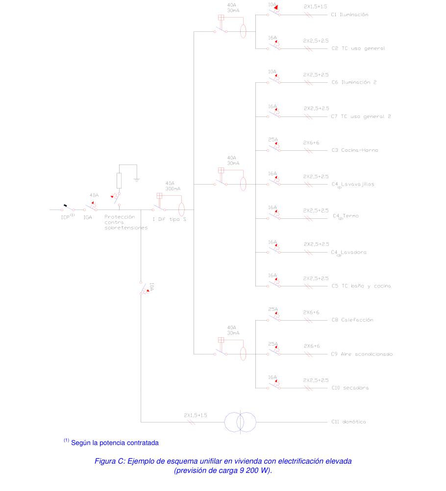
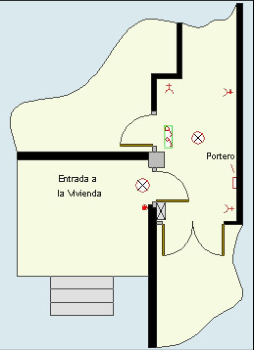
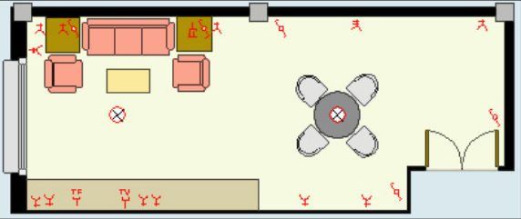
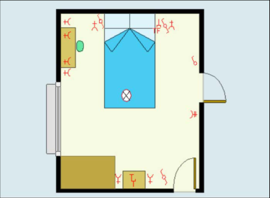
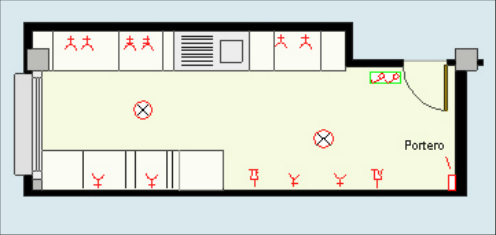
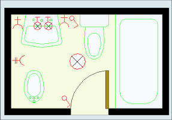
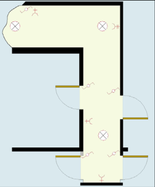
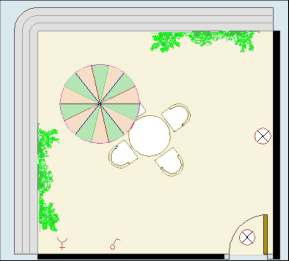
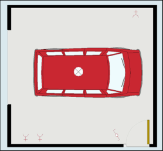

# BT-25. Instalaciones interiores en viviendas. Número de circuitos y características

ÍNDICE

- 1. GRADO DE ELECTRIFICACIÓN BÁSICO — 2

- 2. CIRCUITOS INTERIORES — 2

- 2.1 Protección general — 2

#### 2.2 Previsión para instalaciones de sistemas de automatización, gestión

- técnica de la energía y seguridad — 4

- 2.3 Derivaciones — 4

- 2.3.1 Electrificación básica — 4

- 2.3.2 Electrificación elevada — 6

### 3. DETERMINACIÓN DEL NÚMERO DE CIRCUITOS, SECCIÓN DE LOS

- CONDUCTORES Y DE LAS CAIDAS DE TENSIÓN — 10

- 4. PUNTOS DE UTILIZACIÓN — 13

El grado de electrificación de una vivienda será “electrificación elevada” cuando se cumpla alguna de las siguientes condiciones: - superficie útil de la vivienda superior a 160 m2. - si está prevista la instalación de aire acondicionado. - si está prevista la instalación de calefacción eléctrica. - si está prevista la instalación de sistemas de automatización. - si está prevista la instalación de una secadora. - si el número de puntos de utilización de alumbrado es superior a 30. - si el número de puntos de utilización de tomas de corriente de uso general es superior a 20. - si el número de puntos de utilización de tomas de corriente de los cuartos de baño y auxiliares de cocina es superior a 6. - en otras condiciones específicas indicadas en el punto 2.3 de esta ITC-BT 25.

<!-- tabla: ../tablas/BT-25_t01.csv -->

|  | 1. GRADO DE ELECTRIFICACIÓN BÁSICO |
|---|---|
|  | El grado de electrificación básico se plantea como el sistema mínimo, a los efectos de uso, de |
|  | la instalación interior de las viviendas en edificios nuevos tal como se indica en la ITC-BT-10. |
|  | Su objeto es permitir la utilización de los aparatos electrodomésticos de uso básico sin |
|  | necesidad de obras posteriores de adecuación. |
|  | La capacidad de instalación se corresponderá como mínimo al valor de la intensidad asignada |
|  | determinada para el interruptor general automático. Igualmente se cumplirá esta condición para |
|  | la derivación individual. |

Los capítulos siguientes de esta ITC-BT aplican tanto al grado de electrificación básico como al elevado.

<!-- tabla: ../tablas/BT-25_t02.csv -->

|  | 2. CIRCUITOS INTERIORES |
|---|---|
|  | 2.1 Protección general |
|  | Los circuitos de protección privados se ejecutarán según lo dispuesto en la ITC-BT-17 y |
|  | constarán como mínimo de: |
|  | - Un interruptor general automático de corte omnipolar con accionamiento manual, de |
|  | intensidad nominal mínima de 25 A y dispositivos de protección contra sobrecargas y |
|  | cortocircuitos. El interruptor general es independiente del interruptor para el control de potencia |
|  | (ICP) y no puede ser sustituido por éste. |

En función de la previsión de carga la intensidad nominal del interruptor general automático será:

Tabla A: escalones de potencia prevista en suministros monofásicos

<!-- tabla: ../tablas/BT-25_t03.csv -->

| Electrificación | Potencia (W) | Calibre interruptor general automático (IGA) (A) |
|---|---|---|
| Básica | 5 750 | 25 |
|  | 7 360 | 32 |
| Elevada | 9 200 | 40 |
|  | 11 500 | 50 |
|  | 14 490 | 63 |

El interruptor de control de potencia (ICP) es un dispositivo para controlar que la potencia realmente demandada por el consumidor no exceda de la contratada, su colocación es potestativa de la Compañía Suministradora.

<!-- tabla: ../tablas/BT-25_t04.csv -->

|  | - Uno o varios interruptores diferenciales que garanticen la protección contra contactos |
|---|---|
|  | indirectos de todos los circuitos, con una intensidad diferencial-residual máxima de 30 mA e |
|  | intensidad asignada superior o igual que la del interruptor general. Cuando se usen |
|  | interruptores diferenciales en serie, habrá que garantizar que todos los circuitos quedan |
|  | protegidos frente a intensidades diferenciales-residuales de 30 mA como máximo, pudiéndose |
|  | instalar otros diferenciales de intensidad superior a 30 mA en serie, siempre que se cumpla lo |
|  | anterior. |
|  | Para instalaciones de viviendas alimentadas con redes diferentes a las de tipo TT, que |
|  | eventualmente pudieran autorizarse, la protección contra contactos indirectos se realizará |
|  | según se indica en el apartado 4.1 de la ITC-BT-24. |

según se indica en el apartado 4.1 de la ITC-BT-24.

La utilización de un único interruptor diferencial para varios circuitos puede provocar que su actuación desconecte ciertos aparatos, tales como equipos informáticos, frigoríficos y congeladores, cuya desconexión debe ser evitada. Para este tipo de circuitos es conveniente prever una protección diferencial individual.

Para garantizar la selectividad total entre los diferenciales instalados en serie, se deben cumplir las siguientes condiciones:

1- El tiempo de no-actuación del diferencial instalado aguas arriba deberá ser superior al tiempo de total de operación del diferencial situado aguas abajo. Los diferenciales tipo tipo S cumplen con esta condición. 2- La intensidad diferencial-residual del diferencial instalado aguas arriba deberá ser como mínimo tres veces superior a la del diferencial situado aguas abajo.

Con miras a la selectividad pueden instalarse dispositivos de corriente diferencial-residual tipo “S” en serie con dispositivos de protección diferencial-residual de tipo general (disparo instantáneo).

<!-- tabla: ../tablas/BT-25_t05.csv -->

|  | - Dispositivos de protección contra sobretensiones, si fuese necesario, conforme a la ITC-BT- |
|---|---|
|  | 23. |

23.

Para evitar disparos intempestivos de los interruptores diferenciales en caso de actuación del dispositivo de protección contra sobretensiones, dicho dispositivo debe instalarse aguas arriba del interruptor diferencial (entre el Interruptor General y el propio interruptor diferencial), salvo si el interruptor diferencial es selectivo S.

Con el fin de optimizar la continuidad de servicio en caso de destrucción del limitador de sobretensiones transitorias a causa de una descarga de rayo, superior a la máxima prevista, se debe instalar el dispositivo de protección recomendado por el fabricante, aguas arriba del limitador, con objeto de mantener la continuidad de todo el sistema evitando el disparo del IGA.

Para instalaciones con un único interruptor diferencial, éste debe ser de disparo instantáneo.

<!-- tabla: ../tablas/BT-25_t06.csv -->

|  | 2.2 Previsión para instalaciones de sistemas de automatización, gestión técnica de la |
|---|---|
|  | energía y seguridad |
|  | En el caso de instalaciones de sistemas de automatización, gestión técnica de la energía y de |
|  | seguridad, que se desarrolla en la ITC-BT-51, la alimentación a los dispositivos de control y |
|  | mando centralizado de los sistemas electrónicos se hará mediante un interruptor automático de |
|  | corte omnipolar con dispositivo de protección contra sobrecargas y cortocircuitos que se podrá |
|  | situar aguas arriba de cualquier interruptor diferencial, siempre que su alimentación se realice a |
|  | través de una fuente de MBTS o MBTP, según ITC-BT-36. |
|  | 2.3 Derivaciones |
|  | Los tipos de circuitos independientes serán los que se indican a continuación y estarán |
|  | protegidos cada uno de ellos por un interruptor automático de corte omnipolar con |
|  | accionamiento manual y dispositivos de protección contra sobrecargas y cortocircuitos con una |
|  | intensidad asignada según su aplicación e indicada en el apartado 3. |
|  | 2.3.1 Electrificación básica |
|  | Circuitos independientes |
|  | C circuito de distribución interna, destinado a alimentar los puntos de iluminación. 1 |
|  | C circuito de distribución interna, destinado a tomas de corriente de uso general y 2 |
|  | frigorífico. |
|  | C circuito de distribución interna, destinado a alimentar la cocina y horno. 3 |
|  | C circuito de distribución interna, destinado a alimentar la lavadora, lavavajillas y 4 |
|  | termo eléctrico. |
|  | C circuito de distribución interna, destinado a alimentar tomas de corriente de los 5 |
|  | cuartos de baño, así como las bases auxiliares del cuarto de cocina. |

cuartos de baño, así como las bases auxiliares del cuarto de cocina.

(1) Según la potencia contratada

Figura A: Ejemplo de esquema unifilar en vivienda con electrificación básica

Según la nota 8 de la tabla 1 de la presente ITC-BT, en el circuito C (lavadora, lavavajillas y 4 termo eléctrico) se recomienda el uso de dos o tres circuitos independientes, sin que esto suponga el paso a electrificación elevada ni la necesidad de disponer de un diferencial adicional. Aunque no esté prevista la instalación de un termo eléctrico, se instalará su toma de corriente, quedando disponible para otros usos, por ejemplo alimentación de caldera de gas.

Una base de toma de corriente prevista para la conexión de aparatos de iluminación, que esté comandada por un interruptor (p.e. lámparas de mesilla de noche o vestíbulo o de pie), se considera perteneciente al circuito C . 1

La eventual toma para la instalación de una bañera de hidromasaje será del circuito C y su 5 instalación debe cumplir los requisitos establecidos en la ITC-BT-27.

La toma del horno microondas se considera perteneciente al circuito C . 5

En el caso del desdoblamiento de los circuitos C , C o C cuando no se supera el número 1 2 5 máximo de puntos de utilización establecido en la tabla 1 de esta ITC-BT (por ejemplo 22 puntos de luz en dos circuitos de 11 puntos cada uno):

- se debe mantener la sección mínima de los conductores y el calibre de los interruptores automáticos reflejados en la tabla 1 para dicho circuito. - se debe instalar un interruptor diferencial adicional si el número total de circuitos es superior a 5. - no supondrá el paso a electrificación elevada si se mantiene el mismo interruptor general que corresponda a la previsión de cargas inicial.

<!-- figura vectorial en la pág. 5 del PDF original -->
> Figura en la pág. 5 del PDF original: [ver en el PDF](../pdf/BT-25.pdf#page=5)

(1) Según la potencia contratada (2) Puntos C1a + puntos C1b ≤ 30 (3) Circuito C2a: 18 tomas como máximo

Figura B: Ejemplo de esquema unifilar en vivienda con electrificación básica con circuitos desdoblados.

<!-- tabla: ../tablas/BT-25_t07.csv -->

|  | 2.3.2 Electrificación elevada |
|---|---|
|  | Es el caso de viviendas con una previsión importante de aparatos electrodomésticos |
|  | obligue a instalar mas de un circuito de cualquiera de los tipos descritos anteriormente |
|  | como con previsión de sistemas de calefacción eléctrica, acondicionamiento de |
|  | automatización, gestión técnica de la energía y seguridad o con superficies útiles d |
|  | viviendas superiores a 160 m2. En este caso se instalará, además de los correspondiente |
|  | electrificación básica, los siguientes circuitos: |
|  | C Circuito adicional del tipo C , por cada 30 puntos de luz 6 1 |
|  | C Circuito adicional del tipo C , por cada 20 tomas de corriente de uso gen 7 2 |
|  | si la superficie útil de la vivienda es mayor de 160 m2. |
|  | C Circuito de distribución interna, destinado a la instalación de calefa 8 |
|  | eléctrica, cuando existe previsión de ésta. |

eléctrica, cuando existe previsión de ésta.

<!-- figura vectorial en la pág. 6 del PDF original -->
> Figura en la pág. 6 del PDF original: [ver en el PDF](../pdf/BT-25.pdf#page=6)

<!-- tabla: ../tablas/BT-25_t08.csv -->

|  | C Circuito de distribución interna, destinado a la instalación aire acondicionado, 9 |
|---|---|
|  | cuando existe previsión de éste |
|  | C Circuito de distribución interna, destinado a la instalación de una secadora 10 |
|  | independiente |
|  | C Circuito de distribución interna, destinado a la alimentación del sistema de 11 |
|  | automatización, gestión técnica de la energía y de seguridad, cuando exista |
|  | previsión de éste. |
|  | C Circuitos adicionales de cualquiera de los tipos C o C , cuando se prevean, o 12 3 4 |
|  | circuito adicional del tipo C , cuando su número de tomas de corriente exceda 5 |
|  | de 6. |
|  | Tanto para la electrificación básica como para la elevada, se colocará, como mínimo, un |
|  | interruptor diferencial de las características indicadas en el apartado 2.1 por cada cinco |
|  | circuitos instalados. |

circuitos instalados.

En el caso de que el sistema de automatización, gestión técnica de la energía y seguridad no vaya a gestionar cargas diferentes a las normalmente previstas en electrificación básica, no será necesario el paso a electrificación elevada, a no ser que el paso venga motivado por otro de los requisitos indicados en el apartado 2.3.2.

También se considerará electrificación elevada en aquellas viviendas unifamiliares que incorporen un punto de recarga para vehículo eléctrico. En este caso se añadirá el siguiente circuito: C : Circuito adicional para la infraestructura de recarga de vehículos eléctricos, cuando 13 esté prevista una o más plazas o espacios para el estacionamiento de vehículos.

El circuito C13 deberá incorporar un interruptor diferencial de 30 mA, Clase A, exclusivo para su protección. Tendrá como máximo 3 puntos de utilización, conductores de sección mínima 2,5 mm2 y tubo de diámetro 20 mm o conducto equivalente.

(1) Según la potencia contratada

Figura C: Ejemplo de esquema unifilar en vivienda con electrificación elevada (previsión de carga 9 200 W).

En caso de disparos intempestivos frecuentes de los diferenciales en instalaciones existentes, después de comprobar que no se debe a fallos de aislamiento o desajuste del diferencial, en cuyo caso este se debería sustituir por uno nuevo, se recomienda seguir una de las siguientes opciones:

a) Separar del resto el circuito C3 de la cocina y horno o el circuito C9 del aire acondicionado o ambos, protegiendo cada uno mediante un diferencial (que será de tipo A según el punto 3.5 de la ITC-BT-24). b) Sustituir el diferencial que dispara intempestivamente por uno de tipo rearmable, según norma EN 50557

Para el caso de disparos intempestivos provocados por el funcionamiento de filtros y protectores de sobretensiones instalados aguas abajo del diferencial (internos y/o externos a los receptores), se recomienda instalar protectores contra sobretensiones transitorias aguas arriba del mismo. La selección de su Tipo y características se realizará según lo indicado en la última edición de la GUÍA-BT-23, normalmente serán de Tipo 2 y se instalarán entre el interruptor general y el diferencial.

Para evitar problemas de disparos intempestivos frecuentes en instalaciones nuevas, es conveniente seguir todos los criterios anteriores al realizar la instalación.

Figura D: Ejemplo de esquema unifilar en vivienda con electrificación básica, con separación del circuito C3

<!-- figura vectorial en la pág. 9 del PDF original -->
> Figura en la pág. 9 del PDF original: [ver en el PDF](../pdf/BT-25.pdf#page=9)

<!-- tabla: ../tablas/BT-25_t09.csv -->

|  | 3. DETERMINACIÓN DEL NÚMERO DE CIRCUITOS, SECCIÓN DE LOS CONDUCTORES |
|---|---|
|  | Y DE LAS CAIDAS DE TENSIÓN |
|  | En la Tabla 1 se relacionan los circuitos mínimos previstos con sus características eléctricas. |
|  | La sección mínima indicada por circuito está calculada para un número limitado de puntos de |
|  | utilización. De aumentarse el número de puntos de utilización, será necesaria la instalación de |
|  | circuitos adicionales correspondientes. |
|  | Cada accesorio o elemento del circuito en cuestión tendrá una corriente asignada, no inferior al |
|  | valor de la intensidad prevista del receptor o receptores a conectar. |
|  | El valor de la intensidad de corriente prevista en cada circuito se calculará de acuerdo con la |
|  | fórmula: |
|  | I = n x I x Fs x Fu a |
|  | N nº de tomas o receptores |
|  | Ia Intensidad prevista por toma o receptor |
|  | Fs (factor de simultaneidad) Relación de receptores conectados |
|  | simultáneamente sobre el total |
|  | Fu (factor de utilización) Factor medio de utilización de la potencia |
|  | máxima del receptor |
|  | Los dispositivos automáticos de protección tanto para el valor de la intensidad asignada como |
|  | para la Intensidad máxima de cortocircuito se corresponderá con la intensidad admisible del |
|  | circuito y la de cortocircuito en ese punto respectivamente. |
|  | Los conductores serán de cobre y su sección será como mínimo la indicada en la Tabla 1, y |
|  | además estará condicionada a que la caída de tensión sea como máximo el 3 %. Esta caída de |
|  | tensión se calculará para una intensidad de funcionamiento del circuito igual a la intensidad |
|  | nominal del interruptor automático de dicho circuito y para una distancia correspondiente a la |
|  | del punto de utilización mas alejado del origen de la instalación interior. El valor de la caída de |
|  | tensión podrá compensarse entre la de la instalación interior y la de las derivaciones |
|  | individuales, de forma que la caída de tensión total sea inferior a la suma de los valores límite |
|  | especificados para ambas, según el tipo de esquema utilizado. |

especificados para ambas, según el tipo de esquema utilizado.

En la tabla B se presentan los valores máximos de longitud de los conductores en función de su sección y de la intensidad nominal del dispositivo de protección para una caída de tensión del 3%, una temperatura estimada del conductor de 40 ºC y unos valores del factor de potencia de cosϕ = 1.

Tabla B: Valor de la longitud máxima del cable (m).

<!-- tabla: ../tablas/BT-25_t10.csv -->

| Sección del conductor (mm2) | Intensidad nominal del dispositivo de protección (A) |  |  |  |  |  |  |  |  |  |
|---|---|---|---|---|---|---|---|---|---|---|
|  | 10 |  |  | 16 |  |  | 20 |  |  | 25 |
| 1,5 | 27 |  |  |  |  |  |  |  |  |  |
| 2,5 | 45 |  |  | 28 |  |  |  |  |  |  |
| 4 |  |  |  | 45 |  |  | 36 |  |  |  |
| 6 |  |  |  |  |  |  | 53 |  |  | 43 |

6 53 43

Tabla 1. Características eléctricas de los circuitos(1)

<!-- tabla: ../tablas/BT-25_t11.csv -->

|  |  |  |  |  |  |  |  |  |  |  |  |  |  |  |  |  |  |  | Máximo nº de |  |  | Conductores |  |  |  |
|---|---|---|---|---|---|---|---|---|---|---|---|---|---|---|---|---|---|---|---|---|---|---|---|---|---|
|  |  |  |  | Potencia |  |  |  |  |  |  |  |  |  |  |  |  |  |  |  |  |  |  |  |  | Tubo o conducto |
|  |  |  |  |  |  |  | Factor |  |  | Factor |  |  |  |  |  | Interruptor |  |  | puntos de |  |  | sección |  |  |  |
|  | Circuito de |  |  | prevista |  |  |  |  |  |  |  |  | Tipo de toma |  |  |  |  |  |  |  |  |  |  |  | Diámetro |
|  |  |  |  |  |  |  | simultaneidad |  |  | utilización |  |  |  |  |  | Automático |  |  | utilización o |  |  | mínima |  |  |  |
|  | utilización |  |  | por toma |  |  |  |  |  |  |  |  | (7) |  |  |  |  |  |  |  |  |  |  |  | mm |
|  |  |  |  |  |  |  | Fs |  |  | Fu |  |  |  |  |  | (A) |  |  | tomas por |  |  | mm2 |  |  |  |
|  |  |  |  | (W) |  |  |  |  |  |  |  |  |  |  |  |  |  |  |  |  |  |  |  |  | (3) |
|  |  |  |  |  |  |  |  |  |  |  |  |  |  |  |  |  |  |  | circuito |  |  | (5) |  |  |  |
|  | C1 Iluminación |  |  | 200 |  |  | 0,75 |  |  | 0,5 |  |  | Punto de luz(9) |  |  | 10 |  |  | 30 |  |  | 1,5 |  |  | 16 |
|  | C2 Tomas de uso general |  |  | 3.450 |  |  | 0,2 |  |  | 0,25 |  |  | Base 16A 2p+T |  |  | 16 |  |  | 20 |  |  | 2,5 |  |  | 20 |
|  | C3 Cocina y horno |  |  | 5.400 |  |  | 0,5 |  |  | 0,75 |  |  | Base 25 A 2p+T |  |  | 25 |  |  | 2 |  |  | 6 |  |  | 25 |
|  |  |  |  |  |  |  |  |  |  |  |  |  | Base 16A 2p+T |  |  |  |  |  |  |  |  |  |  |  |  |
|  | C4 Lavadora, lavavajillas y |  |  |  |  |  |  |  |  |  |  |  |  |  |  |  |  |  |  |  |  |  |  |  |  |
|  |  |  |  | 3.450 |  |  | 0,66 |  |  | 0,75 |  |  | combinadas con |  |  | 20 |  |  | 3 |  |  | 4 (6) |  |  | 20 |
|  | termo eléctrico |  |  |  |  |  |  |  |  |  |  |  | fusibles o interruptores |  |  |  |  |  |  |  |  |  |  |  |  |
|  |  |  |  |  |  |  |  |  |  |  |  |  | automáticos de 16 A (8) |  |  |  |  |  |  |  |  |  |  |  |  |
|  | C5 Baño, cuarto de cocina |  |  | 3.450 |  |  | 0,4 |  |  | 0,5 |  |  | Base 16A 2p+T |  |  | 16 |  |  | 6 |  |  | 2,5 |  |  | 20 |
|  | C8 Calefacción |  |  | (2) |  |  | --- |  |  | --- |  |  | --- |  |  | 25 |  |  | --- |  |  | 6 |  |  | 25 |
|  | C9 Aire acondicionado |  |  | (2) |  |  | --- |  |  | --- |  |  | --- |  |  | 25 |  |  | --- |  |  | 6 |  |  | 25 |
|  | C10 Secadora |  |  | 3.450 |  |  | 1 |  |  | 0,75 |  |  | Base 16A 2p+T |  |  | 16 |  |  | 1 |  |  | 2,5 |  |  | 20 |
|  | C11 Automatización |  |  | (4) |  |  | --- |  |  | --- |  |  | --- |  |  | 10 |  |  | --- |  |  | 1,5 |  |  | 16 |

C11 Automatización (4) --- --- --- 10 --- 1,5 16 (1) La tensión considerada es de 230 V entre fase y neutro. (2) La potencia máxima permisible por circuito será de 5.750 W (3) Diámetros externos según ITC-BT 19 (4) La potencia máxima permisible por circuito será de 2.300 W (5) Este valor corresponde a una instalación de dos conductores y tierra con aislamiento de PVC bajo tubo empotrado en obra, según tabla 1 de ITC-BT-19. Otras secciones pueden ser requeridas para otros tipos de cable o condiciones de instalación (6) En este circuito exclusivamente, cada toma individual puede conectarse mediante un conductor de sección 2,5 mm2 que parta de una caja de derivación del circuito de 4 mm2. (7) Las bases de toma de corriente de 16 A 2p+T serán fijas del tipo indicado en la figura C2a y las de 25 A 2p+T serán del tipo indicado en la figura ESB 25-5A, ambas de la norma UNE 20315. (8) Los fusibles o interruptores automáticos no son necesarios si se dispone de circuitos independientes para cada aparato, con interruptor automático de 16 A en cada circuito. el desdoblamiento del circuito con este fin no supondrá el paso a electrificación elevada ni la necesidad de disponer de un diferencial adicional. (9) El punto de luz incluirá conductor de protección.

### 4. PUNTOS DE UTILIZACIÓN

En cada estancia se utilizará como mínimo los siguientes puntos de utilización:

Tabla 2.

<!-- tabla: ../tablas/BT-25_t12.csv -->

| Estancia | Circuito | Mecanismo | nº mínimo | Superf./Longitud |
|---|---|---|---|---|
| Acceso | C1 | pulsador timbre | 1 |  |
| Vestíbulo | C1 | Punto de luz Interruptor 10.A | 1 1 | --- --- |
|  | C2 | Base 16 A 2p+T | 1 | --- |
| Sala de estar o Salón | C1 | Punto de luz Interruptor 10 A | 1 1 | hasta 10 m2 (dos si S > 10 m2) uno por cada punto de luz |
|  | C2 | Base 16 A 2p+T | 3 (1) | una por cada 6 m2, redondeado al entero superior |
|  | C8 | Toma de calefacción | 1 | hasta 10 m2 (dos si S > 10 m2) |
|  | C9 | Toma de aire acondicionado | 1 | hasta 10 m2 (dos si S > 10 m2) |
| Dormitorios | C1 | Puntos de luz Interruptor 10 A | 1 1 | hasta 10 m2 (dos si S > 10 m2) uno por cada punto de luz |
|  | C2 | Base 16 A 2p+T | 3(1) | una por cada 6 m2, redondeado al entero superior |
|  | C8 | Toma de calefacción | 1 | --- |
|  | C9 | Toma de aire acondicionado | 1 | --- |
| Baños | C1 | Puntos de luz Interruptor 10 A | 1 1 | --- --- |
|  | C5 | Base 16 A 2p+T | 1 | --- |
|  | C8 | Toma de calefacción | 1 | --- |
| Pasillos o distribuidores | C1 | Puntos de luz Interruptor/Conmutador 10 A | 1 1 | uno cada 5 m de longitud uno en cada acceso |
|  | C2 | Base 16 A 2p + T | 1 | hasta 5 m (dos si L > 5 m) |
|  | C8 | Toma de calefacción | 1 | --- |
| Cocina | C1 | Puntos de luz Interruptor 10 A | 1 1 | hasta 10 m2 (dos si S > 10 m2) uno por cada punto de luz |
|  | C2 | Base 16 A 2p + T | 2 | extractor y frigorífico |
|  | C3 | Base 25 A 2p + T | 1 | cocina/horno |
|  | C4 | Base 16 A 2p + T | 3 | lavadora, lavavajillas y termo |
|  | C5 | Base 16 A 2p + T | 3 (2) | encima del plano de trabajo |
|  | C8 | Toma calefacción | 1 | --- |
|  | C10 | Base 16 A 2p + T | 1 | secadora |
| Terrazas y Vestidores | C1 | Puntos de luz Interruptor 10 A | 1 1 | hasta 10 m2 (dos si S > 10 m2) uno por cada punto de luz |
| Garajes unifamiliares y Otros | C1 | Puntos de luz Interruptor 10 A | 1 1 | hasta 10 m2 (dos si S > 10 m2) uno por cada punto de luz |
|  | C2 | Base 16 A 2p + T | 1 | hasta 10 m2 (dos si S > 10 m2) |

Otros C2 Base 16 A 2p + T 1 hasta 10 m2 (dos si S > 10 m2) (1) En donde se prevea la instalación de una toma para el receptor de TV, la base correspondiente deberá ser múltiple, y en este caso se considerará como una sola base a los efectos del número de puntos de utilización de la tabla 1. (2) Se colocarán fuera de un volumen delimitado por los planos verticales situados a 0,5 m del fregadero y de la encimera de cocción o cocina

Las ubicaciones indicadas en la tabla 2 se considera orientativa, por ejemplo la lavadora puede estar instalada en otra dependencia de la vivienda.

El timbre no computa como “punto de utilización” en el circuito C . 1

Los conmutadores, cruzamientos, telerruptores y otros dispositivos de características similares se consideran englobados en el genérico “interruptor” indicado en la anterior tabla.

Punto de luz es un punto de utilización del circuito de alumbrado que va comandado por un interruptor independiente y al que pueden conectarse una o varias luminarias.

En el caso de instalar varias tomas de corriente para receptor de TV o asociadas a la infraestructura común de la telecomunicaciones (ICT), computa como un solo punto de utilización hasta un máximo de 4 tomas.

Se recomienda que los puntos de utilización para calefacción, aire acondicionado y circuito de sistemas de automatización sean del tipo caja de conexión que incorpore regleta de conexión y dispositivo de retención de cable.

Prescripciones mínimas y de confort.

Esta ITC-BT tiene como objetivo fijar los puntos de utilización mínimos que debe tener la instalación de una vivienda, desde un punto de vista de seguridad eléctrica. Sin embargo, el incremento de la utilización de la energía eléctrica en las viviendas y la aplicación del concepto “diseño para todos” aconseja que en el diseño de la instalación se tengan en cuenta las posibles necesidades particulares del usuario y sus limitaciones (debido a la edad, discapacidad, etc.), así como sus futuras demandas.

Por esto se recomienda:

- diseñar la instalación con una suficiente previsión (instalación de conductos vacíos, reservar espacio en el cuadro de distribución para futuros dispositivos, etc.) que permita una futura ampliación sin necesidad de hacer obras.

- prever un número de tomas de puntos de iluminación, tomas de corriente de usos generales o en baño y auxiliares de cocina superior a los indicados en la tabla 1 de esta ITC-BT, de este modo además de tener una instalación acorde a la necesidad del usuario, se mejora la seguridad de la instalación al reducir el uso de conectores multivía o prolongadores y evitar la realización de futuras modificaciones de la instalación por personal no calificado.

- no intentar un ahorro ficticio apurando al máximo las tomas por circuito para reducir el número de circuitos. Incrementar los circuitos y pasar al grado de electrificación elevado no tiene obligatoriamente consecuencias prácticas de cambio de potencia contratada a la Compañía Suministradora, se obtiene mayor confort pero no mayor consumo.

- en viviendas con más de una altura, por ejemplo unifamiliares o duplex, se situará un cuadro general de mando y protección en cada planta de manera que los circuitos de cada planta estén protegidos en el cuadro ubicado en su planta.

Las siguientes tablas, resumen los puntos de utilización mínimos, así como los recomendados para garantizar el adecuado confort de la instalación.

### 1. Electrificación del acceso a la vivienda

<!-- tabla: ../tablas/BT-25_t13.csv -->

|  | Prescripciones Reglamentarias |  |  |  |
|---|---|---|---|---|
|  | Mecanismo |  |  | Nº Prescrito |
|  | Pulsador para timbre |  |  | 1 |

Figura D: Plano de planta del acceso de la vivienda y el vestíbulo

<!-- tabla: ../tablas/BT-25_t14.csv -->

| Prescripciones de confort de uso no obligatorio |  |
|---|---|
| Mecanismo | Nº aconsejado |
| Pulsador para timbre | 1 |
| Punto de luz (vivienda unifamiliar) | 1 |
| Vídeo portero (vivienda unifamiliar) | 1 |

### 2. Electrificación del vestíbulo

<!-- tabla: ../tablas/BT-25_t15.csv -->

|  | Prescripciones Reglamentarias |  |  |  |
|---|---|---|---|---|
|  | Mecanismo |  |  | Nº Prescrito |
|  | Punto de luz |  |  | 1 |
|  | Interruptor 10 A |  |  | 1 |
|  | Base 16 A (2P+T) |  |  | 1 |

<!-- tabla: ../tablas/BT-25_t16.csv -->

| Prescripciones de confort de uso no obligatorio |  |  |
|---|---|---|
| Mecanismo | Superficie / Longitud | Nº aconsejado |
| Punto de luz | 1 hasta 10 m2 (2 si S>10 m2) | 1 ó 2 |
|  | Luz exterior (vivienda unifamiliar) | 1 |
| Interruptor 10 A | Por punto de luz | 1 |
| Base 16 A (2P+T) | 1 | 1 |
| Zumbador | - | 1 |
| Toma Calefacción eléctrica* | - | 1 |
| Vídeo portero | - | 1 |
| * Cuando se prevea su instalación |  |  |

### 3. Electrificación de la sala de estar o salón

<!-- tabla: ../tablas/BT-25_t17.csv -->

|  | Prescripciones Reglamentarias |  |  |  |  |  |  |
|---|---|---|---|---|---|---|---|
|  | Mecanismo |  |  | Superficie / Longitud |  |  | Nº Prescrito |
|  | Punto de luz |  |  | 1 hasta 10 m2 (2 si S>10 m2) |  |  | 1 ó 2 |
|  | Interruptor 10 A |  |  | Por punto de luz |  |  | 1 ó 2 |
|  |  |  |  | Una por cada 6 m2 redondeando al entero |  |  |  |
|  | Base 16 A (2P+T) |  |  |  |  |  | 3 |
|  |  |  |  | superior |  |  |  |
|  | Toma Calefacción |  |  |  |  |  |  |
|  |  |  |  | 1 hasta 10 m2 (2 si S>10 m2) |  |  | 1 ó 2 |
|  | eléctrica |  |  |  |  |  |  |
|  | Toma Aire |  |  |  |  |  |  |
|  |  |  |  | 1 hasta 10 m2 (2 si S>10 m2) |  |  | 1 ó 2 |
|  | acondicionado |  |  |  |  |  |  |

Figura E: Plano de planta de la sala de estar o salón.

<!-- tabla: ../tablas/BT-25_t18.csv -->

| Prescripciones de confort de uso no obligatorio |  |  |
|---|---|---|
| Mecanismo | Superficie / Longitud | Nº aconsejado |
| Punto de luz | 1 hasta 10m2 (2 si S>10 m2) | 1 ó 2 |
| Interruptor | Por punto de luz | -- |
| Toma Calefacción eléctrica * | 1 hasta 10m2 (2 si S>10 m2) | 1 ó 2 |
| Toma Aire acondicionado * | 1 hasta 10m2 (2 si S>10 m2) | 1 ó 2 |
| Base 16 A (2P+T) | Una por cada 6m2 redondeando al entero superior | 4 |
| Toma telefónica | Teléfono | 2 |
| Base 16 A (2P+T) | Televisor y vídeo | 1 múltiple |
| Base 16 A (2P+T) | Equipo de música | 1 |
| * Cuando se prevea su instalación |  |  |

### 4. Electrificación del dormitorio

<!-- tabla: ../tablas/BT-25_t19.csv -->

|  | Prescripciones Reglamentarias |  |  |  |  |  |  |
|---|---|---|---|---|---|---|---|
|  | Mecanismo |  |  | Superficie / Longitud |  |  | Nº Prescrito |
|  | Punto de luz |  |  | 1 hasta 10 m2 (2 si S>10 m2) |  |  | 1 ó 2 |
|  | Interruptor 10 A |  |  | Por punto de luz |  |  | 1 |
|  |  |  |  | Una por cada 6 m2 redondeando al entero |  |  |  |
|  | Base 16 A (2P+T) |  |  |  |  |  | 3 |
|  |  |  |  | superior |  |  |  |
|  | Toma Calefacción |  |  |  |  |  |  |
|  |  |  |  | - |  |  | 1 |
|  | eléctrica |  |  |  |  |  |  |
|  | Toma Aire |  |  |  |  |  |  |
|  |  |  |  | - |  |  | 1 |
|  | acondicionado |  |  |  |  |  |  |

Figura F: Plano de planta del dormitorio

<!-- tabla: ../tablas/BT-25_t20.csv -->

| Prescripciones de confort de uso no obligatorio |  |  |
|---|---|---|
| Mecanismo | Superficie / Longitud | Nº aconsejado |
| Punto de luz | Habitaciones individuales | 2* |
|  | Habitaciones dobles | 3* |
| Interruptor | Por punto de luz | -- |
| Toma Calefacción eléctrica** | 1 hasta 10 m2 (2 si S>10 m2) | 1 |
| Toma Aire acondicionado** | 1 hasta 10 m2 (2 si S>10 m2) | 1 |
| Base 16 A (2P+T) | Una por cada 6 m2 redondeando al entero superior | 4 |
| Toma telefónica | Teléfono | 2 |
| Base 16 A (2P+T) | Televisor | 1 |
| Base 16 A (2P+T) | Ordenador | 1 |
| Base 16 A (2P+T) | Equipo de música | 1 |
| *2 en habitaciones individuales, 1 en mesilla de noche y 1 en techo 3 en habitaciones dobles, 2 en mesillas de noche y 1 en techo ** Cuando se prevea su instalación |  |  |

### 5. Electrificación de la cocina

<!-- tabla: ../tablas/BT-25_t21.csv -->

|  | Prescripciones Reglamentarias |  |  |  |  |  |  |
|---|---|---|---|---|---|---|---|
|  | Mecanismo |  |  | Superficie / Longitud |  |  | Nº Prescrito |
|  | Punto de luz |  |  | 1 hasta 10 m2 (2 si S>10 m2) |  |  | 1 ó 2 |
|  | Interruptor 10 A |  |  | Por punto de luz |  |  | 1 |
|  | Base 16 A (2P+T) |  |  | Extractor y frigorífico |  |  | 2 |
|  | Base 16 A (2P+T) |  |  | Cocina/horno |  |  | 1 |
|  | Base 16 A (2P+T) |  |  | Lavadora, lavavajillas y termo |  |  | 3 |
|  | Base 16 A (2P+T) |  |  | Encima del plano de trabajo |  |  | 3 |
|  | Toma Calefacción |  |  |  |  |  |  |
|  |  |  |  | - |  |  | 1 |
|  | eléctrica |  |  |  |  |  |  |
|  | Base 16 A (2P+T) |  |  | Secadora |  |  | 1 |

Figura G: Plano de planta de la cocina

<!-- tabla: ../tablas/BT-25_t22.csv -->

| Prescripciones de confort de uso no obligatorio |  |  |
|---|---|---|
| Mecanismo | Superficie / Longitud | Nº aconsejado |
| Punto de luz | 1 hasta 10 m2 (2 si S>10 m2) | 1 ó 2 |
| Interruptor | Por punto de luz | -- |
| Base 16 A (2P+T) | Encima del plano de trabajo * | 4 |
| Base 16 A (2P+T) | Lavadora, Lavavajillas y Termo | 3 |
| Base 16 A (2P+T) | Extractor y Frigorífico | 2 |
| Base 25 A (2P+T) | Cocina/horno | 1 |
| Toma calefacción eléctrica** | 1 hasta 10 m2 (2 si S>10 m2) | 1 ó 2 |
| Base 16 A (2P+T)** | Secadora | 1 |
| Toma telefónica | Teléfono | 1 |
| Base 16 A (2P+T) | Televisor | 1 |
| * Se colocarán fuera de un volumen delimitado por los planos verticales situados a 0,5m del fregadero y de la encimera de cocción o cocina ** Cuando se prevea su instalación |  |  |

### 6. Electrificación del baño-aseo

<!-- tabla: ../tablas/BT-25_t23.csv -->

|  | Prescripciones Reglamentarias |  |  |  |  |  |  |
|---|---|---|---|---|---|---|---|
|  |  |  |  | Superficie / |  |  |  |
|  | Mecanismo |  |  |  |  |  | Nº Prescrito |
|  |  |  |  | Longitud |  |  |  |
|  | Punto de luz |  |  | - |  |  | 1 |
|  | Interruptor 10 A |  |  | - |  |  | 1 |
|  | Base 16 A (2P+T) |  |  | - |  |  | 1 |
|  | Toma Calefacción |  |  |  |  |  |  |
|  |  |  |  | - |  |  | 1 |
|  | eléctrica |  |  |  |  |  |  |

Figura H: Plano de planta del baño-aseo

<!-- tabla: ../tablas/BT-25_t24.csv -->

| Prescripciones de confort de uso no obligatorio |  |  |
|---|---|---|
| Mecanismo | Superficie / Longitud | Nº aconsejado |
| Punto de luz | - | 2 |
| Interruptor | Por punto de luz | 2 |
| Base 16 A (2P+T) | - | 2 |
| Toma Calefacción eléctrica* | - | 1 |
| * Cuando se prevea su instalación |  |  |

### 7. Electrificación del pasillo

<!-- tabla: ../tablas/BT-25_t25.csv -->

|  | Prescripciones Reglamentarias |  |  |  |  |  |  |
|---|---|---|---|---|---|---|---|
|  |  |  |  | Superficie / |  |  |  |
|  | Mecanismo |  |  |  |  |  | Nº Prescrito |
|  |  |  |  | Longitud |  |  |  |
|  |  |  |  | Uno cada 5 m de |  |  |  |
|  | Punto de luz |  |  |  |  |  | 1 |
|  |  |  |  | longitud |  |  |  |
|  |  |  |  | Uno en cada |  |  |  |
|  | Interruptor 10 A |  |  |  |  |  | 1 |
|  |  |  |  | acceso |  |  |  |
|  |  |  |  | 1 hasta 5 m (dos |  |  |  |
|  | Base 16 A (2P+T) |  |  |  |  |  | 1 ó 2 |
|  |  |  |  | si L>5 m) |  |  |  |
|  | Toma Calefacción |  |  |  |  |  |  |
|  |  |  |  | - |  |  | 1 |
|  | eléctrica |  |  |  |  |  |  |

Figura I: Plano de planta del pasillo

<!-- tabla: ../tablas/BT-25_t26.csv -->

| Prescripciones de confort de uso no obligatorio |  |  |
|---|---|---|
| Mecanismo | Superficie / Longitud | Nº aconsejado |
| Punto de luz | Uno cada 5 m de longitud | 2 |
| Interruptor | Uno en cada acceso | 2 |
| Base 16 A (2P+T) | 1 hasta 5 m (uno adicional si L>5 m) | 1 ó 2 |
| Toma Calefacción eléctrica* | - | 1 |
| * Cuando se prevea su instalación |  |  |

### 8. Electrificación de la terraza o jardín

En caso de que una vivienda disponga de jardín, la instalación eléctrica de este debe de ser un circuito independiente del resto de la vivienda. Las bases exteriores destinadas a alimentar aparatos fijos o móviles deberán estar protegidas por un diferencial independiente del de los circuitos interiores, de 30mA .

Las bases, interruptores y luminarias instaladas en el jardín, deberán tener un grado IP44.

<!-- tabla: ../tablas/BT-25_t27.csv -->

|  | Prescripciones Reglamentarias |  |  |  |  |  |  |
|---|---|---|---|---|---|---|---|
|  | Mecanismo |  |  | Superficie / Longitud |  |  | Nº Prescrito |
|  | Punto de luz |  |  | 1 hasta 10 m2 (2 si S>10 m2) |  |  | 1 ó 2 |
|  | Interruptor |  |  | Por punto de luz |  |  | 1 |

Figura J: Plano de planta de la terraza

<!-- tabla: ../tablas/BT-25_t28.csv -->

| Prescripciones de confort de uso no obligatorio |  |  |
|---|---|---|
| Mecanismo | Superficie / Longitud | Nº aconsejado |
| Punto de luz | Entrada | 1 |
|  | Otra zona 1hasta 10 m2 (2 si S>10 m2) | 1 ó 2 |
| Interruptor | Por punto de luz | 1* |
| Base 16 A (2P+T) | - | 2 |
| * El o los puntos de luz instalados en el jardín pueden estar controlados por un interruptor horario programado para su encendido y apagado. |  |  |

### 9. Electrificación del garaje unifamiliar

<!-- tabla: ../tablas/BT-25_t29.csv -->

|  | Prescripciones Reglamentarias |  |  |  |  |  |  |
|---|---|---|---|---|---|---|---|
|  |  |  |  | Superficie / |  |  |  |
|  | Mecanismo |  |  |  |  |  | Nº Prescrito |
|  |  |  |  | Longitud |  |  |  |
|  |  |  |  | 1 hasta 10 m2 (2 |  |  |  |
|  | Punto de luz |  |  |  |  |  | 1 ó 2 |
|  |  |  |  | si S>10 m2) |  |  |  |
|  | Interruptor |  |  | Por punto de luz |  |  | 1 |
|  |  |  |  | 1 hasta 10 m2 (2 |  |  |  |
|  | Base 16 A (2P+T) |  |  |  |  |  | 1 ó 2 |
|  |  |  |  | si S>10 m2) |  |  |  |

Figura K: Plano de planta del garaje unifamiliar

<!-- tabla: ../tablas/BT-25_t30.csv -->

| Prescripciones de confort de uso no obligatorio |  |  |
|---|---|---|
| Mecanismo | Superficie / Longitud | Nº aconsejado |
| Punto de luz* | 1hasta 10 m2 (2 si S>10 m2) | 1 ó 2 |
| Interruptor | Por punto de luz | 1 |
| Base 16 A (2P+T) | - | 2 |
| *Es recomendable llevar a cabo la instalación de un circuito de alumbrado de emergencia. La iluminancia mínima para este tipo de estancias es de 150 lux. |  |  |

