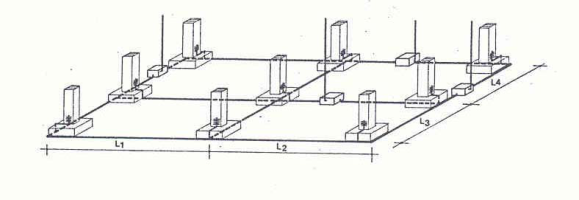

# BT-26. Instalaciones interiores en viviendas. Prescripciones generales de instalaciones

_PRESCRIPCIONES GENERALES DE INSTALACION_

### 0. ÍNDICE

- 0. ÍNDICE — 1

- 00. DIFERENCIAS MÁS IMPORTANTES ENTRE EL RBT 2002 Y EL RBT 1973 — 2

- 1. ÁMBITO DE APLICACIÓN — 3

- 2. TENSIONES DE UTILIZACIÓN Y ESQUEMA DE CONEXIÓN — 3

- 3. TOMAS DE TIERRA — 3

- 3.1 Instalación — 3

- 3.2 Elementos a conectar a tierra — 5

- 3.3 Puntos de puesta a tierra — 6

- 3.4 Líneas principales de tierra. Derivaciones — 6

- 3.5 Conductores de protección — 8

- 4. PROTECCIÓN CONTRA CONTACTOS INDIRECTOS — 8

- 5. CUADRO GENERAL DE DISTRIBUCIÓN — 8

- 6. CONDUCTORES — 9

- 6.1 Naturaleza y Secciones — 9

- 6.1.1 Conductores activos — 9

- 6.1.2 Conductores de protección — 10

- 6.2 Identificación de los conductores — 10

- 6.3 Conexiones — 11

- 7. EJECUCIÓN DE LAS INSTALACIONES — 11

- 7.1 Sistema de instalación — 11

- 7.2 Condiciones generales — 12

00. DIFERENCIAS MÁS IMPORTANTES ENTRE EL RBT 2002 Y EL RBT 1973.

<!-- tabla: ../tablas/BT-26_t01.csv -->

| RBT 1973 | RBT 2002 |
|---|---|
| MI BT 23-pto.3.1 El cable a instalar para establecer la toma de tierra del edificio tendrá una sección mínima de 35 mm2 si es de Cu y 95 mm2 si es de acero galvanizado. | ITC-BT 26-pto.3.1 Para las secciones del cable de tierra, se remite a la ITC-BT-18, P.3.2 en donde se presenta una tabla con valores inferiores a los presentados en el reglamento del 73. |
| MI BT 23-pto.4 Protección contra contactos indirectos: Se describen los siguientes sistemas de protección contra contactos indirectos: - Puesta a tierra de las masas y dispositivos de corte por intensidad de defecto. - Puesta a neutro de las masas y dispositivos de corte por intensidad de defecto. - Puesta a tierra de las masas y empleo de interruptores diferenciales. - Se indica que se procurará que a resistencia de tierra no sea superior a los 37Ω para poder utilizar diferenciales de 650mA. - Dispositivos de corte por tensión de defecto. | ITC-BT 26-pto.4 Protección contra contactos indirectos: Únicamente se remite a la ITC-BT-25 P.2.1 que indica que los diferenciales serán de 30mA como máximo y ni en esta ITC ni en la ITC-BT-24 se indica un valor máximo para la resistencia de tierra sino que lo que nos limita la sensibilidad de los diferenciales es la tensión de contacto (24V locales húmedos o mojados y 50V locales secos). |
| MI BT 24-pto.1.1 Sistemas de instalación: - Conductores aislados bajo tubo, empotrado o en montaje superficial. - Conductores aislados bajo molduras o rodapiés. - Conductores aislados en el interior de huecos de la construcción. - Conductores aislados instalados directamente bajo el enlucido. | ITC-BT 26-pto.7.1 Sistemas de instalación (ejecución): Instalaciones empotradas: - Cables aislados bajo tubo flexible. - Cables aislados bajo tubo curvable. Instalaciones superficiales: - Cables aislados bajo tubo curvable. - Cables aislados bajo tubo rígido. - Cables aislados bajo canal cerrada. - Canalizaciones prefabricadas |
| MI BT 24-pto.1.2 Condiciones generales (ejecución): Cuando las tomas de corriente de una misma habitación no puedan ser conectadas a la misma fase, es necesario que entre aquellas conectadas a fases diferentes exista una distancia mínima de 1,5m. | ITC-BT 26-pto.7.2 Condiciones generales (ejecución): Las tomas de corriente de una misma habitación deben estar conectadas a las misma fase. |

### 1. ÁMBITO DE APLICACIÓN

Las prescripciones objeto de esta Instrucción son complementarias de las expuestas en la ITC- BT-19 y aplicables a las instalaciones interiores de las viviendas, así como en la medida que pueda afectarles, a las de locales comerciales, de oficinas y a las de cualquier otro local destinado a fines análogos.

### 2. TENSIONES DE UTILIZACIÓN Y ESQUEMA DE CONEXIÓN

Las instalaciones de las viviendas se consideran que están alimentadas por una red de distribución pública de baja tensión según el esquema de distribución “TT” (ITC-BT-08) y a una tensión de 230 V en alimentación monofásica y 230/400 V en alimentación trifásica.

### 3. TOMAS DE TIERRA

#### 3.1 Instalación

En toda nueva edificación se establecerá una toma de tierra de protección, según el siguiente sistema:

Instalando en el fondo de las zanjas de cimentación de los edificios, y antes de empezar ésta, un cable rígido de cobre desnudo de una sección mínima según se indica en la ITC-BT-18, formando un anillo cerrado que interese a todo el perímetro del edificio. A este anillo deberán conectarse electrodos verticalmente hincados en el terreno cuando, se prevea la necesidad de disminuir la resistencia de tierra que pueda presentar el conductor en anillo. Cuando se trate de construcciones que comprendan varios edificios próximos, se procurará unir entre sí los anillos que forman la toma de tierra de cada uno de ellos, con objeto de formar una malla de la mayor extensión posible.

Los conductores de cobre desnudos utilizados como electrodos serán de construcción y resistencia eléctrica según la clase 2 de la norma UNE 21 022 (conductor formado por varios alambres rígidos cableados entre sí). Con una sección mínima de 35 mm2 según NTE 1973 “Puesta a tierra”.

La profundidad mínima de enterramiento del conductor recomendada es de 0,8 m.

Cuando se deba mejorar la eficacia de la puesta a tierra de la conducción enterrada, se añadirán el número de picas necesarias que se repartirán proporcionalmente a lo largo del anillo enterrado, conectadas a ésta y separadas una distancia no inferior a 2 veces su longitud.

<!-- tabla: ../tablas/BT-26_t02.csv -->

| Producto | Norma de aplicación |
|---|---|
| Picas de puesta a tierra para edificios | UNE 202 006 |
| Conductor de cobre desnudo (clase 2) | UNE 21 022 |

Mediante la tabla A puede determinarse el número orientativo de electrodos verticales en función de las características del terreno, la longitud del anillo y según la presencia o no de pararrayos en el edificio.

La resistencia a tierra obtenida con la aplicación de los valores de esta tabla debería ser, en la práctica, inferior a 15 Ω para edificios con pararrayos y de 37 Ω para edificios sin pararrayos .

Tabla A: Número de electrodos en función de las características del terreno y la longitud del anillo.

<!-- tabla: ../tablas/BT-26_t03.csv -->

| Terrenos orgánicos, arcillas y margas |  | Arenas arcillosas y graveras, rocas sedimentarias y metamórficas |  | Calizas agrietadas y rocas eruptivas |  | Grava y arena silícea |  | Nº de picas de longitud (2 metros) |
|---|---|---|---|---|---|---|---|---|
| sin pararrayos | con pararrayos | sin pararrayos | con pararrayos | sin pararrayos | con pararrayos | sin pararrayos | con pararrayos |  |
| 25 | 34 | 28 | 67 | 54 | 134 | 162 | 400 | 0 |
| ^ | 30 | 25 | 63 | 50 | 130 | 158 | 396 | 1 |
|  | 26 | ^ | 59 | 46 | 126 | 154 | 392 | 2 |
|  | ^ |  | 55 | 42 | 122 | 150 | 388 | 3 |
|  |  |  | 51 | 38 | 118 | 146 | 384 | 4 |
|  |  |  | 47 | 34 | 114 | 142 | 380 | 5 |
|  |  |  | 43 | 30 | 110 | 138 | 376 | 6 |
|  |  |  | 39 | ^ | 106 | 134 | 372 | 7 |
|  |  |  | 35 |  | 105 | 130 | 368 | 8 |
|  |  |  | ^ |  | 98 | 126 | 364 | 9 |
|  |  |  |  |  | 94 | 122 | 360 | 10 |
|  |  |  |  |  | 74 | 102 | 340 | 15 |
|  |  |  |  |  | ^ | 82 | 320 | 20 |
|  |  |  |  |  |  | ^ | 280 | 30 |
|  |  |  |  |  |  |  | 240 | 40 |
|  |  |  |  |  |  |  | 200 | 50 |
|  |  |  |  |  |  |  | ^ |  |

^ aumentar la longitud de los conductores enterrados del anillo. ∑ L = longitud en planta de la conducción enterrada, en m

Figura A: Ejemplo de anillo enterrado de puesta a tierra

La longitud en planta de este anillo es: L = 3 L + 3 L + 3 L + 3 L 1 2 3 4

Ejemplo: Determinar el número de picas necesario para un edificio con pararrayos, en terreno de arena arcillosa y con una longitud en planta de conducción enterrada de ∑ L = 33 m

Según la tabla A, para un edificio de estas características:

- la longitud mínima de la conducción enterrada debe ser de 35 m, por lo que debemos disponer como mínimo de 2 m más de conducción. - además, para 35 m de conducción enterrada necesitamos colocar 8 picas

En rehabilitación o reforma de edificios existentes, la toma de tierra se podrá realizar también situando en patios de luces o en jardines particulares del edificio, uno o varios electrodos de características adecuadas.

Al conductor en anillo, o bien a los electrodos, se conectarán, en su caso, la estructura metálica del edificio o, cuando la cimentación del mismo se haga con zapatas de hormigón armado, un cierto número de hierros de los considerados principales y como mínimo uno por zapata.

Estas conexiones se establecerán de manera fiable y segura, mediante soldadura aluminotérmica o autógena.

Las líneas de enlace con tierra se establecerán de acuerdo con la situación y número previsto de puntos de puesta a tierra. La naturaleza y sección de estos conductores estará de acuerdo con lo indicado para ellos en la Instrucción ITC-BT-18.

Según la ITC-BT-18 las secciones mínimas convencionales de los conductores de tierra o líneas de enlace con el electrodo de puesta a tierra son:

<!-- tabla: ../tablas/BT-26_t04.csv -->

| TIPO | Protegido mecánicamente | No protegido mecánicamente |
|---|---|---|
| Protegido contra la corrosión* | Según apartado 3.4 (1) | 16 mm2 Cobre 16 mm2 Acero Galvanizado |
| No protegido contra la corrosión | 25 mm2 Cobre 50 mm2 Hierro |  |
| * La protección contra la corrosión puede obtenerse mediante una envolvente |  |  |

(1) El apartado 3.4 de la ITC-BT-18 establece:

<!-- tabla: ../tablas/BT-26_t05.csv -->

| Sección de los conductores de fase de la instalación S (mm2) | Sección mínima de los conductores de protección S (mm2) p |
|---|---|
| S ≤ 16 16< S ≤ 35 S > 35 | S = S p S = 16 p S = S/2 p |

#### 3.2 Elementos a conectar a tierra

A la toma de tierra establecida se conectará toda masa metálica importante, existente en la zona de la instalación, y las masas metálicas accesibles de los aparatos receptores, cuando su clase de aislamiento o condiciones de instalación así lo exijan.

A esta misma toma de tierra deberán conectarse las partes metálicas de los depósitos de gasóleo, de las instalaciones de calefacción general, de las instalaciones de agua, de las instalaciones de gas canalizado y de las antenas de radio y televisión.

Cuando dichas partes conductoras tengan su origen en el exterior del edificio, deberán conectarse a tierra tan cerca como sea posible de su entrada al edificio.

#### 3.3 Puntos de puesta a tierra

Los puntos de puesta a tierra se situarán:

a) En los patios de luces destinados a cocinas y cuartos de aseo, etc., en rehabilitación o reforma de edificios existentes. b) En el local o lugar de la centralización de contadores, si la hubiere. c) En la base de las estructuras metálicas de los ascensores y montacargas, si los hubiere. d) En el punto de ubicación de la caja general de protección. e) En cualquier local donde se prevea la instalación de elementos destinados a servicios generales o especiales, y que por su clase de aislamiento o condiciones de instalación, deban ponerse a tierra.

En edificios de viviendas existen cinco posibles puntos o bornes de puesta a tierra, pudiendo coexistir varios a la vez, en cuyo caso se considera borne principal el situado en la centralización de contadores.

En nuevas instalaciones los puntos de conexión o bornes de puesta a tierra, deberán situarse en las ubicaciones b), c) y d) y si procede la e).

En la rehabilitación y reforma de edificios existentes la ubicación indicada en a) se considera orientativa ya que depende de las características particulares de cada edificio, y si es posible deben situarse en el resto de puntos indicados.

El punto de puesta a tierra ubicado en la Caja General de Protección, deberá estar situado junto a la misma, a efectos de ser utilizada como punto para mediciones, o durante la ejecución, mantenimiento o reparación de la red de distribución.

#### 3.4 Líneas principales de tierra. Derivaciones

Las líneas principales y sus derivaciones se establecerán en las mismas canalizaciones que las de las líneas generales de alimentación y derivaciones individuales.

Tanto las líneas principales de tierra como las derivaciones de las líneas principales de tierra forman parte de lo que la ITC-BT-18 define como conductores de protección. Las líneas principales se encuentran conectadas directamente a un borne de puesta a tierra, mientras que las derivaciones se conectan a tierra a través de las líneas principales.

En edificios para viviendas con una única centralización de contadores la línea principal de tierra está formada por el conductor de protección que va desde el borne de puesta hasta el embarrado de protección y bornes de salida de la centralización de contadores. Cuando existen centralizaciones de contadores en varias ubicaciones esta línea principal de tierra discurre por la misma canalización que la LGA hasta el embarrado de protección de cada centralización.

La derivación de una línea principal de tierra está formada por el conductor de protección que discurre desde el embarrado de protección de la centralización de contadores hasta el origen de la instalación interior, por la misma canalización que las derivaciones individuales.

Las líneas de tierra de la instalación interior se denominan simplemente conductores de protección.

Únicamente es admitida la entrada directa de las derivaciones de la línea principal de tierra en cocinas y cuartos de aseo, cuando, por la fecha de construcción del edificio, no se hubiese previsto la instalación de conductores de protección. En este caso, las masas de los aparatos receptores, cuando sus condiciones de instalación lo exijan, podrán ser conectadas a la derivación de la línea principal de tierra directamente, o bien a través de tomas de corriente que dispongan de contacto de puesta a tierra. Al punto o puntos de puesta a tierra indicados como a) en el apartado 3.3, se conectarán las líneas principales de tierra. Estas líneas podrán instalarse por los patios de luces o por canalizaciones interiores, con el fin de establecer a la altura de cada planta del edificio su derivación hasta el borne de conexión de los conductores de protección de cada local o vivienda.

Las líneas principales de tierra estarán constituidas por conductores de cobre de igual sección que la fijada para los conductores de protección en la Instrucción ITC-BT-19, con un mínimo de 16 milímetros cuadrados. Pueden estar formadas por barras planas o redondas, por conductores desnudos o aislados, debiendo disponerse una protección mecánica en la parte en que estos conductores sean accesibles, así como en los pasos de techos, paredes, etc.

La sección de los conductores que constituyen las derivaciones de la línea principal de tierra, será la señalada en la Instrucción ITC-BT-19 para los conductores de protección.

<!-- tabla: ../tablas/BT-26_t06.csv -->

| Secciones de los conductores de fase o polares de la instalación (mm2) | Secciones mínimas de los conductores de protección (mm2) |
|---|---|
| S ≤ 16 16< S ≤ 35 S > 35 | S (*) 16 S/2 |
| (*) Con un mínimo de: 2,5 mm2 si los conductores de protección no forman parte de la canalización de alimentación y tienen una protección mecánica 4 mm2 si los conductores de protección no forman parte de la canalización de alimentación y no tienen una protección mecánica |  |

No podrán utilizarse como conductores de tierra las tuberías de agua, gas, calefacción, desagües, conductos de evacuación de humos o basuras, ni las cubiertas metálicas de los cables, tanto de la instalación eléctrica como de teléfonos o de cualquier otro servicio similar, ni las partes conductoras de los sistemas de conducción de los cables, tubos, canales y bandejas.

Las conexiones en los conductores de tierra serán realizadas mediante dispositivos, con tornillos de apriete u otros similares, que garanticen una continua y perfecta conexión entre aquéllos.

#### 3.5 Conductores de protección

Se instalarán conductores de protección acompañando a los conductores activos en todos los circuitos de la vivienda hasta los puntos de utilización.

### 4. PROTECCIÓN CONTRA CONTACTOS INDIRECTOS

La protección contra contactos indirectos se realizará mediante la puesta a tierra de las masas y empleo de los dispositivos descritos en el apartado 2.1 de la ITC-BT-25.

Se podrán utilizar uno o varios interruptores diferenciales, con una intensidad diferencialresidual máxima de 30 mA e intensidad asignada superior o igual que la del interruptor general.

Cuando se usen interruptores diferenciales en serie, habrá que garantizar que todos los circuitos quedan protegidos frente a intensidades diferenciales-residuales de 30 mA como máximo, pudiéndose instalar otros diferenciales de intensidad superior a 30 mA en serie, siempre que se cumpla lo anterior.

La intensidad diferencial-nominal del diferencial instalado aguas arriba deberá ser como mínimo tres veces superior a la del diferencial situado aguas abajo. Los diferenciales instalados aguas arriba serán de tipo S.

### 5. CUADRO GENERAL DE DISTRIBUCIÓN

El cuadro general de distribución estará de acuerdo con lo indicado en la ITC-BT-17. En este mismo cuadro se dispondrán los bornes o pletinas para la conexión de los conductores de protección de la instalación interior con la derivación de la línea principal de tierra.

El instalador fijará de forma permanente sobre el cuadro de distribución una placa, impresa con caracteres indelebles, en la que conste su nombre o marca comercial, fecha en que se realizó la instalación, así como la intensidad asignada del interruptor general automático, que de acuerdo con lo señalado en las Instrucciones ITC-BT-10 e ITC-BT-25, corresponda a la vivienda.

Envolvente con un IP 30 e IK 07

<!-- tabla: ../tablas/BT-26_t07.csv -->

|  |  | T T T |
|---|---|---|
|  |  | T T |
| T |  | T |

Precinto m Placa identificadora con: m 2 1) Nombre del instalador o empresa < 4,1 2) Fecha de la instalación > 3) Intensidad del Interruptor general

Suelo

Figura A: Características y ejemplo de instalación del cuadro general de mando y protección en una vivienda.

<!-- tabla: ../tablas/BT-26_t08.csv -->

| Producto | Norma de aplicación |
|---|---|
| Envolvente cuadro general | UNE 20451 |
| Conjunto de aparamenta | UNE-EN 60439-3 |
| Interruptor de control de potencia | UNE 20317 |
| Interruptores automáticos | UNE-EN 60898 |
| Interruptores, seccionadores | UNE-EN 60947-3 |
| Interruptores diferenciales | UNE-EN 61008 |
| Interruptores diferenciales con dispositivo de protección contra sobreintensidades incorporado | UNE-EN 61009 |
| Fusibles | UNE-EN 60269-3 |
| Bornes de conexión | UNE-EN 60998 |

### 6. CONDUCTORES

#### 6.1 Naturaleza y Secciones

##### 6.1.1 Conductores activos

Los conductores activos serán de cobre, aislados y con una tensión asignada de 450/750 V, como mínimo.

Los circuitos y las secciones utilizadas serán, los indicados en la ITC-BT-25

Los conductores aislados comúnmente utilizados corresponden a los tipos:

<!-- figura vectorial en la pág. 9 del PDF original -->
> Figura en la pág. 9 del PDF original: [ver en el PDF](../pdf/BT-26.pdf#page=9)

Norma de Producto aplicación Conductor unipolar aislado de tensión asignada tipo H07V-U 450/750 V, con conductor de cobre clase 1 (-U) y, aislamiento de policloruro de vinilo (V). Conductor unipolar aislado unipolar de tensión tipo H07V-R asignada 450/750 V, con conductor de cobre clase 2 UNE 21.031-3 (-R) y, aislamiento de policloruro de vinilo (V) Conductor unipolar aislado unipolar de tensión tipo H07V-K asignada 450/750 V, con conductor de cobre clase 5 (-K) y, aislamiento de policloruro de vinilo (V) La norma UNE 21 022 especifica las características constructivas y eléctricas de las diferentes clases de conductor.

Las clases definidas y el símbolo utilizado en la designación del cable son:

- clase 1: conductor rígido de un solo alambre. (símbolo –U) - clase 2: conductor rígido de varios alambres cableados. (símbolo –R) - clase 5: conductor flexible de varios alambres finos, no apto para usos móviles (símbolo –K)

##### 6.1.2 Conductores de protección

Los conductores de protección serán de cobre y presentarán el mismo aislamiento que los conductores activos. Se instalarán por la misma canalización que éstos y su sección será la indicada en la Instrucción ITC-BT-19.

Según lo indicado en la ITC-BT 19 y para las secciones habituales de los conductores de fase de las instalaciones interiores de viviendas, la sección del conductor de protección será igual a la del conductor de fase ya que no suelen emplearse conductores de fase de sección superior a 16 mm2.

#### 6.2 Identificación de los conductores

Los conductores de la instalación deben ser fácilmente identificados, especialmente por lo que respecta a los conductores neutro y de protección. Esta identificación se realizará por los colores que presenten sus aislamientos. Cuando exista conductor neutro en la instalación o se prevea para un conductor de fase su pase posterior a conductor neutro, se identificarán éstos por el color azul claro. Al conductor de protección se le identificará por el doble color amarilloverde. Todos los conductores de fase, o en su caso, aquellos para los que no se prevea su pase posterior a neutro, se identificarán por los colores marrón o negro. Cuando se considere necesario identificar tres fases diferentes, podrá utilizarse el color gris.

<!-- tabla: ../tablas/BT-26_t09.csv -->

| conductor | coloración |
|---|---|
| neutro (o previsión de que un conductor de fase pase posteriormente a neutro) | azul |
| protección | verde-amarillo |

marrón negro gris fase

#### 6.3 Conexiones

Se realizarán conforme a lo establecido en el apartado 2.11 de la ITC-BT-19.

Se admitirá no obstante, las conexiones en paralelo entre bases de toma de corriente cuando éstas estén juntas y dispongan de bornes de conexión previstos para la conexión de varios conductores.

<!-- tabla: ../tablas/BT-26_t10.csv -->

| Producto | Norma de aplicación |
|---|---|
| Bornes de conexión | UNE-EN 60998 |
| Bases de toma de corriente para uso doméstico o análogo | UNE 20315 |
| Cajas de empalme y/o derivación | UNE 20451 |

Las bases de toma de corriente de 16 A según la norma UNE 20315 están previstas para la conexión de dos conductores por terminal, en cambio en las bases de 25 A no se exige normativamente esta característica.

Para facilitar su verificación, ensayos, mantenimiento y substitución, las conexiones deberán ser accesibles.

Tal y como se indica en la ITC-BT21 apto. 3.1, en las canales protectoras de grado IP4X o superior y clasificadas como “canales con tapa de acceso que solo puede abrirse con herramientas” según la norma UNE-EN 50.085 -1, se podrá realizar empalmes de conductores en su interior y conexiones a los mecanismos.

### 7. EJECUCIÓN DE LAS INSTALACIONES

#### 7.1 Sistema de instalación

Las instalaciones se realizarán mediante algunos de los siguientes sistemas:

Instalaciones empotradas: - Cables aislados bajo tubo flexible - Cables aislados bajo tubo curvable

<!-- tabla: ../tablas/BT-26_t11.csv -->

| Sección nominal de los conductores unipolares (mm2) | Diámetro exterior de los tubos (mm) |  |  |  |  |
|---|---|---|---|---|---|
|  | Número de conductores |  |  |  |  |
|  | 1 | 2 | 3 | 4 | 5 |
| 1,5 2,5 4 6 | 12 12 12 12 | 12 16 16 16 | 16 20 20 25 | 16 20 20 25 | 20 20 25 25 |

Según la ITC-BT-21 para más de 5 conductores por tubo o para conductores o cables de secciones diferentes a instalar en el mismo tubo, su sección interior será como mínimo, igual a 3 veces la sección ocupada por los conductores.

Instalaciones superficiales: - Cables aislados bajo tubo curvable - Cables aislados bajo tubo rígido

<!-- tabla: ../tablas/BT-26_t12.csv -->

| Sección nominal de los conductores unipolares (mm2) | Diámetro exterior de los tubos (mm) |  |  |  |  |
|---|---|---|---|---|---|
|  | Número de conductores |  |  |  |  |
|  | 1 | 2 | 3 | 4 | 5 |
| 1,5 2,5 4 6 | 12 12 12 12 | 12 12 16 16 | 16 16 20 20 | 16 16 20 20 | 16 20 20 25 |

Según la ITC-BT-21 para más de 5 conductores por tubo o para conductores aislados o cables de secciones diferentes a instalar en el mismo tubo, su sección interior será, como mínimo igual a 2,5 veces la sección ocupada por los conductores.

- Cables aislados bajo canal protectora cerrada - Canalizaciones prefabricadas

Las instalaciones deberán cumplir lo indicado en las ITC-BT-20 e ITC-BT-21.

Las características mínimas para los sistemas de conducción de cables son:

<!-- tabla: ../tablas/BT-26_t13.csv -->

| Producto | Designación s/norma | Norma de aplicación |
|---|---|---|
| Tubo Rígido | 4321 y no propagador de la llama | UNE-EN 50086-2-1 |
| Tubo Curvable | 2221 y no propagador de la llama | UNE-EN 50086-2-2 |
| Tubo Flexible | 4321 y no propagador de la llama | UNE-EN 50086-2-3 |
| Canal protectora | No propagador de la llama | UNE-EN 50085-1 |
| Canalización prefabricada |  | UNE-EN 60439-2 |

#### 7.2 Condiciones generales

En la ejecución de las instalaciones interiores de las viviendas se deberá tener en cuenta:

- No se utilizará un mismo conductor neutro para varios circuitos. - Todo conductor debe poder seccionarse en cualquier punto de la instalación en el que se realice una derivación del mismo, utilizando un dispositivo apropiado, tal como un borne de conexión, de forma que permita la separación completa de cada parte del circuito del resto de la instalación. - Las tomas de corriente en una misma habitación deben estar conectadas a la misma fase. - Las cubiertas, tapas o envolventes, mandos y pulsadores de maniobra de aparatos tales como mecanismos, interruptores, bases, reguladores, etc., instalados en cocinas, cuartos de baño, secaderos y, en general, en los locales húmedos o mojados, así como en aquellos en que las paredes y suelos sean conductores, serán de material aislante. - La instalación empotrada de estos aparatos se realizará utilizando cajas especiales para su empotramiento. Cuando estas cajas sean metálicas estarán aisladas

interiormente o puestas a tierra. - La instalación de estos aparatos en marcos metálicos podrá realizarse siempre que los aparatos utilizados estén concebidos de forma que no permitan la posible puesta bajo tensión del marco metálico, conectándose éste al sistema de tierras. - La utilización de estos aparatos empotrados en bastidores o tabiques de madera u otro material aislante, cumplirá lo indicado en la ITC-BT 49.
