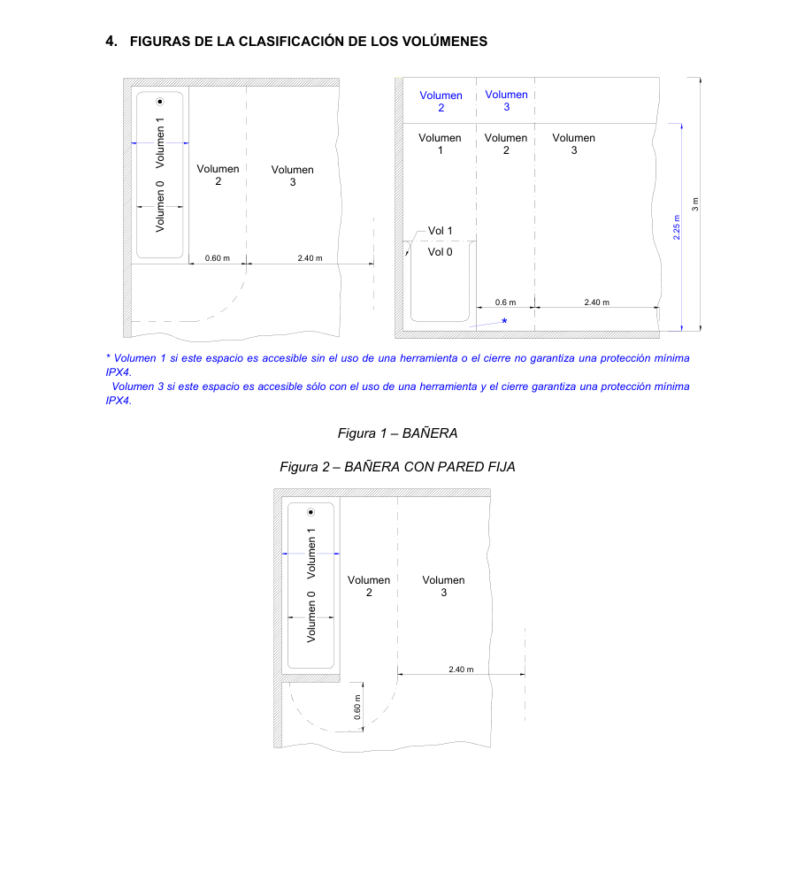
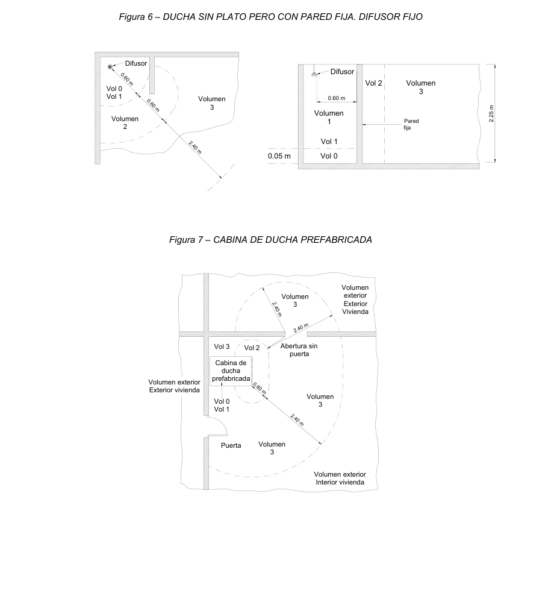

# BT-27. Locales que contienen una bañera o ducha

_LOCALES QUE CONTIENEN UNA BAÑERA O_

### 0. ÍNDICE

- 0. ÍNDICE — 1

- 1. CAMPO DE APLICACIÓN — 2

- 2. EJECUCIÓN DE LAS INSTALACIONES — 2

- 2.1 Clasificación de los volúmenes — 2

- 2.1.1 Volumen 0 — 2

- 2.1.2 Volumen 1 — 2

- 2.1.3 Volumen 2 — 3

- 2.1.4 Volumen 3 — 3

- 2.2 Protección para garantizar la seguridad — 4

- 2.3 Elección e instalación de los materiales eléctricos — 5

### 3. REQUISITOS PARTICULARES PARA LA INSTALACIÓN DE BAÑERAS DE

### HIDROMASAJE, CABINAS DE DUCHA CON CIRCUITOS ELÉCTRICOS Y APARATOS

- ANÁLOGOS — 6

- 4. FIGURAS DE LA CLASIFICACIÓN DE LOS VOLÚMENES — 8

### 1. CAMPO DE APLICACIÓN

Las prescripciones objeto de esta Instrucción son aplicables a las instalaciones interiores de viviendas, así como en la medida que pueda afectarles, a las de locales comerciales, de oficinas y a las de cualquier otro local destinado a fines análogos que contengan una bañera o una ducha o una ducha prefabricada o una bañera de hidromasaje o aparato para uso análogo.

Para lugares que contengan baños o duchas para tratamiento médico o para minusválidos, pueden ser necesarios requisitos adicionales.

Para duchas de emergencia en zonas industriales, son de aplicación las reglas generales.

### 2. EJECUCIÓN DE LAS INSTALACIONES

#### 2.1 Clasificación de los volúmenes

Para las instalaciones de estos locales se tendrán en cuenta los cuatro volúmenes 0, 1, 2 y 3 que se definen a continuación. En el apartado 5 de la presente instrucción se presentan figuras aclaratorias para la clasificación de los volúmenes, teniendo en cuenta la influencia de las paredes y del tipo de baño o ducha. Los falsos techos y las mamparas no se consideran barreras a los efectos de la separación de volúmenes.

##### 2.1.1 Volumen 0

Comprende el interior de la bañera o ducha.

En un lugar que contenga una ducha sin plato, el volumen 0 está delimitado por el suelo y por un plano horizontal situado a 0,05 m por encima del suelo. En este caso:

a) Si el difusor de la ducha puede desplazarse durante su uso, el volumen 0 está limitado por el plano generatriz vertical situado a un radio de 1,2 m alrededor de la toma de agua de la pared o el plano vertical que encierra el área prevista para ser ocupada por la persona que se ducha; o b) Si el difusor de la ducha es fijo, el volumen 0 está limitado por el plano generatriz vertical situado a un radio de 0,6 m alrededor del difusor.

##### 2.1.2 Volumen 1

Está limitado por:

a) El plano horizontal superior al volumen 0 y el plano horizontal situado a 2,25 m por encima del suelo, y b) El plano vertical alrededor de la bañera o ducha y que incluye el espacio por debajo de los mismos, cuanto este espacio es accesible sin el uso de una herramienta; o - Para una ducha sin plato con un difusor que puede desplazarse durante su uso, el volumen 1 está limitado por el plano generatriz vertical situado a un radio de 1,2 m desde la toma de agua de la pared o el plano vertical que encierra el área prevista para ser ocupada por la persona que se ducha; o - Para una ducha sin plato y con un rociador fijo, el volumen 1 está delimitado por la superficie generatriz vertical situada a un radio de 0,6 m alrededor del rociador.

##### 2.1.3 Volumen 2

Está limitado por:

a) El plano vertical exterior al volumen 1 y el plano vertical paralelo situado a una distancia de 0,6 m; y b) El suelo y plano horizontal situado a 2,25 m por encima del suelo

Además, cuando la altura del techo exceda los 2,25 m por encima del suelo, el espacio comprendido entre el volumen 1 y el techo o hasta una altura de 3 m por encima del suelo, cualquiera que sea el valor menor, se considera volumen 2.

##### 2.1.4 Volumen 3

Está limitado por:

a) El plano vertical límite exterior del volumen 2 y el plano vertical paralelo situado a una distancia de éste de 2,4 m; y b) El suelo y el plano horizontal situado a 2,25 m por encima del suelo

Además, cuando la altura del techo exceda los 2,25 m por encima del suelo, el espacio comprendido entre el volumen 2 y el techo o hasta una altura de 3 m por encima del suelo, cualquiera que sea el valor menor, se considera volumen 3.

El volumen 3 comprende cualquier espacio por debajo de la bañera o ducha que sea accesible sólo mediante el uso de una herramienta siempre que el cierre de dicho volumen garantice una protección como mínimo IP X4. Esta clasificación no es aplicable al espacio situado por debajo de las bañeras de hidromasaje y cabinas.

En el espacio situado por debajo de las bañeras de hidromasaje y cabinas, el grado de protección será mínimo IPX5 tal como se indica en el apartado 3 de esta instrucción

#### 2.2 Protección para garantizar la seguridad

Cuando se utiliza MBTS, cualquiera que sea su tensión asignada, la protección contra contactos directos debe estar proporcionada por:

- barreras o envolventes con un grado de protección mínimo IP2X o IPXXB, según UNE 20.324 o - aislamiento capaz de soportar una tensión de ensayo de 500 V en valor eficaz en alterna durante 1 minuto.

Una conexión equipotencial local suplementaria debe unir el conductor de protección asociado con las partes conductoras accesibles de los equipos de clase I en los volúmenes 1, 2 y 3, incluidas las tomas de corriente y las siguientes partes conductoras externas de los volúmenes 0, 1, 2 y 3:

- Canalizaciones metálicas de los servicios de suministro y desagües (por ejemplo agua, gas); - Canalizaciones metálicas de calefacciones centralizadas y sistemas de aire acondicionado; - Partes metálicas accesibles de la estructura del edificio. Los marcos metálicos de puertas, ventanas y similares no se consideran partes externas accesibles, a no ser que estén conectadas a la estructura metálica del edificio. - Otras partes conductoras externas, por ejemplo partes que son susceptibles de transferir tensiones.

Estos requisitos no se aplican al volumen 3, en recintos en los que haya una cabina de ducha prefabricada con sus propios sistemas de drenaje, distintos de un cuarto de baño, por ejemplo un dormitorio.

Las bañeras y duchas metálicas deben considerarse partes conductoras externas susceptibles de transferir tensiones, a menos que se instalen de forma que queden aisladas de la estructura y de otras partes metálicas del edificio. Las bañeras y duchas metálicas pueden considerarse aisladas del edificio, si la resistencia de aislamiento entre el área de los baños y duchas y la estructura del edificio, medido de acuerdo con la norma UNE 20.460 -6-61, anexo A, es de cómo mínimo 100 kΩ.

El método de medida de la resistencia de aislamiento de suelos y paredes respecto del conductor de protección se detalla en el Anexo sobre verificación de instalaciones eléctricas.

#### 2.3 Elección e instalación de los materiales eléctricos

Tabla 1. Grado de Protección Cableado Mecanismos(2) Otros aparatos fijos(3)

<!-- tabla: ../tablas/BT-27_t01.csv -->

|  | Grado de Protección | Cableado | Mecanismos(2) | Otros aparatos fijos(3) |
|---|---|---|---|---|
| Volumen 0 | IPX7 | Limitado al necesario para alimentar los aparatos eléctricos fijos situados en este volumen | No permitida | Aparatos que únicamente pueden ser instalados en el volumen 0 y deben ser adecuados a las condiciones de este volumen |
| Volumen 1 | IPX4 IPX2, por encima del nivel más alto de un difusor fijo. IPX5, en equipo eléctrico de bañeras de hidromasaje y en los baños comunes en los que se puedan producir chorros de agua durante la limpieza de los mismos(1). | Limitado al necesario para alimentar los aparatos eléctricos fijos situados en los volúmenes 0 y 1 | No permitida, con la excepción de interruptores de circuitos MBTS alimentados a una tensión nominal de 12V de valor eficaz en alterna o de 30V en continua, estando la fuente de alimentación instalada fuera de los volúmenes 0, 1 y 2. | Aparatos alimentados a MBTS no superior a 12 V ca ó 30 V cc Calentadores de agua, bombas de ducha y equipo eléctrico para bañeras de hidromasaje que cumplan con su norma aplicable, si su alimentación está protegida adicionalmente con un dispositivo de protección de corriente diferencial de valor no superior a los 30 mA, según la norma UNE 20.460 -4-41. |
| Volumen 2 | IPX4 IPX2, por encima del nivel más alto de un difusor fijo. IPX5, en los baños comunes en los que se puedan producir chorros de agua durante la limpieza de los mismos(1) | Limitado al necesario para alimentar los aparatos eléctricos fijos situados en los volúmenes 0, 1 y 2, y la parte del volumen 3 situado por debajo de la bañera o ducha. | No permitida, con la excepción de interruptores o bases de circuitos MBTS cuya fuente de alimentación este instalada fuera de los volúmenes 0, 1 y 2. Se permiten también la instalación de bloques de alimentación de afeitadoras que cumplan con la UNE-EN 60.742 o UNE-EN 61558-2-5 | Todos los permitidos para el volumen 1. Luminarias, ventiladores, calefactores, y unidades móviles para bañeras de hidromasaje que cumplan con su norma aplicable, si su alimentación está protegida adicionalmente con un dispositivo de protección de corriente diferencial de valor no superior a los 30 mA, según la norma UNE 20.460 -4-41. |
| Volumen 3 | IPX5, en los baños comunes, cuando se puedan producir chorros de agua durante la limpieza de los mismos. | Limitado al necesario para alimentar los aparatos eléctricos fijos situados en los volúmenes 0, 1, 2 y 3. | Se permiten las bases sólo si están protegidas bien por un transformador de aislamiento; o por MBTS; o por un interruptor automático de la alimentación con un dispositivo de protección por corriente diferencial de valor no superior a los 30 mA, todos ellos según los requisitos de la norma UNE 20.460 -4-41. | Se permiten los aparatos sólo si están protegidos bien por un transformador de aislamiento; o por MBTS; o por un dispositivo de protección de corriente diferencial de valor no superior a los 30 mA, todos ellos según los requisitos de la norma UNE 20.460 -4-41. |

(1): Los baños comunes comprenden los baños que se encuentran en escuelas, fábricas, centros deportivos, etc. e incluyen todos los utilizados por el público en general. (2): Los cordones aislantes de interruptores de tirador están permitidos en los volúmenes 1 y 2, siempre que cumplan con los requisitos de la norma UNE-EN 60.669 -1. (3): Los calefactores bajo suelo pueden instalarse bajo cualquier volumen siempre y cuando debajo de estos volúmenes estén cubiertos por una malla metálica puesta a tierra o por una cubierta metálica conectada a una conexión equipotencial local suplementaria según el apartado 2.2.

Producto Norma de aplicación Transformadores de separación de circuitos y transformadores de UNE-EN 60742 seguridad Transformadores y unidades de alimentación para máquinas de afeitar UNE-EN 61558-2-5 Bases de toma de corriente (fijas y móviles) para uso doméstico o UNE 20315 análogo Cajas de empalme y/o derivación UNE 20451 Interruptores para instalaciones eléctricas fijas doméstica y análogas UNE-EN 60669-1

En el volumen 3, la norma UNE 20460-7-701 establece que el grado de protección mínimo para el equipo eléctrico será IPX1.

En el espacio existente bajo bañeras o duchas que sea accesible sólo mediante el uso de una herramienta el grado de protección del equipo eléctrico será IPX4.

Los bloques de alimentación de afeitadoras de acuerdo con la UNE-EN 60.742 o UNE-EN 61558-2-5 instalados en el volumen 2 deben presentar un grado de protección mínimo IPX1 y por lo tanto no les aplica el requisito general de IPX4.

Las cajas de conexión deberán instalarse fuera de los volúmenes 0, 1 y 2, de acuerdo con la norma UNE 20460-7-701.

3. REQUISITOS PARTICULARES PARA LA INSTALACIÓN DE BAÑERAS DE HIDROMASAJE,

### CABINAS DE DUCHA CON CIRCUITOS ELÉCTRICOS Y APARATOS ANÁLOGOS

El hecho de que en estos aparatos, en los espacios comprendidos entre la bañera y el suelo y las paredes y el techo de las cabinas y las paredes y techos del local donde se instalan, coexista equipo eléctrico tanto de baja tensión como de Muy Baja Tensión de Seguridad (MBTS) con tuberías o depósitos de agua u otros líquidos, hace necesario que se requieran condiciones especiales de instalación.

En general todo equipo eléctrico, electrónico, telefónico o de telecomunicación incorporado en la cabina o bañera, incluyendo los alimentados a MBTS, deberán cumplir los requisitos de la norma UNE-EN 60.335 - 2-60.

La conexión de las bañeras y cabinas se efectuará con cable con cubierta de características no menores que el de designación H05VV-F o mediante cable bajo tubo aislante con conductores aislados de tensión asignada 450/750V. Debe garantizarse que, una vez instalado el cable o tubo en la caja de conexiones de la bañera o cabina, el grado de protección mínimo que se obtiene sea IPX5.

Los cables y conductores unipolares aislados comúnmente utilizados corresponden a los tipos:

<!-- tabla: ../tablas/BT-27_t02.csv -->

| Producto |  | Norma de aplicación |
|---|---|---|
| Cable tipo H05VV-F | Cable de tensión asignada 300/500, con conductor de cobre clase 5 (-F) y con aislamiento y cubierta de policloruro de vinilo (VV) | UNE 21.031-5 |
| Cable tipo H07V-U | Conductor aislado unipolar de tensión asignada 450/750 V, con conductor de cobre clase 1 (-U) y aislamiento de policloruro de vinilo (V) | UNE 21.031-3 |

Conductor aislado unipolar de tensión asignada 450/750 Cable tipo H07V-R V, con conductor de cobre clase 2 (-R) y aislamiento de policloruro de vinilo (V) Conductor aislado unipolar de tensión asignada 450/750 Cable tipo H07V-K V, con conductor de cobre clase 5 (-K) y aislamiento de policloruro de vinilo (V) Según la norma UNE 21 022 que especifica las características constructivas y eléctricas de las diferentes clases de conductor::

- clase 1: conductor rígido de un solo alambre. (símbolo –U) - clase 2: conductor rígido de varios alambres cableados. (símbolo –R) - clase 5: conductor flexible de varios alambres finos, - no apto para usos móviles . (símbolo –K) - apto para usos móviles (símbolo –F)

Todas las cajas de conexión localizadas en paredes y suelo del local bajo la bañera o plato de ducha, o en las paredes o techos del local, situadas detrás de paredes o techos de una cabina por donde discurren tubos o depósitos de agua, vapor u otros líquidos, deben garantizar, junto con su unión a los cables o tubos de la instalación eléctrica, un grado de protección mínimo IPX5. Para su apertura será necesario el uso de una herramienta.

No se admiten empalmes en los cables y canalizaciones que discurran por los volúmenes determinados por dichas superficies salvo si estos se realizan con cajas que cumplan el requisito anterior.

<!-- tabla no extraíble en la pág. 8 -->
> La tabla de esta página no se puede extraer como texto (pdfplumber la lee como
> caracteres sueltos): se muestra la imagen de la página. También está en [pdf/BT-27.pdf](../pdf/BT-27.pdf#page=8).

Figura 3 – DUCHA

Vol 0 Volumen Volumen Volumen Volumen Volumen Vol 1 2 3 1 2 3

m 0.60 m 2.40 m 52.2 Vol 1 0.6 m 2.40 m Vol 0 *

* Volumen 1 si este espacio es accesible sin el uso de una herramienta o el cierre no garantiza una protección mínima IPX4. Volumen 3 si este espacio es accesible sólo con el uso de una herramienta y el cierre garantiza una protección mínima IPX4.

Vol 0 Volumen Volumen Vol 1 2 3

2.40 m

m 06.0

Figura 4 – DUCHA CON PARED FIJA

Volumen Difusor 3 0.60 m Vol 0 Volumen 1 0.60 m

2.40 m Volumen 2

Figura 5 – DUCHA SIN PLATO

<!-- figura vectorial en la pág. 9 del PDF original -->
> Figura en la pág. 9 del PDF original: [ver en el PDF](../pdf/BT-27.pdf#page=9)

<!-- tabla no extraíble en la pág. 10 -->
> La tabla de esta página no se puede extraer como texto (pdfplumber la lee como
> caracteres sueltos): se muestra la imagen de la página. También está en [pdf/BT-27.pdf](../pdf/BT-27.pdf#page=10).

