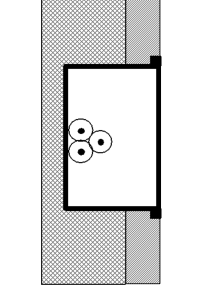
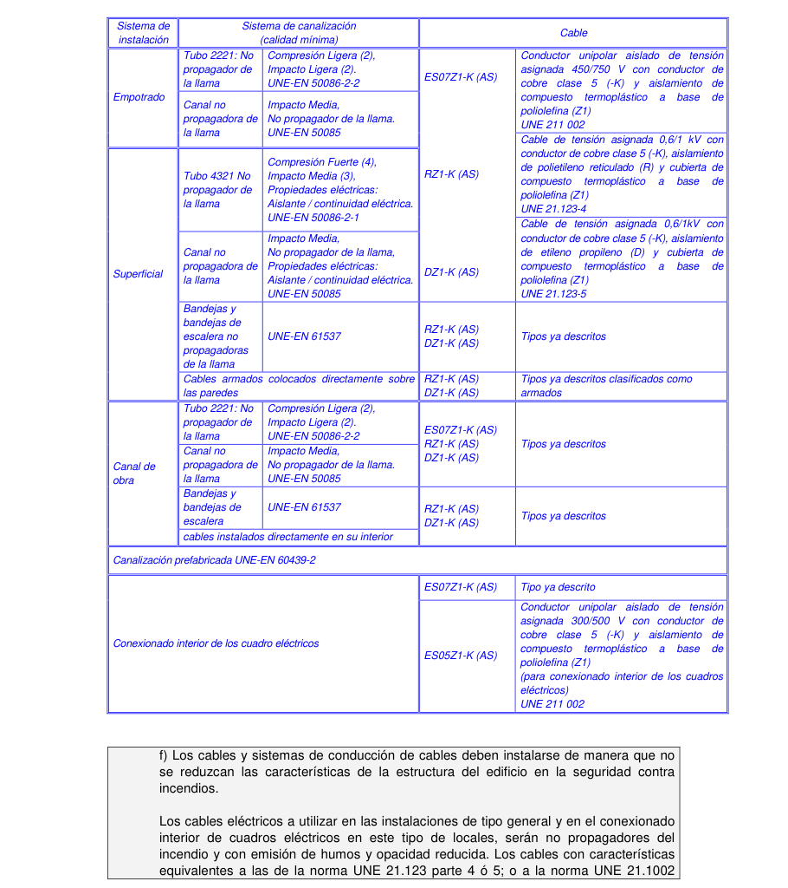

# BT-28. Instalaciones en locales de pública concurrencia

_INSTALACIONES EN LOCALES DE PÚBLICA_

### 0. ÍNDICE

- 0. ÍNDICE — 1

- 1. CAMPO DE APLICACIÓN — 3

- 2. ALIMENTACIÓN DE LOS SERVICIOS DE SEGURIDAD — 5

- 2.1 Generalidades y fuentes de alimentación — 6

- 2.2 Fuentes propias de energía — 7

- 2.3 Suministros complementarios o de seguridad — 7

- 3. ALUMBRADO DE EMERGENCIA — 9

- 3.1 Alumbrado de seguridad — 11

- 3.1.1 Alumbrado de evacuación — 11

- 3.1.2 Alumbrado ambiente o anti-pánico — 12

- 3.1.3 Alumbrado de zonas de alto riesgo — 13

- 3.2 Alumbrado de reemplazamiento — 13

- 3.3 Lugares en que deberán instalarse alumbrado de emergencia — 14

- 3.3.1 Con alumbrado de seguridad — 14

- 3.3.2 Con alumbrado de reemplazamiento — 15

- 3.4 Prescripciones de los aparatos para alumbrado de emergencia — 15

- 3.4.1 Aparatos autónomos para alumbrado de emergencia — 15

- 3.4.2 Luminaria alimentada por fuente central — 19

- 4. PRESCRIPCIONES DE CARÁCTER GENERAL — 19

### 5. PRESCRIPCIONES COMPLEMENTARIAS PARA LOCALES DE

- ESPECTÁCULOS Y ACTIVIDADES RECREATIVAS — 23

### 6. PRESCRIPCIONES COMPLEMENTARIAS PARA LOCALES DE REUNIÓN Y

- TRABAJO — 25

DIFERENCIAS MÁS SIGNIFICATIVAS CON EL REBT ANTERIOR:

- Se separa la instalación de quirófanos en una Instrucción específica e independiente (ITC-BT- 38) - Se introduce la prescripción de alumbrado de balizamiento en rampas y escaleras. - Se hace una nueva división del alumbrado de emergencia y se establecen numerosos requisitos adicionales, algunos de ellos de sus características fotométricas. - El alumbrado de emergencia realizado con bloques autónomos no necesita un circuito independiente. - Se establecen requisitos específicos de comportamiento al fuego para los cables y sistemas de conducción de cables.

### 1. CAMPO DE APLICACIÓN

La presente instrucción se aplica a locales de pública concurrencia como:

Locales de espectáculos y actividades recreativas: Cualquiera que sea su capacidad de ocupación, como por ejemplo, cines, teatros, auditorios, estadios, pabellones deportivos, plazas de toros, hipódromos, parques de atracciones y ferias fijas, salas de fiesta, discotecas, salas de juegos de azar.

Locales de reunión, trabajo y usos sanitarios: - Cualquiera que sea su ocupación, los siguientes: Templos, Museos, Salas de conferencias y congresos, casinos, hoteles, hostales, bares, cafeterías, restaurantes o similares, zonas comunes en agrupaciones de establecimientos comerciales, aeropuertos, estaciones de viajeros, estacionamientos cerrados y cubiertos para más de 5 vehículos, hospitales, ambulatorios y sanatorios, asilos y guarderías - Si la ocupación prevista es de más de 50 personas: bibliotecas, centros de enseñanza, consultorios médicos, establecimientos comerciales, oficinas con presencia de público, residencias de estudiantes, gimnasios, salas de exposiciones, centros culturales, clubes sociales y deportivos. La ocupación prevista de los locales se calculará como 1 persona por cada 0,8 m2 de superficie útil, a excepción de pasillos, repartidores, vestíbulos y servicios.

Para las instalaciones en quirófanos y salas de intervención se establecen requisitos particulares en la ITC-BT-38.

Igualmente se aplican a aquellos locales clasificados en condiciones BD2, BD3 y BD4, según la norma UNE 20.460 -3 y a todos aquellos locales no contemplados en los apartados anteriores, cuando tengan una capacidad de ocupación de más de 100 personas.

Para determinar si un local es de pública concurrencia se debe considerar la previsión de presencia de personas ajenas al mismo en lo relativo a la aplicación de los límites reglamentarios de 50 ó 100 personas, la capacidad de ocupación del local, y la facilidad de evacuación en caso de emergencia. La calificación de local de pública concurrencia se puede aplicar tanto a un único local u oficina, una agrupación de locales u oficinas, un edificio completo o a parte o partes de un edificio. Cuando un edificio o local completo es considerado como de pública concurrencia, todas sus dependencias, están consideradas también como de pública concurrencia. Por ejemplo, en el caso de un teatro, los camerinos o los despachos del personal, aunque no estén abiertos al público, también se consideran locales de pública concurrencia.

Dada la dificultad para establecer una definición precisa de “local de pública concurrencia”, serán locales de pública concurrencia cualquier local de características y uso similar a los listados en la ITC-BT. Por ejemplo: canódromos y parques temáticos son asimilables a hipódromos y parques de atracciones respectivamente. Pensiones se asimilan a hostales. El uso veterinario se asimila a centro sanitario. Las zonas comunes de edificios destinados a oficinas se asimilan a las zonas comunes en agrupaciones de establecimientos comerciales.

Para el caso de centros de trabajo (fábricas, talleres, etc.) se deberá tener en cuenta la reglamentación de protección contra incendios en establecimientos industriales. En lo relativo a los estacionamientos mencionados en la ITC-BT-28, se considerarán de pública concurrencia, si éstos son de uso público. No obstante, para los estacionamientos de uso no público, se considerará lo que en este sentido establezca el Código Técnico de la Edificación

Tabla A. Resumen de tipos de locales de pública concurrencia:

<!-- tabla: ../tablas/BT-28_t01.csv -->

| TIPOS DE LOCAL |  | EJEMPLOS | SERÁ LOCAL DE PÚBLICA CONCURRENCIA |
|---|---|---|---|
| 1. Espectáculos y actividades recreativas |  | Cines, teatros, auditorios, estadios, pabellones de deportes, plazas de toros, hipódromos, parques de atracciones, ferias, salas de fiesta, discotecas, salas de juegos de azar. | siempre |
| 2. Locales de reunión, trabajo y usos sanitarios | 2.1. Locales de reunión | Templos, salas de conferencias y congresos, bares, cafeterías, restaurantes, museos, casinos, hoteles, hostales, zonas comunes de centros comerciales, aeropuertos, estaciones de viajeros, parking de uso público cerrado de más de 5 vehículos, asilos, guarderías, | siempre |
|  |  | centros de enseñanza, bibliotecas, establecimientos comerciales, residencias de estudiantes, gimnasios, salas de exposiciones, centros culturales, clubes sociales y deportivos | Ocupación > 50 personas ajenas al local |
|  | 2.2. Locales de trabajo | Oficinas con presencia de público, | Ocupación > 50 personas ajenas al local |
|  | 2.3. Locales de uso sanitario | Hospitales, ambulatorios, sanatorios, | siempre |
|  |  | consultorios médicos, clínicas | Ocupación > 50 personas ajenas al local |
| 3. Según dificultad de evacuación de cualquier local | 3.1. BD2 (baja densidad de ocupación, difícil evacuación) | Edificios de gran altura, sótanos. | siempre |
|  | 3.2. BD3 (alta densidad de ocupación, fácil evacuación) | Locales abiertos al público: grandes almacenes |  |
|  | 3.3. BD4 (alta densidad de ocupación, difícil evacuación) | Edificios de gran altura abiertos al público. Locales en sótanos, abiertos al público. |  |
| 4. Otros locales |  | Cualquier local no incluido en los otros epígrafes con capacidad superior a 100 personas ajenas al local | siempre |
| Nota 1: Cuando un local pueda estar considerado bajo dos epígrafes, uno de ellos “siempre obligatorio” y el otro “dependa de la ocupación”, se tomará la condición de “siempre obligatorio”. Nota 2: Cuando en un local sea difícil evaluar el número de personas ajenas al mismo o la dificultad de evacuación en caso de emergencia, se considerará el local como de pública concurrencia. |  |  |  |

Para el cálculo de ocupación, la superficie a considerar será la útil excluyendo pasillos, repartidores y servicios. Se entiende por servicios todos aquellos que conlleva la actividad que se desarrolla en el local, como por ejemplo: Almacenes, oficinas privadas, zonas exclusivas del personal, aseos, archivos, escaparates, cuartos de calderas o cuartos de máquinas y en general todos aquellos espacios que no estén ocupados por el publico ajeno al mismo.

Dado que la determinación de la superficie útil de cada local de pública concurrencia depende de su actividad y tendiendo en cuenta que existen valores de densidad de ocupación

particularizados para cada tipo de actividad tanto en la NBE- CPI 96, como en el futuro Código Técnico de la Edificación (CTE), se recomienda que el cálculo de la ocupación del local se realice utilizando los valores indicados en éstos últimos y en el caso de que la actividad del local no este contemplada en ellos se utilice el valor genérico indicado en esta ITC-BT-28.

Dentro del campo de aplicación de esta instrucción se encuentran algunos locales que, sin ser considerados de pública concurrencia, tienen prescripciones de iluminación especiales, como por ejemplo, las escaleras de evacuación de los edificios de viviendas, la zonas clasificadas como de riesgo especial en el artículo 19 de la NBE-CPI/96. (ver apartado 3.3.1)

Esta instrucción tiene por objeto garantizar la correcta instalación y funcionamiento de los servicios de seguridad, en especial aquellos dedicados a alumbrado que faciliten la evacuación segura de las personas o la iluminación de puntos vitales de los edificios.

Se consideran servicios de seguridad aquellos esenciales para mantener la seguridad de las personas que se indican en el apartado 2 de esta ITC-BT.

En lo relativo al mantenimiento y de acuerdo con el artículo 20 del Reglamento (Ver Guía BT- RD 842/02) se considera que el periodo de mantenimiento recomendable para las instalaciones que disponen de alumbrado de emergencia no debería superar los 3 años y que las operaciones de mantenimiento se deben registrar para su posible presentación en la inspección periódica reglamentaria.

La utilización de luminarias autónomas con dispositivo automático de prueba (AUTOTEST) facilita el control y verificación de los aparatos autónomos de alumbrado de emergencia en las instalaciones de los locales de pública concurrencia.

### 2. ALIMENTACIÓN DE LOS SERVICIOS DE SEGURIDAD

En el presente apartado se definen las características de la alimentación de los servicios de seguridad tales como alumbrados de emergencia, sistemas contra incendios, ascensores u otros servicios urgentes indispensables que están fijados por las reglamentaciones específicas de las diferentes Autoridades competentes en materia de seguridad.

La alimentación de los servicios de seguridad no implica necesariamente el disponer de un suministro complementario o de seguridad de los definidos en el artículo 10 del RBT, ya que se pueden utilizar otros sistemas como baterías de acumuladores con la autonomía de funcionamiento requerida. En el apartado 2.3 se indican concretamente los locales de pública concurrencia que deben disponer de suministro complementario o de seguridad.

La alimentación para los servicios de seguridad, en función de lo que establezcan las reglamentaciones específicas, puede ser automática o no automática.

En una alimentación automática la puesta en servicio de la alimentación no depende de la intervención de un operador.

Una alimentación automática se clasifica, según la duración de conmutación, en las siguientes categorías:

- Sin corte: alimentación automática que puede estar asegurada de forma continua en

las condiciones especificadas durante el periodo de transición, por ejemplo, en lo que se refiere a las variaciones de tensión y frecuencia. - Con corte muy breve: alimentación automática disponible en 0,15 segundos como máximo. - Con corte breve: alimentación automática disponible en 0,5 segundos como máximo. - Con corte mediano: alimentación automática disponible en 15 segundos como máximo. - Con corte largo: alimentación automática disponible en mas de 15 segundos.

La conmutación no automática se considera conmutación con corte largo.

Es posible conseguir una alimentación automática sin corte cuando se disponga de una UPS o aparato autónomo que nos proporciona el consumo eléctrico requerido durante la conmutación.

#### 2.1 Generalidades y fuentes de alimentación

Para los servicios de seguridad la fuente de energía debe ser elegida de forma que la alimentación esté asegurada durante un tiempo apropiado.

Para que los servicios de seguridad funcionen en caso de incendio, los equipos y materiales utilizados deben presentar, por construcción o por instalación, una resistencia al fuego de duración apropiada.

Los equipos y materiales utilizados, que cumplan con las normas indicadas en esta Guía-BT, se considera que reúnen las características de resistencia al fuego y duración exigidas.

Se elegirán preferentemente medidas de protección contra los contactos indirectos sin corte automático al primer defecto. En el esquema IT debe preverse un controlador permanente de aislamiento que al primer defecto emita una señal acústica o visual.

En caso de fallo de la alimentación normal se recomienda utilizar un esquema IT para la alimentación de los servicios de seguridad que no sean autónomos. Solamente cuando se emplee el esquema IT la protección contra contactos indirectos deberá ser sin corte al primer defecto.

<!-- tabla: ../tablas/BT-28_t02.csv -->

| Producto | Norma de aplicación |
|---|---|
| Dispositivos de control de aislamiento para sistemas IT | UNE-EN 61557-8 |

Los equipos y materiales deberán disponerse de forma que se facilite su verificación periódica, ensayos y mantenimiento.

Se pueden utilizar las siguientes fuentes de alimentación:

- Baterías de acumuladores. Generalmente las baterías de arranque de los vehículos no satisfacen las prescripciones de alimentación para los servicios de seguridad - Generadores independientes - Derivaciones separadas de la red de distribución, efectivamente independientes de la alimentación normal

Las fuentes para servicios para servicios complementarios o de seguridad deben estar instaladas en lugar fijo y de forma que no puedan ser afectadas por el fallo de la fuente normal. Además, con excepción de los equipos autónomos, deberán cumplir las siguientes condiciones:

- se instalarán en emplazamiento apropiado, accesible solamente a las personas cualificadas o expertas. - el emplazamiento estará convenientemente ventilado, de forma que los gases y los humos que produzcan no puedan propagarse en los locales accesibles a las personas. - no se admiten derivaciones separadas, independientes y alimentadas por una red de distribución pública, salvo si se asegura que las dos derivaciones no puedan fallar simultáneamente. - cuando exista una sola fuente para los servicios de seguridad, ésta no debe ser utilizada para otros usos. Sin embargo, cuando se dispone de varias fuentes, pueden utilizarse igualmente como fuentes de reemplazamiento, con la condición, de que en caso de fallo de una de ellas, la potencia todavía disponible sea suficiente para garantizar la puesta en funcionamiento de todos los servicios de seguridad, siendo necesario generalmente, el corte automático de los equipos no concernientes a la seguridad.

#### 2.2 Fuentes propias de energía

Fuente propia de energía es la que esta constituida por baterías de acumuladores, aparatos autónomos o grupos electrógenos.

La puesta en funcionamiento se realizará al producirse la falta de tensión en los circuitos alimentados por los diferentes suministros procedentes de la Empresa o Empresas distribuidoras de energía eléctrica, o cuando aquella tensión descienda por debajo del 70% de su valor nominal. La capacidad mínima de una fuente propia de energía será, como norma general, la precisa para proveer al alumbrado de seguridad en las condiciones señaladas en el apartado 3.1. de esta instrucción.

#### 2.3 Suministros complementarios o de seguridad

El suministro normal es el que se efectúa habitualmente por una empresa suministradora; el suministro complementario se efectúa por la misma empresa suministradora, cuando disponga de medios de distribución de energía independientes, por otra empresa suministradora distinta o por el usuario mediante medios de producción propios.

Los suministros complementarios se clasifican según el artículo 10 del RBT en tres tipos:

- Suministro de socorro: limitado a una potencia receptora mínima del 15% del total contratado para el suministro normal. - Suministro de reserva: limitado a una potencia receptora mínima del 25% del total contratado para el suministro normal. - Suministro duplicado: capaz de mantener un servicio mayor del 50% de la potencia total contratada para el suministro normal.

La conmutación del suministro normal al de seguridad en caso de fallo del primero se debe realizar de forma que se impida el acoplamiento entre ambos suministros. Esta conmutación se puede realizar mediante interruptores automáticos motorizados con enclavamiento mecánico y eléctrico o conmutadores motorizados.

El artículo 10 del RBT indica que se considera suministro complementario aquel que, aún partiendo del mismo transformador, dispone de línea de distribución independiente del suministro normal desde su mismo origen en baja tensión. Por tanto, pueden considerarse independientes los suministros de energía en baja tensión a un mismo usuario siempre que las canalizaciones o circuitos de alimentación estén protegidos separadamente en origen, aunque partan de un mismo transformador AT/BT.

No obstante, para mejorar la fiabilidad del suministro complementario, es conveniente que cuando tanto el suministro normal como el suministro de seguridad procedan de la red de distribución pública, las líneas de alimentación de ambos suministros procedan de transformadores de distribución distintos.

Todos los locales de pública concurrencia deberán disponer de alumbrado de emergencia.

Esta prescripción no implica que todos los locales de pública concurrencia deban disponer también de un suministro complementario, sino únicamente los que se indican a continuación:

Deberán disponer de suministro de socorro los locales de espectáculos y actividades recreativas cualquiera que sea su ocupación y los locales de reunión, trabajo y usos sanitarios con una ocupación prevista de más de 300 personas.

Deberán disponer de suministro de reserva: - Hospitales, clínicas, sanatorios, ambulatorios y centros de salud - Estaciones de viajeros y aeropuertos - Estacionamientos subterráneos para más de 100 vehículos - Establecimientos comerciales o agrupaciones de éstos en centros comerciales de más de 2.000 m2 de superficie - Estadios y pabellones deportivos

Cuando un local se pueda considerar tanto en el grupo de locales que requieren suministro de socorro como en el grupo que requieren suministro de reserva, se instalará suministro de reserva

En aquellos locales singulares, tales como los establecimientos sanitarios, grandes hoteles de más de 300 habitaciones, locales de espectáculos con capacidad para mas de 1.000 espectadores, estaciones de viajeros, estacionamientos subterráneos con más de 100 plazas, aeropuertos y establecimientos comerciales o agrupaciones de éstos en centros comerciales de más de 2.000 m2 de superficie, las fuentes propias de energía deberán poder suministrar, con independencia de los alumbrados especiales, la potencia necesaria para atender servicios urgentes indispensables cuando sean requeridos por la autoridad competente.

La referencia en el texto anterior a alumbrados especiales debe entenderse como alumbrado de emergencia.

La entrada en funcionamiento de los dispositivos de seguridad debe producirse cuando la tensión de alimentación desciende por debajo del 70% de la tensión nominal, aunque teniendo en cuenta que este límite es el valor mínimo inferior, se considerará adecuado que entren en funcionamiento cuando la tensión nominal esté comprendida entre el 80% y el 70% de sus valor nominal. Tabla B. Resumen de suministros de seguridad

<!-- tabla: ../tablas/BT-28_t03.csv -->

| Alumbrado de emergencia | Grupos de Locales | Suministro de socorro | Locales específicos | Suministro de reserva |
|---|---|---|---|---|
| siempre | Espectáculos | siempre | Estadios y pabellones deportivos | siempre |
|  | Acitividades recreativas |  | --- | --- |
|  | Reunión | ocupación mayor de 300 personas ajenas al centro | Estaciones - aeropuertos | siempre |
|  |  |  | Estacionamientos subterráneos de uso público | más de 100 vehículos |
|  |  |  | Comercios y centros comerciales | más de 2000 m2 de superficie |
|  | Trabajo |  | --- | --- |
|  | Uso sanitario |  | Hospitales, clínicas, santorios y centros de salud | siempre |
| Nota: cuando se requiere suministro de socorro y de reserva se instalará el de reserva únicamente. |  |  |  |  |

### 3. ALUMBRADO DE EMERGENCIA

Las instalaciones destinadas a alumbrado de emergencia tienen por objeto asegurar, en caso de fallo de la alimentación al alumbrado normal, la iluminación en los locales y accesos hasta las salidas, para una eventual evacuación del público o iluminar otros puntos que se señalen.

La alimentación del alumbrado de emergencia será automática con corte breve.

Se incluyen dentro de este alumbrado el alumbrado de seguridad y el alumbrado de reemplazamiento.

Esquema explicativo del alumbrado de emergencia

### ALUMBRADO DE EMERGENCIA

Previsto para entrar en funcionamiento cuando se produce un fallo en la alimentación del alumbrado normal

### ALUMBRADO DE REEMPLAZAMIENTO

ALUMBRADO DE SEGURIDAD •Su duración no siempre está determinada, debe permitir •Garantiza la iluminación durante la finalizar los trabajos con seguridad si la iluminación es inferior evacuación de una zona a la normal •Entra en funcionamiento a tensión inferior al •Permite la continuación de las actividades normales 70% de la nominal (En salas de intervención, de tratamiento intensivo, de curas, paritorios y urgencias, se prescribe una duración mínima de 2 horas)

### DE EVACUACIÓN AMBIENTE O ANTIPÁNICO DE ZONAS DE ALTO RIESGO

•Antes llamado de señalización •Antes llamado alumbrado de •Duración mínima: la necesaria para •Permite reconocer y utilizar las rutas de emergencia interrumpir las actividades. evacuación •Permite la identificación y acceso a las •Permite la interrupción de los •Proporcionará 1lux en el suelo, en el eje de rutas de evacuación. trabajos peligrosos con seguridad. los pasos principales •Proporciona 0,5 lux en todo el espacio •Iluminación mínima: 15 lux o 10% de •Permite identificar los puntos de los hasta 1 m de altura * la iluminación normal servicios contra incendios y cuadros de •Tiempo mínimo de funcionamiento 1 distribución (5 lux) hora •Tiempo mínimo de funcionamiento 1 hora

#### 3.1 Alumbrado de seguridad

Es el alumbrado de emergencia previsto para garantizar la seguridad de las personas que evacuen una zona o que tienen que terminar un trabajo potencialmente peligroso antes de abandonar la zona.

El alumbrado de seguridad estará previsto para entrar en funcionamiento automáticamente cuando se produce el fallo del alumbrado general o cuando la tensión de éste baje a menos del 70% de su valor nominal.

La instalación de este alumbrado será fija y estará provista de fuentes propias de energía. Sólo se podrá utilizar el suministro exterior para proceder a su carga, cuando la fuente propia de energía esté constituida por baterías de acumuladores o aparatos autónomos automáticos.

3.1.1 Alumbrado de evacuación.

Es la parte del alumbrado de seguridad previsto para garantizar el reconocimiento y la utilización de los medios o rutas de evacuación cuando los locales estén o puedan estar ocupados.

En rutas de evacuación, el alumbrado de evacuación debe proporcionar, a nivel del suelo y en el eje de los pasos principales, una iluminancia horizontal mínima de 1 lux.

En los puntos en los que estén situados los equipos de las instalaciones de protección contra incendios que exijan utilización manual y en los cuadros de distribución del alumbrado, la iluminancia mínima será de 5 lux.

La relación entre la iluminancia máxima y la mínima en el eje de los pasos principales será menor de 40.

El alumbrado de evacuación deberá poder funcionar, cuando se produzca el fallo de la alimentación normal, como mínimo durante una hora, proporcionando la iluminancia prevista.

Se debe garantizar que las vías de evacuación de los locales de pública concurrencia estén siempre señalizadas e iluminadas cuando el local esté o pueda estar ocupado. Bien sea con alumbrado normal o con alumbrado de evacuación.

La función de señalización se debe realizar mediante señales con símbolos normalizados.

Cuando no se produzca fallo de la alimentación, el alumbrado normal puede realizar la función de iluminación de las vías de evacuación, ya que el local no podrá estar ocupado cuando el alumbrado normal no esté encendido. En este caso se debe garantizar que su interrupción no pueda ser realizada por el público en general, sino solo por personal autorizado.

No obstante hay determinados locales en los que el alumbrado normal no garantiza la identificación de las rutas de evacuación porque, o es insuficiente o no está permanentemente encendido, en cuyo caso deberá complementarse con otro tipo de alumbrado que permita la identificación de las mencionadas rutas de evacuación (puertas, pasillos, escaleras, etc.)

Ejemplos de estos tipos de situación: garajes en los que el alumbrado sea temporizado y pueda apagarse; hoteles u hospitales en los que en horario nocturno el alumbrado normal se reduce a

valores insuficientes; rutas de evacuación que discurren por zonas habitualmente no iluminadas; etc.

El proyecto de instalación del local de pública concurrencia deberá detallar los recorridos de evacuación, así como los valores de iluminancia previstos. Por ejemplo:

- En un salón de espectáculos, los pasillos de acceso a las butacas formarían parte de este recorrido siendo el origen del mismo los extremos de cada línea de butacas. - En viviendas y recintos pequeños de baja densidad de ocupación y de menos de 50 m2 (como habitaciones de hotel, o de Hospitales, oficinas), el origen del recorrido de evacuación es la puerta de la vivienda o del recinto. - Cuando hay varios recintos comunicados entre sí, cuya superficie total es inferior a 50 m2 también puede considerarse la puerta de salida a los espacios generales de circulación como el origen de la ruta de evacuación. - En garajes las rutas de evacuación incluyen todas las calles donde haya plazas de aparcamiento. - En los centros comerciales con comercios de superficie inferior a 50m2, las puertas de los mismos son el origen de las rutas de evacuación.

##### 3.1.2 Alumbrado ambiente o anti-pánico

Es la parte del alumbrado de seguridad previsto para evitar todo riesgo de pánico y proporcionar una iluminación ambiente adecuada que permita a los ocupantes identificar y acceder a las rutas de evacuación e identificar obstáculos.

El alumbrado ambiente o anti-pánico debe proporcionar una iluminancia horizontal mínima de 0,5 lux en todo el espacio considerado, desde el suelo hasta una altura de 1 m.

La relación entre la iluminancia máxima y la mínima en todo el espacio considerado será menor de 40.

El alumbrado ambiente o anti-pánico deberá poder funcionar, cuando se produzca el fallo de la alimentación normal, como mínimo durante una hora, proporcionando la iluminancia prevista.

Para cumplir los requisitos de iluminación de alumbrado de evacuación y ambiente con un único equipo de alumbrado de emergencia, se recomienda su instalación al menos 2 m por encima del suelo salvo en casos especiales como salas de proyección, cines y teatros.

##### 3.1.3 Alumbrado de zonas de alto riesgo

Es la parte del alumbrado de seguridad previsto para garantizar la seguridad de las personas ocupadas en actividades potencialmente peligrosas o que trabajan en un entorno peligroso. Permite la interrupción de los trabajos con seguridad para el operador y para los otros ocupantes del local.

El alumbrado de las zonas de alto riesgo debe proporcionar una iluminancia mínima de 15 lux o el 10% de la iluminancia normal, tomando siempre el mayor de los valores.

La relación entre la iluminancia máxima y la mínima en todo el espacio considerado será menor de 10.

El alumbrado de las zonas de alto riesgo deberá poder funcionar, cuando se produzca el fallo de la alimentación normal, como mínimo el tiempo necesario para abandonar la actividad o zona de alto riesgo.

#### 3.2 Alumbrado de reemplazamiento

Parte del alumbrado de emergencia que permite la continuidad de las actividades normales.

Cuando el alumbrado de reemplazamiento proporcione una iluminancia inferior al alumbrado normal, se usará únicamente para terminar el trabajo con seguridad.

Se puede utilizar el mismo aparato de alumbrado de emergencia para cubrir los requisitos de varios tipos de alumbrado simultáneamente, como por ejemplo alumbrado de evacuación y antipánico.

#### 3.3 Lugares en que deberán instalarse alumbrado de emergencia

##### 3.3.1 Con alumbrado de seguridad

Es obligatorio situar el alumbrado de seguridad en las siguientes zonas de los locales de pública concurrencia:

a) en todos los recintos cuya ocupación sea mayor de 100 personas b) los recorridos generales de evacuación de zonas destinadas a usos residencial u hospitalario y los de zonas destinadas a cualquier otro uso que estén previstos para la evacuación de más de 100 personas. c) en los aseos generales de planta en edificios de acceso público. d) en los estacionamientos cerrados y cubiertos para más de 5 vehículos, incluidos los pasillos y las escaleras que conduzcan desde aquellos hasta el exterior o hasta las zonas generales del edificio. e) en los locales que alberguen equipos generales de las instalaciones de protección. f) en las salidas de emergencia y en las señales de seguridad reglamentarias. g) en todo cambio de dirección de la ruta de evacuación. h) en toda intersección de pasillos con las rutas de evacuación. i) en el exterior del edificio, en la vecindad inmediata a la salida j) cerca(1) de las escaleras, de manera que cada tramo de escaleras reciba una iluminación directa. k) cerca(1) de cada cambio de nivel. l) cerca(1) de cada puesto de primeros auxilios. m) cerca(1) de cada equipo manual destinado a la prevención y extinción de incendios. n) en los cuadros de distribución de la instalación de alumbrado de las zonas indicadas anteriormente (1) Cerca significa a una distancia inferior a 2 metros, medida horizontalmente

En las zonas incluidas en los apartados m) y n), el alumbrado de seguridad proporcionará una iluminancia mínima de 5 lux al nivel de operación.

Solo se instalará alumbrado de seguridad para zonas de alto riesgo en las zonas que así lo requieran, según lo establecido en 3.1.3.

También será necesario instalar alumbrado de evacuación, aunque no sea un local de pública concurrencia, en todas las escaleras de incendios, en particular toda escalera de evacuación de edificios para uso de viviendas excepto las unifamiliares; así como toda zona clasificada como de riesgo especial en el Articulo 19 de la Norma Básica de Edificación NBE-CPI-96.

El artículo 19 de la NBE-CPI-96 incluye los siguientes locales y zonas como de riesgo especial: - Cuarto de baterías de acumuladores de tipo no estanco centralizadas, - Talleres de mantenimiento, almacenes de lencería, de mobiliario, de limpieza o de otros elementos combustible cuando el volumen total de la zona sea mayor que 100 m3. - Depósitos de basura y residuos cuando la superficie construida sea mayor de 5 m2. - Archivos de documentos, depósitos de libros, o cualquier otro uso para el que se prevea la acumulación de papel, cuando la superficie construida sea mayor de 25 m2.

- Cocinas cuya superficie construida sea mayor de 50 m2 y no estén protegidas con sistema automático de extinción - Garajes y aparcamientos de uso público como máximo de 5 vehículos y todos los de uso privado - Los trasteros de viviendas cuando su superficie total construida sea mayor de 50 m2, - Imprentas y locales anejos, cuando el volumen sea mayor de 100 m3. - Reprografías y locales anejos cuando el volumen sea mayor de 200 m3. - Zonas destinadas a la destrucción de documentación, cuando su superficie construida sea mayor de 15 m2. - A criterio del autor del proyecto, los laboratorios y talleres de centros universitarios y de formación profesional dependiendo de la cantidad y grado de peligrosidad de los productos utilizados y el riesgo de los procesos en que se utilicen dichos productos - Locales comerciales con almacenes que contengan productos combustibles en los que la carga de fuego total aportada por estos sea superior a 50.000 MJ. Ejemplos orientativos de éstos son: almacenes de pinturas, barnices y librería de más de 50 m3, de farmacia y deportes de más de 62,5 m3, de alimentación y papelería de más de 71,4 m3, de ropa de más de 83 m3. -

##### 3.3.2 Con alumbrado de reemplazamiento

En las zonas de hospitalización, la instalación de alumbrado de emergencia proporcionará una iluminancia no inferior de 5 lux y durante 2 horas como mínimo. Las salas de intervención, las destinadas a tratamiento intensivo, las salas de curas, paritorios, urgencias dispondrán de un alumbrado de reemplazamiento que proporcionará un nivel de iluminancia igual al del alumbrado normal durante 2 horas como mínimo.

En las zonas de hospitalización la iluminancia mínima prescrita se entiende horizontal y se medirá a nivel del suelo y en el eje de los pasos principales.

#### 3.4 Prescripciones de los aparatos para alumbrado de emergencia

##### 3.4.1 Aparatos autónomos para alumbrado de emergencia

Luminaria que proporciona alumbrado de emergencia de tipo permanente o no permanente en la que todos los elementos, tales como la batería, la lámpara, el conjunto de mando y los dispositivos de verificación y control, si existen, están contenidos dentro de la luminaria o a una distancia inferior a 1 m de ella.

Los aparatos autónomos destinados a alumbrado de emergencia deberán cumplir las normas UNE-EN 60.598 -2-22 y la norma UNE 20.392 o UNE 20.062, según sea la luminaria para lámparas fluorescentes o incandescentes, respectivamente.

Dado el avance tecnológico, la mayoría de los aparatos autónomos de alumbrado de emergencia incorpora actualmente la tecnología LED, por lo que no existe una norma UNE específica para este tipo de aparatos. En la actualidad la norma europea aplicable es la UNE-EN 60598-2-22 con la particularidad de que el paso a la condición de funcionamiento debe realizarse a un valor inferior al 70 % de la tensión de alimentación.

Para facilitar el mantenimiento, control y verificación de los aparatos autónomos de alumbrado de emergencia se recomienda utilizar un sistema de ensayo automático de acuerdo con las prescripciones de la Norma UNE-EN 62034.

<!-- tabla: ../tablas/BT-28_t04.csv -->

| Producto | Norma de aplicación |
|---|---|
| Luminaria para alumbrado de emergencia | UNE-EN 60598-2-22 |
| Aparatos autónomos para alumbrado de emergencia con lámparas de fluorescencia | UNE 20392 |
| Aparatos autónomos para alumbrado de emergencia con lámparas de incandescencia | UNE 20062 |
| Sistema de ensayo automático del alumbrado de emergencia alimentado por baterías. | UNE-EN 62034 |
| Nota: Las luminarias de emergencia deben tener un dispositivo de puesta en reposo integrado o a distancia con objeto de evitar la descarga de las baterías cuando no sea necesaria la iluminación de emergencia. |  |

Las luminarias para alumbrado de emergencia pueden ser de los siguientes tipos:

<!-- tabla: ../tablas/BT-28_t05.csv -->

|  |  | CON TENSIÓN DE RED | CON FALLO DE RED |
|---|---|---|---|
| PERMANENTE Las lámparas para alumbrado de emergencia están alimentadas permanentemente, ya se requiera el alumbrado normal o el de emergencia. |  |  |  |
| NO PERMANENTE Las lámparas para alumbrado de emergencia están en funcionamiento únicamente cuando falla la alimentación del alumbrado normal. |  |  |  |
| COMBINADO contiene 2 o más lámparas, de las que al menos una está alimentada a partir de la alimentación de alumbrado de emergencia y las otras a partir de la alimentación de alumbrado normal. | ETNENAMREP |  |  |
|  | -AMREP ETNEN ON |  |  |

<!-- figura vectorial en la pág. 17 del PDF original -->
> Figura en la pág. 17 del PDF original: [ver en el PDF](../pdf/BT-28.pdf#page=17)

MARCADO DE LOS APARATOS DE EMERGENCIA.

En función de la construcción de la luminaria el marcado que debe aparecer sobre el aparato, se indica de la siguiente forma:

* * **** ***

1ª celda indica el TIPO de la luminaria: X aparato autónomo Z aparato alimentado por fuente central

2ª celda indica el modo de funcionamiento

### 0 No permanente

### 1 Permanente

### 2 Combinado no permanente

### 3 Combinado permanente

### 4 Compuesto no permanente

### 5 Compuesto permanente

### 6 Satélite

3ª dispositivos A dispositivo de verificación incorporado B con puesta en estado de reposo a distancia C con puesta en estado de neutralización D luminaria para zonas de alto riesgo

4ª celda, sólo en aparatos autónomos, indica la duración en minutos *60 1 hora (valor mínimo según el RBT) 120 2 horas 180 3 horas

Ejemplo

X 2 *B** *60

Significaría: Aparato autónomo, Combinado no permanente, con puesta en estado de reposo a distancia y 60 minutos de duración

Transitoriamente y hasta octubre de 2005 el marcado sobre el aparato puede incluir únicamente en letra: • El tipo de luminaria y dispositivo de verificación • Modo de funcionamiento Permanente, No Permanente o Combinado • Duración en horas.

##### 3.4.2 Luminaria alimentada por fuente central

Luminaria que proporciona alumbrado de emergencia de tipo permanente o no permanente y que está alimentada a partir de un sistema de alimentación de emergencia central, es decir, no incorporado en la luminaria.

Las luminarias que actúan como aparatos de emergencia alimentados por fuente central deberán cumplir lo expuesto en la norma UNE-EN 60.598 -2-22.

Los distintos aparatos de control, mando y protección generales para las instalaciones del alumbrado de emergencia por fuente central entre los que figurará un voltímetro de clase 2,5 por lo menos, se dispondrán en un cuadro único, situado fuera de la posible intervención del público

Las líneas que alimentan directamente los circuitos individuales de los alumbrados de emergencia alimentados por fuente central, estarán protegidas por interruptores automáticos con una intensidad nominal de 10 A como máximo. Una misma línea no podrá alimentar más de 12 puntos de luz o, si en la dependencia o local considerado existiesen varios puntos de luz para alumbrado de emergencia, éstos deberán ser repartidos, al menos, entre dos líneas diferentes, aunque su número sea inferior a doce.

Las canalizaciones que alimenten los alumbrados de emergencia alimentados por fuente central se dispondrán, cuando se instalen sobre paredes o empotradas en ellas, a 5 cm como mínimo, de otras canalizaciones eléctricas y, cuando se instalen en huecos de la construcción estarán separadas de éstas por tabiques incombustibles no metálicos.

### 4. PRESCRIPCIONES DE CARÁCTER GENERAL

Las instalaciones en los locales de pública concurrencia, cumplirán las condiciones de carácter general que a continuación se señalan.

a) El cuadro general de distribución deberá colocarse en el punto más próximo posible a la entrada de la acometida o derivación individual y se colocará junto o sobre él, los dispositivos de mando y protección establecidos en la instrucción ITC-BT-17. Cuando no sea posible la instalación del cuadro general en este punto, se instalará en dicho punto un dispositivo de mando y protección.

En general, el dispositivo a instalar será un interruptor automático magnetotérmico.

Del citado cuadro general saldrán las líneas que alimentan directamente los aparatos receptores o bien las líneas generales de distribución a las que se conectará mediante cajas o a través de cuadros secundarios de distribución los distintos circuitos alimentadores. Los aparatos receptores que consuman más de 16 amperios se alimentarán directamente desde el cuadro general o desde los secundarios.

Se recomienda instalar en el origen de todo cuadro de mando o distribución un interruptor con bloqueo en posición de abierto, de corte omnipolar con capacidad de seccionamiento y apertura en carga para realizar, de forma segura, operaciones de mantenimiento o reparación. En cualquier caso la protección contra cortocircuitos debe estar garantizada.

Los interruptores automáticos conforme a la norma UNE-EN 60947-2 clasificados como aptos para el seccionamiento cumplen con las prescripciones anteriores.

b) El cuadro general de distribución e, igualmente, los cuadros secundarios, se instalarán en lugares a los que no tenga acceso el público y que estarán separados de los locales donde exista un peligro acusado de incendio o de pánico (cabinas de proyección, escenarios, salas de público, escaparates, etc.), por medio de elementos a prueba de incendios y puertas no propagadoras del fuego. Los contadores podrán instalarse en otro lugar, de acuerdo con la empresa distribuidora de energía eléctrica, y siempre antes del cuadro general.

c) En el cuadro general de distribución o en los secundarios se dispondrán dispositivos de mando y protección para cada una de las líneas generales de distribución y las de alimentación directa a receptores. Cerca de cada uno de los interruptores del cuadro se colocará una placa indicadora del circuito al que pertenecen.

<!-- tabla: ../tablas/BT-28_t06.csv -->

| Producto | Norma de aplicación |
|---|---|
| Envolvente cuadro general (uso doméstico o análogo) | UNE 20451 |
| Cajas de empalme y/o derivación | UNE 20451 |
| Envolvente cuadro general y conjuntos de aparamenta (uso industrial) (1) | UNE-EN 50298 |
| Interruptores automáticos (uso doméstico o análogo) | UNE-EN 60898 |
| Interruptores automáticos (uso industrial) | UNE-EN 60947-2 |
| Interruptores temporizados (minuteros) (uso doméstico o análogo) | UNE-EN 60669-2-3 |
| Interruptores-seccionadores (uso doméstico o análogo) | UNE-EN 60669-2-4 |
| Interruptores-seccionadores (uso industrial) | UNE-EN 60947-3 |
| Interruptores diferenciales (uso doméstico o análogo) | UNE-EN 61008 |
| Interruptores diferenciales con dispositivo de protección contra sobreintensidades incorporado (uso doméstico o análogo) | UNE-EN 61009 |
| Interruptores diferenciales (uso industrial) | UNE-EN 60947-2 |
| Fusibles | UNE-EN 60269-3 |
| Bornes de conexión | UNE-EN 60998 |
| Nota 1: Los diferentes componentes que conforman el cuadro deberán cumplir con su correspondiente norma de producto. Cuando se comercializan montados, todos estos elementos, constituyen el conjunto de aparamenta y deberán cumplir con las prescripciones de la norma (UNE-EN 60439-3). |  |

d) En las instalaciones para alumbrado de locales o dependencias donde se reúna público, el número de líneas secundarias y su disposición en relación con el total de lámparas a alimentar deberá ser tal que el corte de corriente en una cualquiera de ellas no afecte a más de la tercera parte del total de lámparas instaladas en los locales o dependencias que se iluminan alimentadas por dichas líneas. Cada una de estas líneas estarán protegidas en su origen contra sobrecargas, cortocircuitos, y si procede contra contactos indirectos.

Cuando el alumbrado de emergencia este conectado en el mismo circuito que el alumbrado normal, deberá existir un interruptor manual que permita la desconexión del alumbrado normal sin desconectar el alumbrado de emergencia.

e) Las canalizaciones deben realizarse según lo dispuesto en las ITC-BT-19 e ITC-BT- 20 y estarán constituidas por:

- Conductores aislados, de tensión asignada no inferior a 450/750 V, colocados bajo tubos o canales protectores, preferentemente empotrados en especial en las zonas accesibles al público. - Conductores aislados, de tensión asignada no inferior a 450/750 V, con cubierta de protección, colocados en huecos de la construcción totalmente construidos en materiales incombustibles de resistencia al fuego RF-120, como mínimo. - Conductores rígidos aislados, de tensión asignada no inferior a 0,6/1 kV, armados, colocados directamente sobre las paredes.

En el caso de canales protectoras empotradas, éstas tendrán siempre su tapa accesible.

Figura A: Ejemplo de instalación de conductores unipolares aislados en canal protectora empotrada en suelo o pared

Teniendo en cuenta que el apartado 2.2.9 de la ITC-BT-20 permite la utilización de cables de tensión asignada mínima de 0,6/1kV colocados en bandejas, bandejas de escalera o soporte de bandejas, se considera que el objetivo principal de protección mecánica de los conductores, se cumple también cuando las bandejas se instalen en el interior de falsos techos, falsos suelos, o bien a una altura no inferior a 2,5 m desde el nivel del suelo si las bandejas están adosadas a la pared o a una altura no inferior a 4 m desde el nivel del suelo en el resto de los casos (por ejemplo si sobrevuelan pasillos o corredores).

Se considera que las canalizaciones eléctricas prefabricadas conforme a lo indicado en el apartado 2.2.10 de la ITC-BT-20 y las bandejas de paredes llenas adosadas al techo que se instalen a una altura mayor de 2,5 m, garantizan el mismo nivel de protección que las canales protectoras.

Las características mínimas para los cables y los sistemas de conducción de cables son:

<!-- tabla: ../tablas/BT-28_t07.csv -->

| Sistema de instalación | Sistema de canalización (calidad mínima) |  | Cable |  |
|---|---|---|---|---|
| Empotrado | Tubo 2221: No propagador de la llama | Compresión Ligera (2), Impacto Ligera (2). UNE-EN 50086-2-2 | ES07Z1-K (AS) RZ1-K (AS) DZ1-K (AS) | Conductor unipolar aislado de tensión asignada 450/750 V con conductor de cobre clase 5 (-K) y aislamiento de compuesto termoplástico a base de poliolefina (Z1) UNE 211 002 |
|  | Canal no propagadora de la llama | Impacto Media, No propagador de la llama. UNE-EN 50085 |  |  |
|  |  |  |  | Cable de tensión asignada 0,6/1 kV con conductor de cobre clase 5 (-K), aislamiento de polietileno reticulado (R) y cubierta de compuesto termoplástico a base de poliolefina (Z1) UNE 21.123-4 |
| Superficial | Tubo 4321 No propagador de la llama | Compresión Fuerte (4), Impacto Media (3), Propiedades eléctricas: Aislante / continuidad eléctrica. UNE-EN 50086-2-1 |  |  |
|  |  |  |  | Cable de tensión asignada 0,6/1kV con conductor de cobre clase 5 (-K), aislamiento de etileno propileno (D) y cubierta de compuesto termoplástico a base de poliolefina (Z1) UNE 21.123-5 |
|  | Canal no propagadora de la llama | Impacto Media, No propagador de la llama, Propiedades eléctricas: Aislante / continuidad eléctrica. UNE-EN 50085 |  |  |
|  | Bandejas y bandejas de escalera no propagadoras de la llama | UNE-EN 61537 | RZ1-K (AS) DZ1-K (AS) | Tipos ya descritos |
|  | Cables armados colocados directamente sobre las paredes |  | RZ1-K (AS) DZ1-K (AS) | Tipos ya descritos clasificados como armados |
| Canal de obra | Tubo 2221: No propagador de la llama | Compresión Ligera (2), Impacto Ligera (2). UNE-EN 50086-2-2 | ES07Z1-K (AS) RZ1-K (AS) DZ1-K (AS) | Tipos ya descritos |
|  | Canal no propagadora de la llama | Impacto Media, No propagador de la llama. UNE-EN 50085 |  |  |
|  | Bandejas y bandejas de escalera | UNE-EN 61537 | RZ1-K (AS) DZ1-K (AS) | Tipos ya descritos |
|  | cables instalados directamente en su interior |  |  |  |
| Canalización prefabricada UNE-EN 60439-2 |  |  |  |  |
| Conexionado interior de los cuadro eléctricos |  |  | ES07Z1-K (AS) | Tipo ya descrito |
|  |  |  | ES05Z1-K (AS) | Conductor unipolar aislado de tensión asignada 300/500 V con conductor de cobre clase 5 (-K) y aislamiento de compuesto termoplástico a base de poliolefina (Z1) (para conexionado interior de los cuadros eléctricos) UNE 211 002 |

<!-- tabla no extraíble en la pág. 22 -->
> La tabla de esta página no se puede extraer como texto (pdfplumber la lee como
> caracteres sueltos): se muestra la imagen de la página. También está en [pdf/BT-28.pdf](../pdf/BT-28.pdf#page=22).

(según la tensión asignada del cable), cumplen con esta prescripción.

Los elementos de conducción de cables con características equivalentes a los clasificados como “no propagadores de la llama” de acuerdo con las normas UNE-EN 50.085-1 y UNE-EN 50.086-1, cumplen con esta prescripción.

Los tubos, canales y bandejas para conducción de cables pueden estar fabricados en PVC u otros materiales siempre y cuando cumplan con la característica de no propagador de la llama según la norma que le corresponda.

Los cables eléctricos destinados a circuitos de servicios de seguridad no autónomos o a circuitos de servicios con fuentes autónomas centralizadas, deben mantener el servicio durante y después del incendio, siendo conformes a las especificaciones de la norma UNE-EN 50.200 y tendrán emisión de humos y opacidad reducida. Los cables con características equivalentes a la norma UNE 21.123 partes 4 ó 5, apartado 3.4.6, cumplen con la prescripción de emisión de humos y opacidad reducida.

La norma UNE-EN 50200 no es una norma constructiva de un tipo de cable, sino que es una norma que especifica el método de ensayo comúnmente llamado de “resistencia al fuego”, y permite clasificar el cable según su capacidad de mantener de forma fiable el suministro de energía eléctrica cuando esté expuesto al fuego. Se recomienda que la clasificación de los cables a instalar sea PH 90.

Por lo tanto los cables resistentes al fuego pueden corresponder a varios diseños (material de aislamiento, material de cubierta, etc.) completamente diferentes, siendo la condición final cumplir con el ensayo indicado en la mencionada norma UNE-EN.

Además de ser resistentes al fuego, los cables utilizados para los circuitos de servicios de seguridad no autónomos o circuitos de servicios con fuentes autónomas centralizadas, deben cumplir con el apartado 3.4.6 “Ensayos de reacción al fuego” de la norma UNE 21123-4 o UNE 21123-5.

Los cables con todas las propiedades descritas anteriormente se distinguen en el mercado por las siglas (AS+).

g) Las fuentes propias de energía de corriente alterna a 50 Hz, no podrán dar tensión de retorno a la acometida o acometidas de la red de Baja Tensión pública que alimenten al local de pública concurrencia.

### 5. PRESCRIPCIONES COMPLEMENTARIAS PARA LOCALES DE ESPECTÁCULOS Y

### ACTIVIDADES RECREATIVAS

Además de las prescripciones generales señaladas en el capítulo anterior, se cumplirán en los locales de espectáculos las siguientes prescripciones complementarias:

a) A partir del cuadro general de distribución se instalarán líneas distribuidoras generales, accionadas por medio de interruptores omnipolares con la debida protección al menos, para cada uno de los siguientes grupos de dependencias o locales:

- Sala de público

- Vestíbulo, escaleras y pasillos de acceso a la sala desde la calle, y dependencias anexas a ellos. - Escenario y dependencias anexas a él, tales como camerinos, pasillos de acceso a éstos, almacenes, etc. - Cabinas cinematográficas o de proyectores para alumbrado.

Cada uno de los grupos señalados dispondrá de su correspondiente cuadro secundario de distribución, que deberá contener todos los dispositivos de protección. En otros cuadros se ubicarán los interruptores, conmutadores, combinadores, etc. que sean precisos para las distintas líneas, baterías, combinaciones de luz y demás efectos obtenidos en escena. b) En las cabinas cinematográficas y en los escenarios así como en los almacenes y talleres anexos a éstos, se utilizarán únicamente canalizaciones constituidas por conductores aislados, de tensión asignada no inferior a 450/750V, colocados bajo tubos o canales protectores, preferentemente empotrados. Los dispositivos de protección contra sobreintensidades estarán constituidos siempre por interruptores automáticos magnetotérmicos; las canalizaciones móviles estarán constituidas por conductores con aislamiento del tipo doble o reforzado y los receptores portátiles tendrán un aislamiento de la clase II.

c) Los cuadros secundarios de distribución deberán estar colocados en locales independientes o en el interior de un recinto construido con material no combustible.

d) Será posible cortar, mediante interruptores omnipolares, cada una de las instalaciones eléctricas correspondientes a:

Camerinos Almacenes Talleres Otros locales con peligro de incendio Los reostatos, resistencias y receptores móviles del equipo escénico.

e) Las resistencias empleadas para efectos o juegos de luz o para otros usos, estarán montadas a suficiente distancia de los telones, bambalinas y demás material del decorado y protegidas suficientemente para que una anomalía en su funcionamiento no pueda producir daños. Estas precauciones se hacen extensivas a cuantos dispositivos eléctricos se utilicen y especialmente a las linternas de proyección y a las lámparas de arco de las mismas.

f) El alumbrado general deberá ser completado por un alumbrado de evacuación, conforme a las disposiciones del apartado 3.1.1, el cual funcionará permanentemente durante el espectáculo y hasta que el local sea evacuado por el público.

g) Se instalará iluminación de balizamiento en cada uno de los peldaños o rampas con una inclinación superior al 8% del local con la suficiente intensidad para que puedan iluminar la huella. En el caso de pilotos de balizado, se instalará a razón de 1 por cada metro lineal de la anchura o fracción. La instalación de balizamiento debe estar construida de forma que el paso de alerta al de funcionamiento de emergencia se produzca cuando el valor de la tensión de alimentación descienda por debajo del 70% de su valor nominal.

La iluminación de balizamiento se puede garantizar con el uso de pilotos de balizado, pudiendo ser éstos autónomos o centralizados. Cuando sean centralizados no son aplicables los requisitos descritos en el apartado 3.4.2 Ejemplo de aplicación del alumbrado de seguridad a un teatro.

<!-- tabla: ../tablas/BT-28_t08.csv -->

|  | Alumbrado ambiente | Alumbrado de evacuación |  |
|---|---|---|---|
|  |  | Origen | Final |
| Salón de actos | Toda la sala | extremos de las filas de butacas | Salida exterior |
| Aseos de público | Todo el espacio | En el interior, sobre la puerta de salida | Salida exterior |
| Todos los recorridos, pasillos, escaleras, cambios de nivel y dirección.. | Todo el espacio | Inicio del recorrido | Salida exterior |
| Camerinos y recintos de uso de los empleados, Almacenes... | Todo el espacio | En el interior, sobre la puerta de salida | Salida exterior |
| vestíbulos | Todo el espacio | En el interior, sobre la puerta de salida | Salida exterior |
| cuadros de distribución de alumbrado, equipos manuales de prevención y extinción de incendios |  | Sobre el punto indicado (5 lux) |  |
| Local con equipo general de la instalación de protección | Todo el espacio |  |  |
| Bar | Toda la sala | En el interior, sobre la puerta de salida | Salida exterior |
| aparcamiento | Todo el espacio | Cada plaza de aparcamiento | Salida exterior |

### 6. PRESCRIPCIONES COMPLEMENTARIAS PARA LOCALES DE REUNIÓN Y TRABAJO

Además de las prescripciones generales señaladas en el capítulo 4, se cumplirán en los locales de reunión las siguientes prescripciones complementarias:

- A partir del cuadro general de distribución se instalarán líneas distribuidoras generales, accionadas por medio de interruptores omnipolares, al menos para cada uno de los siguientes grupos de dependencias o locales: Salas de venta o reunión, por planta del edificio Escaparates Almacenes Talleres Pasillos, escaleras y vestíbulos

Anexo Otros ejemplos de distribución de alumbrado de seguridad

Hotel -Hospital

<!-- tabla: ../tablas/BT-28_t09.csv -->

|  | Alumbrado ambiente | Alumbrado de evacuación |  |
|---|---|---|---|
|  |  | Origen | Final |
| habitaciones | Todo el espacio | Exterior de la puerta de la habitación | Salida exterior |
| Todos los recorridos, pasillos, escaleras, cambios de nivel y dirección.. | Todo el espacio | Inicio del recorrido | Salida exterior |
| Recintos uso empleados | Todo el espacio | En el interior, sobre la puerta de salida | Salida exterior |
