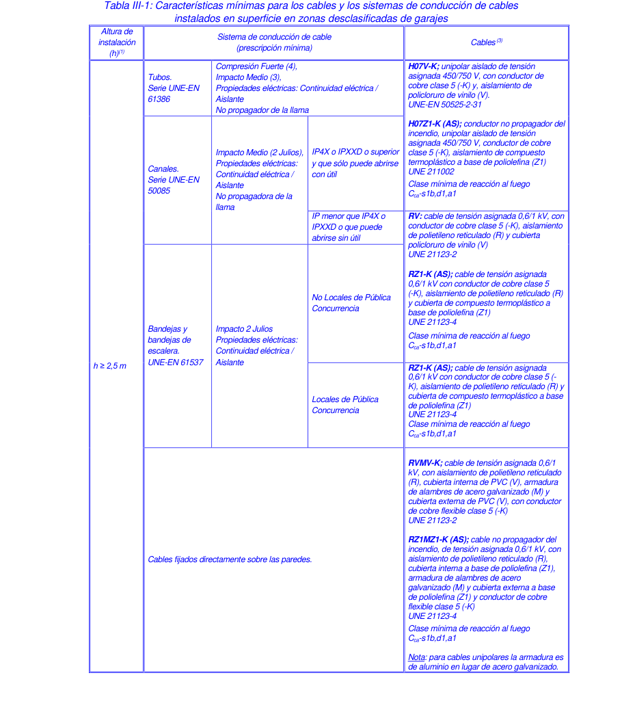

# BT-29. Instalaciones eléctricas de los locales con riesgo de incendio o explosión

ÍNDICE

- 1 CAMPO DE APLICACIÓN 1 — 2

- 2 TERMINOLOGÍA — 5

- 3 FUNDAMENTOS PARA ALCANZAR LA SEGURIDAD — 7

- 4 CLASIFICACIÓN DE EMPLAZAMIENTOS — 8

- 4.1 Clases de emplazamientos — 9

- 4.1.1 Zonas de emplazamientos clase I — 10

- 4.1.2 Zonas de emplazamientos clase II — 11

- 4.2 Ejemplos de emplazamientos peligrosos — 11

- 5 REQUISITOS DE LOS EQUIPOS — 12

- 6 PRESCRIPCIONES GENERALES — 13

- 6.1 Condiciones Generales — 13

- 6.2 Documentación — 14

- 6.3 Mantenimiento y reparación — 15

- 7 EMPLAZAMIENTOS DE CLASE I — 16

- 7.1 Generalidades — 16

- 7.2 Selección de equipos eléctricos (excluidos cables y conductos) — 16

- 7.3 Reglas de instalación de equipos eléctricos — 17

- 8 EMPLAZAMIENTOS DE CLASE II — 17

- 8.1 Generalidades — 17

- 8.2 Selección de equipos eléctricos (excluidos cables y conductos) — 17

- 8.3 Reglas de instalación de equipos eléctricos — 18

- 9 SISTEMAS DE CABLEADO — 18

- 9.1 Generalidades — 18

- 9.2 Requisitos de los cables — 19

- 9.3 Requisitos de los conductos — 23

### 1 CAMPO DE APLICACIÓN 1

La presente Instrucción tiene por objeto especificar las reglas esenciales para el diseño, ejecución, explotación, mantenimiento y reparación de las instalaciones eléctricas en emplazamientos en los que existe riesgo de explosión o de incendio debido a la presencia de sustancias inflamables para que dichas instalaciones y sus equipos no puedan ser, dentro de límites razonables, la causa de inflamación de dichas sustancias Dentro del concepto de atmósferas potencialmente explosivas se consideran aquellos emplazamientos en los que se fabriquen, procesen, manipulen, traten, utilicen o almacenen sustancias sólidas, líquidas o gaseosas, susceptibles de inflamarse, deflagrar, o explosionar, siendo sostenida la reacción por el aporte de oxígeno procedente del aire ambiente en que se encuentran. Debido a que son objeto de normativas específicas no se consideran incluidas en esta Instrucción las instalaciones eléctricas siguientes - Las instalaciones correspondientes a los equipos excluidos del campo de aplicación del R.D. 400/1996, de 1 de marzo, por el que se dictan las disposiciones de aplicación de la Directiva del Parlamento Europeo y del Consejo 94/9/CE, relativa a los aparatos y sistemas de protección para uso en atmósferas potencialmente explosivas. - Cualquier otro entorno que disponga de una reglamentación particular. En esta Instrucción sólo se consideran los riesgos asociados a la coexistencia en el espacio y tiempo de equipos e instalaciones eléctricas con atmósferas explosivas; para otras eventuales fuentes de ignición se aplicará lo dispuesto en las reglamentaciones pertinentes. Las instalaciones y equipos eléctricos en emplazamientos en los que hay riesgo simultáneo por sustancias inflamables de tipo gaseoso y pulverulento cumplirán los requisitos particulares de cada caso. Además de la situación anterior, así como en atmósferas enriquecidas en oxígeno, se pueden requerir medidas especiales en relación con lo aquí prescrito; estas medidas se justificarán en el Proyecto de la instalación.

1 El alcance de esta Instrucción, en el marco del Reglamento Electrotécnico para Baja Tensión, se limita a los equipos e instalaciones eléctricas de baja tensión, en atmósferas potencialmente explosivas. Se llama la atención sobre el hecho de que el R.D. 400/1996, por el que se dictan las disposiciones de aplicación de la Directiva 94/9/CE, sobre aparatos y sistemas de protección para uso en atmósferas potencialmente explosivas, afecta a todo tipo de instalaciones en atmósferas potencialmente explosivas, incluyendo aquellas manifestaciones energéticas de origen no eléctrico.

- La nota 1 a pie de página es singular en la reglamentación, pues ésta no suele ser informativa, sino simplemente preceptiva. En este caso, se pretende llamar la atención del lector sobre el hecho (que debería ser obvio) de que esta ITC solo es exigible en sus propios términos, es decir, dentro de los límites y condiciones establecidos en el Reglamento electrotécnico para baja tensión, aprobado por Real Decreto 842/2002 junto con sus instrucciones técnicas complementarias (ITCs): Eso quiere decir que esta ITC se aplica, como el Reglamento y las demás ITCs, únicamente a instalaciones eléctricas. En el caso de la ITC BT 29, tales instalaciones incluyen o pueden incluir materiales y equipos afectados por el Real Decreto 144/2016A (Directiva 2014/34/UE sobre ATEX), pero ese real decreto tiene un campo de aplicación propio, que no debe ser confundido con el de la ITC, de la misma manera que tampoco debe confundirse con el propósito y campo de aplicación del Real Decreto 681/2003, de 12 de junio, sobre la protección de la salud y la

A En referencia a las instalaciones anteriores al 20 de Abril del año 2016, se tendrá en cuenta la aplicación del R.D. 400/1996 (Directiva 94/9/CE ATEX).

seguridad de los trabajadores expuestos a los riesgos derivados de atmósferas explosivas en el lugar de trabajo. Por lo tanto, esta ITC no se aplica a las instalaciones: a) No eléctricas; b) Las que, siendo eléctricas, son de tensión superior a 1000 V en corriente alterna o superior a 1500 V en corriente continua (artículo 2.1 del Reglamento); c) Las correspondientes a equipos que, aún siendo eléctricos, el propio Real Decreto 144/2016 los declara excluidos de su ámbito de aplicación; d) A cualesquiera otras instalaciones, equipos o materiales sujetos a reglamentación específica.

- El Real Decreto 681/2003, de 12 de junio, sobre la protección de la salud y la seguridad de los trabajadores expuestos a los riesgos derivados de atmósferas explosivas en el lugar de trabajo requiere la protección de los trabajadores en amplia gama de supuestos, entre ellos cuando se utilizan las instalaciones eléctricas que son objeto de esta ITC, pero también en otro tipo de situaciones. Los conceptos, prescripciones y orientaciones de esta ITC y las de esta guía podrían considerarse útiles en supuestos análogos, siempre que no exista regulación específica y que se utilicen de forma coherente con la propia guíaB preparada por el Instituto Nacional de Seguridad e Higiene en el Trabajo para dicho real decreto.

- Asimismo, según establece el artículo 2.5 del Reglamento electrotécnico para baja tensión, las instalaciones eléctricas en locales con riesgo de incendio o explosión deben cumplir los requisitos de la presente ITC en todo lo que ésta sea específica, pero también deberán cumplir los requisitos que sean aplicables de las demás ITCs, salvo aquellos que se contradigan con la presente Instrucción. - En el ámbito de esta instrucción se entienden los conceptos de “aparato” y “equipo” como sinónimos.

- Hay que hacer notar que cuando se dice: “Debido a que son objeto de normativas específicas no se consideran incluidas en esta Instrucción las instalaciones eléctricas siguientes”: - Las instalaciones correspondientes a los equipos excluidos del campo de aplicación del R.D. 144/2016…”, la ITC-BT 29 se está refiriendo a las instalaciones correspondientes a los equipos, no a éstos mismos, los cuales se regulan por aquel Real Decreto y no por el REBT.

Por lo tanto, esta ITC no se aplica a las instalaciones correspondientes a: a) Los dispositivos médicos para uso en un entorno sanitario. b) Los aparatos y sistemas de protección cuando el peligro de explosión se deba exclusivamente a la presencia de sustancias explosivas o sustancias químicas inestables.

B Véase la página web del Instituto Nacional de Seguridad e Higiene en el Trabajo: http://www.insht.es/InshtWeb/Contenidos/Normativa/GuiasTecnicas/Ficheros/ATMÓSFERAS%20EXPLOSIVAS.pdf

c) Los equipos destinados a usos en entornos domésticos y no comerciales, donde las atmósferas potencialmente explosivas se crean muy rara vez, únicamente como consecuencia de una fuga fortuita de gas. d) Los equipos de protección individual que están regulados por el Real Decreto 1407/1992, de 20 de noviembre, modificado por el Real Decreto 159/1995, de 3 de febrero, de aplicación de la Directiva 89/686/CEE. e) Los navíos marinos y las unidades móviles «offshore», así como los equipos a bordo de dichos navíos o unidades. f) Los medios de transporte, es decir, los vehículos y sus remolques destinados únicamente al transporte de personas por vía aérea, red vial, red ferroviaria o vías acuáticas, y los medios de transporte, cuando estén concebidos para el transporte de mercancías por vía aérea, red vial pública, red ferroviaria o vías acuáticas. No estarán excluidos los vehículos destinados al uso en una atmósfera potencialmente explosiva. g) Los equipos contemplados en el párrafo b) del apartado 1 del artículo 223 del Tratado de Roma (vinculados a la seguridad de los Estados).

- Se entenderá como “entorno que disponga de una reglamentación particular” aquel cuya reglamentación contemple los requisitos particulares de la instalación eléctrica en atmósfera potencialmente explosiva y que no remita al presente reglamento. Como ejemplo cabe citar a las minas subterráneas cuya atmósfera explosiva es debida a la presencia de grisú; sin embargo, si aplicará la presente instrucción a aquellos emplazamientos de las minas donde existan gases distintos del grisú así como a sus instalaciones eléctricas en superficie.

- Se deberá prestar atención especial a los entornos donde se dan mezclas híbridas de gas, vapor o niebla junto con polvo combustible, ya que las características de sensibilidad y explosividad pueden resultar mucho más severas que las correspondientes al gas y al polvo por separado. En estos casos es aconsejable la determinación experimental de las características de explosión de la mezcla.C Los modos de protección normalizados no son, por lo general, válidos para este tipo de atmósferas. Deberán utilizarse equipos especiales en los que se haya evaluado su seguridad en la atmósfera particular.

C El informe técnico UNE-CLC TR 60079-33 trata de la protección de equipos e instalaciones en situaciones especiales, como las debidas a la presencia de mezclas híbridas.

### 2 TERMINOLOGÍA

A los efectos de la presente Instrucción se entenderá: Modo de protección: Conjunto de medidas específicas aplicadas a un equipo eléctrico para impedir la inflamación de una atmósfera explosiva que lo circunde Envolvente antideflagrante "d": Modo de protección en el que las partes que pueden inflamar una atmósfera explosiva están situadas dentro de una envolvente que puede soportar los efectos de la presión derivada de una explosión interna de la mezcla y que impide la transmisión de la explosión a la atmósfera explosiva circundante. Las reglas de este modo de protección se definen en la Norma UNE-EN 50.018. Inmersión en aceite "o": Modo de protección en el que el equipo eléctrico o partes de éste, se sumergen en un líquido de protección de modo que la atmósfera explosiva que pueda encontrarse sobre la superficie del líquido o en el entorno de la envolvente, no resulta inflamado. Las reglas de este modo de protección se definen en la norma UNE-EN 50.015. Seguridad intrínseca "i": Modo de protección que aplicado a un circuito o a los circuitos de un equipo hace que cualquier chispa o cualquier efecto térmico producido en condiciones normalizadas, lo que incluye funcionamiento normal y funcionamiento en condiciones de fallo especificadas, no sea capaz de provocar la inflamación de una determinada atmósfera explosiva. Las reglas de este modo de protección se definen en la norma UNE-EN 50.020. Sistema de seguridad intrínseca: Conjunto de materiales y equipos eléctricos interconectados entre sí, descritos en un documento, en el que los circuitos o partes de circuitos destinados a ser empleados en atmósferas con riesgo de explosión, son de seguridad intrínseca. Las reglas a que deben someterse estos sistemas se encuentran en la norma UNE- EN 50.039.

Además de estos modos de protección existen otros específicos para utilizar en atmósferas de gas (zonas 0, 1 y 2) y en atmósferas de polvo (zonas 20, 21 y 22), que se citan más adelante. La situación actual normativa supone un cambio con la adopción de las normas de la serie UNE- EN 60079-x, tanto para los modos de protección de gases y polvos, como las correspondientes a instalaciones (ver Anexos I y II).

<!-- tabla: ../tablas/BT-29_t01.csv -->

|  | Categoría de aparatos: Clasificación de los equipos eléctricos o no eléctricos establecida por |
|---|---|
|  | la Directiva 94/9/CE en función de la peligrosidad del emplazamiento en que se van a utilizar. |
|  | Dentro del Grupo II2 de aparatos se distinguen: |
|  | 2 No se consideran las categorías del Grupo I por pertenecer a un entorno reglamentario- |
|  | minas- distinto a este. |
|  | Categoría 1: Aparatos diseñados para que puedan funcionar dentro de los parámetros |
|  | operativos determinados por el fabricante y asegurar un nivel de protección muy alto |

Los modos de protección típicos que proporcionan esta categoría son: - Aparatos y sistemas de seguridad intrínseca con nivel de protección ‘ia’ para gases y polvos - Encapsulado ‘ma’ (gases y polvos) - Protección por envolvente ‘ta’ (polvo) - Equipos con doble modo de protección conformes con la norma UNE-EN 60079-26 - Cabezales de sensores de gases antideflagrantes “da”

<!-- tabla: ../tablas/BT-29_t02.csv -->

|  | Categoría 2: Aparatos diseñados para poder funcionar en las condiciones prácticas fijadas |
|---|---|
|  | por el fabricante y asegurar un alto nivel de protección. |

Los modos de protección típicos que proporcionan esta categoría son: - Envolvente antideflagrante ‘db’ (gases) - Sobrepresión interna ‘pxb’ o ‘pyb ’(gases y polvos) - Relleno pulverulento ‘qb’(gases) - Inmersión en aceite ‘ob” (gases)’ - Seguridad aumentada ‘eb’ (gases) - Encapsulado ‘mb’ (gases y polvos) - Aparatos y sistemas de seguridad intrínseca con nivel de protección ‘ib’ (gases y polvos) - Protección por envolvente ‘tb’(polvos)

<!-- tabla: ../tablas/BT-29_t03.csv -->

|  | Categoría 3: Aparatos diseñados para poder funcionar en las condiciones prácticas fijadas por |
|---|---|
|  | el fabricante y asegurar un nivel normal de protección. |

Los modos de protección típicos que proporcionan esta categoría son - Envolvente antideflagrante ‘dc’ (gases) - Sobrepresión interna ‘pzc’ (gases y polvos) - Seguridad aumentada ‘ec’ (gases) - Encapsulado ‘mc’ (gases y polvos) - Aparatos y sistemas de seguridad intrínseca con nivel de protección ‘ic’ (gases y polvos) - Protección por envolvente ‘tc’ (polvos)

<!-- tabla: ../tablas/BT-29_t04.csv -->

|  | Declaración CE de conformidad: Documento emitido por el fabricante, o por su |
|---|---|
|  | representante legal, por el que se afirma que un determinado aparato, sistema o componente |
|  | cumple todas las prescripciones de la directiva o directivas aplicables. |

Esta declaración deberá realizarse para los productos afectados por el R.D. 144/2016 (Directiva 2014/34/UE). La citada declaración, junto con el manual de instrucciones, ambos al menos en castellano, son los dos únicos documentos obligatorios que el fabricante o mandatario está obligado a entregar con el producto, además de realizar sobre el mismo el marcado CE y el complementario. El contenido mínimo de la declaración UE de conformidad, de acuerdo con el R.D. 144/2016, Anexo X será:

1. Modelo de producto/producto (producto, tipo, lote, o número de serie): 2. Nombre y dirección del fabricante y, en su caso, de su representante autorizado:

### 3. La presente declaración de conformidad se expide bajo la exclusiva responsabilidad

del fabricante.

### 4. Objeto de la declaración (identificación del producto que permita su trazabilidad; si

fuera necesario para la identificación del producto, podrá incluirse una imagen):

### 5. El objeto de la declaración descrita anteriormente es conforme con la legislación de

armonización pertinente de la Unión Europea:

### 6. Referencias a las normas armonizadas pertinentes utilizadas, o referencias a las otras

especificaciones técnicas respecto a las cuales se declara la conformidad:

### 7. Si procede, el organismo notificado… (nombre, número) … ha efectuado …

(descripción de la intervención) … y expide el certificado: … 8. Información adicional: Firmado en nombre de: (Lugar y fecha de expedición): (Nombre, cargo) (firma):

Para equipos de categorías 1 y 2, denominación, número de identificación y domicilio del organismo notificado que interviene en el procedimiento y número del certificado de examen UE de tipo.D No es de aplicación la declaración UE de conformidad el caso de los componentes a que se refiere la definición del artículo 2,c del R.D. 144/2016; en su lugar, el fabricante o mandatario debe suministrar un certificado que declare la conformidad de dichos componentes con las disposiciones pertinentes de la Directiva 2014/34/UE y que indique las características de dichos componentes y las condiciones de incorporación a un aparato o sistema de protección.

La Comisión Europea ha editado una Guía sobre la Directiva 2014/34/UE E. Las orientaciones sobre los documentos de conformidad figuran en el artículo 14 de la misma.

<!-- tabla: ../tablas/BT-29_t05.csv -->

|  | 3 FUNDAMENTOS PARA ALCANZAR LA SEGURIDAD |
|---|---|
|  | El procedimiento para alcanzar un nivel de seguridad aceptable se fundamenta en el empleo |
|  | de equipamiento construido y seleccionado de acuerdo a ciertas reglas así como en la |
|  | adopción de medidas de seguridad especiales de instalación, inspección, mantenimiento y |
|  | reparación, en relación con la acotación del riesgo de presencia de atmósfera explosiva |
|  | mediante una clasificación de los emplazamientos en los que se pueden producir atmósferas |
|  | explosivas. |
|  | Según la clasificación en que se incluye el emplazamiento, es necesario recurrir a un tipo |
|  | determinado de medidas constructivas de los equipos, de instalación, supervisión o |
|  | intervención, como se detalla en la presente Instrucción y normas que en ella se citan. |
|  | Adicionalmente, es preciso llevar a cabo la explotación, conservación y mantenimiento de la |
|  | instalación y sus componentes, dentro de unos límites estrictos, para que las condiciones de |
|  | seguridad no se vean comprometidas durante su vida útil |

Es de aplicación el R.D. 681/2003 (Directiva 1999/92/CE) cuyos principios de seguridad se basan en tres objetivos principales:

D Nótese que, salvo para certificados de verificación por unidad, existen dos tipos de documentos emitidos por un organismo notificado: el certificado de examen UE de tipo y otro correspondiente a uno de los módulos de control de calidad; esto puede suponer la intervención de dos organismos notificados diferentes, uno para la fase de diseño (certificación) y otro para la fase de fabricación (notificación del sistema de calidad del fabricante) Ehttps://ec.europa.eu/docsroom/documents/26861 (válido a fecha de la versión de esta guía)

- Impedir la formación de atmósferas explosivas - Cuando la naturaleza de la actividad no lo permita evitar la ignición de la atmósfera explosiva - Atenuar los efectos perjudiciales de una explosión de forma que se garantice la salud y seguridad de los trabajadores Se deberá elaborar el “Documento de Protección contra Explosiones” requerido en dicho R.D.

<!-- tabla: ../tablas/BT-29_t06.csv -->

|  | 4 CLASIFICACIÓN DE EMPLAZAMIENTOS |
|---|---|
|  | Para establecer los requisitos que han de satisfacer los distintos elementos constitutivos de la |
|  | instalación eléctrica en emplazamientos con atmósferas potencialmente explosivas, estos |
|  | emplazamientos se agrupan en dos clases según la naturaleza de la sustancia inflamable, |
|  | denominadas como Clase I si el riesgo es debido a gases, vapores o nieblas y como Clase II |
|  | si el riesgo es debido a polvo. |
|  | En las anteriores clases se establece una subdivisión en zonas según la probabilidad de |
|  | presencia de la atmósfera potencialmente explosiva. |

Si como análisis previo, según establece el R.D. 681/2003, se determina que el riesgo de explosión en la instalación persiste, se debe entonces clasificar el emplazamiento con la finalidad de delimitarlo y poder tomar las acciones necesarias de prevención y protección. La clasificación de emplazamientos se realizará considerando la instalación en funcionamiento normal, es decir, no se consideran los escapes que se originen en situaciones catastróficas como la rotura de una tubería o recipiente. El objetivo de la clasificación por zonas es doble: - Precisar las categorías del equipo utilizado y su instalación en las zonas indicadas, a condición de que éstas estén adaptadas a los gases, vapores o niebla y/o polvo; - Señalar las limitaciones de acceso, de la ejecución de trabajos y selección de materiales con fuente de ignición no cubiertos por esta instrucción. La clasificación de un entorno requiere, como mínimo, la realización de: - Lista de sustancias y sus características relacionadas con la explosión - Lista de fuentes de escape indicando sus parámetros - Plano de áreas peligrosas

<!-- tabla: ../tablas/BT-29_t07.csv -->

|  | La clasificación de emplazamientos se llevará a cabo por un técnico competente que |
|---|---|
|  | justificarán los criterios y procedimientos aplicados. Esta decisión tendrá preferencia sobre las |
|  | interpretaciones literales o ejemplos que figuran en los textos y figuras de los documentos de |
|  | referencia que se citan para establecer esta clasificación. |

Dado que las instalaciones eléctricas de los locales con riesgo de incendio o explosión, según la ITC-BT-04, requieren de un proyecto, la clasificación de los emplazamientos será realizada por el técnico titulado competente que elabora el proyecto.

#### 4.1 Clases de emplazamientos

Los emplazamientos se agrupan como sigue: Clase I: Comprende los emplazamientos en los que hay o puede haber gases, vapores o nieblas en cantidad suficiente para producir atmósferas explosivas o inflamables; se incluyen en esta clase los lugares en los que hay o puede haber líquidos inflamables. Clase II: Comprende los emplazamientos en los que hay o puede haber polvo inflamable.

Clase I: Los datos relevantes de las sustancias de la clase I se enumeran en la norma UNE-EN 60079- 10-1, y entre estos datos se requiere conocer: - Estado físico de la sustancia - Si el sistema de contención es abierto o cerrado - Punto de inflamación y de ebullición - Densidad relativa del gas o vapor - Temperatura de ignición - Límites de explosión, inferior y superior - Presión de vapor - Subgrupo (IIA, IIB o IIC) - Ventilación: tipo, grado y disponibilidad Los datos de las sustancias mas comunes pueden encontrarse en la norma UNE-EN 60079-20- 1, aunque es válida cualquier otra fuente información y, en su caso, determinación por ensayo.

Clase II: La clase II incluye polvos y fibras inflamables, en general sustancias sólidas que pueden ponerse en suspensión y que se depositan por su propio peso. Bajo esta definición cabe considerar tamaños de partículas inferiores a 1 mm. Es necesario recopilar los datos de las sustancias del entorno particular, tales como: - Granulometría - Humedad - Temperatura de inflamación (en capa y en nube) - Conductividad eléctrica - Concentración mínima explosiva - Energía mínima de inflamación - Presión máxima de explosión y velocidad máxima de aumento de presión (K ) max A diferencia de la Clase I, los datos de estas sustancias dependen mucho de las características particulares del proceso y de la propia sustancia (distribución granulométrica, humedad, etc.). Aunque existen datos de muchas sustancias se recomienda la determinación experimental de las características explosivas. Se establecen tres subgrupos para las sustancias de clase II: - IIIA fibras - IIIB polvos no conductores - IIIC polvos conductores

<!-- tabla: ../tablas/BT-29_t08.csv -->

|  | 4.1.1 Zonas de emplazamientos clase I |
|---|---|
|  | Se distinguen: |
|  | Zona 0: Emplazamiento en el que la atmósfera explosiva constituida por una mezcla de aire |
|  | de sustancias inflamables en forma de gas, vapor o niebla, está presente de modo |
|  | permanente, o por un espacio de tiempo prolongado, o frecuentemente. |
|  | Zona 1: Emplazamiento en el que cabe contar, en condiciones normales de funcionamiento, |
|  | con la formación ocasional de atmósfera explosiva constituida por una mezcla con aire de |
|  | sustancias inflamables en forma de gas, vapor o niebla. |
|  | Zona 2: Emplazamiento en el que no cabe contar, en condiciones normales de funcionamiento, |
|  | con la formación de atmósfera explosiva constituida por una mezcla con aire de sustancias |
|  | inflamables en forma de gas, vapor o niebla o, en la que , en caso de formarse, dicha atmósfera |
|  | explosiva sólo subsiste por espacios de tiempo muy breves. |
|  | En la Norma UNE-EN 60079-10 se recogen reglas precisas para establecer zonas en |
|  | emplazamientos de Clase I. |

Para la clasificación de emplazamientos de clase I deberá seguirse la norma UNE-EN 60079-10- 1F.

En cualquier caso, es necesario tomar precauciones cuando las zonas solapadas conciernen a sustancias inflamables que tienen diferente subgrupo y/o clase de temperatura. Así, por ejemplo, si una zona 1 con un gas de subgrupo IIA y clase de temperatura T3 se solapa por una zona 2 con un gas IIC T1 la clasificación de la zona solapada será zona 1 con características IIC T3. Es decir, se tomarán las características más restrictivas para la zona solapada.

F Un documento de gran ayuda para la clasificación de emplazamientos de Clase I es el informe UNE 202007 IN: Clasificación de emplazamientos peligrosos. (Proviene de la Norma Italiana CEI 31-35)

##### 4.1.2 Zonas de emplazamientos clase II

Se distinguen: Zona 20: Emplazamiento en el que la atmósfera explosiva en forma de nube de polvo inflamable en el aire está presente de forma permanente, o por un espacio de tiempo prolongado, o frecuentemente. Las capas en sí mismas no constituyen una zona 20. En general estas condiciones se dan en el interior de conducciones, recipientes, etc. Los emplazamientos en los que hay capas de polvo pero no hay nubes de forma continua o durante largos períodos de tiempo, no entran en este concepto. Zona 21: Emplazamientos en los que cabe contar con la formación ocasional, en condiciones normales de funcionamiento, de una atmósfera explosiva, en forma de nube de polvo inflamable en el aire. Esta zona puede incluir entre otros, los emplazamientos en la inmediata vecindad de, por ejemplo, lugares de vaciado o llenado de polvo. Zona 22: Emplazamientos en el que no cabe contar, en condiciones normales de funcionamiento, con la formación de una atmósfera explosiva peligrosa en forma de nube de polvo inflamable en el aire o en la que, en caso de formarse dicha atmósfera explosiva, sólo subsiste por breve espacio de tiempo. Esta zona puede incluir, entre otros, entornos próximos de sistemas conteniendo polvo de los que puede haber fugas y formar depósitos de polvo. En la Norma CEI 61241-3 se recogen reglas para establecer zonas en emplazamientos de Clase II.

Para la clasificación de emplazamientos de clase II deberá seguirse la norma UNE-EN 60079- 10-2 (ver anexo I) G)

<!-- tabla: ../tablas/BT-29_t09.csv -->

|  | 4.2 Ejemplos de emplazamientos peligrosos |
|---|---|
|  | A título orientativo, sin que esta lista sea exhaustiva, y salvo que el proyectista pueda justificar |
|  | que no existe el correspondiente riesgo, son ejemplos de emplazamientos peligrosos: |

Debe considerarse que en todas aquellas instalaciones donde se manipulen o almacenen sustancias inflamables es difícil asegurar que nunca van a aparecer atmósferas explosivas. Por lo tanto se considerarán como emplazamientos peligrosos, salvo que por clasificación de zonas se demuestre lo contrario, bien porque se demuestra que no hay cantidad suficiente, porque no hay fuentes de escape o, bien, porque la extensión de las zonas es despreciable.

<!-- tabla: ../tablas/BT-29_t10.csv -->

|  | De Clase I: |
|---|---|
|  | - Lugares donde se trasvasen líquidos volátiles inflamables de un recipiente a otro. |
|  | - Garajes y talleres de reparación de vehículos. Se excluyen los garajes de uso privado |
|  | para estacionamiento de 5 vehículos o menos. |

G) Una fuente de información para localizar datos de sustancias de clase II es la base de datos GESTIS de IFA: https://www.dguv.de/ifa/gestis/gestis-stoffdatenbank/index-2.jsp (válido a fecha de la versión de esta guía)

- Interior de cabinas de pintura donde se usen sistemas de pulverización y su entorno cercano cuando se utilicen disolventes. - Secaderos de material con disolventes inflamables. - Locales de extracción de grasas y aceites que utilicen disolventes inflamables. - Locales con depósitos de líquidos inflamables abiertos o que se puedan abrir. - Zonas de lavanderías y tintorerías en las que se empleen líquidos inflamables. - Salas de gasógenos. - Instalaciones donde se produzcan, manipulen, almacenen o consuman gases inflamables. - Salas de bombas y/o de compresores de líquidos y gases inflamables. - Interiores de refrigeradores y congeladores en los que se almacenen materias inflamables en recipientes abiertos, fácilmente perforables o con cierres poco consistentes.

Para garajes véase Anexo III.

<!-- tabla: ../tablas/BT-29_t11.csv -->

|  | De Clase II: |
|---|---|
|  | - Zonas de trabajo, manipulación y almacenamiento de la industria alimentaria que |
|  | maneja granos y derivados. |
|  | - Zonas de trabajo y manipulación de industrias químicas y farmacéuticas en las que se |
|  | produce polvo. |
|  | - Emplazamientos de pulverización de carbón y de su utilización subsiguiente. |
|  | - Plantas de coquización. |
|  | - Plantas de producción y manipulación de azufre. |
|  | - Zonas en las que se producen, procesan, manipulan o empaquetan polvos metálicos |
|  | de materiales ligeros (Al, Mg, etc.). |
|  | - Almacenes y muelles de expedición donde los materiales pulverulentos se almacenan |
|  | o manipulan en sacos y contenedores. |
|  | - Zonas de tratamiento de textiles como algodón, etc. |
|  | - Plantas de fabricación y procesado de fibras. |
|  | - Plantas desmotadoras de algodón. |
|  | - Plantas de procesado de lino. |
|  | - Talleres de confección. |
|  | - Industria de procesado de madera tales como carpinterías, etc. |

<!-- tabla: ../tablas/BT-29_t12.csv -->

|  | 5 REQUISITOS DE LOS EQUIPOS |
|---|---|
|  | Los equipos eléctricos y los sistemas de protección y sus componentes destinados a su |
|  | empleo en emplazamientos comprendidos en el ámbito de ésta Instrucción, deberán cumplir |
|  | las condiciones que se establecen en el R.D. 400/1996 de 1 de Marzo. |

Los reglamentos son obligatorios desde la fecha que se indica en las correspondientes disposiciones que los aprueban. Habitualmente, carecen de efectos retroactivos. Con carácter general, esta ITC establece que se utilicen en las instalaciones productos conformes con el Real Decreto 144/2016, el cual fue obligatorio a partir de 20 de abril de 2016

para los nuevos productos fabricados en los Estados miembros de la Unión Europea y para los nuevos y usados introducidos en la Unión Europea desde terceros países. Otros equipos, instalados o almacenados en las instalaciones del usuario final, adquiridos con anterioridad a la fecha indicada y que no cumplan los requisitos de dicho real decreto (aunque amparados por la legislación vigente en el momento de su adquisición, basados en modos de protección adecuados) solamente podrán usarse en las instalaciones realizadas de acuerdo a esta ITC siempre que se justifique en la documentación técnica de la instalación su seguridad y su adecuada instalación de acuerdo a lo previsto en el artículo 23.1,b) del Reglamento (aplicación de técnicas de seguridad equivalentes).

<!-- tabla: ../tablas/BT-29_t13.csv -->

|  | Para aquellos elementos que no entran en el ámbito del mencionado R.D. 400/1996 y para los |
|---|---|
|  | que se estipule el cumplimiento de una norma, se considerarán conformes con las |
|  | prescripciones de la presente Instrucción aquellos que estén amparados por las |
|  | correspondientes certificaciones de conformidad otorgadas por Organismos de control |
|  | autorizados según lo dispuesto en el R. D. 2200/1995, de 28 de diciembre |

<!-- tabla: ../tablas/BT-29_t14.csv -->

|  | 6 PRESCRIPCIONES GENERALES |
|---|---|
|  | En todo lo que aquí no se indique explícitamente son de aplicación, en lo que corresponda, |
|  | las demás Instrucciones de este Reglamento; caso de conflicto predominará la interpretación |
|  | correspondiente a esta Instrucción. |
|  | 6.1 Condiciones Generales |
|  | En la medida de lo posible, los equipos eléctricos se ubicarán en áreas no peligrosas. Si esto |
|  | no es posible, la instalación se llevará a cabo donde exista menor riesgo. |
|  | Los equipos eléctricos se instalarán de acuerdo con las condiciones de su documentación |
|  | particular, se pondrá especial cuidado en asegurar que las partes recambiables, tales como |
|  | lámparas, sean del tipo y características asignadas correctas. Las inspecciones de las |
|  | instalaciones objeto de esta Instrucción se realizarán según lo establecido en la norma UNE- |
|  | EN 60079-17. |

No deben confundirse las inspecciones contempladas en la norma UNE-EN 60079-17 con las inspecciones prescritas en la ITC BT 05. La primeras son inspecciones técnicas internas, que deben realizarse siguiendo los procedimientos operativos que a modo informativo se recogen en la norma UNE-EN 60079-17 (gases y polvos). La realización de estas Inspecciones Técnicas corresponde al empresario (la propiedad), con sus propios recursos o con la concurrencia de cualquier entidad o empresa que considere oportuno, ya que es de su absoluta competencia y responsabilidad. Es en este entorno, donde las variaciones en la frecuencia de las inspecciones y la metodología seguida, pueden supeditarse a la experiencia previa en el comportamiento de los equipos eléctricos y las instalaciones eléctricas, pudiéndose aplicar procedimientos de supervisión continua. Las inspecciones que se establecen en la ITC-BT-05 son inspecciones administrativas, tanto inicial como periódica, que deben ser efectuadas por un organismo de control acreditado por ENAC para la actividad, de acuerdo con el Reglamento de la Infraestructura para la Calidad y Seguridad Industrial (Inicialmente aprobado por Real Decreto 2200/1995, de 28 de diciembre). En estas inspecciones administrativas el organismo de control aplicará el procedimiento que considere más adecuado, pudiendo tomar como referencia el establecido en las normas UNE- EN 60079-17 y/o teniendo en consideración las inspecciones técnicas realizadas por la propiedad.

<!-- tabla: ../tablas/BT-29_t15.csv -->

|  | En el caso de circunstancias excepcionales, como por ejemplo, ciertas tareas de reparación |
|---|---|
|  | que precisan soldadura, trabajos de investigación y desarrollo (operación en plantas piloto, |
|  | realización de trabajos experimentales etc) no será necesario que se reúnan todos los |
|  | requisitos de los capítulos 6, 7 y 8 siguientes, supuesto que la instalación va a estar en |
|  | operación solo durante un periodo limitado, está bajo la supervisión de personal especialmente |
|  | formado, y se reúnen las siguientes condiciones: |
|  | - Se han tomado medidas para prevenir la aparición de atmósferas explosivas |
|  | peligrosas. |
|  | - Se han tomado medidas para asegurar que el equipo eléctrico se desconecta en caso |
|  | de formación de una atmósfera peligrosa. |
|  | - Se han tomado medidas para asegurar que las personas no van a resultar dañadas |
|  | por incendios o explosiones. |
|  | y adicionalmente, estas medidas se han comunicado por escrito a personal que está |
|  | familiarizado con los requisitos de esta Instrucción y con las normas que tratan de equipos e |
|  | instalaciones en lugares con riesgo de explosión y tienen acceso a toda la información |
|  | necesaria para llevar a cabo la actuación. |
|  | Para llevar a cabo estas operaciones será necesaria la previa elaboración de un permiso |
|  | especial de trabajo autorizado por el responsable de la planta o instalación. |
|  | 6.2 Documentación |
|  | Para instalaciones nuevas o ampliaciones de las existentes, en el ámbito de aplicación de la |
|  | presente ITC, se incluirá la siguiente información (según corresponda) en el proyecto de la |
|  | instalación: |
|  | - Clasificación de emplazamientos y plano representativo. |
|  | - Adecuación de la categoría de los equipos a los diferentes emplazamientos y zonas. |
|  | - Instrucciones de implantación, instalación y conexión de los aparatos y equipos. |
|  | - Condiciones especiales de instalación y utilización. |
|  | El propietario deberá conservar: |
|  | - Copia del proyecto en su forma definitiva. |
|  | - Manual de instrucciones de los equipos. |
|  | - Declaraciones de Conformidad de los equipos. |
|  | - Documentos descriptivos del sistema para los de seguridad intrínseca. |
|  | - Todo documento que pueda ser relevante para las condiciones de seguridad. |

Lo anteriormente indicado es una parte de lo que debe contener el proyecto requerido por la instrucción BT-04. Además del proyecto se debe realizar el “documento de protección contra explosiones -DCPE-” indicado en el art. 8 del RD 681/2003.

Tanto para inspecciones iniciales como periódicas de este tipo de instalaciones según los criterios establecidos en la ITC BT 05, es preceptivo disponer del citado documento de clasificación de emplazamientos el cual contenga la información referida en el punto 6.2 de la ITC BT 29, o bien la preceptiva indicada en su propia reglamentación (p.e. garajes ejecutados con el D. 2413/1973 con los criterios de las hojas de interpretación 12A y 12B, estaciones de

servicio en las que le sea de aplicación los preceptos de la instrucción técnica IP04 del Reglamento de instalaciones petrolíferas con R.D. 2085/1994, etc.

<!-- tabla: ../tablas/BT-29_t16.csv -->

|  | 6.3 Mantenimiento y reparación |
|---|---|
|  | Las instalaciones objeto de esta instrucción se someterán a un mantenimiento que garantice |
|  | la conservación de las condiciones de seguridad. Como criterio al respecto, se seguirá lo |
|  | establecido en la norma UNE-EN 60079-17. |

Dentro del contexto correspondiente al mantenimiento de las condiciones técnicas de seguridad durante la vida útil de la instalación, se seguirán las actuaciones de inspección y mantenimiento técnico que deben realizarse en las instalaciones. Los procedimientos indicados en estas normas son orientativos, no obligatorios, sirven de guía para que la propiedad pueda confeccionarse sus propios procedimientos que se adecuen a la instalación a inspeccionar.

<!-- tabla: ../tablas/BT-29_t17.csv -->

|  | La reparación de equipos y sistemas de protección deberán ser llevados a cabo de forma que |
|---|---|
|  | no comprometa la seguridad. Como criterio técnico se seguirá lo establecido en la norma CEI |
|  | 60079-19. |

Las normas UNE-EN 60079-17 y UNE-EN 60079-19 establecen una serie de requisitos a seguir por las entidades mantenedoras y reparadoras ya sean externas o internas a la propiedad de la instalación. Dado que la responsabilidad de uso seguro de dicha instalación es de la propiedad de la misma, sería procedente y recomendable que ésta, exigiese/solicitase que estas entidades mantenedoras y reparadoras dispusiesen de acreditación necesaria que validase la capacidad y competencia técnica de las personas para la ejecución de estos trabajos.

### 7 EMPLAZAMIENTOS DE CLASE I

#### 7.1 Generalidades

Estas instalaciones eléctricas se ejecutarán de acuerdo a lo especificado en la norma UNE- EN 60.079 –14, salvo que se contradiga con lo indicado en la presente Instrucción, la cual prevalecerá sobre la norma.

#### 7.2 Selección de equipos eléctricos (excluidos cables y conductos)

Para seleccionar un equipo eléctrico el procedimiento a seguir comprende las siguientes fases:

1) Caracterizar la sustancia o sustancias implicadas en el proceso. 2) Clasificar el emplazamiento en el que se va a instalar el equipo 3) Seleccionar los equipos eléctricos de tal manera que la categoría esté de acuerdo a las limitaciones de la tabla 1 y que éstos cumplan con los requisitos que les sea de aplicación, establecidos en la norma UNE EN 60079-14. Si la temperatura ambiente prevista no está en el rango comprendido entre -20 ºC y +40 ºC el equipo deberá estar marcado para trabajar en el rango de temperatura correspondiente. 4) Instalar el equipo de acuerdo con las instrucciones del fabricante.

Deben recopilarse las características de las sustancias peligrosas existentes en el proceso, como por ejemplo: Temperatura de ignición, LIE, Grupo de gases, etc. Cuando aplique, seleccionar el equipo en función de la sustancia concreta o su grupo de gases, como sigue:

<!-- tabla: ../tablas/BT-29_t18.csv -->

| Equipo diseñado para sustancias del subgrupo: | Subgrupos de sustancias peligrosas: |
|---|---|
| II A | II A |
| II B | II A y II B |
| II C | II A, II B y II C |

Asociar la clase térmica del equipo (en forma de T1 a T6 o su temperatura máxima determinada por ensayo), con la temperatura de ignición de la sustancia peligrosa, para ello seguir las instrucciones indicadas en la norma UNE-EN 60079-14. Adicionalmente tener en cuenta que en ciertos casos el equipo requiere condiciones especiales para una segura utilización que de haberlas, deben de estar en el manual de instrucciones de uso del mismo. Estas condiciones especiales además se denotan por un símbolo “X” a continuación del código del marcado.

<!-- tabla: ../tablas/BT-29_t19.csv -->

|  | Tabla 1: Categorías de equipos admisibles para atmósfera de gases y vapores. |  |
|---|---|---|
|  | Categoría del equipo | Zonas en que se admiten |
|  | Categoría 1 | 0, 1 y 2 |
|  | Categoría 2 | 1 y 2 |
|  | Categoría 3 | 2 |

#### 7.3 Reglas de instalación de equipos eléctricos

La instalación de los equipos eléctricos se realizará de acuerdo a lo especificado en la norma UNE-EN 60079-14. Adicionalmente se tendrá en cuenta que la utilización de equipos con modo de protección por inmersión en aceite "o" queda restringida a equipos de instalación fija y que no tengan elementos generadores de arco en el seno del líquido de protección. Para la instalación de sistemas de seguridad intrínseca, se tendrá en cuenta también, lo indicado en la Norma UNE-EN 50039.

La norma para los sistemas de seguridad intrínseca es actualmente UNE-EN 60079-25 y se recoge parcialmente en la norma general de instalaciones eléctricas para atmósferas explosivas UNE-EN 60079-14. Tal como se indica en el apartado 6.2 de la presente instrucción los sistemas de seguridad intrínseca deberán de ser evaluados reflejando los resultados de tal evaluación en el denominado “documento descriptivo del sistema de seguridad intrínseca”. Este documento formará parte del “documento de protección contra explosiones”. El documento del sistema es, en general, realizado por el instalador y mantenido por la propiedad.

<!-- tabla: ../tablas/BT-29_t20.csv -->

|  | 8 EMPLAZAMIENTOS DE CLASE II |
|---|---|
|  | 8.1 Generalidades |
|  | Estas instalaciones se ejecutarán de acuerdo a lo especificado en la norma EN 50281-1-2, |
|  | salvo que contradiga con lo indicado en la presente Instrucción, la cual prevalecerá sobre la |
|  | norma. |

La norma existente a la fecha de esta guía para instalaciones en emplazamiento de clase II es la UNE-EN 60079-14 en sustitución de la mencionada EN 50281-1-2. (Para la relación de normas relacionadas véase el Anexo II de esta Guía-BT)

<!-- tabla: ../tablas/BT-29_t21.csv -->

|  | 8.2 Selección de equipos eléctricos (excluidos cables y conductos) |
|---|---|
|  | Para seleccionar un equipo eléctrico el procedimiento a seguir comprende las siguientes fases: |
|  | 1) Caracterizar la sustancia o sustancias implicadas en el proceso. |

Recopilar las características de las sustancias peligrosas existentes en el proceso, como por ejemplo: Temperatura de ignición en capa y en nube, Concentración mínima explosiva, Kmax, St, etc. Asociar la clase térmica del equipo (en forma de su temperatura máxima superficial determinada por ensayo), con la temperatura de ignición de la sustancia peligrosa en forma de nube o de capa, para ello seguir las instrucciones indicadas en la norma UNE-EN 60079-14.

<!-- tabla: ../tablas/BT-29_t22.csv -->

|  | 2) Clasificar el emplazamiento en el que se va a instalar el equipo |
|---|---|
|  | 3) Seleccionar los equipos eléctricos de tal manera que la categoría esté de acuerdo a |
|  | las limitaciones de la tabla 2 y que éstos cumplan con los requisitos que les sea de |
|  | aplicación, establecidos en la norma EN 50281-1-2. |

Disponer de la categoría del equipo según el emplazamiento peligroso, ver tabla 2.

4) Instalar el equipo de acuerdo con las instrucciones del fabricante.

Adicionalmente tener en cuenta que en ciertos casos el equipo requiere condiciones especiales para una segura utilización que de haberlas, deben de estar en el manual de instrucciones. Estas condiciones especiales además se indican con un símbolo “X” a continuación del código del marcado.

Tabla 2: Categorías de equipos admisibles para atmósferas con polvo explosivo.

<!-- tabla: ../tablas/BT-29_t23.csv -->

| Categoría del equipo | Zonas en que se admiten |
|---|---|
| Categoría 1 | 20, 21 y 22 |
| Categoría 2 | 21 y 22 |
| Categoría 3 | 22 |

Cuando el polvo inflamable sea conductor de la electricidad los requisitos de los equipos en zona 22 serán los de la Tabla 1 de la UNE-EN 60079-14.

<!-- tabla: ../tablas/BT-29_t24.csv -->

|  | 8.3 Reglas de instalación de equipos eléctricos |
|---|---|
|  | La instalación de los equipos eléctricos destinados a emplazamientos de clase II se hará de |
|  | acuerdo con lo especificado en la norma EN 50281-1-2. |
|  | Es necesario tener presente que si un equipo eléctrico dispone de un modo de protección para |
|  | gases, no garantiza que su protección sea adecuada contra el riesgo de inflamación de polvo. |

La norma actual para instalaciones en emplazamiento de clase II es UNE-EN 60079-14 en sustitución de la mencionada EN 50281-1-2. (Para la relación de normas relacionadas véase el Anexo II de esta Guía-BT) Los equipos para Clase I (gases), pueden usarse en Clase II (polvos inflamables), siempre y cuando, adicionalmente estén debidamente evaluados de acuerdo con los requisitos particulares de esta Clase II. Por ejemplo, una envolvente antideflagrante será adecuada para polvos inflamables si dispone, adicionalmente, de un modo de protección por envolvente “t”.

<!-- tabla: ../tablas/BT-29_t25.csv -->

|  | 9 SISTEMAS DE CABLEADO |
|---|---|
|  | 9.1 Generalidades |
|  | Para instalaciones de seguridad intrínseca, los sistemas de cableado cumplirán los requisitos |
|  | de la norma UNE-EN 60079-14 y de la norma UNE-EN 50039 |

Instalaciones de seguridad intrínseca La norma UNE-EN 50039 ha sido reemplazada por la UNE-EN 60079-25. Los circuitos eléctricos que integran los sistemas de cableado podrán ser utilizados en Zona 0 y 20 si están de acuerdo con los requisitos establecidos por las normas UNE EN 60079-14 y UNE- EN 60079-25 siempre que correspondan a circuitos de seguridad intrínseca de categoría 1. No obstante, un circuito de seguridad intrínseca en el que se combinen o puedan combinarse (por cableado) más de dos aparatos de categoría 1, el resultado global por defecto es categoría 2 para todos ellos. Solo un análisis detallado por un experto podría justificar el mantenimiento de la categoría. Se llama la atención a las disposiciones especiales para la conexión y puesta a tierra así como la instalación de dispositivos de descarga de sobretensiones.”

El resto de las exigencias incluidas en el apartado 9 de esta GUIA-BT y sus subapartados no son de aplicación a instalaciones de seguridad intrínseca.

<!-- tabla: ../tablas/BT-29_t26.csv -->

|  | Los cables para el resto de las instalaciones tendrán una tensión mínima asignada de |
|---|---|
|  | 450/750 V. |
|  | Las entradas de los cables y de los tubos a los aparatos eléctricos se realizarán de acuerdo |
|  | con el modo de protección previsto. Los orificios de los equipos eléctricos para entradas de |
|  | cables o tubos que no se utilicen deberán cerrarse mediante piezas acordes con el modo de |
|  | protección de que vayan dotados dichos equipos. |
|  | Para las canalizaciones para equipos móviles se tendrá en cuenta lo establecido en la |
|  | Instrucción ITC MIE-BT 21. |

Los sistemas de cableado para alimentar a equipos móviles deben realizarse según ITC-BT-21, salvo que ésta contradiga a la presente.

<!-- tabla: ../tablas/BT-29_t27.csv -->

|  | La intensidad admisible en los conductores deberá disminuirse en un 15% respecto al valor |
|---|---|
|  | correspondiente a una instalación convencional. Además todos los cables de longitud igual o |
|  | superior a 5 m estarán protegidos contra sobrecargas y cortocircuitos; para la protección de |
|  | sobrecargas se tendrá en cuenta la intensidad de carga resultante fijada en el párrafo anterior |
|  | y para la protección de cortocircuitos se tendrá en cuenta el valor máximo para un defecto en |
|  | el comienzo del cable y el valor mínimo correspondiente a un defecto bifásico y franco al final |
|  | del cable. |
|  | En el punto de transición de una canalización eléctrica de una zona a otra, o de un |
|  | emplazamiento peligroso a otro no peligroso, se deberá impedir el paso de gases, vapores o |
|  | líquidos inflamables. Eso puede precisar del sellado de zanjas, tubos, bandejas, etc., una |
|  | ventilación adecuada o el relleno de zanjas con arena. |

Para el uso de canalizaciones eléctricas prefabricadas deberá considerarse la conformidad a la UNE-EN 61439-6 y las prescripciones aplicables a equipos que figuran en esta guía. Para la selección, según emplazamiento, de las canalizaciones eléctricas prefabricadas, se considerarán especialmente los apartados 7 y 8 de esta guía.

<!-- tabla: ../tablas/BT-29_t28.csv -->

|  | 9.2 Requisitos de los cables |
|---|---|
|  | Los cables a emplear en los sistemas d cableado en los emplazamientos de clase I y clase II |
|  | serán: |
|  | a) En instalaciones fijas: |
|  | - Cables de tensión asignada mínima 450/750V, aislados con mezclas |
|  | termoplásticas o termoestables; instalados bajo tubo (según 9.3) metálico |
|  | rígido o flexible conforme a norma UNE-EN 50086-1. |
|  | - Cables construidos de modo que dispongan de una protección mecánica; se |
|  | consideran como tales: |
|  | ▪ Los cables con aislamiento mineral y cubierta metálica, según UNE |
|  | 21157 parte 1. |
|  | ▪ Los cables armados con alambre de acero galvanizado y con cubierta |
|  | externa no metálica, según la serie UNE 21.123. |
|  | Los cables a utilizar en las instalaciones fijas deben cumplir, respecto a la reacción al fuego, |
|  | lo indicado en la norma UNE 20432-3 |

Como desarrollo del Reglamento (UE) nº 305/2011 se publicó en el Diario Oficial de la Unión Europea el Reglamento Delegado (UE) 2016/364, en cuyo cuadro 4 se establecen las clases posibles de reacción al fuego de los cables eléctricos a nivel europeo. Se pueden entender cumplidas las exigencias establecidas en el Reglamento Electrotécnico para Baja Tensión (REBT) (Real Decreto 842/2002) si los cables son de la clase de reacción al fuego mínima C ‐s1b,d1,a1. ca En el caso de esta ITC, las prestaciones de fuego mínimas aplicables a partir del 1 de Julio de 2017 son las siguientes: “Los cables a utilizar en las instalaciones fijas deben cumplir, respecto a la reacción al fuego, como mínimo la clase C ‐s1b,d1,a1. ca

NOTA: La norma UNE 21157-1 ha sido sustituida por UNE-EN 60702-1 y la norma UNE 20432-3 ha sido sustituida por la serie UNE-EN 60332-3. Siguiendo lo establecido en la ITC-BT-04 del REBT de 2002, en los locales con riesgo de incendio y explosión el proyectista deberá justificar la aplicación de las soluciones utilizadas y tener en cuenta la legislación vigente aplicable. Al realizar el proyecto, el proyectista deberá prestar especial atención al definir la clasificación de zonas, la posibilidad de riesgo mecánico y la selección de los materiales idóneos en cada caso y aplicación. Además de las canalizaciones indicadas en el apartado 9.2 a) se podrán instalar las canalizaciones que se citan en la Tabla A. Las características mínimas para los cables y los sistemas de conducción de cables instalados en superficie son:

Tabla A Características mínimas para los cables y los sistemas de conducción de cables para instalaciones fijas en superficie (zonas 1, 21, 2 y 22)

<!-- tabla: ../tablas/BT-29_t29.csv -->

| Sistema de conducción de cable (prescripción mínima) |  |  | Cable |
|---|---|---|---|
| Tubos. Serie UNE- EN 61386 | Compresión Fuerte (4), Impacto Fuerte (4), Temperatura mínima de instalación y servicio -5 ºC (2) Temperatura máxima de instalación y servicio +60 ºC (1) Resistencia al curvado Rígido/curvable (1-2) Propiedades eléctricas: Continuidad eléctrica/ Aislante2 Resistencia a la penetración de objetos sólidos: Contra objetos D = 1 mm Resistencia a la penetración del agua: Contra gotas de agua cayendo verticalmente cuando el sistema de tubos está inclinado 15º Resistencia a la corrosión de tubos metálicos y compuestos: Protección interior y exterior media Resistencia a la tracción: No declarada No propagador de la llama Resistencia a las cargas suspendidas: No declarada |  | H07Z1-K (AS); conductor no propagador del incendio, unipolar aislado de tensión asignada 450/750 V, conductor de cobre clase 5 (-K), aislamiento de compuesto termoplástico a base de poliolefina (Z1) UNE 211002 Clase mínima de reacción al fuego C -s1b,d1,a1 ca |
| Canales. Serie UNE- EN 50085 | Impacto: Fuerte (6 Julios) Temperatura mínima de instalación y servicio (ver tabla 4) Temperatura máxima de instalación y servicio (ver tabla 4) Propiedades eléctricas: Continuidad eléctrica/ Aislante2 Resistencia a la penetración de objetos sólidos(ver tabla 4) No propagadora de la llama | IP4X o IPXXD o superior y que sólo puede abrirse con útil |  |
|  |  | IP menor que IP4X o IPXXD o que puede abrirse sin útil | RZ1-K (AS); cable de tensión asignada 0,6/1 kV con conductor de cobre clase 5 (-K), aislamiento de polietileno reticulado (R) y cubierta de compuesto termoplástico a base de poliolefina (Z1) UNE 21123-4 Clase mínima de reacción al fuego C -s1b,d1,a1 ca |
| Bandejas y bandejas de escalera. UNE-EN 61537 | Impacto: 5 Julios Temperatura mínima de instalación y servicio -5 ºC Temperatura máxima de instalación y servicio +60 ºC Propiedades eléctricas: Continuidad eléctrica/ Aislante2 No propagadora de la llama Resistencia a la corrosión grado 2 | Sin riesgo mecánico1 |  |
|  |  | Con riesgo mecánico1 | RZ1MZ1-K (AS); cable no propagador del incendio, de tensión asignada 0,6/1 kV, con aislamiento de polietileno reticulado (R), cubierta interna a base de poliolefina (Z1), armadura de alambres de acero galvanizado (M) y cubierta externa a base de poliolefina (Z1) y conductor de cobre flexible clase 5 (-K) UNE 21123-4 Clase mínima de reacción al fuego C -s1b,d1,a1 ca Nota: para cables unipolares la armadura es de aluminio en lugar de acero galvanizado. |
| Cables colocados directamente sobre las paredes. |  |  |  |

Nota 1: El proyectista deberá considerar la posibilidad de riesgo mecánico en el lugar de la instalación. Como riesgo mecánico se considerará cualquier causa que pueda dañar el aislamiento tal como el impacto, compresión, roedores, etc. Véase el apartado 9.3.7 de la norma UNE-EN 60079-14. Nota 2: Consideraciones sobre el uso de canalizaciones eléctricas no metálicas (cables, sistemas de conducción de cables y elementos de fijación): Además de los requisitos de resistencia mecánica expuestos en la tabla A, para las canalizaciones deberán tenerse en cuenta los riesgos electrostáticos que de ellas puedan derivarse. La minimización de tales riesgos podrá conseguirse cumpliendo uno de los siguientes requisitos: a) Empleo de materiales con una resistencia eléctrica superficial no mayor de 1 G (de acuerdo a lo indicado en el apartado 7.4, relativo a cargas electrostáticas de la norma de UNE-EN 60079-0). Se garantizará una unión equipotencial a tierra con una resistencia no mayor de 1M.

b) Si la resistencia eléctrica superficial es mayor de 1 G se establecerán las siguientes limitaciones: • No se deberán utilizar nunca en zonas 0 ó 20. • La instalación en otras zonas (1, 21, 2 y 22) deberá reducirse a ubicaciones no accesibles al personal u objetos. Las condiciones de no accesibilidad de las canalizaciones deberán definirse en el proyecto de la instalación de acuerdo con las condiciones de utilización de la misma. En ausencia de tales justificaciones en el proyecto, en general el cumplimiento con esta prescripción se considera cubierto instalando las canalizaciones a una altura de 2.5 m cuando están instaladas sobre pared o a 4 m en el resto de los casos. • Durante la colocación y mantenimiento deberán tomarse medidas adicionales tales como la verificación de que no existe una atmósfera explosiva presente. • Las inserciones metálicas, tales como tornillos o remaches, no deberán presentar una capacidad a tierra que supere 5 pF. En caso contrario deberán estar conectadas a tierra con una resistencia no mayor de 1 M. • Deberán incluirse etiquetas claramente visibles de aviso del riesgo electrostático. • Las operaciones de limpieza deberán ser realizadas con paños húmedos y utilizando ropa y calzado antiestáticos. En cualquier caso los materiales utilizados serán no propagadores de la llama.

<!-- tabla: ../tablas/BT-29_t30.csv -->

|  | b) En alimentación de equipos portátiles o móviles. Se utilizarán cables con cubierta de |
|---|---|
|  | policloropreno según UNE 21027 parte 4 o UNE 21150, que sean aptos para servicios |
|  | móviles, de tensión asignada mínima 450/750 V, flexibles y de sección mínima 1,5 mm2. |
|  | La utilización de estos cables flexibles se restringirá a lo estrictamente necesario y como |
|  | máximo a una longitud de 30 m. |

Nota: La norma UNE 21027-4 ha sido anulada y sustituida por la norma UNE-EN 50525-2-21

La limitación de 30 m solo se aplica a herramientas portátiles que no formen parte de la instalación. Cuando los equipos portátiles o móviles formen parte de la instalación permanente (por ejemplo, puentes grúa), no se aplicará la limitación de 30m si el cable no está expuesto a daños mecánicos y se justifica en el proyecto Los cables de instalación habitual con estas características son:

<!-- tabla: ../tablas/BT-29_t31.csv -->

| cable H07RN-F (norma UNE-EN 50525-2-21) | cable de tensión asignada 450/750 V, con conductor de cobre clase 5 apto para servicios móviles (-F), aislamiento de compuesto de goma (R) y cubierta de policloropreno (N) |
|---|---|
| cable H07ZZ-F (AS) (norma UNE-EN 50525-3-21) | cable no propagador del incendio, de tensión asignada 450/750 V, con conductor de cobre clase 5 apto para servicios móviles (-F), aislamiento y cubierta de compuesto reticulado (Z) |

Los equipos eléctricos portátiles o transportables, deben estar equipados con cables de una cubierta robusta de policloropreno, o una cubierta elastómera sintética equivalente, con cables que tengan una cubierta reforzada de caucho, o con cables que tengan una construcción igualmente robusta. Los conductores deben tener una sección transversal mínima de 1,0 mm2. Si es necesario el uso de un conductor de protección, este debería estar aislado separadamente de una forma similar a los demás conductores y debería estar incorporado dentro de la cubierta del cable de alimentación.

Los equipos eléctricos portátiles con tensión nominal no mayor de 250 V respecto de tierra y con corriente asignada no mayor de 6 A, se pueden conectar con cables con cubiertas de policloropreno ordinario, o con cualquier otro elastómero sintético equivalente, con cables con cubierta de goma de resistencia normal, o con cables de construcción equivalente en robustez. No son admisibles estos cables para equipos eléctricos portátiles o transportables expuestos a esfuerzos mecánicos intensos, como por ejemplo lámparas de mano, interruptores de pedal, bombas para trasvase, etc. Si en los equipos eléctricos portátiles o transportables, se incorpora a los cables una armadura metálica flexible o una vaina metálica, esta no deberá utilizarse como único conductor de protección. Cables flexibles. Los cables flexibles para áreas peligrosas se deben seleccionar de la lista siguiente: - Cables flexibles recubiertos con caucho normal; - Cables flexibles recubiertos con policloropreno normal; - Cables flexibles recubiertos con goma resistente reforzada; - Cables flexibles recubiertos con policloropreno reforzado; - Cables con aislamiento de plástico con una construcción de robustez equivalente a la de los cables flexibles con recubrimiento de goma de resistencia reforzada.

#### 9.3 Requisitos de los conductos

Tubos

<!-- tabla: ../tablas/BT-29_t32.csv -->

|  | Cuando el cableado de las instalaciones fijas se realice mediante tubo o canal protector, éstos |  |  |  |  |  |  |  |
|---|---|---|---|---|---|---|---|---|
|  | serán conformes a las especificaciones dadas en las tablas siguientes: |  |  |  |  |  |  |  |
|  | Tabla 3. Características mínimas para tubos |  |  |  |  |  |  |  |
|  |  | Característica |  |  | Código |  |  | Grado |
|  |  | Resistencia a la compresión |  |  | 4 |  |  | Fuerte |
|  |  | Resistencia al impacto |  |  | 4 |  |  | Fuerte |
|  |  | Temperatura mínima de instalación y servicio |  |  | 2 |  |  | -5ºC |
|  |  | Temperatura máxima de instalación y servicio |  |  | 1 |  |  | +60ºC |
|  |  | Resistencia al curvado |  |  | 1-2 |  |  | Rígido/curvable |
|  |  | Propiedades eléctricas |  |  | 1-2 |  |  | Continuidad eléctrica/aislante |
|  | Resistencia a la penetración de objetos sólidos | Resistencia a la penetración de objetos sólidos |  | 4 | 4 |  |  | Contra objetos |
|  |  |  |  |  |  |  |  | D ≥ 1 mm |
|  | Resistencia a la penetración del agua |  |  | 2 |  |  |  | Contra gotas de agua cayendo |
|  |  |  |  |  |  |  |  | verticalmente cuando el |
|  |  |  |  |  |  |  |  | sistema de tubos está inclinado |
|  |  |  |  |  |  |  |  | 15º |
|  |  | Resistencia a la corrosión de tubos metálicos y |  | 2 |  |  |  | Protección interior y exterior |
|  |  | compuestos |  |  |  |  |  | media |
|  |  | Resistencia a la tracción |  |  | 0 |  |  | No declarada |
|  |  | Resistencia a la propagación de la llama |  |  | 1 |  |  | No propagador |
|  |  | Resistencia a las cargas suspendidas |  |  | 0 |  |  | No declarada |

El cumplimiento de estas características se realizará según los ensayos indicados en la norma UNE-EN 61386. Esta norma sustituye a la norma UNE-EN 50086. Para facilitar la entrada del cable al equipo eléctrico y en el caso que eso no fuera posible mediante el empleo de tubos rígidos, podrán utilizarse tubos curvables o flexibles, de material resistente a la corrosión y nivel de protección mecánica igual al exigido a los tubos rígidos. Estos tubos curvables o flexibles tendrán la mínima longitud posible. Excepcionalmente la entrada del cable al equipo eléctrico podría realizarse mediante cable sin protección mecánica. En este caso, la zona libre (desprotegida) del cable entre la canalización y

la entrada al equipo eléctrico tendrá la mínima longitud posible. El proyectista deberá justificar que no existe ningún tipo de riesgo mecánico sobre este cable. Usando estos tubos protectores, la entrada a aparatos con modo de protección será por prensaestopas (tanto para soluciones fijas como para móviles) que dispongan de un modo de protección compatible con el modo de protección del aparato en cuestión o, en zonas 2 y 22, a través de accesorios adecuados al modo de protección Nota: Una clavija de toma de corriente tiene la misma consideración que un equipo eléctrico.

Canales protectoras:

<!-- tabla: ../tablas/BT-29_t33.csv -->

| Tabla 4. Características mínimas para canales protectoras |  |  |  |  |  |  |  |
|---|---|---|---|---|---|---|---|
|  | Característica |  |  | Grado |  |  |  |
|  | Dimensión del lado mayor de la sección |  |  16 mm |  |  | > 16 mm |  |
|  | transversal |  |  |  |  |  |  |
|  | Resistencia al impacto |  |  | Fuerte |  |  | Fuerte |
|  | Temperatura mínima de instalación y servicio |  |  | +15ºC |  |  | -5ºC |
|  | Temperatura máxima de instalación y servicio |  |  | +60ºC |  |  | +60ºC |
|  | Propiedades eléctricas |  | Aislante | Aislante |  |  | Continuidad |
|  |  |  |  |  |  |  | eléctrica/aislante |
|  | Resistencia a la penetración de objetos sólidos |  |  | 4 |  |  | no inferior a 2 |
|  | Resistencia a la penetración de agua |  |  | No declarada |  |  |  |
|  | Resistencia a la propagación de la llama |  |  | No propagador |  |  |  |

Usando estas canales protectoras, la entrada a aparatos con modo de protección será siempre por prensaestopas (tanto para soluciones fijas como para móviles) que dispongan de un modo de protección compatible con el modo de protección del aparato en cuestión Las canales protectoras metálicas deben ponerse a tierra siguiendo las prescripciones de la ITC –BT 18.

Bandejas portacables Cuando el cableado de las instalaciones fijas se realice mediante bandeja portacables, éstas serán conformes a las especificaciones dadas en la tabla siguiente: Puesto que la bandeja no representa una protección mecánica sobre los cables, salvo que el proyectista justifique la ausencia de riesgo mecánico, deberá instalarse cable armado (Ver tabla A).” Tabla B. Características mínimas de las bandejas

<!-- tabla: ../tablas/BT-29_t34.csv -->

| Característica | Grado |
|---|---|
| Resistencia al impacto | 5 Julios |
| Temperatura mínima de instalación y servicio | -5 ºC |
| Temperatura máxima de instalación y servicio | +60 ºC |
| Propiedades eléctricas | Continuidad eléctrica / Aislante |
| Resistencia a la propagación de la llama | No propagador |
| Resistencia a la corrosión | 2 |

El cumplimiento de estas características se realizará según los ensayos indicados en la norma UNE-EN 61537. Las bandejas portacables metálicas deben ponerse a tierra siguiendo las prescripciones de la ITC –BT 18.

Tubos para la interconexión de envolventes antideflagrantes provistos de cortafuegos:

Esto no es aplicable en el caso de canalizaciones bajo tubo que se conecten a aparatos eléctricos con modo de protección antideflagrante provistos de cortafuegos, en donde el tubo resistirá una presión interna mínima de 3 MPa durante 1 minuto y será, o bien de acero sin soldadura, galvanizado interior y exteriormente, conforme a la norma UNE 36582, o bien conforme a la norma UNE EN 50086, con el grado de resistencia de la tabla siguiente:

El texto “Esto no es aplicable” hace referencia a las características mínimas para tubos incluidas en la Tabla 3.

<!-- tabla: ../tablas/BT-29_t35.csv -->

|  | Tabla 5. Características mínimas para tubos que se conectan a aparatos eléctricos con modo de |  |  |  |  |  |  |
|---|---|---|---|---|---|---|---|
|  | protección antideflagrante provistos de cortafuegos |  |  |  |  |  |  |
|  | Característica |  |  | Código |  |  | Grado |
|  | Resistencia a la compresión |  |  | 5 |  |  | Muy Fuerte |
|  | Resistencia al impacto |  |  | 5 |  |  | Muy Fuerte |
|  | Temperatura mínima de instalación y servicio |  |  | 3 |  |  | -15ºC |
|  | Temperatura máxima de instalación y servicio |  |  | 2 |  |  | +90ºC |
|  | Resistencia al curvado |  |  | 1 |  |  | Rígido |
|  | Propiedades eléctricas |  |  | 1 |  |  | Continuidad eléctrica |
|  | Resistencia a la penetración de objetos sólidos |  |  | 5 |  |  | Contra el polvo |
|  | Resistencia a la penetración del agua |  | 2 | 2 |  |  | Contra gotas de agua |
|  |  |  |  |  |  |  | cayendo verticalmente |
|  |  |  |  |  |  |  | cuando el sistema de |
|  |  |  |  |  |  |  | tubos está inclinado 15º |
|  | Resistencia a la corrosión de tubos metálicos y |  | 4 |  |  |  | Protección interior y |
|  | compuestos |  |  |  |  |  | exterior elevada |
|  | Resistencia a la tracción |  |  | 2 |  |  | Ligera |
|  | Resistencia a la propagación de la llama |  |  | 1 |  |  | No propagador |
|  | Resistencia a las cargas suspendidas |  |  | 2 |  |  | Ligero |

Los tubos de protección de la Tabla 5 únicamente se usan para entradas a aparatos con modo de protección por envolvente antideflagrante, ya sea a través de cortafuegos o sin él de acuerdo con lo establecido en la norma UNE-EN 60079-1. En caso de que la entrada requiera cortafuegos, los cables serán preferentemente unipolares con el fin de poder realizar con garantía el sellado del cortafuegos.

<!-- tabla: ../tablas/BT-29_t36.csv -->

|  | Cuando por exigencias de la instalación, se precisen tubos flexibles (p.ej.: por existir |
|---|---|
|  | vibraciones en la conexión del cableado bajo tubo), estos serán metálicos corrugados de |
|  | material resistente a la oxidación y características semejantes a los rígidos. |

Normalmente estos tubos flexibles se usan para entrada de cables a aparatos en modo de protección antideflagrante, los cuales por su instalación y/o características en condiciones normales de uso tienen vibraciones, por lo que estos tubos flexibles deben de disponer de un adecuado certificado de acuerdo con el modo de protección antideflagrante según lo establecido en la norma UNE-EN 60079-1.

<!-- tabla: ../tablas/BT-29_t37.csv -->

|  | Los tubos con conductividad eléctrica deben conectarse a la red de tierra, su continuidad |
|---|---|
|  | eléctrica quedará convenientemente asegurada. En el caso de utilizar tubos metálicos |
|  | flexibles, es necesario que la distancia entre dos puesta a tierra consecutivas de los tubos no |
|  | exceda de 10 metros. |

Anexo I Relación no exhaustiva de normas relacionadas con equipos eléctricos para atmósferas explosivas y en relación con la directiva 2014/34/UE (R.D. 144/2016) GASES

<!-- tabla: ../tablas/BT-29_t38.csv -->

| Modo de protección | Símbolo de marcado | Norma UNE-EN 60079-x |
|---|---|---|
| Reglas generales |  | 60079-0 |
| Envolvente antideflagrante | d | 60079-1 |
| Presurización interna | p | 60079-2 |
| Relleno pulverulento | q | 60079-5 |
| Inmersión en aceite | o | 60079-6 |
| Seguridad aumentada | e | 60079-7 |
| Seguridad intrínseca | i | 60079-11 |
| Simplificado | n | 60079-15 |
| Encapsulado | m | 60079-18 |
| Radiación óptica | op | 60079-28 |

POLVOS

<!-- tabla: ../tablas/BT-29_t39.csv -->

| Modo de protección | Símbolo de marcado | Norma UNE-EN 60079-x |
|---|---|---|
| Reglas generales |  | 60079-0 |
| Protección por envolvente | t | 60079-31 |
| Presurización interna | p | 60079-2 |
| Seguridad intrínseca | i | 60079-11 |
| Encapsulado | m | 60079-18 |
| Radiación óptica | op | 60079-28 |

OTRAS

<!-- tabla: ../tablas/BT-29_t40.csv -->

| Modo de protección | Símbolo de marcado | Norma UNE-EN 500xx | UNE-EN 60079-x |
|---|---|---|---|
| Cintas calefactoras | e | - | 60079-30-1 |
| Equipos de categoría 1 |  | 50284 | 60079-26 |
| Dispositivos ópticos | op | - | 60079-28 |

Anexo II Relación no exhaustiva de normas relacionadas con instalaciones eléctricas para atmósferas explosivas y en relación con la directiva 1999/92/CE (R.D. 681/2003) GASES

<!-- tabla: ../tablas/BT-29_t41.csv -->

| Título | Norma UNE-EN 6xxx-x | Norma UNE-EN 60079-x |
|---|---|---|
| Clasificación de zonas | 60079-10 | 60079-10-1 |
| Instalaciones eléctricas | 60079-14 | 60079-14 |
| Inspección y mantenimiento | 60079-17 | 60079-17 |
| Reparación | 60079-19 | 60079-19 |
| Sistemas de seguridad intrínseca | 60079-25 | 60079-25 |
| Buses de campo (FISCO/FNICO) | 60079-27 | 60079-11 |
| Instalación de cintas calefactoras | - | 60079-30-2 |

POLVOS

<!-- tabla: ../tablas/BT-29_t42.csv -->

| Título | Norma UNE-EN 60079-x |
|---|---|
| Clasificación de zonas | 60079-10-2 |
| Instalaciones eléctricas | 60079-14 |
| Inspección y mantenimiento | 60079-17 |
| Reparación | 60079-19 |
| Sistemas de seguridad intrínseca | 60079-25 |

OTRAS

<!-- tabla: ../tablas/BT-29_t43.csv -->

| Título | Documento |
|---|---|
| Presurización de edificios y salas | UNE-EN 60079-13 |
| Riesgos de explosión por electricidad estática | CLC/TR 60079-32-1 |
| Riesgos de explosión por radiofrecuencia | CLC/TR 50427 |
| Atmósferas explosivas: Conceptos básicos y metodología | UNE-EN 1127-1 |

Anexo III

### INSTALACIONES ELÉCTRICAS EN GARAJES

### III.1 INTRODUCCIÓN

Los garajes de vehículos son aquel tipo de locales destinados al depósito de diversos tipos de vehículos tales como motocicletas, ciclomotores, coches, todo terrenos, SUV, furgonetas, etc., ya sea para largas estancias, cortas estancias o bien en régimen de pupilaje. A efectos de este documento se entiende que los garajes afectados son aquellos locales destinados a garaje de vehículos excepto aquellos al aire libre. Los garajes son susceptibles de estar afectados por varias ITC debido a las especiales condiciones que les aplican. Entre estas ITC particulares podemos destacar la ITC-BT-29, Prescripciones particulares para las instalaciones eléctricas de los locales con riesgo de incendio o explosión, y la ITC-BT-28, Instalaciones en locales de Pública concurrencia, además de lo descrito en la ITC-BT-20, Sistemas de instalación, aplicando los principios de selección de la canalización eléctrica en función de las influencias externas según la norma UNE 20460-5-52. De modo paralelo se incluyen prescripciones aplicables a los garajes según las condiciones de seguridad en caso de incendio al ser también relevantes en lo que se refiere a las condiciones que afectan a la instalación eléctrica.

### III.2 PRESCRIPCIONES GENERALES

Al tratarse los garajes de zonas de especial riesgo de impactos mecánicos deberán considerarse las siguientes prescripciones ya que en general no existe una separación física entre las zonas de rodadura de los vehículos (incluyendo los bienes transportados) o de estacionamiento de los mismos y las paredes o techos por las que discurren las canalizaciones superficiales. Además, en muchos casos se consideran Locales de Pública Concurrencia por lo que debe prestarse especial atención a la protección de la instalación eléctrica. En las instalaciones donde puedan producirse choques mecánicos, puede asegurarse la protección mediante uno de los medios siguientes: – las características mecánicas de las canalizaciones; – el emplazamiento elegido (1); – la disposición de una protección mecánica complementaria, local o general; - o la combinación de estas medidas. (1): En general se considera adecuada una altura de instalación mínima de 2,5 m o una distancia de separación lateral de 1,25 m. El proyectista podrá definir distancias diferentes en función de las influencias externas previsibles. En la medida de lo posible no se dispondrán canalizaciones eléctricas o aparatos (aparamenta eléctrica) por debajo de 1 m respecto de la superficie del suelo en su punto más alto de la planta. Se deberán tener en cuenta los requisitos aplicables respecto a espacios ocultos y el paso de instalaciones a través de elementos de compartimentación de incendios descrito en el Código Técnico de la Edificación, Documento Básico, Seguridad en caso de incendio CTE DB-SI 1. Las instalaciones que atraviesen un garaje (por ejemplo Línea General de Alimentación, Derivaciones Individuales, etc.) deberán cumplir igualmente las prescripciones de sus ITC específicas. Las características mínimas para los cables y los sistemas de conducción de cables instalados en superficie en zonas desclasificadas son acorde a la Tabla III-1.

<!-- tabla: ../tablas/BT-29_t44.csv -->

| Altura de instalación (h)(1) | Sistema de conducción de cable (prescripción mínima) |  |  | Cables (3) |
|---|---|---|---|---|
| h ≥ 2,5 m | Tubos. Serie UNE-EN 61386 | Compresión Fuerte (4), Impacto Medio (3), Propiedades eléctricas: Continuidad eléctrica / Aislante No propagador de la llama |  | H07V-K; unipolar aislado de tensión asignada 450/750 V, con conductor de cobre clase 5 (-K) y, aislamiento de policloruro de vinilo (V). UNE-EN 50525-2-31 H07Z1-K (AS); conductor no propagador del incendio, unipolar aislado de tensión asignada 450/750 V, conductor de cobre clase 5 (-K), aislamiento de compuesto termoplástico a base de poliolefina (Z1) UNE 211002 Clase mínima de reacción al fuego C -s1b,d1,a1 ca |
|  | Canales. Serie UNE-EN 50085 | Impacto Medio (2 Julios), Propiedades eléctricas: Continuidad eléctrica / Aislante No propagadora de la llama | IP4X o IPXXD o superior y que sólo puede abrirse con útil |  |
|  |  |  | IP menor que IP4X o IPXXD o que puede abrirse sin útil | RV: cable de tensión asignada 0,6/1 kV, con conductor de cobre clase 5 (-K), aislamiento de polietileno reticulado (R) y cubierta policloruro de vinilo (V) UNE 21123-2 RZ1-K (AS); cable de tensión asignada 0,6/1 kV con conductor de cobre clase 5 (-K), aislamiento de polietileno reticulado (R) y cubierta de compuesto termoplástico a base de poliolefina (Z1) UNE 21123-4 Clase mínima de reacción al fuego C -s1b,d1,a1 ca |
|  | Bandejas y bandejas de escalera. UNE-EN 61537 | Impacto 2 Julios Propiedades eléctricas: Continuidad eléctrica / Aislante | No Locales de Pública Concurrencia |  |
|  |  |  | Locales de Pública Concurrencia | RZ1-K (AS); cable de tensión asignada 0,6/1 kV con conductor de cobre clase 5 (- K), aislamiento de polietileno reticulado (R) y cubierta de compuesto termoplástico a base de poliolefina (Z1) UNE 21123-4 Clase mínima de reacción al fuego C -s1b,d1,a1 ca |
|  | Cables fijados directamente sobre las paredes. |  |  | RVMV-K; cable de tensión asignada 0,6/1 kV, con aislamiento de polietileno reticulado (R), cubierta interna de PVC (V), armadura de alambres de acero galvanizado (M) y cubierta externa de PVC (V), con conductor de cobre flexible clase 5 (-K) UNE 21123-2 RZ1MZ1-K (AS); cable no propagador del incendio, de tensión asignada 0,6/1 kV, con aislamiento de polietileno reticulado (R), cubierta interna a base de poliolefina (Z1), armadura de alambres de acero galvanizado (M) y cubierta externa a base de poliolefina (Z1) y conductor de cobre flexible clase 5 (-K) UNE 21123-4 Clase mínima de reacción al fuego C -s1b,d1,a1 ca Nota: para cables unipolares la armadura es de aluminio en lugar de acero galvanizado. |

<!-- tabla no extraíble en la pág. 29 -->
> La tabla de esta página no se puede extraer como texto (pdfplumber la lee como
> caracteres sueltos): se muestra la imagen de la página. También está en [pdf/BT-29.pdf](../pdf/BT-29.pdf#page=29).

<!-- tabla: ../tablas/BT-29_t45.csv -->

| 1,5 m ≤ h < 2,5 m | Tubos. Serie UNE-EN 61386 | Compresión Fuerte (4), Impacto Medio (3), Propiedades eléctricas: Continuidad eléctrica / Aislante No propagador de la llama |  |  | H07V-K; Tipo de cable ya descrito H07Z1-K (AS); Tipo de cable ya descrito |
|---|---|---|---|---|---|
|  | Canales. Serie UNE-EN 50085 | Impacto Medio (2 Julios), Propiedades eléctricas: Continuidad eléctrica / Aislante No propagadora de la llama |  | IP4X o IPXXD o superior y que sólo puede abrirse con útil |  |
|  |  |  |  | IP menor que IP4X o IPXXD o que puede abrirse sin útil | RV: Tipo de cable ya descrito RZ1-K (AS); Tipo de cable ya descrito |
|  | Bandejas y bandejas de escalera. UNE-EN 61537 | Impacto 2 Julios Propiedades eléctricas: Continuidad eléctrica / Aislante No propagadora de la llama |  |  | RVMV-K; Tipo de cable ya descrito RZ1MZ1-K (AS); Tipo de cable ya descrito |
|  | Cables fijados directamente sobre las paredes. |  |  |  |  |
| h < 1,5 m(2) | Tubos. Serie UNE-EN 61386 | Compresión Fuerte (4), Impacto Muy Fuerte (5), Propiedades eléctricas: Continuidad eléctrica / Aislante No propagador de la llama |  |  | H07V-K; Tipo de cable ya descrito H07Z1-K (AS); Tipo de cable ya descrito |
|  | Canales. Serie UNE-EN 50085 | Impacto: Muy Fuerte (20 Julios), Propiedades eléctricas: Continuidad eléctrica / aislante No propagadora de la llama | IP4X o IPXXD o superior y que sólo puede abrirse con útil |  |  |
|  |  |  | IP menor que IP4X o IPXXD o que puede abrirse sin útil |  | RV: Tipo de cable ya descrito RZ1-K (AS); Tipo de cable ya descrito |
|  | Bandejas y bandejas de escalera. UNE-EN 61537 | Impacto: 20 Julios Propiedades eléctricas: Continuidad eléctrica / Aislante No propagadora de la llama. |  |  | RVMV-K; Tipo de cable ya descrito RZ1MZ1-K (AS); Tipo de cable ya descrito |
|  | Cables fijados directamente sobre las paredes. |  |  |  |  |
| Nota (1): Medida desde el nivel del suelo en el punto de instalación. Nota (2): En la medida de lo posible no se dispondrán canalizaciones eléctricas o aparatos (aparamenta eléctrica) por debajo de 1 m respecto de la superficie del suelo en su punto más alto de la planta a fin de evitar el efecto de la posible presencia de gases combustibles. Nota (3): Cuando los garajes tengan la consideración de locales de pública concurrencia, (véase apartado III.3.3 de esta Guía) solamente podrán instalarse cables de reacción al fuego mínima Cca-s1b,d1,a1. |  |  |  |  |  |

Las características mínimas para los sistemas de conducción de cables para las instalaciones eléctricas de extracción, suministros complementarios y las acometidas a cuadros de sistemas de seguridad contra incendios y sus accionamientos de seguridad, cualquiera que sea su altura de instalación, serán las indicadas en la tabla III-2.

Tabla III-2: Características mínimas para los sistemas de conducción de cables para las instalaciones eléctricas de extracción, suministros complementarios y las acometidas a cuadros de sistemas de seguridad contra incendios y sus accionamientos de seguridad instalados en superficie en zonas desclasificadas de garajes

<!-- tabla: ../tablas/BT-29_t46.csv -->

| Sistema de conducción de cable (prescripción mínima) |  |  |
|---|---|---|
| Tubos. Serie UNE-EN 61386 | Compresión Fuerte (4), Impacto Muy Fuerte (5), Propiedades eléctricas: Continuidad eléctrica / Aislante No propagador de la llama |  |
| Canales. Serie UNE-EN 50085 | Impacto: Muy Fuerte (20 Julios) Propiedades eléctricas: Continuidad eléctrica / aislante No propagadora de la llama | IP4X o IPXXD o superior y que sólo puede abrirse con útil |
|  |  | IP menor que IP4X o IPXXD o que puede abrirse sin útil |
| Bandejas y bandejas de escalera. UNE-EN 61537 | Impacto: 20 Julios Propiedades eléctricas: Continuidad eléctrica / Aislante No propagadora de la llama. |  |
| Cables armados fijados directamente sobre las paredes. |  |  |
| Nota: Los suministros complementarios se refieren a aquellos definidos en la ITC-BT 28 apartado 2.3. |  |  |

Los cables instalados serán adecuados a la altura de instalación según la tabla III-1. Los cables adecuados para este tipo de circuitos se distinguen en el mercado por las siglas (AS+) y corresponden a la norma UNE 211025 “Cables con una resistencia intrínseca al fuego destinados a circuitos de seguridad”

<!-- tabla: ../tablas/BT-29_t47.csv -->

| Tipo constructivo | Designación |
|---|---|
| Cables sin pantalla | SZ1-K 300/500 V PH 90 (AS+) |
|  | SZ1-K 0,6/1 kV PH 90 (AS+) |
| Nota 1: La norma UNE 211025 también incluye las variantes de cables armados y apantallados que puede ser conveniente utilizar en instalaciones particulares. Nota 2: Los cables de tensión asignada 300/500 V se pueden utilizar en circuitos auxiliares de control. |  |

### III.3 PRESCRIPCIONES PARTICULARES

### III.3.1 GARAJES SEGÚN LA ITC-BT-29

En la ITC-BT-29 se establecen las condiciones para la realización de instalaciones eléctricas en locales con riesgo de incendio o explosión. En función de la afectación por este riesgo se pueden distinguir dos tipologías: − Garajes clasificados: Son aquellos en los que no se han determinado medidas especiales para su desclasificación, y puede existir el riesgo de una atmósfera explosiva, siendo de aplicación expresa la ITC-BT-29 y su guía técnica. Se deberá tener en cuenta adicionalmente lo dispuesto en este documento en lo referente a las medidas a aplicar por los requisitos de otras ITC del REBT o bien por las condiciones de protección contra incendios respecto a la instalación eléctrica del apartado 4. − Garajes desclasificados: Son aquellos en los que se han determinado medidas específicas de desclasificación de la atmósfera explosiva. Las instalaciones se realizarán de acuerdo a lo expuesto en este anexo III así como las ITCs del REBT que el proyectista considere aplicables.

### III.3.2 MÉTODO DE DESCLASIFICACIÓN DE GARAJES

Se detalla a continuación un caso muy concreto pero que, por su controversia, se considera de gran importancia y en el que se indica una serie de prescripciones a seguir para el caso de los garajes en edificios o construcciones similares, para vehículos ligeros que en general, no superen 3500 kg. Para el caso de aparcamientos o garajes que puedan albergar vehículos de características diferentes, por ejemplo autobuses, camiones o grandes furgonetas, los considerandos siguientes puede que no se cumplan, por lo que será necesario realizar un estudio de detalle en función de los volúmenes reales ocupados por cada plaza, la distribución de vehículos por la naturaleza de su combustible, las tasas de escape esperadas, etc. 1º.- Puesto que los vehículos, por si mismos, poseen fuentes de ignición no controladas, en la medida de lo posible se debe dotar a los garajes de la suficiente ventilación permanente que permita desclasificarlos frente al riesgo de presencia de atmósferas explosivas. 2º.- Existe la siguiente distribución de riesgos en función del tipo de combustible que utilizan los vehículos del parque automovilista actual de vehículos ligeros, que no superan los 3500 kg. - Vehículos de Gas-oil ≈ 54 % del parque automovilístico actual - Punto de inflamación del Gas-oil > 55ºC - Vehículos de Gasolina ≈ 45 % del parque automovilístico actual, de los que el 75% son posteriores a 1992 - Punto de inflamación de la Gasolina < 20ºC - Vehículos de GLP y GN ≈ 1 % del parque automovilístico actual - Punto de inflamación de los GLP y GN << 0ºC - Vehículos eléctricos de carretera 3º.- En función de esta distribución deberán tenerse en cuenta las siguientes medidas. - Gas-oil: Si la temperatura del combustible almacenado en los depósitos de los vehículos de gas-oil existentes en un garaje no alcanza este valor en condiciones normales, no se alcanza el LIE (límite inferior de explosividad) del gas-oil y no es necesario clasificar las zonas teniendo en cuenta este combustible. - Gasolina: En condiciones ambientales normales se supera la temperatura de su punto de inflamación y por tanto en el entorno próximo a la fuente de emisión se alcanza la concentración del LIE de la gasolina. A efectos de la clasificación de zonas se deberá tomar en cuenta este combustible. - GLP y GN: En condiciones ambientales normales se supera la temperatura de su punto de inflamación y por tanto en el entorno próximo a la fuente de emisión se alcanza la concentración del LIE del GLP y GN. A efectos de la clasificación de zonas se deberá tomar en cuenta este combustible. - Baterías de vehículos eléctricos de carretera: No son necesarios requisitos especiales de clasificación de áreas para los vehículos eléctricos cuyas baterías sean estancas de Li-ION o de Ni-MH. 4º.- Para evaluar el número de renovaciones necesarias en función de las condiciones de los locales y las características de las sustancias, se seguirá el siguiente procedimiento según lo establecido en la norma UNE-EN 60079-10-1. a) Determinación o estimación de la tasa de escape existente o previsible por el tipo de vehículo y combustible utilizado (G ), en g/día o kg/s. max b) Selección de los parámetros f y k más adecuados. El parámetro “f” expresa la eficacia de la ventilación en la dilución de la atmósfera explosiva con valores que van de f=1 (situación ideal) a f=5 (circulación de aire con dificultades debido a los obstáculos) y el parámetro “k” es un factor de seguridad impuesto al LIE, correspondiendo el valor de k=0,25 (si el escape es continuo o primario) o k=0,5 (si el escape es secundario).

c) Estimación de un radio para el volumen de zona peligrosa (considerado semiesférico) alrededor de la fuente de escape, que pueda considerarse de extensión despreciable (R). d) Selección del volumen ocupado por vehículo (V ), incluyendo las zonas comunes y de vehículo circulación del garaje. e) Obtención del caudal de aire fresco mínimo (Q ), el número de renovaciones necesarias min total de aire (C) y la ventilación mínima por vehículo (Q ), según las ecuaciones min vehículo siguientes, tomadas del Anexo B de la norma UNE-EN 60079-10-1:

𝐺 𝑚𝑎𝑥 𝑄 = 𝑚𝑖𝑛𝑡𝑜𝑡𝑎𝑙 𝑘.𝐿𝐼𝐸 𝑓.𝑄 𝑚𝑖𝑛𝑡𝑜𝑡𝑎𝑙 𝐶 = 1 4 ( 𝜋.𝑅3) 2 3 𝑄 = 𝐶.𝑉 𝑚𝑖𝑛𝑣𝑒ℎ𝑖𝑐𝑢𝑙𝑜 𝑣𝑒ℎ𝑖𝑐𝑢𝑙𝑜

5º.- Se tomarán en consideración las siguientes tasas de escape para el cálculo de las zonas con riesgo de presencia de atmósferas explosivas, a una temperatura ambiente de 20ºC. - Gas-oil: No se considera - Gasolina: Para vehículos posteriores a 1992: G = 2 g/día max >1992 Para vehículos de 1992 o anteriores: G = 20 g/día max≤1992 - GLP: G = 8,75 g/día (equivalente a 160 cm3/h) max GLP - GN: G = 129 g/día max GN

6º.- Ejemplo generalizado. Para la realización de este ejemplo se ha tomado un LIE para el vapor de gasolina de 1,6 % en volumen (0,061 kg/m3), para el GLP un LIE de 2,1% en volumen (0,039 kg/m3) y para el GNC un LIE de 5% en volumen (0,033 kg/m3). a) Determinación de la tasa de escape existente. Turismos de gasolina existentes en la actualidad = 45 % del parque Turismos de gasolina posteriores a 1992 = 75 % Turismos de gasolina anteriores a 1992 = 25 %

Turismos con GLP o GN en la actualidad = 0,5 % del parque, respectivamente

Tasa de escape promedio función de las características actuales del parque automovilístico:

G (gasolina)= 0,45 · [(0,75 · G ) + (0,25 · G )] = 339·10-10 kg/s max max>1992 max ≤1992 G (GLP) = 0,005 · G = 5,06·10-10 kg/s max max G (GN) = 0,005 · G = 74,7·10-10 kg/s max max b) Selección de los parámetros f y k. Se consideran los parámetros más desfavorables: f = 5 (circulación de aire con dificultades debido a los obstáculos) y k = 0,25 (escape continuo para gasolina) y k= 0,5 (escape secundario para GLP o GNC)

c) Estimación de un radio para el volumen de la extensión de zona despreciable. Variable: desde R =50 cm hasta 10 cm d) Selección del volumen ocupado por vehículo, considerando la propia plaza de aparcamiento e incluyendo la parte proporcional de superficie de zonas de paso, circulación y rampas correspondientes a la plaza (30 m2 con altura de 3 m). V = 90 m3 vehículo e) Obtención del caudal de aire fresco, número de renovaciones de aire necesarias y ventilación mínima por vehículo. Para vehículos con Gasolina:

<!-- tabla: ../tablas/BT-29_t48.csv -->

| Radio de zona (R) m | Volumen de zona m3 | Caudal de ventilación total (Q ) min.total m3/s | Renovaciones (C) h-1 | Caudal de ventilación por vehículo m3/s |
|---|---|---|---|---|
| 0,50 | 262·10-3 | 221·10-8 | 0,15 | 0,0038 |
| 0,20 | 16,8·10-3 | 221·10-8 | 2,37 | 0,0593 |
| 0,10 | 2,10.10-3 | 221·10-8 | 18,98 | 0,4744 |

Para vehículos con GLP:

<!-- tabla: ../tablas/BT-29_t49.csv -->

| Radio de zona (R) m | Volumen de zona m3 | Caudal de ventilación total (Q ) min.total m3/s | Renovaciones (C) h-1 | Caudal de ventilación por vehículo m3/s |
|---|---|---|---|---|
| 0,50 | 262·10-3 | 2,63·10-8 | 0,002 | < 0,0001 |
| 0,20 | 16,8·10-3 | 2,63·10-8 | 0,028 | 0,0007 |
| 0,10 | 2,10.10-3 | 2,63·10-8 | 0,226 | 0,0056 |

Para vehículos con GNC:

<!-- tabla: ../tablas/BT-29_t50.csv -->

| Radio de zona (R) m | Volumen de zona m3 | Caudal de ventilación total (Q ) min.total m3/s | Renovaciones (C) h-1 | Caudal de ventilación por vehículo m3/s |
|---|---|---|---|---|
| 0,50 | 262·10-3 | 44,7·10-8 | 0,031 | 0,0008 |
| 0,20 | 16,8·10-3 | 44,7·10-8 | 0,480 | 0,0120 |
| 0,10 | 2,10.10-3 | 44,7·10-8 | 3,844 | 0,0961 |

Y sumando las contribuciones de cada tipo de combustible:

<!-- tabla: ../tablas/BT-29_t51.csv -->

| Radio de zona (R) m | Volumen de zona m3 | Caudal de ventilación total (Q ) min.total m3/s | Renovaciones (C) h-1 | Caudal de ventilación por vehículo m3/s |
|---|---|---|---|---|
| 0,50 | 262·10-3 | 268·10-8 | 0,184 | 0,005 |
| 0,20 | 16,8·10-3 | 268·10-8 | 2,881 | 0,072 |
| 0,10 | 2,10.10-3 | 268·10-8 | 23,047 | 0,576 |

El procedimiento anterior es el inverso al habitual en clasificación de zonas; en este caso se parte de un volumen de zona y se calcula el caudal necesario para ventilar dicho volumen al 0,25 del

LIE, cuando normalmente se parte del caudal de ventilación y se determina el radio o volumen de la zona. Como puede observarse en la anterior tabla, es determinante el radio de la zona (R) que se considere ya que el número de renovaciones será mayor cuanto menor volumen de zona peligrosa se quiera alcanzar. A modo de ejemplo, el CTE, sección HS3, apartado 2 tabla 2.1 prescribe, para garantizar la calidad de aire, un caudal de ventilación mínimo de 120 l/s (432 m3/h) por plaza en aparcamientos y garajes de edificios. Este valor corresponde, para un plaza tipo de 25 a 30 m2 (teniendo en cuenta las zonas de paso, circulación y rampas del garaje) y una altura de 2,5 a 3 m, se obtendrán valores comprendidos entre 6,9 y 4,8 renovaciones / hora. Tomado un valor prudente y conservador para el radio de la extensión de zona despreciable de 0,2 m (20 cm), el número de renovaciones por hora sería bastante inferior a 4,8, valor inferior al número de renovaciones por hora mínimo, exigido por el CTE. Por lo tanto aquellos garajes que cumplan con los requisitos establecidos en CTE, Seccion HS3, se consideran como “garaje desclasificado”.

Conclusión: 1) No cabe considerar la clasificación de garajes por razones prácticas: presencia de fuentes de ignición no controladas de los propios vehículos y de las personas. 2) Se debe garantizar un caudal de ventilación permanente, natural o forzada, con una tasa de al menos el valor mínimo exigido por motivos de salubridad 3) La ventilación exigida por la dilución de monóxido de carbono no se debe considerar a estos efectos debido a su carácter periódico o no permanente.

### III.3.3 GARAJES SEGÚN LA ITC-BT-28

Los garajes de pública concurrencia además de lo indicado en este anexo cumplirán con ITC-BT 28 y el CTE

Se consideran garajes de pública concurrencia los siguientes:

1. Los garajes considerados de uso público,

### 2. Los garajes que forman parte de un edificio considerado como Local de Pública

Concurrencia (LPC),

### 3. Los garajes vinculados a una actividad sujeta a horarios y con una superficie mayor de

1500 m2, y

### 4. Los estacionamientos de uso público, cerrados y cubiertos para más de 5 vehículos para

cualquier ocupación.

### III.4 OTRAS CONSIDERACIONES RELATIVAS AL RIESGO DE INCENDIO

En general respecto a las condiciones de seguridad contra incendios se aplicará lo dispuesto en el CTE DB-SI. Los elementos de la instalación eléctrica del sistema de extracción de humos del garaje deberán cumplir los requisitos del CTE DB-SI3 Apdo. 8.

Anexo IV INSTALACIONES ELÉCTRICAS EN LOCALES CON RIESGO DE EXPLOSIÓN:

### PARTICULARIDADES A TENER EN CUENTA CON RESPECTO A LA EXISTENCIA DE UN

### SISTEMA DE DETECCIÓN DE GASES EN INSTALACIONES COLECTIVAS, COMERCIALES

### E INDUSTRIALES

### IV.1 INTRODUCCIÓN

Entre los locales con riesgo de explosión se encuentran aquel tipo de locales en los que se ubican aparatos que consumen cualquier tipo de gas susceptible de ser explosivo. Estos locales son susceptibles de estar afectados por varias ITC debido a las especiales condiciones que les aplican. Entre estas ITC particulares podemos destacar la ITC-BT-29, Prescripciones particulares para las instalaciones eléctricas de los locales con riesgo de incendio o explosión, y la ITC-BT-28, Instalaciones en locales de Pública concurrencia, además de lo descrito en la ITC-BT-20, Sistemas de instalación, aplicando los principios de selección de la canalización eléctrica en función de las influencias externas según la norma UNE-HD 60364-5- 52.

### IV.2 PRESCRIPCIONES PARTICULARES

Al considerarse los locales con riesgo de explosión en muchos de sus casos como Locales de Pública Concurrencia se debe prestar especial atención a la protección de la instalación eléctrica, adicionalmente puede tratarse de locales de ámbito colectivo, comercial e industrial, debiendo valorarse las medidas aplicadas para mitigar dicho riesgo. A tal fin se verificará la medida de seguridad selecciona, y en el caso de hallarse un sistema de detección de gases, se deberá verificar la conformidad a la normativa de aplicación. Para tal fin el Organismo de Control solicitará y verificará la declaración UE de conformidad, donde se indicará el cumplimiento con la Norma UNE EN 60079-29-1 y el Organismo Notificado (cuando aplique) que certifica dicho cumplimiento.

Normativa relacionada con los detectores de gas y su instalación

<!-- tabla: ../tablas/BT-29_t52.csv -->

| Producto | Norma de aplicación |
|---|---|
| Sistema de detección de gases inflamables (1) (requisitos de funcionamiento) | UNE-EN 60079-29-1 |
| Sistema de detección de gases inflamables y de oxígeno (1) (selección, instalación, uso y mantenimiento) | UNE-EN 60079-29-2 |
| Atmosferas en lugares de trabajo (1) (detección y medición de gases y vapores tóxicos) | UNE-EN 45544 (serie) |
| Detector de gases combustibles (2) (métodos de ensayo y requisitos de funcionamiento) | UNE-EN 50194-1 |
| Detector de gases combustibles (3) (métodos de ensayo y requisitos de funcionamiento) | UNE-EN 50194-2 |
| Detector de gases combustibles (2) (guía de selección, instalación, uso y mantenimiento) | UNE-EN 50244 |
| Detector de gas monóxido de carbono (CO) (2) (métodos de ensayo y requisitos de funcionamiento) | UNE-EN 50291-1 |
| Detector de gas monóxido de carbono (CO) (3) (métodos de ensayo y requisitos de funcionamiento) | UNE-EN 50291-2 |
| Detector de gas monóxido de carbono (CO) (4) (guía de selección, instalación, uso y mantenimiento) | UNE-EN 50292 |
| Nota 1: Normativa de producto para uso en ambientes colectivos, comerciales e industriales. Nota 2: Normativa de producto para uso en ambientes domésticos. Nota 3: Normativa de producto para uso en instalaciones fijas de vehículos recreativos y emplazamientos similares. Nota 4: Normativa de producto para uso en ambientes domésticos, caravanas y embarcaciones. |  |
