# BT-40. Instalaciones generadoras de baja tensión

_Revisión: 1 TENSIÓN_

### 0. ÍNDICE

- 0. ÍNDICE — 1

- 1. OBJETO Y CAMPO DE APLICACIÓN — 2

- 2. CLASIFICACION — 3

- 3. CONDICIONES GENERALES — 4

- 4. CONDICIONES PARA LA CONEXIÓN — 5

- 4.1 Instalaciones generadoras aisladas — 9

- 4.2 Instalaciones generadoras asistidas — 11

- 4.3 Instalaciones interconectadas — 14

- 5. CABLES DE CONEXION — 36

- 6. FORMA DE LA ONDA — 36

- 7. PROTECCIONES — 40

- 8. INSTALACIONES DE PUESTA A TIERRA — 49

- 8.1 Generalidades — 49

#### 8.2 Características de la puesta a tierra según el funcionamiento de la

- instalación generadora respecto a la Red de Distribución Pública. — 49

- 8.3 Generadores eólicos — 53

- 9. PUESTA EN MARCHA. — 53

- 10. OTRAS DISPOSICIONES — 54

– 1 –

### 1. OBJETO Y CAMPO DE APLICACIÓN

La presente instrucción se aplica a las instalaciones generadoras, entendiendo como tales, las destinadas a transformar cualquier tipo de energía no eléctrica en energía eléctrica.

A los efectos de esta Instrucción se entiende por “Redes de Distribución Pública” a las redes eléctricas que pertenecen o son explotadas por empresas cuyo fin principal es la distribución de energía eléctrica para su venta a terceros. Asimismo, se entiende por “Autogenerador” a la empresa que, subsidiariamente a sus actividades principales, produce, individualmente o en común, la energía eléctrica destinada en su totalidad o en parte, a sus necesidades propias.

PREAMBULO

Aunque el objetivo de la presente instrucción, es dar normas generales que apliquen a todas a las instalaciones generadoras de energía eléctrica, debido al auge de las energías renovables en los últimos años, y en particular al de la energía solar fotovoltaica, con una gran penetración principalmente en las redes de media y baja tensión, se ha creído conveniente particularizar en algunos aspectos la aplicación de esta Guía a este tipo de instalaciones, sobre todo habida cuenta de sus grandes perspectivas de futuro en el mix de generación. Por lo tanto se pretenden establecer una serie de recomendaciones para la conexión a red de esta generación distribuida, siendo necesario definir los ensayos y recomendaciones normativas que deben cumplir las partes integrantes de estos sistemas, y no dar lugar a situaciones no contempladas en el diseño de este tipo de generación y su forma de acoplarse a la red a través de convertidores alterna continua, teniendo siempre en cuenta aquellos posibles problemas que pudieran afectar a la seguridad de las personas y de los equipos eléctricos. No obstante la aplicación de esta guía afecta al resto de tecnologías de generación, dado que están cubiertas por la presente ITC El presente documento aplica a todas las instalaciones generadoras de baja tensión, tales como: - Motores de combustión - Turbinas - Generadores fotovoltaicos (FV) - Generadores eólicos de BT - Acumuladores mecánicos o electroquímicos - Células de combustible - Otras fuentes de energía en BT

En lo relativo a la definición de autogenerador debe entenderse que la referencia a "empresa" incluye "persona física o jurídica".

– 2 –

### 2. CLASIFICACION

Las Instalaciones Generadoras se clasifican, atendiendo a su funcionamiento respecto a la Red de Distribución Pública, en:

a) Instalaciones generadoras aisladas: aquellas en las que no puede existir conexión eléctrica alguna con la Red de Distribución Pública. b) Instalaciones generadoras asistidas: Aquellas en las que existe una conexión con la Red de Distribución Pública, pero sin que los generadores puedan estar trabajando en paralelo con ella. La fuente preferente de suministro podrá ser tanto los grupos generadores como la Red de Distribución Pública, quedando la otra fuente como socorro o apoyo. Para impedir la conexión simultánea de ambas, se deben instalar los correspondientes sistemas de conmutación. Será posible no obstante, la realización de maniobras de transferencia de carga sin corte, siempre que se cumplan los requisitos técnicos descritos en el apartado 4.2 c) Instalaciones generadoras interconectadas: Aquellas que están, normalmente, trabajando en paralelo con la Red de Distribución Pública.

De la clasificación de instalaciones generadoras de la presente ITC se pueden contemplar los siguientes tipos: a) Las instalaciones aisladas para uso exclusivo de alimentar cargas o circuitos de baja tensión.

b) Las instalaciones generadoras asistidas, para uso exclusivo de alimentación de cargas o circuitos de baja tensión que pueden estar alternativamente alimentados por la red o por el generador.

c) Instalaciones interconectadas

c1) Las instalaciones generadoras con punto de conexión en la red de distribución de baja tensión en la que hay otros circuitos e instalaciones de baja tensión conectados a ella, independientemente de que la finalidad de la instalación sea tanto vender energía como alimentar cargas, en paralelo con la red.

c2) Las instalaciones generadoras con punto de conexión en la red de alta tensión mediante un transformador elevador de tensión, que no tiene otras redes de distribución de baja tensión que alimentan cargas ajenas, conectadas a él. Este esquema, está igualmente incluido en las condiciones del RBT, aunque por su consideración de instalación generadora conectada directamente a la red de AT requiere condiciones especiales de conexión, atendiendo a las reglamentaciones vigentes sobre protecciones y condiciones de conexión en alta tensión.

En las instalaciones de tipo c) cuando la red de distribución se desconecta, se pueden alimentar cargas propias siempre que se cumplan las condiciones de desconexión y conexión de la instalación generadora a la red de distribución, requeridas en el capítulo 4 de la ITC-BT-40. Nota: Sin perjuicio de lo establecido en las definiciones de punto de conexión en otras reglamentaciones, a los efectos de esta guía se entiende por punto de conexión el punto de la

– 3 –

red pública de distribución o transporte en el que se conecta la instalación del titular de la instalación generadora. El punto de conexión no necesariamente coincide con el punto en el que se realiza la medida de energía, pero sí es el punto en el que se instala el primer elemento (visto desde la red) de las protecciones generales requeridas en la instalación del titular.

<!-- tabla: ../tablas/BT-40_t01.csv -->

|  | 3. CONDICIONES GENERALES |
|---|---|
|  | Los generadores y las instalaciones complementarias de las instalaciones |
|  | generadoras, como los depósitos de combustibles, canalizaciones de líquidos o |
|  | gases, etc., deberán cumplir, además, las disposiciones que establecen los |
|  | Reglamentos y Directivas específicos que les sean aplicables. |

Las instalaciones eléctricas de alimentación fotovoltaicas se ejecutarán preferentemente según lo establecido en la norma UNE 20460-7-712 en aquello que no colisione con los requisitos de las legislaciones aplicables. Las instalaciones situadas a la intemperie deberán cumplir los requisitos de la ITC-BT- 30. En edificios o establecimientos industriales deberán cumplirse las disposiciones del Reglamento de seguridad contra incendios en los establecimientos industriales, Real Decreto 2267/2004 y sus modificaciones. En el caso de locales y edificios para uso residencial y /o terciario deberán cumplirse las disposiciones del Código Técnico de la Edificación, Documento Básico DB-SI Seguridad en caso de incendio, Real Decreto 314/2006 y sus modificaciones.

<!-- tabla: ../tablas/BT-40_t02.csv -->

|  | Cuando las instalaciones generadoras estén alojadas en edificios o establecimientos |
|---|---|
|  | industriales, sus locales, que serán de uso exclusivo, cumplirán con las disposiciones |
|  | reguladoras de protección contra incendios correspondientes. |
|  | Los locales donde estén instalados los motores térmicos, cualquiera que sea su |
|  | potencia, deberán estar suficientemente ventilados. |

potencia, deberán estar suficientemente ventilados.

La ventilación debe asegurar que no se producen acumulaciones de sustancias tóxicas en el ambiente ni se generan atmósferas potencialmente explosivas.

<!-- tabla: ../tablas/BT-40_t03.csv -->

|  | Los conductos de salida de los gases de combustión serán de material incombustible |
|---|---|
|  | y evacuarán directamente al exterior o a través de un sistema de aprovechamiento |
|  | energético. |

En el caso de células de combustible y de acumuladores electroquímicos también deberán considerarse los requisitos de ventilación y los relativos a los conductos de salida de los gases. Atendiendo al efecto que sobre la seguridad puede tener la inclusión de generación en una instalación nueva o existente, toda instalación generadora deberá ser comunicada a la compañía distribuidora. Será responsabilidad del titular de la instalación generadora la correcta actuación de las protecciones, la vigilancia de las condiciones de seguridad y de conexión a la red.

– 4 –

### 4. CONDICIONES PARA LA CONEXIÓN

#### 4.0 Clasificación de los esquemas de conexión

En los apartados 4.1, 4.2 y 4.3 se clasifican los esquemas de conexión en tablas. En esas tablas se incluye en columnas la información relativa a: Número de esquema, que más adelante se incluye en el texto. El titular de la instalación, tipificado como: • Suministro asociado • Sólo generación

Punto de conexión de la instalación de generación, tipificado como: • Instalación interior • Instalación interior (LGA) • Instalación interior (DI) • Instalación interior (Centralización de contador) • Instalación interior a DGMP o CMP. • Instalación interior BT • Red de distribución

El modo de funcionamiento, de acuerdo a la clasificación establecida en esta guía, tipificado como: • Modo aislado • Modo asistido • Modo interconectado: Modo separado o Modo independiente o La Ubicación de la instalación generadora, tipificada como: • Instalación interior • Acometida de único usuario. • Centralización de contadores. • Centro de transformación único • Centros de transformación separados

El tipo de contador utilizado, tipificado como: • Sin contador • Solo generación • Doble: generación / Consumo • Único Bidireccional

Nota: El significado y alcance de cada uno de los conceptos en la anterior clasificación se establece en los apartados correspondientes a los esquemas de instalación (apartados 4.1, 4,2 y 4.3).

– 5 –

Un esquema general de las instalaciones se incluye a continuación haciendo referencia a los números de esquema (E-x) que más adelante se presentan e indicando los apartados del texto en que se incluyen:

– 6 –

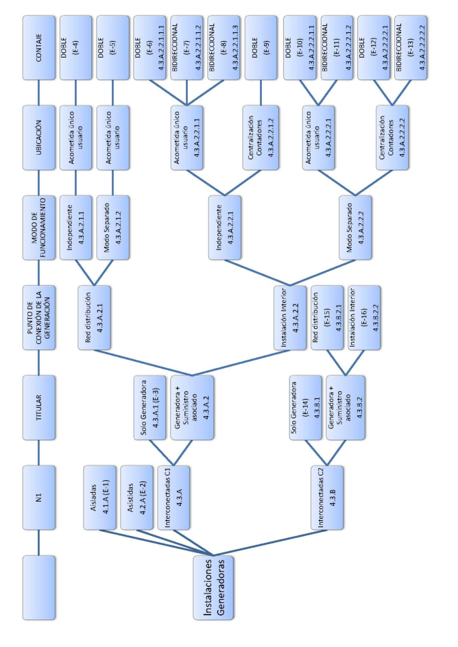

Con el fin de facilitar la interpretación de los esquemas de conexión de las instalaciones de generación con las de enlace (referidas a una instalación receptora), y en especial en los casos de instalaciones interconectadas, se describen a continuación, las partes que componen las instalaciones generadoras a las que se refiere la presente ITC-BT-40, asimilándolas a las de enlace descritas en la ITC-BT-12. Los esquemas de conexión que se representan en este capítulo muestran diferentes topologías de conexión de los generadores con los elementos característicos de la instalación, lo que no exime de la necesidad de colocar otros elementos no representados cuando la dimensión de los circuitos u otros parámetros así lo requieran para cumplir todos los requisitos del REBT. Para aquellas instalaciones que incorporen un equipo que impide la entrega de energía a la red, este deberá cumplir la norma que le corresponda. En lo relativo a la posibilidad de suministrar energía a la red y a la utilización del contador u otros elementos de control reflejados en los esquemas para este fin, su inclusión o no, vendrá determinada por otra legislación. En lo que respecta a esta guía, los diferentes esquemas reflejan la ubicación de dichos elementos pero no su obligatoriedad en todos los casos.

### 4.A INSTALACIONES DE CONEXIÓN PARA INSTALACIONES GENERADORAS

DE TIPO C1 4.A.1 Definiciones A efectos del presente capítulo, se considerará que las instalaciones de conexión de una instalación generadora tipo C1 a la red comienzan en la caja general de protección y terminan en los dispositivos generales de mando y protección del equipo generador Nota: Se debe tener en cuenta que si el equipo generador incorpora partes que requieren instalación, esta deberá cumplir los requisitos del REBT relevantes. 4.A.2 Partes que constituyen las instalaciones de conexión Estructuralmente, serán las mismas que constituyen las instalaciones de enlace (ITC- BT-12), y que llamaremos: - Caja General de Protección (CGP) - Línea General de conexión (LGC) - Interruptor general de maniobra (IGM) - Equipo de medida de generación (EMG) - Línea Individual del generador (LIG) - Interruptor de Control de Potencia (ICP) - Dispositivos de Protección Interiores (DPI) - Equipo generador (GEN)

Dependiendo del punto físico de conexión del equipo generador algunas de las partes de la instalación generadora citadas podrán ser comunes con las propias de la instalación eléctrica para consumo de cargas. En cualquier caso no debe sobrepasarse la previsión de cargas de la instalación aguas arriba de los elementos comunes.

– 7 –

Las protecciones correspondientes al generador en los esquemas que se incluyen a continuación podrán estar integradas en el mismo, cumpliendo las especificaciones correspondientes. El interruptor de control de potencia (ICP) es un dispositivo para controlar que la potencia consumida no exceda de la contratada.. Para generadores que no compartan equipo de medida con la instalación de consumo no es preceptiva la instalación de la caja para ICP.

4.A.3 Equivalencia entre las partes que constituyen las instalaciones receptoras y las generadoras Las siguientes leyendas se aplican genéricamente a los esquemas incluidos en los siguientes apartados. En cada esquema particular se añade información complementaria particular cuando es relevante.

Leyenda para instalaciones receptoras Leyenda para instalaciones generadoras

### 1 Red de distribución 1 Red de distribución

### 2 Acometida 2 Acometida

### 3 Caja general de protección (CGP) 3 Caja General de Protección (CGP)

### 4 Línea general de alimentación (LGA) 4 Línea General de conexión (LGC)

### 5 Interruptor general de maniobra (IGM) 5 Interruptor general de maniobra (IGM)

### 6 Caja de derivación 6 Caja de derivación

### 7 Centralización de contadores (CC) 7 Centralización de contadores (CC)

### 8 Derivación individual (DI) 8 Línea Individual del generador (LIG)

### 9 Fusible de seguridad 9 Fusible de seguridad

### 10 Contador 10 Contador

11 Caja para interruptor de control de potencia 11 Caja para interruptor de control de potencia (ICP) (ICP)

### 12 Dispositivos generales de mando y 12 Dispositivos de mando y protección Interiores

protección (DGMP). (DPI)

### 13 Instalación interior 13 Equipo generador-inversor (GEN)

### 14 Conjunto de protección y medida (CMP) 14 Conjunto de protección y medida (CMP)

### 15 Conmutador de conexión red/generador con

sistema de sincronismo

### 16 Tramo de la conexión privada (TCP)

Los números reflejan funciones que pueden estar integradas en uno o en varios aparatos. Asimismo si hay más de una función en un mismo número, puede realizarse con varios aparatos.

– 8 –

<!-- tabla: ../tablas/BT-40_t04.csv -->

|  | 4.1 Instalaciones generadoras aisladas |
|---|---|
|  | La conexión a los receptores, en las instalaciones donde no pueda darse la |
|  | posibilidad del acoplamiento con la Red de Distribución Pública o con otro generador, |
|  | precisará la instalación de un dispositivo que permita conectar y desconectar la carga |
|  | en los circuitos de salida del generador. |
|  | Cuando existan más de un generador y su conexión exija la sincronización, se deberá |
|  | disponer de un equipo manual o automático para realizar dicha operación. |

Existen equipos, como algunos inversores, en los que no es necesario realizar tal sincronización de forma externa debido a que ya incorporan dicha función internamente. En estos casos, no será necesaria la instalación de equipos adicionales para este fin.

<!-- tabla: ../tablas/BT-40_t05.csv -->

|  | Los generadores portátiles deberán incorporar las protecciones generales contra |
|---|---|
|  | sobreintensidades y contactos directos e indirectos necesarios para la instalación que |
|  | alimenten. |

alimenten.

Las protecciones incorporadas en los generadores portátiles deben ser conformes a :

<!-- tabla: ../tablas/BT-40_t06.csv -->

| Producto | Norma de aplicación |
|---|---|
| Interruptores automáticos con capacidad de seccionamiento (uso industrial) | UNE-EN 60947-2 |
| Interruptores diferenciales (uso industrial) | UNE-EN 60947-2 |
| Fusibles | UNE-EN 60269-3 |

Es igualmente recomendable que incorporen protección contra las sobretensiones y en su caso serán conformes a :

<!-- tabla: ../tablas/BT-40_t07.csv -->

| Dispositivos de protección contra sobretensiones transitorias | UNE-EN 61643-11 |
|---|---|
| Dispositivos de protección contra sobretensiones temporales para uso doméstico y análogo | UNE-EN 50550 |

En el caso de las instalaciones generadoras aisladas, las instalaciones de conexión, contienen solamente los elementos de conexión a la instalación de consumo, ya que los de conexión a la red, no existen ni para la instalación generadora, ni para la receptora o de consumo, tal como puede verse en el esquema siguiente.

– 9 –

4.1.A. Esquemas ESQUEMAS DE INSTALACIONES AISLADAS.

<!-- tabla: ../tablas/BT-40_t08.csv -->

|  | TITULAR | CONEXIÓN GENERACIÓN | FUNCIONAMIENTO | UBICACIÓN | MEDIDA |
|---|---|---|---|---|---|
| AISLADAS Esq-1 | SUMTRO ASOCIADO | INSTALACIÓN INTERIOR | MODO AISLADO | INSTALACIÓN INTERIOR | Ninguno |

Esquema 1

El hecho de que está instalación esté conectada permanentemente al generador no implica que puedan utilizarse las protecciones del generador como protección de los circuitos de las cargas de manera que las protecciones serán:

Del lado Generador: 12: puede integrar dispositivos tales como interruptor automático, diferencial, dispositivo de detección de aislamiento, protección contra tensión fuera de rango según el capítulo 7 y protección contra sobretensiones según se establece en el ITC- BT-23. Las protecciones contra el choque eléctrico se elegirán conforme a lo indicado en la ITC-BT-24 teniendo en cuenta el régimen de puesta a tierra del neutro de la instalación.

– 10 –

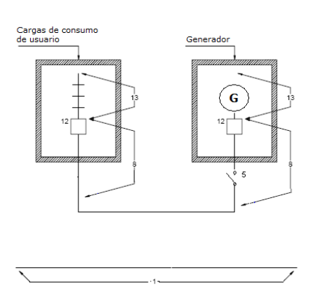

Del lado Cargas 12: protecciones según la ITC-BT-17, la 25 y la 23 y sus guías de aplicación

<!-- tabla: ../tablas/BT-40_t09.csv -->

|  | 4.2 Instalaciones generadoras asistidas |
|---|---|
|  | En la instalación interior la alimentación alternativa (red o generador) podrá hacerse |
|  | en varios puntos que irán provistos de un sistema de conmutación para todos los |
|  | conductores activos y el neutro, que impida el acoplamiento simultáneo a ambas |
|  | fuentes de alimentación. |

Esta conmutación puede realizarse manualmente, normalmente con enclavamiento mecánico o interruptores de leva, o mediante conmutación automática, normalmente con enclavamiento eléctrico.

<!-- tabla: ../tablas/BT-40_t10.csv -->

|  | En el caso en el que esté previsto realizar maniobras de transferencia de carga sin |
|---|---|
|  | corte, la conexión de la instalación generadora asistida con la Red de Distribución |
|  | Pública se hará en un punto único y deberán cumplirse los siguientes requisitos: |
|  | - Sólo podrán realizar maniobras de transferencia de carga sin corte los |
|  | generadores de potencia superior a 100 kVA |
|  | - En el momento de interconexión entre el generador y la red de distribución |
|  | pública, se desconectará el neutro del generador de tierra. |
|  | - El sistema de conmutación deberá instalarse junto a los aparatos de |
|  | medida de la Red de Distribución pública, con accesibilidad para la |
|  | empresa distribuidora. |
|  | - Deberá incluirse un sistema de protección que imposibilite el envío de |
|  | potencia del generador a la red. |
|  | - Deberán incluirse sistemas de protección por tensión del generador fuera |
|  | de límites, frecuencia fuera de límites, sobrecarga y cortocircuito, |
|  | enclavamiento para no poder energizar la línea sin tensión y protección por |
|  | fuera de sincronismo. |
|  | - Dispondrá de un equipo de sincronización y no se podrá mantener la |
|  | interconexión más de 5 segundos. |

Para evitar los efectos de sobretensión debidas a las conmutaciones podrá ser necesario instalar protectores contra sobretensiones transitorias, adecuados a la instalación que alimenten.

– 11 –

El conmutador llevará un contacto auxiliar que permita conectar a una tierra propia el neutro de la generación, en los casos que se prevea la transferencia de carga sin corte.

Los elementos de protección y sus conexiones al conmutador serán precintables o se garantizará mediante método alternativo que no se pueden modificar los parámetros de conmutación iniciales y la empresa distribuidora de energía eléctrica, deberá poder acceder de forma permanente a dicho elemento, en los casos en que se prevea la transferencia de carga sin corte. El dispositivo de maniobra del conmutador será accesible al Autogenerador.

Las protecciones que se incorporen en la instalación generadora y sus elementos deben ser conformes a:

<!-- tabla: ../tablas/BT-40_t11.csv -->

| Producto | Norma de aplicación |
|---|---|
| Interruptores automáticos con capacidad de seccionamiento | UNE-EN 60947-2 |
| Interruptores seccionadores | UNE-EN 60947-3 |
| Contactores | UNE-EN 60947-4-1 |
| Elementos de conmutación para circuitos de mando | UNE-EN 60947-5-1 |
| Interruptores diferenciales | UNE-EN 60947-2 |
| Fusibles | UNE-EN 60269-3 |
| Dispositivos de protección contra sobretensiones transitorias | UNE-EN 61643-11 |
| Dispositivos de detección del aislamiento | UNE-EN 61557-8 |
| Dispositivos de reconexión automática para uso doméstico y análogo | UNE-EN 50557 |

En el caso de las instalaciones generadoras asistidas, las instalaciones de conexión, contienen solamente los elementos de conexión a la instalación de consumo, ya que los elementos de conexión a la red, son los de la receptora o de consumo, no existiendo como tales en la instalación generadora, tal como puede verse en el esquema siguiente.

– 12 –

4.2.A. Esquemas ESQUEMAS DE INSTALACIONES ASISTIDAS.

<!-- tabla: ../tablas/BT-40_t12.csv -->

|  | TITULAR | CONEXIÓN GENERACIÓN | FUNCIONAMIENTO | UBICACIÓN | MEDIDA |
|---|---|---|---|---|---|
| ASISTIDAS Esq-2 | SUMTRO ASOCIADO | INSTALACIÓN INTERIOR | MODO ASISTIDO | INSTALACIÓN INTERIOR | Ninguno |

Esquema 2

El conmutador de conexión red/generador (bloque 15), podrá sustituir al interruptor general de maniobra (IGM), siempre que el conmutador cumpla al menos las mismas condiciones técnicas y de ubicación exigidas a dicho interruptor, según la ITC-BT-16 e ITC-BT-40, apartado 4.3.3.

– 13 –

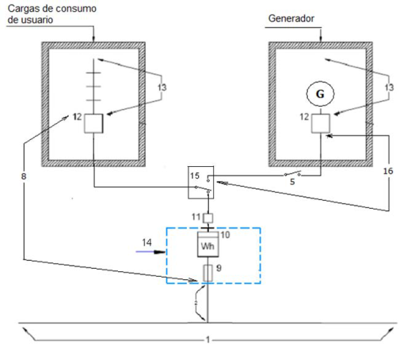

<!-- tabla: ../tablas/BT-40_t13.csv -->

|  | 4.3 Instalaciones interconectadas |
|---|---|
|  | La potencia máxima de las centrales interconectadas a una Red de Distribución |
|  | Pública, estará condicionada por las características de ésta: tensión de servicio, |
|  | potencia de cortocircuito, capacidad de transporte de línea, potencia consumida en la |
|  | red de baja tensión, etc. |

red de baja tensión, etc.

La conexión de la instalación generadora no deberá afectar al funcionamiento normal de la red ni a la calidad del suministro de los clientes conectados a ella. Tampoco deberá producir cambios en la filosofía de explotación, protección y desarrollo de la misma. El punto de conexión debe tener elementos que cumplan las funciones de corte y aislamiento de la red, accesibles, en todo momento a la empresa distribuidora, a efectos de poder desconectar la instalación generadora. En el caso de las instalaciones de tipo c2, el punto de conexión consistirá en un seccionador frontera entre las instalaciones del autogenerador y las de la empresa de distribución pública, en las condiciones establecidas en la ITC 19 del MIE-RAT (y en caso de conexión a la red de transporte el PO 12.2), con su correspondiente equipo de medida (cuando proceda) y protecciones según lo que se indica más adelante. Se contemplan aquí una serie de escenarios, en función del punto de conexión del generador, y la posibilidad o no de alimentación de un consumo asociado al productor de la instalación de generación, y manteniendo siempre la simetría con las instalaciones de enlace de la ITC BT 12 y su Guía de aplicación correspondiente. Los escenarios que se contemplan se refieren a aspectos de seguridad y no necesariamente son admisibles para las condiciones que otro tipo de legislación establezca (por ejemplo las relativas al régimen económico). Se define en el contexto del apartado 4.3 el funcionamiento en modo separado como aquel en el que el generador funciona normalmente en modo interconectado y cuando se dan condiciones de falta de red puede alimentar a la instalación. En los escenarios en los que se hace referencia a funcionamiento en modo separado, la transferencia de carga se hace con corte. En caso de tener la posibilidad de funcionamiento en modo separado y ante la eventualidad de la desconexión de la red, el control del generador deberá garantizar que primero se desconecta el generador de la red y después se pone en modo de funcionamiento separado, antes de conectarse a las cargas. Para la reconexión a la red, el generador deberá primero desconectar las cargas, ponerse en modo de funcionamiento interconectado y sincronizarse con la red antes de conectarse a ésta.

– 14 –

<!-- tabla: ../tablas/BT-40_t14.csv -->

| INTERCONEC TADAS TIPO C1 | TITULAR | CONEXIÓN GENERACIÓN | FUNCIONAMIEN TO | UBICACIÓN | MEDIDA |
|---|---|---|---|---|---|
| Esq-3 | SÓLO GENERACI ÓN (G) | RED DISTRIBUCIÓN (R) | INDEPENDIENTE (I) | ACOMETIDA (U) ÚNICO USUARIO | SÓLO GENERACIÓN (G) |
| Esq-4 | SUMTRO ASOCIADO (A) | RED DISTRIBUCIÓN (R) | INDEPENDIENTE (I) | ACOMETIDA (U) ÚNICO USUARIO | DOBLE (D) GENERAC/CON SUMO |
| Esq-5 | SUMTRO ASOCIADO (A) | RED DISTRIBUCIÓN (R) | MODO SEPARADO (S) | ACOMETIDA (U) ÚNICO USUARIO | DOBLE (D) GENERAC/CON SUMO |
| Esq-6 | SUMTRO ASOCIADO (A) | INSTALACIÓN INTERIOR (P) LGA | INDEPENDIENTE (I) | ACOMETIDA (U) ÚNICO USUARIO | DOBLE (D) GENERAC/CON SUMO |
| Esq-7 | SUMTRO ASOCIADO (A) | INSTALACIÓN INTERIOR (P) DI | INDEPENDIENTE (I) | ACOMETIDA (U) ÚNICO USUARIO | ÚNICO BIDIRECCIONAL (B) |
| Esq-8 | SUMTRO ASOCIADO (A) | INSTALACIÓN INTERIOR (P) A DGMP o CMP | INDEPENDIENTE (I) | ACOMETIDA (U) ÚNICO USUARIO | ÚNICO BIDIRECCIONAL (B) |
| Esq-9 | SUMTRO ASOCIADO (A) | INSTALACIÓN INTERIOR CENTRALIZACI ON | INDEPENDIENTE (I) | CENTRALIZAC CONTADORES (C) | DOBLE (D) GENERAC/CON SUMO |
| Esq-10 | SUMTRO ASOCIADO (A) | INSTALACIÓN INTERIOR (P) LGA | MODO SEPARADO (S) | ACOMETIDA (U) ÚNICO USUARIO | DOBLE (D) GENERAC/CON SUMO |
| Esq-11 | SUMTRO ASOCIADO (A) | INSTALACIÓN INTERIOR (P) DI | MODO SEPARADO (S) | ACOMETIDA (U) ÚNICO USUARIO | ÚNICO BIDIRECCIONAL (B) |
| Esq-12 | SUMTRO ASOCIADO (A) | INSTALACIÓN INTERIOR CENTRALIZACI ON | MODO SEPARADO (S) | CENTRALIZAC CONTADORES (C) | DOBLE (D) GENERAC/CON SUMO |
| Esq-13 | SUMTRO ASOCIADO (A) | INSTALACIÓN INTERIOR (P) DI | MODO SEPARADO (S) | CENTRALIZAC CONTADORES (C) | ÚNICO BIDIRECCIONAL (B) |

<!-- tabla no extraíble en la pág. 15 -->
> La tabla de esta página no se puede extraer como texto (pdfplumber la lee como
> caracteres sueltos): se muestra la imagen de la página. También está en [pdf/BT-40.pdf](../pdf/BT-40.pdf#page=15).

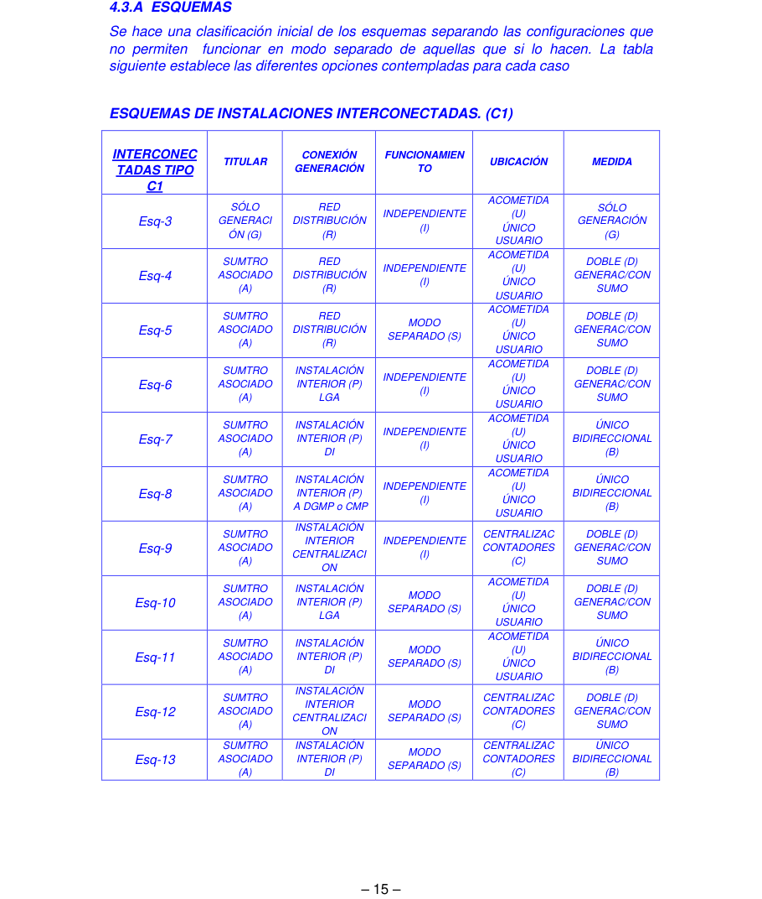

Para instalaciones generadoras que funcionan en modo separado con configuración equivalente a los tipos IT, TN o TT se requiere que éstas dispongan del correspondiente sistema de protección contra los choques eléctricos establecido en la ITC-BT-24. En particular los dispositivos de protección contra el choque eléctrico instalados en la instalación fija deben garantizar su funcionamiento para cualquier combinación posible de fuentes de alimentación. En caso que el funcionamiento en modo separado suponga el paso a una configuración equivalente al modo IT: - los interruptores diferenciales conformes con las normas UNE-EN 61008 o UNE-EN 61009 son apropiados para su uso en sistemas IT si se satisfacen los requisitos de instalación incluidos en la ITC-BT-24. - los interruptores diferenciales conformes con la norma UNE-EN 61947-2 son apropiados para su uso en sistemas IT si se satisfacen los requisitos de instalación incluidos en la ITC-BT-24. Sólo en el caso de diferenciales marcados con el valor de tensión seguido por el símbolo , éstos no deben utilizarse en sistemas IT para dicha tensión. - los interruptores automáticos conformes con la normas UNE-EN 60898 son apropiados para su uso en sistemas IT si se satisfacen los requisitos de instalación incluidos en la ITC-BT-22 e ITC-BT-24. - los interruptores automáticos conformes con la serie de normas UNE-EN 61947 son apropiados para su uso en sistemas IT si se satisfacen los requisitos de instalación incluidos en la ITC-BT-22 e ITC-BT-24. Sólo en el caso de interruptores automáticos marcados con el valor de tensión seguido por el símbolo , éstos no deben utilizarse en sistemas IT para dicha tensión. - Para la detección de un primer defecto de aislamiento es necesaria la instalación de equipos de detección de aislamiento conformes con la norma UNE-EN 61557-8.

– 16 –

4.3.A.1 Generador conectado directamente a la red de BT. Solo generador, sin instalación de consumo asociado

Es el caso común de un generador de conexión simple y directa a la red de BT, con el fin exclusivo de suministrar energía a la red.

Esquema 3 Lado Generador: 12: puede integrar dispositivos tales como interruptor automático, diferencial, dispositivo de detección de aislamiento, protección contra tensión fuera de rango según el capítulo 7 y protección contra sobretensiones según se establece en el ITC- BT-23. Las protecciones contra el choque eléctrico se elegirán conforme a lo indicado en la ITC-BT-24 teniendo en cuenta el régimen de puesta a tierra del neutro de la instalación.

Lado de red 5: podrá estar integrado en el contador cuando haya sistemas de telegestión.

Según la ITC-BT-13 punto 2, la caja general de protección que incluye el contador, sus fusibles de protección y, en su caso, reloj para discriminación horaria, se denomina caja de protección y medida (CMP).

– 17 –

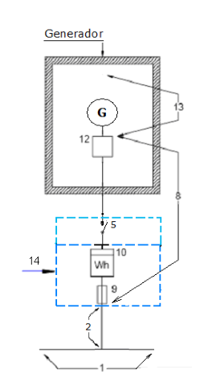

4.3.A.2 Instalaciones generadoras con suministro asociado 4.3.A.2.1 Instalación generadora conectada a la red de distribución y suministro asociado 4.3.A.2.1.1 Modo de funcionamiento independiente con acometida de único usuario y método de medida doble

Esquema 4

– 18 –

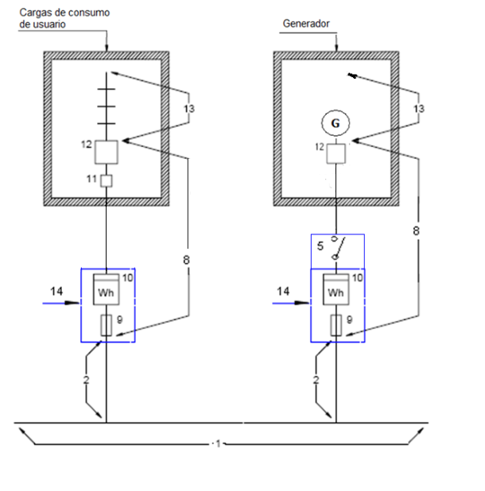

4.3.A.2.1.1 Modo de funcionamiento separado acometida de único usuario y método de medida doble

Esquema 5

– 19 –

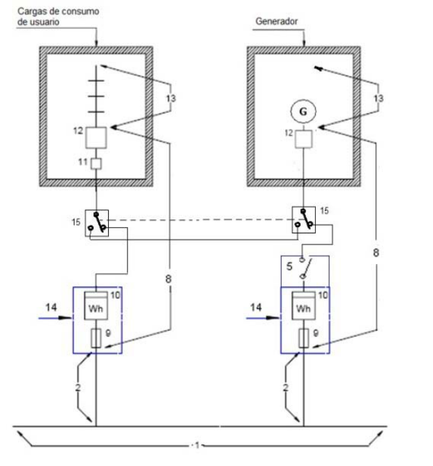

4.3.A.2.2 Instalación generadora conectada a la red interior y suministro asociado 4.3.A.2.2.1 Modo de funcionamiento independiente 4.3.A.2.2.1.1 Acometida de único usuario 4.3.A.2.2.1.1.1 Método de medida doble. Conexión a la LGA Generador compartiendo la instalación de conexión con otra de consumo asociado al productor en el que no existe la posibilidad de funcionamiento en modo separado

Esquema 6

– 20 –

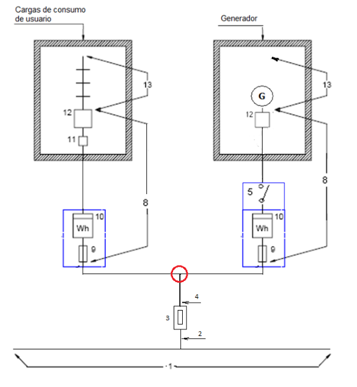

4.3.A.2.2.1.1.2 Método de medida bidireccional. Conexión en la DI

Esquema 7

– 21 –

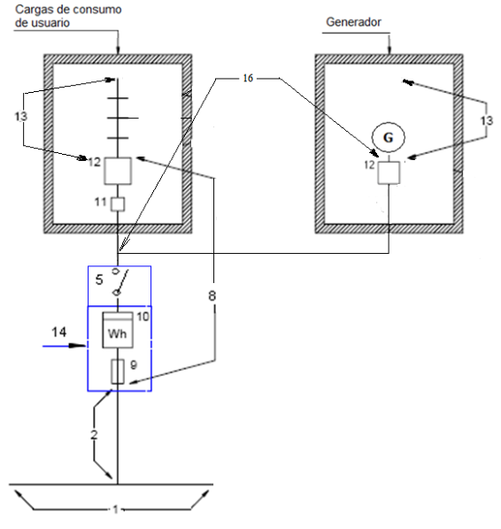

4.3.A.2.2.1.1.3 Método de medida bidireccional. Conexión al DGMP o CMP

El generador y la instalación de consumo pueden estar en el mismo o distinto local. El generador debe estar conectado en un circuito dedicado e independiente del resto de circuitos. Por tanto no debe compartir circuito con ninguna otra carga de la instalación

Esquema 8

– 22 –

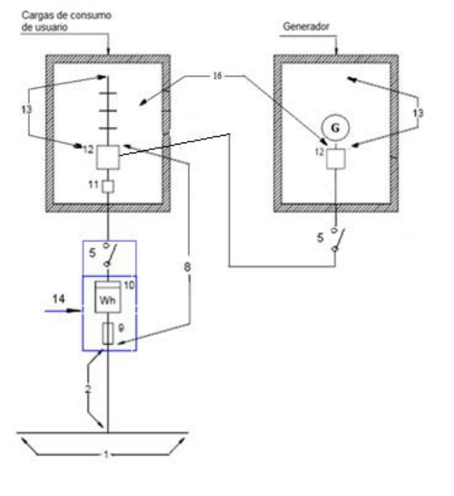

4.3.A.2.2.1.2 Acometida en centralización de contadores. Método de medida doble. Este esquema es el típico en conjuntos de edificación vertical u horizontal, destinados principalmente a viviendas, edificios comerciales, de oficinas o destinados a una concentración de industrias.

Esquema 9

– 23 –

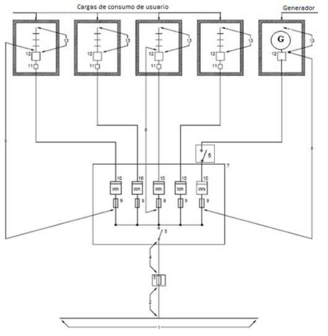

4.3.A.2.2.2 Funcionamiento en modo separado 4.3.A.2.2.2.1 Acometida de único usuario 4.3.A.2.2.2.1.1 Método de medida doble. Este tipo de esquema es típico de chalets, de forma que se instalan dos cajas de protección y medida empotradas en el mismo nicho, o bien una caja doble que agrupe los contadores y fusibles de protección del generador y los del consumo.

Esquema 10

– 24 –

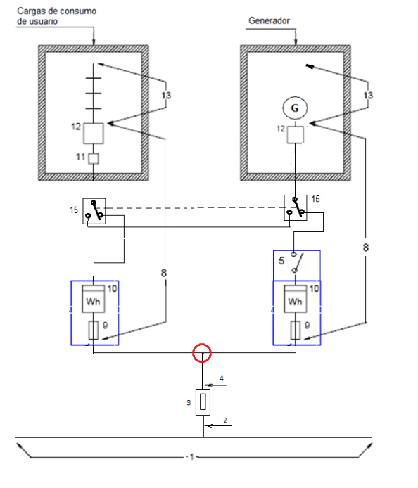

4.3.A.2.2.2.1.2 Método de medida bidireccional. Con respecto al esquema anterior, los dos contadores pueden sustituirse por uno bidireccional o por varios en cascada si se admite en la legislación aplicable para cada tipo de generación.

Esquema 11

– 25 –

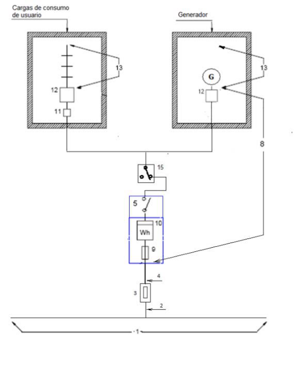

4.3.A.2.2.2.2 Acometida en centralización de contadores 4.3.A.2.2.2.2.1 Método de medida doble.

Este esquema es el típico en conjuntos de edificación vertical u horizontal, destinados principalmente a viviendas, edificios comerciales, de oficinas o destinados a una concentración de industrias.

Esquema 12

– 26 –

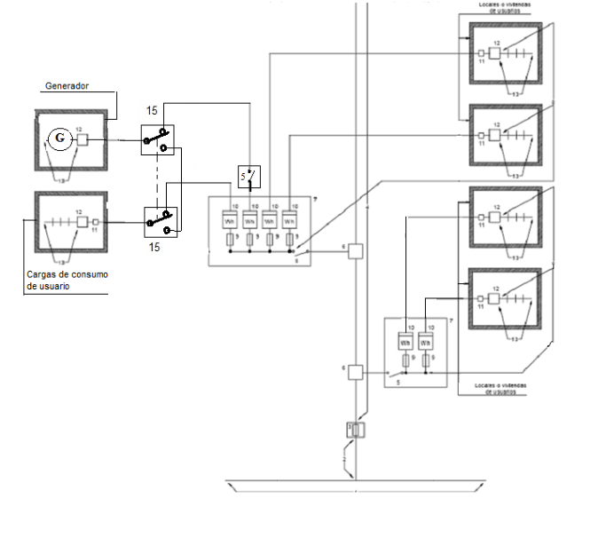

4.3.A.2.2.2.2.2 Método de medida bidireccional

Este esquema sólo es posible cuando generador y consumo son del mismo propietario (persona o comunidad de vecinos con servicios generales)

Esquema 13

– 27 –

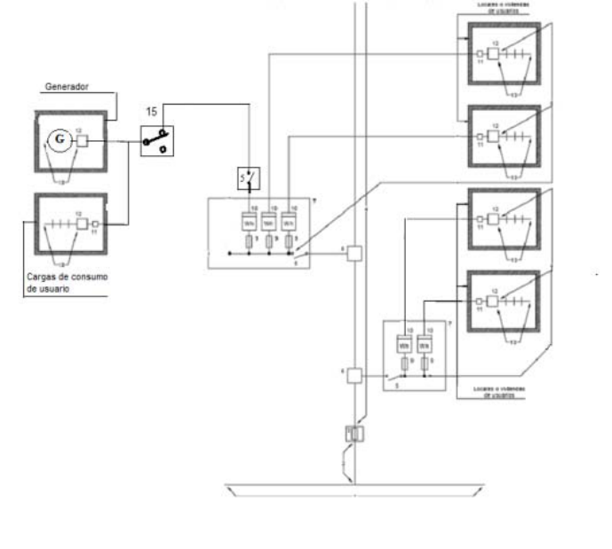

4.3.B. Instalaciones interconectadas de tipo C2 Pueden darse los siguientes escenarios en función de la existencia o no de consumos asociados y su punto de conexión, que a su vez dependerá de las potencias, ubicaciones respectivas, etc.

### ESQUEMAS DE INSTALACIONES INTERCONECTADAS. (C2)

<!-- tabla: ../tablas/BT-40_t15.csv -->

| INTERCON ECTADAS TIPO C2 | TITULAR | CONEXIÓN GENERACIÓ N | FUNCIONAMIE NTO | UBICACIÓN | MEDIDA |
|---|---|---|---|---|---|
| Esq-14 | SÓLO GENERACIÓN (G) | RED DISTRIBUCIÓ N (R) | INDEPENDIEN TE (I) | CT UNICO (U) | SÓLO GENERACIÓN (G) |
| Esq-15 | SUMTRO ASOCIADO (A) | RED DISTRIBUCIÓ N (R) | INDEPENDIEN TE (I) | CT SEPARADO S (C) | DOBLE (D) GENERAC/CONSUMO |
| Esq-16 | SUMTRO ASOCIADO (A) | INSTALACIO N INTERIOR (P) BT | MODO SEPARADO (S) | CT UNICO (U) | ÚNICO BIDIRECCIONAL EN MT (B) Y/Ó DOBLE (D) GENERAC/CONSUMO EN BT |

– 28 –

4.3.B.1 Instalación generadora con conexión directa a la Red de distribución AT, sin suministro asociado

Esquema 14

Los bloques 5 y 9 son necesarios únicamente si se conecta un contador (bloque 10) en baja tensión.

– 29 –

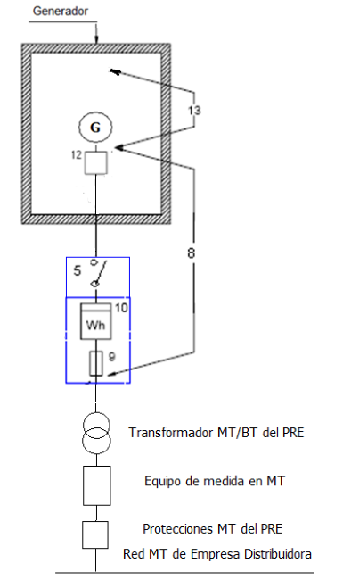

4.3.B.2 Instalación generadora y suministro asociado 4.3.B.2.1 Conexiones independientes a la red de distribución de AT del generador y el suministro asociado

Esquema 15

Cuando exista equipo de medida en AT, el de BT si está en serie, será opcional. Las protecciones serán las que se indican en el apartado correspondiente de esta Guía

– 30 –

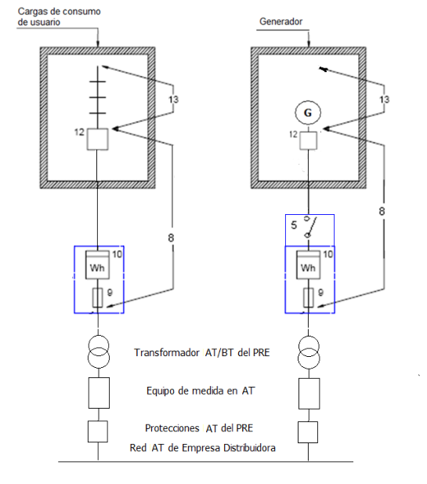

4.3.B.2.2 Con la instalación de conexión a la Red de distribución AT compartida por generador y consumo asociado

Para este tipo de conexión la parte de baja tensión podrá hacerse según los esquemas 3, 4, 5, 7, 9, 10, 11. En el esquema 16 se muestra en el lado de baja tensión, como ejemplo, el esquema 3.

Esquema 16

Los elementos representados en el lado de alta tensión del transformador y los detalles de conexión deberán cumplir con lo establecido en los reglamentos aplicables. El equipo de medida en BT correspondiente a las cargas de consumo podrá no ser necesario dependiendo de lo establecido en las legislaciones aplicables.

– 31 –

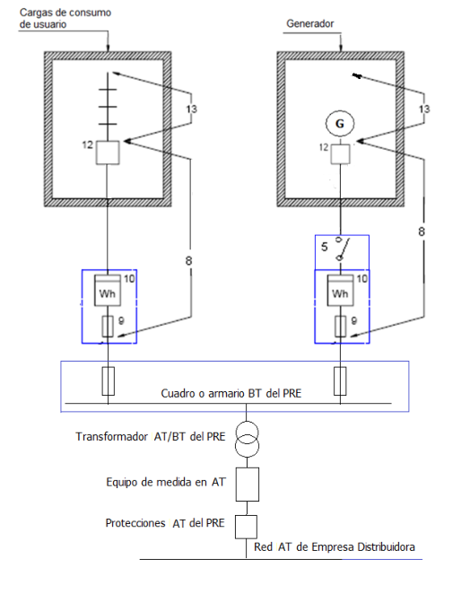

4.3.1 Potencias máximas de las centrales interconectadas en baja tensión.

Con carácter general la interconexión de centrales generadoras a las redes de baja tensión de 3x400/230 V será admisible cuando la suma de las potencias nominales de los generadores no exceda de 100 kVA, ni de la mitad de la capacidad de la salida del centro de transformación correspondiente a la línea de la Red de Distribución Pública a la que se conecte la central.

En redes trifásicas a 3x220/127 V, se podrán conectar centrales de potencia total no superior a 60 kVA ni de la mitad de la capacidad de la salida del centro de transformación correspondiente a la línea de la Red de Distribución Pública a la que se conecte la central. En estos casos toda la instalación deberá estar preparada para un funcionamiento futuro a 3x400/230 V.

En los generadores eólicos, para evitar fluctuaciones en la red, la potencia de los generadores no será superior al 5% de la potencia de cortocircuito en el punto de conexión a la Red de Distribución Pública.

En aquellas instalaciones cubiertas por el RD 1699/2011 se establece que para determinar la potencia nominal máxima disponible de conexión, se atenderá a los siguientes criterios:

### 1. Para las instalaciones que pretendan conectarse en un punto de la red de tensión

igual o inferior a 1 kV (bien directamente o a través de la instalación de una red interior): a) La potencia nominal máxima disponible en el punto de conexión de una línea se calculará como la mitad de la capacidad de transporte de la línea en dicho punto, definida como capacidad térmica de diseño de la línea en el punto, menos la suma de las potencias de las instalaciones de producción conectadas o con punto de conexión vigente en dicha línea. b) En el caso de que el punto de conexión sea en un centro de transformación, la potencia nominal máxima disponible en dicho punto se calculará como la mitad de la capacidad de transformación instalada para ese nivel de tensión menos la suma de las potencias de las instalaciones de producción conectadas o con punto de conexión vigente a ese centro. Debe tenerse en cuenta que para el dimensionamiento de los cables de la red de distribución pública el factor de simultaneidad es 1 para la generación pero la línea de la red de distribución de baja tensión puede estar dimensionada con factores de simultaneidad inferiores, de acuerdo a la ITC-BT10. Adicionalmente a estos requisitos, el RD 1699/2011 establece que la contribución de los generadores al incremento de tensión en las líneas de distribución no debe ser superior al 2.5%, según se especifica en el punto 3 del artículo 12 de dicho Real Decreto.

– 32 –

##### 4.3.2 Condiciones específicas para el arranque y acoplamiento de la instalación

generadora a la Red de Distribución Pública. 4.3.2.1 Generadores asíncronos. La caída de tensión que puede producirse en la conexión de los generadores no será superior al 3 % de la tensión asignada de la red.

En el caso de generadores eólicos la frecuencia de las conexiones será como máximo de 3 por minuto, siendo el límite de la caída de tensión del 2 % de la tensión asignada durante 1 segundo.

Para limitar la intensidad en el momento de la conexión y las caídas de tensión, a los valores anteriormente indicados, se emplearán dispositivos adecuados.

Para ello pueden usarse relés de intensidad o de tensión.

<!-- tabla: ../tablas/BT-40_t16.csv -->

|  | La conexión de un generador asíncrono a la red no se realizará hasta que, |
|---|---|
|  | accionados por la turbina o el motor, éste haya adquirido una velocidad entre el 90 y |
|  | el 100% de la velocidad de sincronismo. |
|  | 4.3.2.2 Generadores síncronos. |
|  | La utilización de generadores síncronos en instalaciones que deben interconectarse a |
|  | Redes de Distribución Pública, deberá ser acordada con la empresa distribuidora de |
|  | energía eléctrica, atendiendo a la necesidad de funcionamiento independiente de la |
|  | red y a las condiciones de explotación de ésta. |
|  | La central deberá poseer un equipo de sincronización, automático o manual. |
|  | Podrá prescindirse de este equipo si la conexión pudiera efectuarse como generador |
|  | asíncrono. En este caso las características del arranque deberán cumplir lo indicado |
|  | para este tipo de generadores. |
|  | La conexión de la central a la red de distribución pública deberá efectuarse cuando en |
|  | la operación de sincronización las diferencias entre las magnitudes eléctricas del |
|  | generador y la red no sean superiores a las siguientes: |
|  | - Diferencia de tensiones ± 8 % |
|  | - Diferencia de frecuencia ± 0,1Hz |
|  | - Diferencia de fase ± 10o |
|  | Los puntos donde no exista equipo de sincronismo y sea posible la puesta en |
|  | paralelo, entre la generación y la Red de Distribución Pública, dispondrán de un |
|  | enclavamiento que impida la puesta en paralelo. |

enclavamiento que impida la puesta en paralelo.

Siempre que se mencionan los límites de variación de tensión durante la conexión y desconexión, se refieren al transitorio en el momento de la maniobra y no a la variación de tensión durante el régimen permanente de funcionamiento de la

– 33 –

instalación generadora. Los límites de variación durante el régimen permanente están relacionados con el cumplimiento de lo que indica en el R.D. 1955/2000 por el que se regulan las actividades de transporte, distribución de energía eléctrica.

<!-- tabla: ../tablas/BT-40_t17.csv -->

|  | 4.3.3 Equipos de maniobra y medida a disponer en el punto de interconexión. |
|---|---|
|  | En el origen de la instalación interior y en un punto único y accesible de forma |
|  | permanente a la empresa distribuidora de energía eléctrica, se instalará un interruptor |
|  | automático sobre el que actuarán un conjunto de protecciones. Éstas deben |
|  | garantizar que las faltas internas de la instalación no perturben el correcto |
|  | funcionamiento de las redes a las que estén conectadas y en caso de defecto de |
|  | éstas, debe desconectar el interruptor de la interconexión que no podrá reponerse |
|  | hasta que exista tensión estable en la Red de Distribución Pública. |

hasta que exista tensión estable en la Red de Distribución Pública.

Las protecciones de las instalaciones de baja tensión a las que se refiere este párrafo pueden estar incorporadas en el propio interruptor automático o en otros dispositivos externos (por ejemplo relés) que actúan sobre el interruptor automático dándole la orden de desconexión del circuito. Además, en aquellas instalaciones cubiertas por el RD 1699/2011, las protecciones también pueden estar incorporadas en el equipo generador o el inversor en las condiciones establecidas en el capítulo 7.

<!-- tabla: ../tablas/BT-40_t18.csv -->

|  | Las protecciones y el conexionado del interruptor serán precintables y el dispositivo |
|---|---|
|  | de maniobra será accesible al Autogenerador. |

de maniobra será accesible al Autogenerador.

Los requisitos de todas las protecciones citadas están indicadas en el apartado 7 de esta ITC-BT. Debido a las conmutaciones que se realizan en la instalación, para instalaciones asistidas y para las que funcionan en modo separado es recomendable que se instalen protectores contra sobretensiones transitorias en la instalación del lado de cargas de consumo..

– 34 –

El interruptor de acoplamiento llevará un contacto auxiliar que permita desconectar el neutro de la red de distribución pública y conectar a tierra el neutro de la generación cuando ésta deba trabajar independiente de aquella.

Cuando se prevea la entrega de energía de la instalación generadora a la Red de Distribución Pública, se dispondrá, al final de la instalación de enlace, un equipo de medida que registre la energía suministrada por el Autogenerador. Este equipo de medida podrá tener elementos comunes con el equipo que registre la energía aportada por la Red de Distribución Pública, siempre que los registros de la energía en ambos sentidos se contabilicen de forma independiente.

Los elementos a disponer en el equipo de medida serán los que correspondan al tipo de discriminación horaria que se establezca.

En las instalaciones generadoras con generadores asíncronos se dispondrá siempre un contador que registre la energía reactiva absorbida por éste.

Cuando deba verificarse el cumplimiento de programas de entrega de energía tendrán que disponerse los elementos de medida o registro necesarios.

<!-- tabla: ../tablas/BT-40_t19.csv -->

|  | 4.3.4 Control de la energía reactiva. |
|---|---|
|  | En las instalaciones con generadores asíncronos, el factor de potencia de la |
|  | instalación no será inferior a 0,86 a la potencia nominal y para ello, cuando sea |
|  | necesario, se instalarán las baterías de condensadores precisas. |
|  | Las instalaciones anteriores dispondrán de dispositivos de protección adecuados que |
|  | aseguren la desconexión en un tiempo inferior a 1 segundo cuando se produzca una |
|  | interrupción en la Red de Distribución Pública. |
|  | La empresa distribuidora de energía eléctrica podrá eximir de la compensación del |
|  | factor de potencia en el caso de que pueda suministrar la energía reactiva. |
|  | Los generadores síncronos deberán tener una capacidad de generación de energía |
|  | reactiva suficiente para mantener el factor de potencia entre 0,8 y 1 en adelanto o |
|  | retraso. Con objeto de mantener estable la energía reactiva suministrada se instalará |
|  | un control de la excitación que permita regular la misma. |

un control de la excitación que permita regular la misma.

En aquellas instalaciones cubiertas por el RD 1699/2011 el factor de potencia de la energía suministrada a la red de la empresa distribuidora debe ser lo más próximo posible a la unidad y, en todo caso, superior a 0,98 cuando la instalación trabaje a potencias superiores al 25 por ciento de su potencia nominal”. Consecuentemente en estas instalaciones, cuando la regulación de generación no lo permita, se montarán equipos de compensación de potencia reactiva (p.e. baterías de condensadores) para lograr dicho factor de potencia.

Las instalaciones de generación de régimen especial fuera del ámbito del RD 1699/2011 además se regirán a los efectos del control de energía reactiva por el

– 35 –

RD 661/2007 (artículo 29 y anexo V) modificado posteriormente en el artículo 1º del RD 1565/2010 (modificaciones 8 y 20).

<!-- tabla: ../tablas/BT-40_t20.csv -->

| Producto | Norma de aplicación |
|---|---|
| Baterías de condensadores | UNE- EN 60143-1 |

<!-- tabla: ../tablas/BT-40_t21.csv -->

|  | 5. CABLES DE CONEXION |
|---|---|
|  | Los cables de conexión deberán estar dimensionados para una intensidad no inferior |
|  | al 125% de la máxima intensidad del generador y la caída de tensión entre el |
|  | generador y el punto de interconexión a la Red de Distribución Pública o a la |
|  | instalación interior, no será superior al 1,5%, para la intensidad nominal. |
|  | 6. FORMA DE LA ONDA |
|  | La tensión generada será prácticamente senoidal, con una tasa máxima de armónicos, |
|  | en cualquier condición de funcionamiento de: |
|  | Armónicos de orden par: 4/n |
|  | Armónicos de orden 3: 5 |
|  | Armónicos de orden impar (≥5) 25/n |
|  | Extender a cualquier frecuencia para cubrir frecuencias de conmutación. |
|  | La tasa de armónicos es la relación, en % , entre el valor eficaz del armónico de orden |
|  | n y el valor eficaz del fundamental. |

Los anteriores límites de distorsión en tensión son adicionales a los necesarios para el cumplimiento de la Directiva Europea de Compatibilidad Electromagnética establecidos en las normas: - UNE-EN 61000-3-2. Límites para las emisiones de corriente armónica. Equipos con corriente de entrada ≤ 16 A por fase - UNE-EN 61000-3-12. Límites para las corriente armónicas producidas por los equipos conectados a las redes públicas de baja tensión con corriente de entrada >16 A y ≤ 75 A. por fase Dichas normas establecen límites de la corriente emitida por los equipos, mientras que los límites del presente capítulo se refieren a la tensión. Adicionalmente también son aplicables las normas siguientes: - UNE-EN 61000-6-3. Norma de emisión para entorno residencial, comercial e industria ligera. - UNE-EN 61000-6-4. Norma de emisión para entorno industrial.

El RD. 1699/2011 Artículo 11.1 Condiciones técnicas de carácter general. establece que el funcionamiento de las instalaciones no deberá provocar en la red averías,

– 36 –

disminuciones de las condiciones de seguridad ni alteraciones superiores a las admitidas por la normativa que resulte aplicable. Por otro lado el artículo 10.4 del citado decreto establece que en el caso excepcional en el que se evidencie que la instalación suponga un riesgo inminente para las personas, o cause daños o impida el funcionamiento de equipos de terceros, la distribuidora podrá desconectar inmediatamente la instalación, debiendo comunicar y justificar detalladamente dicha actuación excepcional al órgano de la Administración competente en materia de energía y al interesado, en un plazo máximo de veinticuatro horas. Con el objetivo de cumplir estos requisitos se considera necesario evitar la inyección de corriente continua y las sobretensiones que el funcionamiento de estos generadores en diferentes situaciones puedan producir. Para evaluar esto se establecen los dos ensayos siguientes:

Inyección de corriente continua a la red El generador deberá garantizar que la corriente continua inyectada a red no supere el 0,5 % de la corriente nominal, de acuerdo con la Nota de interpretación técnica de la equivalencia de la separación galvánica de la conexión de instalaciones generadoras en baja tensión. Los generadores con transformador de baja frecuencia garantizan la no inyección de corriente continua a la red, por lo que no necesitan realizar ningún ensayo para demostrar que cumplen con este requerimiento. Si el generador utilizado es con transformador de alta frecuencia o sin transformador se deberá demostrar que la corriente continua inyectada a red por el generador no supera el 0,5 % de la corriente nominal. Para ello se realizará el siguiente ensayo:

### 1. Conectar el generador a una red cuya componente de tensión continua sea

despreciable a los efectos de la medida, por ejemplo separando otras cargas de la red con un transformador separador.

### 2. Ajustar la potencia de salida del generador a una potencia de salida

comprendida entre el 25 % y el 100 % de su potencia nominal.

### 3. Esperar el tiempo necesario hasta que la temperatura interna del generador

alcance el régimen estacionario (variación de temperatura inferior a 2º C en 15 minutos). 4. Medir el valor de la componente continua inyectada por el equipo a la red. La prueba se determina como válida si la componente de continua, medida en una ventana de al menos 10 segundos, es menor al 0,5 % del valor eficaz de la corriente nominal de salida del generador.

Generación de sobretensiones Se establecen dos grupos de generadores: 1) Grupo 1: son los generadores de las instalaciones de tipo C1.

– 37 –

a. Generador con transformador de baja frecuencia (50Hz). Dicho transformador estará colocado en la parte de alterna, interno o externo a la etapa de conversión. b. Generador con transformador de alta frecuencia. Se trata de generadores que incorporan en su etapa de conversión una etapa de conversión CC/CC con transformador de alta frecuencia. c. Generador sin transformador. Se trata de generadores que no incorporan ningún tipo de transformador en la etapa de conversión.

2) Grupo 2: son los generadores para instalaciones de tipo C2.

El generador no debe generar sobretensiones en su conexión de alterna, cumpliendo con los límites establecidos en las tablas siguientes.

<!-- tabla: ../tablas/BT-40_t22.csv -->

| Duración, t, de la sobretensión (s) | Valor admisible de la sobretensión instantánea (% Un pico) |
|---|---|
| 0,0002 | 280 |
| 0,0006 | 218 |
| 0,002 | 178 |
| 0,006 | 145 |
| 0,02 | 129 |
| 0,06 | 120 |
| 0,2 | 120 |
| 0,6 | 120 |

Sobretensiones máximas admisibles para generadores del grupo 1.

<!-- tabla: ../tablas/BT-40_t23.csv -->

| Duración, t, de la sobretensión | Valor admisible de la sobretensión instantánea (% Un pico) |
|---|---|
| 0< t < 1 ms | 200 |
| 1 ms ≤ t < 3 ms | 140 |
| 3 ms ≤ t < 500 ms | 120 |
| t ≥ 500 ms | 110 |

Sobretensiones máximas admisibles para generadores del grupo 2

Ensayo a realizar:

### 1. Conectar el generador de acuerdo al circuito de ensayo mostrado en la figura 1

para generadores del grupo 1, o en la figura 2 para generadores del grupo 2, con una tensión de red entre el ± 5 % de su valor nominal.

### 2. Abrir el interruptor y registrar las tensiones en bornas del generador o

transformador, en el caso de generadores del grupo 2, a partir del momento de la desconexión con una frecuencia de muestreo de al menos 10 kHz.

– 38 –

El ensayo se realizará para una potencia superior al 50 % de la potencia asignada. Repetir el ensayo tres veces. A partir del registro de tensión obtenido tras la apertura del interruptor, determinar la curva tensión-duración de la sobretensión. Para ello, para cada tensión, con escalones máximos de 10 V, se cuenta el número de muestras en las que la tensión ha sido superior a este valor. Este número de muestras se multiplica por el tiempo de muestreo para obtener la duración para dicha tensión. La curva final es el lugar geométrico de todos los puntos derivados de este proceso.

Ensayo para generadores del grupo 1 El siguiente diagrama ilustra el circuito de ensayo para generadores del grupo 1.

C R

S

Simulador Analizador de Generador Inversor Red Potencia Fotovoltaico

C= 100μF R= 560kΩ Figura 1. Circuito de ensayo para generadores del grupo 1

El generador se considera que cumple con la prueba de tensión límite transitorio si la tensión derivada de duración curva se encuentra por debajo de la curva adecuada de la Tabla del grupo 1 en todos los puntos.

Ensayo para generadores del grupo 2

Los generadores del grupo 2 se conectan a la red de distribución pública en AT siempre a través de un transformador elevador. Por esa razón, siempre y cuando el fabricante lo solicite, el circuito de ensayo será el indicado a continuación en vez del de la figura 1.

– 39 –

Figura 2 Circuito de ensayo para generadores del grupo 2

La carga podrá ser puramente resistiva o contener condensadores en paralelo a una resistencia, siempre y cuando la capacidad total de los condensadores no supere los 500 μF. El valor de la carga resistiva no podrá superar el 0,1 % de la potencia máxima CA del generador. Por ejemplo, si la potencia máxima del generador es 500 kW, entonces la carga trifásica del ensayo no podrá superar los 500 W, lo que equivale a una resistencia mínima de 0,5 kΩ.

El ensayo se considera como válido si en cualquier momento la tensión generada por el generador en el punto de medida no supera ninguno de los límites especificados en la tabla del grupo 2.

<!-- tabla: ../tablas/BT-40_t24.csv -->

|  | 7. PROTECCIONES |
|---|---|
|  | La máquina motriz y los generadores dispondrán de las protecciones específicas que |
|  | el fabricante aconseje para reducir los daños como consecuencia de defectos internos |
|  | o externos a ellos. |
|  | Los circuitos de salida de los generadores se dotarán de las protecciones |
|  | establecidas en las correspondientes ITC que les sean aplicables. |

establecidas en las correspondientes ITC que les sean aplicables.

La instalación debe estar protegida contra sobretensiones transitorias según lo establecido en la ITC-BT-23 como instalación fija de categoría III o IV en función de su ubicación. Es recomendable seguir los criterios indicados en la GUÍA-BT-23 para la instalación de dispositivos de protección contra sobretensiones transitorias y también contra sobretensiones temporales.

En todas aquellas instalaciones ubicadas en la intemperie no cubiertas por el Código Técnico de la Edificación (por ejemplo huertos solares, parques eólicos, etc.) deberá considerarse la necesidad de instalar sistemas de protección externos contra el rayo.

– 40 –

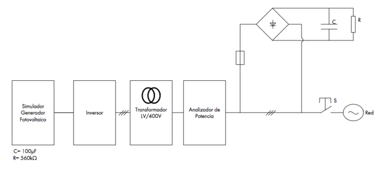

Para la protección contra contactos indirectos se montará una protección diferencial que se puede integrar en un sistema de supervisión de la instalación (contactos auxiliares, gestión de planta, etc.).

Se recomienda la instalación de sistemas que eviten la falta de producción por un disparo intempestivo. Estos sistemas pueden ser, por ejemplo: • Sistemas de reconexión automática, o • Utilización de protecciones diferenciales adecuadas para evitar los disparos intempestivos previsibles.

<!-- tabla: ../tablas/BT-40_t25.csv -->

|  | En las instalaciones de generación que puedan estar interconectadas con la Red de |
|---|---|
|  | Distribución Pública, se dispondrá un conjunto de protecciones que actúen sobre el |
|  | interruptor de interconexión, situadas en el origen de la instalación interior. Éstas |
|  | corresponderán a un modelo homologado y deberán estar debidamente verificadas y |
|  | precintadas por un Laboratorio reconocido. |

Se entiende que el requisito reglamentario anterior ya se cumple en aquellas protecciones convencionales que sean de acuerdo a las normas armonizadas recogidas en la Directiva de Baja Tensión (DBT), dado que se pueden considerar todas ellas modelos homologados y de libre circulación dentro de los estados de la UE. Por tanto lo indicado en el requisito reglamentario, se entiende aplica a aquellas protecciones del generador que no sean convencionales, como por ejemplo las que se integran en el equipo electrónico del generador. Con respecto a las protecciones y sus condiciones, el R.D 1699/2011 artículo 14, apartado 4 indica que:

A los efectos de las protecciones requeridas en el RD 1699/2011 se entiende que las únicas protecciones que es admisible integrar en el generador son las de máxima y mínima frecuencia y máxima y mínima tensión entre fases (apartado 14.1.d) Por tanto se entiende que la protección contra sobrecorrientes y contra contactos indirectos del conjunto de la instalación generadora será convencional según lo establecido en las ITC correspondientes del REBT. No obstante, el generador, en función de su topología, puede requerir incorporar a su vez protección adicional contra sobrecorrientes, contra contactos indirectos o contra fallos de aislamiento. Ejemplos de

– 41 –

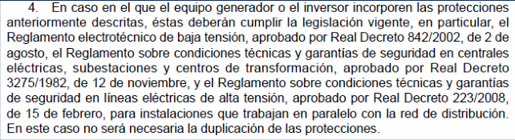

esto son los llamados sistemas de detección de corrientes de defecto en algunos generadores fotovoltaicos, o los dispositivos de detección de aislamiento, entre otros. Para las protecciones no convencionales, la verificación de las características funcionales aplicables (por ejemplo, curvas de actuación) será conforme a los requisitos equivalentes de las normas armonizadas de aplicación a la citada protección. Además se tendrá en cuenta el análisis del efecto que sobre la protección puedan tener los posibles fallos eléctricos o electrónicos, tanto del equipo como de la instalación a la que se conecta, la influencia de los fenómenos de perturbación electromagnética esperables en el entorno en el que está ubicada la instalación generadora, e incluso la influencia que sobre las características de protección pudiesen tener los errores en el software del equipo, cuando proceda. A estos efectos se tendrán en cuenta las normas armonizadas aplicables por la DBT correspondientes a las protecciones relevantes que cubran las verificaciones citadas, o en su defecto se considerarán las normas de seguridad y de requisitos funcionales aplicables a equipos análogos al del objeto de análisis y que incorporen verificaciones que cubran los aspectos citados en el párrafo anterior.

Cuando no exista una norma armonizada para las protecciones correspondientes no convencionales se utilizará la EN 60730-1 Respecto a las condiciones de verificación y precintado del REBT y respecto a las del artículo 14.3 del RD 1699/2011:

se entiende que para equipos que incorporen protecciones no convencionales, la verificación de las condiciones de protección se realizará mediante informe de laboratorio acreditado, de los aspectos de: • características funcionales aplicables • protección contra posibles fallos eléctricos o electrónicos • protección contra los fenómenos de perturbación electromagnética • protección contra los fallos y/o errores en el software del equipo.

Como ejemplos de protecciones que deben considerarse para la verificación están: a) Sincronización entre múltiples fuentes de corriente alterna. b) Paradas de operación de emergencia (incluyendo secuencia de parada) c) Sistema de conmutación (conexión / desconexión entre fuentes) y enclavamientos de seguridad (rango válido de tensión y frecuencia). Un ejemplo es el sistema de conmutación referido en el apartado 14.3 del RD 1699/2011, que se corresponde con el elemento identificado como “15 Conmutador de conexión red/generador con sistema de sincronismo” en los esquemas del capítulo 4 de esta guía, que puede estar integrado en el generador o ser un elemento externo

– 42 –

d) Funciones de dispositivos de corriente residual para protección de la propia instalación generadora e) Protección de sobrecorriente para protección de la propia instalación generadora.

En lo relativo al precintado se debe entender que se refiere a la imposibilidad de modificación de los parámetros de protección, bien mediante la inaccesibilidad del software que la ejecuta, o la imposibilidad de acceso a los elementos de regulación electrónica incorporados en el equipo generador por parte de la empresa instaladora u operador de la instalación. Esta característica deberá ser evaluada en el informe del laboratorio acreditado, mencionado anteriormente.

<!-- tabla: ../tablas/BT-40_t26.csv -->

|  | Las protecciones mínimas a disponer serán las siguientes: |
|---|---|
|  | - De sobreintensidad, mediante relés directos magnetotérmicos o solución |
|  | equivalente. |
|  | - De mínima tensión instantáneos, conectados entre las tres fases y neutro y |
|  | que actuarán, en un tiempo inferior a 0,5 segundos, a partir de que la tensión |
|  | llegue al 85% de su valor asignado. |
|  | - De sobretensión, conectado entre una fase y neutro, y cuya actuación debe |
|  | producirse en un tiempo inferior a 0,5 segundos, a partir de que la tensión |
|  | llegue al 110% de su valor asignado. |
|  | - De máxima y mínima frecuencia, conectado entre fases, y cuya actuación |
|  | debe producirse cuando la frecuencia sea inferior a 49 Hz o superior a 51 Hz |
|  | durante más de 5 períodos. |

De acuerdo al R.D. 1699/2011 el sistema de protecciones deberá cumplir, en lo no previsto en dicho real decreto, el Real Decreto 661/2007, de 25 de mayo, y los procedimientos de operación correspondientes, así como, en lo no previsto en los anteriores, las exigencias previstas en la reglamentación vigente, en particular, el Reglamento electrotécnico de baja tensión, aprobado por Real Decreto 842/2002, de 2 de agosto, el Reglamento sobre condiciones técnicas y garantías de seguridad en centrales eléctricas, subestaciones y centros de transformación, aprobado por Real Decreto 3275/1982, de 12 de noviembre, y el Reglamento sobre condiciones técnicas y garantías de seguridad en líneas eléctricas de alta tensión, aprobado por Real Decreto 223/2008, de 15 de febrero En este contexto debe considerarse que el Art14. D) del RD 1699/2011 establece que las protecciones contra sobretensiones y máxima y mínima frecuencia cumplirán con:

– 43 –

Nota: En el RD 661/2007, (aplicable a cualquier instalación generadora del régimen especial, independientemente de la potencia) en el anexo XI, punto 10 establece que la temporización de 3 s de mínima frecuencia se refiere al tiempo mínimo a soportar para garantizar la operación del sistema eléctrico y no al tiempo máximo como indica la tabla 1 del RD 1699/2011 para la protección anti-isla de la instalación generadora. Por otro lado el PO 12.3 establece, para algunos tipos de generadores y potencias, la capacidad para soportar huecos de tensión que implica tiempos mínimos de actuación de dichas protecciones. Para cumplir con todas las condiciones anteriores se recomienda ajustar los tiempos de actuación a los valores exactos indicados en la tabla.

El sistema de protecciones de las instalaciones que no entren en el ámbito de aplicación del RD 1699/2011 deberá cumplir con lo dispuesto en el RD 661/2007 y en el procedimiento de operación P.O.1.6 (éste último es aplicable, a los efectos de los planes de deslastres de carga por mínima frecuencia y planes de desconexión de generación por máxima frecuencia, a todas las instalaciones de generación acopladas al Sistema Eléctrico Peninsular con independencia de su potencia o punto de conexión).

Según el RD 661/2007 y su modificación RD 1565/2010 se obliga al cumplimiento del P.O. 12.3 referente a huecos de tensión a las instalaciones o agrupaciones de instalaciones fotovoltaicas de más de 2 MW y a todas las instalaciones eólicas. En las instalaciones a las que les sean de aplicación procedimientos de operación relativos a requisitos técnicos de conexión (p.e. P.O.12.2 y P.O.12.3) los ajustes de las protecciones de tensión no impedirán el cumplimiento de dichos procedimientos.

Las instalaciones bajo el ámbito de aplicación del RD 1699/2011 deben disponer de los siguientes elementos:

– 44 –

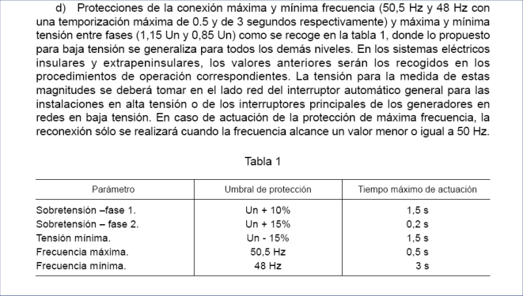

a) Un elemento de corte general para proporcionar aislamiento sobre disposiciones mínimas para la protección de la salud y seguridad de los trabajadores frente al riesgo eléctrico. Éste podría ser el mismo interruptor automático que se menciona en el capítulo 4.3.3 de esta ITC siempre y cuando tenga características de seccionamiento que proporcionen el aislamiento exigible en la legislación sobre Riesgo Eléctrico. El interruptor estará ubicado conforme a lo indicado en los diferentes esquemas del capítulo 4. b) Un Interruptor automático diferencial, con el fin de proteger a las personas en el caso de derivación de algún elemento a tierra. En las instalaciones generadoras el diferencial de la instalación deberá funcionar correctamente en presencia de ciertos niveles de corriente continua de defecto, por lo que los de tipo AC no son aptos para esta aplicación salvo cuando la instalación está aislada de la red mediante transformador separador. Cuando no se utilice un transformador separador en instalaciones generadoras que compartan circuitos con instalaciones de consumo, el diferencial de la instalación de consumo tampoco podrá ser de tipo AC. En este caso la elección del tipo de diferencial ( A o B) se corresponderá con la componente continua máxima de la corriente de fuga previsible en dichas instalaciones. Esta información puede obtenerse de los valores aportados por el fabricante del generador o por mediciones realizadas sobre la instalación generadora. Se ubicará en la instalación del productor conforme a lo indicado en diferentes esquemas del capítulo 4 dentro del elemento identificado como "Dispositivos de mando y protección interiores (DPI)". En particular, la protección diferencial en instalaciones en viviendas cumplirá lo indicado en la ITC-BT-25, por lo que su intensidad diferencial-residual máxima será de 30 mA. En otro tipo de instalaciones que no estén conectadas a redes con régimen de neutro en TT, se podrá sustituir el interruptor diferencial por otras protecciones contra contactos indirectos descritas en la ITC-BT-24, cuando éstas den una seguridad equivalente. c) Interruptor automático de la conexión, para la desconexión-conexión automática de la instalación en caso de anomalía de tensión o frecuencia de la red, junto a un relé de enclavamiento. De acuerdo a la ITC-BT-01, un interruptor automático es aquel capaz de establecer, mantener e interrumpir las intensidades de corriente de servicio, o de establecer e interrumpir automáticamente, en condiciones predeterminadas, intensidades de corriente anormalmente elevadas, tales como las corrientes de cortocircuito. Por otro lado, el RD 1699/2011 establece que la función de este interruptor es la desconexión del generador en caso de actuación de las protecciones voltimétricas de la instalación. En consecuencia, se entiende que estas funciones pueden ser también cubiertas por dos elementos separados: • Un interruptor automático de la instalación conforme a lo indicado en los diferentes esquemas del capítulo 4 dentro del elemento identificado como "Dispositivos de mando y protección interiores (DPI)" o el elemento de corte general referido en el apartado a), con protección contra sobreintensidades y capacidad de corte de cortocircuitos, de acuerdo a la ITC-BT-22,

– 45 –

• Un elemento de corte del generador, con capacidad de corte en carga, sobre el que actúen las protecciones voltimétricas y los automatismos de conexión y desconexión y que puede estar integrado o no en el generador. Los elementos de los apartados b) y c) anteriores deben ser accesibles para el productor. A este respecto, se considerará que la instalación interior se refiere a la vivienda o local privativo de la instalación, que puede ser diferente a la ubicación de los contadores. Los generadores deben conectarse de tal forma que la protección contra los contactos indirectos por interruptores diferenciales se mantiene efectiva para cada combinación de fuentes de alimentación prevista. Estas protecciones contra contactos indirectos se dimensionarán de manera que se tengan en cuenta los diferentes valores de la impedancia de defecto para las distintas puestas a tierra (red o generador) que puedan darse según el modo de funcionamiento (ver apartados 8.2.2 y 8.2.3 de esta guía) Adicionalmente algunos generadores podrán requerir protecciones específicas relacionadas con su tecnología propia. Un ejemplo es la protección de inversión de potencia en generadores síncronos. Este tipo de protecciones debe instalarse lo más cerca posible de los terminales del generador. Conforme a la Directiva de Baja Tensión, las normas aplicables a los dispositivos de protección convencionales son:

<!-- tabla: ../tablas/BT-40_t27.csv -->

| Producto | Norma de aplicación |
|---|---|
| Interruptores automáticos con capacidad de seccionamiento (A estos dispositivos se les puede añadir funciones adicionales como relés de disparo) | UNE-EN 60947-2 |
| Interruptores automáticos (uso doméstico y análogo) | UNE-EN 60898 |
| Fusibles | UNE-EN 60269-2 UNE-EN 60269-3 |
| Dispositivos de protección contra sobretensiones transitorias | UNE-EN 61643-11 |
| Dispositivos de protección contra sobretensiones transitorias para uso en aplicaciones fotovoltaicas | EN 50539-11 |
| Dispositivos de protección contra sobretensiones temporales (uso doméstico y análogo) | UNE-EN 50550 |
| Interruptores diferenciales | UNE-EN 60947-2 |
| Interruptores diferenciales (uso doméstico y análogo) | UNE-EN 61008 |
| Interruptores diferenciales con dispositivo de protección contra sobreintensidades incorporado (uso doméstico y análogo) | UNE-EN 61009 |
| Interruptores seccionadores y combinados fusibles | UNE-EN 60947-3 |
| Dispositivos de detección del aislamiento | UNE-EN 61557-8 |
| Dispositivos de rearme automático para interruptores automáticos, AD e ID de uso doméstico y análogo | UNE-EN 50557 |

– 46 –

Reconexión automática después de una pérdida de red

La reconexión a red del generador se podrá producir únicamente después de que la tensión y frecuencia de la red estén dentro de los márgenes normales durante al menos tres minutos según el artículo 9.2.1 de la OM de 5 de Septiembre de 1985 por la que se establecen normas administrativas y técnicas para el funcionamiento y conexión a las redes eléctricas de centrales hidroeléctricas de hasta 5000 kVA y centrales de autogeneración eléctrica.

Detección de funcionamiento en isla.

Según el RD 1699/2011, apartado 12.1 los esquemas de conexión deben responder al principio de minimizar pérdidas en el sistema, favoreciendo el mantenimiento de la seguridad y calidad de suministro y posibilitando el trabajo en isla, sobre sus propios consumos, nunca alimentando a otros usuarios de la red. Además se verificará el correcto funcionamiento del sistema de detección de funcionamiento en isla cuando múltiples inversores trabajan en paralelo. La verificación se realiza con el ensayo especificado a continuación, teniendo en cuenta las siguientes definiciones: ESE: equipo sometido a ensayo IA (inversor de apoyo): equipo asimilado-inversor idéntico al ESE que se usa en el ensayo. Tiene que ser el mismo modelo que el equipo sometido a ensayo.

Procedimiento de evaluación:

Los inversores que incorporen sistemas de detección de funcionamiento en isla cumplirán con la Norma EN 62116. La detección de funcionamiento en isla se debe verificar según lo establecido en esta norma, con factor de calidad Q = 1 + 0.05 que detecte el funcionamiento en isla en menos de 2 s. Para realizar el ensayo se deben utilizar los límites de tensión y frecuencia establecidos en la legislación vigente. Además de los ensayos establecidos en la Norma EN 62116, se debe verificar el correcto funcionamiento del sistema de detección de funcionamiento en isla cuando haya dos generadores trabajando en paralelo. Para ello se debe utilizar el montaje mostrado en la figura 1. basado en el ensayo de protección de pérdida de red de la Norma UNE-EN 50438, donde se deben utilizar dos unidades de generación similares: el equipo sometido a ensayo y el inversor de apoyo, el cual tiene que ser el mismo modelo que el equipo sometido a ensayo. Los ensayos para la verificación de la detección del efecto isla de inversores conectados en paralelo son: 1.- El equipo sometido a ensayo y el IA con el efecto isla activado, deben suministrar, cada uno de ellos, el 50% de la potencia de ensayo. El ensayo se repetirá a tres niveles de potencia: 25-33%. 50-66% y > 90% de la potencia nominal del ESE.

– 47 –

2.- El equipo sometido a ensayo con el efecto isla activado. ESE. y el IA con el efecto isla desactivado, cada uno de ellos, debe suministrar el 50% de la potencia de ensayo. El ensayo se repetirá a tres niveles de potencia: 25-33%, 50-66% y > 90%.

Todos los ensayos se deben realizar en las condiciones fijadas por la Norma EN 62116. El montaje de ensayos se presenta en la figura 3.

Leyenda V Tensión de corriente continua suministrada por la fuente de corriente continua cc V Tensión medida del ESE ese I Corriente medida del ESE ese P Potencia activa medida del ESE ese Q Potencia reactiva medida del ESE ese I Corriente medida de corriente alterna ca P Potencia activa medida de corriente alterna ca Q Potencia reactiva medida de corriente alterna ca Figura 3 - Montaje para realizar los ensayos

La conformidad se verifica si el ESE se desconecta en menos de 2 s en las dos situaciones y en los niveles de potencia nominal fijados.

Diseño del generador

Los generadores deberán está construidos y diseñados conforme a lo establecido en la Directiva de Baja Tensión. Cuando existan generadores configurados como unión de diferentes partes físicamente separadas la instalación del cableado y elementos de interconexión y protección se hará conforme a las normas aplicables al generador, si existen, o a los requisitos esenciales de seguridad de la DBT.

En concreto, para generadores fotovoltaicos la norma de aplicación es la UNE 20460- 7-712 que cubre las reglas para instalaciones y emplazamientos especiales: sistemas de alimentación solar fotovoltaica. Para estas instalaciones también es recomendable

– 48 –

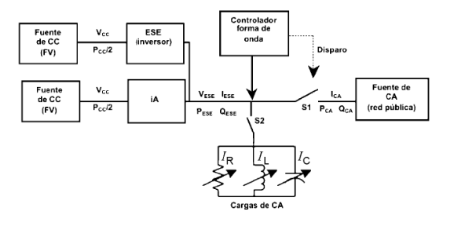

considerar lo establecido en la especificación técnica de CENELEC TS 50539-12 para la protección contra sobretensiones.

Para los generadores eólicos pequeños la norma de aplicación es la UNE EN 61400-2. Para la protección contra la caída de rayos la norma de aplicación es la UNE EN 61400-24.

<!-- tabla: ../tablas/BT-40_t28.csv -->

|  | 8. INSTALACIONES DE PUESTA A TIERRA |
|---|---|
|  | 8.1 Generalidades |
|  | Las centrales de instalaciones generadoras deberán estar provistas de sistemas de |
|  | puesta a tierra que, en todo momento, aseguren que las tensiones que se puedan |
|  | presentar en las masas metálicas de la instalación no superen los valores |
|  | establecidos en la MIE-RAT 13 del Reglamento sobre Condiciones Técnicas y |
|  | Garantías de Seguridad en Centrales Eléctricas, Subestaciones y Centros de |
|  | Transformación. |
|  | Los sistemas de puesta a tierra de las centrales de instalaciones generadoras |
|  | deberán tener las condiciones técnicas adecuadas para que no se produzcan |
|  | transferencias de defectos a la Red de Distribución Pública ni a las instalaciones |
|  | privadas, cualquiera que sea su funcionamiento respecto a ésta: aisladas, asistidas o |
|  | interconectadas. |
|  | 8.2 Características de la puesta a tierra según el funcionamiento de la |
|  | instalación generadora respecto a la Red de Distribución Pública. |
|  | 8.2.1 Instalaciones generadoras aisladas conectadas a instalaciones receptoras que |
|  | son alimentadas de forma exclusiva por dichos grupos. |
|  | La red de tierras de la instalación conectada a la generación será independiente de |
|  | cualquier otra red de tierras. Se considerará que las redes de tierra son |
|  | independientes cuando el paso de la corriente máxima de defecto por una de ellas, no |
|  | provoca en la otra diferencias de tensión, respecto a la tierra de referencia, superiores |
|  | a 50 V. |

La GUIA-BT 18, en su apartado 11, detalla las medidas a considerar para garantizar la adecuada independencia entre redes de tierra.

– 49 –

En las instalaciones de este tipo se realizará la puesta a tierra del neutro del generador y de las masas de la instalación conforme a uno de los sistemas recogidos en la ITC- BT 08. Cuando el generador no tenga el neutro accesible, se podrá poner a tierra el sistema mediante un transformador trifásico en estrella, utilizable para otras funciones auxiliares.

En el caso de que trabajen varios generadores en paralelo, se deberá conectar a tierra, en un solo punto, la unión de los neutros de los generadores.

##### 8.2.2 Instalaciones generadoras asistidas, conectadas a instalaciones receptoras

que pueden ser alimentadas, de forma independiente, por dichos grupos o por la red de distribución pública. Cuando la Red de Distribución Pública tenga el neutro puesto a tierra, el esquema de puesta a tierra será el TT y se conectarán las masas de la instalación y receptores a una tierra independiente de la del neutro de la Red de Distribución Pública.

En caso de imposibilidad técnica de realizar un tierra independiente para el neutro del generador, y previa autorización específica del Organo Competente de la Comunidad Autónoma, se podrá utilizar la misma tierra para el neutro y las masas.

Para alimentar la instalación desde la generación propia en los casos en que se prevea transferencia de carga sin corte, se dispondrá, en el conmutador de interconexión, un polo auxiliar que cuando pase a alimentar la instalación desde la generación propia conecte a tierra el neutro de la generación.

##### 8.2.3 Instalaciones generadoras interconectadas, conectadas a instalaciones

receptoras que pueden ser alimentadas, de forma simultánea o independiente, por dichos grupos o por la Red de Distribución Pública. Cuando la instalación receptora esté acoplada a una Red de Distribución Pública que tenga el neutro puesto a tierra, el esquema de puesta a tierra será el TT y se conectarán las masas de la instalación y receptores a una tierra independiente de la del neutro de la Red de Distribución pública.

Cuando la instalación receptora no esté acoplada a la Red de Distribución Pública y se alimente de forma exclusiva desde la instalación generadora, existirá en el interruptor automático de interconexión, un polo auxiliar que desconectará el neutro de la Red de Distribución Pública y conectará a tierra el neutro de la generación.

Para la protección de las instalaciones generadoras se establecerá un dispositivo de detección de la corriente que circula por la conexión de los neutros de los generadores al neutro de la Red de Distribución Pública, que desconectará la instalación si se sobrepasa el 50% de la intensidad nominal.

– 50 –

Donde la legislación vigente establezca que la instalación deberá disponer de una separación galvánica entre la red y las instalaciones generadoras, bien sea por medio de un transformador de aislamiento o cualquier otro medio que cumpla las mismas funciones, con base en el desarrollo tecnológico, se entenderá que las funciones que se persiguen utilizando un transformador de aislamiento de baja frecuencia son:

### 1. Aislar la instalación generadora para evitar la transferencia de defectos entre la

red y la instalación. 2. Proporcionar seguridad personal. 3. Evitar la inyección de corriente continua en la red. En instalaciones generadoras en las que la transmisión de energía a la red se haga mediante convertidores electrónicos podrán utilizarse transformadores de separación, o no, siempre que se cumplan las funciones anteriores. La transferencia de defectos entre la red y la instalación generadora se considera resuelta, independientemente del convertidor utilizado, siempre que se cumpla el siguiente esquema aplicado por separado a las distintas partes de la instalación, básicamente convertidor y elementos del generador (por ejemplo, en el caso de generación fotovoltaica, inversores y cada uno de los paneles fotovoltaicos), a menos que estén juntas.

– 51 –

Figura 4 (*1) La unión equipotencial entre tierras de diferentes edificios está contemplada en el reglamento en la ITC-BT 26, apartado 3.1.

(*2) En caso de poner protectores de sobretensión entre fases y tierra su tensión de funcionamiento continuo será mayor que la tensión asignada al aislamiento.

– 52 –

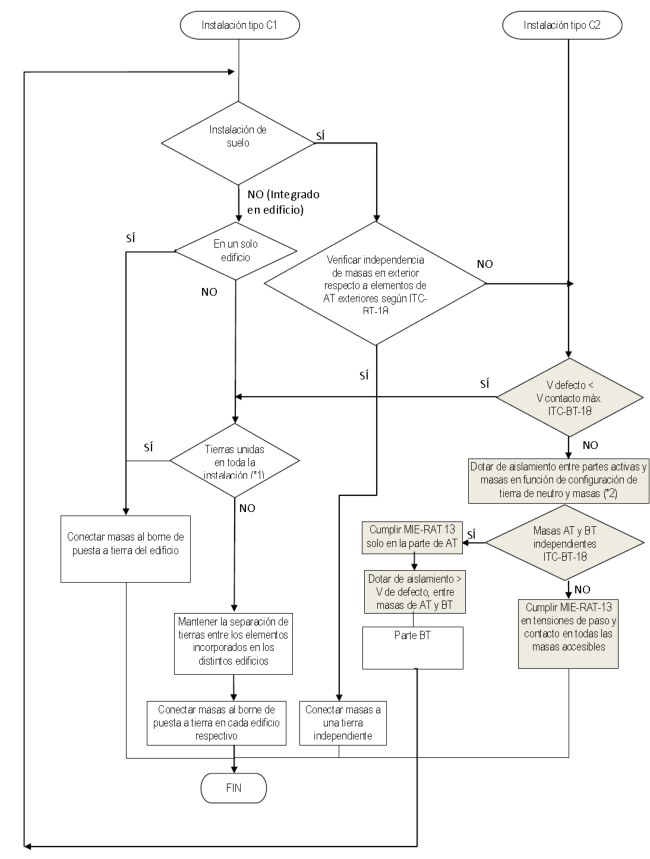

Con el fin de proporcionar seguridad personal la instalación deberá cumplir lo que establece la ITC-BT-24 Para evitar la inyección de corriente continua se deberá aplicar lo que se establece en el apartado 6.

<!-- tabla: ../tablas/BT-40_t29.csv -->

|  | 8.3 Generadores eólicos |
|---|---|
|  | La puesta a tierra de protección de la torre y del equipo en ella montado contra |
|  | descargas atmosféricas será independiente del resto de las tierras de la instalación. |

<!-- tabla: ../tablas/BT-40_t30.csv -->

|  | 9. PUESTA EN MARCHA. |
|---|---|
|  | Para la puesta en marcha de las instalaciones generadoras asistidas o |
|  | interconectadas, además de los trámites y gestiones que corresponda realizar, de |
|  | acuerdo con la legislación vigente ante los Organismos Competentes se deberá |
|  | presentar el oportuno proyecto a la empresa distribuidora de energía eléctrica de |
|  | aquellas partes que afecten a las condiciones de acoplamiento y seguridad del |
|  | suministro eléctrico. Esta podrá verificar, antes de realizar la puesta en servicio, que |
|  | las instalaciones de interconexión y demás elementos que afecten a la regularidad del |
|  | suministro están realizadas de acuerdo con los reglamentos en vigor. En caso de |
|  | desacuerdo se comunicará a los órganos competentes de la Administración, para su |
|  | resolución. |
|  | Este trámite ante la empresa distribuidora de energía eléctrica, no será preciso en las |
|  | instalaciones generadoras aisladas. |

Para instalaciones interconectadas, de acuerdo al artículo 7 del RD 1699/2011 “una vez superadas las pruebas de la instalación realizadas por el instalador autorizado, éste emitirá el correspondiente certificado de características principales de la instalación y de superación de dichas pruebas, debidamente diligenciado por el órgano de la Administración competente. El titular de la instalación solicitará a la empresa distribuidora la suscripción del contrato técnico de acceso a la red para lo que será necesaria la presentación del certificado de superación de las pruebas de la instalación y que se haya producido la aceptación de las condiciones técnicas y económicas de conexión.....". Se entiende que el certificado de superación de pruebas de la instalación que debe ser presentado a la Administración competente, junto a los datos aportados por el promotor en la solicitud de punto de acceso y conexión, debe incluir según el artículo 4 del RD 1699/2011 el esquema unifilar y una descripción de las características técnicas

– 53 –

de la instalación, además de lo que establece la ITC-BT-04 en lo relativo al contenido del proyecto mencionado en el artículo 9 de la ITC-BT-40. El certificado de superación de pruebas citado debe incluir los informes completos de laboratorio acreditado o las conclusiones realizadas por el mismo laboratorio en lo referente a lo establecido en los artículos 6 y 7 de la presente guía, referentes a calidad de onda y a las protecciones y el sistema de conmutación. En el caso de que se hayan entregado sólo las conclusiones, los citados informes completos deberán estar disponibles para la empresa distribuidora cuando esta lo requiera. La aportación por parte del titular de la instalación de los certificados de superación de pruebas se considera equivalente a la verificación y precintado indicados en el artículo 14.3 del RD 1699/2011.

<!-- tabla: ../tablas/BT-40_t31.csv -->

|  | 10. OTRAS DISPOSICIONES |
|---|---|
|  | Todas las actuaciones relacionadas con la fijación del punto de conexión, el proyecto, |
|  | la puesta en marcha y explotación de las instalaciones generadoras seguirán los |
|  | criterios que establece la legislación en vigor. |
|  | La empresa distribuidora de energía eléctrica podrá, cuando detecte riesgo inmediato |
|  | para las personas, animales y bienes, desconectar las instalaciones generadoras |
|  | interconectadas, comunicándolo posteriormente, al Órgano competente de la |
|  | Administración. |

Administración.

– 54 –
