# BT-51. Instalaciones de sistemas de automatización, gestión técnica de la energía y seguridad para viviendas y edificios

_INSTALACIONES DE SISTEMAS DE AUTOMATIZACIÓN,_

### 0. ÍNDICE

- 0. ÍNDICE — 1

- 1. OBJETO Y CAMPO DE APLICACIÓN — 2

- 2. TERMINOLOGÍA — 4

- 3. TIPOS DE SISTEMAS — 6

- 4. REQUISITOS GENERALES DE LA INSTALACIÓN — 7

- 5. CONDICIONES PARTICULARES DE INSTALACIÓN — 9

#### 5.1 Requisitos para sistemas que usan señales que se acoplan y transmiten

- por la instalación eléctrica de baja tensión — 9

#### 5.2 Requisitos para sistemas que usan señales transmitidas por cables

- específicos para dicha función — 9

- 5.3 Requisitos para sistemas que usan señales radiadas — 9

### 1. OBJETO Y CAMPO DE APLICACIÓN

Esta Instrucción establece los requisitos específicos de la instalación de los sistemas de automatización, gestión técnica de la energía y seguridad para viviendas y edificios, también conocidos como sistemas domóticos.

El campo de aplicación comprende las instalaciones de aquellos sistemas que realizan una función de automatización para diversos fines, como gestión de la energía, control y accionamiento de receptores de forma centralizada o remota, sistemas de emergencia y seguridad en edificios, entre otros, con excepción de aquellos sistemas independientes e instalados como tales, que puedan ser considerados en su conjunto como aparatos, por ejemplo, los sistemas automáticos de elevación de puertas, persianas, toldos, cierres comerciales, sistemas de regulación de climatización, redes privadas independientes para transmisión de datos exclusivamente y otros aparatos, que tienen requisitos específicos recogidos en las Directivas europeas aplicables conforme a lo establecido en el artículo 6 del Reglamento Electrotécnico para Baja Tensión.

Quedan excluidas también las instalaciones de redes comunes de telecomunicaciones en el interior de los edificios y la instalación de equipos y sistemas de telecomunicaciones a los que se refiere el Reglamento de Infraestructura Común de Telecomunicaciones (I.C.T.), aprobado por el R.D. 279/1999.

Igualmente están excluidos los sistemas de seguridad reglamentados por el Ministerio del Interior y Sistemas de Protección contra Incendios, reglamentados por el Ministerio de Fomento (NBE-CPI) y el Ministerio de Industria y Energía (RIPCI).

No obstante, a las instalaciones excluidas anteriormente, cuando formen parte de un sistema más complejo de automatización, gestión de la energía o seguridad de viviendas o edificios, se les aplicarán los requisitos de la presente Instrucción además los requisitos específicos reglamentarios correspondientes.

Los sistemas de automatización, gestión técnica de la energía y seguridad para viviendas y edificios, se conocen internacionalmente como HBES (Home and Building Electronic Systems – sistemas electrónicos para viviendas y edificios). Actualmente la norma que define los requisitos técnicos generales de estos sistemas es la UNE-EN 50090-2-2.

De modo general, la instalación de estos sistemas se conoce como domótica y la instalación en edificios como inmótica, aunque en esta guía se utiliza el término domótica para referirse a los dos, ya que es el término más ampliamente empleado.

Los sistemas domóticos realizan el control integrado de múltiples elementos de una instalación con los fines principales de:

- Aumentar el confort, mediante la automatización de elementos de la instalación. - La gestión técnica del la energía, por ejemplo para el ahorro o la eficiencia energética. - Garantizar la seguridad de las personas, los animales y los bienes. - Permitir la comunicación del sistema con redes de telecomunicación externas.

La red de control del sistema domótico, deberá integrarse con la red de energía eléctrica y coordinarse con el resto de redes con las que tenga relación, como por ejemplo de telefonía, televisión y tecnologías de la información, cumpliendo con las reglas de instalación aplicables a cada una de ellas.

En la figura 1 se muestran las distintas redes que pueden convivir en una instalación de una vivienda o edificio. Para referirse al conjunto de estas redes y las posibles aplicaciones mediante su conexión con el exterior, se pueden utilizar varios términos: hogar digital, hogar inteligente (smarthouse), vivienda conectada, casa del futuro, tecnologías digitales en el hogar, edificio inteligente, etc.

Figura 1 – Redes de una instalación

La instalación interior eléctrica (línea roja continua) y la red de control del sistema domótico (línea verde discontinua) están reguladas por el REBT. En particular, la red de control del sistema domótico está regulada por esta instrucción en lo referente a seguridad eléctrica y compatibilidad electromagnética.

La red de control del sistema domótico puede realizarse mediante un cableado específico, por ondas portadoras acopladas a la red eléctrica de baja tensión o por señales radiadas. La línea verde discontinua no tendrá soporte físico en el caso de comunicación por señales radiadas y coincidirá con la línea de alimentación eléctrica (línea roja continua) en el caso de comunicación por ondas portadoras.

Las redes de telefonía, televisión y tecnologías de la información (líneas azules de puntos) están reguladas por el RICT (Reglamento de las infraestructuras comunes de telecomunicaciones para el acceso a los servicios de telecomunicación en el interior de los edificios) aunque también están afectadas por el REBT en lo referente a la seguridad eléctrica.

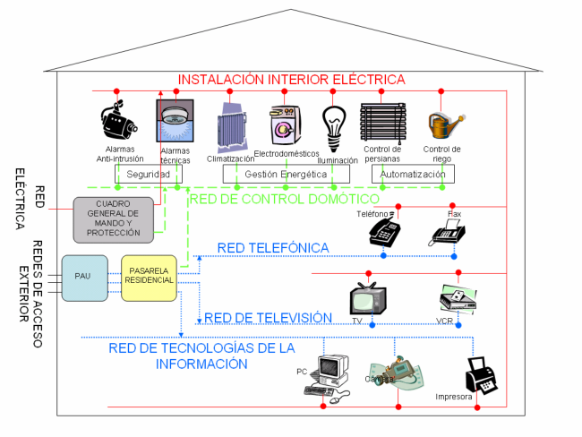

El R.D. 279/1999 ha sido derogado por el R.D. 401/2003 que tiene por objeto “establecer la normativa técnica de telecomunicación relativa a la infraestructura común de telecomunicaciones (ICT) para el acceso a los servicios de telecomunicación; las especificaciones técnicas de telecomunicación que se deberán incluir en la normativa técnica básica de la edificación, que regule la infraestructura de obra civil en el interior de los edificios para garantizar la capacidad suficiente que permita el acceso a los servicios de telecomunicación y el paso de las redes de los distintos operadores; los requisitos que debe cumplir la ICT para el acceso a los distintos servicios de telecomunicación en el interior de los edificios y determinar las condiciones para el ejercicio profesional de la actividad de instalador de telecomunicaciones, a fin de garantizar que las instalaciones y su puesta en servicio permitan el funcionamiento eficiente de los servicios y redes de telecomunicación”.

En consecuencia, teniendo en cuenta las categorías de instaladores autorizados definidos en la ITC-BT 03 del REBT (RD 842/2002) y lo establecido en el RICT (RD 401/2003), se describen a continuación la división de competencias entre los instaladores autorizados de baja tensión y los instaladores autorizados en el ámbito de las telecomunicaciones:

- la realización, mantenimiento o reparación de las instalaciones domóticas se deberá llevar a cabo por un instalador autorizado en baja tensión de la categoría especialista en la modalidad de sistemas de automatización, gestión técnica de la energía y seguridad para viviendas y edificios. - la instalación eléctrica que sea necesaria para la puesta en servicio de los sistemas independientes que puedan ser considerados en su conjunto como un aparto la podrá realizar un instalador autorizado en baja tensión de categoría básica. - las instalaciones en el interior de los edificios destinadas a permitir el acceso a los servicios de telecomunicación definidos en el articulo 2 del RD 401/2003 (por ejemplo, teléfono, televisión, acceso a Internet, etc.) serán realizadas por un instalador de telecomunicaciones tal como se indica en el nuevo reglamento regulador de las infraestructuras comunes de telecomunicaciones (ICT).

### 2. TERMINOLOGÍA

Sistemas de Automatización, Gestión de la Energía y Seguridad para Viviendas y Edificios: Son aquellos sistemas centralizados o descentralizados, capaces de recoger información proveniente de unas entradas (sensores o mandos), procesarla y emitir ordenes a unos actuadores o salidas, con el objeto de conseguir confort, gestión de la energía o la protección de personas animales y bienes.

Estos sistemas pueden tener la posibilidad de accesos a redes exteriores de comunicación, información o servicios, como por ejemplo, red telefónica conmutada, servicios INTERNET, etc.

Ejemplos de Sistemas de Automatización, Gestión de la Energía y Seguridad para Viviendas y Edificios, denominados en el ámbito de esta guía como Sistemas domóticos, son:

1. Sistemas de automatización que controlan aparatos o sistemas tales como iluminación, climatización, persianas y toldos, sistemas de riego, control de electrodomésticos, etc. Un sistema que controla la climatización, la apertura de persianas, la iluminación del local y el riego del jardín, que tenga en cuenta las condiciones meteorológicas presentes o sus previsiones, mediante una lógica, se considera que es un sistema domótico, ya que recibe información de diferentes entradas, la procesa y decide el tipo de actuación sobre cada elemento controlado.

Un reloj-programador simple de encendido/apagado o similar no se considera un sistema domótico en sí mismo ya que, aunque emita una orden de encendido o apagado, no recibe información externa ni procesa ninguna información. Sin embargo, si el reloj programador esta integrado en un sistema como el descrito en el párrafo anterior, se considera parte del sistema domótico.

### 2. Sistemas de gestión de la energía que controlan o secuencian el encendido de varios

electrodomésticos, con objeto de realizar un uso más racional de la energía, limitando la potencia máxima demandada o adaptando el consumo a horarios en los que el precio de la energía es menor. Cuando un alumbrado cuenta únicamente con un sensor de presencia para evitar que la luz permanezca encendida sin ocupación del local, no se considerará un sistema domótico en sí mismo, pero si estuviera integrado en un sistema más complejo debería considerarse como parte del sistema domótico.

### 3. Sistemas de seguridad que sirvan para la detección de intrusos, incendios, fugas de

agua o gas, disparos de protecciones eléctricas y gestión de su reenganche, recibiendo información de los distintos subsistemas y ejecutando ordenes de aviso, corte de suministro, previamente establecidas. Los diferentes subsistemas (central de detección de incendios, central antirrobo, etc.) además deberán cumplir las prescripciones reglamentarias propias que le sean de aplicación individualmente.

Nodo: Cada una de las unidades del sistema capaces de recibir y procesar información comunicando, cuando proceda con otras unidades o nodos, dentro del mismo sistema.

Actuador: Es el dispositivo encargado de realizar el control de algún elemento del Sistema, como por ejemplo, electroválvulas (suministro de agua, gas, etc.), motores (persianas, puertas, etc.), sirenas de alarma, reguladores de luz, etc.

Dispositivo de entrada: Sensor, mando a distancia, teclado u otro dispositivo que envía información al nodo.

Los elementos definidos anteriormente pueden ser independientes o estar combinados en una o varias unidades distribuidas.

Sistemas centralizados: Sistema en el cual todos los componentes se unen a un nodo central que dispone de funciones de control y mando.

Sistema descentralizado: Sistema en que todos sus componentes comparten la misma línea de comunicación, disponiendo cada uno de ellos de funciones de control y mando.

En el primer ejemplo anterior:

- El nodo sería un ordenador o un autómata que reciba señales de sensores de temperatura, humedad, luz, etc. y procese dichas señales para dar órdenes a los sistemas que actúan sobre la climatización, la iluminación, las persianas o el sistema de riego. Asimismo, podría estar conectada a la red de tecnologías de la información (RTI) para recibir información de las previsiones meteorológicas. - Los actuadores serían el contactor que alimenta los motores de las persianas, la electroválvula del sistema de riego o un regulador de intensidad de luz. - Los dispositivos de entrada serían los medidores de temperatura o humedad, las células fotoeléctricas, etc. que envían información al nodo.

A continuación se resume otra terminología complementaria utilizada en este ámbito:

- BUS (Binary Unit System): Línea de intercambio de datos a la que se pueden conectar gran cantidad de componentes, permitiendo la comunicación entre éstos. Los componentes que se pueden conectar pueden ser nodos, actuadores o dispositivos de entrada.

- Pasarela residencial (Residential Gateway): Elemento de conexión entre diferentes redes de una vivienda o edificio (control domótico, telefonía, televisión y tecnologías de la información) a una red pública de datos, como por ejemplo Internet, efectuando en su caso, la adaptación y traducción entre diferentes protocolos. La red de control del sistema domótico puede estar o no conectada a la pasarela residencial; en el caso de que esté conectada, el nodo puede desempeñar también las funciones de pasarela residencial.

- Punto de acceso al usuario (PAU): Es el elemento en el que comienza la red interior de telecomunicación del domicilio del usuario, que permite la delimitación de responsabilidades en cuanto al origen, localización y reparación de averías. Se ubica en el interior del domicilio del usuario.

- Protocolo: Lenguaje de comunicación entre periféricos con objeto de establecer la transmisión de datos con un sistema central o entre sí, de forma ordenada.

- Radiofrecuencia (RF): Transmisión de señal sin requerir de un medio físico, ni de alineación libre de obstáculos entre el emisor y el receptor, generalmente de frecuencia comprendida entre 3 kHz y 3 GHz.

- Topología: Término utilizado para definir la estructura de la red y la configuración del sistema.

### 3. TIPOS DE SISTEMAS

Los sistemas de Automatización, Gestión de la energía y Seguridad considerados en la presente instrucción, se clasifican en los siguientes grupos:

- Sistemas que usan en todo o en parte señales que se acoplan y transmiten por la instalación eléctrica de Baja Tensión, tales como sistemas de corrientes portadoras. - Sistemas que usan en todo o en parte señales transmitidas por cables específicos para dicha función, tales como cables de pares trenzados, paralelo, coaxial, fibra óptica. - Sistemas que usan señales radiadas, tales como ondas de infrarrojo, radiofrecuencia, ultrasonidos, o sistemas que se conectan a la red de telecomunicaciones.

Un sistema domótico puede combinar varios de los sistemas anteriores, debiendo cumplir los requisitos aplicables en cada parte del sistema. La topología de la instalación puede ser de distintos tipos, tales como, anillo, árbol, bus o lineal, estrella o combinaciones de éstas.

En la clasificación establecida en el último guión, la referencia a sistemas que se conectan a la red de telecomunicaciones se refiere, en este caso, a sistemas domóticos que usan dicha red como soporte de transmisión de las señales domóticas, sean o no radiadas.

### 4. REQUISITOS GENERALES DE LA INSTALACIÓN

Todos los nodos, actuadores y dispositivos de entrada deben cumplir, una vez instalados, los requisitos de Seguridad y Compatibilidad Electromagnética que le sean de aplicación, conforme a lo establecido en la legislación nacional que desarrolla la Directiva de Baja Tensión (73/23/CEE) y la Directiva de Compatibilidad Electromagnética (89/336/CEE). En el caso de que estén incorporados en otros aparatos se atendrán, en lo que sea aplicable, a lo requisitos establecidos para el producto o productos en los que vayan a ser integrados.

La Directiva de Compatibilidad Electromagnética (89/336/CEE) ha sido sustituida en diciembre de 2004, por la nueva directiva 2004/108/CE que se aplicará de forma obligatoria a los aparatos, componentes, subsistemas e instalaciones a partir del 20 de julio de 2009.

La evaluación de conformidad establecida en dicha directiva para los aparatos, es aplicable a todos los componentes y subsistemas que estén disponibles comercialmente, por ejemplo actuadores, nodos, dispositivos de entrada, etc.

La norma UNE-EN 50090-2-2:1998 está incluida en la lista de normas armonizadas que otorgan presunción de conformidad con los requisitos esenciales establecidos en la Directiva de Compatibilidad Electromagnética y en la Directiva de Baja Tensión. Dicha norma establece los requisitos de compatibilidad electromagnética y de seguridad que son aplicables a componentes y subsistemas de la red de control del sistema domótico.

Todos los nodos, actuadores y dispositivos de entrada que se instalen en el sistema, deberán incorporar instrucciones o referencias a las condiciones de instalación y uso que deban cumplirse para garantizar la seguridad y compatibilidad electromagnética de la instalación, como por ejemplo, tipos de cable a utilizar, aislamiento mínimo, apantallamientos, filtros y otras informaciones relevantes para realizar la instalación. En el caso de que no se requieran condiciones especiales de instalación, esta circunstancia deberá indicarse expresamente en las instrucciones.

Dichas instrucciones se incorporarán en el proyecto o memoria técnica de diseño, según lo establecido en la ITC-BT-04.

Toda instalación nueva, modificada o ampliada de un sistema de automatización, gestión de la energía y seguridad deberá realizarse conforme a lo establecido en la presente Instrucción y lo especificado en las instrucciones del fabricante, anteriormente citadas.

### DOCUMENTOS DE LA INSTALACIÓN

La documentación técnica debe incluir, como mínimo, el manual del usuario y el manual del instalador, con los contenidos mínimos establecidos en los siguientes apartados:

Manual de usuario

a) Instrucciones para el correcto uso y mantenimiento de la instalación, incluyendo - el esquema unifilar de la instalación del sistema domótico; - la relación de los dispositivos instalados con sus características técnicas fundamentales; - trazado de la instalación del sistema domótico indicando la ubicación de los dispositivos; - Parámetros y especificaciones de funcionamiento del sistema domótico.

b) Datos para la programación del sistema, incluyendo las explicaciones necesarias que permitan al usuario final cambiar los parámetros preestablecidos por el fabricante o el instalador. c) Posibilidades de ampliación de la instalación. d) Declaración de entrega firmada por el instalador, incluyendo la dirección y teléfono de la empresa instaladora y del servicio de mantenimiento o post-venta.

Manual de instalador

a) Identificación de la instalación, con datos del emplazamiento, características básicas de la instalación incluyendo información sobre datos particulares relevantes de la instalación. b) Planos de la instalación: - Planta general de la vivienda o edificio; - Indicación del trazado de los sistemas de conducción de cables, tanto de la red de control del sistema domótico como de la red eléctrica asociada; - Trazado de la instalación del sistema domótico indicando la ubicación de los dispositivos; - Esquema unifilar de la instalación identificando los circuitos de control del sistema domótico y los de la red eléctrica asociada, incluyendo las secciones de los cables. c) Relación de los dispositivos instalados con sus características técnicas fundamentales y las instrucciones de instalación del fabricante de dichos dispositivos. d) Asignación de entradas y salidas de cada uno de los nodos indicando las entradas y salidas utilizadas con sus direcciones físicas y tipos de señal, así como su localización en la topología del sistema, incluyendo también las que estén disponibles para futuras ampliaciones. e) Parámetros del sistema que se han establecido de acuerdo con las especificaciones de funcionamiento del fabricante de cada dispositivo. f) Programación de los niveles de aviso y alarma. g) Instrucciones del fabricante del sistema completo o de los subsistemas y componentes a la empresa instaladora para la puesta en marcha y verificación del correcto funcionamiento, con indicación de las etapas apropiadas para asegurar que las partes, componentes, subconjuntos, cableados, etc. están de acuerdo con las normas de instalación. h) Relación de disposiciones legales y normas con las que se declara el cumplimiento de la instalación. i) Condiciones y requisitos a cumplir en caso de ampliación o modificación de la instalación.

Conforme a lo requerido por el artículo 19 del REBT, se entiende que ambos manuales deben formar parte de las “instrucciones de la instalación para el correcto uso y mantenimiento” que se entregarán al usuario de la instalación y deberán estar disponibles para la empresa que realice el servicio de mantenimiento o post-venta de la instalación.

Es aceptable la entrega de estos documentos en soporte informático, siempre que se garantice que los archivos no son modificables por el usuario.

En lo relativo a la Compatibilidad Electromagnética, las emisiones voluntarias de señal, conducidas o radiadas, producidas por las instalaciones domóticas para su funcionamiento, serán conformes a las normas armonizadas aplicables y, en ausencia de tales normas, las señales voluntarias emitidas en ningún caso superarán los niveles de inmunidad establecidos en las normas aplicables a los aparatos que se prevea puedan ser instalados en el entorno del sistema, según el ambiente electromagnético previsto.

Cuando el sistema domótico esté alimentado por muy baja tensión o la interconexión entre nodos y dispositivos de entrada este realizada en muy baja tensión, las instalaciones e interconexiones entre dichos elementos seguirán lo indicado en la ITC-BT-36.

Para el resto de los casos, se seguirán los requisitos de instalación aplicables a las tensiones ordinarias.

Las instalaciones receptoras del sistema domótico que no satisfagan los requisitos establecidos para MBTS o MBTP cumplirán los requisitos de seguridad y de instalación definidos en las ITC- BT correspondientes a Instalaciones interiores o receptoras en lo relativo a su nivel de aislamiento, protecciones y sistemas de instalación, al igual que el resto de instalaciones para baja tensión.

### 5. CONDICIONES PARTICULARES DE INSTALACIÓN

Además de las condiciones generales establecidas en el apartado anterior, se establecen los siguientes requisitos particulares.

#### 5.1 Requisitos para sistemas que usan señales que se acoplan y transmiten por la

instalación eléctrica de baja tensión

Los nodos que inyectan en la instalación de baja tensión señales de 3 kHz hasta 148,5 kHz cumplirán lo establecido en la norma UNE-EN 50.065-1 en lo relativo a compatibilidad electromagnética. Para el resto de frecuencias se aplicará la norma armonizada en vigor y en su defecto se aplicará lo establecido en el apartado 4.

#### 5.2 Requisitos para sistemas que usan señales transmitidas por cables específicos

para dicha función

Sin perjuicio de los requisitos que los fabricantes de nodos, actuadores o dispositivos de entrada establezcan para la instalación, cuando el circuito que transmite la señal transcurra por la misma canalización que otro de baja tensión, el nivel de aislamiento de los cables del circuito de señal será equivalente a la de los cables del circuito de baja tensión adyacente, bien en un único o en varios aislamientos.

Los cables coaxiales y los pares trenzados usados en la instalación serán de características equivalentes a los cables de las normas de la serie EN 61.196 y CEI 60.189-2.

Las normas de cables indicadas han sido adoptadas como norma UNE con los siguientes códigos: - UNE-EN 61196 (serie): Cables de radiofrecuencia - UNE 212002 (serie): Cables y conductores aislados de baja frecuencia con aislamiento y cubierta de PVC

#### 5.3 Requisitos para sistemas que usan señales radiadas

Adicionalmente, los emisores de los sistemas que usan señales de radiofrecuencia o señales de telecomunicación, deberán cumplir la legislación nacional vigente del “Cuadro Nacional de Atribución de Frecuencias de Ordenación de las Telecomunicaciones”.

### RECOMENDACIONES PARA LA INSTALACIÓN DE LOS SISTEMAS DOMÓTICOS

El avance y desarrollo de las nuevas tecnologías hace recomendable que las instalaciones eléctricas en viviendas y edificios estén preparadas para incorporar sistemas domóticos.

Preinstalación de los sistemas domóticos En los proyectos de obra nueva en los que no se contemple la instalación de sistemas domóticos se recomienda, con objeto de evitar costosas obras de instalación posteriores, realizar una preinstalación que facilite la adecuación del sistema domótico a las necesidades del usuario, así como a sus futuras demandas en este campo.

Los elementos y características de la preinstalación recomendada son los siguientes: - Canalización desde punto de acceso de usuario a las instalaciones de telecomunicación (PAU) hasta la caja de distribución. - Caja de distribución: el nodo junto con su fuente de alimentación y protecciones, se podrá instalar en el cuadro general de distribución previsto para los dispositivos generales de mando y protección de la instalación eléctrica o en una caja de distribución independiente. Se recomienda que se instale una caja de 24 módulos DIN por cada 100 m2 o por planta, si se trata de viviendas de más de una planta. - Cajas de registro: se instalará una junto a cada caja de empalme y derivación de la instalación eléctrica o bien, la caja de empalme y derivación se ampliará en superficie al menos un 50%, para poder ubicar los dispositivos del sistema domótico. - Canalizaciones: se instalará una canalización independiente (de sección equivalente a la de un tubo de diámetro 20 mm) entre las cajas de registro específicas para la instalación domótica o, en caso de utilizarse las cajas de empalme y derivación eléctricas para la instalación domótica, se aumentará la sección de la canalización, como mínimo en 200 mm2. - Cajas de mecanismos domóticos: Se instalarán cajas para alojar los componentes domóticos de la instalación (accionamientos, detectores, alarmas, etc.), junto con sus correspondientes canalizaciones, hasta la caja de registro.

En las figuras 2 a 10 se muestra un ejemplo de trazado de preinstalación del sistema domótico en cada estancia de una vivienda, así como el número mínimo de elementos de cada tipo a preinstalar.

Figura 2 – vestíbulo

Figura 3 – pasillo

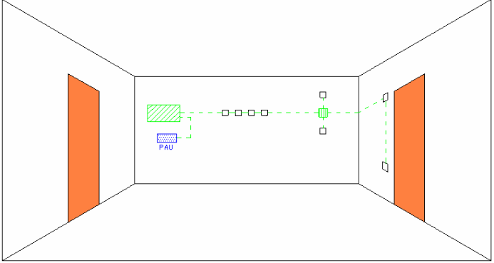

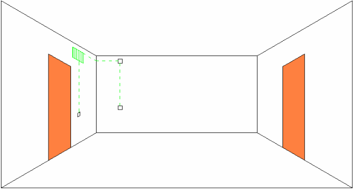

Figura 4 – cocina

Figura 5 – baño-aseo

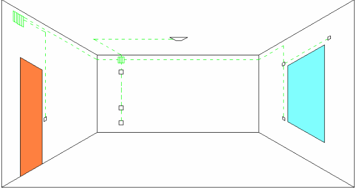

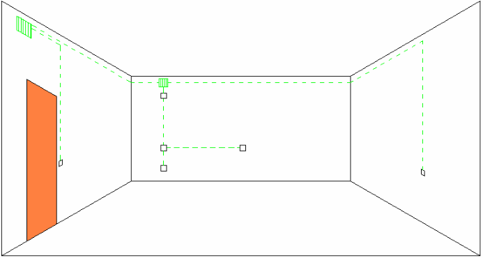

Figura 6 – salón-comedor

Figura 7 – dormitorio

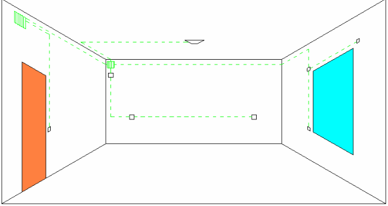

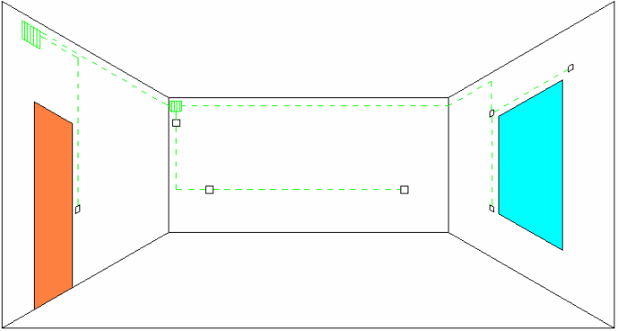

Figura 9 – terraza

Figura 10 – garaje

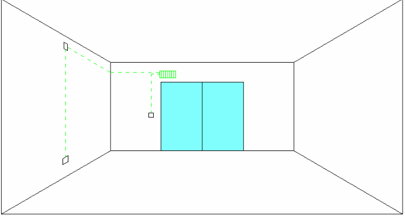

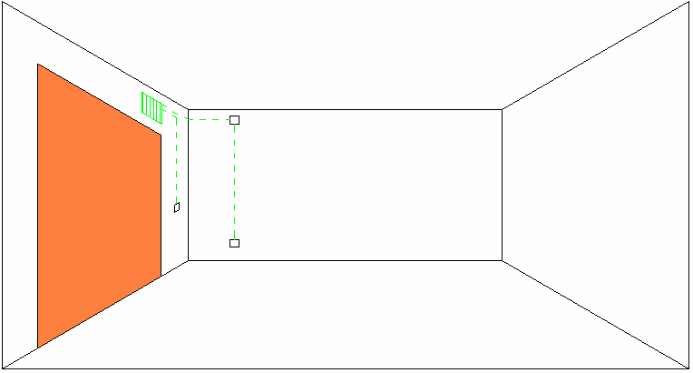

### GRADOS DE AUTOMATIZACIÓN

En esta guía y con el fin de clasificar las prestaciones de los sistemas domóticos que actualmente se utilizan, se distinguen los grados de automatización, básico y normal, con el fin de satisfacer dos niveles de servicios y confort para los usuarios. La preinstalación descrita anteriormente, permitirá la utilización de las aplicaciones domóticas para discapacitados o personas de la tercera edad, aunque los dispositivos concretos a utilizar en cada caso no estén incluidos en las tablas que describen los grados de automatización.

Grado de automatización básico

<!-- tabla: ../tablas/BT-51_t01.csv -->

| FUNCIONALIDAD | APLICACIÓN | DISPOSITIVOS |
|---|---|---|
| Seguridad | Intrusión | - Dos detectores de presencia. |
|  | Alarmas técnicas | - Detección de inundación en zonas húmedas (baños, cocina, lavadero, garaje…) asociada a electroválvula de agua |
|  |  | - Detección de concentraciones de gas butano o natural (si hay suministro de gas), asociada a electroválvula de gas |
|  |  | - Detección de incendios en cocina. |
| Confort y ahorro energético | Control de climatización | - Un crono-termostato o equivalente en salón-comedor. |
|  | Control de iluminación | - Detector de presencia para control de la iluminación en zonas de paso |
|  | Control de persianas | - Motorización y control de persianas en el salón y dormitorio principal |

Grado de automatización normal

<!-- tabla: ../tablas/BT-51_t02.csv -->

| FUNCIONALIDAD | APLICACIÓN | DISPOSITIVOS |
|---|---|---|
| Seguridad | Intrusión | - Un detector de presencia por estancia - Contactos magnéticos en las ventana - Detectores de impactos en las ventanas |
|  | Alarmas técnicas | - Detección de inundación en zonas húmedas (baños, cocina, lavadero, garaje…) asociada a electroválvula de agua |
|  |  | - Detección de concentraciones de gas butano o natural (si hay suministro de gas), asociada a electroválvula de gas |
|  |  | - Detectores de humo en todas las estancias |
|  | Simulación de presencia | - Sistema programable de encendido y apagado de luces |
| Confort y ahorro energético | Control de climatización | - Varios crono-termostatos (o equivalente) zonificado la vivienda por estancias |
|  | Control de iluminación | - Detector de presencia para control de la iluminación en zonas de paso - Regulación luminosa en salas de estar con elección de ambientes de iluminación predefinidos - Control de los puntos de luz y tomas de corriente más significativas de la vivienda (mínimo 80% de los puntos de luz y el 20% de las tomas de corriente) |
|  | Control de persianas | - Motorización y control de las persianas |
|  | Programación | - Posibilidad de realizar programaciones horarias sobre los equipos controlados (mínimo 12 temporizadores) - Sistemas de gestión de energía |
|  | Control de iluminación exterior | - En viviendas con jardín o grandes terrazas se instalará un detector crepuscular o un interruptor horario astronómico para el control de la iluminación exterior |

Las figuras 11 a 18 muestran un ejemplo de sistema domótico de grado normal para una vivienda provista de una instalación similar a la mostrada en las figuras 2 a 10. Las figuras muestran los dispositivos a colocar en las diferentes estancias de la vivienda, incluyendo alguna de las ayudas técnicas típicas para discapacitados y personas de la tercera edad.

Figura 11 – vestíbulo

Figura 12 – pasillo

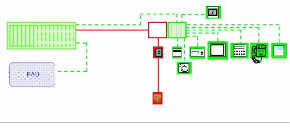

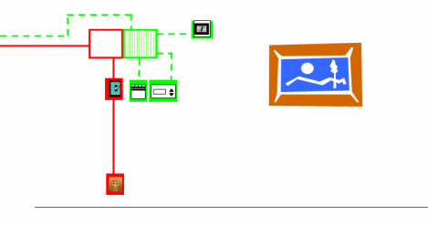

Figura 13 – Cocina

Figura 14 – baño-aseo

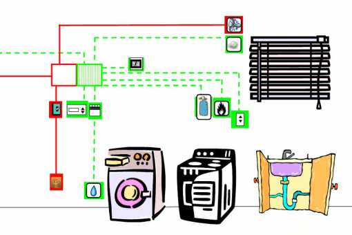

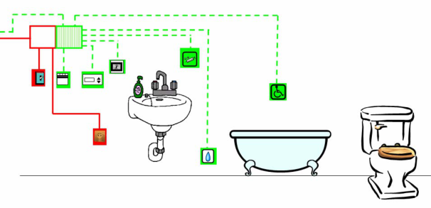

Figura 15 – salón-comedor

Figura 16 – dormitorio

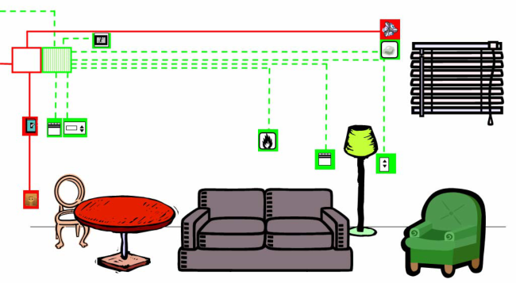

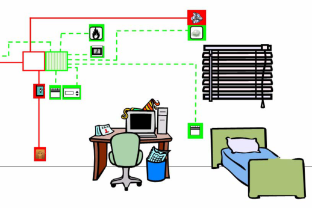

Figura 17 – terraza

Figura 18 – garaje

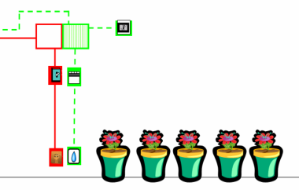

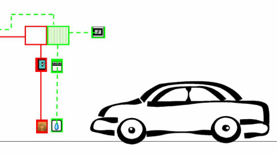

Leyenda:

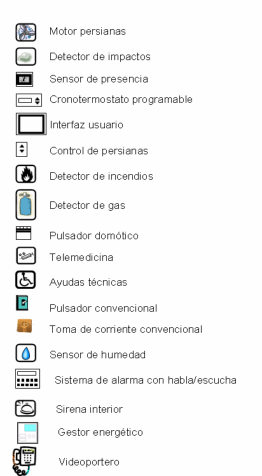

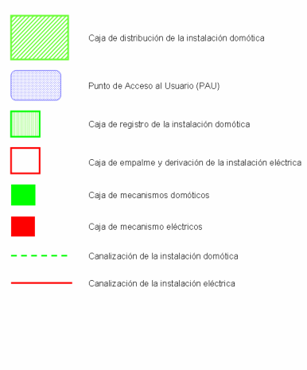
