# BT-52. Infraestructuras para la recarga de vehículos eléctricos

Guía técnica de aplicación ITC-BT 52

### INSTALACIONES CON FINES ESPECIALES. INFRAESTRUCTURA PARA LA RECARGA DE

### VEHÍCULOS ELÉCTRICOS

ÍNDICE

### INTRODUCCIÓN A LA GUÍA 3

### 1. OBJETO Y ÁMBITO DE APLICACIÓN. 4

### 2. TÉRMINOS Y DEFINICIONES. 5

### 3. ESQUEMAS DE INSTALACIÓN PARA LA RECARGA DE VEHÍCULOS ELÉCTRICOS. 11

#### 3.1 Instalación en aparcamientos de viviendas unifamiliares. 24

3.2 Instalación en aparcamientos o estacionamientos colectivos interiores o adscritos a edificios o conjuntos inmobiliarios. 25

#### 3.3. Otras instalaciones de recarga 27

### 4. PREVISIÓN DE CARGAS SEGÚN EL ESQUEMA DE LA INSTALACIÓN. 27

#### 4.1. Esquema colectivo con un contador principal común (esquemas 1a, 1b y 1c). 27

#### 4.2. Esquema individual (esquemas 2, 3a y 3b). 29

#### 4.3. Esquema 4 (esquemas 4a y 4b). 29

### 5. REQUISITOS GENERALES DE LA INSTALACIÓN 30

#### 5.1 Alimentación. 32

#### 5.2 Sistemas de conexión del neutro. 32

#### 5.3 Canalizaciones. 33

#### 5.4 Punto de conexión. 33

#### 5.5 Contador secundario de medida de energía. 35

### 6. PROTECCIÓN PARA GARANTIZAR LA SEGURIDAD. 35

#### 6.1 Medidas de protección contra contactos directos e indirectos. 35

#### 6.2 Medidas de protección en función de las influencias externas. 36

#### 6.3 Medidas de protección contra sobreintensidades 38

#### 6.4 Medidas de protección contra sobretensiones. 38

### 7. CONDICIONES PARTICULARES DE INSTALACIÓN. 40

#### 7.1 Red de tierra para plazas de aparcamiento en el exterior. 40

### ANEXO 1 DE LA GUIA. BUENAS PRÁCTICAS PARA LA INSTALACIÓN DE UN PUNTO DE RECARGA EN

### GARAJES EXISTENTES EN RÉGIMEN DE PROPIEDAD HORIZONTAL 41

### ANEXO 2 DE LA GUÍA. PREVISIÓN DE CARGAS EN EDIFICIOS DE VIVIENDAS DE NUEVA CONSTRUCCIÓN

### CON GARAJES EN RÉGIMEN DE CONDOMINIO. 42

### ANEXO 3 DE LA GUÍA. DETERMINACIÓN DE LA CAPACIDAD DISPONIBLE POR UN CONSUMIDOR

### DOMÉSTICO PARA REALIZAR LA RECARGA DEL VE SIN AMPLIAR LA POTENCIA. 46

1 de 46

© Dirección General de Estrategia Industrial y de la Pequeña y Mediana Empresa Paseo de la Castellana, 160. 28046 Madrid https://industria.gob.es/es-es/Paginas/Index.aspx

Catálogo de Publicaciones de la Administración General del Estado https://cpage.mpr.gob.es/

MINISTERIO DE INDUSTRIA Panamá, 1. 28036 Madrid Y TURISMO Tels. 91 349 51 31 / 913 494 000 (centralita) SECRETARÍA GENERAL TÉCNICA CentroPublicaciones@mincotur.es https://www.mintur.gob.es

### SUBDIRECCIÓN GENERAL DE DESARROLLO

### NORMATIVO, INFORMES Y PUBLICACIONES

### CENTRO DE PUBLICACIONES

___________________________ Edición: septiembre 2024 NIPO: 217-24-031-6 (en línea) P.V.P. 0,00 €

2 de 46

### INTRODUCCIÓN A LA GUÍA

El artículo 29 del Real Decreto 842/2002, de 2 de agosto, por el que se aprueba el Reglamento electrotécnico para baja tensión, dispone que se elaborará y mantendrá actualizada una guía técnica, de carácter no vinculante, para la aplicación práctica de este Reglamento y sus Instrucciones Técnicas Complementarias. Así mismo, la disposición adicional segunda del RD 1053/2014 de 12 de diciembre por el que se aprueba la ITC-BT 52 del Reglamento Electrotécnico para Baja Tensión y se modifican otras instrucciones técnicas complementarias del mismo, establece que el órgano directivo competente en materia de seguridad industrial del Ministerio con competencias en industria elaborará y mantendrá actualizada una Guía técnica, de carácter no vinculante, para la aplicación práctica de las previsiones de este real decreto, la cual podrá establecer aclaraciones a conceptos de carácter general incluidos en el mismo. El objetivo de esta guía es dar cumplimiento a la citada disposición. El Real Decreto-ley 6/2010, de 9 de abril, de medidas para el impulso de la recuperación económica y el empleo, reformó la Ley 54/1997, de 27 de noviembre, del Sector Eléctrico, entre otros aspectos, para definir la función principal del servicio de recarga energética como “la entrega de energía a través de servicios de recarga de vehículos eléctricos que utilicen motores eléctricos o baterías de almacenamiento en unas condiciones que permitan la recarga conveniente y a coste mínimo para el propio usuario y para el sistema eléctrico, mediante la futura integración con los sistemas de recarga tecnológicos que se desarrollen”. Para desarrollar y concretar el Real Decreto-ley 6/2010 en el RD 647/2011 se define la actividad de los gestores de cargas del sistema consistente en la realización de servicios de recarga energética para vehículos eléctricos y se concretan y desarrollan los derechos y obligaciones de los gestores de cargas del sistema. Asimismo, se regulan el procedimiento y los requisitos necesarios para el ejercicio de esta actividad. La definición de la figura del gestor de cargas ha sido refrendada posteriormente por la Ley 24/2013, de 26 de diciembre, del Sector Eléctrico, que en su artículo 48 define los servicios de recarga energética y las obligaciones y derechos de los gestores de cargas. Según el artículo 48 de la Ley del Sector Eléctrico, el servicio de recarga energética tendrá como función principal la entrega de energía a través de servicios de carga de vehículos eléctricos y de baterías de almacenamiento en unas condiciones que permitan la carga de forma eficiente y a mínimo coste para el propio usuario y para el sistema eléctrico Como aspecto técnico aplicable a cualquiera de los posibles esquemas de instalación, cabe señalar que los gestores de cargas registrarán en cada una de sus instalaciones los consumos destinados a la recarga de vehículos de forma diferenciada a los consumos que puedan producirse para otros usos. Según el artículo 48 de la Ley del Sector Eléctrico, el servicio de recarga energética tendrá como función principal la entrega de energía a través de servicios de carga de vehículos eléctricos y de baterías de almacenamiento en unas condiciones que permitan la carga de forma eficiente y a mínimo coste para el propio usuario y para el sistema eléctrico. Sin embargo, tal y como aclara el preámbulo del RD 1053/2014 "...ello no impide que los titulares de los aparcamientos de uso no público puedan realizar las instalaciones correspondientes y gestionar su propio suministro o realizar una repercusión interna de gastos". De ello se deduce que en aparcamientos de uso no público no es obligatoria la figura del gestor de cargas. En el caso de aparcamientos o estacionamientos en régimen de condominio el modo de repercutir los gastos vinculados a la recarga de vehículos eléctricos debe acordarse en la comunidad de vecinos de acuerdo con la legislación aplicable. La aplicación práctica de esta repercusión de gastos la puede realizar la comunidad directamente o subcontratarla a una empresa externa, como se realiza por ejemplo para los consumos del agua. La disposición adicional primera define las dotaciones mínimas de la estructura para la recarga del vehículo eléctrico en estacionamientos no adscritos a edificios, de nueva construcción o sujetos a reformas importantes, y en vías públicas.

3 de 46

1. En aparcamientos o estacionamientos de nueva construcción o sujetos a reformas importantes no ubicados en un edificio ni adscritos al mismo y, por lo tanto, fuera del ámbito de aplicación del Documento Básico de Ahorro de Energía (DB HE) del Código Técnico de la Edificación, se deberá instalar como mínimo una estación de recarga por cada 40 plazas de estacionamiento, o fracción. Se considera que un estacionamiento es de nueva construcción cuando el proyecto constructivo se presente a la Administración Pública competente para su tramitación en fecha posterior a la entrada en vigor de este real decreto. 2. En la vía pública, deberán efectuarse las instalaciones necesarias para dar suministro a las estaciones de recarga ubicadas en las plazas destinadas a vehículos eléctricos que estén previstas en el Planes de Movilidad Sostenible supramunicipales o municipales.

Las dotaciones mínimas a ejecutar en los aparcamientos o estacionamientos de nueva construcción o sujetos a reformas importantes no ubicados en un edificio ni adscritos al mismo, incluirán las estaciones de carga y las instalaciones necesarias para su alimentación. Las dotaciones mínimas a ejecutar en las edificaciones comprendidas dentro del ámbito de aplicación del Código Técnico de la Edificación se determinarán de conformidad con las previsiones del Documento Básico de Ahorro de Energía (DB HE) del Código Técnico de la Edificación.

1. OBJETO Y ÁMBITO DE APLICACIÓN.

1. Constituye el objeto de esta Instrucción el establecimiento de las prescripciones aplicables a las instalaciones para la recarga de vehículos eléctricos. 2. Las disposiciones de esta Instrucción se aplicarán a las instalaciones eléctricas incluidas en el ámbito del Reglamento electrotécnico para baja tensión con independencia de si su titularidad es individual, colectiva o corresponde a un gestor de cargas, necesarias para la recarga de los vehículos eléctricos en lugares públicos o privados, tales como:

a) Aparcamientos de viviendas unifamiliares o de una sola propiedad. b) Aparcamientos o estacionamientos colectivos en edificios o conjuntos inmobiliarios de régimen de propiedad horizontal. c) Aparcamientos o estacionamientos de flotas privadas, cooperativas o de empresa, o los de oficinas, para su propio personal o asociados, los de talleres, de concesionarios de automóviles o depósitos municipales de vehículos eléctricos y similares. d) Aparcamientos o estacionamientos públicos, gratuitos o de pago, sean de titularidad pública o privada. e) Vías de dominio público destinadas a la circulación de vehículos eléctricos, situadas en zonas urbanas y en áreas de servicio de las carreteras de titularidad del Estado previstas en el artículo 28 de la Ley 25/1988, de 29 de julio, de Carreteras.

3. Esta instrucción no es aplicable a los sistemas de recarga por inducción, ni a las instalaciones para la recarga de baterías que produzcan desprendimiento de gases durante su recarga.

4 de 46

2. TÉRMINOS Y DEFINICIONES.

A los efectos de esta instrucción se entenderá por: "Gestor de cargas" Sociedades mercantiles que, siendo consumidores, están habilitados para la reventa de energía eléctrica para servicios de recarga energética. Los gestores de carga del sistema son los únicos sujetos con carácter de cliente mayorista en los términos previstos en la normativa comunitaria de aplicación. (Definición según el artículo 6 de la ley 24/2013 del Sector eléctrico). «Circuito de recarga colectivo». Circuito interior de la instalación receptora que partiendo de una centralización de contadores o de un cuadro de mando y protección, está previsto para alimentar dos o más estaciones de recarga del VEHÍCULO ELÉCTRICO. «Circuito de recarga individual». Circuito interior de la instalación receptora que partiendo de la centralización de contadores está previsto para alimentar una estación de recarga del VEHÍCULO ELÉCTRICO, o circuito de una vivienda que partiendo del cuadro general de mando y protección está destinado a alimentar una estación de recarga del VEHÍCULO ELÉCTRICO, (circuito C ). 13 «Contador eléctrico principal». Contador de energía eléctrica destinado a la medida de energía consumida por una o varias estaciones de recarga. Estos contadores cumplirán con la reglamentación de metrología legal aplicable y con el reglamento unificado de puntos de medida. Los contratos de acceso a la red se realizan siempre sobre un contador principal. Para los garajes en régimen de condominio, si se utilizan los esquemas colectivos (1a, 1b, 1c y 4b) el titular del contrato será la comunidad de vecinos y si se utilizan los esquemas individuales (2, 3a y 3b) cada vecino individual. Las empresas distribuidoras son las encargadas de la lectura de estos contadores, pero no de los contadores secundarios. «Contador secundario». Sistema de medida individual asociado a una estación de recarga, que permite la repercusión de los costes y la gestión de los consumos. Estos sistemas de medida individuales cumplirán la reglamentación de metrología legal aplicable, pero no están sujetos al reglamento unificado de puntos de medida al no tratarse de puntos frontera del sistema eléctrico. La reglamentación de metrología aplicable es la siguiente:  RD 244/2016 para contadores de activa de clases A, B, y C para uso residencial, comercial o de industria ligera, en la fase de evaluación de la conformidad.  ITC3022/2007 para los contadores estáticos combinados activa, clases A, B y C y reactiva de clases 2 y 3 hasta 15 kW con discriminación horaria y telegestión hasta una potencia de 15 kW en activa en las fases de evaluación de la conformidad, verificación después de reparación o modificación y de verificación periódica.  ITC 3747 para contadores estáticos de activa de clases A, B, y C para uso residencial, comercial o de industria ligera, en las fases de verificación después de reparación o modificación y de verificación periódica.

5 de 46

A los contadores secundarios no les resultan aplicables los requisitos de telegestión, ya que las empresas distribuidoras no son las encargadas de su lectura. «Estación de movilidad eléctrica». Infraestructura de recarga que cuenta con, al menos, 2 estaciones de recarga, que permitan la recarga simultánea de vehículo eléctrico con categoría hasta M1 (Vehículo eléctrico de ocho plazas como máximo -excluida la del conductordiseñados y fabricados para el transporte de pasajeros) y N1 (Vehículo eléctrico cuya masa máxima no supere las 3,5 toneladas diseñados y fabricados para el transporte de mercancías), según la Directiva 2007/46/CE. Ha de posibilitar la recarga en corriente alterna (monofásica o trifásica) o en corriente continua. «Estación de recarga». Conjunto de elementos necesarios para efectuar la conexión del VEHÍCULO ELÉCTRICO a la instalación eléctrica fija necesaria para su recarga. Las estaciones de recarga se clasifican como: 1. Punto de recarga simple, compuesto por las protecciones necesarias, una o varias bases de toma de corriente no específicas para el vehículo eléctrico y, en su caso, la envolvente. 2. Punto de recarga tipo SAVE (Sistema de alimentación específico del vehículo eléctrico). «Función de control piloto». Cualquier medio, ya sea electrónico o mecánico, que asegure que se satisfacen las condiciones relacionadas con la seguridad y con la transmisión de datos requeridas según el modo recarga utilizado. «Infraestructura de recarga de vehículos eléctricos (IVEHÍCULO ELÉCTRICO)». Conjunto de dispositivos físicos y lógicos, destinados a la recarga de vehículos eléctricos que cumplan los requisitos de seguridad y disponibilidad previstos para cada caso, con capacidad para prestar servicio de recarga de forma completa e integral. Una IVEHÍCULO ELÉCTRICO incluye las estaciones de recarga, el sistema de control, canalizaciones eléctricas, los cuadros eléctricos de mando y protección y los equipos de medida, cuando éstos sean exclusivos para la recarga del vehículo eléctrico. «Modo de carga 1». Conexión del vehículo eléctrico a la red de alimentación de corriente alterna mediante tomas de corriente normalizadas, con una intensidad no superior a los 16A y tensión asignada en el lado de la alimentación no superior a 250V de corriente alterna en monofásico o 480V de corriente alterna en trifásico y utilizando los conductores activos y de protección. «Modo de carga 2». Conexión del vehículo eléctrico a la red de alimentación de corriente alterna no excediendo de 32A y 250V en corriente alterna monofásica o 480V en trifásico, utilizando tomas de corriente normalizadas monofásicas o trifásicas y usando los conductores activos y de protección junto con una función de control piloto y un sistema de protección para las personas, contra el choque eléctrico (dispositivo de corriente diferencial), entre el vehículo eléctrico y la clavija o como parte de la caja de control situada en el cable.

6 de 46

«Modo de carga 3». Conexión directa del vehículo eléctrico a la red de alimentación de corriente alterna usando un SAVE, dónde la función de control piloto se amplía al sistema de control del SAVE, estando éste conectado permanentemente a la instalación de alimentación fija. «Modo de carga 4». Conexión indirecta del vehículo eléctrico a la red de alimentación de corriente alterna usando un SAVE que incorpora un cargador externo en que la función de control piloto se extiende al equipo conectado permanentemente a la instalación de alimentación fija. «Punto de conexión». Punto en el que el vehículo eléctrico se conecta a la instalación eléctrica fija necesaria para su recarga, ya sea a una toma de corriente o a un conector. «Sistema de alimentación específico de vehículo eléctrico (SAVE)». Conjunto de equipos montados con el fin de suministrar energía eléctrica para la recarga de un VEHÍCULO ELÉCTRICO, incluyendo protecciones de la estación de recarga, el cable de conexión, (con conductores de fase, neutro y protección) y la base de toma de corriente o el conector. Este sistema permitirá en su caso la comunicación entre el VEHÍCULO ELÉCTRICO y la instalación fija. En el modo de carga 4 el SAVE incluye también un convertidor alterna-continua. Nota: las definiciones de la función de control piloto, de los modos de carga y del sistema de alimentación específico del vehículo eléctrico (SAVE) están basadas en las normas internacionales aplicables. «Sistema de protección de la línea general de alimentación (SPL)». Sistema de protección de la línea general de alimentación contra sobrecargas, que evita el fallo de suministro para el conjunto del edificio debido a la actuación de los fusibles de la caja general de protección, mediante la disminución momentánea de la potencia destinada a la recarga del VEHÍCULO ELÉCTRICO. Este sistema puede actuar desconectando cargas, o regulando la intensidad de recarga cuando se utilicen los modos 3 o 4. La orden de desconexión y reconexión podrá actuar sobre un contactor o sistema equivalente. Con posterioridad a la publicación del RD 1053/2014 que aprueba la ITC-BT 52 se ha aprobado la Especificación UNE 0048 "Infraestructura para la recarga de vehículos eléctricos. Sistema de protección de la línea general de alimentación (SPL)" que facilita directrices e información con respecto de las funcionalidades y requisitos de seguridad mínimos de un SPL y es aplicable a todas aquellas soluciones que pretenden realizar la función de SPL. Un SPL puede presentarse como un producto único, un conjunto de productos y medidas, soluciones de hardware o software o sistemas domóticos o inmóticos. «Vehículo eléctrico (VEHÍCULO ELÉCTRICO)». Vehículo eléctrico cuya energía de propulsión procede, total o parcialmente, de la electricidad de sus baterías utilizando para su recarga la energía de una fuente exterior al vehículo eléctrico, por ejemplo, la red eléctrica

7 de 46

«Tipos de conexión entre la estación de recarga y el VEHÍCULO ELÉCTRICO». La conexión entre la estación de recarga y el VEHÍCULO ELÉCTRICO se podrá realizar según los casos A, B y C descritos en las figuras 1, 2 y 3. Nótese que las figuras 1, 2 y 3 no presuponen ningún diseño específico.

<!-- tabla: ../tablas/BT-52_t01.csv -->

| Leyenda: |  |
|---|---|
| 1 | Base de toma de corriente |
| 2 | Clavija |
| 3 | Cable de conexión |
| 6 | Cargador incorporado al VEHÍCULO ELÉCTRICO |
| 7 | Batería de tracción |
| 8 | Punto de conexión |
| 9 | Punto de recarga simple |
| 10 | SAVE |

Figura 1. Caso A. Conexión del VEHÍCULO ELÉCTRICO a la estación de recarga mediante un cable terminado en una clavija con el cable solidario al VEHÍCULO ELÉCTRICO. Caso A1: conexión a un punto de recarga simple mediante una toma de corriente para usos domésticos y análogos. Caso A2: conexión a un punto de recarga tipo SAVE.

8 de 46

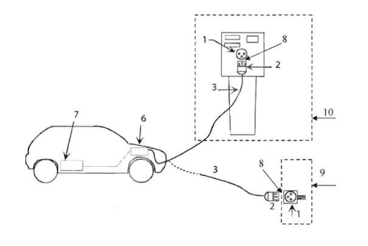

<!-- tabla: ../tablas/BT-52_t02.csv -->

| Leyenda: |  |
|---|---|
| 1 | Base de toma de corriente |
| 2 | Clavija |
| 3 | Cable de conexión |
| 4 | Conector |
| 5 | Entrada de alimentación al VEHÍCULO ELÉCTRICO |
| 6 | Cargador incorporado al VEHÍCULO ELÉCTRICO |
| 7 | Batería de tracción |
| 8 | Punto de conexión |
| 9 | Punto de recarga simple |
| 10 | SAVE |

Figura 2. Caso B. Conexión del VEHÍCULO ELÉCTRICO a la estación de recarga mediante un cable terminado por un extremo en una clavija y por el otro en un conector, donde el cable es un accesorio del VEHÍCULO ELÉCTRICO. Caso B1: conexión a un punto de recarga simple mediante una toma de corriente para usos domésticos y análogos. Caso B2: conexión a un punto de recarga tipo SAVE.

9 de 46

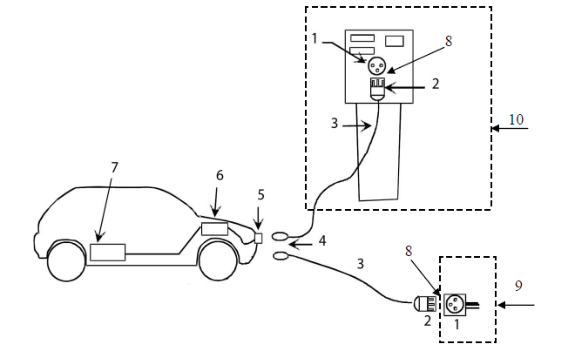

<!-- tabla: ../tablas/BT-52_t03.csv -->

| Leyenda: |  |
|---|---|
| 3 | Cable de conexión |
| 4 | Conector |
| 5 | Entrada de alimentación al VEHÍCULO ELÉCTRICO |
| 6 | Cargador incorporado al VEHÍCULO ELÉCTRICO |
| 7 | Batería de tracción |
| 8 | Punto de conexión |
| 10 | SAVE. |

Figura 3. Caso C. Conexión del VEHÍCULO ELÉCTRICO a la estación de recarga mediante un cable terminado en un conector: el cable forma parte de la instalación fija.

<!-- tabla: ../tablas/BT-52_t04.csv -->

| Leyenda: |  |
|---|---|
| 1 | Base de toma de corriente |
| 2 | Clavija |
| 3 | Cable de alimentación |
| 4 | Conector |
| 5 | Entrada de alimentación al VEHÍCULO ELÉCTRICO |
| 6 | Cargador en cable alimentación |
| 7 | Batería de tracción |
| 8 | Punto de conexión |
| 9 | Punto de recarga simple |
| 10 | SAVE |

Figura 4. Caso D. Conexión de un VEHÍCULO ELÉCTRICO ligero a la estación de recarga mediante un cable terminado en un conector: el cable incorpora el cargador.

10 de 46

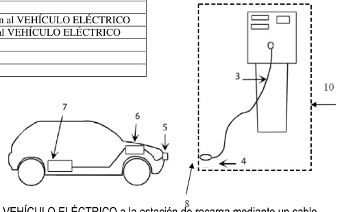

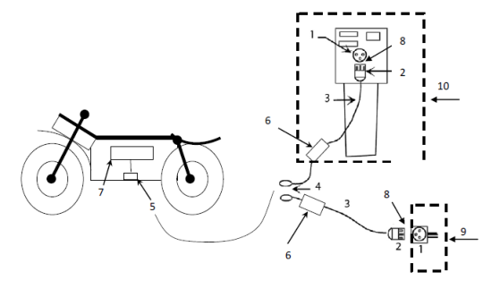

3. ESQUEMAS DE INSTALACIÓN PARA LA RECARGA DE VEHÍCULOS ELÉCTRICOS.

Las instalaciones nuevas para la alimentación de las estaciones de recarga, así como la modificación de instalaciones ya existentes, que se alimenten de la red de distribución de energía eléctrica, se realizarán según los esquemas de conexión descritos en este apartado. En cualquier caso, antes de la ejecución de la instalación, el instalador o en su caso el proyectista, deben preparar una documentación técnica en la forma de memoria técnica de diseño o de proyecto, según proceda en aplicación de la (ITC) BT-04, en la que se indique el esquema de conexión a utilizar. Los posibles esquemas serán los siguientes: 1. Esquema colectivo o troncal con un contador principal en el origen de la instalación. 2. Esquema individual con un contador común para la vivienda y la estación de recarga. 3. Esquema individual con un contador para cada estación de recarga. 4. Esquema con circuito o circuitos adicionales para la recarga del VEHÍCULO ELÉCTRICO.

Independientemente del esquema utilizado, las instalaciones serán realizadas por un instalador de la categoría que corresponda según el tipo de instalación, por ejemplo, en el caso de proyectarse la instalación en locales con riesgo de incendio o explosión según la ITC - BT 29, el instalador deberá ser de la categoría especialista. Debido al alto grado de electrónica de potencia a instalar y a la gran variedad de fabricantes de vehículos y tecnologías de recarga que se pueden llegar a conectar a la red de distribución, así como para facilitar la futura instalación de sistemas SPL que permitan incrementar el número de vehículos a recargar sin que sea preciso modificar las instalaciones de enlace, en las centralizaciones de contadores de las nuevas instalaciones se reservará espacio suficiente para que las empresas distribuidoras puedan instalar en caso necesario filtros PLC, que eviten que el ruido en el rango de frecuencias PLC (procedentes de los distintos sistemas de recarga o de los propios vehículos) afecte a la telegestión del resto de contadores conectados a la misma red baja tensión y para poder instalar igualmente elementos para la gestión de cargas desde el SPL o en general, para el funcionamiento correcto de los distintos esquemas de conexión, tales como contactores. Con tal fin, las empresas distribuidoras de energía eléctrica podrán disponer de especificaciones particulares donde establezcan las características sobre la construcción y montaje de las centralizaciones de contadores preparadas para la conexión del vehículo eléctrico. Según se establece en el artículo 14 del RD 842/2002 dichas especificaciones deberán ser aprobadas por la administración competente.

11 de 46

Uno, o varios circuitos de recarga colectivos

Caja de derivación Wh Contador principal LGA Cuadro de mando y

<!-- tabla: ../tablas/BT-52_t05.csv -->

| Estación de recarga |  |  |  |
|---|---|---|---|
|  | Wh |  | Contador secundario |

contadores (CC)

Leyenda: LGA: línea general de alimentación. SPL: sistema de protección de la LGA

Figura 5. Esquema 1a: instalación colectiva troncal con contador principal en el origen de la instalación y contadores secundarios en las estaciones de recarga

12 de 46

<!-- figura vectorial en la pág. 12 del PDF original -->
> Figura en la pág. 12 del PDF original: [ver en el PDF](../pdf/BT-52.pdf#page=12)

Centralización de contadores de viviendas (CC) Instalaciones interiores Contadores de viviendas principales

Wh

Wh

Uno, o varios SPL circuitos de recarga colectivos Caja de derivación

LGA

<!-- tabla: ../tablas/BT-52_t06.csv -->

| Estación de recarga Contador Wh secundario | Estación de recarga |  |  |  |
|---|---|---|---|---|
|  |  | Wh |  | Contador secundario |

Nueva centralización para estaciones de recarga del VE, en armario o local independiente

Leyenda: LGA: línea general de alimentación. SPL: sistema de protección de la LGA

Figura 6. Esquema 1b: instalación colectiva troncal con contador principal en origen de la instalación y contadores secundarios en las estaciones de recarga (con nueva centralización de contadores para recarga VEHÍCULO ELÉCTRICO)

13 de 46

<!-- figura vectorial en la pág. 13 del PDF original -->
> Figura en la pág. 13 del PDF original: [ver en el PDF](../pdf/BT-52.pdf#page=13)

Para la selección entre los esquemas 1a y 1b, se aplicarán los siguientes criterios de prioridad, en primer lugar se utilizarán los módulos de reserva de la centralización existente (esquema 1a), si ello no fuera suficiente se ampliará la centralización existente utilizando también el esquema 1a, en último caso y por falta de espacio, se dispondrán una o varias centralizaciones nuevas en armarios o locales (esquema 1b). Para la selección entre los esquemas 1a y 1b se tendrá en cuenta que la centralización de contadores disponga de espacio suficiente la instalación de filtros PLC que bloqueen el ruido en el rango de frecuencias PLC, así como para los elementos necesarios para la gestión de cargas desde el SPL o para el funcionamiento correcto de los distintos esquemas de conexión, tales como contactores.

Circuito de recarga Centralización individual de contadores Wh para recarga del VE Contador secundario

LGA Wh Circuito de recarga individual Contador Wh SPL principal Contador Estación Estación secundario de de recarga recarga

Resto de circuitos de la instalación

Leyenda: LGA: línea general de alimentación. SPL: sistema de protección de la LGA

Figura 7. Esquema 1c: instalación colectiva con un contador principal y contadores secundarios individuales para cada estación de recarga.

14 de 46

<!-- figura vectorial en la pág. 14 del PDF original -->
> Figura en la pág. 14 del PDF original: [ver en el PDF](../pdf/BT-52.pdf#page=14)

La protección de los circuitos de recarga se puede realizar con fusibles o con interruptores automáticos. La centralización de contadores para recarga del VEHÍCULO ELÉCTRICO puede formar parte de la centralización existente o disponerse en una o varias centralizaciones nuevas en armarios o locales.

Para la instalación de los circuitos de recarga colectivos según los esquemas 1a, 1b, 1c, o 4b, se utilizarán cajas de derivación de las que partirán las derivaciones que alimentan a cada estación de recarga. Estas cajas de derivación serán responsabilidad de la comunidad de vecinos ya que en general afectarán a varios vecinos. A continuación, se recomiendan algunas características de estas cajas.  Se recomienda su montaje en un paramento vertical (columna o pared), a una altura superior a 1,8 metros sobre la cota del suelo del garaje.  Cada caja debe tener la posibilidad de conectar 3 o 6 derivaciones a estaciones de carga (múltiplos de tres para facilitar el equilibrado de cargas).  En instalaciones nuevas las cajas deben instalarse a lo largo de todo su recorrido de forma que ninguna plaza de garaje quede a más de 20 metros de una caja.  Las cajas podrán albergar pequeños interruptores automáticos cuando sean necesarios para proteger la derivación frente a cortocircuitos.  Las cajas dispondrán de un sistema de cierre a fin de evitar manipulaciones indebidas de sus conexiones.

15 de 46

<!-- tabla: ../tablas/BT-52_t07.csv -->

| Instalación interior de la vivienda |  |
|---|---|
|  | DDI I |

individual Wh Bornes de Contado salida de la principal CC Instalación interior de la vivienda

<!-- tabla: ../tablas/BT-52_t08.csv -->

| DI |  |
|---|---|
|  | Circuito de recarga individual |

individual Wh Bornes de Contador Estación salida de la Estación principal de CC de LGA recarga recarga

Contador Contador secundario Wh secundario Wh opcional opcional

Centralización de Leyenda: contadores (CC) LGA: línea general de alimentación. DI: derivación individual

Figura 8. Esquema 2: instalación individual con un contador principal común para la vivienda y para la estación de recarga.

16 de 46

<!-- figura vectorial en la pág. 16 del PDF original -->
> Figura en la pág. 16 del PDF original: [ver en el PDF](../pdf/BT-52.pdf#page=16)

Para el esquema 2 en el proyecto o memoria técnica de diseño se justificará que el fusible de la centralización protege contra cortocircuitos tanto a la derivación individual, como al circuito de recarga individual, en especial para la intensidad mínima de cortocircuito, incrementando la sección obtenida por aplicación de los criterios de caída de tensión y de protección contra sobrecargas para este circuito, si fuera necesario. La función de control de potencia contratada por el cliente será realizada por el contador principal, sin necesidad de instalar un ICP independiente. En caso de actuación de la función de control de potencia, su rearme se realizará directamente desde la vivienda. La función de control de potencia contratada por el cliente será realizada por el contador principal para potencias inferiores a 15 kW, sin necesidad en este caso de instalar un ICP independiente. El citado rearme puede conseguirse mediante diversas soluciones, por ejemplo:  Soluciones que requieren la utilización de uno o dos conductores de mando desde la vivienda hasta un contactor instalado en la centralización de contadores, en el circuito de recarga individual o en la propia estación de recarga. Como ejemplos de tales soluciones se incluyen las figuras A1 y A2. Para el hilo de mando se recomienda color rojo y una sección mínima de 1,5 mm2. El contactor se podrá ubicar en la propia estación de carga, o en la centralización de contadores justo en el origen del circuito de recarga. Si se ubica en la centralización de contadores la ventaja es que la longitud del hilo de mando será menor, aunque para instalaciones existentes y por falta de espacio puede ser más sencillo ubicarlo en la estación de carga.

 Soluciones que utilizan dispositivos adicionales para el rearme del contactor y no requieren de conductores auxiliares desde la vivienda hasta el contactor. Dichos dispositivos pueden estar instalados en la centralización de contadores, en el circuito de recarga individual o en la propia estación de recarga. Como ejemplo de tales soluciones se incluye la figura A3. Una vez interrumpido el circuito de recarga el contador debe apreciar una impedancia infinita que permita su rearme desde la vivienda.

 Cualquier otro método que tecnológicamente pueda realizar esta función de rearme.

Figura A1: Ejemplo de rearme manual con un conductor de mando único.

Int: Interruptor opcional para activación de la carga 17 de 46

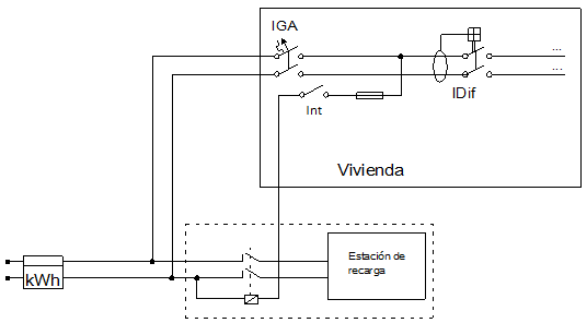

Figura A2: Ejemplo de rearme manual con dos conductores de mando.

Figura A3: Ejemplo de rearme automático con contactor normalmente abierto.

18 de 46

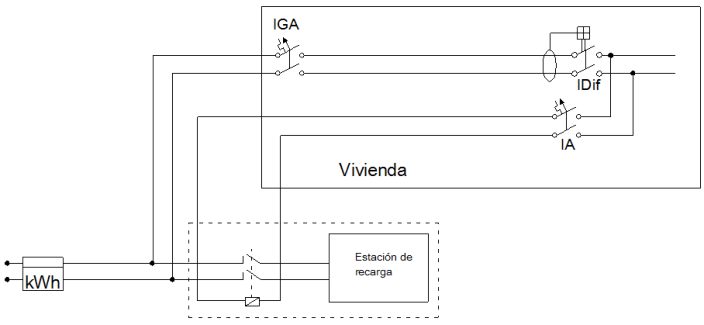

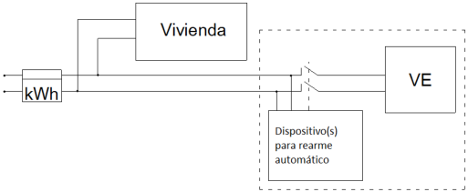

A modo de ejemplo en la figura A4 se presenta un ejemplo de centralización de contadores preparada para el esquema 2, con un contador principal común para la vivienda y para la estación de recarga, que permite la conexión o desconexión de la recarga del vehículo eléctrico desde la vivienda, así como el rearme de la función de control de potencia también desde la vivienda, para lo cual se utiliza el hilo de mando ya descrito en la figura A1. Figura A4: Ejemplo de centralización de contadores preparada para un esquema 2.

19 de 46

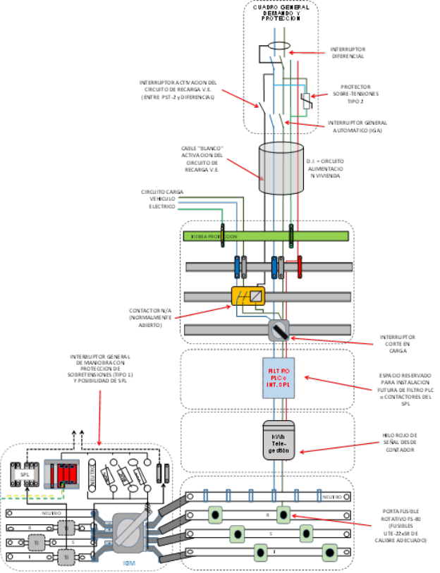

Con el objetivo de mantener el nivel de seguridad, cuando con motivo de la instalación de los nuevos circuitos para la recarga de vehículos eléctricos se realice una modificación en la instalación interior de la vivienda (por ejemplo, en el cuadro de mando y protección), se recomienda realizar una revisión de la instalación existente, según la UNE 202008 IN.

Centralización de contadores de viviendas (CC) Instalaciones interiores Contadores Bornes de de viviendas principales salida de la CC Wh DI

Wh LGA

Circuito de recarga individual Wh

Circuito de recarga individual Wh

Contadores principales Estación Estación de de recarga recarga

Extensión de CC de viviendas para estaciones de carga del VE

Leyenda: LGA: línea general de alimentación. DI: derivación individual

Figura 9. Esquema 3a: instalación individual con un contador principal para cada estación de recarga (utilizando la centralización de contadores existente). 20 de 46

<!-- figura vectorial en la pág. 20 del PDF original -->
> Figura en la pág. 20 del PDF original: [ver en el PDF](../pdf/BT-52.pdf#page=20)

Figura 10. Esquema 3b: instalación individual con un contador principal para cada estación de recarga (con una nueva centralización de contadores).

21 de 46

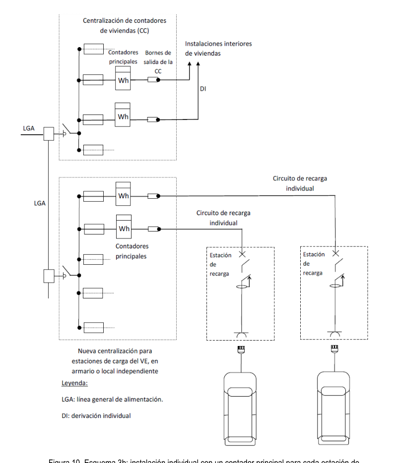

Para la selección entre los esquemas 3a y 3b, se aplicarán los siguientes criterios de prioridad, en primer lugar se utilizarán los módulos de reserva de la centralización existente (esquema 3a), si ello no fuera suficiente se ampliará la centralización existente utilizando también el esquema 3a, en último caso y por falta de espacio, se dispondrán una o varias centralizaciones nuevas en armarios o locales (esquema 3b).

Figura 11. Esquema 4a: instalación con circuito adicional individual para la recarga del VEHÍCULO ELÉCTRICO en viviendas unifamiliares.

Este esquema 4a también se puede utilizar en instalaciones para la recarga de vehículos eléctricos en edificios o conjuntos inmobiliarios en régimen de propiedad horizontal según lo establecido en el apartado 3.2 de esta ITC-BT- 52, siempre que la infraestructura común del edificio esté preparada para albergar este tipo de instalación. Su uso generalizado en garajes en régimen de propiedad horizontal supondría grandes caídas de tensión y la necesidad de disponer de patinillos para las derivaciones individuales de grandes dimensiones, de forma que se recomienda su utilización solo en los siguientes casos:  Viviendas unifamiliares  Fincas de cualquier tipo con un único suministro

Con el objetivo de mantener el nivel de seguridad, cuando con motivo de la instalación de los nuevos circuitos para la recarga de vehículos eléctricos se realice una modificación en la instalación interior de la vivienda (por ejemplo, en el cuadro de mando y protección), se recomienda realizar una revisión de la instalación existente, según la UNE 202008 IN. 22 de 46

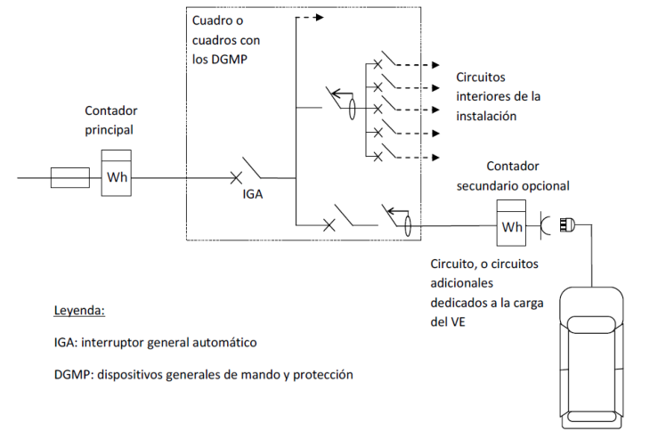

Figura 12. Esquema 4b: instalación con circuito o circuitos adicionales para la recarga del VEHÍCULO ELÉCTRICO. Conforme a lo establecido en el apartado 3.2 de esta ITC-BT-52, este esquema 4b se puede utilizar para la recarga de vehículos eléctricos en edificios o conjuntos inmobiliarios en régimen de propiedad horizontal, utilizando el cuadro de los servicios generales de los garajes como punto de partida de los circuitos para la recarga del vehículo eléctrico, y utilizando generalmente circuitos de recarga colectivos. Si en este esquema 4 b o en cualquier otro interviene un gestor de cargas cabe recordar que en aplicación del RD 647/2011 tendrán que registrar en cada una de sus instalaciones los consumos destinados a la recarga de vehículos eléctricos de forma diferenciada a los consumos que puedan producirse para otros usos. Con el objetivo de mantener el nivel de seguridad, cuando con motivo de la instalación de los nuevos circuitos para la recarga de vehículos eléctricos se realice una modificación en la instalación eléctrica de los aparcamientos se recomienda realizar una revisión de la instalación existente, según la parte aplicable de la serie de normas UNE 202009 IN. Los esquemas de instalación descritos en este apartado no resultan aplicables para la conexión de las estaciones de recarga que se alimenten mediante una red independiente de la red de distribución de corriente alterna usualmente utilizada, por ejemplo, mediante una red de corriente continua o corriente alterna ferroviaria, o mediante un fuente de energía de origen renovable con posible almacenamiento de energía, en cuyo caso el diseñador de la instalación especificará el esquema eléctrico a utilizar. Nótese que las figuras 5 a 12 son solamente ejemplos ilustrativos de los distintos esquemas de instalaciones de recarga de vehículos eléctricos y que no contienen todos los elementos de la instalación.

23 de 46

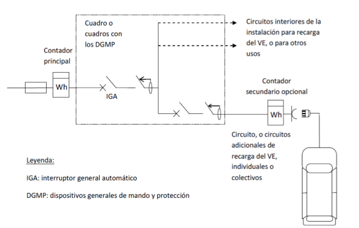

3.1 Instalación en aparcamientos de viviendas unifamiliares. En las viviendas unifamiliares nuevas que dispongan de aparcamiento o zona prevista para poder albergar un vehículo eléctrico se instalará un circuito exclusivo para la recarga de VEHÍCULO ELÉCTRICO. Este circuito se denominará circuito C , según la nomenclatura de la (ITC) BT-25 y seguirá el esquema de instalación 4a. 13 En todas las viviendas unifamiliares nuevas el circuito C13 debe quedar totalmente instalando incluyendo los sistemas de canalización, los cables, las protecciones y el punto de recarga. En las viviendas unifamiliares, o en general en las fincas con un único suministro, tanto para instalaciones nuevas como ya existentes, se instalará una Caja de Protección y Medida (CPM) que incorpore un protector contra sobretensiones transitorias antes del contador y un espacio para la instalación en caso necesario de un filtro PLC después del contador. Las instalaciones existentes en las que se desee instalar una estación de recarga se ajustarán también a lo establecido en este apartado. La alimentación de este circuito podrá ser monofásica o trifásica y la potencia instalada responderá generalmente a uno de los escalones de la tabla 1, según prevea el proyectista de la instalación. No obstante, el proyectista podrá justificar una potencia mayor, en función de la previsión de potencia por estación de recarga o del número de plazas construidas para la vivienda unifamiliar, en cuyo caso el circuito y sus protecciones se dimensionarán acorde con la potencia prevista.

<!-- tabla: ../tablas/BT-52_t09.csv -->

| U nominal | Interruptor automático de protección en el origen del circuito | Potencia instalada | Estaciones de recarga por circuito |
|---|---|---|---|
| 230 V | 10 A | 2300 W | 1 |
|  | 16 A | 3680 W | 1 |
|  | 20 A | 4600 W | 1 |
|  | 32 A | 7360W | 1 |
|  | 40 A | 9200 W | 1 |
| 230/400 V | 16 A | 11085 W | de 1 a 3 |
|  | 20 A | 13856 W | de 1 a 4 |
|  | 32 A | 22170 W | de 1 a 6 |
|  | 40 A | 27713 W | de 1 a 8 |

Tabla 1. Potencias instaladas normalizadas en un circuito de recarga para una vivienda unifamiliar.

Para evitar desequilibrios en la red eléctrica los circuitos C monofásicos no dispondrán de una potencia instalada 13 superior a los 9200 W. Cuando en un circuito trifásico se conecten estaciones monofásicas, éstas se repartirán de la forma más equilibrada posible entre las tres fases. El número máximo de estaciones de recarga de la tabla 1 por cada circuito de recarga trifásico se ha calculado suponiendo estaciones monofásicas de una potencia unitaria de 3680 W. El proyectista podrá ampliar o reducir el número máximo si justifica una potencia instalada por estación de recarga inferior o superior respectivamente. Las bases de toma de corriente o conectores instalados en la estación de recarga y sus interruptores automáticos de protección deberán ser conformes con alguna de las opciones indicadas en el apartado 5.4.

24 de 46

3.2 Instalación en aparcamientos o estacionamientos colectivos interiores o adscritos a edificios o conjuntos inmobiliarios. Las instalaciones eléctricas para la recarga de vehículos eléctricos ubicadas en aparcamientos o estacionamientos seguirán cualquiera de los esquemas descritos anteriormente. En un mismo edificio se podrán utilizar esquemas distintos siempre que se cumplan todos los requisitos establecidos en esta (ITC) BT-52. En edificios existentes que carezcan de instalaciones para recarga de vehículos, cuando sea necesario realizar las instalaciones para la recarga del primer vehículo, se recomienda que el o los vecinos propietarios de los vehículos a recargar y la propia comunidad de vecinos lleguen a un acuerdo en relación al esquema o esquemas de conexión a implementar en el edificio, sin que la decisión individual de una de las dos partes afecte a la otra, puesto que cada una debería asumir los costes correspondientes a la modificación o construcción de las instalaciones de las que sea titular. En el esquema 4a, el circuito de recarga seguirá las condiciones de instalación descritas en la (ITC) BT-15, utilizando cables y sistemas de conducción de los mismos tipos y características que para una derivación individual; la sección del cable se calculará conforme a los requisitos generales del apartado 5 de esta ITC, no siendo necesario prever una ampliación de la sección de los cables para determinar el diámetro o las dimensiones transversales del sistema de conducción a utilizar. Para instalaciones existentes en garajes en régimen de propiedad horizontal en las que se utilice el esquema 4a para la recarga del vehículo eléctrico se tendrán en cuenta los siguientes aspectos:

 Los cables del circuito de recarga se podrán instalar por el interior del mismo Sistema de Conducción de Cables (SCC) de la Derivación Individual (DI) siempre que haya espacio disponible para ello de acuerdo con las reglas de la ITC-BT-21. En este caso los conductores del circuito de recarga utilizarán la reserva de espacio vacío del SCC prescrito en la ITC-BT-15.  En caso que no hubiera suficiente espacio disponible en el interior del SCC de la DI para poder pasar por su interior los conductores del circuito de recarga se podrá utilizar el tubo o conducción de reserva para DIs siempre que exista la canalización y tenga espacio disponible para ello, de acuerdo con las reglas de la ITC- BT 21.  En caso que no fuera posible instalar el cable del circuito de recarga en el interior del SCC de la DI o por la conducción de reserva para DIs, será posible instalar dicho cable bien en el interior de un SCC adicional o directamente en la canaladura de obra de las DIs siempre y cuando haya espacio disponible para ello. Cuando el circuito de recarga se instale directamente en la canaladura se utilizará cable multiconductor de 0,6/1 kV, de acuerdo con las reglas de la ITC-BT 21.  Por motivos de espacio y en caso de que ninguna de las anteriores soluciones sea posible, se podrá admitir la instalación de los conductores de circuitos de recarga de distintos suministros por el interior de un mismo sistema de conducción de cables (ya sea el tubo de reserva para derivaciones individuales u otro SCC instalado adicionalmente) siempre que exista espacio disponible según las reglas de la ITC-BT 21. En tal caso, para asegurar la separación necesaria entre suministros, los circuitos C deberán realizarse utilizando 13 cable multiconductor de tensión asignada 0,6/1 kV.

El esquema 4b se utilizará cuando la alimentación de las estaciones de recarga se proyecte como parte integrante o ampliación de la instalación eléctrica que atiende a los servicios generales de los garajes.

Tanto en instalaciones existentes como en instalaciones nuevas, y con objeto de facilitar la utilización del esquema eléctrico seleccionado, los cuadros con las protecciones generales se podrán ubicar en los cuartos habilitados para ello o en zonas comunes.

25 de 46

La preinstalación eléctrica para la recarga de vehículo eléctrico en aparcamientos ubicados o adscritos a edificios o conjuntos inmobiliarios facilitará la utilización posterior de cualquiera de los posibles esquemas de instalación. Para ello se preverán los siguientes elementos: a) Instalación de sistemas de conducción de cables desde la centralización de contadores y por las vías principales del aparcamiento o estacionamiento con objeto de poder alimentar posteriormente las estaciones de recarga que se puedan ubicar en las plazas individuales del aparcamiento o estacionamiento. Cuando la preinstalación esté prevista para el 100 % de las plazas, los sistemas de conducción de cables llegarán hasta cada una de las plazas. Cuando la preinstalación no esté prevista para el 100 % de las plazas, se definirán las plazas que se consideran para el cumplimiento de la dotación reglamentaria de sistemas de conducción de cables, y dichos sistemas llegarán hasta cada una de esas plazas.

Las dotaciones mínimas de la infraestructura para la recarga del vehículo eléctrico a ejecutar en las edificaciones comprendidas dentro del ámbito de aplicación del Documento Básico de Ahorro de Energía (DB HE) Código Técnico de la Edificación se determinarán de conformidad con las previsiones de la sección HE6 del Documento Básico de Ahorro de Energía.

b) La centralización de contadores se dimensionará de acuerdo al esquema eléctrico escogido para la recarga del vehículo eléctrico y según lo establecido en la (ITC) BT-16. Se instalarán módulos de reserva para al menos el 20 % de las plazas de garaje no asociadas a una vivienda y, aunque todas las plazas estén asociadas a viviendas, como mínimo un módulo de reserva. Estos módulos de reserva tendrán capacidad para ubicar el contador principal y los dispositivos de protección contra sobreintensidades asociados al contador, bien sea con fusibles o con interruptor automático.

Los porcentajes requeridos en la preinstalación se tratan en el Código Técnico de la Edificación sección HE6, según sea el uso previsto de los garajes (residencial privado o para otros usos). Debe consultarse este documento para determinar el porcentaje correcto. En relación con las potencias previstas, será de aplicación lo indicado en el Anexo 2. Se recomienda que los elementos comunes a instalar tales como las canalizaciones y los módulos de reserva en la centralización de contadores sigan las siguientes pautas, no siendo obligatorio que la preinstalación incluya los cables de los circuitos de alimentación del vehículo eléctrico, ni las estaciones de recarga.

 Cuando en edificios existentes se realice la instalación del primer punto de recarga, se recomienda dimensionar la canalización para albergar la instalación de futuros puntos de recarga en la zona de influencia del punto a instalar. Se recomienda aplicar el criterio anterior también cada vez que se realice la instalación de un nuevo punto de recarga. En el Anexo 1, aplicable a edificios o conjuntos inmobiliarios en régimen de propiedad horizontal, se presenta un ejemplo de buenas prácticas de cómo dimensionar estas canalizaciones.

 Cuando en edificios existentes se realice la instalación de un punto de recarga utilizando un esquema que precise de un contador principal adicional (esquemas 1 o 3) y por falta de espacio fuera necesario realizar una nueva centralización de contadores, generalmente en armario, se recomienda dimensionar ésta con al menos un módulo de reserva para instalar el contador asociado con un futuro punto de recarga. Las bases de toma de corriente o conectores instalados en la estación de recarga y sus interruptores automáticos de protección deberán ser conformes con alguna de las opciones indicadas en el apartado 5.4.

26 de 46

#### 3.3. Otras instalaciones de recarga

Las instalaciones eléctricas para la recarga de vehículos eléctricos alimentadas de la red de distribución de energía eléctrica, distintas de las descritas en 3.1 y 3.2, seguirán los esquemas 1a, 1b, 1c, 3 o 4b descritos anteriormente.

Esta descripción comprende a las instalaciones de recarga en aparcamientos o estacionamientos no ubicados en el interior de un edificio ni adscritos al mismo ni en viviendas unifamiliares.

Las bases de toma de corriente o conectores instalados en la estación de recarga y sus interruptores automáticos de protección deberán ser conformes con alguna de las opciones indicadas en el apartado 5.4. 3.3.1. Estaciones de recarga para autoservicio (uso por personas no adiestradas). Estas estaciones de recarga, tales como las ubicadas en la vía pública, en aparcamientos o estacionamientos de flotas privadas, cooperativas o de empresa, para su propio personal o asociados y en aparcamientos o estacionamientos públicos, gratuitos o de pago, de titularidad pública o privada, están destinadas a ser utilizadas por usuarios no familiarizados con los riesgos de la energía eléctrica. Este tipo de instalaciones podrán utilizar cualquier modo de carga. 3.3.2. Estaciones de recarga con asistencia para su utilización (uso por personas adiestradas o cualificadas). Estas estaciones de recarga, tales como las ubicadas en aparcamientos para recarga de flotas, talleres, concesionarios de automóviles, depósitos municipales de vehículo eléctrico, así como otras estaciones dedicadas específicamente a la recarga del VEHÍCULO ELÉCTRICO, están destinadas a ser utilizadas o supervisadas por usuarios familiarizados con los riesgos de la energía eléctrica. Este tipo de instalaciones dispondrán preferentemente de los modos de carga 3 o 4, aunque también podrán equiparse con estaciones de recarga en modo 1 ó 2, cuando esté previsto recargar vehículos eléctricos de baja potencia tales como bicicletas, ciclomotores y cuadriciclos.

4. PREVISIÓN DE CARGAS SEGÚN EL ESQUEMA DE LA INSTALACIÓN.

Para realizar la previsión de cargas en garajes de nueva construcción en régimen de condominio cuando se desee realizar la preinstalación para un número de las plazas elevado, mayor que el mínimo reglamentario y superior al 50% del total de plazas de garaje construidas, se podrá seguir lo indicado en el anexo 2 la GUÍA ITC-BT 52. Una vez terminada la instalación, y con objeto de conocer fácilmente la máxima potencia a contratar, el certificado de instalación eléctrica (CIE) debería recoger, entre otros valores, la información actualizada correspondiente a la potencia máxima admisible de la totalidad de la instalación (esto es, potencia máxima admisible de la instalación aguas abajo del punto frontera entre empresa distribuidora y consumidor).

4.1. Esquema colectivo con un contador principal común (esquemas 1a, 1b y 1c). La instalación del SPL será opcional, en edificios de nueva construcción a criterio del promotor y en instalaciones en edificios existentes a criterio del titular del suministro, o, en su caso, de la Junta de Propietarios. El dimensionamiento de las instalaciones de enlace y la previsión de cargas se realizará considerando un factor de simultaneidad de las cargas del VEHÍCULO ELÉCTRICO con el resto de la instalación igual a 0,3 cuando se instale el SPL y de 1,0 cuando no se instale. Como entrada de información el SPL recibirá la medida de intensidad que circula por la LGA.

27 de 46

  P  P P P P 0,3P (se instala el SPL) edificio 1 2 3 4 5   P  P  P  P  P  P (no se instala el SPL) edificio 1 2 3 4 5

Donde: P , carga correspondiente al conjunto de viviendas obtenida como el número de viviendas por el coeficiente de 1 simultaneidad de la tabla 1 de la (ITC) BT 10. P , carga correspondiente a los servicios generales. 2 P , carga correspondiente a locales comerciales y oficinas. 3 P , carga correspondiente a los garajes distintas de la recarga del VEHÍCULO ELÉCTRICO. 4 P , carga prevista para la recarga del VEHÍCULO ELÉCTRICO. 5 En el proyecto o memoria técnica de diseño de instalaciones en edificios existentes se incluirá el cálculo del número máximo de estaciones de recarga que se pueden alimentar teniendo en cuenta la potencia disponible en la LGA y considerando la suma de la potencia instalada en todas las estaciones de recarga con el factor de simultaneidad que corresponda con el resto de la instalación, según se disponga o no del SPL. La previsión de potencia de los puntos de recarga a instalar en aparcamientos o estacionamientos colectivos en edificios o conjuntos inmobiliarios en régimen de propiedad horizontal no será inferior a la previsión de potencia mínima para la instalación de recarga de vehículo eléctrico según el requisito de la ITC-BT-10. P 0,1Nº plazas3,68kW 5mínimo

La previsión de potencia de los puntos de recarga a instalar en edificios de uso no residencial tales como los edificios de oficinas u otros de usos comerciales se calculará conforme a la disposición adicional primera del RD 1053/2014 con la siguiente fórmula: Nº plazas P  3,68kW 5mínimo 40 Para poder aplicar el factor 0,3 para el cálculo de la previsión de cargas del edificio, es necesario que se instale un SPL en el edificio junto con las estaciones de recarga. Dado que el correcto funcionamiento del SPL condiciona las dimensiones de la instalación de enlace y repercute en su seguridad, durante la instalación de sistema se debe asegurar por parte del titular o promotor y de los responsables técnicos que intervienen en la instalación (proyectista o instalador según el caso), que el SPL y los puntos de recarga instalados se comuniquen correctamente. Una vez puesta en servicio la instalación, será responsabilidad del titular su correcto mantenimiento, así como del correcto funcionamiento de las estaciones de recarga gestionadas por el SPL. El número de estaciones de recarga posibles para cada circuito de recarga colectivo y su previsión de carga se calcularán, teniendo en cuenta la potencia prevista de cada estación con un factor de simultaneidad entre las estaciones de recarga igual a la unidad. No obstante, el número de estaciones por circuito de recarga colectivo podrá aumentarse y el factor de simultaneidad entre ellas disminuirse si se dispone de un sistema de control que mida la intensidad que pasa por el circuito de recarga colectivo y reduzca la intensidad disponible en las estaciones, evitando las sobrecargas en el circuito de recarga colectivo. En caso de existir un sistema de control interno del circuito de recarga colectivo que mida la intensidad que pasa por dicho circuito y que pueda limitar la potencia disponible en las estaciones, la potencia prevista, P , para un número N 5 de estaciones de recarga, podría reducirse, aunque nunca por debajo del umbral mínimo (P ). Si se mantiene la 5 mínimo previsión de potencia, la instalación de este sistema de control permitiría la instalación de puntos de recarga 28 de 46

adicionales. En todo caso, el sistema optimiza el control de las cargas regulando la disponibilidad de potencia para la carga simultánea de todos los vehículos eléctricos.

4.2. Esquema individual (esquemas 2, 3a y 3b). El dimensionamiento de las instalaciones de enlace y la previsión de cargas se realizará considerando un factor de simultaneidad de las cargas del VEHÍCULO ELÉCTRICO con el resto de cargas de la instalación igual a 1,0. El mínimo reglamentario a considerar de la carga prevista para el VE, será el mismo valor P indicado en el 5, mínimo apartado 4.1, según se trate de aparcamientos en régimen de propiedad horizontal o de aparcamientos en edificios de uso no residencial. Para aplicar este mínimo se separará la potencia prevista para el VE de la potencia prevista para otras cargas, tales como las viviendas.

En caso de utilizar el esquema 2:  Dado que el circuito de alimentación de la estación de recarga no se alimenta de la derivación individual a la vivienda, la previsión de potencia del vehículo eléctrico no influye en el dimensionamiento de la derivación individual a la vivienda. Por tanto, para el cálculo de la sección de la derivación individual de las viviendas se tendrá en cuenta sólo la previsión de potencia de la propia vivienda sin considerar la potencia para la carga del vehículo eléctrico.  Respecto a la previsión de potencia total, la potencia prevista para la recarga del vehículo eléctrico se englobará dentro de la de la vivienda (como parte de P1) por lo que la previsión de potencia de la vivienda se incrementará en la potencia prevista para la recarga del vehículo eléctrico.

 No resulta necesario prever un grado de electrificación elevado para las viviendas en todos los casos, ya que la potencia prevista para el vehículo eléctrico se estima de forma independiente a la de la vivienda.

En los esquemas 3a y 3b, la función de control de potencia contratada para la estación de recarga se realizará con el contador principal, sin necesidad de instalar un ICP externo al contador. En caso de utilizar el esquema 3, como cada punto de recarga de vehículos eléctricos cuenta con su propio suministro individual, la recarga de vehículo eléctrico debe considerarse como una carga adicional a las del resto del edificio e incluirse dentro de P . 5 4.3. Esquema 4 (esquemas 4a y 4b). La previsión de cargas se realizará considerando un factor de simultaneidad de las cargas del VEHÍCULO ELÉCTRICO con el resto de circuitos de la instalación igual a 1,0. Para calcular el número de estaciones de recarga en un circuito de recarga colectivo y la simultaneidad entre ellas según el esquema 4b, se aplicará lo indicado en el apartado 4.1. Cuando se utilice el esquema 4a en viviendas unifamiliares la previsión de cargas de la vivienda incluirá el o los puntos de recarga del VE, con una previsión mínima de 9200 W por vivienda (nivel de electrificación elevada). Cuando se utilicen el esquema 4a o el 4b para aparcamientos colectivos en régimen de propiedad horizontal o para aparcamientos en edificios de uso no residencial se aplicará la previsión de cargas mínima, P indicada en el 5, mínimo apartado 4.1. Para aplicar este mínimo se separará la potencia prevista para el VE de la potencia prevista para otras cargas, tales como las viviendas que podrán ser de electrificación básica o elevada. 29 de 46

En caso de utilizar el esquema 4a, a diferencia del caso en que se utiliza un esquema 2, la potencia correspondiente a la carga del vehículo eléctrico sí influye en el dimensionamiento de la derivación individual a la vivienda. En instalaciones existentes con el esquema 4a la potencia prevista para la recarga del vehículo eléctrico se englobará dentro de la de la vivienda (como parte de P1) por lo que la previsión de potencia de la vivienda se incrementará en la potencia prevista para la recarga del vehículo eléctrico con factor de simultaneidad 1. En instalaciones existentes con el esquema 4b la potencia prevista para la recarga de vehículo eléctrico se sumará con la previsión de potencia del resto de la instalación también con factor de simultaneidad 1. En caso de existir un sistema de control interno del circuito de recarga colectivo que mida la intensidad que pasa por dicho circuito y que pueda limitar la potencia disponible en las estaciones, la potencia instalada en dicho circuito y por tanto la previsión de cargas para dicho circuito se podrá reducir, ya que el sistema controlará la disponibilidad de potencia para la recarga simultánea en todos los puntos.

### 5. REQUISITOS GENERALES DE LA INSTALACIÓN

En los locales cerrados de edificios destinados a aparcamientos o estacionamientos colectivos de uso público o privado, se podrá realizar la operación de recarga de baterías siempre que dicha operación se realice sin desprendimiento de gases durante la recarga y que dichos locales no estén clasificados como locales con riesgo de incendio o explosión según la (ITC) BT 29. En el local donde se realice la recarga del vehículo eléctrico se colocará un cartel reflectante en el punto de recarga que identifique que no está permitida la recarga de baterías con desprendimiento de gases.

Cuando se pretenda realizar una instalación para la recarga del VE en un garaje existente con ventilación forzada o con ventilación natural y más de 5 plazas de aparcamiento, el proyectista encargado de elaborar el proyecto o el instalador encargado de elaborar la memoria técnica de diseño, revisarán el proyecto original de la instalación eléctrica del garaje para comprobar si el garaje está desclasificado y si se siguen cumpliendo las condiciones de ventilación que permitieron esta desclasificación. En caso de que no se pueda comprobar que el garaje está desclasificado se realizará un proyecto de desclasificación según la ITC-BT 29.

Los circuitos de recarga colectivos discurrirán preferentemente por zonas comunes.

Para los esquemas 1a, 1b, 1c, 2, 3a y 3b, los contadores principales se ubicarán en el propio local o armario destinado a albergar la concentración de contadores o, en caso que no se disponga de espacio suficiente, se habilitará un nuevo local o armario al efecto de acuerdo con los requisitos de la (ITC) BT-16. Cuando se instalen contadores secundarios, éstos se ubicarán en un armario, en una envolvente o dentro de un SAVE. En el esquema 4b, el contador principal, que será el correspondiente a los servicios generales de la finca, debe ubicarse en la centralización de contadores. Se admitirá que la línea general de alimentación tenga derivaciones de menor sección si se garantiza la protección de dichas derivaciones contra sobreintensidades. Para tal fin, en los esquemas 1b, 1c y 3b, se podrán incluir en la caja de derivación las protecciones necesarias con fusibles o interruptor automático. La caja en la que se realice la derivación de la LGA debe estar ubicada en un cuarto o armario de contadores o bien en una zona común. La caja estará cerrada y dispondrá de un sistema de cierre similar al utilizado en los armarios de contadores. Cuando se instale un circuito de recarga colectivo que alimente a varias estaciones de recarga (según el esquema 1a, ó 1b), cada circuito partirá de un interruptor automático para su protección contra sobrecargas y cortocircuitos. Aguas 30 de 46

arriba de cada interruptor automático y en el mismo cuadro se instalará un IGA (interruptor general automático) para la protección general de todos los circuitos de recarga.

En aparcamientos y estacionamientos, el cuadro de mando y protección asociado a las estaciones de recarga estará identificado en relación a la plaza o plazas de aparcamiento asignadas. Los elementos a instalar en dicho cuadro se definen en el apartado 6.

Los cuadros de mando y protección, o en su caso los SAVE con protecciones integradas, deberán disponer de sistemas de cierre a fin de evitar manipulaciones indebidas de los dispositivos de mando y protección. La potencia instalada en los circuitos de recarga colectivos trifásicos según el esquema 1a, 1b ó 4b se ajustará generalmente a uno de los escalones de la tabla siguiente, aunque el proyectista podrá justificar una potencia distinta, en cuyo caso el circuito y sus protecciones se dimensionarán acorde con la potencia prevista.

<!-- tabla: ../tablas/BT-52_t10.csv -->

| U nominal | Interruptor automático de protección en origen circuito recarga | Potencia instalada | Nº máximo de estaciones de recarga por circuito |
|---|---|---|---|
| 230/400 V | 16 A | 11085 W | 3 |
| 230/400 V | 32 A | 22170 W | 6 |
| 230/400 V | 50 A | 34641 W | 9 |
| 230/400 V | 63 A | 43647 W | 12 |

Tabla 2. Potencias instaladas normalizadas de los circuitos de recarga colectivos destinados a alimentar estaciones de recarga. Las estaciones de recarga monofásicas se repartirán de forma equilibrada entre las tres fases del circuito de recarga colectivo. El número máximo de estaciones de recarga por cada circuito de recarga colectivo indicado en la tabla 2, se ha calculado suponiendo que las estaciones son monofásicas y de una potencia unitaria de 3680 W. El proyectista podrá ampliar o reducir el número de estaciones de recarga si justifica una potencia instalada por estación inferior o superior respectivamente. La previsión de potencia y las características del circuito de recarga colectivo o individual previsto para el modo de carga 4 se determinarán para cada proyecto en particular. El sistema de iluminación en la zona donde esté prevista la realización de la recarga garantizará que durante las operaciones y maniobras necesarias para el inicio y terminación de la recarga exista un nivel de iluminancia horizontal mínima a nivel de suelo de 20 lux para estaciones de recarga de exterior y de 50 lux para estaciones de recarga de interior. La caída de tensión máxima admisible en cualquier circuito desde su origen hasta el punto de recarga no será superior al 5%. Los conductores utilizados serán generalmente de cobre y su sección no será inferior a 2,5 mm2, aunque podrán ser de aluminio en instalaciones distintas de las viviendas o aparcamientos colectivos en edificios de viviendas, en cuyo caso la sección mínima será de 4mm2. Siempre que se utilicen conductores de aluminio, sus conexiones deberán realizarse utilizando las técnicas apropiadas que eviten el deterioro del conductor debido a la aparición de potenciales peligrosos, originados por pares galvánicos entre metales distintos. En instalaciones para la recarga de VEHÍCULO ELÉCTRICO, que reúnan más de 5 estaciones de recarga, por ejemplo en estaciones dedicadas específicamente a la recarga del VEHÍCULO ELÉCTRICO, el proyectista estudiará la 31 de 46

necesidad de instalar filtros de corrección de armónicos, con el objeto de garantizar que se mantiene la distorsión armónica de la tensión según los límites característicos de la tensión suministrada por las redes generales de distribución, para que otros usuarios que estén conectados en el mismo punto de la red no se vean perjudicados. En caso necesario, independientemente del número de estaciones de recarga, el proyectista o instalador preverá los elementos de corrección necesarios para evitar perturbaciones o distorsiones que afecten a la red y en particular a las comunicaciones del sistema de telegestión de los contadores, por ejemplo, mediante la instalación de filtros. Con tal fin, junto con el contador principal, tanto en cajas de protección y medida, CPM, como en centralizaciones de contadores, se recomienda reservar un espacio adecuado para que la empresa distribuidora pueda instalar un filtro PLC que elimine el ruido en el rango de frecuencia PLC que pueden introducir las estaciones de recarga o los propios vehículos y que impiden la telegestión del resto de suministros conectados a la misma red de baja tensión. En instalaciones existentes en las que no haya posibilidad de adecuar la centralización, se podrá utilizar cualquier otra ubicación aguas arriba de la estación de recarga. El circuito que alimenta el punto de recarga debe ser un circuito dedicado y no debe usarse para alimentar ningún otro equipo eléctrico salvo los consumos auxiliares relacionados con el propio sistema de recarga, entre los que se puede incluir la iluminación de la estación de recarga. La instalación fija para la recarga del VEHÍCULO ELÉCTRICO deberá contar con las bases de toma de corriente que corresponda según el modo de carga y ubicación de la estación de recarga conforme al apartado 5.4, de forma que se evite la utilización de prolongadores o adaptadores por parte de los usuarios de los servicios de recarga.

En todos los casos, pero de forma especial en los edificios existentes, el diseñador de la instalación comprobará que no se sobrepasa la intensidad admisible de la línea general de alimentación (o de la derivación individual en caso de viviendas unifamiliares), teniendo en cuenta la potencia prevista de cada estación de recarga y el factor de simultaneidad que proceda según se indica en el apartado 4. La instalación para la recarga del VEHÍCULO ELÉCTRICO se podrá proyectar como una ampliación de la instalación de baja tensión ya existente o con una alimentación directa de la red de distribución mediante una instalación de enlace propia independiente de la ya existente. Para toda instalación dedicada a la recarga de vehículos eléctricos, se aplicarán las prescripciones generales siguientes.

5.1 Alimentación. La tensión nominal de las instalaciones eléctricas para la recarga de vehículos eléctricos alimentadas desde la red de distribución será de 230/400 V en corriente alterna para los modos de carga 1, 2 y 3. Cuando se requiera instalar una estación de recarga con alimentación trifásica, y la tensión de alimentación existente sea de 127/220 V, se procederá a su conversión a trifásica 230/400 V. En el modo de carga 4, la tensión de alimentación se refiere a la tensión de entrada del convertidor alterna-continua, y podrá llegar hasta 1000 V en trifásico corriente alterna y 1500 V en corriente continua. 5.2 Sistemas de conexión del neutro. Con objeto de permitir la protección contra contactos indirectos mediante el uso de dispositivos de protección diferencial en los casos especiales en los que la instalación esté alimentada por un esquema TN, solamente se utilizará en la forma TN-S.

32 de 46

5.3 Canalizaciones. Las canalizaciones necesarias para la instalación de puntos de recarga deberán cumplir con los requerimientos que se establecen en las diferentes ITC del REBT en función del tipo de local donde se vaya a hacer la instalación (local de pública concurrencia, local de características especiales, etc.) Los cables desde el SAVE hasta el punto de conexión que formen parte de la instalación fija (ver figura 3, caso C de forma de conexión), deben ser de tensión asignada mínima 450/750 V, con conductor de cobre clase 5 o 6 (aptos para usos móviles) y resistentes a todas las condiciones previstas en el lugar de la instalación: mecánicas (por ejemplo abrasión e impacto, sacudidas o aplastamiento), ambientales (por ejemplo presencia de aceites, radiación ultravioleta o temperaturas extremas) y de seguridad (por ejemplo deflagración o vandalismo). Cuando los cables de alimentación de las estaciones de recarga discurran por el exterior, estos serán de tensión asignada 0,6/1 kV. 5.4 Punto de conexión. El punto de conexión deberá situarse junto a la plaza a alimentar, e instalarse de forma fija en una envolvente. La altura mínima de instalación de las tomas de corriente y conectores será de 60 cm sobre el nivel del suelo. Si la estación de recarga está prevista para uso público la altura máxima será de 120 cm. En las plazas de aparcamiento accesibles las tomas de corriente y conectores tendrán contraste cromático respecto del entorno, se situarán a una altura comprendida entre 80 y 120 cm y la distancia a encuentros en rincón será de, como mínimo, 35 cm. Se recomienda que la altura mínima de las estaciones de recarga o cajas que incorporan las tomas de corriente sea como mínimo de 1,5 metros para evitar ser golpeados por los propios vehículos, con la única excepción de las plazas para personas con movilidad reducida en las que dicha altura se reducirá a 1,0 metro.

Para garantizar la interconectividad del VEHÍCULO ELÉCTRICO a los puntos de recarga, para potencias mayores de 3,7 kW y menores o iguales de 22 kW los puntos de recarga de corriente alterna estarán equipados al menos con bases o conectores del tipo 2. Para potencias mayores de 22 kW los puntos de recarga de corriente alterna estarán equipados al menos con conectores del tipo 2. En modo de carga 4 los puntos de recarga de corriente continua estarán equipados al menos con conectores del tipo combo 2, de conformidad con la norma EN 62196-3. La determinación de los tipos adecuados de toma de corriente debe realizarse teniendo en cuenta la potencia de cada punto de conexión (base de toma de corriente o conector) y no la potencia total de la estación de recarga. Allí donde se prescriban bases de toma de corriente tipo 2 según UNE-EN 62196-2 y donde se prevea el uso de las mismas por personal no conocedor de los riesgos del manejo de la electricidad, se recomienda el uso de tomas tipo 2 con obturadores. En el caso de estaciones de recarga monofásicas de corriente alterna potencia menor o igual de 3,7 kW instaladas en viviendas unifamiliares o en aparcamientos para edificios de viviendas en régimen de propiedad horizontal el punto de recarga de corriente alterna podrá estar equipado con cualquiera de las bases de toma de corriente o conectores indicados en la tabla 3. En modos de carga 3 y 4 las bases y conectores siempre deben estar incorporadas en un SAVE o en un sistema equivalente que haga las funciones del SAVE. Según el modo de carga (1, 2 ó 3) las bases de toma de corriente o conectores instalados en cada estación de recarga y sus protecciones deberán ser conformes a alguna de las opciones de la tabla 3, en función de la ubicación de la estación de recarga, y de que la alimentación sea monofásica o trifásica. 33 de 46

Tabla 3. Puntos de conexión posibles a instalar en función de su ubicación.

<!-- tabla: ../tablas/BT-52_t11.csv -->

| Alimentación de la estación de recarga | Base de toma de corriente o conector del tipo descrito en: (1) | Intensidad asignada del punto de conexión | Interruptor automático de protección del punto de conexión | Modo de carga previsto | Ubicación posible del punto de conexión |  |  |
|---|---|---|---|---|---|---|---|
|  |  |  |  |  | Viviendas unifamiliares | Aparcamientos en edificios de viviendas | Otras instalaciones |
| Monofásica | Base de toma de corriente: UNE 20315-1- 2.Fig.C2a. | - | 10 A(2) | 1 ó 2 | sí | sí | no (6) |
|  | Base de toma de corriente: UNE 20315-2- 11. Fig. C7a. | - | 10 A(2) | 1 ó 2 | si | si | no (6) |
|  | UNE-EN 62196- 2, tipo 2 (3) | 16 A | (4) | 3 | sí | sí | sí |
|  | UNE-EN 62196- 2, tipo 2 (3) (5) | 32 A | (4) | 3 | sí | sí | sí |
| Trifásica | UNE-EN 62196-2, tipo 2 (3) (5) | 16 A | (4) | 3 | sí | sí | sí |
|  | UNE-EN 62196-2, tipo 2 (3) (5) | 32 A | (4) | 3 | sí | sí | si |
|  | UNE-EN 62196-2, tipo 2 (3) (5) | 63 A | (4) | 3 | no | no | sí |
| (1) La recarga de autobuses eléctricos puede requerir de estaciones de recarga de muy alta potencia, por lo que en estos casos se podrán utilizar otras bases de toma de corriente y conectores normalizados distintos de los indicados en la tabla. (2) Se podrá utilizar también un automático de 16 A, siempre que el fabricante de la base garantice que queda protegida por este automático en las condiciones de funcionamiento previstas para la recarga lenta del VEHÍCULO ELÉCTRICO con recargas diarias de 8 horas, a la intensidad de 16 A. (3) Las estaciones de recarga distintas de las previstas para el modo de recarga 4 que estén ubicadas en lugares públicos, tales como centros comerciales, garajes de uso público o vía pública, estarán preparadas para el modo de recarga 3 con bases de toma de corriente tipo 2, salvo en aquellas plazas destinadas a recargar vehículos eléctricos de baja potencia, tales como bicicletas, ciclomotores y cuadriciclos que podrán utilizar otros modos de recarga y bases de toma de corriente normalizadas. Esta excepción debe entenderse como extensiva a cualquier vehículo de categoría L (ciclomotores, motocicletas, vehículos todo terreno, quads y otros vehículos de poca cilindrada de tres o cuatro ruedas). De este modo, mientras los organismos europeos de normalización no desarrollen especificaciones técnicas en materia de puntos de recarga para vehículos de categoría L, debe entenderse que estos puntos de recarga podrán utilizar cualquier base de toma de corriente normalizada de potencia inferior o igual a 3,7 kW. (4) La protección contra sobreintensidades de cada toma de corriente o conector puede estar en el interior de la estación de recarga (SAVE) por lo que, en tal caso, la elección de sus características es responsabilidad del fabricante. Para la protección del circuito de alimentación a la estación de recarga véase el apartado 6.3. (5) En estaciones de recarga con puntos de conexión de potencia superior a 3,7 kW en c.a. también pueden instalarse cualquier tipo de conector normalizado siempre y cuando al menos uno de dichos puntos de conexión sea del Tipo 2 según UNE-EN 62196-2. (6) En estaciones de recarga monofásicas con potencia inferior o igual a 3.7 kW en c.a. en otras ubicaciones (distintas de viviendas y edificios de viviendas: por ejemplo comercios, vía pública, aparcamientos públicos, empresas, industrias, edificios de oficinas, talleres mecánicos, concesionarios, etc.) también pueden instalarse tomas de los tipos UNE 20315- 1-2. Fig. C2a o UNE 20315-2-11 Fig. C7a siempre que al menos exista una toma de corriente o conector de Tipo 2. |  |  |  |  |  |  |  |

34 de 46

En caso de modo de carga 4, puede instalarse cualquier tipo de conector normalizado siempre y cuando al menos uno de los puntos de conexión sea del Tipo Combo 2 (Configuración FF) según UNE-EN 62196-3. Temporalmente hasta el 18 de noviembre de 2017, y de acuerdo con la Orden IET/2388/2015, de 5 de noviembre se autoriza la instalación de conectores TESLA como único conector en estaciones de recarga ultra rápida, de potencia nominal mayor de 100 kW, conforme con la lEC 61851-23:2014, en nuevos puntos de recarga o en la renovación de puntos de recarga existentes. El contenido de este apartado se adaptará a las prescripciones que de carácter obligatorio dicten las futuras directivas o reglamentos europeos en este campo. 5.5 Contador secundario de medida de energía. Los contadores secundarios de medida de energía eléctrica tendrán al menos la capacidad de medir energía activa y serán de clase A o superior. Cuando en los esquemas 1a, 1b, 1c, y 4b, exista una transacción comercial que dependa de la medida de la energía consumida será obligatoria la instalación de contadores secundarios para cada una de las estaciones de recarga ubicadas en: a) Plazas de aparcamiento de aparcamientos o estacionamientos colectivos en edificios o conjuntos inmobiliarios en régimen de propiedad horizontal. b) En estaciones de movilidad eléctrica para la recarga del VEHÍCULO ELÉCTRICO. c) En las estaciones de recarga ubicadas en la vía pública.

Para los esquemas 1a, 1b, 1c, y 4b, en edificios comerciales, de oficinas o de industrias, también se instalarán contadores secundarios cuando sea necesario identificar consumos individuales. Su instalación será opcional a elección del titular para los esquemas 2 y 4a.

6. PROTECCIÓN PARA GARANTIZAR LA SEGURIDAD.

6.1 Medidas de protección contra contactos directos e indirectos. Las medidas generales para la protección contra los contactos directos e indirectos serán las indicadas en la (ITC) BT-24 teniendo en cuenta lo indicado a continuación. El circuito para la alimentación de las estaciones de recarga de vehículos eléctricos deberá disponer siempre de conductor de protección, y la instalación general deberá disponer de toma de tierra. En este tipo de instalaciones se admitirán exclusivamente las medidas establecidas en la (ITC) BT-24 contra contactos directos según los apartados 3.1, protección por aislamiento de las partes activas, o 3.2, protección por medio de barreras o envolventes, así como las medidas protectoras contra contactos indirectos según los apartados 4.1, protección por corte automático de la alimentación, 4.2, protección por empleo de equipos de la clase II o por aislamiento equivalente, o 4.5, protección por separación eléctrica. Cualquiera que sea el esquema utilizado, la protección de las instalaciones de los equipos eléctricos debe asegurarse mediante dispositivos de protección diferencial. Cada punto de conexión deberá protegerse individualmente mediante un dispositivo de protección diferencial de corriente diferencial-residual asignada máxima de 30 mA, que podrá formar parte de la instalación fija o estar dentro del SAVE. Con objeto de garantizar la selectividad la protección diferencial instalada en el origen del circuito de recarga colectivo será selectiva o retardada con la instalada aguas abajo. 35 de 46

Los dispositivos de protección diferencial serán de clase A. Los dispositivos de protección diferencial instalados en la vía pública estarán preparados para que se pueda instalar un dispositivo de rearme automático y los instalados en aparcamientos públicos o en estaciones de movilidad eléctrica dispondrán de un sistema de aviso de desconexión o estarán equipados con un dispositivo de rearme automático. Salvo cuando la protección contra contactos indirectos se realiza por separación eléctrica, cada punto de conexión debe estar protegido mediante su propio diferencial que será como mínimo de tipo A, con una corriente diferencial residual no superior a 30 mA. Los dispositivos de protección diferencial deberían cumplir con una de las siguientes normas de producto: EN 61008-1, EN 61009-1, EN 60947-2 o EN 62423. Cuando la estación de carga de vehículos eléctricos esté equipada con una toma de corriente o un conector de vehículo según la serie de Normas EN 62196 (previstas para recarga en modo 3), la normalización internacional más reciente (véase UNE-HD 60364-7-722) requiere de medidas contra las corrientes de fuga con componente en corriente continua, salvo cuando estas medidas estuvieran incluidas en la propia estación de carga de vehículos eléctricos. Las medidas apropiadas, para cada punto de conexión pueden ser: – Utilización de diferenciales de tipo B; o – Utilización de diferenciales de tipo A y un equipo que asegure la desconexión de la alimentación en caso de corrientes de defecto con componente en continua superior a los 6 mA (dispositivo de detección de corriente diferencial continua (RDC-DD)) conforme con la norma IEC 62955.

6.2 Medidas de protección en función de las influencias externas. Las principales influencias externas a considerar en este tipo de instalaciones son: Para las instalaciones en el exterior: penetración de cuerpos sólidos extraños, penetración de agua, corrosión y resistencia a los rayos ultravioletas.

Para instalaciones en aparcamientos o estacionamientos públicos, privados o en vía pública: competencia de las personas que utilicen el equipo. En todos los casos, el daño mecánico. El proyectista deberá prestar especial atención a las influencias externas existentes en el emplazamiento en el que se ubique la instalación a fin de analizar la necesidad de elegir características superiores o adicionales a las que se prescriben en este apartado. Cuando la estación de recarga esté instalada en el exterior, los equipos deben garantizar una adecuada protección contra la corrosión. Para ello se tendrán en cuenta las prescripciones que se incluyen en la (ITC) BT 30. Los grados de protección contra la penetración de cuerpos sólidos y acceso a partes peligrosas, contra la penetración del agua y contra impactos mecánicos de las estaciones de recarga podrán obtenerse mediante la utilización de envolventes múltiples proporcionando el grado de protección requerido el conjunto de las envolventes completamente montadas. En este caso, en la documentación del fabricante de la estación de recarga deberá estar perfectamente definido el método para la obtención de los diferentes grados de protección IP e IK.

36 de 46

6.2.1 Grado de protección contra penetración de cuerpos sólidos y acceso a partes peligrosas. Cuando la estación de recarga esté instalada en el exterior las canalizaciones deben garantizar una protección mínima IP4X o IPXXD. Las estaciones de recarga y otros cuadros eléctricos tendrán un grado de protección mínimo IP4X o IPXXD para aquellas instaladas en el interior e IP5X para aquellas instaladas en exterior. El grado de protección especificado para la estación de recarga no aplica durante el proceso de recarga. El grado de protección establecido para la estación de recarga no resulta extensible a la base de toma de corriente o conector tipo 2, siempre que exista un elemento de corte en la estación de carga que impida su alimentación cuando el vehículo no está conectado. Por este motivo no es necesario el uso de obturadores para las bases de toma de corriente o conectores tipo 2 o Combo 2, aunque se recomiendan cuando se prevea su uso por personal no conocedor de los riesgos del manejo de la electricidad. 6.2.2 Grado de protección contra la penetración del agua. Cuando la estación de recarga esté instalada en el exterior, la instalación debe realizarse de acuerdo a lo indicado en el capítulo 2 de la (ITC) BT-30, garantizando, por tanto para las canalizaciones un IPX4. Las estaciones de recarga y otros cuadros eléctricos asociados tendrán un grado de protección mínimo IPX4. Cuando la base de toma de corriente o el conector no cumpla con el grado IP anterior, éste deberá proporcionarlo la propia estación de recarga mediante su diseño. El grado de protección especificado para la estación de recarga no aplica durante el proceso de recarga. 6.2.3 Grado de protección contra impactos mecánicos. Los equipos instalados en emplazamientos en los que circulen vehículos eléctricos deberán protegerse frente a daños mecánicos externos del tipo impacto de severidad elevada (AG3). La protección del equipo se garantizará a través de alguno de los medios siguientes: a) Emplazando el material eléctrico en una ubicación en la que éste no se encuentre sujeto a un riesgo de impacto previsible; b) Disponiendo algún tipo de protección mecánica adicional en aquellas zonas en las que el equipo se encuentre sujeto al riesgo de impacto; c) Seleccionando el material eléctrico con un grado de protección contra daños mecánicos de acuerdo con lo especificado en los apartados 6.2.3.1 y 6.2.3.2; d) Usando la combinación de alguna o todas las medidas anteriores.

6.2.3.1. Grado de protección de las envolventes. Cuando la protección del equipo eléctrico frente a daños mecánicos se garantice mediante envolventes, una vez instaladas deberán proporcionar un grado de protección mínimo IK08 contra impactos mecánicos externos. El cuerpo de las estaciones de recarga y otros cuadros eléctricos ubicados en el exterior tendrán un grado de protección mínimo contra impactos mecánicos externos de IK10. El cuerpo de las estaciones de recarga excluye partes tales como teclado, leds, pantallas o rejillas de ventilación. El grado de protección especificado para la estación de recarga no aplica durante el proceso de recarga.

37 de 46

6.2.3.2. Grado de protección de las canalizaciones. Cuando las canalizaciones se instalen en una ubicación sujeta a riesgo de daños mecánicos, tales como áreas de circulación de vehículos eléctricos, éstas presentarán una resistencia adecuada a los daños mecánicos. En estos casos, los tubos presentarán una resistencia mínima al impacto grado 4 y una resistencia mínima a la compresión grado 5. Si se utilizan canales protectoras, éstas presentarán una resistencia mínima IK08 a impactos mecánicos. En otros sistemas de conducción que no aporten protección mecánica a los cables, la protección se garantizará mediante el uso de medios mecánicos adicionales, por ejemplo mediante la utilización de cables armados. Cuando el proyectista considere que existe un riesgo importante de choque de los vehículos contrala canalización ésta deberá tener una mayor resistencia al impacto  En el caso de tubos, resistencia mínima al impacto grado 5 según UNE-EN 61386.  En el caso de canales, resistencia al impacto de 20 J según UNE-EN 50085.

#### 6.3 Medidas de protección contra sobreintensidades

Los circuitos de recarga, hasta el punto de conexión, deberán protegerse contra sobrecargas y cortocircuitos con dispositivos de corte omnipolar, curva C, dimensionados de acuerdo con los requisitos de la (ITC) BT 22. Cada punto de conexión deberá protegerse individualmente. Esta protección podrá formar parte de la instalación fija o estar dentro del SAVE. En instalaciones previstas para modo de carga 1 ó 2 en las que el punto de recarga esté constituido por tomas de corriente conformes con la norma UNE 20315, el interruptor automático que protege cada toma deberá tener una intensidad asignada máxima de 10 A, aunque se podrá utilizar una intensidad asignada de 16 A, siempre que el fabricante de la base garantice que queda protegida por este interruptor automático en las condiciones de funcionamiento previstas para la recarga lenta del VEHÍCULO ELÉCTRICO con recargas diarias de 8 horas, a la intensidad de 16 A. En las instalaciones previstas para modo de carga 3 la selección del interruptor automático que protege el circuito que alimenta la estación de recarga garantizará la correcta protección del circuito, evitando al mismo tiempo el disparo intempestivo de la protección durante el proceso de recarga. Para su selección se puede utilizar como referencia la documentación del fabricante de la estación. La tolerancia de la señal correspondiente a la intensidad de carga, el consumo interno de la propia estación de recarga y las condiciones ambientales de instalación, justifican que la intensidad asignada del interruptor automático sea en algunos casos superior a la suma de intensidades asignadas que pueden suministrar los puntos de conexión de la estación de recarga. 6.4 Medidas de protección contra sobretensiones. Todos los circuitos deben estar protegidos contra sobretensiones temporales y transitorias. Los dispositivos de protección contra sobretensiones temporales estarán previstos para una máxima sobretensión entre fase y neutro hasta 440V. Los dispositivos de protección contra sobretensiones temporales deben ser adecuados a la máxima sobretensión entre fase y neutro prevista. En el caso en que la máxima sobretensión prevista entre fase y neutro sea 440V los dispositivos contra sobretensiones temporales deben cumplir con la Norma UNE-EN 50550.El dispositivo de protección contra sobretensiones temporales puede instalarse en el circuito de recarga, junto a la estación de recarga o dentro de ella. Los dispositivos de protección contra sobretensiones transitorias deben ser instalados en la proximidad del origen de la instalación o en el cuadro principal de mando y protección, lo más cerca posible del origen de la instalación eléctrica 38 de 46

en el edificio. Según cuál sea la distancia entre la estación de recarga y el dispositivo de protección contra sobretensiones transitorias situado aguas arriba, puede ser necesario proyectar la instalación con un dispositivo de protección contra sobretensiones transitorias adicional junto a la estación de recarga. En este caso, los dos dispositivos de protección contra sobretensiones transitorias deberán estar coordinados entre sí. Con el fin de optimizar la continuidad de servicio en caso de destrucción del dispositivo de protección contra sobretensiones transitorias a causa de una descarga de rayo de intensidad superior a la máxima prevista, cuando el dispositivo de protección contra sobretensiones no lleve incorporada su propia protección, se debe instalar el dispositivo de protección recomendado por el fabricante, aguas arriba del dispositivo de protección contra sobretensiones, con objeto de mantener la continuidad de todo el sistema, evitando así el disparo del interruptor general. Se recomienda instalar una protección contra sobretensiones transitorias de tipo 1 aguas arriba del contador principal, instalando dicho protector bien en la caja de protección y medida, CPM, en el caso de suministros individuales, o bien junto al interruptor general de maniobra, IGM, situado a la entrada de la centralización de contadores. En la figura A5 se representa, a modo de ejemplo, la instalación de un protector contra sobretensiones transitorias tipo 1, integrado en el módulo del IGM y protegido mediante fusibles.

Figura A5. Instalación en centralizaciones de contadores de un protector contra sobretensiones transitorias tipo 1, integrado en el módulo del IGM y protegido con fusibles.

Según la norma UNE-CLC/TS 61643-12 "Dispositivos de protección contra sobretensiones transitorias de baja tensión. Parte 12: Dispositivos de protección contra sobretensiones transitorias conectados a sistemas eléctricos de baja tensión. Selección y principios de aplicación", cuando la distancia entre la estación de recarga y el dispositivo de protección contra sobretensiones transitorias situado aguas arriba sea superior o igual a 10 metros es recomendable instalar un dispositivo adicional de protección contra sobretensiones transitorias, tipo 2, junto a la estación de recarga o dentro de ella.

39 de 46

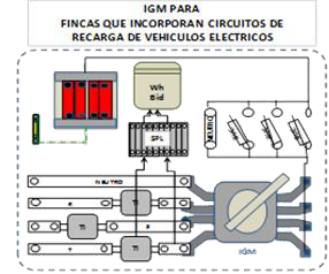

7. CONDICIONES PARTICULARES DE INSTALACIÓN.

7.1 Red de tierra para plazas de aparcamiento en el exterior. El presente apartado aplica tanto a la instalación de puntos de recarga en vía pública como a la instalación en aparcamientos o estacionamientos públicos a la intemperie. La instalación de puesta a tierra se realizará de forma tal que la máxima resistencia de puesta a tierra a lo largo de la vida de la instalación y en cualquier época del año, no se puedan producir tensiones de contacto mayores de 24 V, en las partes metálicas accesibles de la instalación (estaciones de recarga, cuadros metálicos, etc.). Cada poste de recarga dispondrá de un borne de puesta a tierra, conectado al circuito general de puesta a tierra de la instalación. Los conductores de la red de tierra que unen los electrodos podrán ser:

Desnudos, de cobre, de 35 mm2 de sección mínima, si forman parte de la propia red de tierra, en cuyo caso irán por fuera de las canalizaciones de los cables de alimentación.

Aislados, mediante cables de tensión asignada 450/750V, con recubrimiento de color verde-amarillo, con conductores de cobre, de sección mínima 16 mm2. El conductor de protección que une de cada punto de recarga con el electrodo o con la red de tierra, será de cable unipolar aislado, de tensión asignada 450/750 V, con recubrimiento de color verdeamarillo, y sección mínima de 16 mm2 de cobre. Todas las conexiones de los circuitos de tierra, se realizarán mediante terminales, grapas, soldadura o elementos apropiados que garanticen un buen contacto permanente y protegido contra la corrosión.

40 de 46

### ANEXO 1 DE LA GUIA. BUENAS PRÁCTICAS PARA LA INSTALACIÓN DE UN PUNTO DE RECARGA EN

### GARAJES EXISTENTES EN RÉGIMEN DE PROPIEDAD HORIZONTAL

En este anexo se recomiendan buenas prácticas para la instalación de un punto de conexión en instalaciones existentes, de forma que se adecúe la infraestructura para albergar la instalación de futuros puntos de conexión. En estos casos se recomienda instalar los elementos siguientes:

 Protector contra sobretensiones transitorias tipo 1, junto al interruptor general de maniobra IGM (esta protección es necesaria en aplicación del apartado 6.4 de la ITC-BT 52). Cuando en la centralización de contadores no exista espacio para instalar este dispositivo, se podrá instalar en el cuadro de mando y protección del circuito de recarga del vehículo eléctrico, de modo que los nuevos circuitos queden protegidos. En este caso será posible combinar los protectores de tipo 1 de tipo 2 en un solo dispositivo.

 Para reducir el número de sistemas de conducción de cables (tubos, canales o bandejas) con un trazado común y facilitar la instalación de futuros puntos de conexión cuando se realice la instalación del primero, independientemente del esquema de conexión utilizado, se recomienda que el sistema de conducción de cables se dimensione de forma que pueda alojar los cables necesarios para alimentar al menos dos puntos de conexión adicionales que pudieran instalarse en un futuro, próximos al primero instalado, sin que ello suponga incrementar el trazado o recorrido del sistema de conducción de cables necesario para alimentar el primer punto de conexión.

41 de 46

### ANEXO 2 DE LA GUIA. PREVISIÓN DE CARGAS EN EDIFICIOS DE VIVIENDAS DE NUEVA CONSTRUCCIÓN

CON GARAJES EN RÉGIMEN DE CONDOMINIO. Según la ITC-BT 10 del REBT sobre previsión de cargas para suministros en baja tensión, la carga mínima correspondiente a las zonas de estacionamiento con infraestructura para la recarga de los vehículos eléctricos en viviendas de nueva construcción, cuando se trate de plazas de aparcamientos o estacionamientos colectivos en edificios o conjuntos inmobiliarios en régimen de propiedad horizontal se calculará multiplicando 3680 W, por el 10% del total de las plazas de aparcamiento construidas. Esta potencia se multiplicará por el factor de simultaneidad que corresponda y se sumará con la previsión de potencia del resto de la instalación del edificio, en función del esquema de la instalación y de la disponibilidad de un sistema protección de la línea general de alimentación. No obstante el proyectista de la instalación podrá prever una potencia instalada mayor cuando disponga de los datos que lo justifiquen. Por otra parte, según se indica en el apartado 3.2. de esta ITC-BT 52, la preinstalación eléctrica para la recarga de VE, facilitará la utilización posterior de cualquiera de los posibles esquemas de instalación, y constará de sistemas de conducción de cables desde la centralización de contadores hacia las vías principales del aparcamiento o estacionamiento con objeto de poder alimentar posteriormente las estaciones de recarga que se puedan ubicar en las plazas individuales del aparcamiento o estacionamiento. Este porcentaje sobre el total de plazas del 10% para la previsión de cargas debe considerarse como valor mínimo reglamentario Con el objetivo de no condicionar ni restringir las posteriores formas de conexión y contratación, en los casos en los que se proyecten dos centralizaciones de contadores (una para las viviendas y otra para las estaciones de carga del vehículo eléctrico) la canalización que las une debería dimensionarse con un espacio suficiente que permita otros esquemas alternativos (por ejemplo, el esquema 1 o el 2).

Para realizar la previsión de cargas en las nuevas promociones inmobiliarias de viviendas con garajes en régimen de condominio cabe distinguir dos casos según los esquemas utilizados. En el caso de utilizar el esquema de instalación 2 (o el 4a), la previsión de cargas del VE se debe integrar con la de la vivienda, ya que ambos consumos serán medidos por el mismo contador, mientras que para el resto de esquemas es posible separar los consumos del VE de los consumos de las viviendas, ya que estarán asociados a contratos de suministro independientes y sus consumos se medirán con contadores principales diferentes. Este anexo establece el procedimiento recomendado para determinar la previsión de cargas en garajes de nueva construcción en régimen de condominio cuando se desee realizar la preinstalación en un número de plazas, N, elevado, por encima del 50% del total de plazas de garaje construidas. Este procedimiento pretende realizar una buena previsión de cargas, evitando previsiones excesivas. La previsión de cargas se estudiará agrupando los esquemas en tres casos distintos, suponiendo un número N de puntos de recarga de 3 680 W de potencia instalada en cada uno. No obstante, el procedimiento es generalizable para otras potencias distintas por punto de recarga. a) Caso general, aplicables a los esquemas 1a , 1b, 1c y 4b. La previsión de cargas del edificio para el caso general se calcula aplicando la expresión (1):

P P P P P P (1) edificio 1 2 3 4 VE

42 de 46

La previsión de cargas para la recarga de vehículos en el edificio, P , se calcula según esté o no prevista la instalación VE de un SPL mediante la aplicación del factor de simultaneidad FS1.

### P  FS P  FS N3680W (2)

VE 1 5 1 donde: P , carga correspondiente al conjunto de viviendas (sin VE) obtenida como el número de viviendas por el coeficiente 1 de simultaneidad de la tabla 1 de la (ITC) BT 10. P , carga correspondiente a los servicios generales del edificio. 2 P , carga correspondiente a locales comerciales y oficinas. 3 P , carga correspondiente a los garajes, pero distintas de la recarga del VE. 4 P , carga prevista para la recarga del VE incluyendo el factor de simultaneidad. VE P , carga prevista para la recarga del VE, sin factor de simultaneidad. 5 FS , factor de simultaneidad cuyo valor depende de si se prevé o no el SPL (0,3 si se prevé y 1 si no se prevé). 1 N, número de plazas de garaje en las que se realiza la preinstalación. En caso de instalar puntos de recarga con potencia mayor de 3680 W, los cálculos de la fórmula (2) en cuanto a la potencia de cada punto de recarga de vehículo eléctrico se adaptarán al valor concreto de potencia prevista.

La ITC-BT 52 no incluía la posible instalación del SPL para el esquema 4b, sin embargo, tampoco la prohibía expresamente. Las diferentes soluciones tecnológicas y opciones disponibles en el mercado, hacen perfectamente viable la instalación del SPL, también en el esquema 4b, muy parecido a los esquemas 1, por lo que el caso general resultará aplicable a todos los esquemas 1a, 1b, 1c y 4b. Una vez finalizada la promoción inmobiliaria con su preinstalación correspondiente para el VE, los puntos de recarga se irán colocando poco a poco según las necesidades de los propietarios de las plazas de garaje, por lo que el valor de la potencia realmente instalada irá creciendo hasta también poco a poco. Una preinstalación con una previsión de cargas P , calculada según la expresión (2), constituye una reserva de potencia, que se irá utilizando a medida que VE se instalen los puntos de recarga reales. Mientras que la potencia realmente instalada una vez colocados los puntos de recarga no supere el valor de P que figure en el proyecto no será necesario reforzar, ampliar, duplicar la LGA o VE realizar una nueva acometida y se podrá autorizar la instalación de nuevos puntos de recarga aún sin la instalación del SPL. En el proyecto se debe indicar el punto de recarga número Y, a partir del cual será necesario instalar el SPL. El valor de Y se calculará como la parte entera del número que resulte de multiplicar 0,3 por N. Cada vez que se complete la instalación con uno o varios puntos de recarga el instalador tendrá que realizar una memoria técnica de diseño para el punto o puntos de recarga instalados sin ser necesario un proyecto, salvo que la previsión de carga de los puntos instalados desde el mismo circuito o cuadro superen los 50 kW (o 10 kW en instalaciones de exterior) tal y como se describe en la ITC-BT 04. En la memoria técnica de diseño, o en su caso en el proyecto, se hará constar el número de puntos de recarga instalados hasta la fecha, así como el valor de Y a partir del cual se debe instalar el SPL

b) Previsión de cargas para el esquema 2 o el 4a. La previsión de cargas de un edificio nuevo en el que el promotor opte por el esquema 2 o el 4a (instalación con un contador principal común para la vivienda y para la estación de recarga de VE) se realizará aplicando (3): P  P P P P (3) edificio 1 2 3 4

43 de 46

donde: P , carga correspondiente al conjunto de viviendas, incluida la carga correspondiente al VE para aquellas viviendas 1 que tengan preinstalación del VE asignada. P , carga correspondiente a los servicios generales del edificio. 2 P , carga correspondiente a locales comerciales y oficinas. 3 P , carga correspondiente a los garajes, pero distintas de la recarga del VE. 4 No existe todavía mucha experiencia real para determinar la previsión de cargas para una vivienda que incluya un punto de recarga para el VE, no obstante, la costumbre más extendida para su recarga cuando el usuario del vehículo dispone de una plaza de garaje asociada a la vivienda es la siguiente.  Se trata de recargar aprovechando las tarifas supervalle y bajos precios del mercado durante la noche, así como la baja utilización del resto de circuitos de la vivienda por parte del usuario.

 Se utilizan los sistemas de programación del propio vehículo que permiten al conductor seleccionar el tiempo durante el cual se realizará la recarga, en otros casos se puede instalar fácilmente en el punto de recarga un programador / temporizador. En función de estas premisas y los estudios descritos en el Anexo 3 de esta guía, se propone considerar dos períodos horarios (nocturno y diurno), y considerar como previsión de cargas para las viviendas el mayor valor obtenido de los dos períodos.   P máximo P(diurno),P(nocturno) (4) 1 1 1

 Período diurno: la previsión de cargas para las viviendas sin VE se calcularía según la ITC-BT 10, mientras que la previsión de cargas para viviendas con VE se calcularía con la expresión (5):   P (conVE) P (sin VE) 0,3 3680W (5) vivienda vivienda

Según esta expresión la previsión de cargas durante el día para una vivienda con preinstalación de punto de recarga para el VE se considera como la suma de la previsión de cargas de una vivienda igual que no tuviera esta preinstalación más la carga prevista para el vehículo eléctrico con un factor de simultaneidad de 0,3. Esto significa que no es totalmente descartable la recarga del VE durante el día, por ejemplo que se inicie a las 19 h o las 20 horas, aunque en este caso lo más común es que usuario opte por no conectar al mismo tiempo todas las cargas de su vivienda. Si denominamos A, al número de viviendas con preinstalación para el VE, y B al número de viviendas sin preinstalación, supuestas todas ellas con el mismo nivel de electrificación se puede calcular la potencia media aritmética por vivienda como: AP (con VE)BP (sin VE) P  vivienda vivienda (6) m,v AB P(diurno)CS P (7) 1 m,v

donde: P valor medio aritmético de la previsión de carga correspondiente al conjunto de viviendas, incluyendo m, v en la previsión de cargas de las viviendas la carga del VE. 44 de 46

CS coeficiente de simultaneidad de la tabla 1 de la ITC-BT 10, que depende únicamente del número total de viviendas (A+B).  Período nocturno: la previsión de cargas durante el período nocturno se calcularía separando la carga de las viviendas de la carga para el VE, sumando para ello el consumo nocturno de las viviendas (sin VE) al producto del número de puntos de recarga previstos por 3680 W. P(nocturno)P (nocturno)N3680W (8)

### 1 Viviendas

El consumo nocturno de las viviendas se puede calcular en función de la potencia prevista por vivienda (supuestas todas del mismo nivel de electrificación) del y coeficiente de simultaneidad, CS, aplicable según la tabla 1 de la ITC-BT 10, siguiendo la expresión (9): P (nocturno)0,5CSP (sin VE) (9) Viviendas vivienda

Agrupando las expresiones (8) y (9): P(nocturno)0,5CS P (sin VE)N3680W (10) 1 vivienda

Puede observarse como en la expresión (10) el factor de simultaneidad entre la previsión de cargas del VE y la previsión de cargas de la carga de las viviendas es igual a la unidad, tal y como se indica en la ITC BT- 52. La justificación del coeficiente 0,5 de las expresiones (9) y (10) se incluye en el Anexo 3 de esta guía. En el caso particular de que las viviendas estuvieran previstas para tarifa nocturna, no procede realizar la distinción entre consumo diurno y nocturno, ya que el mayor consumo se producirá durante el período nocturno, por lo que la expresión a aplicar para calcular la carga P1 correspondiente al conjunto de viviendas con tarifa nocturna, teniendo en cuenta el apartado 3.1 de la ITC-BT 10 sería la siguiente: P(casotarifa nocturna) NV P (sin VE)N3680W (11) 1 vivienda

siendo NV: número de viviendas con tarifa nocturna c) Previsión de cargas para el esquema 3a o el 3b. Este caso resulta parecido al caso a) por lo que la previsión de cargas del edificio se calcula con la expresión (1): P P P P P P (1) edificio 1 2 3 4 VE

La previsión de cargas para la recarga de vehículos en el edificio, P , se calcula aplicando factor de simultaneidad VE unidad. P  P  N 3680W (12) VE 5

En caso de instalar puntos de recarga con potencia superior a 3680 W, los cálculos de las expresiones (5), (8), (10), (11) y (12) en cuanto a la potencia de recarga del VE se deberán adaptar proporcionalmente a la nueva potencia.

45 de 46

### ANEXO 3 DE LA GUÍA. DETERMINACIÓN DE LA CAPACIDAD DISPONIBLE POR UN CONSUMIDOR

DOMÉSTICO PARA REALIZAR LA RECARGA DEL VE SIN AMPLIAR LA POTENCIA.

El operador del sistema (Red Eléctrica de España), calcula y publica regularmente las medidas de la demanda del sistema eléctrico peninsular y los perfiles finales de consumo. Gracias al proyecto perfila, estos perfiles de consumo aplicables a los consumidores domésticos se han podido determinar con precisión. En base a esta información, y con el objetivo de poder estimar de una manera razonable y robusta el margen de capacidad libre o “hueco” que tendrían los consumidores domésticos para realizar la cargar nocturna del VE, se han tomado los valores máximos para cada periodo horario del coeficiente de perfilado A publicado por REE durante el año 2015. Estos valores, ajustados en base 100 para el valor máximo de dicho coeficiente horario, han sido representados en la siguiente gráfica.

Figura 13. Proyecto a través del cual se ha constituido un panel de consumidores con datos de consumo de contadores inteligentes instalados según el plan de sustitución de contadores.http://www.ree.es/es/red21/idi/proyectos-idi/proyecto-perfila-0

De esta manera, se obtiene el ratio horario de uso de la capacidad disponible por un consumidor doméstico. Suponiendo que los VE fuera programados para que iniciaran su carga a partir de la 1 de la mañana (hora de inicio de la tarifa de acceso supervalle, que coincide además con los precios más bajos de la energía en el mercado), un consumidor doméstico tendría disponible en un escenario de máxima demanda para esta hora, prácticamente el 50% de su capacidad de punta para poder realizar esta recarga. En caso el de que se comprobara que los VE conectados a los puntos de recarga de las viviendas no realizan en su mayoría una recarga lenta a partir de esta hora, este coeficiente debería ser recalculado.

46 de 46

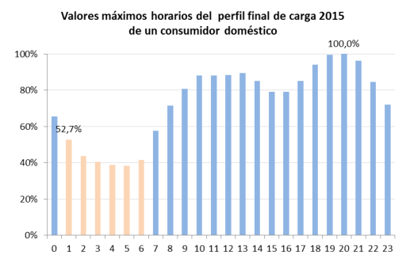
