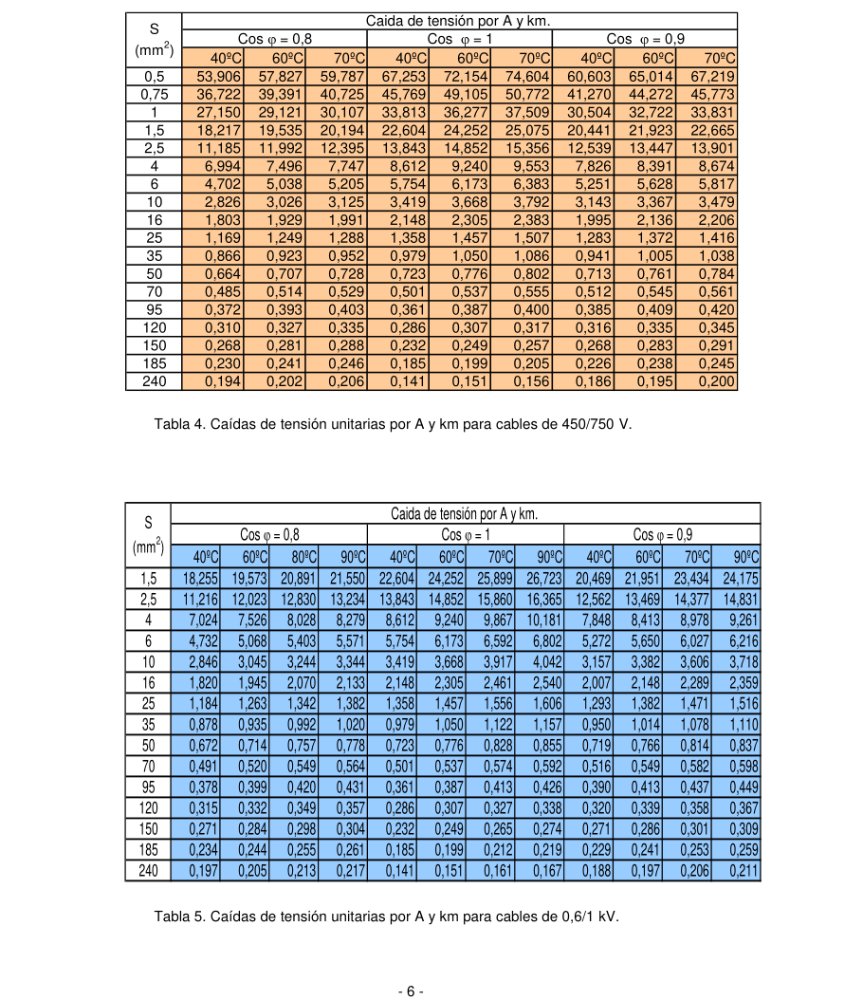

# Cálculos de caídas de tensión

CÁLCULO DE CAÍDAS DE TENSIÓN.

1. Introducción. La determinación reglamentaria de la sección de un cable consiste en calcular la sección mínima normalizada que satisface simultáneamente las tres condiciones siguientes. a) Criterio de la intensidad máxima admisible o de calentamiento. La temperatura del conductor del cable, trabajando a plena carga y en régimen permanente, no deberá superar en ningún momento la temperatura máxima admisible asignada de los materiales que se utilizan para el aislamiento del cable. Esta temperatura se especifica en las normas particulares de los cables y suele ser de 70ºC para cables con aislamiento termoplásticos y de 90ºC para cables con aislamientos termoestables. b) Criterio de la caída de tensión. La circulación de corriente a través de los conductores ocasiona una pérdida de potencia transportada por el cable, y una caída de tensión o diferencia entre las tensiones en el origen y extremo de la canalización. Esta caída de tensión debe ser inferior a los límites marcados por el Reglamento en cada parte de la instalación, con el objeto de garantizar el funcionamiento de los receptores alimentados por el cable. Este criterio suele ser el determinante cuando las líneas son de larga longitud por ejemplo en derivaciones individuales que alimenten a los últimos pisos en un edificio de cierta altura. c) Criterio de la intensidad de cortocircuito. La temperatura que puede alcanzar el conductor del cable, como consecuencia de un cortocircuito o sobreintensidad de corta duración, no debe sobrepasar la temperatura máxima admisible de corta duración (para menos de 5 segundos) asignada a los materiales utilizados para el aislamiento del cable. Esta temperatura se especifica en las normas particulares de los cables y suele ser de 160ºC para cables con aislamiento termoplásticos y de 250ºC para cables con aislamientos termoestables. Este criterio, aunque es determinante en instalaciones de alta y media tensión no lo es en instalaciones de baja tensión ya que por una parte las protecciones de sobreintensidad limitan la duración del cortocircuito a tiempos muy breves, y además las impedancias de los cables hasta el punto de cortocircuito limitan la intensidad de cortocircuito. En este capítulo se presentarán las fórmulas aplicables para el cálculo de las caídas de tensión, los límites reglamentarios, así como algunos ejemplos de aplicación. Todo el planteamiento teórico que se expone a continuación es aplicable independientemente del tipo del material conductor (cobre, aluminio o aleación de aluminio). La mayoría de los ejemplos se centran en los cálculos de caídas de tensión en instalaciones de enlace, aunque la teoría es también aplicable a instalaciones interiores.

2. Cálculo de caídas de tensión. La expresión que se utiliza para el cálculo de la caída de tensión que se produce en una línea se obtiene considerando el circuito equivalente de una línea corta (inferior a unos 50 km.), mostrado en la figura siguiente, junto con su diagrama vectorial.

R jX I

U 1 U 2

Figura 1. Circuito equivalente de una línea corta.

- 1 -

<!-- figura vectorial en la pág. 1 del PDF original -->
> Figura en la pág. 1 del PDF original: [ver en el PDF](../pdf/BT-Anexo-2.pdf#page=1)

U 1

<!-- tabla: ../tablas/BT-Anexo-2_t01.csv -->

|  |  | θ |
|---|---|---|
|  |  | U 2 |
|  | U 2 | U 2 |
| I |  |  |

<!-- tabla: ../tablas/BT-Anexo-2_t02.csv -->

|  | C |
|---|---|
| XI |  |

Figura 2. Diagrama vectorial.

Debido al pequeño valor del ángulo  entre las tensiones en el origen y extremo de la línea, se puede asumir sin cometer prácticamente ningún error, que el vector U es igual a su proyección horizontal, 1 siendo por tanto el valor de la caída de tensión.

U = U - U  AB + BC = R I cos + XI sen. [1] 1 2

Como la potencia transportada por la línea es:

P= 3 U I cos (en trifásico) [2] 1 P= U I cos (en monofásico) [3] 1 Basta con sustituir la intensidad calculada en función de la potencia en la fórmula [1], y tener en cuenta que en trifásico la caída de tensión de línea será raíz de tres veces la caída de tensión de fase calculada según [1], y que en monofásico habrá que multiplicarla por un factor de dos para tener en cuenta tanto el conductor de ida como el de retorno. Caída de tensión en trifásico:

U = (R + X tan ) (P / U ) [4] III 1 Caída de tensión en monofásico:

U = 2 (R + X tan ) (P / U ) [5] I 1 Donde: U Caída de tensión de línea en trifásico en voltios  U Caída de tensión en monofásico en voltios.  R Resistencia de la línea en  X Reactancia de la línea en  P Potencia en vatios transportada por la línea. U Tensión de la línea según sea trifásica o monofásica, (400V en trifásico, 230V 1 en monofásico) tan  Tangente del ángulo correspondiente al factor de potencia de la carga. La reactancia, X, de los conductores varía con el diámetro y la separación entre conductores. En el caso de redes de distribución aéreas trenzadas es sensiblemente constante al estar los conductores reunidos en haz, siendo del orden de X= 0,1 /km, valor que se puede utilizar para los cálculos sin error apreciable. En el caso de redes de distribución subterráneas, aunque se suelen obtener valores del mismo orden, es posible su cálculo en función de la separación entre conductores, determinando lo que se conoce como separación media geométrica entre ellos.

- 2 -

<!-- figura vectorial en la pág. 2 del PDF original -->
> Figura en la pág. 2 del PDF original: [ver en el PDF](../pdf/BT-Anexo-2.pdf#page=2)

En ausencia de datos se puede estimar el valor de la reactancia inductiva como 0,1 /km, o bien como un incremento adicional de la resistencia. Así podemos suponer que para un conductor cuya sección sea:

<!-- tabla: ../tablas/BT-Anexo-2_t03.csv -->

| Sección | Reactancia inductiva (X) |
|---|---|
| S  120 mm2 | X  0 |
| S = 150 mm2 | X  0,15 R |
| S = 185 mm2 | X  0,20 R |
| S = 240 mm2 | X  0,25 R |

Tabla1. Valores aproximados de la reactancia inductiva Para secciones menores o iguales de 120mm2, como es lo habitual tanto en instalaciones de enlace como en instalaciones interiores, la contribución a la caída de tensión por efecto de la inductancia es despreciable frente al efecto de la resistencia, y por lo tanto las fórmulas [4] y [5] anteriores se pueden simplificar de la siguiente forma:

Caída de tensión en trifásico: U = R P / U [6]  1

Caída de tensión en monofásico: U = 2 R P / U [7]  1 Si tenemos en cuenta que el valor de la resistencia de un cable se calcula como: R = R = R (1 + Ys + Yp) = c R [8] tca tcc tcc

R = R [1 +  ( - 20)] =  L / S [9] tcc 20cc 

R =  L / S [10] 20cc 20

 =  [1 +  ( -20)] [11]  20 Donde: R resistencia del conductor en corriente alterna a la temperatura  tca R resistencia del conductor en corriente continua a la temperatura  tcc R resistencia del conductor en corriente continua a la temperatura de 20ºC. 20cc Ys incremento de la resistencia debido al efecto piel (o efecto skin) Yp incremento de la resistencia debido al efecto proximidad.  coeficiente de variación de resistencia específica por temperatura del conductor en ºC-1.  resistividad del conductor a la temperatura    resistividad del conductor a 20ºC. 20 S sección del conductor en mm2. L longitud de la línea en m.

<!-- tabla: ../tablas/BT-Anexo-2_t04.csv -->

| Material |  ( mm2 /m)  |  ( mm2 /m)  |  ( mm2 /m)  |  (ºC –1) |
|---|---|---|---|---|
| Cobre | 0,018 | 0,021 | 0,023 | 0,00392 |
| Aluminio | 0,029 | 0,033 | 0,036 | 0,00403 |
| Almelec (Al-Mg-Si) | 0,032 | 0,038 | 0,041 | 0,00360 |

Tabla 2. Valores de la resistividad y del coeficiente de temperatura de los conductores más utilizados. El efecto piel y el efecto proximidad son mucho más pronunciados en los conductores de gran sección. Su cálculo riguroso se detalla en la serie de normas UNE 21144. No obstante, y de forma aproximada para instalaciones de enlace e instalaciones interiores en baja tensión es factible suponer un incremento de resistencia inferior al 2% en alterna respecto del valor en continua.

- 3 -

c = (1 + Ys + Yp)  1,02 Combinando las ecuaciones [8], y [9] anteriores se tiene:

R = c  L / S [12]  Sustituyendo la ecuación [12] en las [6] y [7] se puede despejar el valor de la sección mínima que garantiza una caída de tensión límite previamente establecida.

Cálculo de la sección en trifásico [13] c ρ P L S = 𝜃 𝛥𝑈 U III 1 Cálculo de la sección en monofásico [14] 2 c ρ P L S = 𝜃 𝛥𝑈 U 𝐼 1 Donde: S sección calculada según el criterio de la caída de tensión máxima admisible en mm2 . c incremento de la resistencia en alterna. (Se puede tomar c= 1,02).  resistividad del conductor a la temperatura de servicio prevista para el conductor  ( mm2 /m). P potencia activa prevista para la línea, en vatios. L longitud de la línea en m. U caída de tensión máxima admisible en voltios en líneas trifásicas.  U caída de tensión máxima admisible en voltios en líneas monofásicas.  U tensión nominal de la línea (400 V en trifásico, 230 V en monofásico) 1

En la práctica para instalaciones de baja tensión tanto interiores como de enlace es admisible despreciar el efecto piel y el efecto de proximidad, así como trabajar con el inverso de la resistividad que se denomina conductividad (“ ”, en unidades m/ mm2). Además, se suele utilizar la letra “e” para designar a la caída de tensión en voltios, tanto en monofásico como en trifásico, y la letra U para designar la tensión de línea en trifásico (400V) y la tensión de fase en monofásico (230V). Con estas simplificaciones se obtienen las expresiones siguientes para determinar la sección. Para receptores trifásicos: [15] P L S = 𝛾 e U Para receptores monofásicos: [16]

### 2 P L

S = 𝛾 e U Donde la conductividad se puede tomar de la siguiente tabla:

<!-- tabla: ../tablas/BT-Anexo-2_t05.csv -->

| Material |   |   |   |
|---|---|---|---|
| Cobre | 56 | 48 | 44 |
| Aluminio | 35 | 30 | 28 |
| Temperatura | 20ºC | 70ºC | 90ºC |

Tabla 3. Conductividades, , (en m/  mm2) para el cobre y el aluminio, a distintas temperaturas.

- 4 -

Para calcular la temperatura máxima prevista en servicio de un cable se puede utilizar el siguiente razonamiento: su incremento de temperatura respecto de la temperatura ambiente T (25ºC para 0 cables enterrados y 40ºC para cables al aire), es proporcional al cuadrado del valor eficaz de la intensidad. Por tanto. T = T - T = Constante · I2 0 T = Constante · I 2 máx máx Por tanto: T/ I2 = T / I 2 máx máx

T = T + (T − T ) · (I / I )2 [17] 0 máx 0 máx

Donde T temperatura real estimada en el conductor T temperatura máxima admisible para el conductor según su tipo de aislamiento. máx T temperatura ambiente del conductor. 0 I intensidad prevista para el conductor. I intensidad máxima admisible para el conductor según el tipo de instalación. máx

3. Cálculo de caídas de tensión mediante valores unitarios.

Se define la caída de tensión unitaria (e ) como la caída de tensión por unidad de longitud del cable y u por unidad de intensidad que circula por el cable.

e = e / (L · I) [18] u

Donde e caída de tensión unitaria en voltios. u e caída de tensión en voltios. L longitud de la canalización en km. I intensidad de servicio máxima prevista para el conductor, en amperios.

En las tablas siguientes se indican las caídas de tensión unitarias calculadas teniendo en cuenta tanto la resistencia como la inductancia de los cables, para dos factores de potencia distintos y para distintas temperaturas de servicio de los conductores. La tabla 4 es para cables de tensión asignada 450/750 V, y la tabla 5 para cables de 0,6/1 kV.

- 5 -

<!-- tabla: ../tablas/BT-Anexo-2_t06.csv -->

| S (mm2) | Caida de tensión por A y km. |  |  |  |  |  |  |  |  |  |  |  |
|---|---|---|---|---|---|---|---|---|---|---|---|---|
|  | Cos  = 0,8 |  |  |  | Cos  = 1 |  |  |  | Cos  = 0,9 |  |  |  |
|  | 40ºC | 60ºC | 80ºC | 90ºC | 40ºC | 60ºC | 70ºC | 90ºC | 40ºC | 60ºC | 70ºC | 90ºC |
| 1,5 | 18,255 | 19,573 | 20,891 | 21,550 | 22,604 | 24,252 | 25,899 | 26,723 | 20,469 | 21,951 | 23,434 | 24,175 |
| 2,5 | 11,216 | 12,023 | 12,830 | 13,234 | 13,843 | 14,852 | 15,860 | 16,365 | 12,562 | 13,469 | 14,377 | 14,831 |
| 4 | 7,024 | 7,526 | 8,028 | 8,279 | 8,612 | 9,240 | 9,867 | 10,181 | 7,848 | 8,413 | 8,978 | 9,261 |
| 6 | 4,732 | 5,068 | 5,403 | 5,571 | 5,754 | 6,173 | 6,592 | 6,802 | 5,272 | 5,650 | 6,027 | 6,216 |
| 10 | 2,846 | 3,045 | 3,244 | 3,344 | 3,419 | 3,668 | 3,917 | 4,042 | 3,157 | 3,382 | 3,606 | 3,718 |
| 16 | 1,820 | 1,945 | 2,070 | 2,133 | 2,148 | 2,305 | 2,461 | 2,540 | 2,007 | 2,148 | 2,289 | 2,359 |
| 25 | 1,184 | 1,263 | 1,342 | 1,382 | 1,358 | 1,457 | 1,556 | 1,606 | 1,293 | 1,382 | 1,471 | 1,516 |
| 35 | 0,878 | 0,935 | 0,992 | 1,020 | 0,979 | 1,050 | 1,122 | 1,157 | 0,950 | 1,014 | 1,078 | 1,110 |
| 50 | 0,672 | 0,714 | 0,757 | 0,778 | 0,723 | 0,776 | 0,828 | 0,855 | 0,719 | 0,766 | 0,814 | 0,837 |
| 70 | 0,491 | 0,520 | 0,549 | 0,564 | 0,501 | 0,537 | 0,574 | 0,592 | 0,516 | 0,549 | 0,582 | 0,598 |
| 95 | 0,378 | 0,399 | 0,420 | 0,431 | 0,361 | 0,387 | 0,413 | 0,426 | 0,390 | 0,413 | 0,437 | 0,449 |
| 120 | 0,315 | 0,332 | 0,349 | 0,357 | 0,286 | 0,307 | 0,327 | 0,338 | 0,320 | 0,339 | 0,358 | 0,367 |
| 150 | 0,271 | 0,284 | 0,298 | 0,304 | 0,232 | 0,249 | 0,265 | 0,274 | 0,271 | 0,286 | 0,301 | 0,309 |
| 185 | 0,234 | 0,244 | 0,255 | 0,261 | 0,185 | 0,199 | 0,212 | 0,219 | 0,229 | 0,241 | 0,253 | 0,259 |
| 240 | 0,197 | 0,205 | 0,213 | 0,217 | 0,141 | 0,151 | 0,161 | 0,167 | 0,188 | 0,197 | 0,206 | 0,211 |

<!-- tabla no extraíble en la pág. 6 -->
> La tabla de esta página no se puede extraer como texto (pdfplumber la lee como
> caracteres sueltos): se muestra la imagen de la página. También está en [pdf/BT-Anexo-2.pdf](../pdf/BT-Anexo-2.pdf#page=6).

El procedimiento de cálculo de la sección del conductor utilizando estas tablas es muy simple, basta seguir los pasos siguientes:

• Se calcula en primer lugar la caída de tensión unitaria reglamentaria máxima admisible en unidades (V/A·km). • A continuación, para la temperatura de servicio máxima admisible del conductor y para el factor de potencia de la instalación se escoge la sección de conductor cuya caída de tensión unitaria según la tabla sea inferior al valor reglamentario calculado. • Finalmente se comprueba que para esa sección el conductor es capaz de soportar la intensidad prevista en función de sus condiciones de instalación.

Si se quiere efectuar el cálculo con una segunda iteración, aplicando la temperatura real del conductor puede continuarse proceso de la siguiente forma:

• Se comprueba si la sección normalizada inferior es también capaz de soportar la intensidad prevista en función de sus condiciones de instalación. Si es así se continua con el siguiente paso.

• Se calcula la temperatura real del conductor de sección menor mediante la fórmula [17].

• Se comprueba según las tablas si a la temperatura real el conductor de dicha sección nos da una caída de tensión unitaria menor que la reglamentaria. En caso contrario se debería utilizar la sección superior determinada en la primera iteración.

- 7 -

4. Límites reglamentarios de las caídas de tensión en las instalaciones de enlace.

Los límites caída de tensión vienen detallados en las ITC-BT-14, ITC-BT-15 e ITC-BT-19, y son los siguientes.

<!-- tabla: ../tablas/BT-Anexo-2_t07.csv -->

| Parte de la instalación | Para alimentar a : | Caída de tensión máxima en % de la tensión de suministro. | e=U  | e=U  |
|---|---|---|---|---|
| LGA: (Línea General de Alimentación) | Suministros de un único usuario | No existe LGA | -- | -- |
|  | Contadores totalmente concentrados | 0,5% | 2 V | -- |
|  | Centralizaciones parciales de contadores | 1,0% | 4 V | -- |
| DI (Derivación Individual) | Suministros de un único usuario | 1,5% | 6 V | 3,45 V |
|  | Contadores totalmente concentrados | 1,0% | 4 V | 2,3 V |
|  | Centralizaciones parciales de contadores | 0,5% | 2 V | 1,15 V |
| Circuitos interiores | Circuitos interiores en viviendas | 3% | 12 V | 6,9 V |
|  | Circuitos de alumbrado que no sean viviendas | 3% | 12 V | 6,9 V |
|  | Circuitos de fuerza que no sean viviendas | 5% | 20 V | 11,5 V |

Tabla 6. Límites de caídas de tensión reglamentarios. Nota: la LGA es siempre trifásica.

5. Ejemplos de cálculo de caídas de sección de conductores.

Para los cálculos que siguen se tomó como material conductor el cobre. Para otros conductores el proceso es el mismo, únicamente se sustituirían las constantes características por las del material correspondiente en cada caso. Para determinar cuál es la intensidad máxima admisible hay que tener en cuenta las condiciones y tipo de montaje de los conductores, y además habrá que aplicar en su caso los factores de reducción por agrupación de varios circuitos que se recogen en la guía BT 19, o con mayor detalle en la norma UNE- HD 60364-5-52. Únicamente en el caso de que un conductor se prevea para transportar una corriente no superior nunca al 30% de su carga nominal, puede no tenerse en cuenta para la determinación del factor de reducción del resto del agrupamiento.

Ejemplo1: Un edificio destinado a viviendas y locales comerciales tiene una previsión de cargas de P = 145 kW. Se proyecta instalar una única centralización de contadores, y se trata de calcular la sección de la LGA (línea general de alimentación) que va desde la Caja General de Protección ubicada en la fachada del edificio hasta la Centralización de Contadores ubicada en la planta baja de dicho edificio. El edificio tiene unas zonas comunes con jardines y piscina, resultando una longitud de la LGA de 40 metros. La LGA discurre en el interior de un tubo enterrado ya que es necesario pasar por el jardín de las zonas comunes del edificio. Elección del tipo de cables a utilizar: Según la ITC-BT-14, los cables a utilizar serán unipolares de tensión asignada 0,6/1 kV, no propagadores del incendio y con emisión de humos y opacidad reducida. Por tanto, se utilizarán cables normalizados de uno de los tipos siguientes:

- 8 -

Producto Norma de aplicación Cable de tensión asignada 0,6/1 kV, con conductor de cobre Cable tipo RZ1-K clase 5 (-K), aislamiento de polietileno reticulado (R) y cubierta UNE 21.123-4 de compuesto termoplástico a base de poliolefina (Z1) Cable de tensión asignada 0,6/1 kV, con conductor de cobre Cable tipo DZ1-K clase 5 (-K), aislamiento de etileno propileno (D) y cubierta de UNE 21.123-5 compuesto termoplástico a base de poliolefina (Z1)

En ambos casos al tratarse de aislamientos termoestables la temperatura máxima admisible del conductor en servicio continuo será de 90ºC. Cálculo de la sección: a) En primer lugar se calcula la intensidad:

I = P / (3 · U · cos) = 232,5 A 1

Donde: P = 145000 W potencia activa para la línea, en vatios. U = 400 V tensión nominal de la línea, en voltios 1 cos = 0,90 factor de potencia conocido de la carga. Nota: en la práctica la protección contra sobreintensidades de esta línea se realizará con los fusibles de la Caja General de Protección que se elegirían de intensidad asignada normalizada de 250 A, que será el valor de intensidad que define la potencia instalada o prevista y que se utilizará para el cálculo de la caída de tensión. b) Cálculo decaída de tensión mediante valores unitarios: Tensión unitaria reglamentaria: e = 0,5% · 400 V = 2 V e (reglamentaria) = 2 V / (0,04 km · 250 A) = 0,2 V / A km u Según la tabla 5, la caída de tensión para factor de potencia 0,9 y para la temperatura máxima admisible del conductor de 90ºC, inferior al valor de 0,2 V / A km, se obtiene para la sección de 240 mm2, pero solamente cuando su temperatura de trabajo no sea superior a los 60 ºC. Por lo tanto, se probará elegir la sección normalizada; S = 240 mm2 y se calculará su temperatura de trabajo para una corriente de 250 A. c) comprobación de la intensidad admisible: En servicio permanente y en función de las condiciones de instalación hay que comprobar que los cables cuya sección se ha calculado por caída de tensión son capaces de soportar la intensidad de servicio prevista. Para ello utilizamos los valores de la tabla A de la guía BT-14. Según dicha tabla la intensidad máxima admisible para instalación en tubo enterrado es de I = 440 A. máx Este valor es superior al valor de la intensidad prevista. d) Comprobación de temperatura y caída de tensión Se calcula la temperatura del conductor según la fórmula [17]

T = T + (T − T ) · (I / I )2 0 máx 0 máx

- 9 -

(T − T ) = T = 90 ºC - 25 ºC = 65 ºC máx 0 máx

T = 25 + 65 · (250 / 440)2  46 ºC

Por consiguiente, la temperatura real del conductor a la intensidad prevista en servicio permanente será de 46ºC. Según la tabla 5 no se dispone de la caída de tensión unitaria exactamente para 46ºC, pero teniendo en cuenta que a mayor temperatura mayor caída de tensión se observa que la caída de tensión unitaria a 60 ºC toma un valor de 0,197 V/A.km que es inferior al valor máximo reglamentario admisible. Por lo tanto, la sección seleccionada de 240 mm2 cumple con la caída de tensión.

Ejemplo 2: Se debe calcular la sección de una derivación individual (DI) que alimenta a una vivienda con nivel de electrificación básico (5750 W), cuya longitud desde el embarrado del cuarto de contadores hasta el cuadro privado de los dispositivos generales de mando y protección es de 10 metros (segunda planta). El sistema de instalación es el de conductores aislados en el interior de conductos cerrados de obra de fábrica. Elección del tipo de conductores a utilizar: Según la ITC-BT-15, para el sistema de instalación del ejemplo los cables a utilizar serán unipolares o multiconductores de tensión asignada mínima 450/750 V los unipolares, y 0,6/1 kV los multiconductores, no propagadores del incendio y con emisión de humos y opacidad reducida. Por tanto, se utilizarán cables normalizados de uno de los tipos siguientes:

<!-- tabla: ../tablas/BT-Anexo-2_t08.csv -->

| Producto |  | Norma de aplicación |
|---|---|---|
| Cable ES07Z1-K | Cable de tensión asignada 450/750 V, con conductor de cobre clase 5 (-K) y aislamiento de compuesto termoplástico a base de poliolefina (Z1) | UNE 211 002 |
| Cable tipo RZ1-K | Cable de tensión asignada 0,6/1 kV, con conductor de cobre clase 5 (-K), aislamiento de polietileno reticulado (R) y cubierta de compuesto termoplástico a base de poliolefina (Z1) | UNE 21.123-4 |
| Cable tipo DZ1-K | Cable de tensión asignada 0,6/1 kV, con conductor de cobre clase 5 (-K), aislamiento de etileno propileno (D) y cubierta de compuesto termoplástico a base de poliolefina (Z1) | UNE 21.123-5 |

Se eligen conductores unipolares de cobre con aislamiento de compuesto termoplástico, cuya temperatura máxima admisible en servicio continuo es de T = 70ºC. (tipo ES07Z1-K) máx

Cálculo de la sección por el método simplificado:

En lugar de utilizar el método del ejemplo 1, se seguirá el método simplificado. Para su aplicación, una vez determinada la intensidad del circuito se determina la sección por caída de tensión según las fórmulas [15] ó [16], pero considerando el caso más desfavorable en cuanto a que el cable esté a su temperatura máxima admisible en servicio permanente. Una vez determinada la sección por caída de tensión, basta con comprobar que la sección escogida es capaz de soportar la intensidad prevista en servicio permanente. Este método es más rápido y sólo en casos especiales cerca de los límites de la sección normalizada puede dar lugar a un sobredimensionamiento de la sección. La intensidad prevista está limitada por el ICP a instalar que como máximo será de 25 A, al tratarse de un grado de electrificación básico de 5750 W. Según la fórmula [16] por tratarse de un circuito monofásico:

- 10 -

### 2 P L 2· 5750 · 10

S = = =4,52 𝑚𝑚2 γ e U 48 · 2,3 · 230

Por lo tanto, habría que ir a la sección mínima normalizada superior de 6 mm2. Por último, en servicio permanente y en función de las condiciones de instalación hay que comprobar que los cables cuya sección se ha calculado por caída de tensión son capaces de soportar la intensidad de servicio prevista. Para ello utilizamos los valores de la tabla 1 de la ITC-BT-19 para el modo de instalación B. Según dicha tabla, la intensidad máxima admisible es de I = 36 A. Este valor es superior al valor de máx la intensidad prevista (I = 25 A). Cálculo mediante las tablas de caídas de tensión unitarias. Para una caída de tensión reglamentaria admisible de 2,3 voltios (1% de 230 voltios), teniendo en cuenta que L= 0,01 km, I = 25 A, cos = 1, se calcula: e = 2,3 / (0,01. 25) = 9,2 voltios / (A. km) u reglamentaria

Según la tabla 4 para cables de 450/750 V y para una T=70ºC, se obtiene un valor de caída de tensión unitaria menor que el reglamentario: e = 6,383 voltios / (A. km) para una sección de 6 mm2. u Para 4 mm2 la caída de tensión unitaria sería mayor que la reglamentaria y por tanto la sección apropiada es de 6 mm2. La comprobación de la intensidad máxima admisible para esta sección ya se ha efectuado previamente.

Ejemplo 3: Se trata del cálculo de sección de una derivación individual para otra vivienda de electrificación básica del mismo edificio que en el ejemplo 2, donde todos los datos de partida son los mismos excepto la longitud que es ahora de 22 metros. También se desea comprobar si la sección mínima admisible por el RBT de 2,5 mm2, para el circuito interior tipo C2 de bases de toma de corriente de uso general es adecuada teniendo en cuenta que la distancia entre el cuadro de los dispositivos generales de mando y protección y la toma de corriente más alejada es de 30 metros. La instalación interior va empotrada bajo tubo. Elección del tipo de conductores a utilizar: Se emplearán conductores unipolares de cobre con aislamiento termoplástico. Para las derivaciones individuales serán no propagadores del incendio con aislamiento termoplástico a base de poliolefina (ES 07Z1-K), y para la instalación interior del tipo H07-R. Cálculo de la sección de la derivación individual: En primer lugar, hay que tener en cuenta que la intensidad prevista está limitada por el calibre del ICP a un valor máximo de 25A.

- 11 -

Para calcular la potencia prevista se tomará cos = 1, ya que una vez fijada la intensidad prevista en función del calibre del ICP el caso más desfavorable de caída de tensión se obtiene con cos = 1.

P = U I cos = 230 · 25 · 1,0 = 5750 W 1 La sección se calcula aplicando el método simplificado de la fórmula [16]

### 2 P L 2· 5750 · 22

S = = =9,96 𝑚𝑚2 γ e U 48 · 2,3 · 230 Donde por tratarse de una derivación individual con contadores centralizados en un lugar único, e = 1% de 230 V = 2,3 V. Por lo tanto, habría que elegir la sección normalizada inmediatamente superior que es; S = 10 mm2. Por último, en servicio permanente y en función de las condiciones de instalación hay que comprobar que los cables cuya sección se ha calculado por caída de tensión son capaces de soportar la intensidad de servicio prevista. Para ello utilizamos los valores de la tabla1 de la ITC-BT-19 para el modo de instalación B. Según dicha tabla la intensidad máxima admisible es de I = 50A. Este valor es superior al valor de máx la intensidad prevista (I = 25 A). Cálculo de la sección del circuito interior de bases de toma de corriente (C2): Tal y como indica la ITC-BT-25 la intensidad de funcionamiento del circuito coincidirá con la intensidad nominal del interruptor automático que protege el circuito, es decir: I = 16 A. La potencia prevista una vez fijada la intensidad por el calibre de la protección se calcula para cos=1, ya que se cubre el caso más desfavorable

P = U I cos = 230 · 16 · 1,0 = 3680 W 1 La sección se calcula aplicando el método simplificado de la fórmula [16]

### 2 P L 2· 3680 · 30

S = = =2,9 𝑚𝑚2 γ e U 48 · 6,9 · 230 Donde por tratarse de un circuito interior en monofásico de una vivienda, e=3% de 230 V = 6,9 V. Por lo tanto, habría que elegir la sección normalizada inmediatamente superior que es; S = 4 mm2, superior al mínimo reglamentario exigible. Por último, en servicio permanente y en función de las condiciones de instalación hay que comprobar que los cables cuya sección se ha calculado por caída de tensión son capaces de soportar la intensidad de servicio prevista. Para ello utilizamos los valores de la tabla1 de la ITC-BT-19 para el modo de instalación B. Según dicha tabla la intensidad máxima admisible es de I = 27 A. Este valor es superior al valor de máx la intensidad prevista.

Ejemplo 4: Se trata del cálculo de sección de una derivación individual para otra vivienda de electrificación básica del mismo edificio que en el ejemplo 2 y ejemplo 3, donde todos los datos de partida son los mismos excepto la longitud que es ahora de 35 metros. Elección del tipo de conductores a utilizar:

- 12 -

Mismo tipo que en el ejemplo 2 y ejemplo 3. Cálculo de la sección: Siguiendo el ejemplo 2, puesto que sólo cambia la longitud, se tiene:

### 2 P L 2· 5750 · 35

S = = =15,85 𝑚𝑚2 γ e U 48 · 2,3 · 230

Por lo tanto, habría que elegir la sección normalizada inmediatamente superior que es; S = 16 mm2. Por último, la intensidad máxima admisible para esta sección es de I = 66A que es superior al valor máx de la intensidad prevista.

Ejemplo 5: Se trata de repetir los cálculos de sección de las tres derivaciones individuales de los ejemplos 2,3 y 4, para las mismas longitudes (10m, 22m y 35m) pero para viviendas con electrificación elevada. Elección del tipo de conductores a utilizar: Mismo tipo de conductor y condiciones de instalación que en los tres ejemplos anteriores.

Cálculo de la sección: En primer lugar, hay que tener en cuenta que la intensidad prevista está limitada por el calibre del ICP a un valor de 40 A.

Para calcular la potencia prevista se tomará cos = 1, ya que una vez fijada la intensidad prevista en función del calibre del ICP el caso más desfavorable de caída de tensión se obtiene con cos =1.

P = U I cos = 230 · 40 · 1,0 = 9200 W 1

Se aplica la fórmula [16] y se obtienen los valores siguientes para: L = 10 m S = 7,2 mm2 L = 22 m S = 15,9 mm2 L = 35 m S = 25,3 mm2 Por lo tanto, habría que elegir las secciones normalizadas inmediatamente superiores que según el caso son las siguientes. L = 10 m S = 10 mm2 L = 22 m S = 16 mm2 L = 35 m S = 35 mm2

Comprobación de la intensidad admisible: Según la tabla 1 de la ITC-BT-19 para el modo de instalación B y dos conductores cargados las intensidades máximas admisibles para cada sección son las siguientes:

- 13 -

S = 10 mm2 I = 50 A máx S = 16 mm2 I = 66 A máx S = 35 mm2 I = 104 A máx Todos los valores son superiores al valor de la intensidad prevista (I = 40 A). Nota: si el cálculo de la sección se efectuara de la forma detallada en el ejemplo 1 mediante el cálculo de la temperatura real del conductor, para el caso de L = 35 m se obtendría la sección normalizada inferior (S = 25 mm2), ya que la temperatura del conductor es inferior a la máxima admisible de 70ºC, al ser su carga únicamente de 40 A.

- 14 -
