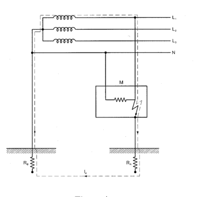

# Verificación de las instalaciones eléctricas

_Revisión: 1 VERIFICACIÓN DE LAS INSTALACIONES ELÉCTRICAS_

### LA VERIFICACIÓN DE LAS INSTALACIONES ELÉCTRICAS

A continuación se resumen los distintos tipos de verificaciones que deberán efectuar los instaladores autorizados. La verificación de las instalaciones eléctricas previa a su puesta en servicio comprende dos fases, una primera fase que no requiere efectuar medidas y que se denomina verificación por examen, y una segunda fase que requiere la utilización de equipos de medida para los ensayos. El alcance de esta verificación se detalla en la ITC-BT-19 y en la norma UNE 20460 parte 6-61 y comprende tanto la verificación por examen como la verificación mediante medidas eléctricas. Adicionalmente la ITC-BT-18 establece las verificaciones a realizar en las puestas a tierra.

### 1 Verificación por examen

Debe preceder a los ensayos y medidas, y normalmente se efectuará para el conjunto de la instalación estando ésta sin tensión. Está destinada a comprobar: • Si el material eléctrico instalado permanentemente es conforme con las prescripciones establecidas en el proyecto o memoria técnica de diseño. • Si el material ha sido elegido e instalado correctamente conforme a las prescripciones del Reglamento y del fabricante del material. • Que el material no presenta ningún daño visible que pueda afectar a la seguridad.

En concreto los aspectos cualitativos que este tipo de verificación debe tener en cuenta son los siguientes: • La existencia de medidas de protección contra los choques eléctricos por contacto de partes bajo tensión o contactos directos, como por ejemplo: el aislamiento de las partes activas, el empleo de envolventes , barreras, obstáculos o alejamiento de las partes en tensión. • La existencia de medidas de protección contra choques eléctricos derivados del fallo de aislamiento de las partes activas de la instalación, es decir, contactos indirectos. Dichas medidas pueden ser el uso de dispositivos de corte automático de la alimentación tales como interruptores de máxima corriente, fusibles, o diferenciales, la utilización de equipos y materiales de clase II, disposición de paredes y techos aislantes o alternativamente de conexiones equipotenciales en locales que no utilicen conductor de protección, etc. • La existencia y calibrado de los dispositivos de protección y señalización. • La presencia de barreras cortafuegos y otras disposiciones que impidan la propagación del fuego, así como protecciones contra efectos térmicos. • La utilización de materiales y medidas de protección apropiadas a las influencias externas. • La existencia y disponibilidad de esquemas, advertencias e informaciones similares. • La identificación de circuitos, fusibles, interruptores, bornes, etc. • La correcta ejecución de las conexiones de los conductores. • La accesibilidad para comodidad de funcionamiento y mantenimiento.

2 Verificaciones mediante medidas o ensayos. Las verificaciones descritas en la ITC-BT-19 e ITC-BT-18 son las siguientes: - 1 -

1. Medida de continuidad de los conductores de protección. 2. Medida de la resistencia de puesta a tierra. 3. Medida de la resistencia de aislamiento de los conductores.

### 4. Medida de la resistencia de aislamiento de suelos y paredes, cuando se utilice este

sistema de protección. 5. Medida de la rigidez dieléctrica.

Adicionalmente hay que considerar otras medidas y comprobaciones que son necesarias para garantizar que se han adoptado convenientemente los requisitos de protección contra choques eléctricos:

### 6. Medida de las corrientes de fuga

7. Medida de la impedancia de bucle. 8. Comprobación de la intensidad de disparo de los diferenciales. 9. Comprobación de la secuencia de fases.

#### 2.1 Medida de la continuidad de los conductores de protección y de las uniones

equipotenciales principales y suplementarias. Esta medición se efectúa mediante un ohmímetro que aplica una intensidad continua del orden de 200 mA con cambio de polaridad, y equipado con una fuente de tensión continua capaz de genera de 4 a 24 voltios de tensión continua en vacío. Los circuitos probados deben estar libres de tensión. Si la medida se efectúa a dos hilos es necesario descontar la resistencia de los cables de conexión del valor de resistencia medido. En la figura se ilustra la medida del valor de la resistencia óhmica del conductor de protección que une dos bases de enchufe, mediante un comprobador de baja tensión multifunción, válido para otros tipos de comprobaciones, no obstante, un simple ohmímetro con medida de resistencia a dos hilos sería sufuciente para esta verificación.

L

N PE

PE/L3

N/L 2

L/L1

Figura 1. Medida de la resistencia de un conductor de protección.

- 2 -

<!-- figura vectorial en la pág. 2 del PDF original -->
> Figura en la pág. 2 del PDF original: [ver en el PDF](../pdf/BT-Anexo-4.pdf#page=2)

Con la lectura del ohmímetro, y supuesta conocida la longitud de los conductores se puede deducir la sección. La ITC-BT-38, aplicable a quirófanos y salas de intervención, requiere unos límites especiales para los valores de resistencia de los conductores de protección y de los conductores utilizados para las uniones de equipotencialidad. En concreto la impedancia entre el embarrado común de puesta a tierra de cada quirófano o sala de intervención y las conexiones a masa, o los contactos de tierra de las bases de toma de corriente, no deberá exceder de 0,2 ohmios. Además todas las partes metálicas accesibles han de estar unidas al embarrado de equipotencialidad mediante conductores de cobre aislados e independientes con una impedancia entre estas partes y el embarrado de equipotencialidad que no deberá exceder de 0,1 ohmios.

2.2 Medida de la resistencia de puesta a tierra. Las condiciones de medida y su periodicidad se indican en la ITC-BT-18. Por la importancia que ofrece, desde el punto de vista de la seguridad cualquier instalación de toma de tierra, deberá ser obligatoriamente comprobada por el Director de la Obra o Instalador Autorizado en el momento de dar de alta la instalación para su puesta en marcha o en funcionamiento. Personal técnicamente competente efectuará la comprobación de la instalación de puesta a tierra, al menos anualmente, en la época en la que el terreno esté mas seco. Para ello, se medirá la resistencia de tierra, y se repararán con carácter urgente los defectos que se encuentren. En los lugares en que el terreno no sea favorable a la buena conservación de los electrodos, éstos y los conductores de enlace entre ellos hasta el punto de puesta a tierra, se pondrán al descubierto para su examen, al menos una vez cada cinco años. Estas medidas se efectúan mediante un telurómetro, que inyecta una intensidad de corriente alterna conocida, a una frecuencia superior a los 50 Hz, y mide la caída de tensión, de forma que el cociente entre la tensión medida y la corriente inyectada nos da el valor de la resistencia de puesta a tierra. La conexión se efectúa a tres terminales tal y como se indica en la figura, de forma que la intensidad se inyecta entre E y H, y la tensión se mide entre S y ES. El electrodo de puesta a tierra está representado por R , mientras que las otros dos electrodos hincados en el terreno son dos picas E auxiliares de unos 30 cm de longitud que se suministran con el propio telurómetro. Los tres electrodos se deben situar en línea recta. Durante la medida, el electrodo de puesta a tierra cuya resistencia a tierra (R ) se desea medir debe E estar desconectado de los conductores de puesta a tierra. La distancia entre la sonda (S) y el electrodo de puesta a tierra (E/ES), al igual que la distancia entre (S) y la pica auxiliar (H) debe ser al menos de 20 metros. Los cables no se deben cruzar entre sí para evitar errores de medida por acoplamientos capacitivos. La medida efectuada se puede considerar como correcta si cuando se desplaza la pica auxiliar (S) de su lugar de hincado un par de metros a izquierda y derecha en la línea recta formada por los tres electrodos el valor de resistencia medido no experimenta variación. En caso contrario es necesario ampliar la distancia entre los tres electrodos de medida hasta que se cumpla lo anterior. Mediante telurómetros que permiten una conexión a cuatro terminales se puede medir también la resistividad del terreno.

H

S

ES

E

20m 20m RE - 3 -

<!-- figura vectorial en la pág. 3 del PDF original -->
> Figura en la pág. 3 del PDF original: [ver en el PDF](../pdf/BT-Anexo-4.pdf#page=3)

Figura 2. Medida de la resistencia de puesta a tierra R . E

2.3 Medida de la resistencia de aislamiento de la instalación. Las instalaciones deberán presentar una resistencia de aislamiento al menos igual a los valores indicados en la tabla siguiente:

<!-- tabla: ../tablas/BT-Anexo-4_t01.csv -->

| Tensión nominal de la instalación | Tensión de ensayo en corriente continua (V) | Resistencia de aislamiento (MΩ) |
|---|---|---|
| Muy Baja Tensión de Seguridad (MBTS) Muy Baja Tensión de protección (MBTP) | 250 | ≥ 0,25 |
| Inferior o igual a 500 V, excepto caso anterior | 500 | ≥ 0,5 |
| Superior a 500 V | 1000 | ≥ 1,0 |

Tabla1. Valores mínimos de resistencia de aislamiento de una instalación.

Este aislamiento se entiende para una instalación en la cual la longitud del conjunto de canalizaciones y cualquiera que sea el número de conductores que las componen no exceda de 100 metros. Cuando esta longitud exceda del valor anteriormente citado y pueda fraccionarse la instalación en partes de aproximadamente 100 metros de longitud, bien por seccionamiento, desconexión, retirada de fusibles o apertura de interruptores, cada una de las partes en que la instalación ha sido fraccionada debe presentar la resistencia de aislamiento que corresponda según la tabla anterior. Cuando no sea posible efectuar el fraccionamiento citado en tramos de 100 metros, el valor de la resistencia de aislamiento mínimo admisible será el indicado en la tabla 1 dividido por la longitud total de la canalización, expresada ésta última en unidades de hectómetros. Si las masas de los aparatos receptores están unidas al conductor neutro (redes T-N), se suprimirán estas conexiones durante la medida, restableciéndose una vez terminada ésta. Cuando la instalación tenga circuitos con dispositivos electrónicos, en dichos circuitos los conductores de fase y el neutro estarán unidos entre sí durante las medidas. El aislamiento se medirá de dos formas distintas: en primer lugar entre todos los conductores del circuito de alimentación (fases y neutro) unidos entre sí con respecto a tierra (aislamiento con relación a tierra), y a continuación entre cada pareja de conductores activos. La medida se efectuará mediante un megóhmetro, que no es más que un generador de corriente continua, capaz de suministrar las tensiones de ensayo especificadas en la tabla anterior con una corriente de 1 mA para una carga igual a la mínima resistencia de aislamiento especificada para cada tensión. Durante la primera medida, los conductores, incluido el conductor neutro o compensador, estarán aislados de tierra, así como de la fuente de alimentación de energía a la cual están unidos habitualmente. Es importante recordar que estas medidas se efectúan por tanto en circuitos sin tensión, o mejor dicho desconectados de su fuente de alimentación habitual, ya que en caso contrario se podría averiar el comprobador de baja tensión o megóhmetro. La tensión de prueba es la tensión continua generada por el propio megóhmetro. La medida de aislamiento con relación a tierra, se efectuará uniendo a ésta el polo positivo del megóhmetro y dejando, en principio, todos los receptores conectados y sus mandos en posición “paro”, asegurándose que no existe falta de continuidad eléctrica en la parte de la instalación que se verifica; los dispositivos de interrupción intercalados en la parte de instalación que se verifica se pondrán en posición de "cerrado" y los cortacircuitos fusibles instalados como en servicio normal a fin

- 4 -

de garantizar la continuidad eléctrica del aislamiento. Todos los conductores se conectarán entre sí incluyendo el conductor neutro o compensador, en el origen de la instalación que se verifica y a este punto se conectará el polo negativo del megóhmetro. Cuando la resistencia de aislamiento obtenida resultara inferior al valor mínimo que le corresponda, se admitirá que la instalación es, no obstante correcta, si se cumplen las siguientes condiciones: - Cada aparato receptor presenta una resistencia de aislamiento por lo menos igual al valor señalado por la norma particular del producto que le concierna o en su defecto 0,5 MΩ. - Desconectados los aparatos receptores, la resistencia de aislamiento de la instalación es superior a lo indicado anteriormente. La segunda medida a realizar corresponde a la resistencia de aislamiento entre conductores polares, se efectúa después de haber desconectado todos los receptores, quedando los interruptores y cortacircuitos fusibles en la misma posición que la señalada anteriormente para la medida del aislamiento con relación a tierra. La medida de la resistencia de aislamiento se efectuará sucesivamente entre los conductores tomados dos a dos, comprendiendo el conductor neutro o compensador. Para las instalaciones que empleen muy baja tensión de protección (MBTP) o de seguridad (MBTS) se deben comprobar los valores de la resistencia de aislamiento para la separación de estos circuitos con las partes activas de otros circuitos, y también con tierra si se trata de MBTS, aplicando en ambos casos los mínimos de la tabla1 anterior.

2.4 Medida de la resistencia de aislamiento de suelos y paredes. Uno de los sistemas que se utiliza para la protección contra contactos indirectos en determinados locales y emplazamientos no conductores se basa en que, en caso de defecto de aislamiento básico o principal de las partes activas, se prevenga el contacto simultáneo con partes que puedan estar a tensiones diferentes, utilizando para ello suelos y paredes aislantes con una resistencia de aislamiento no inferior a: - 50 kΩ, si la tensión nominal de la instalación no es superior a 500 V; y - 100 kΩ, si la tensión nominal de la instalación es superior a 500 V.

Estas medidas de resistencia de aislamiento tienen una aplicación singulara en las ITC-BT-27 y 38. Según la ITC-BT-27 las bañeras y duchas metálicas deben considerarse partes conductoras externas susceptibles de transferir tesniones, y por tanto deben conectarse equipotencialmente al conductor de protección al que se conectarán también la puesta a tierra de las bases de corriente, las partes conductoras accesibles de los equipos de clase 1 que estén instalados en los volúmenes de protección 1, 2 y 3, así como cualquier otra canalización metálica que esté en el interior de estos volúmenes. Esta prescripción para bañeras y duchas metálicas no es aplicable si se demuestra que dichas partes están aisladas de la estructura y de otras partes del edificio, para lo cual la resistencia de aislamiento entre la superificie metálica de baños y duchas y la estructura del edificio debe ser como minimo de 100 kΩ.

Otro caso particular es la ITC-BT-38 sobre instalaciones eléctricas en quirófanos y salas de intervención que establece que sus suelos serán del tipo antielectrostático y su resistencia de aislamiento no deberá exceder de 1 MΩ, salvo que se asegure que un valor superior, pero siempre inferior a 100 MΩ, no favorezca la acumulación de cargas electrostáticas peligrosas. La resistencia de aislamiento se debe medir con un megóhmetro entre un electrodo de de unas dimensiones especificadas que se apoya sobre el suelo o la pared a medir y el conductor de protección de tierra de la instalación.

- 5 -

Para comprobar los valores anteriores deben hacerse al menos tres medidas en el mismo local, una de esas medidas estando situado el electrodo, aproximadamente a 1m de un elemento conductor accesible en el local. Las otras dos medidas se efectuarán a distancias superiores. Esta serie de tres medidas debe repetirse para cada superficie importante del local. Se utilizará para las medidas un megóhmetro capaz de suministrar en vacío una tensión de unos 500 voltios de corriente continua, (1000 voltios si la tensión nominal de la instalación es superior a 500 voltios). Se pueden utilizar dos electrodos de medida (el tipo 1, o el tipo 2), aunque es recomendable utilizar el tipo 1. El electrodo de medida tipo 1 está constituido por una placa metálica cuadrada de 250 mm de lado y un papel o tela hidrófila mojada y escurrida de unos 270 mm de lado que se coloca entre la placa y la superficie a ensayar. Durante las medidas se aplica a la placa una fuerza de 750 N o 250 N según se trate de suelo o paredes.

Tela húmeda Placa metálica Panel de madera 750 N Panel de madera 250 N Placa metálica

Tela húmeda

500 V 500 V

PE Figura 3. Medida de la resistencia de aislamiento de suelos o paredes.

El electrodo de medida tipo 2 está constituido por un triángulo metálico, donde los puntos de contacto con el suelo o parred están colocados próximos a los vértices de un triángulo equilátero. Cada una de las piezas de contacto que le sostiene, está formada por una base flexible que garantiza, cuando está bajo el esfuerzo indicado, un contacto íntimo con la superficie a ensayar de aproximadamente 900 mm2, presentando una resistencia inferior a 5000 Ω. En este caso antes de efectuar las medidas la superficie a ensayar se moja o se cubre con una tela húmeda. Durante la medida, se aplica sobre el triángulo metálico una fuerza de 750 N o 250 N, según se trate de suelos o paredes.

2.5 Ensayo dieléctrico de la instalación. Por lo que respecta a la rigidez dieléctrica de una instalación, ha de ser tal, que desconectados los aparatos de utilización (receptores), resista durante 1 minuto una prueba de tensión de 2U + 1000 voltios a frecuencia industrial (50 Hz), siendo U la tensión máxima de servicio expresada en voltios y con un mínimo de 1.500 voltios. Este ensayo se realizará para cada uno de los conductores incluido el neutro o compensador, con relación a tierra y entre conductores, salvo para aquellos materiales en los que se justifique que haya sido realizado dicho ensayo previamente por el fabricante. Este ensayo se efectúa mediante un generador de corriente alterna de 50 Hz capaz de suministrar la tensión de ensayo requerida. Durante este ensayo los dispositivos de interrupción se pondrán en la posición de "cerrado" y los cortacircuitos fusibles instalados como en servicio normal a fin de garantizar la continuidad del circuito eléctrico a probar.

- 6 -

<!-- figura vectorial en la pág. 6 del PDF original -->
> Figura en la pág. 6 del PDF original: [ver en el PDF](../pdf/BT-Anexo-4.pdf#page=6)

Este ensayo no se realizará en instalaciones correspondientes a locales que presenten riesgo de incendio o explosión. Durante este ensayo, la corriente suministrada por el generador, que es la que se fuga a tierra a través del aislamiento, no será superior para el conjunto de la instalación o para cada uno de los circuitos en que ésta pueda dividirse a efectos de su protección, a la sensibilidad que presenten los interruptores diferenciales instalados como protección contra los contactos indirectos.

2.6 Medida de corrientes de fuga. Además de la prueba de corriente de fuga del apartado anterior es conveniente efectuar para cada uno de los circuitos protegidos con interruptores diferenciales la medida de corrientes de fuga, a la tensión de servicio de la instalación y con los receptores conectados. Los valores medidos deben ser igualmente inferiores a la mitad de la sensibilidad de los interruptores diferenciales instalados para protección de cada uno de los circuitos. Mediante este método es posible detectar un circuito o receptor que presente un defecto de aislamiento o que tenga una corriente de fugas superior a la de la sensibilidad de los interruptores diferenciales de la instalación, llegando en casos extremos a disparar el o los diferenciales de protección, en cuyo caso sería necesario puentearlos para poder localizar el circuito o receptor averiado. La medida se efectúa mediante una tenaza amperimétrica de sensibilidad mínima de 1mA, que se coloca abrazando los conductores activos (de fase y el neutro), de forma que la tenaza mide la suma vectorial de las corrientes que pasan por los conductores que abraza, si la suma no es cero la instalación tiene una intensidad de fuga que circulará por los conductores de puesta a tierra de los receptores instalados aguas abajo del punto de medida. Este tipo de pinzas suelen llevar un filtro que nos permite hacer la medida a la frecuencia de red (50Hz) o para intensidades de alta frecuencia. No hay que confundir la corriente de defecto con la corriente de fuga, ya que esta última se da en mayor o menor medida en todo tipo de receptores en condiciones normales de funcionamiento, sobre todo en receptores que lleven filtros para combatir interferencias, como los formados por condensadores conectados a tierra . Un ejemplo son los balastos electrónicos de alta frecuencia asociados a los tubos fluorescentes.

2.7 Medida de la impedancia de bucle. La medida del valor de la impedancia de bucle es necesaria para comprobar el correcto funcionamiento de los sistemas de protección basados en la utilización de fusibles o interruptores automáticos en sistemas de distribución TN, e IT principalmente. Estos sistemas de protección requieren determinar la intensidad de cortocircuito prevista fase tierra, para comprobar que para ese valor de intensidad de cortocircuito el tiempo de actuación del dispositivo de protección de máxima intensidad es menor que un tiempo especificado. Este tiempo depende del esquema de distribución utilizado y de la tensión nominal entre fase y tierra, U , de la 0 instalación, tal y como se especifica en la ITC-BT-24.

<!-- tabla: ../tablas/BT-Anexo-4_t02.csv -->

| U 0 (V) | Tiempos de interrupción (s) |
|---|---|
| 230 400 > 400 | 0,4 0,2 0,1 |

Tabla 2. Tiempos de interrupción máximos especificados para esquemas TN.

<!-- tabla: ../tablas/BT-Anexo-4_t03.csv -->

| Tensión nominal de la instalación (U /U) 0 | Tiempo de interrupción (s) |
|---|---|
|  | Neutro no distribuido |

- 7 -

230/400 0,4 0,8 400/690 0,2 0,4 580/1000 0,1 0,2 Tabla 3. Tiempos de interrupción máximos especificados para esquemas IT (después de un primer defecto). Los parámetros que intervienen en estas comprobaciones son los siguientes: Z es la impedancia del bucle de defecto, incluyendo la de la fuente, la del conductor activo hasta s el punto de defecto y la del conductor de protección, desde el punto de defecto hasta la fuente. Para el esquema TN de la siguiente figura se tendría que: Z = (R1+R2) + j (XL1 + XL2). s

2 2 Zs = (R1+R2) +(XL1+XL 2)

U es la tensión nominal entre fase y tierra, valor eficaz en corriente alterna. 0 I es la corriente prevista de cortocircuito a tierra (I = U / Z ) cc cc 0 s I es la corriente de actuación del dispositivo de protección por máxima intensidad. a

Se debe cumplir que: I ≤ I , además la característica tiempo-corriente del interruptor debe garantizar a cc su actuación en tiempos inferiores a los establecidos en las tablas.

R1 XL1

L

N PE XL2 R2 Figura 4. Concepto de impedancia de bucle de una instalación.

Los medidores de impedancia de bucle son instrumentos que miden directamente el valor de esta impedancia y que calculan mediante un procesador el valor de la intensidad de cortocircuito prevista. Durante este tipo de medidas es necesario puentear provisionalmente cualquier interruptor diferencial instalado aguas arriba del punto de prueba. Esta medida se debe efectuar con la instalación en tensión. Como estas medidas se efectúan a dos hilos es necesario descontar la resistencia de los cables de conexión de la medida. Además de la medida de la impedancia de bucle entre fase y tierra (L-PE), también es posible mediante estos instrumentos determinar la impedancia de bucle entre cualquier fase y el conductor neutro (L-N), así como entre dos fases cualesquiera para instalaciones trifásicas. El principio de funcionamiento de un medidor de impedancia de bucle consiste en cargar el circuito en el punto de prueba mediante una resistencia calibrada que se conecta durante un tiempo muy breve del orden de milisegundos, de forma que circula una intensidad conocida. El instrumento mide la

- 8 -

tensión tanto antes como durante el tiempo que circula la corriente, siendo la diferencia entre ambas, la caída de tensión en el circuito ensayado, finalmente el cociente entre la caída de tensión y el valor de la intensidad de carga nos da el valor de la impedancia de bucle.

2.8 Medida de la tensión de contacto y comprobación de los interruptores diferenciales.

Cuando el sistema de protección contra los choques eléctricos está confiado a interruptores diferenciales, como es habitual cuando se emplean sistemas de distribución del tipo T-T se debe cumplir la siguiente condición: R x I ≤ U A a Donde: R es la suma de las resistencias de la toma de tierra y de los conductores de protección de A masas. I es la corriente diferencial - residual asignada del diferencial. a U es la tensión de contacto límite convencional (50, 24V u otras, según los casos).

Figura 5. Instalación TT con un defecto a tierra.

Para garantizar la seguridad de la instalación se tienen que dar dos condiciones, la primera que la tensión de contacto que se pueda presentar en la instalación en función de los diferenciales instalados sea menor que el valor límite convencional (50 V ó 24 V), y la segunda que los diferenciales funcionen correctamente. a) Medida de la tensión de contacto. En la práctica los medidores de impedancia de bucle que sirven también para medir el valor de la tensión de contacto no suelen ser capaces de medir únicamente el valor de la resistencia R , sino que A miden el valor de la impedancia de todo el bucle indicado en la figura anterior incluyendo la resistencia de tierra del centro de transformación (R ), de forma que se obtiene un valor superior al B

- 9 -

valor buscado de R . Finalmente el medidor multiplica este valor por la intensidad asignada del A interruptor diferencial que nosotros hayamos seleccionado para obtener así la tensión de contacto: U = Z . I c s a Donde:

U : Tensión de contacto calculada por el medidor c Z : impedancia de bucle de defecto (mayor que la resistencia de puesta a tierra R ) s A I : intensidad diferencial asignada que hemos programado en el medidor. a Como la impedancia de bucle es siempre mayor que la de puesta a tierra el valor de la tensión de contacto medida siempre será mayor que el valor real y estaremos del lado de la seguridad. Obviamente la instalación es segura si la tensión de contacto medida es menor que la tensión de contacto límite convencional. b) Comprobación de los interruptores diferenciales. La comprobación de diferenciales requiere de un aparato capaz de inyectar a través del diferencial bajo prueba una corriente de fugas especificada y conocida que según su valor deberá hacer disparar al diferencial. Para hacer la prueba el comprobador se conecta en cualquier base de enchufe aguas abajo del diferencial en ensayo, estando la instalación en servicio. Además cuando dispare el diferencial el comprobador debe ser capaz de medir el tiempo que tardó en disparar desde el instante en que se inyectó la intensidad de fugas. Normalmente estos equipos inyectan una corriente senoidal, pero para comprobar algunos diferenciales especiales a veces es necesario también que sean capaces de inyectar corriente alterna rectificada de media onda o una corriente continua. Las pruebas habituales para comprobar el funcionamiento de un diferencial del tipo general son las siguientes: • Se inyecta una intensidad mitad de la intensidad diferencial residual asignada, con un ángulo de fase de corriente respecto de la onda de tensión de 0º, y el diferencial no debe disparar. • Se repite la prueba anterior con un ángulo de fase de 180º y el diferencial no debe disparar. • Se inyecta una intensidad igual la intensidad diferencial residual asignada, con un ángulo de fase de corriente respecto de la onda de tensión de 0º, y el diferencial debe disparar en menos de 200 ms. • Se repite la prueba anterior con un ángulo de fase de 180º y el diferencial debe disparar en menos de 200 ms. • Se inyecta una intensidad igual al doble de la intensidad diferencial residual asignada, con un ángulo de fase de corriente respecto de la onda de tensión de 0º, y el diferencial debe disparar en menos de 150 ms. • Se repite la prueba anterior con un ángulo de fase de 180º y el diferencial debe disparar en menos de 150 ms. • Se inyecta una intensidad igual a cinco veces la intensidad diferencial residual asignada, con un ángulo de fase de corriente respecto de la onda de tensión de 0º, y el diferencial debe disparar en menos de 40 ms. • Se repite la prueba anterior con un ángulo de fase de 180º y el diferencial debe disparar en menos de 40 ms. Para los diferenciales selectivos del tipo S las pruebas tienen otros límites de aceptación.

- 10 -

2.9 Comprobación de la secuencia de fases. Esta comprobación se efectúa mediante un equipo específico o utilizando un comprobador multifunción de baja tensión que tenga esta capacidad. Esta medida es necesaria por ejemplo si se van a conectar motores trifásicos, de forma que se asegure que la secuencia de fases es directa antes de conectar el motor.

- 11 -
