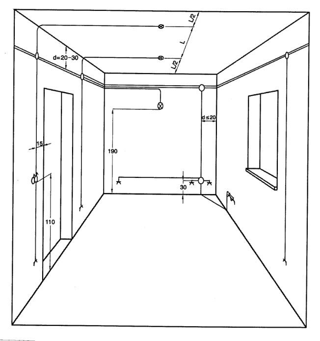
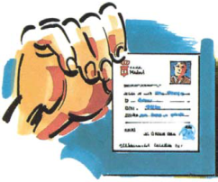
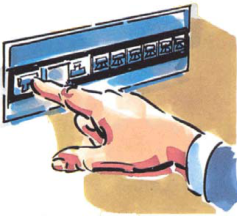
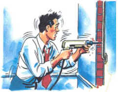
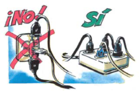
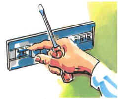
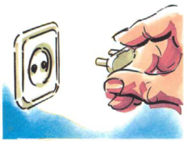
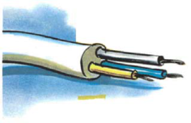
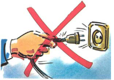

# Guía Técnica de Aplicación RD 842/2002, de 2 de agosto

### REGLAMENTO ELECTROTÉCNICO PARA BAJA TENSIÓN

### REAL DECRETO 842/2002

- ARTÍCULO 1. OBJETO — 3

- ARTÍCULO 2. CAMPO DE APLICACIÓN — 3

- ARTÍCULO 3. INSTALACIÓN ELÉCTRICA — 5

- ARTÍCULO 4. CLASIFICACIÓN DE LAS TENSIONES. FRECUENCIA DE LAS REDES — 5

- ARTÍCULO 5. PERTURBACIONES EN LAS REDES — 5

- ARTÍCULO 6. EQUIPOS Y MATERIALES — 5

- ARTÍCULO 7. COINCIDENCIA CON OTRAS TENSIONES — 6

- ARTÍCULO 8. REDES DE DISTRIBUCIÓN — 6

- ARTÍCULO 9. INSTALACIONES DE ALUMBRADO EXTERIOR — 6

- ARTÍCULO 10. TIPOS DE SUMINISTRO — 6

- ARTÍCULO 11. LOCALES DE CARACTERÍSTICAS ESPECIALES — 8

- ARTÍCULO 12. ORDENACIÓN DE CARGAS — 8

- ARTÍCULO 13. RESERVA DE LOCAL — 8

### ARTÍCULO 14. ESPECIFICACIONES PARTICULARES DE LAS EMPRESAS SUMINISTRADORAS.9

- ARTÍCULO 15. ACOMETIDAS E INSTALACIONES DE ENLACE — 9

- ARTÍCULO 16. INSTALACIONES INTERIORES O RECEPTORAS — 9

- ARTÍCULO 17. RECEPTORES Y PUESTA A TIERRA — 10

- ARTÍCULO 18. EJECUCIÓN Y PUESTA EN SERVICIO DE LAS INSTALACIONES — 10

- ARTÍCULO 19. INFORMACIÓN A LOS USUARIOS — 11

- ARTÍCULO 20. MANTENIMIENTO DE LAS INSTALACIONES — 17

- ARTÍCULO 21. INSPECCIONES — 17

- ARTÍCULO 22. INSTALADORES AUTORIZADOS — 17

- ARTÍCULO 23. CUMPLIMIENTO DE LAS PRESCRIPCIONES — 18

- ARTÍCULO 24.- EXCEPCIONES — 18

- ARTÍCULO 25.- EQUIVALENCIA DE NORMATIVA DEL ESPACIO ECONÓMICO EUROPEO — 19

- 1 -

- ARTÍCULO 26. NORMAS DE REFERENCIA — 19

- ARTÍCULO 27. ACCIDENTES — 20

- ARTÍCULO 28. INFRACCIONES Y SANCIONES — 20

- ARTÍCULO 29. GUÍA TÉCNICA — 21

- 2 -

Artículo 1. Objeto. El presente Reglamento tiene por objeto establecer las condiciones técnicas y garantías que deben reunir las instalaciones eléctricas conectadas a una fuente de suministro en los límites de baja tensión, con la finalidad de: a) Preservar la seguridad de las personas y los bienes. b) Asegurar el normal funcionamiento de dichas instalaciones y prevenir las perturbaciones en otras instalaciones y servicios. c) Contribuir a la fiabilidad técnica y a la eficiencia económica de las instalaciones.

Artículo 2. Campo de aplicación. 1. El presente Reglamento se aplicará a las instalaciones que distribuyan la energía eléctrica, a las generadoras de electricidad para consumo propio y a las receptoras, en los siguientes límites de tensiones nominales: a) Corriente alterna: igual o inferior a 1.000 voltios. b) Corriente continua: igual o inferior a 1.500 voltios. 2. El presente Reglamento se aplicará: a) A las nuevas instalaciones, a sus modificaciones y a sus ampliaciones. b) A las instalaciones existentes antes de su entrada en vigor que sean objeto de modificaciones de importancia, reparaciones de importancia y a sus ampliaciones. c) A las instalaciones existentes antes de su entrada en vigor, en lo referente al régimen de inspecciones, si bien los criterios técnicos aplicables en dichas inspecciones serán los correspondientes a la reglamentación con la que se aprobaron. Se entenderá por modificaciones o reparaciones de importancia las que afectan a más del 50 por 100 de la potencia instalada. Igualmente se considerará modificación de importancia la que afecte a líneas completas de procesos productivos con nuevos circuitos y cuadros, aún con reducción de potencia. 3. Asimismo, se aplicará a las instalaciones existentes antes de su entrada en vigor, cuando su estado, situación o características impliquen un riesgo grave para las personas o los bienes, o se produzcan perturbaciones importantes en el normal funcionamiento de otras instalaciones, a juicio del Órgano Competente de la Comunidad Autónoma.

### 4. Se excluyen de la aplicación de este Reglamento las instalaciones y equipos de uso

exclusivo en minas, material de tracción, automóviles, navíos, aeronaves, sistemas de comunicación, y los usos militares y demás instalaciones y equipos que estuvieran sujetos a reglamentación específica.

### 5. Las prescripciones del presente Reglamento y sus instrucciones técnicas complementarias

(en adelante ITCs) son de carácter general unas, y específico, otras. Las específicas sustituirán, modificarán o complementarán a las generales, según los casos. 6. No se aplicarán las prescripciones generales, sino únicamente prescripciones específicas, que serán objeto de las correspondientes ITCs, a las instalaciones o equipos que utilizan «muy baja tensión» (hasta 50 V en corriente alterna y hasta 75 V en corriente continua), por ejemplo las redes informáticas y similares, siempre que su fuente de energía sea autónoma, no se alimenten de redes destinadas a otros suministros, o que tales instalaciones sean absolutamente independientes de las redes de baja tensión con valores por encima de los fijados para tales pequeñas tensiones.

- 3 -

Se entiende por potencia instalada aquella para la cual se proyectó inicialmente la instalación eléctrica según la previsión de cargas correspondientes. Según el actual RBT será la potencia calculada según la previsión de cargas conforme los criterios de la ITC-BT-10 A las instalaciones existentes antes de la entrada en vigor del RD 842/02 y por tanto ejecutadas según el Reglamento del año 73 o anteriores, se les aplica, en lo referente al régimen de inspecciones, el Reglamento del año 2002. En consecuencia, se deberán inspeccionar estas instalaciones antes de que haya transcurrido el correspondiente periodo de 5 años o de 10 años, aplicable según lo establecido en el apartado 4.2 de la ITC-BT 05, contados desde la entrada en vigor del citado Reglamento (18 de septiembre de 2003).

- 4 -

Artículo 3. Instalación eléctrica. Se entiende por instalación eléctrica todo conjunto de aparatos y de circuitos asociados en previsión de un fin particular: producción, conversión, transformación, transmisión, distribución o utilización de la energía eléctrica.

Artículo 4. Clasificación de las tensiones. Frecuencia de las redes. 1. A efectos de aplicación de las prescripciones del presente Reglamento, las instalaciones eléctricas de baja tensión se clasifican, según las tensiones nominales que se les asignen, en la forma siguiente: Corriente alterna Corriente continua (Valor eficaz) (Valor medio aritmético) Muy baja tensión Un ≤ 50V Un ≤ 75V Tensión usual 50 < Un ≤ 500V 75 < Un ≤ 750V Tensión especial 500 < Un ≤ 1000V 750 < Un ≤ 1500V

2. Las tensiones nominales usualmente utilizadas en las distribuciones de corriente alterna serán: a) 230 V entre fases para las redes trifásicas de tres conductores. b) 230 V entre fase y neutro, y 400 V entre fases, para las redes trifásicas de 4 conductores.

### 3. Cuando en las instalaciones no pueda utilizarse alguna de las tensiones normalizadas en

este Reglamento, porque deban conectarse a o derivar de otra instalación con tensión diferente, se condicionará su inscripción a que la nueva instalación pueda ser utilizada en el futuro con la tensión normalizada que pueda preverse. 4. La frecuencia empleada en la red será de 50 Hz. 5. Podrán utilizarse otras tensiones y frecuencias, previa autorización motivada del Órgano competente de la Administración Pública, cuando se justifique ante el mismo su necesidad, no se produzcan perturbaciones significativas en el funcionamiento de otras instalaciones y no se menoscabe el nivel de seguridad para las personas y los bienes.

Artículo 5. Perturbaciones en las redes. Las instalaciones de baja tensión que pudieran producir perturbaciones sobre las telecomunicaciones, las redes de distribución de energía o los receptores, deberán estar dotadas de los adecuados dispositivos protectores, según se establece en las disposiciones vigentes relativas a esta materia.

Artículo 6. Equipos y materiales. 1. Los materiales y equipos utilizados en las instalaciones deberán ser utilizados en la forma y para la finalidad que fueron fabricados. Los incluidos en el campo de aplicación de la reglamentación de trasposición de las Directivas de la Unión Europea deberán cumplir con lo establecido en las mismas. En lo no cubierto por tal reglamentación se aplicarán los criterios técnicos preceptuados por el presente Reglamento. En particular, se incluirán junto con los equipos y materiales las indicaciones necesarias para su correcta instalación y uso, debiendo marcarse con las siguientes indicaciones

- 5 -

mínimas: a) Identificación del fabricante, representante legal o responsable de la comercialización. b) Marca y modelo. c) Tensión y potencia (o intensidad) asignadas. d) Cualquier otra indicación referente al uso específico del material o equipo, asignado por el fabricante.

### 2. Los órganos competentes de las Comunidades Autónomas verificarán el cumplimiento de las

exigencias técnicas de los materiales y equipos sujetos a este Reglamento. La verificación podrá efectuarse por muestreo.

Artículo 7. Coincidencia con otras tensiones. Si en una instalación eléctrica de baja tensión se encuentran integrados circuitos o elementos sometidos a tensiones superiores a los límites definidos en este Reglamento, en ausencia de indicación específica en éste, se deberá cumplir con lo establecido en los reglamentos que regulen las instalaciones a dichas tensiones.

Artículo 8. Redes de distribución. 1. Las instalaciones de servicio público o privado cuya finalidad sea la distribución de energía eléctrica se definirán: a) Por los valores de la tensión entre fase o conductor polar y tierra y entre dos conductores de fase o polares, para las instalaciones unidas directamente a tierra. b) Por el valor de la tensión entre dos conductores de fase o polares, para las instalaciones no unidas directamente a tierra. 2. Las intensidades de la corriente eléctrica admisibles en los conductores se regularán en función de las condiciones técnicas de las redes de distribución y de los sistemas de protección empleados en las mismas.

Artículo 9. Instalaciones de alumbrado exterior. Se considerarán instalaciones de alumbrado exterior las que tienen por finalidad la iluminación de las vías de circulación o comunicación y las de los espacios comprendidos entre edificaciones que, por sus características o seguridad general, deben permanecer iluminados, en forma permanente o circunstancial, sean o no de dominio público. Las condiciones que deben reunir las instalaciones de alumbrado exterior serán las correspondientes a su peculiar situación de intemperie y, por el riesgo que supone, el que parte de sus elementos sean fácilmente accesibles.

Artículo 10. Tipos de suministro.

### 1. A efectos del presente Reglamento, los suministros se clasifican en normales y

complementarios. A) Suministros normales son los efectuados a cada abonado por una sola empresa distribuidora por la totalidad de la potencia contratada por el mismo y con un solo punto de entrega de la energía. B) Suministros complementarios o de seguridad son los que, a efectos de seguridad y continuidad de suministro, complementan a un suministro normal. Estos suministros podrán realizarse por dos empresas diferentes o por la misma Empresa, cuando se disponga, en el

- 6 -

lugar de utilización de la energía, de medios de transporte y distribución independientes, o por el usuario mediante medios de producción propios. Se considera suministro complementario aquel que aun partiendo del mismo transformador, dispone de línea de distribución independiente del suministro normal desde su mismo origen en baja tensión. Se clasifican en suministro de socorro, suministro de reserva y suministro duplicado: a) Suministro de socorro es el que está limitado a una potencia receptora mínima equivalente al 15 por 100 del total contratado para el suministro normal. b) Suministro de reserva es el dedicado a mantener un servicio restringido de los elementos de funcionamiento indispensables de la instalación receptora, con una potencia mínima del 25 por 100 de la potencia total contratada para el suministro normal. c) Suministro duplicado es el que es capaz de mantener un servicio mayor del 50 por 100 de la potencia total contratada para el suministro normal. 2. Las instalaciones previstas para recibir suministros complementarios deberán estar dotadas de los dispositivos necesarios para impedir un acoplamiento entre ambos suministros, salvo lo prescrito en las instrucciones técnicas complementarias. La instalación de esos dispositivos deberá realizarse de acuerdo con la o las empresas suministradoras. De no establecerse ese acuerdo, el órgano competente de la Comunidad Autónoma resolverá lo que proceda en un plazo máximo de 15 días hábiles, contados a partir de la fecha en que le sea formulada la consulta. 3. Además de los señalados en las correspondientes instrucciones técnicas complementarias, los órganos competentes de las Comunidades Autónomas podrán fijar, en cada caso, los establecimientos industriales o dedicados a cualquier otra actividad que, por sus características y circunstancias singulares, hayan de disponer de suministro de socorro, de reserva o suministro duplicado. 4. Si la empresa suministradora que ha de facilitar el suministro complementario se negara a realizarlo o no hubiera acuerdo con el usuario sobre las condiciones técnico-económicas propuestas, el órgano competente de la Comunidad Autónoma deberá resolver lo que proceda, en el plazo de quince días hábiles, a partir de la fecha de presentación de la controversia.

La ITC-BT-28 indica los tipos de locales de pública concurrencia que deben disponer de un suministro complementario.

- 7 -

Artículo 11. Locales de características especiales. Se establecerán en las correspondientes instrucciones técnicas complementarias prescripciones especiales, en base a las condiciones particulares que presentan, en los denominados "locales de características especiales", tales como los locales y emplazamientos mojados o en los que exista atmósfera húmeda, gases o polvos de materias no inflamables o combustibles, temperaturas muy elevadas o muy bajas en relación con las normales, los que se dediquen a la conservación o reparación de automóviles, los que estén afectos a los servicios de producción o distribución de energía eléctrica; en las instalaciones donde se utilicen las denominadas tensiones especiales, las que se realicen con carácter provisional o temporal, las instalaciones para piscinas, otras señaladas específicamente en las ITC, y en general, todas aquellas donde sea necesario mantener instalaciones eléctricas en circunstancias distintas a las que pueden estimarse como de riesgo normal, para la utilización de la energía eléctrica en baja tensión.

Artículo 12. Ordenación de cargas. Se establecerán en las correspondientes instrucciones técnicas complementarias prescripciones relativas a la ordenación de las cargas previsibles para cada una de las agrupaciones de consumo de características semejantes, tales como edificios dedicados principalmente a viviendas, edificios comerciales, de oficinas y de talleres para industrias, basadas en la mejor utilización de las instalaciones de distribución de energía eléctrica. Antes de iniciar las obras, los titulares de edificaciones en proyecto de construcción deberán facilitar a la Empresa suministradora toda la información necesaria para deducir los consumos y cargas que han de producirse, a fin de poder adecuar con antelación suficiente el crecimiento de sus redes y las previsiones de cargas en sus centros de transformación.

Artículo 13. Reserva de local. En lo relativo a la reserva de local se seguirán las prescripciones recogidas en la reglamentación por la que se regulen las actividades de transporte, distribución, comercialización, suministro y procedimientos de autorización de instalaciones de energía eléctrica.

La reglamentación a la que se refiere el Artículo 13 es el RD 1955/2000 de 1 de diciembre.

- 8 -

Artículo 14. Especificaciones particulares de las Empresas suministradoras. Las empresas suministradoras podrán proponer especificaciones sobre la construcción y montaje de acometidas, líneas generales de alimentación, instalaciones de contadores y derivaciones individuales, señalando en ellas las condiciones técnicas de carácter concreto que sean precisas para conseguir mayor homogeneidad en las redes de distribución y las instalaciones de los abonados. Dichas especificaciones deberán ajustarse, en cualquier caso, a los preceptos del Reglamento, y deberán ser aprobadas por los órganos competentes de las Comunidades Autónomas, en caso de que se limiten a su ámbito territorial, o por centro directivo competente en materia de seguridad industrial del Ministerio de Ciencia y Tecnología, en caso de aplicarse en más de una Comunidad Autónoma, pudiéndose exigir para ello el dictamen de una entidad competente en la materia. Las normas particulares así aprobadas deberán publicarse en el correspondiente Boletín Oficial.

Artículo 15. Acometidas e instalaciones de enlace. 1. Se denomina acometida la parte de la instalación de la red de distribución que alimenta la caja o cajas generales de protección o unidad funcional equivalente. La acometida será responsabilidad de la empresa suministradora, que asumirá la inspección y verificación final. 2. Son instalaciones de enlace las que unen la caja general de protección, o cajas generales de protección, incluidas éstas, con las instalaciones interiores o receptoras del usuario. Se componen de: caja general de protección, línea general de alimentación, elementos para la ubicación de contadores, derivación individual, caja para interruptor de control de potencia y dispositivos generales de mando y protección. Las cajas generales de protección alojan elementos de protección de las líneas generales de alimentación y señalan el principio de la propiedad de las instalaciones de los usuarios. Línea general de alimentación es la parte de la instalación que enlaza una caja general de protección con las derivaciones individuales que alimenta. La derivación individual de un abonado parte de la línea general de alimentación y comprende los aparatos de medida, mando y protección. 3. Las compañías suministradoras facilitarán los valores máximos previsibles de las potencias o corrientes de cortocircuito de sus redes de distribución, con el fin de que el proyectista tenga en cuenta este dato en sus cálculos.

Artículo 16. Instalaciones interiores o receptoras. 1. Las instalaciones interiores o receptoras son las que, alimentadas por una red de distribución o por una fuente de energía propia, tienen como finalidad principal la utilización de la energía eléctrica. Dentro de este concepto hay que incluir cualquier instalación receptora aunque toda ella o alguna de sus partes esté situada a la intemperie. 2. En toda instalación interior o receptora que se proyecte y realice se alcanzará el máximo equilibrio en las cargas que soportan los distintos conductores que forman parte de la misma, y ésta se subdividirá de forma que las perturbaciones originadas por las averías que pudieran producirse en algún punto de ella afecten a una mínima parte de la instalación. Esta subdivisión deberá permitir también la localización de las averías y facilitar el control del aislamiento de la parte de la instalación afectada. 3. Los sistemas de protección para las instalaciones interiores o receptoras para baja tensión impedirán los efectos de las sobreintensidades y sobretensiones que por distintas causas cabe

- 9 -

prever en las mismas y resguardarán a sus materiales y equipos de las acciones y efectos de los agentes externos. Asimismo, y a efectos de seguridad general, se determinarán las condiciones que deben cumplir dichas instalaciones para proteger de los contactos directos e indirectos. 4. En la utilización de la energía eléctrica para instalaciones receptoras se adoptarán las medidas de seguridad, tanto para la protección de los usuarios como para la de las redes, que resulten proporcionadas a las características y potencia de los aparatos receptores utilizados en las mismas. 5. Además de los preceptos que en virtud del presente y otros reglamentos sean de aplicación a los locales de pública concurrencia, deberán cumplirse medidas y previsiones específicas, en función del riesgo que implica en los mismos un funcionamiento defectuoso de la instalación eléctrica.

Artículo 17. Receptores y puesta a tierra. Sin perjuicio de las disposiciones referentes a los requisitos técnicos de diseño de los materiales eléctricos, según lo estipulado en el artículo 6, la instalación de los receptores, así como el sistema de protección por puesta a tierra deberán respetar lo dispuesto en las correspondientes instrucciones técnicas complementarias.

Artículo 18. Ejecución y puesta en servicio de las instalaciones. 1. Según lo establecido en el artículo 12.3 de la Ley 21/1992, de Industria, la puesta en servicio y utilización de las instalaciones eléctricas se condiciona al siguiente procedimiento: a) Deberá elaborarse, previamente a la ejecución, una documentación técnica que defina las características de la instalación y que, en función de sus características, según determine la correspondiente ITC, revestirá la forma de proyecto o memoria técnica. b) La instalación deberá verificarse por el instalador, con la supervisión del director de obra en su caso, a fin de comprobar la correcta ejecución y funcionamiento seguro de la misma. c) Asimismo, cuando así se determine en la correspondiente ITC, la instalación deberá ser objeto de una inspección inicial, por un organismo de control. d) A la terminación de la instalación y realizadas las verificaciones pertinentes y, en su caso, la inspección inicial, el instalador autorizado ejecutor de la instalación, emitirá un certificado de instalación, en el que se hará constar que la misma se ha realizado de conformidad con lo establecido en el Reglamento y sus instrucciones técnicas complementarias y de acuerdo con la documentación técnica. En su caso, identificará y justificará las variaciones que en la ejecución se hayan producido con relación a lo previsto en dicha documentación. e) El certificado, junto con la documentación técnica y, en su caso, el certificado de dirección de obra y el de inspección inicial, deberá depositarse ante el órgano competente de la Comunidad Autónoma, con objeto de registrar la referida instalación, recibiendo las copias diligenciadas necesarias para la constancia de cada interesado y solicitud de suministro de energía. Las Administraciones competentes deberán facilitar que éstas documentaciones puedan ser presentadas y registradas por procedimientos informáticos o telemáticos. 2. Las instalaciones eléctricas deberán ser realizadas únicamente por instaladores autorizados. 3. La empresa suministradora no podrá conectar la instalación receptora a la red de distribución si no se le entrega la copia correspondiente del certificado de instalación debidamente diligenciado por el Órgano competente de la Comunidad Autónoma. 4. No obstante lo indicado en el apartado precedente, cuando existan circunstancias objetivas por las cuales sea preciso contar con suministro de energía eléctrica antes de poder culminar la

- 10 -

tramitación administrativa de las instalaciones, dichas circunstancias, debidamente justificadas y acompañadas de las garantías para el mantenimiento de la seguridad de las personas y bienes y de la no perturbación de otras instalaciones o equipos, deberán ser expuestas ante el órgano competente de la Comunidad Autónoma, la cual podrá autorizar, mediante resolución motivada, el suministro provisional para atender estrictamente aquellas necesidades. 5. En caso de instalaciones temporales (congresos y exposiciones, con distintos stands, ferias ambulantes, festejos, verbenas, etc.), el órgano competente de la Comunidad podrá admitir que la tramitación de las distintas instalaciones parciales se realice de manera conjunta. De la misma manera, podrá aceptarse que se sustituya la documentación técnica por una declaración, diligenciada la primera vez por la Administración, en el supuesto de instalaciones realizadas sistemáticamente de forma repetitiva.

El procedimiento detallado de ejecución y puesta en servicio de las instalaciones viene detallado en la ITC-BT-04.

<!-- tabla: ../tablas/BT-RD-842-02_t01.csv -->

|  | Artículo 19. Información a los usuarios. |
|---|---|
|  | Como anexo al certificado de instalación que se entregue al titular de cualquier instalación eléctrica, |
|  | la empresa instaladora deberá confeccionar unas instrucciones para el correcto uso y mantenimiento |
|  | de la misma. Dichas instrucciones incluirán, en cualquier caso, como mínimo, un esquema unifilar de |
|  | la instalación con las características técnicas fundamentales de los equipos y materiales eléctricos |
|  | instalados, así como un croquis de su trazado. |
|  | Cualquier modificación o ampliación requerirá la elaboración de un complemento a lo anterior, en la |
|  | medida que sea necesario. |

Toda instalación eléctrica deberá ir acompañada de unas instrucciones generales de uso y mantenimiento de las mismas, y de los documentos propios de la instalación. Por lo tanto, se tendrán los documentos siguientes: - Instrucciones generales de uso y mantenimiento. - Documentos propios de la instalación: - Esquema unifilar de la instalación - Croquis o plano(s) de trazado de las canalizaciones, de las redes de tierra y ubicación de los materiales instalados (dispositivos de protección, interruptores, bases de toma de corriente, puntos de luz, aparatos de alumbrado de emergencia, etc.) En la figura siguiente se incluye un ejemplo de croquis de trazado de una instalación eléctrica empotrada.

- 11 -

Uno de los anexos a entregar al titular de la instalación (dentro de las Instrucciones generales de uso y mantenimiento para los casos de instalaciones domésticas) podrá consistir en las recomendaciones siguientes,

- 12 -

### CONSEJOS PARA UNA MEJOR UT ILIZACIÓN DE SU INSTALACIÓN

Antes de efectuar su póliza Si se le dispara el IAD de abono (contrato) con la (interruptor automático Cía. Suministradora, diferencial) en el cuadro asesórese con el Instalador general de mando y electricista Autorizado, la propia protección, actúe de la forma Compañía o profesional siguiente: competente para elegir la tarifa y a) Desconecte todos los PIAS y potencia más conveniente para conecte el IAD. usted. b) Vaya conectando uno a uno todos los PIAS y el circuito que le haga disparar nuevamente el IAD es donde existe la avería. En este caso, desconecte los aparatos y lámparas de dicho circuito, y vuelva a accionar el PIA. Si no se dispara, la avería es de los aparatos. Si se dispara nuevamente tiene avería en este circuito, por lo que tendrá No sobrepasar que avisar a su Instalador simultáneamente la Autorizado. potencia contratada con la Cía. Suministradora de energía, puesto que se le disparará el lCP (interruptor de control de potencia), dejándole a usted sin servicio en toda la vivienda o local. Desconecte algún aparato (los de más potencia) y vuelva a accionar el ICP, desconecte el Interruptor General, y vuelva a conectar el ICP. Si aún así se dispara, avise a su compañía suministradora porque la avería está en el ICP. Si se le dispara un PIA (pequeño interruptor automático) en el cuadro general de mando y protección, puede ser debido a estos dos casos.

- 13 -

### CONSEJOS PARA UNA MEJOR UT ILIZACIÓN DE SU INSTALACIÓN

a) Que el circuito que protege Compruebe con dicho PIA está sobrecargado, periodicidad (una vez al en cuyo caso deberá ir mes por lo menos) su desconectando aparatos o IAD. Pulse el botón de lámparas, hasta conseguir prueba y si no dispara es que reponer de nuevo el citado está averiado, por tanto, no está PIA, usted protegido contra b) Que en el circuito o en los derivaciones. Avise a su aparatos y lámparas Instalador Autorizado. conectados a él, se haya Manipule todos los producido un cortocircuito. aparatos eléctricos, Proceda como en el caso incluso el teléfono, anterior (3b), para ver si dicha SIEMPRE con las manos secas avería es de algún aparato o y evite estar descalzo o con los de la instalación. Deje pies húmedos. desconectado dicho PIA y funcione con el resto de la instalación. Y NUNCA los manipule cuando Compruebe con esté en el baño o bajo la ducha. periodicidad (una vez al ¡El agua es conductora de la año por lo menos) y por electricidad! medio de su Instalador Si hay un fallo eléctrico en la Autorizado la red de tierra de su instalación o en el aparato vivienda o local. utilizado, usted corre el riesgo de electrocutarse. Ojo con las radios, secadores de pelo, aparatos de calor al borde de la bañera: pueden caerse al agua y electrocutarse.

- 14 -

<!-- figura vectorial en la pág. 14 del PDF original -->
> Figura en la pág. 14 del PDF original: [ver en el PDF](../pdf/BT-RD-842-02.pdf#page=14)

### CONSEJOS PARA UNA MEJOR UT ILIZACIÓN DE SU INSTALACIÓN

Compruebe las No usar nunca canalizaciones eléctricas aparatos eléctricos con empotradas antes de cables pelados, taladrar una pared o el techo. clavijas y enchufes rotos, etc. Puede electrocutarse al atravesar una canalización con la taladradora. No hacer varias conexiones en un mismo enchufe (no utilizar ladrones o clavijas múltiples).

En el caso de manipular algún aparato eléctrico, desconecte previamente No deje aparatos el IAD del cuadro general eléctricos conectados y compruebe SIEMPRE que no al alcance de los niños existe tensión. y procure tapar los enchufes a los que tenga acceso.

- 15 -

### CONSEJOS PARA UNA MEJOR UT ILIZACIÓN DE SU INSTALACIÓN

Abstenerse de contacto con la parte metálica. intervenir en su Para ello debe llamar al instalación para Instalador Autorizado para que modificarla. Si son localice la fuga. necesarias modificaciones, éstas deberán, ser efectuadas por un Al desconectar los instalador autorizado. aparatos no tire del cordón o hilo, sino de la clavija.

No se puede enchufar Cuando un receptor cualquier aparato en ( electrodoméstico, cualquier toma de maquinaria, etc ) le dé corriente. Cada aparato tiene "calambre" es porque su potencia. Como cada toma hay derivación de corriente de de corriente tiene la suya. Vea los hilos conductores o en algún la “Instalación Interior de su elemento metálico del Vivienda o local” de esta Guía y electrodoméstico. Normalmente adecúe los aparatos a enchufar se Dispara el Diferencial. con las tomas. Si la potencia Localizar el aparato o parte de la del Aparato es superior a los instalación donde se produce y Amperios que permite enchufar aislar debidamente al la toma de corriente, puede quemarse la base del enchufe, la clavija e incluso la instalación.

- 16 -

Artículo 20. Mantenimiento de las instalaciones. Los titulares de las instalaciones deberán mantener en buen estado de funcionamiento sus instalaciones, utilizándolas de acuerdo con sus características y absteniéndose de intervenir en las mismas para modificarlas. Si son necesarias modificaciones, éstas deberán ser efectuadas por un instalador autorizado.

En las instalaciones eléctricas sujetas a inspecciones periódicas tales como alumbrado de emergencia, etc. es muy importante garantizar su estado de funcionamiento, mediante su mantenimiento adecuado. A tal efecto el titular, salvo cuando disponga de medios adecuados, deberá contratar su mantenimiento a un instalador autorizado.

<!-- tabla: ../tablas/BT-RD-842-02_t02.csv -->

|  | Artículo 21. Inspecciones. |
|---|---|
|  | Sin perjuicio de la facultad que, de acuerdo con lo señalado en el artículo 14 de la Ley 21/1992, de |
|  | Industria, posee la Administración Pública competente para llevar a cabo, por sí misma, las |
|  | actuaciones de inspección y control que estime necesarias, el cumplimiento de las disposiciones y |
|  | requisitos de seguridad establecidos por el presente Reglamento y sus instrucciones técnicas |
|  | complementarias, según lo previsto en el artículo 12.3 de dicha Ley, deberá ser comprobado, en su |
|  | caso, por un organismo de control autorizado en este campo reglamentario. |
|  | A tal fin, la correspondiente instrucción técnica complementaria determinará: |
|  | a) Las instalaciones y las modificaciones, reparaciones o ampliaciones de instalaciones que |
|  | deberán ser objeto de inspección inicial, antes de su puesta en servicio. |
|  | b) Las instalaciones que deberán ser objeto de inspección periódica. |
|  | c) Los criterios para la valoración de las inspecciones, así como las medidas a adoptar |
|  | como resultado de las mismas. |
|  | d) Los plazos de las inspecciones periódicas. |

Todos estos aspectos se encuentran desarrollados en la ITC-BT-05.

<!-- tabla: ../tablas/BT-RD-842-02_t03.csv -->

|  | Artículo 22. Instaladores Autorizados. |
|---|---|
|  | Las instalaciones eléctricas de baja tensión se ejecutarán por instaladores autorizados en baja |
|  | tensión, autorizados para el ejercicio de la actividad según lo establecido en la correspondiente |
|  | instrucción técnica complementaria, sin perjuicio de su posible proyecto y dirección de obra por |
|  | técnicos titulados competentes. |
|  | Según lo establecido en el artículo 13.3 de la Ley 21/1992, de Industria, las autorizaciones |
|  | concedidas por los correspondientes órganos competentes de las Comunidades Autónomas a los |
|  | instaladores tendrán ámbito estatal. |

El procedimiento de autorización está detallado en la ITC-BT-03.

- 17 -

Artículo 23. Cumplimiento de las prescripciones. 1. Se considerará que las instalaciones realizadas de conformidad con las prescripciones del presente Reglamento proporcionan las condiciones de seguridad que, de acuerdo con el estado de la técnica, son exigibles, a fin de preservar a las personas y los bienes, cuando se utilizan de acuerdo a su destino. 2. Las prescripciones establecidas en el presente Reglamento tendrán la condición de mínimos obligatorios, en el sentido de lo indicado por el artículo 12.5 de la Ley 21/1992, de Industria. Se considerarán cubiertos tales mínimos: a) Por aplicación directa de las prescripciones de las correspondientes ITC, o b) Por aplicación de técnicas de seguridad equivalentes, siendo tales las que, sin ocasionar distorsiones en los sistemas de distribución de las compañías suministradoras, proporcionen, al menos, un nivel de seguridad equiparable a la anterior. La aplicación de técnicas de seguridad equivalentes deberá ser justificado debidamente por el diseñador de la instalación, y aprobada por el órgano competente de la Comunidad Autónoma.

Cuando el cumplimiento de las prescripciones reglamentarias se justifique según lo dispuesto en el artículo 23 apartado 2.b), el titular de la instalación deberá solicitar una autorización expresa del órgano competente de la Comunidad Autónoma, antes de iniciar los trabajos de la instalación. Para obtener dicha autorización el titular de la instalación presentará una memoria justificativa elaborada por el técnico que redactó la documentación técnica. Para otorgar la autorización la Comunidad autónoma podrá recabar un informe técnico emitido por un Organismo de Control o por otra entidad independiente reconocida con amplia experiencia en la materia.

<!-- tabla: ../tablas/BT-RD-842-02_t04.csv -->

|  | Artículo 24.- Excepciones. |
|---|---|
|  | Sin perjuicio de lo establecido en el apartado 1 del artículo 6, cuando sea materialmente imposible |
|  | cumplir determinadas prescripciones del presente Reglamento, sin que sea factible tampoco |
|  | acogerse a la letra b) del artículo anterior, el titular de la instalación que se pretenda realizar, deberá |
|  | presentar, ante el órgano competente de la Comunidad Autónoma, previamente al procedimiento |
|  | contemplado en el artículo 18, una solicitud de excepción, exponiendo los motivos de la misma e |
|  | indicando las medidas de seguridad alternativas que se propongan, las cuales, en ningún caso, |
|  | podrán rebajar los niveles de protección establecidos en el Reglamento. |
|  | El citado órgano competente podrá desestimar la solicitud, requerir la modificación de las medidas |
|  | alternativas o conceder la autorización de excepción, que será siempre expresa, entendiéndose el |
|  | silencio administrativo como desestimatorio. |

Cuando no sea posible el cumplimiento de las prescripciones reglamentarias ni siquiera aplicando técnicas de seguridad equivalente, el titular de la instalación deberá presentar una solicitud de excepción ante el órgano competente de la Comunidad Autónoma, antes de iniciar los trabajos de la instalación. Junto a la solicitud de excepción el titular de la instalación presentará una memoria justificativa elaborada por el técnico que redactó el proyecto. Para otorgar la autorización de excepción la Comunidad autónoma podrá recabar un informe técnico emitido por un Organismo de Control o por otra entidad independiente reconocida con amplia experiencia en la materia.

- 18 -

Artículo 25.- Equivalencia de normativa del Espacio Económico Europeo. Sin perjuicio de lo establecido en el artículo 6, a los efectos del presente Reglamento y para la comercialización de productos provenientes de los Estados miembros de la Unión Europea o del Espacio Económico Europeo, sometidos a las reglamentaciones nacionales de seguridad industrial, la Administración pública competente deberá aceptar la validez de los certificados y marcas de conformidad a normas y las actas o protocolos de ensayos que son exigibles por las citadas reglamentaciones, emitidos por organismos de evaluación de la conformidad oficialmente reconocidos en dichos Estados, siempre que se reconozca, por la mencionada Administración pública competente, que los citados agentes ofrecen garantías técnicas, profesionales y de independencia e imparcialidad equivalentes a las exigidas por la legislación española y que las disposiciones legales vigentes del Estado en base a las que se evalúa la conformidad comporten un nivel de seguridad equivalente al exigido por las correspondientes disposiciones españolas.

Artículo 26. Normas de referencia. 1. Las instrucciones técnicas complementarias podrán establecer la aplicación de normas UNE u otras reconocidas internacionalmente, de manera total o parcial, a fin de facilitar la adaptación al estado de la técnica en cada momento. Dicha referencia se realizará, por regla general, sin indicar el año de edición de las normas en cuestión. En la correspondiente instrucción técnica complementaria se recogerá el listado de todas las normas citadas en el texto de las instrucciones, identificadas por sus títulos y numeración, la cual incluirá el año de edición. 2. Cuando una o varias normas varíen su año de edición, o se editen modificaciones posteriores a las mismas, deberán ser objeto de actualización en el listado de normas, mediante resolución del centro directivo competente en materia de seguridad industrial del Ministerio de Ciencia y Tecnología, en la que deberá hacerse constar la fecha a partir de la cual la utilización de la nueva edición de la norma será válida y la fecha a partir de la cual la utilización de la antigua edición de la norma dejará de serlo, a efectos reglamentarios. A falta de resolución expresa, se entenderá que también cumple las condiciones reglamentarias la edición de la norma posterior a la que figure en el listado de normas, siempre que la misma no modifique criterios básicos y se limite a actualizar ensayos o incremente la seguridad intrínseca del material correspondiente.

Puesto que las prescripciones reglamentarias definen condiciones mínimas de seguridad, se asume que una norma en edición posterior a la que figura en la ITC-BT 02, ofrece un nivel de seguridad equivalente o superior al mínimo fijado en el Reglamento.

- 19 -

Artículo 27. Accidentes. A efectos estadísticos y con objeto de poder determinar las principales causas, así como disponer las eventuales correcciones en la reglamentación, se debe poseer los correspondientes datos sistematizados de los accidentes más significativos. Para ello, cuando se produzca un accidente que ocasione daños o víctimas, la compañía suministradora deberá redactar un informe que recoja los aspectos esenciales del mismo. En los quince primeros días de cada trimestre, deberán remitir a las Comunidades Autónomas y al centro directivo competente en materia de seguridad industrial del Ministerio de Ciencia y Tecnología, copia de todos los informes realizados.

Artículo 28. Infracciones y sanciones. Las infracciones a lo dispuesto en el presente reglamento se clasificarán y sancionarán de acuerdo con lo dispuesto en el Título V de la Ley 21/1992, de Industria.

Por lo que se refiere a las infracciones, en dicho título se clasifican las infracciones en muy graves, graves y leves. Son infracciones muy graves las tipificadas como graves, cuando de las mismas resulte un daño muy grave o se derive un peligro muy grave e inminente para las personas, la flora, la fauna, las cosas o el medio ambiente. Son infracciones graves entre otras: - La fabricación, importación, venta, transporte, instalación o utilización de productos, aparatos e elementos sujetos a seguridad industrial sin cumplir las normas reglamentarias, cuando comporte peligro o daño grave para personas, la flora, la fauna, las cosas o el medio ambiente. - La puesta en funcionamiento de las instalaciones careciendo de la correspondiente autorización, cuando ésta sea preceptiva. - La ocultación o alteración dolosa de datos relativos a las empresas, por ejemplo fabricantes o instaladores autorizados, o la expedición de certificados no acordes con la realidad de los hechos. - El incumplimiento de las especificaciones dictadas por la autoridad competente en materia de seguridad industrial. - La inadecuada conservación y mantenimiento de las instalaciones, si de ello puede resultar un peligro para las personas, la flora, la fauna, las cosas o el medio ambiente. Son infracciones leves las siguientes: - El incumplimiento de cualquier otra prescripción reglamentaria no citada anteriormente. - La no comunicación a la Administración competente, dentro de los plazos reglamentarios, de los datos relativos a las empresas, por ejemplo fabricantes o instaladores autorizados. - La falta de colaboración con las administraciones públicas en el ejercicio por éstas de sus funciones reglamentarias. Para determinar la cuantía de las sanciones se tendrá en cuenta: - La importancia del daño o deterioro causado. - El grado de participación o beneficio obtenido. - La capacidad económica del infractor. - La intencionalidad de la comisión de la infracción. - La reincidencia.

- 20 -

Artículo 29. Guía técnica. El centro directivo competente en materia de seguridad industrial del Ministerio de Ciencia y Tecnología elaborará y mantendrá actualizada una Guía técnica, de carácter no vinculante, para la aplicación práctica de las previsiones del presente Reglamento y sus instrucciones técnicas complementarias, la cual podrá establecer aclaraciones a conceptos de carácter general incluidos en este Reglamento.

- 21 -
