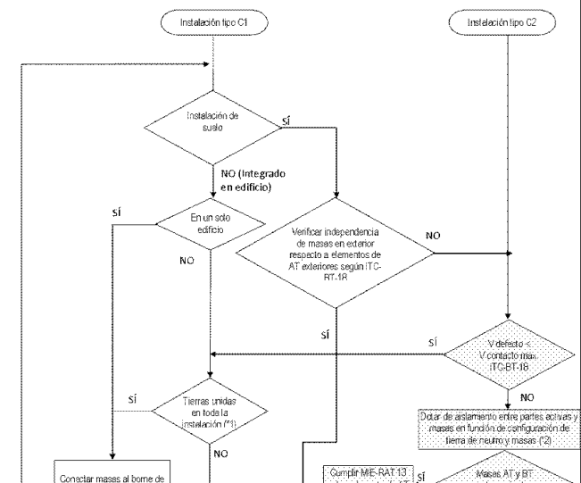
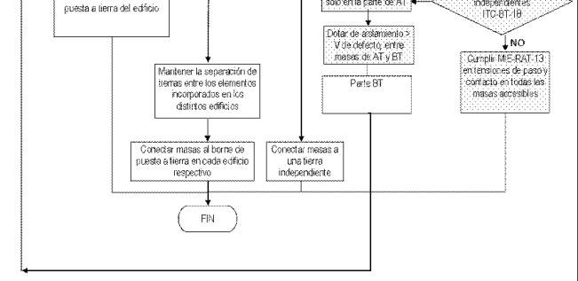

# Nota de Interpretación Técnica de la Equivalencia de la Separación Galvánica

INTRODUCCIÓN Ante las numerosas consultas recibidas sobre las condiciones de conexión de instalaciones generadoras a las redes de distribución eléctrica en baja tensión, en donde la legislación aplicable establece la necesidad de separación galvánica entre éstas, mediante un transformador o sistema equivalente y ante las dudas técnicas que dicha equivalencia pueda suscitar, el Ministerio de Industria Comercio y Turismo establece la siguiente nota de interpretación, basada en los requisitos técnicos contenidos en la ITC-BT-40 del Reglamento Electrotécnico para Baja Tensión (REBT, RD 842/2002).

### NOTA DE INTERPRETACIÓN

Donde la legislación vigente establezca que la instalación deberá disponer de una separación galvánica entre la red y las instalaciones generadoras, bien sea por medio de un transformador de aislamiento o cualquier otro medio que cumpla las mismas funciones, con base en el desarrollo tecnológico, se entenderá que las funciones que se persiguen utilizando un transformador de aislamiento de baja frecuencia son:

### 1. Aislar la instalación generadora para evitar la transferencia de defectos entre la

red y la instalación. 2. Proporcionar seguridad personal. 3. Evitar la inyección de corriente continua en la red.

En instalaciones generadoras en las que la transmisión de energía a la red se haga mediante convertidores electrónicos podrán utilizarse transformadores de separación, o no hacerlo, siempre que se cumplan las funciones anteriores.

Para poder establecer las condiciones que deben cumplir las instalaciones que cumplan las funciones citadas es necesario clasificar las instalaciones generadoras en función de su topología de conexión a la red en los siguientes tipos:

a) Instalaciones aisladas para uso exclusivo de alimentar cargas o circuitos de baja tensión.

b) Instalaciones generadoras independientes de la red para uso exclusivo de alimentación de cargas o circuitos de baja tensión, que pueden estar alternativamente alimentados por la red o por el generador.

c) Instalaciones interconectadas

c1) Las instalaciones generadoras con punto de conexión en la red de distribución de baja tensión en la que hay otros circuitos e instalaciones de baja

- 1 -

tensión conectados a ella, independientemente de que la finalidad de la instalación sea tanto vender energía como alimentar cargas, en paralelo con la red.

c2) Las instalaciones generadoras con punto de conexión en la red de alta tensión mediante un transformador elevador de tensión, que no tiene otras redes de distribución de baja tensión que alimentan cargas ajenas, conectadas a él. Este esquema, está igualmente incluido en las condiciones del REBT, aunque por su consideración de instalación generadora conectada directamente a la red de AT requiere condiciones especiales de conexión, atendiendo a las reglamentaciones vigentes sobre protecciones y condiciones de conexión en alta tensión.

En las instalaciones de tipo c) cuando la red de distribución se desconecta, se pueden alimentar cargas propias siempre que se cumplan las condiciones de desconexión y conexión de la instalación generadora a la red de distribución, requeridas en el capítulo 4 de la ITC-BT-40 del REBT.

Nota: Se entiende por punto de conexión el punto en el que se conecta la instalación generadora a la red de la empresa distribuidora, delimitando la extensión de la instalación generadora. El punto de conexión no necesariamente coincide con el punto en el que se realiza la medida de energía, pero si es el punto en el que se instalan las protecciones generales requeridas en la instalación generadora.

Una vez establecida la clasificación las condiciones a cumplir en cada una de las funciones citadas son:

Aislar la instalación generadora para evitar la transferencia de defectos entre la red y la instalación.

La transferencia de defectos entre la red y la instalación generadora se considera resuelta, independientemente del convertidor utilizado, siempre que se cumpla el siguiente esquema aplicado por separado a las distintas partes de la instalación, básicamente convertidor y elementos del generador (por ejemplo, en el caso de generación fotovoltaica, inversores y cada uno de los paneles fotovoltaicos), a menos que estén juntas.

- 2 -

Figura 1. (*1) La unión equipotencial entre tierras de diferentes edificios está contemplada en el reglamento en la ITC-BT-26 del REBT, apartado 3.1.

(*2) En caso de poner protectores de sobretensión entre fases y tierra su tensión de funcionamiento continuo será mayor que la tensión asignada al aislamiento.

- 3 -

Proporcionar seguridad personal.

Con el fin de proporcionar seguridad personal la instalación deberá cumplir lo que establece la ITC-BT-24 del REBT.

Evitar la inyección de corriente continua en la red.

Para evitar la inyección de corriente continua se deberá aplicar lo siguiente:

La corriente continua inyectada en la red de distribución por una instalación generadora no será superior al 0,5 % de la corriente nominal de la misma. Cuando se disponga en la instalación de un transformador separador entre el inversor y el punto de conexión de la red de distribución se asumirá que esta cubierto el requisito de limitación de la inyección de corriente continúa.

Si el inversor utilizado es con transformador de alta frecuencia o sin transformador se deberá demostrar que la corriente continua inyectada a red por el inversor no supera el 0,5 % de la corriente nominal. Para ello se realizará el siguiente ensayo:

### 1. Conectar el inversor a una red cuya componente de tensión continua sea

despreciable a los efectos de la medida, por ejemplo separando otras cargas de la red con un transformador separador..

### 2. Ajustar la potencia de salida del inversor a una potencia de salida comprendida

entre el 25 % y el 100% de su potencia nominal.

### 3. Esperar el tiempo necesario hasta que la temperatura interna del inversor alcance el

régimen estacionario (variación de temperatura inferior a de 2 ºC en 15 minutos). 4. Medir el valor de la componente continua inyectada por el equipo a la red.

La prueba se determina como válida si la componente de continua, medida en una ventana de al menos 10 segundos, es menor al 0,5 % del valor eficaz de la corriente nominal de salida del inversor.

- 4 -
